# Tema 1 — Termodinámica: ejercicios resueltos

Ejercicios de la [Guía de ejercicios de Termodinámica](Aula%20Virtual/Gu%C3%ADa%20de%20ejercicios%20-%20Termodin%C3%A1mica.pdf). Los enunciados están copiados textualmente de la guía.

Cada ejercicio tiene un botón **Solución**. Al abrirlo aparece la respuesta y, arriba, un segundo botón **Solución paso a paso** con el desarrollo completo. En el paso a paso primero se despeja la fórmula en forma simbólica y recién al final se reemplazan los números.

Teoría: [resumen del tema](teoria.md).

| Bloque | Ejercicios |
|---|---|
| Calorimetría | [1](#ejercicio-1) · [2](#ejercicio-2) · [3](#ejercicio-3) · [4](#ejercicio-4) · [5](#ejercicio-5) · [6](#ejercicio-6) · [7](#ejercicio-7) |
| Conducción, convección y radiación | [8](#ejercicio-8) · [9](#ejercicio-9) · [10](#ejercicio-10) · [11](#ejercicio-11) · [12](#ejercicio-12) · [13](#ejercicio-13) · [14](#ejercicio-14) · [15](#ejercicio-15) · [16](#ejercicio-16) · [17](#ejercicio-17) · [18](#ejercicio-18) · [19](#ejercicio-19) |
| Gases ideales y primer principio | [20](#ejercicio-20) · [21](#ejercicio-21) · [22](#ejercicio-22) · [23](#ejercicio-23) · [24](#ejercicio-24) · [25](#ejercicio-25) · [26](#ejercicio-26) · [27](#ejercicio-27) · [28](#ejercicio-28) · [29](#ejercicio-29) · [30](#ejercicio-30) |
| Máquinas térmicas y Carnot | [31](#ejercicio-31) · [32](#ejercicio-32) · [33](#ejercicio-33) · [34](#ejercicio-34) |

---

### Ejercicio 1

Un calorímetro de zinc con equivalente en agua π=20g contiene 100g de agua a 20°C. Se agregan 50g de una sustancia desconocida X a 90°C, y la temperatura final de equilibrio es de 24°C.

a) calcule el valor del calor específico de la sustancia agregada;

b) calcule el valor de la masa del recipiente de zinc (cZn = 0,1 cal/g °C);

c) si en lugar de zinc el calorímetro fuera de hierro (cFe = 0,113 cal / g °C) calcule cuál tendría que ser su masa para que no cambien los resultados del experimento;

d) realice la curva de calor (T=f(Q)) de todo el sistema (cAGUA, LIQ = 1 cal/g°C).

<b>Solución</b>

Solución paso a paso

**Datos.** $\pi = 20\ \text{g}$, $m_a = 100\ \text{g}$ (agua), $m_X = 50\ \text{g}$, $T_a = 20\ ^\circ\text{C}$ (agua y calorímetro), $T_X = 90\ ^\circ\text{C}$, $T_f = 24\ ^\circ\text{C}$.

**Paso 1 — Planteo (ítem a).** El calorímetro se comporta como $\pi$ gramos de agua, así que su calor es $Q_{cal} = \pi\,c_a\,(T_f - T_a)$. En el balance intervienen el calorímetro, el agua y la sustancia X:

$$Q_{cal} + Q_{agua} + Q_X = 0$$

$$\pi\,c_a\,(T_f - T_a) + m_a\,c_a\,(T_f - T_a) + m_X\,c_X\,(T_f - T_X) = 0$$

**Paso 2 — Despeje de $c_X$.** Se pasa el término de X al otro lado:

$$c_X = \frac{(\pi + m_a)\,c_a\,(T_f - T_a)}{m_X\,(T_X - T_f)}$$

**Paso 3 — Cálculo.**

$$c_X = \frac{(20 + 100)\,\text{g}\cdot 1\,\tfrac{\text{cal}}{\text{g}\,^\circ\text{C}}\cdot 4\ ^\circ\text{C}}{50\ \text{g}\cdot 66\ ^\circ\text{C}} = \frac{480}{3300}\ \frac{\text{cal}}{\text{g}\,^\circ\text{C}} = 0{,}145\ \frac{\text{cal}}{\text{g}\,^\circ\text{C}}$$

**Paso 4 — Masa del calorímetro de zinc (ítem b).** El equivalente en agua es la masa de agua que absorbe el mismo calor que el calorímetro para el mismo $\Delta T$:

$$m_{Zn}\,c_{Zn} = \pi\,c_a \quad\Rightarrow\quad m_{Zn} = \frac{\pi\,c_a}{c_{Zn}} = \frac{20\ \text{g}\cdot 1}{0{,}1} = 200\ \text{g}$$

**Paso 5 — Calorímetro de hierro (ítem c).** Para que el experimento no cambie, el calorímetro de hierro tiene que tener **el mismo equivalente en agua** (20 g):

$$m_{Fe} = \frac{\pi\,c_a}{c_{Fe}} = \frac{20\ \text{g}\cdot 1}{0{,}113} = 177\ \text{g}$$

**Paso 6 — Curva de calor (ítem d).** Se calcula cuánto calor intercambia cada parte:

- Calorímetro: $Q_{cal} = \pi\,c_a\,\Delta T = 20\cdot 1\cdot 4 = 80\ \text{cal}$ (pasa de 20 °C a 24 °C).
- Agua: $Q_{agua} = 100\cdot1\cdot4 = 400\ \text{cal}$ (pasa de 20 °C a 24 °C).
- Sustancia X: $Q_X = -(80 + 400) = -480\ \text{cal}$ (pasa de 90 °C a 24 °C).

En el gráfico $T = f(Q)$, el agua y el calorímetro son rectas que suben de 20 °C a 24 °C (hasta 400 cal y 80 cal, respectivamente) y la sustancia X es una recta que baja de 90 °C a 24 °C a lo largo de 480 cal. No hay tramos horizontales porque nada cambia de fase. La guía usa $c_X = 0{,}145$ redondeado, por eso marca 78,5 y 478,5 cal en lugar de 80 y 480.

**Respuesta:**

- a) $c_X = 0{,}145\ \text{cal/(g °C)}$
- b) $m_{Zn} = 200\ \text{g}$
- c) $m_{Fe} = 177\ \text{g}$
- d) Curva de calor de la guía:

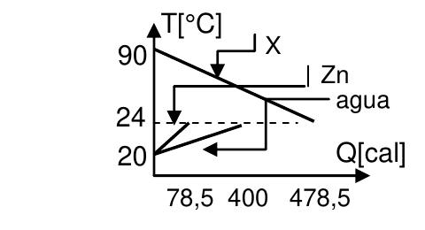

---

### Ejercicio 2

El gráfico muestra la cantidad de calor que cede una sustancia al enfriarse. Se coloca esta sustancia a 500K en un recipiente que contiene agua a 25°C. El equilibrio térmico se alcanza a los 35°C y la sustancia no cambia de estado. Calcule la masa de agua contenida en el recipiente.

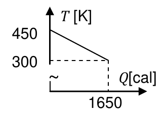

<b>Solución</b>

Solución paso a paso

**Paso 1 — Qué dice el gráfico.** Al enfriarse de 450 K a 300 K ($\Delta T = -150\ \text{K}$), la sustancia cede 1650 cal. Como $Q = m\,c\,\Delta T$, el gráfico nos da el producto $m_X c_X$ (la "capacidad calorífica" de la sustancia):

$$m_X\,c_X = \frac{Q}{\Delta T} = \frac{-1650\ \text{cal}}{-150\ \text{K}}$$

No hace falta conocer $m_X$ y $c_X$ por separado.

**Paso 2 — Pasar todo a °C.** $T_X = 500\ \text{K} = 227\ ^\circ\text{C}$. Una diferencia de 1 K es igual a una de 1 °C.

**Paso 3 — Balance.** El recipiente se considera ideal:

$$m_X\,c_X\,(T_f - T_X) + M_a\,c_a\,(T_f - T_a) = 0$$

**Paso 4 — Despeje.**

$$M_a = \frac{m_X\,c_X\,(T_X - T_f)}{c_a\,(T_f - T_a)}$$

**Paso 5 — Cálculo.**

$$m_X c_X = 11\ \text{cal/°C} \qquad M_a = \frac{11\ \tfrac{\text{cal}}{^\circ\text{C}}\cdot(227 - 35)\ ^\circ\text{C}}{1\ \tfrac{\text{cal}}{\text{g}\,^\circ\text{C}}\cdot(35 - 25)\ ^\circ\text{C}} = \frac{2112}{10}\ \text{g} = 211{,}2\ \text{g}$$

**Respuesta:** $M_{agua} = 211{,}2\ \text{g}$

---

### Ejercicio 3

El gráfico muestra la curva de calor de una dada masa *M* de sustancia desconocida que cambia de estado sólido a líquido. a) indique a qué temperatura funde esta sustancia; b) calcule la relación entre los calores específicos en estado sólido y en estado líquido; c) construya la curva de calor que correspondería si se hubiera utilizado una masa *2M* de sustancia a 200K.

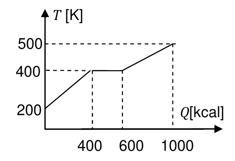

<b>Solución</b>

Solución paso a paso

**Paso 1 — Temperatura de fusión (ítem a).** Durante un cambio de fase la temperatura no cambia, así que el cambio de fase es el **tramo horizontal**, que está a 400 K. Entonces $T_f = 400\ \text{K}$.

**Paso 2 — Tramos con pendiente (ítem b).** En cada tramo sin cambio de fase vale $Q = M\,c\,\Delta T$, es decir $c = \dfrac{Q}{M\,\Delta T}$:

- Sólido (de 200 K a 400 K): $Q_s = 400\ \text{kcal}$, $\Delta T_s = 200\ \text{K}$.
- Líquido (de 400 K a 500 K): $Q_l = 1000 - 600 = 400\ \text{kcal}$, $\Delta T_l = 100\ \text{K}$.

$$\frac{c_{sol}}{c_{liq}} = \frac{Q_s/(M\,\Delta T_s)}{Q_l/(M\,\Delta T_l)} = \frac{Q_s\,\Delta T_l}{Q_l\,\Delta T_s}$$

La masa $M$ se simplifica.

**Paso 3 — Cálculo.**

$$\frac{c_{sol}}{c_{liq}} = \frac{400\cdot100}{400\cdot200} = 0{,}5$$

**Paso 4 — Curva con masa 2M (ítem c).** Todos los calores son proporcionales a la masa ($Q = Mc\Delta T$ y $Q = ML$). Con masa $2M$, las temperaturas de cada tramo son las mismas pero **cada calor se duplica**:

- Calentamiento del sólido (200 K → 400 K): $2\cdot 400 = 800\ \text{kcal}$.
- Fusión: $2\cdot(600 - 400) = 400\ \text{kcal}$, así que termina en $800 + 400 = 1200\ \text{kcal}$.
- Calentamiento del líquido (400 K → 500 K): $2\cdot 400 = 800\ \text{kcal}$, así que termina en $1200 + 800 = 2000\ \text{kcal}$.

**Respuesta:**

- a) $T_{fusión} = 400\ \text{K}$
- b) $c_{sol}/c_{liq} = 0{,}5$
- c) Curva con masa 2M:

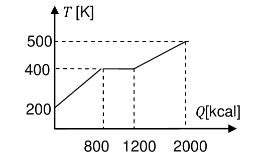

---

### Ejercicio 4

Un calorímetro con equivalente en agua π=30g contiene 200g de una sustancia cuyo calor específico se desea conocer. La temperatura de la sustancia se incrementa de 17,6°C a 22,5°C en tres minutos mediante un dispositivo que suministra una potencia constante de 20W. Calcule el valor del calor específico de la sustancia.

<b>Solución</b>

Solución paso a paso

**Datos.** $\pi = 30\ \text{g}$, $m = 200\ \text{g}$, $\Delta T = 22{,}5 - 17{,}6 = 4{,}9\ ^\circ\text{C}$, $P = 20\ \text{W}$, $t = 3\ \text{min} = 180\ \text{s}$.

**Paso 1 — Calor entregado.** Una potencia constante $P$ durante un tiempo $t$ entrega

$$Q = P\,t$$

**Paso 2 — Quién absorbe ese calor.** Se calientan la sustancia y el calorímetro (que equivale a $\pi$ gramos de agua), ambos con el mismo $\Delta T$:

$$P\,t = (\pi\,c_a + m\,c)\,\Delta T$$

**Paso 3 — Despeje.**

$$c = \frac{1}{m}\left(\frac{P\,t}{\Delta T} - \pi\,c_a\right)$$

**Paso 4 — Cálculo.** Se pasa el calor a calorías ($1\ \text{cal} = 4{,}18\ \text{J}$):

$$P\,t = 20\ \text{W}\cdot180\ \text{s} = 3600\ \text{J} = \frac{3600}{4{,}18}\ \text{cal} = 861{,}2\ \text{cal}$$

$$c = \frac{1}{200\ \text{g}}\left(\frac{861{,}2\ \text{cal}}{4{,}9\ ^\circ\text{C}} - 30\ \tfrac{\text{cal}}{^\circ\text{C}}\right) = \frac{175{,}8 - 30}{200}\ \frac{\text{cal}}{\text{g}\,^\circ\text{C}} = 0{,}73\ \frac{\text{cal}}{\text{g}\,^\circ\text{C}}$$

**Respuesta:** $c = 0{,}73\ \text{cal/(g °C)}$

---

### Ejercicio 5

En un calorímetro ideal se mezclan 2kg de agua a 80°C y 2,5 kg de un sólido a −10°C. Cuando el agua llega a los 60°C el sólido alcanza los 30°C. Calcule: a) el valor del calor específico del sólido; b) la temperatura de equilibrio del sistema (suponiendo que el punto de fusión del sólido está por encima de esta temperatura).

<b>Solución</b>

Solución paso a paso

**Datos.** $m_a = 2000\ \text{g}$ a $80\ ^\circ\text{C}$; $m_s = 2500\ \text{g}$ a $-10\ ^\circ\text{C}$.

**Paso 1 — Idea clave (ítem a).** Como el calorímetro es ideal, **en todo momento** el calor que cede el agua es el que absorbe el sólido. No hace falta llegar al equilibrio: se puede plantear el balance en el instante en que el agua está a 60 °C y el sólido a 30 °C.

$$m_a\,c_a\,(60 - 80) + m_s\,c_s\,(30 - (-10)) = 0$$

**Paso 2 — Despeje de $c_s$.**

$$c_s = \frac{m_a\,c_a\,(80 - 60)}{m_s\,(30 + 10)}$$

**Paso 3 — Cálculo.**

$$c_s = \frac{2000\cdot 1\cdot 20}{2500\cdot 40}\ \frac{\text{cal}}{\text{g}\,^\circ\text{C}} = \frac{40000}{100000} = 0{,}4\ \frac{\text{cal}}{\text{g}\,^\circ\text{C}}$$

**Paso 4 — Temperatura de equilibrio (ítem b).** Ahora se plantea el balance entre los estados iniciales y la temperatura final común $T_e$:

$$m_a\,c_a\,(T_e - 80) + m_s\,c_s\,(T_e + 10) = 0$$

$$T_e = \frac{m_a\,c_a\cdot 80 - m_s\,c_s\cdot 10}{m_a\,c_a + m_s\,c_s}$$

**Paso 5 — Cálculo.** $m_a c_a = 2000\ \text{cal/°C}$ y $m_s c_s = 1000\ \text{cal/°C}$:

$$T_e = \frac{2000\cdot80 - 1000\cdot10}{2000 + 1000}\ ^\circ\text{C} = \frac{150000}{3000}\ ^\circ\text{C} = 50\ ^\circ\text{C}$$

**Respuesta:** a) $c_s = 0{,}4\ \text{cal/(g °C)}$; b) $T_e = 50\ ^\circ\text{C}$

---

### Ejercicio 6

Un recipiente contiene 250 g agua líquida a 20°C. Se le agregan 100 g de hielo de agua a −10°C. Considerando que el recipiente es ideal establezca el estado final del sistema cuando la mezcla alcanza el equilibrio térmico. (Lf agua=80cal/g; cHIELO=0,5 cal/g°C)

<b>Solución</b>

Solución paso a paso

En problemas con hielo **no se sabe de antemano** si se funde todo, una parte o nada. Hay que comparar los calores disponibles.

**Paso 1 — Calor máximo que puede ceder el agua sin congelarse** (de 20 °C a 0 °C):

$$Q_{agua} = m_a\,c_a\,(0 - 20) = 250\cdot1\cdot(-20) = -5000\ \text{cal}$$

Es decir, el agua puede entregar hasta 5000 cal.

**Paso 2 — Calor necesario para llevar el hielo a 0 °C:**

$$Q_1 = m_h\,c_h\,(0 - (-10)) = 100\cdot0{,}5\cdot10 = 500\ \text{cal}$$

**Paso 3 — Calor necesario para fundir todo el hielo:**

$$Q_2 = m_h\,L_f = 100\cdot80 = 8000\ \text{cal}$$

**Paso 4 — Comparación.** Para calentar el hielo y fundirlo todo harían falta $500 + 8000 = 8500\ \text{cal}$, pero el agua solo puede dar 5000 cal. Además, $5000 > 500$, así que el hielo **sí llega a 0 °C**. Conclusión: se funde **una parte** del hielo y el equilibrio queda a **0 °C**.

**Paso 5 — Masa de hielo que se funde.** Se plantea el balance con $T_f = 0\ ^\circ\text{C}$ y una masa fundida $m_f$ desconocida:

$$m_a\,c_a\,(0 - 20) + m_h\,c_h\,(0 + 10) + m_f\,L_f = 0 \quad\Rightarrow\quad m_f = \frac{m_a\,c_a\cdot20 - m_h\,c_h\cdot10}{L_f}$$

**Paso 6 — Cálculo.**

$$m_f = \frac{5000 - 500}{80}\ \text{g} = 56{,}25\ \text{g}$$

- Hielo que queda: $100 - 56{,}25 = 43{,}75\ \text{g}$.
- Agua líquida: $250 + 56{,}25 = 306{,}25\ \text{g}$.

**Respuesta:** mezcla de 306,25 g de agua líquida y 43,75 g de hielo, todo a 0 °C.

---

### Ejercicio 7

El recipiente A de la figura contiene 400g de agua líquida a 363K, el B contiene 300g de agua sólida a 270K. Los recipientes se conectan térmicamente a través de una varilla de cobre de 2 cm de largo y 5cm2 de sección en el momento en que se agregan 10g de hierro a 473K al recipiente B. Asumiendo que los recipientes, salvo en el contacto con la varilla, son rígidos y adiabáticos, y que la varilla está recubierta por un aislante térmico ideal

a) calcule el estado final del recipiente B (como si estuviera aislado) luego de arrojar el hierro (asuma que el calor específico del hierro se mantiene constante, cFe = 0,113 cal/ g ºC; cHIELO=0,5 cal/g°C; Lf=80cal/g);

b) calcule la temperatura de equilibrio del sistema (puede despreciar el calor absorbido por el cobre);

c) estime una cota mínima para el tiempo que lleva alcanzar el equilibrio sabiendo que la conductividad térmica del cobre vale λCu=0,92 cal / ºC cm seg.

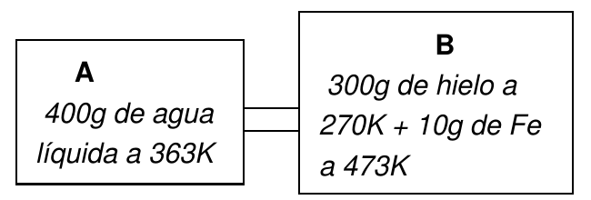

<b>Solución</b>

Solución paso a paso

**Paso 0 — Pasar a °C** (la guía usa 273): A: agua a $363 - 273 = 90\ ^\circ\text{C}$. B: hielo a $270 - 273 = -3\ ^\circ\text{C}$ y hierro a $473 - 273 = 200\ ^\circ\text{C}$.

**Paso 1 — Ítem a: ¿se funde algo de hielo?** El calor máximo que puede dar el hierro al enfriarse hasta 0 °C es $m_{Fe}c_{Fe}\cdot200 = 10\cdot0{,}113\cdot200 = 226\ \text{cal}$. Para llevar el hielo a 0 °C hacen falta $m_hc_h\cdot3 = 300\cdot0{,}5\cdot3 = 450\ \text{cal}$. Como $226 < 450$, el hielo **ni siquiera llega a 0 °C**: no se funde nada y el equilibrio queda **bajo cero**.

**Paso 2 — Balance en B.**

$$m_{Fe}\,c_{Fe}\,(T_B - 200) + m_h\,c_h\,(T_B + 3) = 0 \quad\Rightarrow\quad T_B = \frac{m_{Fe}c_{Fe}\cdot200 - m_hc_h\cdot3}{m_{Fe}c_{Fe} + m_hc_h}$$

**Paso 3 — Cálculo.** $m_{Fe}c_{Fe} = 1{,}13\ \text{cal/°C}$ y $m_hc_h = 150\ \text{cal/°C}$:

$$T_B = \frac{1{,}13\cdot200 - 150\cdot3}{1{,}13 + 150}\ ^\circ\text{C} = \frac{-224}{151{,}13}\ ^\circ\text{C} = -1{,}48\ ^\circ\text{C}$$

**Paso 4 — Ítem b: equilibrio del sistema completo.** Ahora el agua de A (400 g a 90 °C) entrega calor al recipiente B. El agua de A puede dar hasta $400\cdot90 = 36000\ \text{cal}$ al bajar a 0 °C, mientras que fundir todo el hielo cuesta apenas $\approx 222 + 24000\ \text{cal}$. Entonces **se funde todo el hielo** y el equilibrio queda por encima de 0 °C. Se plantea el balance desde los estados iniciales:

$$\underbrace{m_A c_a (T - 90)}_{\text{agua A}} + \underbrace{m_{Fe}c_{Fe}(T - 200)}_{\text{hierro}} + \underbrace{m_hc_h(0 + 3)}_{\text{hielo a }0\,^\circ\text{C}} + \underbrace{m_hL_f}_{\text{fusión}} + \underbrace{m_hc_a(T - 0)}_{\text{agua de deshielo}} = 0$$

**Paso 5 — Despeje.**

$$T = \frac{m_Ac_a\cdot90 + m_{Fe}c_{Fe}\cdot200 - m_hc_h\cdot3 - m_hL_f}{m_Ac_a + m_{Fe}c_{Fe} + m_hc_a}$$

**Paso 6 — Cálculo.**

$$T = \frac{36000 + 226 - 450 - 24000}{400 + 1{,}13 + 300}\ ^\circ\text{C} = \frac{11776}{701{,}13}\ ^\circ\text{C} = 16{,}8\ ^\circ\text{C}$$

**Paso 7 — Ítem c: cota mínima del tiempo.** El calor que tiene que pasar por la varilla es, aproximadamente, el que entrega el agua de A al bajar de 90 °C a ~17 °C:

$$\delta Q = m_Ac_a\,(90 - 17) $$

Por la varilla pasa una corriente térmica $I = \lambda_{Cu}\,\dfrac{S}{L}\,\Delta T$. La mayor diferencia de temperatura posible es la inicial: $\Delta T \approx 90 - (-2) \approx 92\ ^\circ\text{C}$. Con esa $\Delta T$ máxima, la corriente es la máxima y el tiempo resulta **mínimo**. En realidad $\Delta T$ va disminuyendo, así que el tiempo real es mayor: por eso es una **cota mínima**.

$$t_{min} = \frac{\delta Q}{I_{max}} = \frac{m_Ac_a\,(90 - 17)\,L}{\lambda_{Cu}\,S\,\Delta T_{max}}$$

**Paso 8 — Cálculo.**

$$t_{min} = \frac{400\cdot1\cdot73\ \text{cal}\cdot 2\ \text{cm}}{0{,}92\ \tfrac{\text{cal}}{^\circ\text{C cm s}}\cdot 5\ \text{cm}^2\cdot 92\ ^\circ\text{C}} = \frac{29200}{211{,}6}\ \text{s} \approx 140\ \text{s}$$

**Respuesta:**

- a) No se funde hielo; el recipiente B queda en equilibrio a −1,48 °C.
- b) $T_{eq} \approx 16{,}8\ ^\circ\text{C}$ (la guía da 16,78 °C).
- c) $t \gtrsim 140\ \text{s}$

---

### Ejercicio 8

Calcule: a) el valor de la potencia calorífica transportada a través de las paredes sólidas de un recinto cuya superficie efectiva de transporte es de 4m2 recubiertos con una capa de 3cm de espesor de poliestireno expandido (λ=0,01 W/m°C), estando una de sus caras en contacto con un foco a 5°C y la otra en contacto con un foco a 25°C;

b) la cantidad de calor que se transfiere a través de las paredes de este recinto en un día;

c) el valor de la resistencia térmica de la capa de poliestireno expandido;

<b>Solución</b>

Solución paso a paso

**Datos.** $A = 4\ \text{m}^2$, $e = 0{,}03\ \text{m}$, $\lambda = 0{,}01\ \text{W/(m °C)}$, $\Delta T = 25 - 5 = 20\ ^\circ\text{C}$.

**Paso 1 — Resistencia térmica (ítem c).** Conviene calcularla primero:

$$R_T = \frac{e}{\lambda\,A} = \frac{0{,}03\ \text{m}}{0{,}01\ \tfrac{\text{W}}{\text{m}\,^\circ\text{C}}\cdot4\ \text{m}^2} = 0{,}75\ \frac{^\circ\text{C}}{\text{W}}$$

**Paso 2 — Potencia calorífica (ítem a).** Con la "ley de Ohm térmica":

$$\phi_Q = \frac{\Delta T}{R_T} = \frac{20\ ^\circ\text{C}}{0{,}75\ ^\circ\text{C/W}} = 26{,}7\ \text{W}$$

**Paso 3 — Calor en un día (ítem b).** La potencia es constante, así que $Q = \phi_Q\,t$, con $t = 24\cdot3600\ \text{s} = 86400\ \text{s}$:

$$Q = 26{,}67\ \text{W}\cdot86400\ \text{s} = 2{,}3\times10^6\ \text{J} = \frac{2{,}3\times10^6}{4{,}18}\ \text{cal} \approx 552\ \text{kcal}$$

**Respuesta:** a) $\phi_Q = 26{,}7\ \text{W}$; b) $Q \approx 552\ \text{kcal}$; c) $R_T = 0{,}75\ \text{K/W}$

---

### Ejercicio 9

Suponga ahora que el recinto del ejercicio anterior no es un foco calorífico sino una cámara de aire a 5°C (podemos pensar que los valores corresponden a una heladera de 450 litros de volumen). El medio externo (a 20°C) transfiere calor al interior del recinto, y la temperatura de la cámara aumenta. Estime el tiempo que se requiere para llevar el interior de 5°C a 7°C (sin considerar efectos convectivos).

(cAIRE=1012 J/kgK = 0,24 cal/g°C; δAIRE(6°C) = 1,26 kg/m3).

*Sugerencia de la guía: observe que si δ es la densidad del aire (1,26 kg/m³ a 6°C) y 𝒱 el volumen, es Q=mcΔT = (δ𝒱) c ΔT. Luego, ϕ ~ <ΔT> /RT = {[(20-7)+(20-5)]/2} λS/L = 14 λS/L y Δt=Q/ϕ*

<b>Solución</b>

Solución paso a paso

**Paso 1 — Calor que necesita el aire.** La masa de aire es $m = \delta\,\mathcal V$, así que

$$Q = \delta\,\mathcal V\,c\,\Delta T_{aire} \qquad (\Delta T_{aire} = 7 - 5 = 2\ ^\circ\text{C})$$

**Paso 2 — Potencia que entra por las paredes.** La diferencia de temperatura entre afuera y adentro va cambiando: al principio es $20 - 5 = 15\ ^\circ\text{C}$ y al final $20 - 7 = 13\ ^\circ\text{C}$. Como estimación se usa el **promedio**, $\langle\Delta T\rangle = 14\ ^\circ\text{C}$. Con la resistencia del ejercicio 8 ($R_T = 0{,}75\ \text{K/W}$):

$$\phi \approx \frac{\langle\Delta T\rangle}{R_T}$$

**Paso 3 — Tiempo.**

$$\Delta t = \frac{Q}{\phi} = \frac{\delta\,\mathcal V\,c\,\Delta T_{aire}\;R_T}{\langle\Delta T\rangle}$$

**Paso 4 — Cálculo.** $\mathcal V = 450\ \ell = 0{,}45\ \text{m}^3$:

$$Q = 1{,}26\ \tfrac{\text{kg}}{\text{m}^3}\cdot0{,}45\ \text{m}^3\cdot1012\ \tfrac{\text{J}}{\text{kg K}}\cdot2\ \text{K} = 1147{,}6\ \text{J}$$

$$\phi = \frac{14\ \text{K}}{0{,}75\ \text{K/W}} = 18{,}67\ \text{W} \qquad \Delta t = \frac{1147{,}6\ \text{J}}{18{,}67\ \text{W}} \approx 61\ \text{s}$$

**Respuesta:** $\Delta t \approx 61\ \text{s}$ (aproximadamente un minuto).

---

### Ejercicio 10

Dos varillas de igual longitud e idéntica sección, dispuestas en serie, se conectan a dos fuentes térmicas. Una, de cobre, a la fuente de mayor temperatura (TC=500K), la otra, de plata, a la fuente de temperatura menor (TF=300K) Sabiendo que λCu < λAg, justifique si TU, la temperatura de la unión Cu-Ag, es mayor, menor o igual a 400K.

<b>Solución</b>

Solución paso a paso

**Paso 1 — Misma corriente.** Las varillas están en **serie**, así que por las dos pasa la **misma** corriente térmica:

$$I = \lambda_{Cu}\,\frac{S}{L}\,(T_C - T_U) = \lambda_{Ag}\,\frac{S}{L}\,(T_U - T_F)$$

**Paso 2 — Simplificación.** $S$ y $L$ son iguales para ambas, así que se cancelan:

$$\lambda_{Cu}\,(T_C - T_U) = \lambda_{Ag}\,(T_U - T_F)$$

**Paso 3 — Comparación.** Como $\lambda_{Cu} < \lambda_{Ag}$, para que los productos sean iguales el otro factor del cobre tiene que ser **mayor**:

$$T_C - T_U > T_U - T_F \quad\Rightarrow\quad T_U < \frac{T_C + T_F}{2} = \frac{500 + 300}{2}\ \text{K} = 400\ \text{K}$$

**Intuición:** el material que conduce peor (mayor resistencia térmica) es el que "se lleva" la mayor caída de temperatura, igual que una resistencia eléctrica mayor se lleva más caída de tensión.

**Respuesta:** $T_U < 400\ \text{K}$

---

### Ejercicio 11

La varilla de la figura tiene sección uniforme *S*=0,5cm2. La fracción de longitud *L1* =1m es de cobre y la otra, de longitud *L2*, es de acero. Para evitar pérdidas de calor la varilla está aislada térmicamente salvo en los puntos de contacto con las fuentes. En régimen estacionario la temperatura de la unión es de 60°C. Calcule:

a) la cantidad de calor que la barra transporta por segundo;

b) la longitud *L2* de la barra de acero.

(λCu= 0,92 cal/seg cm °C; λacero= 0,12 cal/seg cm °C).

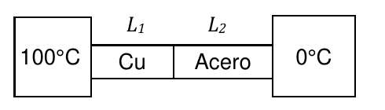

<b>Solución</b>

Solución paso a paso

**Datos.** $S = 0{,}5\ \text{cm}^2$, $L_1 = 100\ \text{cm}$, $T_U = 60\ ^\circ\text{C}$.

**Paso 1 — Corriente por el cobre (ítem a).** En el cobre se conocen las dos temperaturas de los extremos (100 °C y 60 °C):

$$\phi_Q = \lambda_{Cu}\,\frac{S}{L_1}\,(100 - T_U)$$

**Paso 2 — Cálculo.**

$$\phi_Q = 0{,}92\ \tfrac{\text{cal}}{\text{s cm °C}}\cdot\frac{0{,}5\ \text{cm}^2}{100\ \text{cm}}\cdot40\ ^\circ\text{C} = 0{,}184\ \tfrac{\text{cal}}{\text{s}} = 0{,}184\cdot4{,}18\ \text{W} = 0{,}77\ \text{W}$$

**Paso 3 — Longitud del acero (ítem b).** Por estar en serie, por el acero pasa **la misma** corriente:

$$\phi_Q = \lambda_{ac}\,\frac{S}{L_2}\,(T_U - 0) \quad\Rightarrow\quad L_2 = \frac{\lambda_{ac}\,S\,T_U}{\phi_Q}$$

**Paso 4 — Cálculo.**

$$L_2 = \frac{0{,}12\cdot0{,}5\cdot60}{0{,}184}\ \text{cm} = 19{,}6\ \text{cm}$$

**Respuesta:** a) $\phi_Q = 0{,}184\ \text{cal/s} \equiv 0{,}77\ \text{W}$; b) $L_2 = 19{,}6\ \text{cm}$

---

### Ejercicio 12

Suponga que las fuentes del ejercicio anterior, además de conectarse a través del conjunto *L1L2*, se conectaran también a través de una tercera varilla, de igual sección que las otras dos y de longitud *L1+L2*.

a) justifique si cambia el valor de la potencia calorífica total transmitida;

b) justifique si cambia el valor de la temperatura de la unión Cu-acero.,

c) escriba la expresión de la resistencia térmica equivalente con las tres varillas.

<b>Solución</b>

Solución paso a paso

**Paso 1 — Esquema.** La serie Cu-acero ($R_{Cu} + R_{ac}$) y la tercera varilla ($R_3$) conectan las **mismas** dos fuentes: están **en paralelo**, sometidas a la misma $\Delta T = 100\ ^\circ\text{C}$.

**Paso 2 — Ítem a.** Agregar una rama en paralelo **disminuye** la resistencia equivalente. Con la misma $\Delta T$, la potencia total $\phi = \Delta T / R_{eq}$ **aumenta**. Dicho de otra forma: a la corriente de la serie se le suma la de la nueva varilla.

**Paso 3 — Ítem b.** La serie Cu-acero sigue conectada a las mismas fuentes (100 °C y 0 °C), así que su corriente $\phi_{serie} = \Delta T/(R_{Cu} + R_{ac})$ **no cambia**. Entonces tampoco cambia la caída en el cobre, $100 - T_U = R_{Cu}\,\phi_{serie}$, y $T_U$ sigue valiendo 60 °C.

**Paso 4 — Ítem c.** Paralelo entre $(R_{Cu} + R_{ac})$ y $R_3$:

$$\frac{1}{R_{eq}} = \frac{1}{R_{Cu} + R_{ac}} + \frac{1}{R_3} \quad\Rightarrow\quad R_{eq} = \frac{(R_{Cu} + R_{ac})\,R_3}{R_{Cu} + R_{ac} + R_3}$$

**Respuesta:**

- a) Sí, aumenta, porque disminuye la resistencia térmica equivalente.
- b) No, porque la potencia calorífica a través de la serie no cambia.
- c) $R_{eq} = \dfrac{(R_{Cu} + R_{ac})\,R_3}{R_{Cu} + R_{ac} + R_3}$

---

### Ejercicio 13

La pared que separa una habitación del exterior tiene una puerta y una ventana. La superficie neta de la pared de ladrillo macizo (λL = 0,81 W/m K) es de 26m2 y su espesor es de 15 cm, cubiertos con 3 cm de revoque (λR = 1,5 W/m K); la puerta es de madera y tiene 1,60m2 de superficie (λM = 0,17 W/m K) y 7cm de espesor y la ventana de 2,40m2 de superficie tiene un vidrio de coeficiente λV = 0,9 W/m K y 0,5 cm de espesor.

a) calcule el valor de cada una de las resistencias térmicas;

b) calcule el valor de la resistencia equivalente;

c) suponga que desea mantenerse la habitación a 20°C cuando en el exterior la temperatura es de 4°C. Estime la cantidad de calorías que debe suministrar por segundo el calefactor.

<b>Solución</b>

Solución paso a paso

**Paso 1 — Fórmula de cada resistencia.** Cada elemento es una placa plana, así que $R = \dfrac{e}{\lambda\,A}$.

**Paso 2 — Cálculo (ítem a).**

$$R_L = \frac{0{,}15}{0{,}81\cdot26} = 7{,}12\times10^{-3}\ \tfrac{\text{K}}{\text{W}} \qquad R_R = \frac{0{,}03}{1{,}5\cdot26} = 7{,}69\times10^{-4}\ \tfrac{\text{K}}{\text{W}}$$

$$R_M = \frac{0{,}07}{0{,}17\cdot1{,}6} = 0{,}257\ \tfrac{\text{K}}{\text{W}} \qquad R_V = \frac{0{,}005}{0{,}9\cdot2{,}4} = 2{,}31\times10^{-3}\ \tfrac{\text{K}}{\text{W}}$$

> ⚠️ La guía da $R_R = 1{,}25\times10^{-2}\ \text{K/W}$, que corresponde a usar el área de la **puerta** (1,6 m²) en lugar de la de la pared (26 m²). El revoque cubre el ladrillo, así que su área es 26 m².

**Paso 3 — Cómo se conectan (ítem b).** El ladrillo y el revoque están uno detrás del otro, es decir **en serie**. Ese conjunto, la puerta y la ventana conectan el interior con el exterior **en paralelo** (los tres ven la misma $\Delta T$):

$$\frac{1}{R_{eq}} = \frac{1}{R_L + R_R} + \frac{1}{R_M} + \frac{1}{R_V}$$

**Paso 4 — Cálculo.**

$$\frac{1}{R_{eq}} = \frac{1}{7{,}89\times10^{-3}} + \frac{1}{0{,}257} + \frac{1}{2{,}31\times10^{-3}} = (126{,}7 + 3{,}9 + 432{,}0)\ \tfrac{\text{W}}{\text{K}} = 562{,}6\ \tfrac{\text{W}}{\text{K}}$$

$$R_{eq} = 1{,}78\times10^{-3}\ \text{K/W}$$

(Con el $R_R$ de la guía se obtiene $2\times10^{-3}\ \text{K/W}$.)

**Paso 5 — Potencia del calefactor (ítem c).** En régimen estacionario, el calefactor tiene que reponer todo el calor que se pierde por la pared:

$$\phi = \frac{\Delta T}{R_{eq}} = \frac{(20 - 4)\ \text{K}}{1{,}78\times10^{-3}\ \text{K/W}} = 9000\ \text{W} = \frac{9000}{4{,}18}\ \tfrac{\text{cal}}{\text{s}} \approx 2150\ \tfrac{\text{cal}}{\text{s}}$$

Se ve que casi todo el calor se va por la **ventana**, que tiene la menor resistencia.

**Respuesta:**

- a) $R_L = 7{,}12\times10^{-3}\ \text{K/W}$; $R_R = 7{,}7\times10^{-4}\ \text{K/W}$ (la guía: $1{,}25\times10^{-2}$); $R_M = 0{,}26\ \text{K/W}$; $R_V = 2{,}31\times10^{-3}\ \text{K/W}$
- b) $R_{eq} = [(R_L \text{ s } R_R) \,/\!/\, R_M] \,/\!/\, R_V \approx 2\times10^{-3}\ \text{K/W}$ (con el $R_R$ corregido, $1{,}8\times10^{-3}$)
- c) Alrededor de 2000 cal/s.

---

### Ejercicio 14

Con el objeto de aprovechar mejor la energía, se desea reducir al 40% la potencia calorífica empleada para calefaccionar un ambiente. El espesor de las paredes es de 30cm y su conductividad térmica vale λP= 0,6 W/mK. Se empleará un tipo de corcho cuya conductividad vale λC=0,04W/mK. Calcule el espesor ec de material aislante necesario para revestir las paredes existentes (sin considerar efectos convectivos).

<b>Solución</b>

Solución paso a paso

**Paso 1 — Relación entre potencia y resistencia.** Con la misma $\Delta T$ (interior y exterior no cambian), $\phi = \Delta T/R$. Para que la potencia baje al 40 %, la resistencia total tiene que **aumentar** en el factor $1/0{,}4 = 2{,}5$:

$$\phi' = 0{,}4\,\phi \quad\Rightarrow\quad R' = \frac{R_P}{0{,}4} = 2{,}5\,R_P$$

**Paso 2 — El corcho se agrega en serie.** $R' = R_P + R_C$, así que

$$R_C = R' - R_P = 1{,}5\,R_P$$

**Paso 3 — Despeje del espesor.** Ambas capas tienen la misma área $A$:

$$\frac{e_c}{\lambda_C\,A} = 1{,}5\,\frac{e_P}{\lambda_P\,A} \quad\Rightarrow\quad e_c = 1{,}5\,e_P\,\frac{\lambda_C}{\lambda_P}$$

**Paso 4 — Cálculo.**

$$e_c = 1{,}5\cdot30\ \text{cm}\cdot\frac{0{,}04}{0{,}6} = 3\ \text{cm}$$

**Respuesta:** $e_c = 3\ \text{cm}$

---

### Ejercicio 15

Un caño cilíndrico de acero, de 10 cm de radio externo y 1 cm de espesor transporta estacionariamente un fluido a 10°C. La temperatura exterior al caño es de 30°C. (λacero= 0,12 cal/seg cm °C = 50,16 J/seg m K)

a) calcule la cantidad de calor que el fluido intercambia por unidad de tiempo con el medio externo (observe que el flujo es radial y que la geometría es cilíndrica) sin considerar efectos convectivos;

b) indique en qué cambiaría el resultado si la temperatura externa fuera de 10°C y la interna de 30°C.

<b>Solución</b>

Solución paso a paso

**Paso 1 — Resistencia de un caño.** Como el flujo es radial, la sección que atraviesa el calor crece con el radio ($A = 2\pi r L$). Integrando capas cilíndricas en serie (ver [teoría](teoria.md#conducción-radial-caño-cilíndrico)):

$$R = \frac{\ln(R_{EXT}/R_{INT})}{2\pi\,\lambda\,L} \quad\Rightarrow\quad \phi_Q = \frac{2\pi\,\lambda\,L\,(T_{EXT} - T_{INT})}{\ln(R_{EXT}/R_{INT})}$$

**Paso 2 — Datos.** $R_{EXT} = 10\ \text{cm}$; el espesor es 1 cm, así que $R_{INT} = 9\ \text{cm}$. El enunciado no da la longitud, así que se calcula **por metro de caño** ($\phi_Q/L$).

**Paso 3 — Cálculo.**

$$\frac{\phi_Q}{L} = \frac{2\pi\cdot50{,}16\ \tfrac{\text{W}}{\text{m K}}\cdot20\ \text{K}}{\ln(10/9)} = \frac{6303}{0{,}1054}\ \frac{\text{W}}{\text{m}} \approx 5{,}98\times10^4\ \frac{\text{W}}{\text{m}}$$

El calor entra **desde el exterior hacia el fluido** (el exterior está más caliente).

**Paso 4 — Ítem b.** Si se invierten las temperaturas, $|T_{EXT} - T_{INT}|$ sigue valiendo 20 °C, así que **el módulo no cambia**. Solo cambia el **sentido**: ahora el fluido cede calor hacia el exterior.

**Respuesta:**

- a) $\phi_Q = \dfrac{2\pi\lambda L\,(T_{EXT} - T_{INT})}{\ln(R_{EXT}/R_{INT})} \approx 6\times10^4\ \text{W}$ por metro de caño, del exterior hacia el fluido.
- b) Mismo valor, sentido opuesto (el fluido cede calor al exterior).

---

### Ejercicio 16

Sobre una de las superficies límites de una plancha de acero de espesor e = 2cm (conductividad térmica λACERO=20W/mK) se aplica una densidad de flujo de calor uniforme δϕ0= 105 W/m². En la otra superficie límite el calor es disipado por convección hacia un fluido con temperatura T∞ = 50°C y con un coeficiente de transferencia de calor h=500W/m2K. Calcule las temperaturas superficiales T1 y T2.

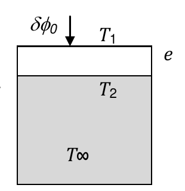

<b>Solución</b>

Solución paso a paso

**Paso 1 — Régimen estacionario.** El mismo flujo por unidad de área $\delta\phi_0$ atraviesa la plancha por conducción y después pasa al fluido por convección (en serie).

**Paso 2 — Convección (superficie 2 → fluido).** Por la ley de Newton, $\delta\phi_0 = h\,(T_2 - T_\infty)$:

$$T_2 = T_\infty + \frac{\delta\phi_0}{h}$$

**Paso 3 — Conducción (superficie 1 → superficie 2).** Por la ley de Fourier, $\delta\phi_0 = \lambda\,\dfrac{T_1 - T_2}{e}$:

$$T_1 = T_2 + \frac{\delta\phi_0\,e}{\lambda}$$

**Paso 4 — Cálculo.**

$$T_2 = 50\ ^\circ\text{C} + \frac{10^5}{500}\ ^\circ\text{C} = 250\ ^\circ\text{C} \qquad T_1 = 250\ ^\circ\text{C} + \frac{10^5\cdot0{,}02}{20}\ ^\circ\text{C} = 350\ ^\circ\text{C}$$

**Respuesta:** $T_1 = 350\ ^\circ\text{C}$; $T_2 = 250\ ^\circ\text{C}$

---

### Ejercicio 17

Calcule el espesor eP de la plancha de fibra de vidrio (conductividad térmica λ=3,4×10−2 W/mK) con que debe cubrirse una caldera para que su temperatura exterior no supere los 49°C en un ambiente cuya temperatura T∞ no debe exceder los 32°C. La temperatura máxima de la caldera será de 288°C y el coeficiente de transferencia de calor vale h=14 W/m2K.

<b>Solución</b>

Solución paso a paso

**Paso 1 — Esquema.** Caldera (288 °C) → **conducción** por la fibra de vidrio → superficie exterior (49 °C) → **convección** → ambiente (32 °C). En régimen estacionario, el flujo por unidad de área es el mismo en ambos tramos.

**Paso 2 — Igualación de flujos.**

$$\lambda\,\frac{T_{cal} - T_s}{e_P} = h\,(T_s - T_\infty)$$

**Paso 3 — Despeje.**

$$e_P = \frac{\lambda\,(T_{cal} - T_s)}{h\,(T_s - T_\infty)}$$

**Paso 4 — Cálculo.**

$$e_P = \frac{0{,}034\cdot(288 - 49)}{14\cdot(49 - 32)}\ \text{m} = \frac{8{,}126}{238}\ \text{m} = 0{,}034\ \text{m} = 3{,}4\ \text{cm}$$

**Respuesta:** $e_P \approx 3{,}4\ \text{cm}$

---

### Ejercicio 18

Un cubo de 0,5m de lado se halla en un recinto a 10°C. Una resistencia eléctrica mantiene la temperatura interna del cubo en 34°C. Si el coeficiente de emisividad de las paredes del cubo es ε = 0,8, calcule la potencia calorífica que transfiere el cubo por radiación y por convección (suponga que el coeficiente de transferencia por convección vale h=14 W/m2K). (σ=5,67×10−8 W/m2K4)

<b>Solución</b>

Solución paso a paso

**Paso 1 — Superficie del cubo.** Tiene 6 caras de lado $a$: $A = 6a^2$.

**Paso 2 — Radiación neta.** El cubo emite según su temperatura y absorbe según la del recinto. La potencia neta es

$$P_{RAD} = \varepsilon\,\sigma\,A\,(T_c^4 - T_r^4)$$

con temperaturas **absolutas**: $T_c = 34 + 273{,}15 = 307{,}15\ \text{K}$ y $T_r = 10 + 273{,}15 = 283{,}15\ \text{K}$.

**Paso 3 — Convección.** Por la ley de Newton:

$$P_{CONV} = h\,A\,(T_c - T_r)$$

(acá alcanza con la diferencia, que vale lo mismo en °C o en K).

**Paso 4 — Cálculo.** $A = 6\cdot0{,}25 = 1{,}5\ \text{m}^2$.

$$P_{RAD} = 0{,}8\cdot5{,}67\times10^{-8}\cdot1{,}5\cdot(307{,}15^4 - 283{,}15^4)\ \text{W} = 6{,}80\times10^{-8}\cdot2{,}47\times10^{9}\ \text{W} = 168\ \text{W}$$

$$P_{CONV} = 14\cdot1{,}5\cdot24\ \text{W} = 504\ \text{W}$$

**Respuesta:** $|P_{RAD}| = 168\ \text{W}$; $|P_{CONV}| = 504\ \text{W}$

---

### Ejercicio 19

Las estrellas irradian de manera muy parecida a un cuerpo negro, lo que significa que la curva de emisión de energía de una estrella es similar a la de un cuerpo negro que estuviera a una temperatura Teff, a la que se denomina *temperatura efectiva*. Por ejemplo, la temperatura efectiva del Sol es Teff = 5.770K. Sabiendo que σ=5,67×10−8 W/m2K4

a) calcule el valor de la potencia radiativa del Sol (a la que se denomina *luminosidad solar*, L⊙) teniendo en cuenta que el radio medio del Sol es de 700.000 km;

b) calcule la cantidad de energía que por segundo incide sobre cada metro cuadrado de una esfera de radio RTS = 1,496×1011m (la distancia media Tierra−Sol) lo que se conoce como *constante solar, S* (Observe que esta es la cantidad de energía que incide sobre cada metro cuadrado de la atmósfera superior terrestre).

<b>Solución</b>

Solución paso a paso

**Paso 1 — Luminosidad (ítem a).** Es un cuerpo negro ($\varepsilon = 1$) con superficie esférica $4\pi R_\odot^2$:

$$L_\odot = 4\pi R_\odot^2\,\sigma\,T_{eff}^4$$

**Paso 2 — Constante solar (ítem b).** Toda esa potencia se reparte uniformemente sobre una esfera de radio $R_{TS}$:

$$S = \frac{L_\odot}{4\pi R_{TS}^2} = \sigma\,T_{eff}^4\left(\frac{R_\odot}{R_{TS}}\right)^2$$

**Paso 3 — Cálculo.** $R_\odot = 7\times10^8\ \text{m}$:

$$L_\odot = 4\pi\,(7\times10^8)^2\cdot5{,}67\times10^{-8}\cdot5770^4\ \text{W} = 6{,}16\times10^{18}\cdot6{,}28\times10^{7}\ \text{W} \approx 3{,}87\times10^{26}\ \text{W}$$

$$S = \frac{3{,}87\times10^{26}}{4\pi\,(1{,}496\times10^{11})^2}\ \frac{\text{W}}{\text{m}^2} \approx 1376\ \frac{\text{W}}{\text{m}^2}$$

> La guía da $3{,}826\times10^{26}\ \text{W}$ y $1360\ \text{W/m}^2$. Esos valores salen de usar el radio real del Sol, $6{,}96\times10^8\ \text{m}$, en lugar de los 700.000 km del enunciado. La diferencia es solo de redondeo.

**Respuesta:** a) $L_\odot \approx 3{,}8\times10^{26}\ \text{W}$ (guía: $3{,}826\times10^{26}\ \text{W}$); b) $S \approx 1360\text{–}1376\ \text{W/m}^2$

---

### Ejercicio 20

La figura muestra cinco transformaciones que realizan 4 mol de un gas ideal. Los estados A y C están conectados por una transformación isotérmica. Si *PD*=4×105 Pa, *PA*=106 Pa y *VA*=10 ℓ

(R=8,314J/mol K = 0,082 ℓ atm/mol K)

a) calcule la temperatura de los estados A, B, D;

b) calcule el volumen *VB*;

c) justifique si el trabajo efectuado en el ciclo ABCDA es positivo o negativo;

d) transforme el gráfico a los planos *PT* y *VT.*

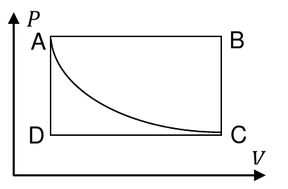

<b>Solución</b>

Solución paso a paso

**Paso 1 — Leer el gráfico.** Es un rectángulo:

- A y B están arriba: $P_B = P_A$ (A→B isobárica).
- C y D están abajo: $P_C = P_D$ (C→D isobárica).
- A y D están a la izquierda: $V_D = V_A$ (D→A isocórica).
- B y C están a la derecha: $V_C = V_B$ (B→C isocórica).
- A→C es la isoterma: $T_C = T_A$.

**Paso 2 — $V_B$ (ítem b).** Como A y C están sobre la misma isoterma, $P_A V_A = P_C V_C$. Con $P_C = P_D$ y $V_C = V_B$:

$$V_B = V_C = \frac{P_A\,V_A}{P_D}$$

**Paso 3 — Temperaturas (ítem a).** Por la ecuación de estado $T = \dfrac{PV}{nR}$:

$$T_A = \frac{P_AV_A}{nR} \qquad T_B = \frac{P_AV_B}{nR} \qquad T_D = \frac{P_DV_A}{nR}$$

**Paso 4 — Cálculo.** $V_A = 10\ \ell = 0{,}01\ \text{m}^3$ y $nR = 4\cdot8{,}314 = 33{,}256\ \text{J/K}$.

$$V_B = \frac{10^6\cdot10}{4\times10^5}\ \ell = 25\ \ell$$

$$T_A = \frac{10^6\cdot0{,}01}{33{,}256}\ \text{K} = 300{,}7\ \text{K} \qquad T_B = \frac{10^6\cdot0{,}025}{33{,}256}\ \text{K} = 751{,}7\ \text{K} \qquad T_D = \frac{4\times10^5\cdot0{,}01}{33{,}256}\ \text{K} = 120{,}3\ \text{K}$$

**Paso 5 — Signo del trabajo (ítem c).** El ciclo ABCDA va A→B (derecha), B→C (abajo), C→D (izquierda) y D→A (arriba): en el plano $PV$ se recorre en **sentido horario**. Entonces el área encerrada se cuenta positiva y $W_{ciclo} > 0$.

**Paso 6 — Planos PT y VT (ítem d).** En cada tramo:

- **Isobáricas** (A→B y C→D): $V \propto T$, así que en el plano $VT$ son rectas que pasan por el origen; en el plano $PT$ son horizontales.
- **Isocóricas** (B→C y D→A): $P \propto T$, así que en el plano $PT$ son rectas que pasan por el origen; en el plano $VT$ son horizontales.
- **Isoterma** A→C: es vertical en ambos planos ($T$ constante).

**Respuesta:**

- a) $T_A = 300{,}8\ \text{K}$; $T_B = 752\ \text{K}$; $T_D = 120{,}3\ \text{K}$
- b) $V_B = 25\ \ell$
- c) Es positivo porque el ciclo es horario en el plano $PV$.
- d) Gráficos de la guía:

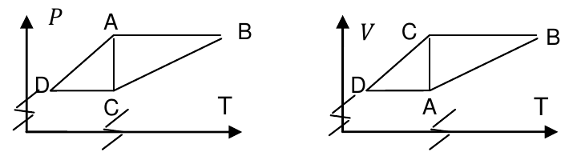

---

### Ejercicio 21

La figura muestra el ciclo ABCDA que realiza un gas ideal diatómico. La presión en el estado A vale *PA*=200kPa.

a) justifique si en cada ciclo el sistema recibe o entrega trabajo;

b) calcule el calor intercambiado por el sistema en la transformación BCD. (cP=7R/2; cV=5R/2; R=8,314 J/mol K).

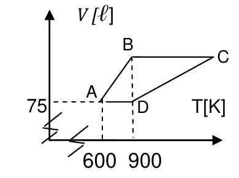

<b>Solución</b>

Solución paso a paso

**Paso 1 — Leer el diagrama V-T.**

- Los tramos AB y DC son rectas que, prolongadas, **pasan por el origen**: $V \propto T$, así que son **isobáricas**.
- Los tramos BC y DA son horizontales ($V$ constante): son **isocóricas**.

Datos del gráfico: $V_A = V_D = 75\ \ell$, $T_A = 600\ \text{K}$, $T_B = T_D = 900\ \text{K}$.

**Paso 2 — Completar los estados.**

- A→B isobárica: $V_B = V_A\,\dfrac{T_B}{T_A} = 75\cdot\dfrac{900}{600} = 112{,}5\ \ell$.
- D→A isocórica: $P_D = P_A\,\dfrac{T_D}{T_A} = 200\cdot\dfrac{900}{600} = 300\ \text{kPa}$.
- C→D isobárica a 300 kPa y B→C isocórica: $T_C = T_D\,\dfrac{V_C}{V_D} = 900\cdot\dfrac{112{,}5}{75} = 1350\ \text{K}$.

**Paso 3 — Ítem a.** En el plano $PV$: A(75 ℓ; 200 kPa) → B(112,5; 200) a la derecha → C(112,5; 300) arriba → D(75; 300) a la izquierda → A abajo. Es un recorrido **antihorario**, así que $W_{ciclo} < 0$: el sistema **recibe** trabajo.

**Paso 4 — Ítem b: calor en BCD.** B→C es isocórica y C→D es isobárica:

$$Q_{BCD} = Q_{BC} + Q_{CD} = n\,c_V\,(T_C - T_B) + n\,c_P\,(T_D - T_C)$$

Como $T_D = T_B$, se puede escribir $T_D - T_C = -(T_C - T_B)$:

$$Q_{BCD} = n\,(T_C - T_B)\,(c_V - c_P) = -n\,R\,(T_C - T_B)$$

**Paso 5 — Cálculo.** No hace falta $n$ por separado: $nR = \dfrac{P_AV_A}{T_A} = \dfrac{200\ \text{kPa}\cdot75\ \ell}{600\ \text{K}} = 25\ \text{J/K}$ (recordar que kPa·ℓ = J).

$$Q_{BCD} = -25\ \tfrac{\text{J}}{\text{K}}\cdot(1350 - 900)\ \text{K} = -11250\ \text{J}$$

**Respuesta:**

- a) El sistema recibe trabajo: en el plano $PV$ el ciclo es antihorario.
- b) $Q_{BCD} = -11250\ \text{J}$

---

### Ejercicio 22

La figura representa un conjunto de transformaciones realizadas por un dado sistema termodinámico. A lo largo de la transformación ACB el sistema recibe 80J de calor y entrega 30J de trabajo. Calcule:

a) el calor que absorbe el sistema a lo largo del camino ADB si realiza un trabajo de 10J;

b) el calor intercambiado por el sistema en el camino BA si recibe 20J de trabajo;

c) el calor intercambiado en los procesos AD y DB si UDA= UD − UA= 40J.

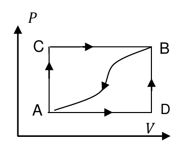

<b>Solución</b>

Solución paso a paso

**Paso 1 — $\Delta U_{AB}$.** Por el primer principio en el camino ACB ($Q = 80\ \text{J}$, $W = 30\ \text{J}$):

$$\Delta U_{AB} = Q_{ACB} - W_{ACB} = 80\ \text{J} - 30\ \text{J} = 50\ \text{J}$$

Como $U$ es variable de estado, $\Delta U_{AB}$ vale **lo mismo por cualquier camino** de A a B.

**Paso 2 — Ítem a (camino ADB, $W = 10\ \text{J}$).**

$$Q_{ADB} = \Delta U_{AB} + W_{ADB} = 50\ \text{J} + 10\ \text{J} = 60\ \text{J}$$

**Paso 3 — Ítem b (camino BA).** Va de B a A, así que $\Delta U_{BA} = -50\ \text{J}$. El sistema **recibe** 20 J de trabajo, entonces $W_{BA} = -20\ \text{J}$:

$$Q_{BA} = \Delta U_{BA} + W_{BA} = -50\ \text{J} - 20\ \text{J} = -70\ \text{J}$$

El signo negativo indica que el sistema cede 70 J.

**Paso 4 — Ítem c.** D→B es **isocórica** (vertical en el gráfico), así que $W_{DB} = 0$ y todo el trabajo de ADB se hace en AD: $W_{AD} = W_{ADB} = 10\ \text{J}$.

$$Q_{AD} = \Delta U_{AD} + W_{AD} = 40\ \text{J} + 10\ \text{J} = 50\ \text{J}$$

$$Q_{DB} = \Delta U_{DB} + 0 = (\Delta U_{AB} - \Delta U_{AD}) = 50\ \text{J} - 40\ \text{J} = 10\ \text{J}$$

Verificación: $Q_{AD} + Q_{DB} = 60\ \text{J} = Q_{ADB}$ ✓

**Respuesta:** a) $Q_{ADB} = 60\ \text{J}$; b) $Q_{BA} = -70\ \text{J}$; c) $Q_{AD} = 50\ \text{J}$, $Q_{DB} = 10\ \text{J}$

---

### Ejercicio 23

Un gas ideal a presión PA=101kPa ocupa un volumen VA=15 ℓ. Se lo calienta isocóricamente hasta duplicar su presión (estado B), luego se lo expande isotérmicamente hasta alcanzar la presión original (estado C), y finalmente se lo lleva isobáricamente al estado inicial.

a) represente el ciclo en los planos *PV*, *VT* y *PT*;

b) calcule el trabajo realizado por el gas en el ciclo ACBA;

c) diagrame un ciclo diferente en el cual el gas intercambie la misma cantidad de trabajo;

d) suponga que el gas es monoatómico. Calcule el calor intercambiado en la transformación CBA.

(*cP*=5R/2; *cV*=3R/2; *R*=8,314 J/mol K).

<b>Solución</b>

Solución paso a paso

**Paso 1 — Los tres estados.**

- A: $P_A = 101\ \text{kPa}$, $V_A = 15\ \ell$.
- B (isocórica, se duplica la presión): $V_B = 15\ \ell$, $P_B = 202\ \text{kPa}$, $T_B = 2T_A$.
- C (isoterma desde B hasta $P_A$): $P_CV_C = P_BV_B$, así que $V_C = 30\ \ell$ y $T_C = T_B$.

Producto $PV$ (en J, porque kPa·ℓ = J): $P_AV_A = 1515\ \text{J}$ y $P_BV_B = P_CV_C = 3030\ \text{J}$.

**Paso 2 — Trabajo del ciclo ABCA.** A→B es isocórica ($W = 0$), B→C es isoterma y C→A es isobárica:

$$W_{ABCA} = \underbrace{P_BV_B\ln\frac{V_C}{V_B}}_{W_{BC}} + \underbrace{P_A(V_A - V_C)}_{W_{CA}}$$

**Paso 3 — El ciclo pedido es el inverso.** ACBA recorre los mismos tramos al revés, así que:

$$W_{ACBA} = -W_{ABCA} = -\left[P_BV_B\ln 2 - P_A(V_C - V_A)\right]$$

**Paso 4 — Cálculo.**

$$W_{ACBA} = -\left[3030\cdot0{,}6931 - 101\cdot15\right]\ \text{J} = -\left[2100{,}2 - 1515\right]\ \text{J} = -585{,}2\ \text{J}$$

**Paso 5 — Ítem c.** El trabajo de un ciclo es el área encerrada en el plano $PV$, con signo según el sentido. Cualquier ciclo recorrido en sentido **antihorario** (inverso) que encierre 585,2 J de área sirve. Por ejemplo, un rectángulo de 101 kPa × 5,794 ℓ recorrido en sentido antihorario.

**Paso 6 — Ítem d: calor en CBA.** C→B es la isoterma recorrida al revés (compresión) y B→A es isocórica:

$$Q_{CB} = W_{CB} = -P_BV_B\ln\frac{V_C}{V_B} \qquad Q_{BA} = n\,c_V\,(T_A - T_B) = \tfrac32\,(P_AV_A - P_BV_B)$$

$$Q_{CBA} = -P_BV_B\ln2 + \tfrac32\,(P_AV_A - P_BV_B)$$

**Paso 7 — Cálculo.**

$$Q_{CBA} = -2100{,}2\ \text{J} + 1{,}5\cdot(1515 - 3030)\ \text{J} = -2100{,}2\ \text{J} - 2272{,}5\ \text{J} = -4372{,}7\ \text{J}$$

> ⚠️ La guía da $Q = -2857{,}7\ \text{J}$. Ese número es $W_{ACBA} + Q_{BA} = -585{,}2 - 2272{,}5$, que no es el calor de CBA. Planteando el primer principio en cada tramo, el resultado es $-4372{,}7\ \text{J}$.

**Respuesta:**

- a) Gráficos de la guía:

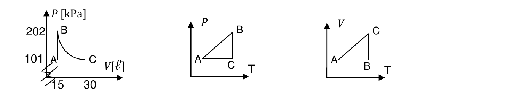

- b) $W_{ACBA} = -585{,}2\ \text{J}$
- c) Cualquier ciclo inverso que en el plano $PV$ tenga un área igual a 585,2 J.
- d) $Q_{CBA} = -4372{,}7\ \text{J}$ (la guía da −2857,7 J; ver la nota del paso a paso).

---

### Ejercicio 24

El gráfico muestra dos evoluciones de un de un gas ideal (ABCDA y ABDA). El estado C está a mayor temperatura que el estado A, y la diferencia de energía *UCA* es de 1875 J. Calcule:

a) el calor intercambiado por el sistema en la evolución ABC;

b) el calor intercambiado en el ciclo ABDA.

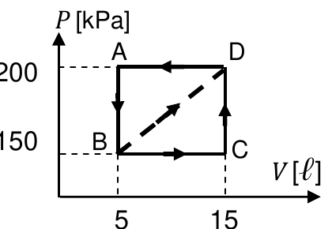

<b>Solución</b>

Solución paso a paso

**Paso 1 — Estados.** A (5 ℓ; 200 kPa), B (5 ℓ; 150 kPa), C (15 ℓ; 150 kPa), D (15 ℓ; 200 kPa).

**Paso 2 — Ítem a.** Por el primer principio entre A y C por el camino ABC:

$$Q_{ABC} = \Delta U_{AC} + W_{AB} + W_{BC}$$

- A→B es isocórica: $W_{AB} = 0$.
- B→C es isobárica: $W_{BC} = P_B\,(V_C - V_B)$.
- $\Delta U_{AC} = U_C - U_A = 1875\ \text{J}$ (positiva, porque C está más caliente).

$$Q_{ABC} = \Delta U_{AC} + P_B\,(V_C - V_B)$$

**Paso 3 — Cálculo.**

$$Q_{ABC} = 1875\ \text{J} + 150\ \text{kPa}\cdot10\ \ell = 1875\ \text{J} + 1500\ \text{J} = 3375\ \text{J} = \frac{3375}{4{,}18}\ \text{cal} = 807{,}4\ \text{cal}$$

**Paso 4 — Ítem b.** En un ciclo, $\Delta U = 0$, así que $Q_{ciclo} = W_{ciclo}$. Se calcula el trabajo de cada tramo:

- A→B: isocórica, $W = 0$.
- B→D: recta de (5; 150) a (15; 200). El área bajo una recta es la de un trapecio: $W_{BD} = \dfrac{P_B + P_D}{2}\,(V_D - V_B)$.
- D→A: isobárica a 200 kPa, compresión: $W_{DA} = P_A\,(V_A - V_D)$.

$$Q_{ABDA} = \frac{P_B + P_D}{2}\,(V_D - V_B) - P_A\,(V_D - V_A)$$

**Paso 5 — Cálculo.**

$$Q_{ABDA} = \frac{150 + 200}{2}\cdot10\ \text{J} - 200\cdot10\ \text{J} = 1750\ \text{J} - 2000\ \text{J} = -250\ \text{J} = -59{,}8\ \text{cal}$$

Es negativo porque el ciclo ABDA se recorre en sentido antihorario.

**Respuesta:** a) $Q_{ABC} = 3375\ \text{J} \equiv 807{,}4\ \text{cal}$; b) $Q_{ciclo} = -250\ \text{J} \equiv -59{,}8\ \text{cal}$

---

### Ejercicio 25

La figura muestran dos evoluciones, ACB (isobara AC + isocora CB) y la isotérmica AB. Justifique en cuál de las dos evoluciones, ACB o AB, se intercambia mayor cantidad de calor.

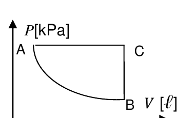

<b>Solución</b>

Solución paso a paso

**Paso 1 — Comparar los trabajos.** El trabajo es el área bajo la curva en el plano $PV$. El camino ACB va por arriba (la isobara AC está a la presión más alta), mientras que la isoterma AB va por debajo. Ambos caminos son expansiones, así que los dos trabajos son positivos y:

$$W_{ACB} > W_{AB}$$

**Paso 2 — Comparar las energías internas.** Los dos caminos van de A a B, y como $U$ es variable de estado:

$$\Delta U_{ACB} = \Delta U_{AB}$$

(De hecho, AB es una isoterma, así que ambos valen 0.)

**Paso 3 — Primer principio.** $Q = \Delta U + W$. Con el mismo $\Delta U$ y más trabajo en ACB:

$$Q_{ACB} = \Delta U + W_{ACB} > \Delta U + W_{AB} = Q_{AB}$$

**Respuesta:** $Q_{ACB} > Q_{AB}$

---

### Ejercicio 26

Tres moles de gas ideal diatómico (*cP*=3,5R; *cV*=2,5R) realizan el ciclo ABCA de la figura. La diferencia de energía entre los estados C y A es UAC= 4562,5J. (UAC = UC−UA)

a) calcule el calor intercambiado por el gas en todo el ciclo;

b) indique cuáles son las tres aseveraciones correctas

| | | | | |
|---|---|---|---|---|
| QBC < 0 | UABC = UAC | WAC < 0 | \|UBC\| > \|UCB\| | QCICLO=UAB+QCA+QBC |
| UCICLO = 0 | WAC = QAC | UAB = 0 | UCICLO > 0 | QAC=QABC |

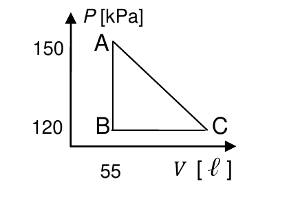

<b>Solución</b>

Solución paso a paso

**Paso 1 — Estados.** A (55 ℓ; 150 kPa), B (55 ℓ; 120 kPa), C ($V_C$; 120 kPa). Falta $V_C$.

**Paso 2 — Obtener $V_C$ con el dato de energía.** Para un gas ideal, $\Delta U = n\,c_V\,\Delta T = \dfrac{c_V}{R}\,\Delta(PV)$:

$$U_C - U_A = 2{,}5\,(P_CV_C - P_AV_A) \quad\Rightarrow\quad V_C = \frac{\dfrac{U_C - U_A}{2{,}5} + P_AV_A}{P_C}$$

$$V_C = \frac{1825 + 150\cdot55}{120}\ \ell = \frac{10075}{120}\ \ell = 83{,}96\ \ell$$

**Paso 3 — Calor del ciclo (ítem a).** $Q_{ciclo} = W_{ciclo}$, que es el área del triángulo. El recorrido A→B (abajo) → C (derecha) → A (arriba a la izquierda) es **antihorario**, así que el trabajo es negativo:

$$Q_{ciclo} = -\frac12\,(V_C - V_A)\,(P_A - P_B)$$

$$Q_{ciclo} = -\frac12\cdot28{,}96\ \ell\cdot30\ \text{kPa} = -434{,}4\ \text{J}$$

**Paso 4 — Aseveraciones (ítem b).** Acá "U" en la tabla representa la variación de energía interna.

- $Q_{BC} < 0$: **falso**. B→C es una expansión isobárica, así que $T$ aumenta y $Q_{BC} = nc_P\Delta T > 0$.
- $U_{ABC} = U_{AC}$: **verdadero**. $U$ es variable de estado y no depende del camino.
- $W_{AC} < 0$: **falso**. De A a C el volumen aumenta (55 → 84 ℓ), así que $W_{AC} > 0$.
- $|U_{BC}| > |U_{CB}|$: **falso**. Son iguales en módulo.
- $Q_{CICLO} = U_{AB} + Q_{CA} + Q_{BC}$: **verdadero**. A→B es isocórica, así que $Q_{AB} = \Delta U_{AB}$.
- $U_{CICLO} = 0$: **verdadero**.
- $W_{AC} = Q_{AC}$: **falso**. Eso valdría solo si $\Delta U_{AC} = 0$, pero vale 4562,5 J.
- $U_{AB} = 0$: **falso**. A→B baja la presión a volumen constante, así que $T$ baja.
- $U_{CICLO} > 0$: **falso**.
- $Q_{AC} = Q_{ABC}$: **falso**. $Q$ depende del camino.

**Respuesta:**

- a) $Q_{CICLO} = -434{,}37\ \text{J}$
- b) $U_{CICLO} = 0$; $U_{ABC} = U_{AC}$; $Q_{CICLO} = U_{AB} + Q_{CA} + Q_{BC}$

---

### Ejercicio 27

El gráfico muestra la evolución ABCDA de 3 moles de un gas ideal monoatómico (*cp*= 5R/2; *cv* = 3R/2; *R*=8,314 J/mol K). Calcule:

a) el trabajo realizado por el sistema en cada transformación y en todo el ciclo;

b) la variación de energía interna en cada transformación y en todo el ciclo. Compare esos valores con los del calor intercambiado;

c) la eficiencia de la máquina;

d) indique las afirmaciones verdaderas.

| | | | |
|---|---|---|---|
| WDAB = WABC | WCICLO > 0 | \|UCD\| > \|UBA\| | En el ciclo el gas cede calor. |
| QCD < 0 | UDC > 0 | QAB =QB−QA | Si el gas fuera diatómico UCD valdría el doble. |

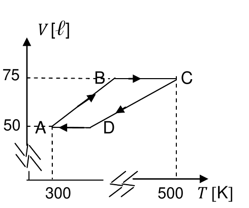

<b>Solución</b>

Solución paso a paso

**Paso 1 — Leer el diagrama V-T.**

- AB y CD son rectas que, prolongadas, pasan por el origen ($V \propto T$): son **isobáricas**.
- BC (a 75 ℓ) y DA (a 50 ℓ) son horizontales: son **isocóricas**.

Datos: $V_A = 50\ \ell$, $T_A = 300\ \text{K}$; $V_C = 75\ \ell$, $T_C = 500\ \text{K}$.

- A→B isobárica: $T_B = T_A\,\dfrac{V_B}{V_A} = 300\cdot\dfrac{75}{50} = 450\ \text{K}$.
- C→D isobárica: $T_D = T_C\,\dfrac{V_D}{V_C} = 500\cdot\dfrac{50}{75} = 333{,}3\ \text{K}$.

**Paso 2 — Fórmulas de cada tramo.** En una isobárica, $W = P\Delta V = nR\,\Delta T$. En una isocórica, $W = 0$. Siempre $\Delta U = n c_V \Delta T = \tfrac32 nR\,\Delta T$, y $Q = \Delta U + W$ (en una isobárica, $Q = \tfrac52 nR\,\Delta T$).

**Paso 3 — Trabajos (ítem a).** $nR = 3\cdot8{,}314 = 24{,}94\ \text{J/K}$.

$$W_{AB} = nR\,(T_B - T_A) = 24{,}94\cdot150\ \text{J} = 3741\ \text{J} \qquad W_{BC} = 0$$

$$W_{CD} = nR\,(T_D - T_C) = 24{,}94\cdot(-166{,}7)\ \text{J} = -4157\ \text{J} \qquad W_{DA} = 0$$

$$W_{ciclo} = 3741 - 4157 = -416\ \text{J}$$

**Paso 4 — Energías internas y calores (ítem b).**

| Tramo | $\Delta T$ [K] | $\Delta U = \tfrac32 nR\Delta T$ [J] | $W$ [J] | $Q$ [J] |
|---|---|---|---|---|
| AB | +150 | +5612 | +3741 | +9353 |
| BC | +50 | +1871 | 0 | +1871 |
| CD | −166,7 | −6236 | −4157 | −10393 |
| DA | −33,3 | −1247 | 0 | −1247 |
| **Ciclo** | 0 | **0** | **−416** | **−416** |

En los tramos isocóricos, $Q = \Delta U$; en los isobáricos, $Q > \Delta U$ en módulo (porque además hay trabajo). En el ciclo, $\Delta U = 0$ y $Q = W$.

**Paso 5 — Eficiencia (ítem c).** En el plano $PV$, el ciclo va A→B (expansión a $P$ baja), B→C (sube la presión), C→D (compresión a $P$ alta) y D→A (baja la presión): es **antihorario**, con $W < 0$. Funciona como **máquina frigorífica**:

$$\eta = -\frac{Q_{abs}}{W_{ciclo}} = \frac{Q_{AB} + Q_{BC}}{|W_{ciclo}|}$$

$$\eta = \frac{9353 + 1871}{416} = \frac{11224}{416} \approx 27$$

**Paso 6 — Afirmaciones (ítem d).**

- $W_{DAB} = W_{ABC}$: **verdadero**. DA y BC son isocóricas, así que ambos valen $W_{AB}$.
- $W_{CICLO} > 0$: **falso**. Es −416 J.
- $|U_{CD}| > |U_{BA}|$: **verdadero**. 6236 J > 5612 J.
- "En el ciclo el gas cede calor": el calor **neto** del ciclo es $Q_{ciclo} = W_{ciclo} = -416\ \text{J} < 0$, así que en el balance el gas cede calor. La guía no la marca como verdadera, pero con este cálculo lo es.
- $Q_{CD} < 0$: **verdadero**.
- $U_{DC} > 0$: **verdadero**. $U_C - U_D > 0$ porque $T_C > T_D$.
- $Q_{AB} = Q_B - Q_A$: **falso**. El calor no es variable de estado: no existen "$Q_A$" ni "$Q_B$".
- "Si el gas fuera diatómico $U_{CD}$ valdría el doble": **falso**. $c_V$ pasaría de $\tfrac32R$ a $\tfrac52R$, es decir, se multiplicaría por $5/3$, no por 2.

**Respuesta:**

- a) $W_{BC} = W_{DA} = 0$ (son isocóricas); $W_{AB} = 3741\ \text{J}$; $W_{CD} = -4157\ \text{J}$; $W_{CICLO} = -416\ \text{J}$. La guía, con $nR \approx 25$, da 3750, −4166,67 y −416,67 J.
- b) $T_B = 450\ \text{K}$; $T_D = 333{,}3\ \text{K}$; $\Delta U_{AB} = 5612\ \text{J}$; $\Delta U_{BC} = 1871\ \text{J}$; $\Delta U_{CD} = -6236\ \text{J}$; $\Delta U_{DA} = -1247\ \text{J}$; $\Delta U_{CICLO} = 0$.
- c) $e = Q_{ABS}/(Q_{CED} - Q_{ABS}) \approx 27$ (funciona como frigorífica).
- d) $W_{DAB} = W_{ABC}$; $U_{DC} > 0$; $|U_{CD}| > |U_{BA}|$; $Q_{CD} < 0$.

---

### Ejercicio 28

Un mol de gas ideal diatómico (*cp* = 7R/2; *cv* = 5R/2) realiza el ciclo ABCA de la figura.

a) discuta si en el ciclo el gas entrega o recibe trabajo;

b) calcule el calor intercambiado por el gas en la transformación AB;

c) calcule el calor intercambiado por el gas en todo el ciclo;

d) indique cuáles son las dos aseveraciones correctas

| | | |
|---|---|---|
| WAB > 0 | El proceso ABCA es irreversible | \|QABCA\| = \|QACBA\| |
| QAB = 0 | WAB = QAB | UCICLO > 0 |

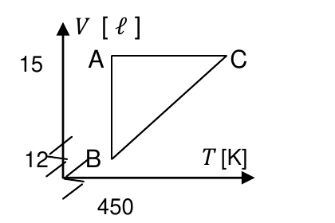

<b>Solución</b>

Solución paso a paso

**Paso 1 — Leer el diagrama V-T.**

- A→B es vertical ($T = 450\ \text{K}$ constante): **isoterma**, de 15 ℓ a 12 ℓ (compresión).
- B→C es una recta que, prolongada, pasa por el origen ($V \propto T$): **isobárica**. $T_C = T_B\,\dfrac{V_C}{V_B} = 450\cdot\dfrac{15}{12} = 562{,}5\ \text{K}$.
- C→A es horizontal (15 ℓ): **isocórica**.

**Paso 2 — Ítem a.** En el plano $PV$: A (15 ℓ, $P$ baja) → B (12 ℓ, $P$ alta) sube a la izquierda; B → C (15 ℓ, misma $P$ alta) va a la derecha; C → A baja. Es un recorrido **horario**, así que $W_{ciclo} > 0$: el gas **entrega** trabajo.

**Paso 3 — Ítem b: calor en la isoterma.** $\Delta U_{AB} = 0$, entonces

$$Q_{AB} = W_{AB} = nRT\ln\frac{V_B}{V_A}$$

$$Q_{AB} = 1\cdot8{,}314\cdot450\cdot\ln\frac{12}{15}\ \text{J} = 3741{,}3\cdot(-0{,}2231)\ \text{J} = -834{,}85\ \text{J}$$

**Paso 4 — Ítem c: calor en todo el ciclo.**

$$Q_{ciclo} = Q_{AB} + \underbrace{n\,c_P\,(T_C - T_B)}_{Q_{BC}} + \underbrace{n\,c_V\,(T_A - T_C)}_{Q_{CA}} = Q_{AB} + nR\,(T_C - T_B)\left(\tfrac72 - \tfrac52\right)$$

(se usó $T_A = T_B$, así que $T_A - T_C = -(T_C - T_B)$).

$$Q_{ciclo} = -834{,}85\ \text{J} + 8{,}314\cdot112{,}5\ \text{J} = -834{,}85\ \text{J} + 935{,}3\ \text{J} = 100{,}47\ \text{J}$$

**Paso 5 — Aseveraciones (ítem d).**

- $W_{AB} > 0$: **falso**. A→B es una compresión.
- "El proceso ABCA es irreversible": **falso**. Se dibuja con línea llena: es reversible.
- $|Q_{ABCA}| = |Q_{ACBA}|$: **verdadero**. El ciclo inverso intercambia el mismo calor con signo opuesto.
- $Q_{AB} = 0$: **falso**. Vale −834,85 J.
- $W_{AB} = Q_{AB}$: **verdadero**. Es una isoterma, así que $\Delta U_{AB} = 0$.
- $U_{CICLO} > 0$: **falso**. Siempre es 0.

**Respuesta:**

- a) Entrega trabajo porque en el plano $PV$ el ciclo es horario.
- b) $Q_{AB} = -834{,}85\ \text{J}$
- c) $Q_{CICLO} = 100{,}47\ \text{J}$
- d) $|Q_{ABCA}| = |Q_{ACBA}|$ y $W_{AB} = Q_{AB}$

---

### Ejercicio 29

El pistón de la figura tiene masa *M*=0,8 kg y su superficie es *S*=0,04m2. Cierra un recipiente que contiene 3 moles de un gas ideal monoatómico (*cP*=5R/2; *cV*=3R/2) en equilibrio con el medio externo, que se halla a presión PEXT=101.000Pa. Se entrega calor al gas (se supone que el recipiente es adiabático y el proceso ideal) y el pistón se eleva 5cm. Calcule:

a) la diferencia de temperaturas entre los estados inicial y final;

b) la cantidad de calor entregada al sistema.

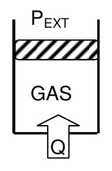

<b>Solución</b>

Solución paso a paso

**Paso 1 — Presión del gas.** El pistón está en equilibrio: la fuerza del gas hacia arriba equilibra la presión externa y el peso del pistón.

$$P\,S = P_{EXT}\,S + M\,g \quad\Rightarrow\quad P = P_{EXT} + \frac{Mg}{S}$$

Como el pistón sube lentamente, $P$ se mantiene constante: es un proceso **isobárico**.

**Paso 2 — Diferencia de temperatura (ítem a).** Con $PV = nRT$ a $P$ constante: $P\,\Delta V = nR\,\Delta T$, y $\Delta V = S\,h$:

$$\Delta T = \frac{P\,S\,h}{nR} = \frac{(P_{EXT}S + Mg)\,h}{nR}$$

**Paso 3 — Calor (ítem b).** En una isobárica:

$$Q = n\,c_P\,\Delta T = \tfrac52\,nR\,\Delta T = \tfrac52\,P\,S\,h$$

**Paso 4 — Cálculo.** $P = 101000 + \dfrac{0{,}8\cdot9{,}8}{0{,}04} = 101196\ \text{Pa}$ y $\Delta V = 0{,}04\cdot0{,}05 = 0{,}002\ \text{m}^3$:

$$P\,\Delta V = 101196\cdot0{,}002\ \text{J} = 202{,}4\ \text{J}$$

$$\Delta T = \frac{202{,}4}{3\cdot8{,}314}\ \text{K} = 8{,}1\ \text{K} \qquad Q = 2{,}5\cdot202{,}4\ \text{J} = 506\ \text{J}$$

**Respuesta:** a) $\Delta T = 8{,}1\ \text{K}$; b) $Q = 506\ \text{J}$ (la guía, con $g = 10$: 506,25 J)

---

### Ejercicio 30

El recipiente de la figura es adiabático salvo en su tapa inferior, de 2cm de espesor, por la que recibe calor del medio externo. La superficie de esta tapa es igual a la del émbolo superior y vale 0,5m2. Durante 30 seg se entrega calor a los 3 moles de gas monoatómico que contiene el recipiente a 700K y el émbolo asciende 1cm a presión constante (*cP*=5R/2; *cv*=3R/2). La masa del émbolo es de 2kg y la presión atmosférica vale PATM=101300Pa. Calcule el coeficiente de conductividad térmica de la placa inferior.

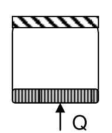

<b>Solución</b>

Solución paso a paso

**Paso 1 — Presión y trabajo.** Igual que en el ejercicio 29:

$$P = P_{ATM} + \frac{m\,g}{S} \qquad W = P\,S\,h$$

**Paso 2 — Calor y variación de temperatura del gas.** Proceso isobárico:

$$\Delta T_{gas} = \frac{W}{nR} \qquad Q = n\,c_P\,\Delta T_{gas} = \tfrac52\,W$$

**Paso 3 — Ley de Fourier en la placa.** El calor entra por conducción durante $t = 30\ \text{s}$:

$$\frac{Q}{t} = \lambda\,\frac{S}{e}\,\Delta T_{placa} \quad\Rightarrow\quad \lambda = \frac{Q\,e}{t\,S\,\Delta T_{placa}}$$

El enunciado no da la temperatura del medio externo. Para llegar al resultado de la guía hay que tomar como diferencia de temperatura a través de la placa la variación de temperatura del gas: $\Delta T_{placa} = \Delta T_{gas}$. Con esa hipótesis:

$$\lambda = \frac{n\,c_P\,\Delta T_{gas}\,e}{t\,S\,\Delta T_{gas}} = \frac{n\,c_P\,e}{t\,S}$$

**Paso 4 — Cálculo.** Los datos intermedios ($P = 101339\ \text{Pa}$, $W = 506{,}7\ \text{J}$, $\Delta T_{gas} = 20{,}3\ \text{K}$, $Q = 1266{,}7\ \text{J}$) se simplifican:

$$\lambda = \frac{3\cdot\tfrac52\cdot8{,}314\ \tfrac{\text{J}}{\text{K}}\cdot0{,}02\ \text{m}}{30\ \text{s}\cdot0{,}5\ \text{m}^2} = \frac{1{,}247}{15}\ \frac{\text{W}}{\text{m K}} = 0{,}083\ \frac{\text{W}}{\text{m K}}$$

**Respuesta:** $\lambda = 0{,}083\ \text{W/(m K)}$

---

### Ejercicio 31

Una máquina de Carnot opera entre dos fuentes, la caliente a 100°C y la fría a 0°C. Si por ciclo absorbe 100J del foco caliente, calcule:

a) el rendimiento de la máquina;

b) la cantidad de calor que cede por ciclo al foco frío;

c) el trabajo que realiza;

<b>Solución</b>

Solución paso a paso

**Paso 1 — Temperaturas absolutas.** $T_1 = 373\ \text{K}$ y $T_2 = 273\ \text{K}$.

**Paso 2 — Rendimiento de Carnot (ítem a).**

$$\eta = 1 - \frac{T_2}{T_1} = 1 - \frac{273}{373} = 0{,}268$$

**Paso 3 — Calor cedido (ítem b).** En Carnot, $\dfrac{Q_C}{Q_A} = -\dfrac{T_2}{T_1}$:

$$Q_C = -Q_A\,\frac{T_2}{T_1} = -100\ \text{J}\cdot\frac{273}{373} = -73{,}2\ \text{J}$$

**Paso 4 — Trabajo (ítem c).** En el ciclo, $\Delta U = 0$, así que $W = Q_A + Q_C$:

$$W = 100\ \text{J} - 73{,}2\ \text{J} = 26{,}8\ \text{J}$$

(o también $W = \eta\,Q_A = 0{,}268\cdot100\ \text{J}$).

**Respuesta:** a) $\eta = 0{,}268$; b) $|Q_F| = 73{,}2\ \text{J}$; c) $W_{CICLO} = 26{,}8\ \text{J}$

---

### Ejercicio 32

Dos máquinas térmicas cíclicas trabajan entre las mismas fuentes, la caliente a 800K y la fría a 400K. Una es ideal y realiza un ciclo Carnot. La otra es real, y tiene el 80% de rendimiento de la anterior (la ideal). Si el trabajo que entrega por ciclo la máquina real es de 5000J calcule el calor *que cede* por ciclo la máquina real.

<b>Solución</b>

Solución paso a paso

**Paso 1 — Rendimiento de la máquina real.**

$$\varepsilon_R = 0{,}8\,\varepsilon_{C} = 0{,}8\left(1 - \frac{T_2}{T_1}\right)$$

**Paso 2 — Calor absorbido.** De la definición, $\varepsilon_R = \dfrac{W}{Q_A}$, así que $Q_A = \dfrac{W}{\varepsilon_R}$.

**Paso 3 — Calor cedido.** Como $W = Q_A + Q_C$:

$$Q_C = W - Q_A = W\left(1 - \frac{1}{\varepsilon_R}\right)$$

**Paso 4 — Cálculo.**

$$\varepsilon_C = 1 - \frac{400}{800} = 0{,}5 \qquad \varepsilon_R = 0{,}8\cdot0{,}5 = 0{,}4$$

$$Q_C = 5000\ \text{J}\left(1 - \frac{1}{0{,}4}\right) = 5000\ \text{J}\cdot(-1{,}5) = -7500\ \text{J}$$

**Respuesta:** $|Q_F| = 7500\ \text{J}$

---

### Ejercicio 33

La máquina cíclica de la figura realiza el ciclo ACBA, en el que la transformación BA es adiabática. Indique cuáles son las aseveraciones verdaderas

| | |
|---|---|
| La máquina recibe trabajo y es frigorífica | |
| La temperatura en la transformación BA es constante | |
| ηMAQUINA= ηCARNOT porque es reversible | |
| Si BA fuera una isoterma UCICLO sería mayor | UCB > 0 y WCB > 0 |
| Si el ciclo fuera inverso disminuiría la energía interna | UBA = 0 y QBA < 0 |
| Si BA fuera una isoterma QCEDIDO, CICLO sería mayor | QAC > WAC |

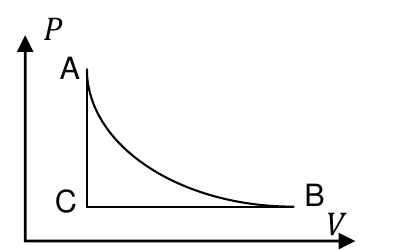

<b>Solución</b>

Solución paso a paso

**Paso 1 — Leer el ciclo.** A→C es vertical (isocórica, baja la presión); C→B es horizontal (isobárica, expansión); B→A es la adiabática (compresión, sube hasta A). Recorrido: abajo, derecha, arriba a la izquierda, es decir **antihorario**, así que $W_{ciclo} < 0$.

**Paso 2 — Analizar cada aseveración.**

- "La máquina recibe trabajo y es frigorífica": **verdadero**. $W_{ciclo} < 0$.
- "La temperatura en BA es constante": **falso**. BA es adiabática, no isoterma: en la compresión adiabática $T$ aumenta.
- "η = η Carnot porque es reversible": **falso**. Carnot requiere dos isotermas y dos adiabáticas, operando solo entre dos focos. Este ciclo intercambia calor a temperaturas variables.
- "Si BA fuera una isoterma, U ciclo sería mayor": **falso**. En cualquier ciclo $\Delta U = 0$.
- "Si el ciclo fuera inverso disminuiría la energía interna": **falso**. También daría $\Delta U = 0$.
- "Si BA fuera una isoterma, Q cedido sería mayor": **verdadero**. Desde A, la isoterma es menos empinada que la adiabática, así que llega a la presión de C en un volumen mayor: el ciclo encierra más área. Además, la compresión isotérmica **cede** calor ($Q = W < 0$), mientras que la adiabática no cede nada. Así aumenta el calor cedido total.
- "$U_{CB} > 0$ y $W_{CB} > 0$": **verdadero**. C→B es una expansión isobárica: $W > 0$ y, como $T$ aumenta, $\Delta U > 0$.
- "$U_{BA} = 0$ y $Q_{BA} < 0$": **falso**. En la adiabática $Q_{BA} = 0$, y $\Delta U_{BA} = -W_{BA} > 0$ (compresión).
- "$Q_{AC} > W_{AC}$": **falso**. $W_{AC} = 0$ (isocórica) y $Q_{AC} = \Delta U_{AC} < 0$ (se enfría), así que $Q_{AC} < W_{AC}$.

**Respuesta:**

- La máquina recibe trabajo y es frigorífica.
- Si BA fuera una isoterma, $Q_{CEDIDO,\,CICLO}$ sería mayor.
- $U_{CB} > 0$ y $W_{CB} > 0$.

---

### Ejercicio 34

Un gas ideal monoatómico (*cp* = 5R/2; *cv* = 3R/2) se dilata a temperatura constante desde el estado A (*TA*=600K, *VA*= 2ℓ, *PA*= 500 kPa) hasta duplicar el volumen en el estado B. Desde el estado B se lo dilata adiabáticamente hasta el estado C, en el que el volumen es de 6 litros. Luego se comprime el gas a presión constante hasta volver al volumen inicial (estado D), y por último se lo calienta a volumen constante hasta alcanzar el estado inicial. Suponiendo que el proceso se llevó a cabo de manera reversible

a) construya el gráfico *P-V* de la transformación;

b) calcule el calor intercambiado por el gas en la etapa de dilatación;

c) suponiendo que el ciclo fuera el de una máquina térmica calorífica, calcule su rendimiento;

d) respecto del ciclo ABCDA, marque las aseveraciones correctas

| | | |
|---|---|---|
| UCD > UDA porque cP>cV | QAB = 0 | QCD < 0 y QBC = 0 |
| WCICLO>0 ⇒ QCICLO<0 | WAB = QAB | UAB > \| UBC \| |
| ηCARNOT= 1-(TC/TA) | UCICLO=0⇒QCICLO=0 | WADCBA < 0 |

<b>Solución</b>

Solución paso a paso

Este ejercicio está resuelto en el [apunte de Termodinámica](Aula%20Virtual/Teor%C3%ADa%204%20-%20Termodin%C3%A1mica.pdf) (págs. 40–50). Conviene trabajar con $nR$ en lugar de $n$, porque con kPa y litros los productos $PV$ quedan en joules.

**Paso 1 — $nR$.**

$$nR = \frac{P_AV_A}{T_A} = \frac{500\cdot2}{600}\ \frac{\text{J}}{\text{K}} = \frac53\ \frac{\text{J}}{\text{K}} \qquad \left(n = \frac{5/3}{8{,}314} = 0{,}2\ \text{mol}\right)$$

**Paso 2 — Estado B** (isoterma, $V_B = 2V_A = 4\ \ell$): $T_B = 600\ \text{K}$ y $P_B = P_A\,\dfrac{V_A}{V_B} = 250\ \text{kPa}$.

**Paso 3 — Estado C** (adiabática hasta 6 ℓ, $\gamma = 5/3$): de $P_BV_B^\gamma = P_CV_C^\gamma$,

$$P_C = P_B\left(\frac{V_B}{V_C}\right)^{\gamma} = 250\left(\frac46\right)^{5/3}\ \text{kPa} = 127{,}19\ \text{kPa} \qquad T_C = \frac{P_CV_C}{nR} = 457{,}9\ \text{K}$$

**Paso 4 — Estado D** (isobárica hasta $V_D = 2\ \ell$): $P_D = 127{,}19\ \text{kPa}$ y $T_D = \dfrac{P_DV_D}{nR} = 152{,}6\ \text{K}$.

**Paso 5 — Tramo por tramo** (con $\Delta U = \tfrac32 nR\,\Delta T$):

| Tramo | Tipo | $\Delta U$ [J] | $W$ [J] | $Q$ [J] |
|---|---|---|---|---|
| AB | isoterma | 0 | $nRT_A\ln2 = 693{,}15$ | 693,15 |
| BC | adiabática | $\tfrac32 nR(T_C - T_B) = -355{,}3$ | $+355{,}3$ | 0 |
| CD | isobárica | $\tfrac32 nR(T_D - T_C) = -763{,}1$ | $P_C(V_D - V_C) = -508{,}8$ | −1271,9 |
| DA | isocórica | $\tfrac32 nR(T_A - T_D) = 1118{,}4$ | 0 | 1118,4 |

**Paso 6 — Ítem b: calor en la dilatación.** La dilatación son los tramos AB y BC, y como $Q_{BC} = 0$:

$$Q_{dilat} = Q_{AB} = nRT_A\ln2 = \frac53\cdot600\cdot0{,}6931\ \text{J} = 693{,}15\ \text{J}$$

**Paso 7 — Ítem c: rendimiento.** El calor se absorbe en AB y DA, y se cede en CD:

$$\eta = 1 + \frac{Q_C}{Q_A} = 1 + \frac{Q_{CD}}{Q_{AB} + Q_{DA}} = 1 - \frac{1271{,}9}{693{,}15 + 1118{,}4} = 1 - \frac{1271{,}9}{1811{,}6} = 0{,}3$$

**Paso 8 — Ítem d: aseveraciones.**

- "$U_{CD} > U_{DA}$ porque $c_P > c_V$": **falso**. $\Delta U_{CD} = -763\ \text{J}$ y $\Delta U_{DA} = 1118\ \text{J}$.
- "$Q_{AB} = 0$": **falso**. Es una isoterma con $Q = W \ne 0$.
- "$Q_{CD} < 0$ y $Q_{BC} = 0$": **verdadero**. CD es una compresión isobárica (se enfría y se le hace trabajo) y BC es adiabática.
- "$W_{CICLO} > 0 \Rightarrow Q_{CICLO} < 0$": **falso**. En un ciclo $Q = W$, así que $Q_{CICLO} > 0$.
- "$W_{AB} = Q_{AB}$": **verdadero**. Isoterma, $\Delta U = 0$.
- "$U_{AB} > |U_{BC}|$": **falso**. $\Delta U_{AB} = 0 < 355\ \text{J}$.
- "$\eta_{CARNOT} = 1 - (T_C/T_A)$": **falso**. Este ciclo no es de Carnot (tiene una sola isoterma).
- "$U_{CICLO} = 0 \Rightarrow Q_{CICLO} = 0$": **falso**. $Q_{CICLO} = W_{CICLO} \ne 0$.
- "$W_{ADCBA} < 0$": **verdadero**. ABCDA es horario ($W > 0$), así que el ciclo inverso tiene $W < 0$.

**Respuesta:**

- a) Gráfico P-V de la guía:

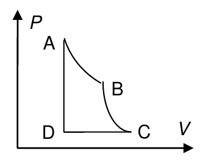

- b) $Q = 693{,}15\ \text{J}$ (la guía, redondeando $n = 0{,}2$ mol: 691,54 J)
- c) $\eta = 0{,}3$
- d) $Q_{CD} < 0$ y $Q_{BC} = 0$; $W_{AB} = Q_{AB}$; $W_{ADCBA} < 0$

Datos intermedios: $n = 0{,}2$ mol; $T_C = 458\ \text{K}$; $T_D = 152{,}6\ \text{K}$; $P_C = 127\ \text{kPa}$; $Q_{DA} = 1118{,}5\ \text{J}$; $W_{BC} = 355\ \text{J}$; $W_{CD} = -508{,}8\ \text{J}$.

