# Tema 1 — Termodinámica: resumen teórico

Resumen de los apuntes del aula virtual: [Temperatura y calorimetría](Aula%20Virtual/Teor%C3%ADa%201%20-%20Temperatura%20y%20calorimetr%C3%ADa.pdf), [Dilatación](Aula%20Virtual/Teor%C3%ADa%202%20-%20Dilataci%C3%B3n.pdf), [Conducción del calor](Aula%20Virtual/Teor%C3%ADa%203%20-%20Conducci%C3%B3n%20del%20calor.pdf) y [Termodinámica](Aula%20Virtual/Teor%C3%ADa%204%20-%20Termodin%C3%A1mica.pdf).

Ejercicios: [práctica del tema](practica.md).

---

## Índice

1. [Temperatura y calor](#1-temperatura-y-calor)
2. [Calorimetría](#2-calorimetría)
3. [Dilatación térmica](#3-dilatación-térmica)
4. [Transmisión del calor: radiación, convección y conducción](#4-transmisión-del-calor-radiación-convección-y-conducción)
5. [Gas ideal](#5-gas-ideal)
6. [Trabajo en un gas](#6-trabajo-en-un-gas)
7. [Primer principio](#7-primer-principio)
8. [Calores específicos molares y energía interna](#8-calores-específicos-molares-y-energía-interna)
9. [Transformaciones adiabáticas](#9-transformaciones-adiabáticas)
10. [Máquinas térmicas y frigoríficas](#10-máquinas-térmicas-y-frigoríficas)
11. [Ciclo de Carnot](#11-ciclo-de-carnot)
12. [Segundo principio](#12-segundo-principio)
13. [Tabla de fórmulas](#13-tabla-de-fórmulas)

---

## 1. Temperatura y calor

**Temperatura.** A nivel microscópico, la temperatura de un cuerpo mide la energía cinética (agitación térmica) de los átomos y moléculas que lo componen.

**Calor ($Q$).** Si dos cuerpos a distinta temperatura se ponen en contacto térmico, se establece entre ellos un flujo de energía térmica, el **calor**, hasta que las temperaturas se igualan y se alcanza el **equilibrio térmico**.

- El calor fluye espontáneamente del cuerpo de **mayor** temperatura al de **menor** temperatura.
- **Convención de signos:** el cuerpo que **absorbe** calor tiene $Q > 0$; el que lo **cede** tiene $Q < 0$.
- Unidades: las de energía. Joule (J) o caloría (cal):

$$1\ \text{cal} = 4{,}18\ \text{J}$$

- Una **caloría** es la energía necesaria para elevar en $1\ ^\circ\text{C}$ la temperatura de $1\ \text{g}$ de agua.

**Equilibrio térmico.** Dos cuerpos están en equilibrio térmico si y solo si están a la misma temperatura. Una vez alcanzado, el flujo de calor cesa.

**Principio cero de la termodinámica.** Si dos cuerpos A y B están cada uno, por separado, en equilibrio térmico con un tercer cuerpo C, entonces A y B están en equilibrio térmico entre sí. Esto es lo que permite construir termómetros: magnitudes que cambian con la temperatura (altura de una columna de mercurio, presión de un gas a volumen fijo, resistencia eléctrica, etc.).

**Escalas de temperatura.**

- **Celsius:** $0\ ^\circ\text{C}$ es el punto de fusión del agua (agua en equilibrio con hielo) y $100\ ^\circ\text{C}$ el punto de vaporización (agua líquida en equilibrio con su vapor), ambos a presión atmosférica.
- **Kelvin (temperatura absoluta):** es la única escala no arbitraria. $0\ \text{K}$ es el **cero absoluto**, donde todas las partículas quedarían en reposo; no se puede alcanzar en el laboratorio. El cero absoluto está en $-273{,}15\ ^\circ\text{C}$.

$$T[\text{K}] = T[^\circ\text{C}] + 273{,}15$$

> Una **diferencia** de temperatura vale lo mismo en °C que en K: $\Delta T = 10\ ^\circ\text{C} = 10\ \text{K}$.

---

## 2. Calorimetría

### Calor sensible (cambio de temperatura)

Si una masa $m$ de una sustancia absorbe o cede un calor $Q$ **sin cambiar de fase**, su temperatura varía según su **calor específico** $c$:

$$Q = m\,c\,\Delta T \qquad \text{con } \Delta T = T_f - T_i$$

Si $T_i > T_f$, resulta $Q < 0$: el cuerpo **cede** calor. Los valores de $c$ se toman a presión constante (la atmosférica).

| Sustancia | $c$ [cal/(g °C)] |
|---|---|
| Agua líquida | 1 (por definición de caloría) |
| Hielo | 0,5 |
| Vapor de agua | 0,5 |
| Cobre | 0,09 |
| Aluminio | 0,22 |
| Plomo sólido | 0,03 |
| Plomo líquido | 0,05 |

### Calor latente (cambio de fase)

Durante un cambio de fase la temperatura **no cambia**: todo el calor se usa para cambiar de estado. El **calor latente** $L$ es el calor necesario por unidad de masa:

$$Q = \pm\, m\,L$$

- Fusión (sólido → líquido) y vaporización (líquido → gas): la sustancia **absorbe** calor → $Q = +mL$.
- Solidificación (líquido → sólido) y condensación (gas → líquido): la sustancia **cede** calor → $Q = -mL$.
- Sublimación: sólido → gas.
- A una presión dada, cada cambio de fase ocurre siempre a la misma temperatura.

| Cambio de fase | $L$ [cal/g] |
|---|---|
| Fusión del hielo | 80 |
| Vaporización del agua | 540 |
| Fusión del plomo | 5,86 |

### Calorímetro y ecuación de balance

Un **calorímetro** es un recipiente **adiabático** (aísla térmicamente su contenido del entorno). Se supone que la experiencia es lo bastante breve como para despreciar el calor intercambiado con el ambiente.

- **Equivalente en agua ($\pi$):** es la masa de agua que tiene el mismo comportamiento térmico que el calorímetro. Si el calorímetro tiene masa $M$ y calor específico $c_{cal}$:

$$M\,c_{cal} = \pi\,c_{agua}$$

**Balance de calor.** Como no hay intercambio con el entorno, todo el calor que unos cuerpos ceden lo absorben los otros:

$$Q_{cal} + \sum_{i=1}^{N} Q_i = 0$$

Cada $Q_i$ es de la forma $m\,c\,\Delta T$ o $\pm\,m\,L$. Un problema de calorimetría consiste en escribir bien esta ecuación y despejar la incógnita.

> **Cómo encarar un problema de calorimetría**
>
> 1. Identificar todos los cuerpos (incluido el calorímetro, si no es ideal).
> 2. Suponer la temperatura final $T_f$. Si hay hielo y agua y **solo se funde una parte** del hielo, la temperatura final es **0 °C**: si fuese mayor se habría fundido todo, y si fuese menor no se habría fundido nada.
> 3. Escribir cada calor con su signo, usando siempre $\Delta T = T_f - T_i$.
> 4. Plantear $\sum Q = 0$ y despejar.
> 5. Verificar que la hipótesis del paso 2 sea coherente (por ejemplo, que la masa de hielo fundida no supere la masa total).

### Curva de calor

La **curva de calor** es el gráfico $T = f(Q)$ de una sustancia:

- Mientras **no** cambia de fase, $T$ varía **linealmente** con $Q$, con pendiente $\dfrac{1}{m\,c}$.
- Durante un **cambio de fase**, la curva es **horizontal**: se absorbe o cede calor sin que cambie $T$. El largo del tramo horizontal es $m\,L$.

**Ejemplo 1 (apunte).** Un calorímetro de cobre de 30 g contiene 60 g de hielo a −8 °C. Se agrega una masa $M$ de aluminio a 170 °C y en el equilibrio se funden 2 g de hielo. Como el hielo se funde solo en parte, $T_f = 0\ ^\circ\text{C}$:

$$\underbrace{30\cdot 0{,}09\cdot 8}_{Q_{cal}=21{,}6} + \underbrace{60\cdot 0{,}5\cdot 8}_{Q_{hielo}=240} + \underbrace{2\cdot 80}_{Q_{fus}=160} + \underbrace{M\cdot 0{,}22\,(0-170)}_{Q_{Al}} = 0 \;\Rightarrow\; M = 11{,}27\ \text{g}$$

Curva de calor del hielo: sube linealmente de −8 °C a 0 °C (hasta $Q = 240$ cal) y después queda horizontal en 0 °C durante la fusión (de 240 a 400 cal).

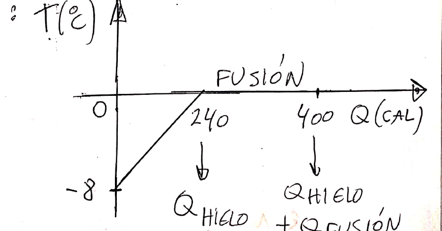

**Ejemplo 2 (apunte).** Vapor de benceno a 80 °C (su punto de ebullición; $L_v = 90$ cal/g, $c = 0{,}4$ cal/(g °C)) entra en un calorímetro de cobre de 20 g con 2 g de hielo y 3 g de agua (todo a 0 °C). Se condensa una masa $M$ y todo termina a 22 °C:

$$\underbrace{20\cdot0{,}09\cdot22}_{39{,}6} + \underbrace{2\cdot80}_{160} + \underbrace{5\cdot1\cdot22}_{110} - M\cdot 90 + M\cdot0{,}4\,(22-80) = 0 \;\Rightarrow\; M = 2{,}7\ \text{g}$$

Hay que notar que el agua que se calienta de 0 a 22 °C es **toda** el agua: los 3 g originales más los 2 g de hielo fundido.

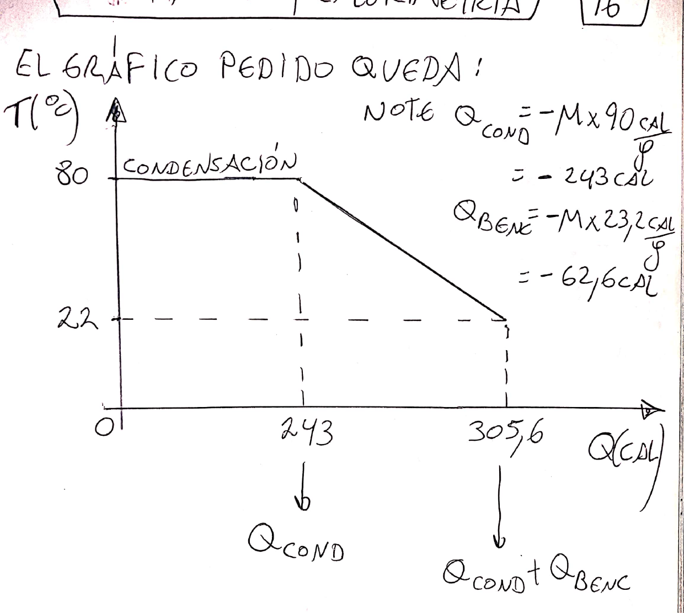

---

## 3. Dilatación térmica

Con los cambios de temperatura, los materiales se dilatan o se contraen. La dilatación puede ser lineal, superficial o volumétrica.

### Dilatación lineal

Para objetos donde una dimensión es mucho mayor que las otras (alambres, rieles):

$$L(T) = L_0 + \alpha\,L_0\,(T - T_0) \qquad\Longleftrightarrow\qquad \frac{\Delta L}{L_0} = \alpha\,\Delta T$$

$\alpha$ es el **coeficiente de dilatación lineal**, $[\alpha] = 1/^\circ\text{C}$. Su definición general (para variaciones infinitesimales) es

$$\alpha = \frac{1}{L}\frac{dL}{dT}$$

### Dilatación volumétrica

Con el **coeficiente de dilatación volumétrica** $\beta$:

$$V(T) = V_0 + \beta\,V_0\,(T - T_0) \qquad\Longleftrightarrow\qquad \frac{\Delta V}{V_0} = \beta\,\Delta T \qquad \beta = \frac{1}{V}\frac{dV}{dT}$$

### Relación entre α y β

Para un material **isótropo** (mismas propiedades en las tres direcciones), un prisma de lados $L_1, L_2, L_3$ tiene $V = L_1L_2L_3$, y derivando:

$$\beta = \frac{1}{L_1}\frac{dL_1}{dT} + \frac{1}{L_2}\frac{dL_2}{dT} + \frac{1}{L_3}\frac{dL_3}{dT} = 3\alpha$$

$$\boxed{\beta = 3\alpha}$$

### Densidad

Como $\rho = M/V$ y la masa no cambia:

$$\beta = -\frac{1}{\rho}\frac{d\rho}{dT}$$

El signo menos aparece porque, en general, al aumentar la temperatura el material se dilata y su densidad **disminuye**. Una excepción importante es el **agua** cerca de su punto de congelación: por debajo de 4 °C el agua se vuelve menos densa al enfriarse. Por eso el hielo flota y los lagos se congelan solo en la superficie, aislando el agua de abajo (que se mantiene a unos 4 °C).

**Juntas de dilatación:** espacios que se dejan en rieles, puentes o pavimentos para que puedan dilatarse sin romperse.

**Ejemplo (apunte).** Un recipiente metálico de 215,3 cm³ contiene 210,6 cm³ de un líquido con $\beta_L = 6{,}1\times10^{-4}\ ^\circ\text{C}^{-1}$, a 6 °C. Un alambre de 29,71 cm del mismo metal se alarga 0,14 cm cuando su temperatura varía 170 °C. ¿Se derrama líquido al calentar hasta 71 °C?

- $\alpha_M = \dfrac{\Delta L}{L_0\,\Delta T} = 2{,}77\times10^{-5}\ ^\circ\text{C}^{-1}$, y entonces $\beta_M = 3\alpha_M = 8{,}32\times10^{-5}\ ^\circ\text{C}^{-1}$.
- $V_R = 215{,}3\,[1 + 8{,}32\times10^{-5}\cdot 65] = 216{,}46\ \text{cm}^3$
- $V_L = 210{,}6\,[1 + 6{,}1\times10^{-4}\cdot 65] = 218{,}95\ \text{cm}^3$
- Como $V_L > V_R$, **se derrama** $V_L - V_R = 2{,}5\ \text{cm}^3$.

**Ejemplo (apunte): reloj de péndulo.** El período de un péndulo simple es $\tau = 2\pi\sqrt{\ell/g}$. Si la longitud varía $d\ell = \alpha\,\ell\,dT$, entonces

$$\frac{d\tau}{\tau} = \frac{\alpha}{2}\,dT$$

Con latón ($\alpha = 1{,}8\times10^{-5}\ ^\circ\text{C}^{-1}$) y un error máximo de 1 s por día ($d\tau/\tau = 1/86400$): $dT = \dfrac{2}{\alpha\cdot 86400} = 1{,}29\ ^\circ\text{C}$.

---

## 4. Transmisión del calor: radiación, convección y conducción

El calor se transmite por tres mecanismos.

### Radiación

Las partículas de un cuerpo, por su agitación térmica, son cargas aceleradas que **emiten radiación electromagnética** y así ceden calor. La radiación que incide sobre otro cuerpo puede ser absorbida y aumentar su temperatura. **Es el único mecanismo que funciona en el vacío** (así nos llega la energía del Sol).

- La frecuencia de la radiación emitida depende de la temperatura de la **superficie**. A temperatura ambiente los cuerpos emiten en el infrarrojo; al aumentar $T$, el pico se corre hacia el visible (metal al rojo vivo). El Sol tiene su pico en el verde, lo que indica unos 6000 K en su superficie. Las estrellas más jóvenes y calientes son blanco-azuladas; las más viejas, rojizas.

**Ley de Stefan-Boltzmann.** Potencia emitida por unidad de área por un cuerpo a temperatura absoluta $T$:

$$\frac{P}{A} = \varepsilon\,\sigma\,T^4 \qquad \sigma = 5{,}67\times10^{-8}\ \frac{\text{W}}{\text{m}^2\,\text{K}^4}$$

- $\varepsilon$ es la **emisividad**: $0 < \varepsilon \le 1$.
- $\varepsilon = 1$ corresponde al **cuerpo negro**, un cuerpo ideal que absorbe toda la radiación que le llega.
- Si el cuerpo (a $T$) está en un ambiente a $T_{amb}$, la potencia **neta** que intercambia por radiación es $P = \varepsilon\,\sigma\,A\,(T^4 - T_{amb}^4)$.

> Históricamente, que la física clásica no pudiera explicar el espectro del cuerpo negro (la "catástrofe ultravioleta") llevó a Planck a sentar las bases de la física cuántica.

### Convección

Ocurre en **fluidos**: la parte más caliente absorbe calor, se vuelve menos densa y se desplaza hacia las zonas más frías, generando una circulación (océanos, atmósfera, estufas). Puede ser **natural** o **forzada** (por ejemplo, con un ventilador).

Un resultado empírico es la **ley de enfriamiento de Newton**. Si la superficie de un cuerpo, a $T_S$, está en contacto con un fluido a $T_F$:

$$\frac{\Delta Q}{\Delta t} = h\,A\,(T_F - T_S)$$

donde $A$ es la superficie en contacto con el fluido y $h$ el **coeficiente de convección**, $[h] = \dfrac{\text{W}}{\text{m}^2\,\text{K}}$.

### Conducción

La agitación térmica de las partículas de una región se transmite a sus vecinas, y así sucesivamente (por ejemplo, la cuchara que se calienta en la olla).

Se estudia con una barra de longitud $\ell$ y sección $A$, **aislada térmicamente salvo en sus extremos**, conectada entre dos **focos térmicos** a $T_1$ y $T_2$. Un foco térmico es un sistema que puede ceder o absorber grandes cantidades de calor sin que cambie su temperatura. Después de un régimen transitorio, se llega a un **régimen estacionario**.

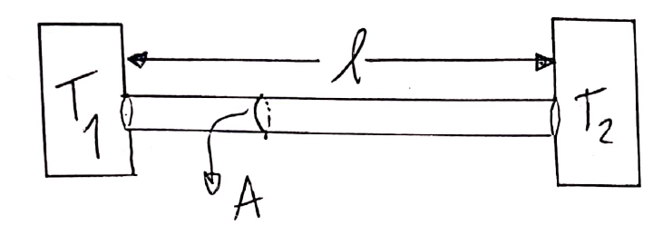

Se define la **corriente térmica** (o potencia calorífica) como el calor que atraviesa una sección por unidad de tiempo:

$$I = \frac{\Delta Q}{\Delta t}\quad(\text{valor medio}) \qquad I = \frac{dQ}{dt}\quad(\text{instantáneo}) \qquad [I] = \text{W}$$

**Ley de Fourier:**

$$I = k\,\frac{A}{\ell}\,|T_1 - T_2|$$

$k$ es la **conductividad térmica** del material, $[k] = \dfrac{\text{W}}{\text{m}\,^\circ\text{C}}$. Un $k$ grande corresponde a buenos conductores (metales) y un $k$ chico a malos conductores (aislantes). En la guía a veces se escribe $\lambda$ en vez de $k$, y la corriente térmica aparece como "potencia calorífica" $\phi_Q$ o $\dot Q$.

### Resistencia térmica

$$R_T = \frac{\ell}{k\,A} \qquad [R_T] = \frac{^\circ\text{C}}{\text{W}} = \frac{\text{K}}{\text{W}}$$

Depende de la geometría y del material. Con ella, la ley de Fourier queda igual que la ley de Ohm:

$$\boxed{\Delta T = R_T\,I}$$

| Térmico | Eléctrico |
|---|---|
| Diferencia de temperatura $\Delta T$ | Diferencia de potencial $\Delta V$ |
| Corriente térmica $I$ [W] | Corriente eléctrica $I$ [A] |
| Resistencia térmica $R_T$ | Resistencia eléctrica $R$ |

### Conexión de resistencias térmicas

**Serie:** los elementos están uno a continuación del otro. Por todos pasa **la misma corriente $I$** (si no, habría una fuente o una pérdida de energía en el camino). Ejemplo: una pared con varias capas (ladrillo, revoque, pintura).

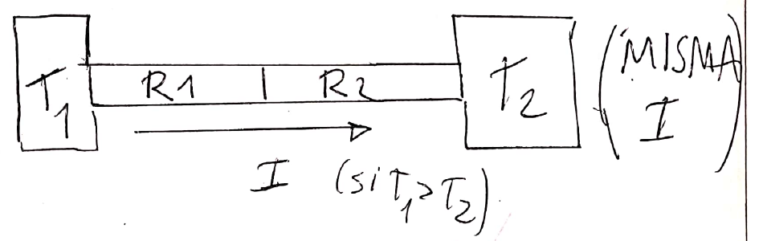

**Paralelo:** todos los elementos están conectados a **la misma $\Delta T$**. Ejemplo: una ventana, donde el vidrio y el marco conectan el interior con el exterior en paralelo.

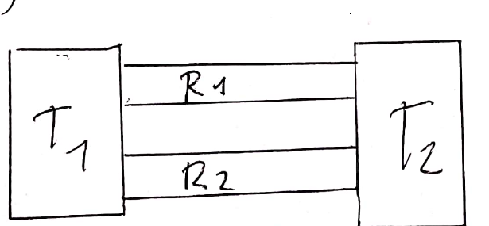

**Resistencia equivalente:** es la resistencia única que transmite la misma corriente bajo la misma $\Delta T$ que el conjunto.

$$\text{Serie: } R_{eq} = R_1 + R_2 + \dots + R_N \qquad\qquad \text{Paralelo: } \frac{1}{R_{eq}} = \frac{1}{R_1} + \frac{1}{R_2} + \dots + \frac{1}{R_N}$$

**Ejemplo (apunte).** Barras de radio 0,8 cm ($A = 2{,}01\times10^{-4}\ \text{m}^2$) entre focos a 5 °C y 70 °C: la barra 1 (30 cm, $k_1 = 80$) en serie con la 2 (26 cm, $k_2 = 110$), y ese conjunto en paralelo con la barra 3 (50 cm, $k_3 = 40$), con $k$ en W/(m °C).

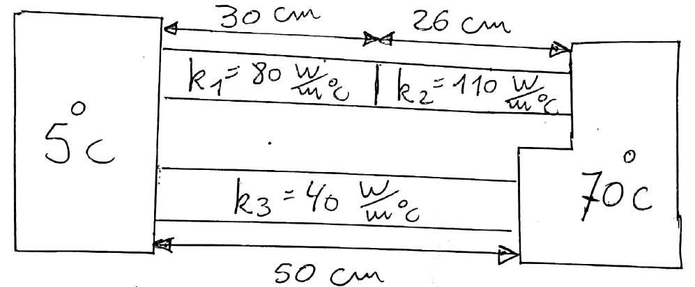

- $R_1 = 18{,}657$, $R_2 = 11{,}759$, $R_3 = 62{,}189$ (en °C/W).
- $R_{12} = R_1 + R_2 = 30{,}416\ ^\circ\text{C/W}$, y entonces $I_{12} = \dfrac{65}{30{,}416} = 2{,}137\ \text{W}$.
- Temperatura de la unión: $T - 5\ ^\circ\text{C} = R_1\,I_{12}$, de donde $T = 44{,}87\ ^\circ\text{C}$.
- $\dfrac{1}{R_{eq}} = \dfrac{1}{R_{12}} + \dfrac{1}{R_3}$, de donde $R_{eq} = 20{,}304\ ^\circ\text{C/W}$ e $I_{tot} = \dfrac{65}{20{,}304} = 3{,}2\ \text{W}$ (igual a $I_{12} + I_3 = 2{,}137 + 1{,}045$).

### Conducción radial: caño cilíndrico

En un caño de radio interno $R_1$, radio externo $R_2$ y longitud $\ell$, el calor fluye **radialmente**. La sección que atraviesa depende de la posición: $A(r) = 2\pi r\,\ell$. Se piensa el caño como una sucesión de cilindros de espesor $dr$ **en serie**:

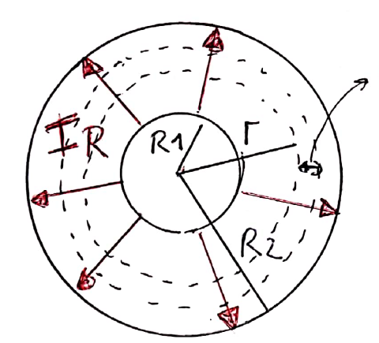

$$dR = \frac{dr}{k\,A(r)} = \frac{dr}{2\pi\,\ell\,k\,r} \quad\Rightarrow\quad R = \frac{1}{2\pi\,\ell\,k}\int_{R_1}^{R_2}\frac{dr}{r}$$

$$\boxed{R = \frac{\ln(R_2/R_1)}{2\pi\,\ell\,k}} \qquad\qquad \boxed{I = \frac{2\pi\,\ell\,k\,|T_1 - T_2|}{\ln(R_2/R_1)}}$$

---

## 5. Gas ideal

Un **gas ideal** es un gas diluido de moléculas idénticas cuya energía interna es **solo energía cinética** (agitación térmica). Se desprecia la energía potencial de interacción entre partículas: los choques son tan breves que se tratan como choques clásicos, y se desprecian los efectos cuánticos.

Como el número de partículas es gigantesco, se describe el sistema con **variables de estado** globales ($P$, $V$, $T$, $U$, …).

- **Estado de equilibrio:** las variables de estado se mantienen constantes en el tiempo.
- **Proceso reversible (cuasiestático):** es una sucesión de estados de equilibrio. Es una idealización que se aproxima haciendo el proceso muy lento. En los diagramas se dibuja con **línea llena**.
- **Proceso irreversible:** el sistema no puede invertir el camino y volver al estado inicial.

### Teoría cinética y ecuación de estado

Si se considera una caja con $N$ moléculas de masa $m$ que chocan elásticamente contra las paredes, la presión resulta

$$P = \frac{1}{3}\frac{N}{V}\,m\,\langle v^2\rangle = \frac{2}{3}\frac{N}{V}\,\langle \varepsilon_c\rangle$$

La **temperatura absoluta** se define a partir de la energía cinética media por partícula:

$$\langle \varepsilon_c\rangle = \frac{3}{2}\,k_B\,T \qquad k_B = 1{,}38\times10^{-23}\ \text{J/K}\ \ (\text{constante de Boltzmann})$$

De ahí sale la ecuación de estado $P = \dfrac{N}{V}k_BT$. Con $N = n\,N_A$ ($N_A = 6{,}02\times10^{23}$ moléculas/mol) y $R = N_A\,k_B$:

$$\boxed{P\,V = n\,R\,T}$$

$$R = 8{,}314\ \frac{\text{J}}{\text{mol K}} = 0{,}082\ \frac{\ell\ \text{atm}}{\text{mol K}} = 8{,}314\ \frac{\text{kPa}\ \ell}{\text{mol K}}$$

> **Truco de unidades:** $1\ \text{kPa}\cdot\ell = 10^3\ \text{Pa}\cdot10^{-3}\ \text{m}^3 = 1\ \text{J}$. Si se trabaja con presiones en kPa y volúmenes en litros, $PV$ queda directamente en joules.

Unidades de presión: $1\ \text{Pa} = 1\ \text{N/m}^2$; $1\ \text{atm} = 101{,}325\ \text{kPa}$.

---

## 6. Trabajo en un gas

Si un gas se expande o comprime reversiblemente en un recipiente con un pistón de área $A$ que se desplaza $dx$, el volumen cambia $dV = A\,dx$ y el **trabajo hecho por el gas** es

$$dW = F\,dx = P\,A\,dx = P\,dV \qquad\Longrightarrow\qquad \boxed{W_{A\to B} = \int_A^B P\,dV}$$

- El trabajo hecho **por el medio** es el opuesto ($dW_{ext} = -P_{ext}\,dV$). En esta materia se usa siempre el **trabajo del gas**.
- En el diagrama $P$-$V$, **$W$ es el área bajo la curva**: positiva si el gas se **expande** ($V$ aumenta) y negativa si se **comprime**.
- **En un ciclo**, $W_{ciclo}$ es el **área encerrada**: positiva si el ciclo se recorre en sentido **horario** en el plano $P$-$V$ y negativa si se recorre en sentido **antihorario**.

### Trabajo en procesos particulares

| Proceso | Condición | Trabajo del gas |
|---|---|---|
| Isocórico (isométrico) | $V$ = cte | $W = 0$ |
| Isobárico | $P$ = cte | $W = P\,(V_B - V_A)$ |
| Isotérmico | $T$ = cte | $W = n\,R\,T\,\ln\dfrac{V_B}{V_A}$ |
| Adiabático | $Q = 0$ | $W = -\Delta U = -n\,c_V\,\Delta T$ |

En la isoterma, $PV = nRT = $ cte, así que en el plano $P$-$V$ la curva es una **hipérbola** y $W = \int \dfrac{nRT}{V}\,dV = nRT\ln\dfrac{V_B}{V_A}$.

---

## 7. Primer principio

La **energía se conserva**. Si la energía interna del gas varía en $\Delta U$, solo puede deberse al calor $Q$ intercambiado con el medio o al trabajo $W$ hecho por el gas:

$$\boxed{\Delta U = Q - W} \qquad\qquad dU = dQ - dW$$

- Se pone $-W$ porque si el gas se expande ($W > 0$) gasta energía y $\Delta U$ disminuye. (En los textos que usan el trabajo del medio, se escribe $dU = dQ + dW$.)
- **$U$ es una variable de estado**: $\Delta U$ depende solo de los estados inicial y final, **no del camino**.
- **$Q$ y $W$ no son variables de estado**: el sistema no "tiene" calor ni trabajo, y sus valores **sí dependen del camino**.

**En un ciclo:**

$$\Delta U_{ciclo} = 0 \quad\Longrightarrow\quad Q_{ciclo} = W_{ciclo} = \text{área encerrada en } P\text{-}V$$

> **Consecuencia útil:** si dos caminos distintos unen los mismos estados A y B, ambos tienen el **mismo $\Delta U$**. Entonces el que tiene más trabajo es también el que intercambia más calor: $Q = \Delta U + W$.

---

## 8. Calores específicos molares y energía interna

Para gases se usa el **calor específico molar** (por mol, no por gramo), que **depende del tipo de proceso**:

$$c_x = \frac{1}{n}\frac{dQ}{dT}\bigg|_x \qquad c_V = \frac{1}{n}\frac{dQ}{dT}\bigg|_V \qquad c_P = \frac{1}{n}\frac{dQ}{dT}\bigg|_P$$

### Energía interna del gas ideal

En un proceso isocórico $dW = 0$, así que $dU = dQ_V = n\,c_V\,dT$. Como $U$ es variable de estado, el resultado vale **para cualquier proceso**:

$$\boxed{\Delta U = n\,c_V\,\Delta T}\qquad(\text{gas ideal, siempre})$$

> En un gas ideal, **$U$ depende solo de $T$**. En una isoterma, $\Delta U = 0$.

### Equipartición de la energía

Cada grado de libertad de la molécula (traslación, rotación, vibración) aporta en promedio $\tfrac12 k_BT$ a la energía.

- **Monoatómico:** 3 grados de traslación, así que $U = \tfrac32 nRT$ y $c_V = \tfrac32 R$.
- **Diatómico:** 3 de traslación + 2 de rotación (alrededor de los dos ejes perpendiculares al que une los átomos) = 5, así que $c_V = \tfrac52 R$.

### Relación de Mayer

A presión constante: $n\,c_V\,dT = n\,c_P\,dT - P\,dV$, y con $P\,dV = nR\,dT$:

$$\boxed{c_P = c_V + R}$$

| Gas ideal | $c_V$ | $c_P$ | $\gamma = c_P/c_V$ |
|---|---|---|---|
| Monoatómico | $\tfrac32 R$ | $\tfrac52 R$ | $\tfrac53$ |
| Diatómico | $\tfrac52 R$ | $\tfrac72 R$ | $\tfrac75$ |

### Calor en cada tipo de proceso (gas ideal)

| Proceso | $\Delta U$ | $W$ | $Q$ |
|---|---|---|---|
| Isocórico | $n c_V \Delta T$ | $0$ | $n c_V \Delta T$ |
| Isobárico | $n c_V \Delta T$ | $P\,\Delta V = nR\,\Delta T$ | $n c_P \Delta T$ |
| Isotérmico | $0$ | $nRT\ln(V_B/V_A)$ | $Q = W$ |
| Adiabático | $n c_V \Delta T$ | $-n c_V \Delta T$ | $0$ |

---

## 9. Transformaciones adiabáticas

Son las transformaciones con $dQ = 0$. Del primer principio, $n\,c_V\,dT = -P\,dV$; si se divide por $PV = nRT$ y se usa $R = c_P - c_V$:

$$\frac{dT}{T} = (1 - \gamma)\,\frac{dV}{V} \qquad \gamma = \frac{c_P}{c_V}$$

Integrando, se obtiene que en un proceso **adiabático reversible** se mantienen constantes:

$$\boxed{T\,V^{\gamma-1} = \text{cte}} \qquad \boxed{P\,V^{\gamma} = \text{cte}} \qquad \boxed{T^{\gamma}\,P^{1-\gamma} = \text{cte}}$$

En el plano $P$-$V$, la adiabática también tiende asintóticamente a los ejes, pero es **más empinada** que la isoterma que pasa por el mismo punto.

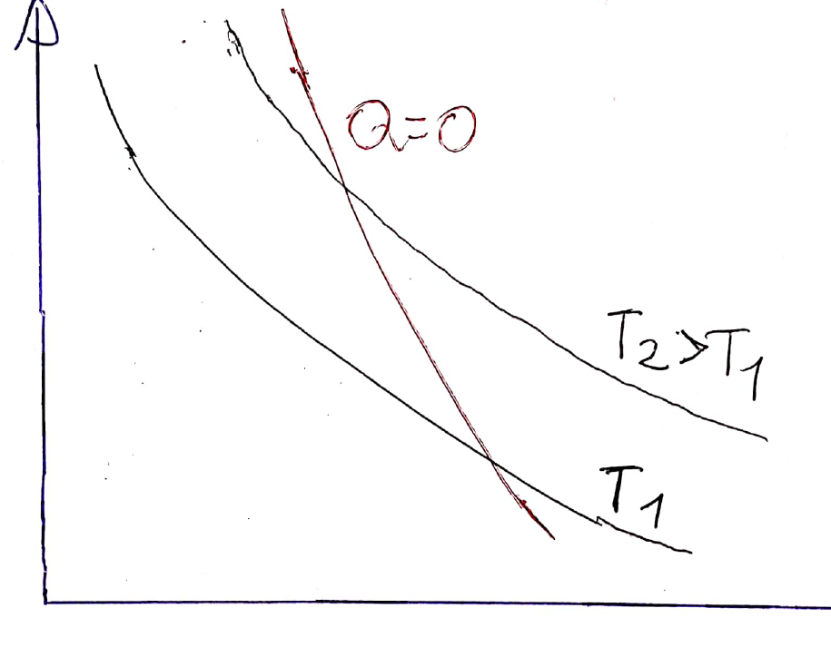

---

## 10. Máquinas térmicas y frigoríficas

### Máquina térmica

Es un sistema que opera **cíclicamente** entre un foco caliente ($T_1$), del que **absorbe** calor $Q_A > 0$, y un foco frío ($T_2 < T_1$), al que **cede** calor $Q_C < 0$, y realiza un trabajo $W > 0$.

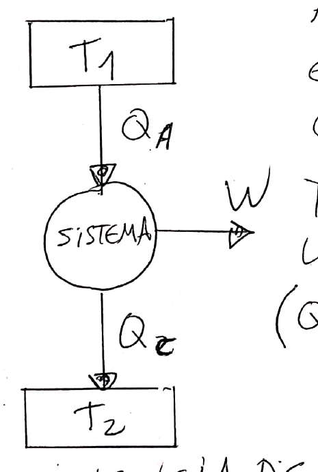

Como $\Delta U_{ciclo} = 0$:

$$W = Q_A + Q_C$$

La **eficiencia** (rendimiento) es la fracción del calor absorbido que se convierte en trabajo:

$$\boxed{\varepsilon = \frac{W}{Q_A} = 1 + \frac{Q_C}{Q_A}} \qquad (\text{como } Q_C < 0,\ \varepsilon < 1)$$

> Con valores absolutos: $\varepsilon = 1 - \dfrac{|Q_C|}{Q_A}$.

### Máquina frigorífica

Se invierten las flechas: se hace trabajo **sobre** el sistema ($W < 0$), se absorbe calor del foco frío ($Q_A > 0$) y se entrega calor al foco caliente ($Q_C < 0$).

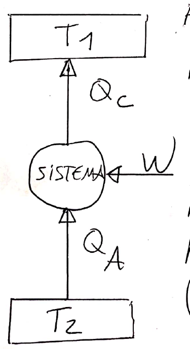

La **eficiencia** (coeficiente de desempeño) compara el calor que se logra extraer del foco frío con el trabajo invertido:

$$\boxed{\eta = -\frac{Q_A}{W} = -\frac{Q_A}{Q_A + Q_C}}$$

---

## 11. Ciclo de Carnot

Es un ciclo **reversible** formado por **dos isotermas y dos adiabáticas**: A→B isoterma a $T_1$ (absorbe $Q_A$), B→C adiabática, C→D isoterma a $T_2$ (cede $Q_C$) y D→A adiabática.

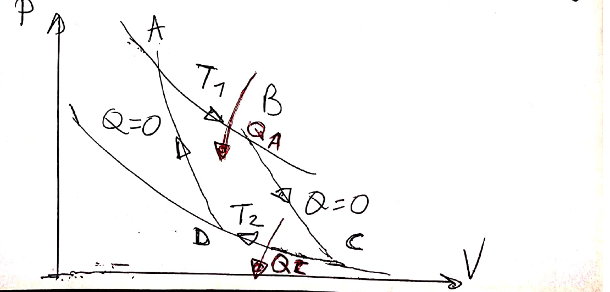

Usando las adiabáticas, $\dfrac{V_B}{V_A} = \dfrac{V_C}{V_D}$. Además $Q_A = nRT_1\ln\dfrac{V_B}{V_A}$ y $Q_C = -nRT_2\ln\dfrac{V_B}{V_A}$. Entonces:

$$\boxed{\frac{Q_C}{Q_A} = -\frac{T_2}{T_1}} \qquad\qquad \boxed{\varepsilon_{Carnot} = 1 - \frac{T_2}{T_1}}$$

**Frigorífico de Carnot:**

$$\frac{Q_C}{Q_A} = -\frac{T_1}{T_2} \qquad\qquad \boxed{\eta_{Carnot} = \frac{T_2}{T_1 - T_2}}$$

> ⚠️ Las temperaturas siempre en **kelvin**.

**Importancia (teorema de Carnot):** todas las máquinas térmicas **reversibles** que operan entre los mismos dos focos tienen la **misma** eficiencia, la de Carnot. Cualquier máquina **real** que opere entre esos focos tiene eficiencia **menor**. Por eso Carnot da el **límite teórico** para máquinas y refrigeradores reales.

---

## 12. Segundo principio

Tiene muchos enunciados equivalentes:

- **Enunciado de Kelvin:** es imposible realizar una transformación cíclica cuyo único resultado sea transformar **íntegramente** en trabajo el calor extraído de **una única fuente**. Por ejemplo, no se puede sacar calor del océano y convertirlo todo en trabajo. En toda máquina térmica $Q_C \neq 0$, así que **ninguna máquina puede tener $\varepsilon = 1$**. Para Carnot, $\varepsilon = 1 - T_2/T_1 < 1$ implica que $T_2 > 0$: el cero absoluto no se puede alcanzar.
- **Enunciado de Clausius:** no es posible un proceso cuyo **único** resultado sea transferir calor de un cuerpo a otro que esté a **mayor** temperatura. Por ejemplo, una heladera no puede funcionar sin motor.

**Equivalencia.** Si Kelvin fuera falso, se podría convertir todo el calor de una fuente fría en trabajo y, con rozamiento, pasar ese trabajo como calor a un cuerpo más caliente, lo que viola Clausius. Si Clausius fuera falso, se podría devolver espontáneamente al foco caliente el calor que una máquina cede al foco frío; el foco frío quedaría irrelevante y la máquina convertiría $Q_1 - Q_2$ íntegramente en trabajo, lo que viola Kelvin.

---

## 13. Tabla de fórmulas

| Tema | Fórmula |
|---|---|
| Kelvin–Celsius | $T[\text{K}] = T[^\circ\text{C}] + 273{,}15$ |
| Calor sensible | $Q = m\,c\,\Delta T$ |
| Calor latente | $Q = \pm\,m\,L$ |
| Balance en calorímetro | $\sum Q_i = 0$ |
| Equivalente en agua | $M\,c = \pi\,c_{agua}$ |
| Dilatación lineal | $\Delta L = \alpha\,L_0\,\Delta T$ |
| Dilatación volumétrica | $\Delta V = \beta\,V_0\,\Delta T$, con $\beta = 3\alpha$ |
| Stefan-Boltzmann | $P = \varepsilon\,\sigma\,A\,T^4$ |
| Convección (Newton) | $\dot Q = h\,A\,\Delta T$ |
| Fourier | $I = k\,A\,\Delta T/\ell$ |
| Resistencia térmica | $R_T = \ell/(kA)$, $\Delta T = R_T\,I$ |
| Resistencia de convección | $R_{conv} = 1/(hA)$ |
| Serie / paralelo | $R_{eq} = \sum R_i$ / $1/R_{eq} = \sum 1/R_i$ |
| Caño cilíndrico | $R = \ln(R_2/R_1)/(2\pi\ell k)$ |
| Gas ideal | $PV = nRT$ |
| Trabajo | $W = \int P\,dV$ |
| Isobárica | $W = P\,\Delta V$, $Q = n\,c_P\,\Delta T$ |
| Isocórica | $W = 0$, $Q = n\,c_V\,\Delta T$ |
| Isotérmica | $W = Q = nRT\ln(V_B/V_A)$ |
| Adiabática | $Q = 0$, $PV^\gamma$ = cte, $TV^{\gamma-1}$ = cte |
| Primer principio | $\Delta U = Q - W$ |
| Energía interna | $\Delta U = n\,c_V\,\Delta T$ |
| Mayer | $c_P = c_V + R$ |
| Eficiencia máquina | $\varepsilon = W/Q_A = 1 + Q_C/Q_A$ |
| Carnot | $\varepsilon = 1 - T_2/T_1$, $Q_C/Q_A = -T_2/T_1$ |
| Frigorífico | $\eta = -Q_A/W$; Carnot: $\eta = T_2/(T_1 - T_2)$ |
