# Tema 2 — Electrostática: ejercicios resueltos

Ejercicios de la [Guía de ejercicios de Electrostática](Aula%20Virtual/Gu%C3%ADa%20de%20ejercicios%20-%20Electrost%C3%A1tica.pdf). Los enunciados están copiados textualmente de la guía.

Cada ejercicio tiene un botón **Solución**. Al abrirlo aparece la respuesta y, arriba, un segundo botón **Solución paso a paso** con el desarrollo completo. En el paso a paso primero se obtiene la fórmula en forma simbólica y recién al final se reemplazan los números.

Teoría: [resumen del tema](teoria.md). Constantes: $k_0 = \dfrac{1}{4\pi\varepsilon_0} = 9\times10^9\ \text{N m}^2/\text{C}^2$, $\varepsilon_0 = 8{,}85\times10^{-12}\ \text{C}^2/(\text{N m}^2)$.

| Bloque | Ejercicios |
|---|---|
| Coulomb y cargas puntuales | [1](#ejercicio-1) · [2](#ejercicio-2) · [3](#ejercicio-3) · [4](#ejercicio-4) · [5](#ejercicio-5) |
| Distribuciones continuas | [6](#ejercicio-6) · [7](#ejercicio-7) · [8](#ejercicio-8) · [9](#ejercicio-9) · [10](#ejercicio-10) · [11](#ejercicio-11) · [12](#ejercicio-12) · [13](#ejercicio-13) |
| Planos infinitos | [14](#ejercicio-14) · [15](#ejercicio-15) · [16](#ejercicio-16) · [17](#ejercicio-17) · [18](#ejercicio-18) |
| Flujo y Gauss | [19](#ejercicio-19) · [20](#ejercicio-20) |
| Potencial y trabajo | [21](#ejercicio-21) · [22](#ejercicio-22) · [23](#ejercicio-23) · [24](#ejercicio-24) · [25](#ejercicio-25) · [26](#ejercicio-26) · [27](#ejercicio-27) · [28](#ejercicio-28) · [29](#ejercicio-29) · [30](#ejercicio-30) · [31](#ejercicio-31) · [32](#ejercicio-32) · [33](#ejercicio-33) · [34](#ejercicio-34) |
| Conceptuales | [35](#ejercicio-35) · [36](#ejercicio-36) |

---

### Ejercicio 1

Las tres cargas de la figura están sobre una línea recta, *q1* > 0, *q2* < 0 y *q3* > 0.

a) si las cargas están equiespaciadas, halle el valor de *q3*, en términos de *q2*, para que la fuerza sobre *q1* sea nula;

b) si |*q1*| = |3*q2*| calcule la posición en la que *q3* se halla en equilibrio;

c) justifique si el resultado anterior depende del signo de *q3*.

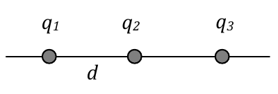

<b>Solución</b>

Solución paso a paso

**Sistema de referencia.** Eje X sobre la recta, con $q_1$ en $x = 0$, $q_2$ en $x = d$ y (en el ítem a) $q_3$ en $x = 2d$.

**Paso 1 — Fuerzas sobre $q_1$ (ítem a).**

- $q_2 < 0$ **atrae** a $q_1$, hacia $+x$: $F_{12} = \dfrac{k|q_1||q_2|}{d^2}$.
- $q_3 > 0$ **repele** a $q_1$, hacia $-x$: $F_{13} = \dfrac{k\,q_1\,q_3}{(2d)^2}$.

**Paso 2 — Condición de fuerza nula.** Los módulos tienen que ser iguales:

$$\frac{k\,q_1\,|q_2|}{d^2} = \frac{k\,q_1\,q_3}{4d^2} \quad\Rightarrow\quad q_3 = 4\,|q_2|$$

**Paso 3 — Equilibrio de $q_3$ (ítem b).** $q_3$ está en equilibrio donde el **campo** de $q_1$ y $q_2$ se anula. Hay que ver en qué zona puede pasar eso:

- **Entre** $q_1$ y $q_2$: el campo de $q_1$ (positiva) apunta a $+x$, alejándose de ella, y el de $q_2$ (negativa) también apunta a $+x$, hacia ella. Se **suman**, así que no puede anularse.
- **A la izquierda** de $q_1$: $q_1$ está más cerca y es mayor ($3|q_2|$), así que su campo siempre gana. No se anula.
- **A la derecha** de $q_2$ ($x > d$): los campos son opuestos y $q_2$ (la menor) está más cerca, así que pueden compensarse.

**Paso 4 — Planteo en $x > d$.**

$$\frac{k\,|q_1|}{x^2} = \frac{k\,|q_2|}{(x - d)^2} \quad\Rightarrow\quad \frac{3}{x^2} = \frac{1}{(x - d)^2} \quad\Rightarrow\quad \sqrt3\,(x - d) = x$$

$$x = \frac{\sqrt3}{\sqrt3 - 1}\,d$$

**Paso 5 — Cálculo.**

$$x = \frac{1{,}732}{0{,}732}\,d = 2{,}366\,d$$

> La guía también da $x = 0{,}635\,d$. Esa es la otra raíz de $3(x - d)^2 = x^2$, pero cae **entre** las cargas, donde los campos se suman: no es una posición de equilibrio.

**Paso 6 — Ítem c.** La condición del paso 4 es $\vec E = 0$, que **no depende de $q_3$**: si el campo es nulo, la fuerza $q_3\vec E$ es nula para cualquier signo de $q_3$.

**Respuesta:**

- a) $q_3 = 4\,|q_2|$
- b) $x = 2{,}366\,d$ medido desde $q_1$ hacia la derecha. (La guía agrega $x = 0{,}635\,d$, que es una raíz espuria; ver paso a paso.)
- c) El signo de $q_3$ es irrelevante.

---

### Ejercicio 2

Los cuerpos puntuales de la figura se hallan suspendidos del mismo punto por hilos de igual longitud ℓ. Ambos cuerpos tienen masa *m* y carga *q*, y puede considerarse nula la masa de los hilos. Si en equilibrio el ángulo entre los hilos es *2θ,* determine la carga *q* de cada uno de los cuerpos en términos de los parámetros propios del problema (*m*, *θ*, *g*, ℓ).

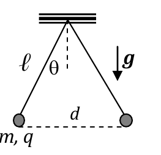

<b>Solución</b>

Solución paso a paso

**Paso 1 — Fuerzas sobre una de las esferas.** Peso $mg$ (hacia abajo), tensión $T$ (a lo largo del hilo) y fuerza eléctrica $F_e$ (horizontal, repulsiva).

**Paso 2 — Equilibrio.** El hilo forma un ángulo $\theta$ con la vertical:

$$\text{horizontal: } T\sin\theta = F_e \qquad \text{vertical: } T\cos\theta = mg$$

Dividiendo: $F_e = mg\tan\theta$.

**Paso 3 — Distancia entre las cargas.** Cada una se aparta $\ell\sin\theta$ de la vertical, así que $d = 2\ell\sin\theta$.

**Paso 4 — Coulomb y despeje.**

$$\frac{k_0\,q^2}{(2\ell\sin\theta)^2} = mg\tan\theta \quad\Rightarrow\quad q = 2\ell\sin\theta\,\sqrt{\frac{mg\tan\theta}{k_0}}$$

**Respuesta:** $q = 2\ell\sin\theta\,\left[\dfrac{mg\tan\theta}{k_0}\right]^{1/2}$ con $k_0 = \dfrac{1}{4\pi\varepsilon_0} \approx 9\times10^9\ \text{N m}^2/\text{C}^2$.

---

### Ejercicio 3

Las dos cargas de la figura se hallan en equilibrio, unidas por un resorte de longitud en reposo ℓ0 = 0,2m deformado 4cm. Para *q1*= 4×10−6 C y *q2*= 2×10−6 C.

a) calcule el valor de la constante elástica *kRES*;

b) justifique si es posible reemplazar el resorte por una carga eléctrica *q3* a los efectos de lograr el equilibrio (en caso afirmativo, indique su signo y su posición relativa)

c) halle la relación *q3* /ℓ (siendo ℓ la distancia entre *q3* y *q1*);

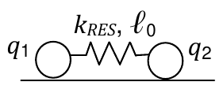

<b>Solución</b>

Solución paso a paso

**Paso 1 — ¿Estirado o comprimido?** Ambas cargas son positivas, así que se **repelen**. Para equilibrarlas, el resorte tiene que **tirar** de ellas hacia adentro: está **estirado** 4 cm. La distancia entre las cargas es $d = \ell_0 + 0{,}04 = 0{,}24\ \text{m}$.

**Paso 2 — Equilibrio (ítem a).** Fuerza elástica = fuerza eléctrica:

$$k_{RES}\,\Delta\ell = \frac{k_0\,q_1\,q_2}{d^2} \quad\Rightarrow\quad k_{RES} = \frac{k_0\,q_1\,q_2}{d^2\,\Delta\ell}$$

**Paso 3 — Cálculo.**

$$k_{RES} = \frac{9\times10^9\cdot4\times10^{-6}\cdot2\times10^{-6}}{(0{,}24)^2\cdot0{,}04}\ \frac{\text{N}}{\text{m}} = \frac{0{,}072}{0{,}002304}\ \frac{\text{N}}{\text{m}} = 31{,}25\ \frac{\text{N}}{\text{m}}$$

**Paso 4 — Reemplazo por una carga (ítem b).** La carga $q_3$ tiene que **atraer** a $q_1$ hacia $q_2$ y a $q_2$ hacia $q_1$, igual que el resorte. Eso se logra con una carga **negativa** ubicada **entre** las dos, es decir, a la izquierda de $q_2$ y a la derecha de $q_1$, manteniendo la separación de 24 cm.

**Paso 5 — Relación pedida (ítem c).** Equilibrio de $q_1$: la atracción de $q_3$ (a distancia $\ell$) compensa la repulsión de $q_2$ (a 0,24 m):

$$\frac{k_0\,q_1\,|q_3|}{\ell^2} = \frac{k_0\,q_1\,q_2}{(0{,}24)^2} \quad\Rightarrow\quad \frac{|q_3|}{\ell^2} = \frac{q_2}{(0{,}24)^2}$$

Para que **también** $q_2$ esté en equilibrio hace falta $\dfrac{|q_3|}{(0{,}24 - \ell)^2} = \dfrac{q_1}{(0{,}24)^2}$. Resolviendo ambas:

$$\ell = 0{,}24\,\frac{\sqrt{q_1}}{\sqrt{q_1} + \sqrt{q_2}} = 0{,}141\ \text{m} \qquad |q_3| = 6{,}86\times10^{-7}\ \text{C}$$

> La guía escribe la relación como $q_3/\ell^2 = q_1/(0{,}24)^2$, que corresponde a medir $\ell$ desde $q_2$ (es la condición de equilibrio de $q_2$). Midiendo $\ell$ desde $q_1$, como dice el enunciado, aparece $q_2$.

**Respuesta:**

- a) $k_{RES} = 31{,}25\ \text{N/m}$
- b) Sí. Para provocar la misma separación (24 cm), $q_3$ debe ser negativa y estar a la izquierda de $q_2$ (entre ambas).
- c) $|q_3|/\ell^2 = q_2/(0{,}24)^2$ con $\ell$ medido desde $q_1$ (la guía: $q_3/\ell^2 = q_1/(0{,}24)^2$, midiendo desde $q_2$).

---

### Ejercicio 4

Se tienen 3 cargas eléctricas equiespaciadas una distancia ℓ, las de los extremos de valor *Q* y la del centro de valor *q’*, como muestra la figura.

a) obtenga la relación entre los valores *Q* y *q’* de manera tal que el campo eléctrico en el punto *P* = (ℓ; 0) sea nulo;

b) suponiendo *q’* = −2*Q,* halle el valor de la fuerza que sentiría una carga de prueba *q* en todo punto del eje *X*>0;

c) con la expresión de la fuerza hallada en el punto (b) calcule el trabajo que realiza la fuerza eléctrica cuando se traslada la carga *q’* desde un punto *x1*>*0* a otro punto *x2*>*x1*.

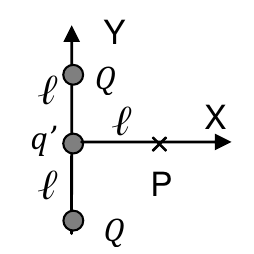

<b>Solución</b>

Solución paso a paso

**Posiciones.** $Q$ en $(0; \ell)$ y en $(0; -\ell)$; $q'$ en el origen. Punto genérico del eje: $(x; 0)$.

**Paso 1 — Campo en $(x; 0)$.**

- De $q'$: $\vec E' = \dfrac{k\,q'}{x^2}\,\hat e_x$.
- De la $Q$ de arriba: vector desde la carga al punto $(x; -\ell)$, distancia $\sqrt{x^2 + \ell^2}$. De la de abajo: $(x; \ell)$. Las componentes $y$ se cancelan y las $x$ se suman:

$$\vec E_Q = \frac{2kQ\,x}{(x^2 + \ell^2)^{3/2}}\,\hat e_x$$

**Paso 2 — Ítem a ($x = \ell$).**

$$\frac{kq'}{\ell^2} + \frac{2kQ\,\ell}{(2\ell^2)^{3/2}} = 0 \quad\Rightarrow\quad q' + \frac{2Q}{2\sqrt2} = 0 \quad\Rightarrow\quad q' = -\frac{\sqrt2}{2}\,Q$$

**Paso 3 — Ítem b.** Con $q' = -2Q$, la fuerza sobre $q$ es $q(\vec E' + \vec E_Q)$:

$$\vec F = k\,2Qq\left(\frac{x}{(x^2 + \ell^2)^{3/2}} - \frac{1}{x^2}\right)\hat e_x$$

**Paso 4 — Ítem c.** El trabajo es la integral de la fuerza a lo largo del eje. Usando $\int \dfrac{x\,dx}{(x^2 + \ell^2)^{3/2}} = -\dfrac{1}{\sqrt{x^2 + \ell^2}}$ y $\int \dfrac{dx}{x^2} = -\dfrac1x$:

$$W = \int_{x_1}^{x_2}\vec F\cdot d\vec x = k\,2Qq\int_{x_1}^{x_2}\left(\frac{x}{(x^2 + \ell^2)^{3/2}} - \frac{1}{x^2}\right)dx = k\,2Qq\left(\frac{-1}{\sqrt{x^2 + \ell^2}} + \frac1x\right)\Bigg|_{x_1}^{x_2}$$

(La guía resuelve el ítem c para la carga de prueba $q$ del ítem b.)

**Respuesta:**

- a) $q' = -\dfrac{\sqrt2}{2}\,Q$
- b) $\vec F = k_0\,2Qq\left(\dfrac{x}{(x^2 + \ell^2)^{3/2}} - \dfrac{1}{x^2}\right)\hat e_x$
- c) $W = k_0\,2Qq\left(\dfrac{-1}{\sqrt{x^2 + \ell^2}} + \dfrac1x\right)\Bigg|_{x_1}^{x_2}$

---

### Ejercicio 5

Las cargas de la figura valen *q1= 2×10-6 C ≡ 2μC; q2= −3×10-6 C ≡ −3μC; q3= 1μC.* Calcule:

a) el valor de la fuerza que las cargas *q1* y *q2* ejercen sobre *q3*;

b) el valor del campo eléctrico que las cargas *q1* y *q2* generan en la posición de la carga *q3*.

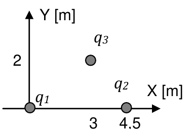

<b>Solución</b>

Solución paso a paso

**Posiciones (en m).** $q_1$ en $(0; 0)$, $q_2$ en $(4{,}5; 0)$, $q_3$ en $(3; 2)$.

**Paso 1 — Conviene calcular primero el campo (ítem b)** y después $\vec F = q_3\vec E$. Para cada carga: $\vec E_i = k q_i\,\dfrac{\vec r - \vec r_i}{|\vec r - \vec r_i|^3}$.

**Paso 2 — Vectores y distancias.**

- Desde $q_1$: $\vec r - \vec r_1 = (3; 2)$, $|\cdot| = \sqrt{13} = 3{,}606$ m.
- Desde $q_2$: $\vec r - \vec r_2 = (-1{,}5; 2)$, $|\cdot| = 2{,}5$ m.

**Paso 3 — Campos.**

$$\vec E_1 = \frac{9\times10^9\cdot2\times10^{-6}}{3{,}606^3}\,(3; 2) = 383{,}9\,(3; 2) = (1152; 768)\ \tfrac{\text{N}}{\text{C}}$$

$$\vec E_2 = \frac{9\times10^9\cdot(-3\times10^{-6})}{2{,}5^3}\,(-1{,}5; 2) = -1728\,(-1{,}5; 2) = (2592; -3456)\ \tfrac{\text{N}}{\text{C}}$$

$$\vec E = \vec E_1 + \vec E_2 = (3744; -2688)\ \tfrac{\text{N}}{\text{C}}$$

**Paso 4 — Fuerza (ítem a).**

$$\vec F = q_3\,\vec E = 10^{-6}\cdot(3744; -2688)\ \text{N} = (3{,}74; -2{,}69)\times10^{-3}\ \text{N}$$

**Respuesta:** a) $\vec F = (3{,}74; -2{,}69)\times10^{-3}\ \text{N}$; b) $\vec E = (3{,}74; -2{,}69)\times10^{3}\ \text{N/C}$

---

### Ejercicio 6

Reemplace ahora la carga *q1* del ejercicio anterior por una varilla de longitud *L=0,25m* cargada con densidad de carga uniforme λ= *8×10-6 C/m.*

a) demuestre que el valor de la carga total de varilla coincide con el valor de *q1* del ejercicio anterior;

b) halle el valor de la fuerza que la varilla y la carga *q2* ejercen sobre *q3*;

c) discuta por qué difieren los resultados respecto del ejercicio anterior a pesar de tratarse de cargas de idéntico valor.

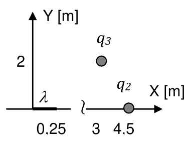

<b>Solución</b>

Solución paso a paso

**Paso 1 — Carga de la varilla (ítem a).**

$$Q = \int_0^{0{,}25}\lambda\,dx' = \lambda L = 8\times10^{-6}\cdot0{,}25\ \text{C} = 2\times10^{-6}\ \text{C} = q_1 \ ✓$$

**Paso 2 — Campo de la varilla en $(x_0; y_0) = (3; 2)$.** Elemento $\delta q = \lambda\,dx'$ en $(x'; 0)$; vector al punto $(x_0 - x'; y_0)$:

$$\vec E_\lambda = k\lambda\int_0^L\frac{(x_0 - x';\ y_0)}{\left[(x_0 - x')^2 + y_0^2\right]^{3/2}}\,dx'$$

Con $u = x_0 - x'$ (de $u = 3$ a $u = 2{,}75$):

$$E_x = k\lambda\left[\frac{1}{\sqrt{(x_0 - L)^2 + y_0^2}} - \frac{1}{\sqrt{x_0^2 + y_0^2}}\right] \qquad E_y = \frac{k\lambda}{y_0}\left[\frac{x_0}{\sqrt{x_0^2 + y_0^2}} - \frac{x_0 - L}{\sqrt{(x_0 - L)^2 + y_0^2}}\right]$$

**Paso 3 — Cálculo.** $k\lambda = 72000\ \text{N m/C}$.

$$E_x = 72000\left[\frac{1}{3{,}400} - \frac{1}{3{,}606}\right] = 1205\ \tfrac{\text{N}}{\text{C}} \qquad E_y = \frac{72000}{2}\left[\frac{3}{3{,}606} - \frac{2{,}75}{3{,}400}\right] = 839\ \tfrac{\text{N}}{\text{C}}$$

**Paso 4 — Fuerza total.** Se suma el campo de $q_2$ del ejercicio 5, $(2592; -3456)$ N/C, y se multiplica por $q_3$:

$$\vec F = 10^{-6}\cdot(1205 + 2592;\ 839 - 3456)\ \text{N} = (3{,}80; -2{,}62)\times10^{-3}\ \text{N}$$

**Paso 5 — Ítem c.** Aunque la carga total es la misma, está **repartida**: cada elemento de la varilla está a una distancia y en una dirección distintas respecto de $q_3$. La suma (integral) de esas contribuciones no es igual a la de toda la carga concentrada en el origen.

**Respuesta:**

- a) $Q = \int_0^{0{,}25}\lambda\,dx' = 2\times10^{-6}$ C
- b) $\vec F \approx (3{,}81; -2{,}60)\times10^{-3}$ N (con más decimales: $(3{,}80; -2{,}62)\times10^{-3}$ N)
- c) La distribución de cargas a lo largo de la varilla provoca una distribución de fuerzas sobre la carga $q_3$. Su integral resulta en una fuerza de magnitud diferente respecto del ejercicio anterior.

---

### Ejercicio 7

La varilla de la figura, de longitud *2L*, posee distribución de carga lineal uniforme λ(*x*)=λ0 (λ0>0) y se halla en vacío.

a) haga un dibujo esquemático de la distribución del campo eléctrico que esta varilla genera en todo punto del eje *Y>0*;

b) halle la expresión del campo eléctrico en todo punto *Y>0*;

c) repita los puntos (a) y (b) suponiendo que la varilla se desplaza horizontalmente de modo tal de tener su extremo izquierdo en *x=0*;

d) en la situación del apartado (c), halle la expresión del campo eléctrico generado por la varilla en todo punto del eje *X>2L*.

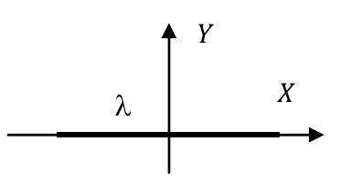

<b>Solución</b>

Solución paso a paso

**Paso 1 — Planteo general.** Elemento $\delta q = \lambda_0\,dx'$ en $(x'; 0)$, punto $(0; y)$. Vector del elemento al punto: $(-x'; y)$.

$$\vec E = k\lambda_0\int dx'\,\frac{(-x';\ y)}{(x'^2 + y^2)^{3/2}}$$

Primitivas útiles: $\displaystyle\int\frac{x'\,dx'}{(x'^2 + y^2)^{3/2}} = \frac{-1}{(x'^2 + y^2)^{1/2}}$ y $\displaystyle\int\frac{dx'}{(x'^2 + y^2)^{3/2}} = \frac{x'}{y^2(x'^2 + y^2)^{1/2}}$.

**Paso 2 — Varilla centrada, de $-L$ a $L$ (ítems a y b).** Por simetría, cada elemento en $x'$ tiene un compañero en $-x'$ y las componentes $x$ se cancelan:

$$E_x = -k\lambda_0\left[\frac{-1}{(x'^2 + y^2)^{1/2}}\right]_{-L}^{L} = 0$$

$$E_y = k\lambda_0\,y\left[\frac{x'}{y^2(x'^2 + y^2)^{1/2}}\right]_{-L}^{L} = k\lambda_0\,\frac{2L}{y\sqrt{L^2 + y^2}}$$

El campo es vertical, hacia arriba, y disminuye al alejarse.

**Paso 3 — Varilla de $0$ a $2L$ (ítem c).** Ya no hay simetría y aparece componente $x$. Como toda la carga queda a la derecha del eje Y, el campo apunta hacia arriba y a la **izquierda**:

$$E_x = -k\lambda_0\left[\frac{-1}{(x'^2 + y^2)^{1/2}}\right]_0^{2L} = k\lambda_0\left(\frac{1}{\sqrt{4L^2 + y^2}} - \frac{1}{|y|}\right) \quad(< 0)$$

$$E_y = k\lambda_0\,y\left[\frac{x'}{y^2(x'^2 + y^2)^{1/2}}\right]_0^{2L} = k\lambda_0\,\frac{2L}{y\sqrt{4L^2 + y^2}}$$

**Paso 4 — Eje X, $x > 2L$ (ítem d).** Vector del elemento al punto: $(x - x'; 0)$:

$$\vec E = k\lambda_0\int_0^{2L}\frac{dx'}{(x - x')^2}\,\hat e_x = k\lambda_0\left[\frac{1}{x - x'}\right]_0^{2L}\hat e_x = k\lambda_0\left(\frac{1}{x - 2L} - \frac1x\right)\hat e_x$$

**Respuesta:**

- a) Campo vertical hacia arriba sobre el eje Y:

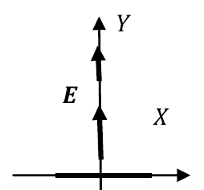

- b) $\vec E = \left(0;\ k_0\lambda_0\dfrac{2L}{y\sqrt{L^2 + y^2}}\right)$
- c) Campo hacia arriba y a la izquierda: $E_x = k_0\lambda_0\left(\dfrac{1}{\sqrt{4L^2 + y^2}} - \dfrac{1}{|y|}\right)$; $E_y = k_0\lambda_0\dfrac{2L}{y\sqrt{4L^2 + y^2}}$

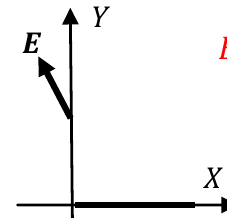

- d) $\vec E = k_0\lambda_0\left(\dfrac{1}{x - 2L} - \dfrac1x\right)\hat e_x$ para $x > 2L$

---

### Ejercicio 8

La varilla de la figura, de longitud *2L*, se halla en vacío y tiene densidad de carga que varía en la forma λ(*x*) =λ0 *x* (λ0>0).

a) calcule el valor de la carga total de la varilla;

b) dibuje las líneas de campo de la distribución sobre el eje Y;

c) halle la expresión del campo eléctrico en todo punto Y>0 y corrobore que se corresponde con las líneas de campo del inciso (b);

d) discuta cómo cambian los resultados si la densidad de carga fuera de la forma λ(x)=λ0 x2.

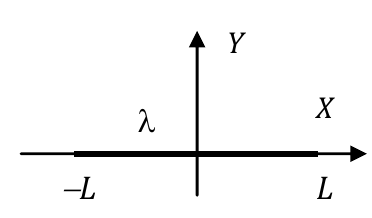

<b>Solución</b>

Solución paso a paso

**Paso 1 — Carga total (ítem a).**

$$Q = \int_{-L}^{L}\lambda_0\,x\,dx = \lambda_0\left[\frac{x^2}{2}\right]_{-L}^{L} = 0$$

La mitad derecha es positiva y la izquierda negativa, con igual módulo.

**Paso 2 — Idea cualitativa (ítem b).** Las líneas salen de la mitad positiva (derecha) y van hacia la negativa (izquierda). Sobre el eje Y, por la simetría, el campo es **horizontal y apunta hacia $-x$**.

**Paso 3 — Cálculo (ítem c).**

$$\vec E = k\lambda_0\int_{-L}^{L}x'\,dx'\,\frac{(-x';\ y)}{(x'^2 + y^2)^{3/2}}$$

- Componente $y$: el integrando $x'y/(\dots)^{3/2}$ es **impar** en $x'$, así que la integral es 0.
- Componente $x$: el integrando $-x'^2/(\dots)^{3/2}$ es par y negativo. Usando la primitiva $\int\frac{x'^2\,dx'}{(x'^2 + y^2)^{3/2}} = \ln\!\left(x' + \sqrt{x'^2 + y^2}\right) - \frac{x'}{\sqrt{x'^2 + y^2}}$:

$$E_x = -2k\lambda_0\left[\ln\!\left(\frac{L + \sqrt{L^2 + y^2}}{y}\right) - \frac{L}{\sqrt{L^2 + y^2}}\right] \quad(< 0)$$

El resultado coincide con el dibujo: campo horizontal hacia la izquierda.

**Paso 4 — Ítem d.** Con $\lambda = \lambda_0x^2$, la densidad es positiva en toda la varilla y **par**: $Q = \dfrac{2\lambda_0L^3}{3} \ne 0$. Por la simetría par, las componentes $x$ se cancelan y en el eje Y el campo tiene solo componente $y$ (hacia arriba).

**Respuesta:**

- a) $Q = 0$
- b) Campo horizontal hacia $-x$ sobre el eje Y:

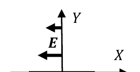

- c) $\vec E = k_0\lambda_0\displaystyle\int_{-L}^{L}x'\,dx'\,\frac{(-x';\ y)}{(x'^2 + y^2)^{3/2}}$ (la segunda integral resulta nula) $= \left(-2k_0\lambda_0\left[\ln\dfrac{L + \sqrt{L^2 + y^2}}{y} - \dfrac{L}{\sqrt{L^2 + y^2}}\right];\ 0\right)$
- d) $Q_{TOTAL}$ no sería nula, y el CE sobre el eje Y tendría componente solo paralela al eje Y.

---

### Ejercicio 9

Un anillo de radio *R* está cargado con densidad lineal uniforme de carga λ > 0 y se halla en el plano horizontal *XY* de un sistema de referencia. En el eje de revolución de la espira (el eje *Z*) se coloca una carga puntual de valor +*q* y masa *m*. La partícula se halla en equilibrio a una altura *z=D* sobre el plano de la espira. Halle la expresión:

a) de la densidad de carga λ del anillo (en función de los parámetros *R, D, q, m*);

b) del campo eléctrico en el centro de la espira (el punto *(0;0;0)*).

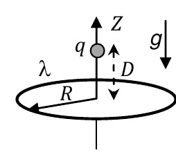

<b>Solución</b>

Solución paso a paso

**Paso 1 — Campo del anillo en su eje.** Con $Q = 2\pi R\lambda$ (ver [teoría](teoria.md#anillo-en-su-eje)):

$$E(z) = \frac{kQ\,z}{(R^2 + z^2)^{3/2}} = \frac{2\pi kR\lambda\,z}{(R^2 + z^2)^{3/2}}\quad(\text{hacia } +z)$$

**Paso 2 — Equilibrio en $z = D$ (ítem a).** La fuerza eléctrica hacia arriba compensa el peso:

$$q\,\frac{2\pi kR\lambda\,D}{(R^2 + D^2)^{3/2}} = mg \quad\Rightarrow\quad \lambda = \frac{(R^2 + D^2)^{3/2}\,mg}{2\pi qkRD}$$

**Paso 3 — Campo en el centro (ítem b).** El anillo **no** genera campo en su centro (todas las contribuciones se cancelan por simetría). Solo queda el campo de la carga $+q$, que está a distancia $D$ arriba y apunta alejándose de ella, es decir hacia abajo:

$$\vec E = \frac{kq}{D^2}\,(-\hat e_z)$$

**Respuesta:** a) $\lambda = \dfrac{(R^2 + D^2)^{3/2}\,mg}{2\pi qkRD}$; b) $\vec E = \dfrac{kq}{D^2}\,(-\hat e_z)$

---

### Ejercicio 10

Considere una semicircunferencia de radio *R* cargada con distribución de carga cuya densidad lineal es *λ(ϕ)= λ0 cosϕ* (*λ0* > 0). El centro de curvatura de la semicircunferencia es el punto ***P***.

a) indique la dirección y sentido de la fuerza que sentiría una carga positiva ubicada en el punto ***P***.

b) dibuje las líneas de campo en los puntos (0; 0 < y < R) correspondientes a esta distribución.

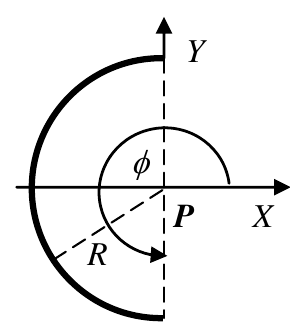

<b>Solución</b>

Solución paso a paso

**Paso 1 — Signo de la carga.** La semicircunferencia está a la izquierda: $\phi \in [\pi/2;\ 3\pi/2]$. Ahí $\cos\phi \le 0$, así que **toda la carga es negativa** (más intensa cerca de $\phi = \pi$, sobre el eje X, y nula en los extremos).

**Paso 2 — Campo en P.** Elemento en $R(\cos\phi; \sin\phi)$, $\delta q = \lambda_0\cos\phi\,R\,d\phi$, versor del elemento a P: $-(\cos\phi; \sin\phi)$:

$$\vec E = -\frac{k\lambda_0}{R}\int_{\pi/2}^{3\pi/2}\cos\phi\,(\cos\phi;\ \sin\phi)\,d\phi$$

- $\int_{\pi/2}^{3\pi/2}\cos^2\phi\,d\phi = \dfrac{\pi}{2}$
- $\int_{\pi/2}^{3\pi/2}\cos\phi\sin\phi\,d\phi = \left[\dfrac{\sin^2\phi}{2}\right]_{\pi/2}^{3\pi/2} = 0$

$$\vec E = -\frac{\pi k\lambda_0}{2R}\,\hat e_x$$

**Paso 3 — Fuerza sobre una carga positiva (ítem a).** $\vec F = q\vec E$ tiene la dirección del eje X y sentido $-x$: la carga positiva es atraída por la semicircunferencia negativa.

**Paso 4 — Líneas de campo (ítem b).** Las líneas terminan en las cargas negativas del arco, así que en el eje Y apuntan hacia la izquierda, hacia el arco. Cerca de $y = 0$ son casi horizontales; al subir se inclinan hacia la parte superior del arco.

**Respuesta:**

- a) $\vec F = F_x\,(-\hat e_x)$, con $F_x = \dfrac{\pi k\lambda_0 q}{2R} > 0$.
- b) Líneas de campo de la guía:

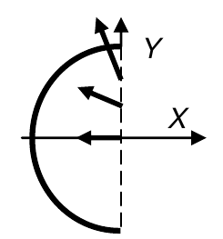

---

### Ejercicio 11

Un disco plano, de radio *rb*, fijo a un sistema de referencia, está cargado homogéneamente con densidad superficial de carga σ, como muestra la figura. Halle la expresión de la intensidad del campo eléctrico en todo punto del eje de revolución del disco (eje *Z* en la figura).

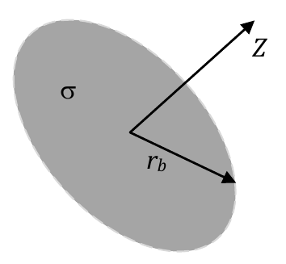

<b>Solución</b>

Solución paso a paso

**Paso 1 — Dividir el disco en anillos.** Un anillo de radio $r$ y ancho $dr$ tiene carga $dQ = \sigma\,2\pi r\,dr$ y, en el eje, genera (ver ejercicio 9):

$$dE_z = \frac{k\,dQ\,z}{(r^2 + z^2)^{3/2}} = \frac{2\pi k\sigma z\,r\,dr}{(r^2 + z^2)^{3/2}}$$

**Paso 2 — Integrar de $0$ a $r_b$.** Con $u = r^2 + z^2$:

$$E_z = 2\pi k\sigma z\int_0^{r_b}\frac{r\,dr}{(r^2 + z^2)^{3/2}} = -\left(\frac{2\pi k\sigma z}{(r^2 + z^2)^{1/2}}\right)\Bigg|_0^{r_b} = 2\pi k\sigma z\left[\frac{1}{|z|} - \frac{1}{\sqrt{r_b^2 + z^2}}\right]$$

**Paso 3 — Ordenar.** Con $2\pi k = \dfrac{1}{2\varepsilon_0}$ y $\dfrac{z}{|z|} = \text{sg}(z)$:

$$\vec E = \frac{\sigma}{2\varepsilon_0}\,\text{sg}(z)\left[1 - \frac{1}{\sqrt{1 + r_b^2/z^2}}\right]\hat e_Z$$

**Respuesta:** $\vec E = \dfrac{\sigma}{2\varepsilon_0}\,\text{sg}(z)\left[1 - \dfrac{1}{\sqrt{1 + r_b^2/z^2}}\right]\hat e_Z$

---

### Ejercicio 12

A partir del resultado del ejercicio anterior, halle la expresión del campo generado (en vacío) por:

a) un anillo de radio *rb*;

b) una corona de radios interno *ra* y externo *rb;*

c) un plano infinito.

<b>Solución</b>

Solución paso a paso

**Paso 1 — Anillo (ítem a).** Se integra directamente sobre el anillo (densidad $\lambda_0$): elemento en $(r_b\cos\phi'; r_b\sin\phi'; 0)$, vector al punto $(-r_b\cos\phi'; -r_b\sin\phi'; z)$:

$$\vec E = k_0\lambda_0\int_0^{2\pi}r_b\,d\phi'\,\frac{(-r_b\cos\phi';\ -r_b\sin\phi';\ z)}{(r_b^2 + z^2)^{3/2}}$$

Las integrales de $\cos\phi'$ y $\sin\phi'$ en una vuelta son 0; la de $z$ da $2\pi$:

$$\vec E = \frac{2\pi k_0\lambda_0\,r_b\,z}{(r_b^2 + z^2)^{3/2}}\,\hat e_z$$

**Paso 2 — Corona (ítem b).** Una corona es un disco de radio $r_b$ al que se le quita un disco de radio $r_a$. Por superposición, $\vec E_{corona} = \vec E_{disco}(r_b) - \vec E_{disco}(r_a)$:

$$\vec E = \frac{\sigma}{2\varepsilon_0}\,\text{sg}(z)\left[\frac{1}{\sqrt{1 + r_a^2/z^2}} - \frac{1}{\sqrt{1 + r_b^2/z^2}}\right]\hat e_Z$$

**Paso 3 — Plano infinito (ítem c).** Se hace $r_b \to \infty$ en el disco: el término $1/\sqrt{1 + r_b^2/z^2} \to 0$:

$$\vec E = \frac{\sigma}{2\varepsilon_0}\,\text{sg}(z)\,\hat e_Z$$

**Respuesta:**

- a) $\vec E = \dfrac{2\pi k_0\lambda_0 r_b z}{(r_b^2 + z^2)^{3/2}}\,\hat e_z$
- b) $\vec E = \dfrac{\sigma}{2\varepsilon_0}\,\text{sg}(z)\left[\dfrac{1}{\sqrt{1 + r_a^2/z^2}} - \dfrac{1}{\sqrt{1 + r_b^2/z^2}}\right]\hat e_Z$
- c) $\vec E = \dfrac{\sigma}{2\varepsilon_0}\,\text{sg}(z)\,\hat e_Z$

---

### Ejercicio 13

La configuración de cargas de la figura consiste en un anillo de radio *R,* uniformemente cargado con densidad de carga *λ1* (*λ1>0*) y un alambre de longitud *2L* que pasa por el centro del anillo y está cargado con densidad de carga variable, de la forma *λ2= β λ0 x2*. (β es un coeficiente de valor unidad y dimensiones m−2, que se incorpora al solo efecto de ajustar las unidades). Sabiendo que la carga total de la configuración vale cero, halle la expresión de λ0 en función del radio *R* del anillo, de *L* y de λ1.

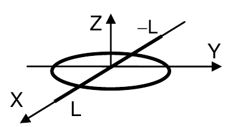

<b>Solución</b>

Solución paso a paso

**Paso 1 — Carga del anillo.** $Q_1 = \lambda_1\cdot2\pi R$.

**Paso 2 — Carga del alambre** (de $-L$ a $L$):

$$Q_2 = \int_{-L}^{L}\beta\lambda_0x^2\,dx = \beta\lambda_0\,\frac{2L^3}{3}$$

**Paso 3 — Carga total nula.**

$$2\pi R\lambda_1 + \frac{2\beta\lambda_0L^3}{3} = 0 \quad\Rightarrow\quad \lambda_0 = -\frac{3\pi R\lambda_1}{\beta L^3}$$

**Respuesta:** $\lambda_0 = -3\pi R\lambda_1/(\beta L^3)$

---

### Ejercicio 14

La partícula de la figura, de masa *m* y carga *q* > 0 se halla frente a un plano infinito cargado con distribución uniforme de carga de densidad *σ* > 0 y en el vacío. Halle la expresión de la aceleración de la partícula. (No tenga en cuenta la acción del campo gravitatorio sobre la partícula. Para ello puede pensar que se halla sobre un plano horizontal sin rozamiento y que el plano infinito es perpendicular al plano horizontal).

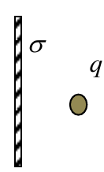

<b>Solución</b>

Solución paso a paso

**Paso 1 — Campo del plano.** Es uniforme, perpendicular al plano y alejándose de él (σ > 0): $E = \dfrac{\sigma}{2\varepsilon_0}$.

**Paso 2 — Newton.** $ma = qE$:

$$a = \frac{q\sigma}{2\varepsilon_0 m}$$

Es constante: la partícula se aleja del plano con MRUV.

**Respuesta:** $a = \dfrac{q\sigma}{2\varepsilon_0 m}$, perpendicular al plano y alejándose de él.

---

### Ejercicio 15

Un cuerpo puntual de masa *m* = 20g se encuentra suspendido de un hilo que forma un ángulo α = 370 con respecto a una placa plana (que puede considerarse infinita) cargada con densidad uniforme *σ* = 8,85 μC/m2. Calcule el valor de la carga *q.*

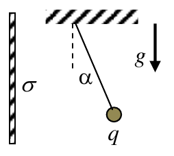

<b>Solución</b>

Solución paso a paso

**Paso 1 — Equilibrio.** Igual que en el ejercicio 2: $T\sin\alpha = qE$ y $T\cos\alpha = mg$, así que $qE = mg\tan\alpha$.

**Paso 2 — Campo de la placa:** $E = \dfrac{\sigma}{2\varepsilon_0}$.

**Paso 3 — Despeje.**

$$q = \frac{2\varepsilon_0\,mg\tan\alpha}{\sigma}$$

**Paso 4 — Cálculo.**

$$q = \frac{2\cdot8{,}85\times10^{-12}\cdot0{,}02\cdot9{,}8\cdot\tan37^\circ}{8{,}85\times10^{-6}}\ \text{C} = 2\times10^{-6}\cdot0{,}196\cdot0{,}754\ \text{C} = 2{,}95\times10^{-7}\ \text{C} \approx 3\times10^{-7}\ \text{C}$$

**Respuesta:** $q \approx 3\times10^{-7}$ C

---

### Ejercicio 16

La carga puntual *q* del ejercicio anterior (cuya masa es m=20g) se coloca ahora entre dos planos (a los efectos prácticos, ambos infinitos). La distancia entre la carga puntual a cada plano es d=25cm. El hilo forma un ángulo α con la vertical. Para *σ* = 8,85 μC/m2 y *q*= 3×10−7 C,

a) halle el valor del ángulo α;

b) discuta si el ángulo se modifica al duplicar la distancia entre las placas.

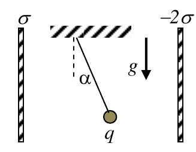

<b>Solución</b>

Solución paso a paso

**Paso 1 — Campo entre los planos.** Plano izquierdo ($+\sigma$): su campo apunta alejándose de él, hacia la derecha, con módulo $\sigma/(2\varepsilon_0)$. Plano derecho ($-2\sigma$): su campo apunta hacia él, también hacia la derecha, con módulo $2\sigma/(2\varepsilon_0)$. Se suman:

$$E = \frac{\sigma}{2\varepsilon_0} + \frac{2\sigma}{2\varepsilon_0} = \frac{3\sigma}{2\varepsilon_0}$$

**Paso 2 — Equilibrio.** $\tan\alpha = \dfrac{qE}{mg}$:

$$\tan\alpha = \frac{3\sigma q}{2\varepsilon_0\,mg} \qquad\Longleftrightarrow\qquad q = 2\varepsilon_0\,\frac{mg\tan\alpha}{3\sigma}$$

**Paso 3 — Cálculo.**

$$\tan\alpha = \frac{3\cdot8{,}85\times10^{-6}\cdot3\times10^{-7}}{2\cdot8{,}85\times10^{-12}\cdot0{,}02\cdot9{,}8} = \frac{7{,}97\times10^{-12}}{3{,}47\times10^{-12}} = 2{,}30 \quad\Rightarrow\quad \alpha = 66^\circ$$

**Paso 4 — Ítem b.** El campo de un plano infinito **no depende de la distancia**. Duplicar la separación no cambia $E$, ni la fuerza, ni el ángulo.

**Respuesta:** a) $q = 2\varepsilon_0\dfrac{mg\tan\alpha}{3\sigma} \Rightarrow \alpha = 66^\circ$; b) la fuerza (y luego el ángulo) es independiente de la distancia de la carga a los planos.

---

### Ejercicio 17

Sea la configuración de cargas de la figura, formada por dos hilos conductores paralelos de longitud *2L*, separados una distancia *a*, ambos con densidad de carga λ. Todo el sistema se halla en el mismo plano y en el vacío.

a) apelando a razonamientos de simetría puede inferirse cuál o cuáles son las componentes del campo sobre el eje Z. Dibuje las líneas de campo eléctrico a lo largo de este eje;

b) indique cuánto vale el campo eléctrico en el origen de coordenadas;

c) calcule el valor del campo eléctrico ***E*** en todo punto del eje *Z* (observe que los alambres se extienden entre −L y +L); asuma L>>a.

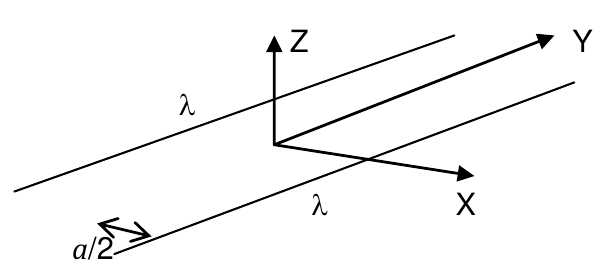

<b>Solución</b>

Solución paso a paso

**Geometría.** Hilos paralelos al eje Y, en $x = \pm a/2$, $z = 0$, entre $y = -L$ y $y = L$. Punto $(0; 0; z)$.

**Paso 1 — Simetría (ítem a).** Para cada elemento de un hilo en $y$ hay otro en $-y$: se cancelan las componentes $y$. Además, los dos hilos son simétricos respecto del plano $x = 0$: se cancelan las componentes $x$. Solo sobrevive $E_z$. Para $\lambda > 0$, las líneas sobre el eje Z se alejan del plano de los hilos.

**Paso 2 — Origen (ítem b).** En el origen también se anula $E_z$ (todo está en el plano $z = 0$). Las fuerzas sobre una carga de prueba se cancelan de a pares: $\vec E(0) = 0$.

**Paso 3 — Campo de un hilo finito en su mediatriz.** El punto $(0;0;z)$ está sobre la mediatriz de cada hilo, a una distancia $d = \sqrt{a^2/4 + z^2}$. Con el resultado de la [teoría](teoria.md#hilo-finito-en-un-punto-fuera-de-su-eje) (longitud $2L$):

$$E_{hilo} = \frac{2k\lambda}{d}\,\frac{L}{\sqrt{L^2 + d^2}}\quad(\text{dirigido del hilo al punto})$$

**Paso 4 — Componente Z de cada hilo y suma.** La componente $z$ es $E_{hilo}\cdot\dfrac{z}{d}$. Los dos hilos aportan lo mismo:

$$E_z = 2\cdot\frac{2k\lambda L}{d\sqrt{L^2 + d^2}}\cdot\frac{z}{d} = \frac{4k\lambda Lz}{d^2\sqrt{d^2 + L^2}}$$

$$\vec E = k_0\lambda\left(0;\ 0;\ \frac{4Lz}{\left(\frac{a^2}{4} + z^2\right)\sqrt{\frac{a^2}{4} + z^2 + L^2}}\right)$$

**Respuesta:**

- a) La simetría especular respecto del eje Y permite inferir que la única componente que puede sobrevivir es $E_z$ (en el plano XY las componentes se cancelan de a pares).
- b) Una carga de prueba en el origen tiene fuerzas aplicadas de a pares iguales y opuestos. Luego, debe ser $E(z = 0) = 0$.
- c) $\vec E = k_0\lambda\left(0;\ 0;\ \dfrac{4Lz}{\left(\frac{a^2}{4} + z^2\right)\sqrt{\frac{a^2}{4} + z^2 + L^2}}\right)$

---

### Ejercicio 18

Dada la configuración de la figura (un alambre semicircular cargado con densidad uniforme λ0 y dos cargas puntuales) calcule el campo eléctrico ***E*** en todo punto del eje que pasa por el punto C y es perpendicular al plano del dibujo. Considere puntuales a las cargas de los extremos. Discuta si el aro se halla en una posición de equilibrio, y de no ser así indique la dirección y sentido de la fuerza que debería aplicarse al aro para evitar que se desplace. Asuma *q* > 0, λ0 > 0.

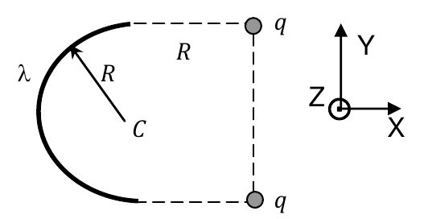

<b>Solución</b>

Solución paso a paso

**Geometría.** C en el origen. Arco de radio $R$ a la izquierda: $\phi \in [\pi/2;\ 3\pi/2]$. Cargas $q$ en $(R; R; 0)$ y $(R; -R; 0)$. Punto $(0; 0; z)$.

**Paso 1 — Campo del arco.** Elemento en $R(\cos\phi; \sin\phi; 0)$, $\delta q = \lambda_0R\,d\phi$, vector al punto $(-R\cos\phi; -R\sin\phi; z)$, distancia $\sqrt{R^2 + z^2}$:

$$\vec E_\lambda = \frac{k_0\lambda_0R}{(R^2 + z^2)^{3/2}}\int_{\pi/2}^{3\pi/2}(-R\cos\phi;\ -R\sin\phi;\ z)\,d\phi$$

- $\int\cos\phi\,d\phi = \sin\frac{3\pi}{2} - \sin\frac{\pi}{2} = -2$, entonces la componente $x$ vale $+2R$.
- $\int\sin\phi\,d\phi = 0$.
- $\int z\,d\phi = \pi z$.

$$\vec E_\lambda = \frac{k_0\lambda_0}{(R^2 + z^2)^{3/2}}\left(2R^2\,\hat e_x + \pi Rz\,\hat e_z\right)$$

**Paso 2 — Campo de las dos cargas.** Vectores al punto: $(-R; \mp R; z)$, distancia $\sqrt{2R^2 + z^2}$. Las componentes $y$ se cancelan:

$$\vec E_q = \frac{2k_0q}{(2R^2 + z^2)^{3/2}}\left(-R\,\hat e_x + z\,\hat e_z\right)$$

**Paso 3 — ¿Equilibrio del aro?** El arco (positivo) repele a las cargas $q$ (positivas): el arco está a la izquierda, así que las empuja hacia $+x$. Las componentes $y$ se cancelan por simetría. Por acción y reacción, las cargas empujan al arco hacia $-x$. El aro **no** está en equilibrio: tiende a desplazarse hacia $-\hat e_x$. Para mantenerlo quieto hay que aplicarle una fuerza en dirección X, sentido $+\hat e_x$.

**Respuesta:** $\vec E = \vec E_\lambda + \vec E_q$ ($\vec E_\lambda$ es el campo del alambre y $\vec E_q$ el generado por las cargas puntuales), con

$$\vec E_\lambda = \frac{k_0\lambda_0}{(R^2 + z^2)^{3/2}}(2R^2\,\hat e_x + \pi Rz\,\hat e_z) \qquad \vec E_q = \frac{2k_0q}{(2R^2 + z^2)^{3/2}}(-R\,\hat e_x + z\,\hat e_z)$$

El aro tiende a desplazarse en la dirección $-\hat e_x$; hay que aplicarle una fuerza en $+\hat e_x$.

---

### Ejercicio 19

El campo eléctrico que ingresa a una región del espacio (un cubo de 25m de arista) es constante en el tiempo, tiene la dirección del eje ***x***, apunta en el sentido positivo de dicho eje y decrece desde *E1* = 560 N/C en *x1* = 0 hasta *E2* = 410 N/C en *x2* = 25 m. Calcule el valor de la carga eléctrica encerrada en la región cúbica, sabiendo que dos de sus caras son perpendiculares a la dirección del campo, una de ellas está ubicada en el plano *yz* y la otra del lado positivo del eje *x*. (*ε0* = 8,85.10-12 C2/N.m2).

<b>Solución</b>

Solución paso a paso

**Paso 1 — Flujo por cada cara.** El campo es paralelo al eje X, así que las cuatro caras laterales no tienen flujo ($\vec E\perp\hat n$).

- Cara en $x = 0$: $\hat n = -\hat e_x$ (hacia afuera), $\phi_1 = -E_1A$.
- Cara en $x = 25$ m: $\hat n = +\hat e_x$, $\phi_2 = +E_2A$.

**Paso 2 — Gauss.**

$$\frac{Q}{\varepsilon_0} = \phi_1 + \phi_2 = (E_2 - E_1)\,A \quad\Rightarrow\quad Q = \varepsilon_0\,[E(x = 25\text{ m}) - E(x = 0)]\,(25\text{ m})^2$$

**Paso 3 — Cálculo.**

$$Q = 8{,}85\times10^{-12}\cdot(410 - 560)\cdot625\ \text{C} = -8{,}3\times10^{-7}\ \text{C} = -0{,}83\ \mu\text{C}$$

Tiene sentido: entra más flujo del que sale, así que adentro hay carga negativa (sumideros de líneas).

**Respuesta:** $Q = \varepsilon_0[E(x = 25\text{ m}) - E(x = 0)](25\text{ m})^2 = -0{,}83\ \mu$C

---

### Ejercicio 20

Una carga puntual *q* = 3 μC se halla en el centro de una esfera de 1 cm de radio. Calcule:

a) el valor del campo eléctrico en los puntos situados en la superficie de la esfera;

b) el valor del flujo del campo eléctrico debido a la carga puntual a través de la superficie de la esfera;

c) el valor del flujo del campo eléctrico debido a la misma carga puntual pero a través de la superficie de un cubo de arista 2cm cuyo centro coincide con el centro de la esfera;

d) a la luz del resultado anterior, discuta cómo varía el flujo si

d1) se duplica el área de la superficie que encierra a la carga;

d2) se duplica el valor de la carga encerrada;

e) discuta si el valor del flujo varía si la carga puntual es desplazada del centro de simetría (pero se mantiene dentro de la superficie cerrada);

f) discuta si el valor del campo eléctrico sobre la superficie de la esfera varía si la carga puntual es desplazada del centro de simetría (pero se mantiene dentro de la superficie cerrada).

<b>Solución</b>

Solución paso a paso

**Paso 1 — Campo (ítem a).** $E = \dfrac{kq}{r^2}$, radial:

$$E = \frac{9\times10^9\cdot3\times10^{-6}}{(0{,}01)^2}\ \tfrac{\text{N}}{\text{C}} = 2{,}7\times10^8\ \tfrac{\text{N}}{\text{C}}$$

**Paso 2 — Flujo (ítem b).** Por Gauss, $\phi = q/\varepsilon_0$ (también sale de $E\cdot4\pi r^2$):

$$\phi = \frac{3\times10^{-6}}{8{,}85\times10^{-12}}\ \tfrac{\text{N m}^2}{\text{C}} = 3{,}39\times10^5\ \tfrac{\text{N m}^2}{\text{C}}$$

**Paso 3 — Ítems c a e.** El flujo depende **solo de la carga encerrada**, no de la forma, el tamaño de la superficie ni la posición de la carga adentro:

- c) cubo: el mismo valor, $3{,}39\times10^5$ N m²/C;
- d1) duplicar el área: no varía;
- d2) duplicar la carga: el flujo se duplica;
- e) mover la carga adentro: no varía.

**Paso 4 — Ítem f.** El **campo** sí depende de la distancia a la carga: si la carga se corre del centro, cada punto de la esfera queda a distinta distancia y $E$ deja de ser uniforme sobre la superficie (aunque el flujo total siga igual).

**Respuesta:** a) $\vec E = 2{,}7\times10^8$ N/C $\hat e_r$; b) $\phi_E = 3{,}39\times10^5$ N m²/C; c) $3{,}39\times10^5$ N m²/C; d1) no varía; d2) se duplica; e) el valor del flujo no varía; f) se modifica y deja de ser homogéneo sobre la superficie.

---

### Ejercicio 21

Regrese al ejercicio 5 y calcule:

a) el potencial (respecto del infinito) de las cargas *q1* y *q2* en el punto (3;2) (donde se halla *q3*);

b) el trabajo que realiza la fuerza eléctrica cuando se transporta la carga *q3* desde su posición hasta el punto (0; 2).

<b>Solución</b>

Solución paso a paso

**Paso 1 — Potencial de cargas puntuales.** $V = \sum\dfrac{kq_i}{r_i}$ (escalar: se suma sin vectores).

**Paso 2 — Distancias.**

- Al punto (3; 2): desde $q_1$, $\sqrt{13} = 3{,}606$ m; desde $q_2$, 2,5 m.
- Al punto (0; 2): desde $q_1$, 2 m; desde $q_2$, $\sqrt{4{,}5^2 + 2^2} = 4{,}924$ m.

**Paso 3 — Potenciales (ítem a).**

$$V_{q_1}(3;2) = \frac{9\times10^9\cdot2\times10^{-6}}{3{,}606}\ \text{V} = 4992{,}3\ \text{V} \qquad V_{q_2}(3;2) = \frac{9\times10^9\cdot(-3\times10^{-6})}{2{,}5}\ \text{V} = -10800\ \text{V}$$

$$V(3;2) = -5807{,}7\ \text{V}$$

**Paso 4 — Trabajo de la fuerza eléctrica (ítem b).** $W_{el} = -q_3\,\Delta V = -q_3\,[V_{final} - V_{inicial}]$:

$$V(0;2) = \frac{18000}{2} - \frac{27000}{4{,}924} = 9000 - 5483 = 3517{,}1\ \text{V}$$

$$W_{el} = -10^{-6}\,[3517{,}1 - (-5807{,}7)]\ \text{J} = -9{,}32\times10^{-3}\ \text{J}$$

Es negativo: hay que "empujar" a $q_3$ (positiva) hacia una zona de mayor potencial.

**Respuesta:**

- a) $V_{q_1}(3;2) = 4992{,}3$ V; $V_{q_2}(3;2) = -10800$ V; $V(3;2) = -5807{,}3$ V
- b) $V(0;2) = 3517{,}1$ V y $W_{el} = -q_3[V(0;2) - V(3;2)] = -9{,}32\times10^{-3}$ J

---

### Ejercicio 22

a) regrese al ejercicio 6 y calcule el potencial que genera el alambre en el punto (3;2) respecto del infinito. Compare este valor con el obtenido para el potencial de la carga *q1* en el ejercicio anterior. Discuta a qué se debe la diferencia.

b) a partir del valor del potencial del alambre, calcule el trabajo que debe efectuarse en contra de la fuerza eléctrica para transportar la carga *q3* desde el infinito hasta su posición final, en presencia del alambre y la carga *q2*.

Ayuda de la guía:

$$\int_0^L\frac{dx}{\sqrt{(x - 3)^2 + 4}} = \int_{-3}^{L-3}\frac{du}{\sqrt{u^2 + 4}} = \ln\left[u + \sqrt{u^2 + 4}\right]_{-3}^{-2{,}75}$$

<b>Solución</b>

Solución paso a paso

**Paso 1 — Potencial del alambre.** Elemento $\lambda\,dx$ en $(x; 0)$, distancia al punto $\sqrt{(x - 3)^2 + 4}$:

$$V_{al} = k\lambda\int_0^L\frac{dx}{\sqrt{(x - 3)^2 + 4}} = k\lambda\,\ln\left[u + \sqrt{u^2 + 4}\right]_{-3}^{-2{,}75}$$

**Paso 2 — Cálculo.**

$$\ln\!\left(-2{,}75 + \sqrt{11{,}5625}\right) - \ln\!\left(-3 + \sqrt{13}\right) = \ln(0{,}6504) - \ln(0{,}6056) = 0{,}07140$$

$$V_{al} = 9\times10^9\cdot8\times10^{-6}\cdot0{,}07140\ \text{V} = 5140{,}7\ \text{V}$$

Es mayor que los 4992,3 V de la carga puntual: parte de la carga del alambre está **más cerca** del punto que el origen, y el potencial $1/r$ pesa más las cargas cercanas.

**Paso 3 — Trabajo externo (ítem b).** Llevar $q_3$ desde el infinito (donde $V = 0$) sin variar su energía cinética:

$$W_{ext} = q_3\,[V(3;2) - V(\infty)] = q_3\,(V_{al} + V_{q_2})$$

$$W_{ext} = 10^{-6}\,(5140{,}7 - 10800)\ \text{J} = -5{,}66\times10^{-3}\ \text{J}$$

**Respuesta:** a) $V_{al} = 5140{,}7$ V; b) $W = -5{,}66\times10^{-3}$ J

---

### Ejercicio 23

Sea la configuración de cargas de la figura, en la que cuatro cargas puntuales, de valor *q* las superiores y *−q* las inferiores, se hallan en los vértices de un cuadrado de lado *2L* y en el vacío. El punto *A* se halla en el centro del cuadrado, y el punto *B* a cierta distancia de *A* sobre la mediatriz del lado derecho del cuadrado. Halle:

a) la expresión del vector campo eléctrico generado por la configuración en el punto *A*.

b) el trabajo mecánico requerido para llevar una carga puntual de valor *Q* desde *A* hasta *B*, con energía cinética constante y en contra sólo de la fuerza eléctrica.

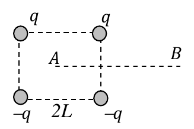

<b>Solución</b>

Solución paso a paso

**Paso 1 — Distancias.** Cada vértice está a $\sqrt2\,L$ de A (media diagonal). Módulo del campo de cada carga en A:

$$E_i = \frac{1}{4\pi\varepsilon_0}\frac{q}{2L^2}$$

**Paso 2 — Direcciones.** Las cargas de arriba ($+q$) generan campo que se aleja de ellas: apunta hacia abajo en diagonal. Las de abajo ($-q$) generan campo hacia ellas: también hacia abajo en diagonal. Las componentes horizontales se cancelan de a pares y las verticales se suman. Cada componente vertical es $E_i\cos45^\circ = E_i/\sqrt2$:

$$E_A = 4\cdot\frac{1}{4\pi\varepsilon_0}\frac{q}{2L^2}\cdot\frac{1}{\sqrt2} = \frac{1}{4\pi\varepsilon_0}\frac{\sqrt2}{L^2}\,q$$

**Paso 3 — Potenciales (ítem b).** $W = Q\,(V_B - V_A)$.

- En A las cuatro cargas están a la misma distancia y suman cero: $V_A = 0$.
- B está en la mediatriz horizontal, así que equidista de cada $q$ y de la $-q$ que tiene debajo: sus potenciales se anulan de a pares. $V_B = 0$.

Entonces $W_{AB} = 0$.

**Respuesta:**

- a) $\vec E_A = -\dfrac{1}{4\pi\varepsilon_0}\dfrac{\sqrt2}{L^2}\,q\ \hat e_y$
- b) $V_A = V_B = 0$, debido a que A equidista de las cuatro cargas, que suman cero, y en B se anula el potencial de $q_1$ con el de $q_3$ y el de $q_2$ con el de $q_4$. En consecuencia $W_{AB} = 0$.

---

### Ejercicio 24

Dos cargas puntuales *q1* y *q2 = −3q1* se hallan separadas una distancia *d*=1m. Halle los puntos sobre la recta que une a las cargas en los que se anula el potencial asociado a estas cargas y en los que se anula el campo eléctrico. Discuta cuánto vale el potencial de esta configuración en el infinito.

<b>Solución</b>

Solución paso a paso

**Sistema.** $q_1$ en $x = 0$, $q_2 = -3q_1$ en $x = 1$ m. Se usa $|q_2| = 3|q_1|$.

**Paso 1 — Potencial nulo.** $\dfrac{kq_1}{|x|} - \dfrac{3kq_1}{|x - 1|} = 0$, es decir $|x - 1| = 3|x|$.

- Entre las cargas ($0 < x < 1$): $1 - x = 3x$, entonces $x = 0{,}25$ m.
- A la izquierda ($x < 0$): $1 - x = -3x$, entonces $x = -0{,}5$ m. (Verificación: $\frac{1}{0{,}5} - \frac{3}{1{,}5} = 0$ ✓.)
- A la derecha ($x > 1$): $x - 1 = 3x$ da $x = -0{,}5$, fuera de la región. No hay solución.

**Paso 2 — Campo nulo.** Entre cargas de signo opuesto los campos se suman, así que el punto está **afuera**, del lado de la carga menor ($q_1$), es decir $x < 0$:

$$\frac{k|q_1|}{x^2} = \frac{3k|q_1|}{(1 - x)^2} \quad\Rightarrow\quad 1 - x = \sqrt3\,|x| = -\sqrt3\,x \quad\Rightarrow\quad x = -\frac{1}{\sqrt3 - 1} = -1{,}366\ \text{m}$$

**Paso 3 — Infinito.** Lejos, el potencial se comporta como $k(q_1 + q_2)/r \to 0$.

> La guía lista $V = 0$ solo en $x = 0{,}25$ m: le falta $x = -0{,}5$ m. Para $E = 0$ agrega $x = 0{,}366$ m, que es la raíz espuria de la ecuación cuadrática: cae entre las cargas, donde los campos se suman.

**Respuesta:** Si $x_{q_1} = 0$ y $x_{q_2} = 1$ m: $V = 0$ en $x = 0{,}25$ m y en $x = -0{,}5$ m (la guía solo da 0,25 m); $E = 0$ en $x = -1{,}366$ m (la guía agrega 0,366 m, que no es válido). En el infinito el potencial se anula.

---

### Ejercicio 25

Sean cuatro cargas puntuales *q1* = 10−4 C, *q2* = −2×10−4 C, *q3* = 3×10−4 C, *q4* = 2×10−4 C, ubicadas en los vértices de un cuadrado de 1m de lado.

a) calcule el potencial de la configuración en el centro del cuadrado;

b) justifique si el intercambio de posiciones de las cargas modifica el valor del potencial en el centro del cuadrado;

c) justifique si el valor hallado en (a) vale para todo punto del cuadrado.

<b>Solución</b>

Solución paso a paso

**Paso 1 — Planteo.** Todas las cargas están a la misma distancia del centro, la media diagonal $r = \dfrac{\sqrt2}{2}$ m:

$$V = \frac{k}{r}\,(q_1 + q_2 + q_3 + q_4)$$

**Paso 2 — Cálculo.** $\sum q = (1 - 2 + 3 + 2)\times10^{-4} = 4\times10^{-4}$ C:

$$V = \frac{9\times10^9\cdot4\times10^{-4}}{0{,}7071}\ \text{V} = 5{,}09\times10^6\ \text{V} = 50{,}9\times10^5\ \text{V}$$

**Paso 3 — Ítems b y c.** El resultado depende solo de la **suma** de las cargas y de la distancia común. Intercambiarlas no cambia nada. En otros puntos las distancias son distintas para cada carga, así que el valor solo vale en el centro.

**Respuesta:** a) $V = 50{,}9\times10^5$ V; b) el potencial es invariante frente al intercambio de cargas; c) no, solo vale en el centro porque para otros puntos varían las distancias a las cargas.

---

### Ejercicio 26

Se coloca una carga puntual *Q>0* en el centro de una cáscara metálica esférica de radios interno *rINT* y externo *rEXT*. Suponiendo que la cáscara esférica tiene carga *q>0*,

a) halle la expresión del campo eléctrico y del potencial electrostático en las regiones *r* < *rINT*, *rINT* < *r* < *rEXT*, *r*> *rEXT*;

b) grafique la función campo eléctrico suponiendo $1 + \frac{q}{Q} > \left(\frac{r_{EXT}}{r_{INT}}\right)^2$

<b>Solución</b>

Solución paso a paso

**Paso 1 — Distribución de cargas.** Dentro del metal $E = 0$. Una esfera gaussiana dentro del metal tiene que encerrar carga nula, así que en la superficie interna ($r_{INT}$) se induce $-Q$. Como la cáscara tiene carga total $q$, en la superficie externa queda $q + Q$.

**Paso 2 — Campos por Gauss** (esferas concéntricas, $E\cdot4\pi r^2 = Q_{enc}/\varepsilon_0$):

- $r < r_{INT}$: $Q_{enc} = Q$, entonces $\vec E = \dfrac{Q}{4\pi\varepsilon_0r^2}\hat e_r$.
- $r_{INT} < r < r_{EXT}$ (metal): $E = 0$.
- $r > r_{EXT}$: $Q_{enc} = Q + q$, entonces $\vec E = \dfrac{q + Q}{4\pi\varepsilon_0r^2}\hat e_r$.

**Paso 3 — Potenciales.** Se integra desde afuera hacia adentro (cero en el infinito) y se pide continuidad:

- $r > r_{EXT}$: $V(r) = \dfrac{q + Q}{4\pi\varepsilon_0r}$.
- En el metal el potencial es constante e igual al de su superficie externa: $V = \dfrac{q + Q}{4\pi\varepsilon_0r_{EXT}}$.
- $r < r_{INT}$: $V(r) = V(r_{INT}) - \displaystyle\int_{r_{INT}}^{r}E\,dr = V(r_{INT}) + \dfrac{Q}{4\pi\varepsilon_0}\left(\dfrac1r - \dfrac{1}{r_{INT}}\right)$.

**Paso 4 — Gráfico (ítem b).** El campo decrece como $1/r^2$ hasta $r_{INT}$ (donde vale $kQ/r_{INT}^2$), es nulo dentro del metal y salta en $r_{EXT}$ a $k(Q + q)/r_{EXT}^2$. La condición del enunciado equivale a $\dfrac{k(Q + q)}{r_{EXT}^2} > \dfrac{kQ}{r_{INT}^2}$: el valor justo afuera de la cáscara es **mayor** que el valor justo antes de entrar.

**Respuesta:**

- $0 < r < r_{INT}$: $\vec E = \dfrac{Q}{4\pi\varepsilon_0r^2}\hat e_r$; $V(r) = V(r_{INT}) + \dfrac{Q}{4\pi\varepsilon_0}\left(\dfrac1r - \dfrac{1}{r_{INT}}\right)$, con $V(r_{INT}) = \dfrac{q + Q}{4\pi\varepsilon_0r_{EXT}}$
- $r_{INT} < r < r_{EXT}$: $E = 0$; $V(r) = \dfrac{q + Q}{4\pi\varepsilon_0r_{EXT}}$
- $r > r_{EXT}$: $\vec E = \dfrac{q + Q}{4\pi\varepsilon_0r^2}\hat e_r$; $V(r) = \dfrac{q + Q}{4\pi\varepsilon_0r}$
- b) Gráfico de la guía:

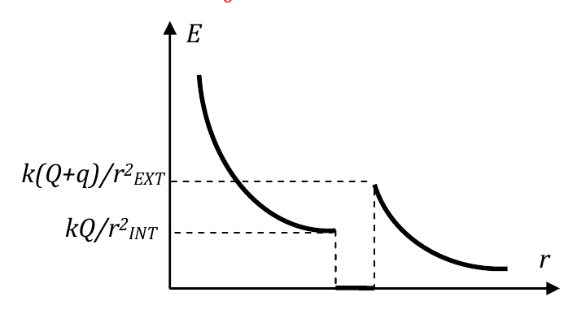

---

### Ejercicio 27

Dos esferas huecas concéntricas de radios *ra* y *rb>ra*, están cargadas con cargas *Qa* > 0 y *Qb* < 0, respectivamente. Se transporta una carga negativa desde la esfera exterior a la interior. Justifique e indique claramente:

a) la dirección y el sentido del campo eléctrico de la configuración en la región interna;

b) la dirección y el sentido de la fuerza eléctrica sobre la carga *q* < 0;

c) la dirección y sentido del gradiente de potencial;

d) el signo del trabajo que debemos realizar en contra de la fuerza eléctrica para transportar la carga a velocidad constante.

<b>Solución</b>

Solución paso a paso

**Paso 1 — Región entre esferas ($r_a < r < r_b$).** Por Gauss, solo cuenta la carga encerrada $Q_a > 0$: $\vec E = \dfrac{kQ_a}{r^2}\hat e_r$, **radial saliente** (va de la esfera positiva a la negativa).

**Paso 2 — Fuerza sobre $q < 0$.** $\vec F = q\vec E$ es opuesta a $\vec E$: **radial entrante** (la carga negativa es atraída por la esfera interior positiva).

**Paso 3 — Gradiente.** $\nabla V = -\vec E$: **radial entrante** (el potencial crece hacia la esfera positiva).

**Paso 4 — Trabajo externo.** La carga va de afuera hacia adentro, en el mismo sentido que $\vec F$. Para ir a velocidad constante, nuestra fuerza tiene que ser opuesta a $\vec F$ (saliente) mientras el desplazamiento es entrante, así que el trabajo es **negativo**.

Otra forma de verlo: $W_{ext} = q\,(V_a - V_b)$, con $q < 0$ y $V_a > V_b$, da $W_{ext} < 0$.

**Respuesta:**

- a) $\vec E$ tiene dirección radial saliente, pues se dirige de la esfera con carga positiva a la de carga negativa.
- b) $\vec F$ es un vector opuesto a $\vec E$ porque la carga es negativa (la fuerza es radial y entrante).
- c) El gradiente de potencial es radial y entrante, porque siempre es un vector opuesto a $\vec E$.
- d) El trabajo es negativo porque ejercemos fuerza en sentido contrario al desplazamiento.

---

### Ejercicio 28

Regrese al ejercicio 4, y suponiendo *q’ = −2Q*, halle la expresión del potencial que origina la configuración en todo punto del eje *X / x≠0*. Calcule la expresión del trabajo que realiza el campo eléctrico si se transporta la carga *q’* entre dos puntos *x1>0* y *x2*>x1 en presencia de las cargas *Q*. Compare con el valor hallado en el inciso (c) del problema 4.

<b>Solución</b>

Solución paso a paso

**Paso 1 — Potencial en $(x; 0)$.** Las dos $Q$ están a $\sqrt{x^2 + \ell^2}$ y $q' = -2Q$ está a $|x|$:

$$V(x) = \frac{2kQ}{\sqrt{x^2 + \ell^2}} + \frac{kq'}{|x|} = 2kQ\left(\frac{1}{\sqrt{x^2 + \ell^2}} - \frac{1}{|x|}\right)$$

**Paso 2 — Trabajo sobre $q'$.** Si se mueve $q'$, solo la afectan las $Q$ (una carga no interactúa con su propio campo). El potencial de las $Q$ es $V_Q = \dfrac{2kQ}{\sqrt{x^2 + \ell^2}}$:

$$W = -q'\,[V_Q(x_2) - V_Q(x_1)] = -2kQq'\left(\frac{1}{\sqrt{x_2^2 + \ell^2}} - \frac{1}{\sqrt{x_1^2 + \ell^2}}\right)$$

**Paso 3 — Comparación con el 4c.** En el 4c la carga que se mueve es una carga de prueba que siente el campo de **las tres** cargas; acá $q'$ siente solo el de las dos $Q$. Por eso las expresiones difieren (falta el término $1/x$).

**Respuesta:** $V(x) = 2kQ\left(\dfrac{1}{\sqrt{x^2 + \ell^2}} - \dfrac1x\right)$ (para $x > 0$); $W = -2kQq'\left(\dfrac{1}{\sqrt{x_2^2 + \ell^2}} - \dfrac{1}{\sqrt{x_1^2 + \ell^2}}\right)$

---

### Ejercicio 29

Las cargas *q1* = 2μC y *q2* = −3μC de la figura, ubicadas en los puntos A y B, respectivamente, se hallan separadas una distancia AB=2m. Desde el punto C, ubicado un metro por debajo del punto medio del segmento AB, se lleva una carga *q3* = 5μC al punto D, 30 cm a la derecha de *q1*.

a) calcule el trabajo realizado para transportar la carga *q3* desde C hasta D por los siguientes caminos

a1) por la recta CD

a2) CH +HD (H es el punto medio del segmento AB) ;

a3) CC’+C´D (C’ es el punto situado 2m por encima de C);

b) calcule la fuerza necesaria para mantener a la carga *q3* en equilibrio en el punto D;

c) discuta y justifique si el trabajo necesario para llevar la carga *q3* a 30 cm a la izquierda de *q2* es mayor, menor o igual que el calculado en el punto (a);

d) discuta y justifique cómo cambiarían cualitativamente los resultados de los puntos (a) y (b) si la carga *q3* fuera negativa.

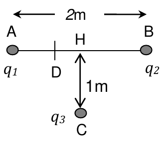

<b>Solución</b>

Solución paso a paso

**Coordenadas (m).** A $(-1; 0)$, B $(1; 0)$, H $(0; 0)$, C $(0; -1)$, D $(-0{,}7; 0)$.

**Paso 1 — El camino no importa.** El campo electrostático es conservativo: el trabajo depende solo de los extremos. Los tres caminos (a1, a2, a3) dan el mismo resultado:

$$W_{ext} = q_3\,(V_D - V_C)$$

**Paso 2 — Potenciales.**

$$V_C = \frac{k q_1}{\sqrt2} + \frac{k q_2}{\sqrt2} = \frac{18000 - 27000}{1{,}414}\ \text{V} = -6364\ \text{V}$$

$$V_D = \frac{kq_1}{0{,}3} + \frac{kq_2}{1{,}7} = (60000 - 15882)\ \text{V} = 44118\ \text{V}$$

**Paso 3 — Trabajo (ítem a).**

$$W = 5\times10^{-6}\cdot(44118 + 6364)\ \text{J} = 0{,}25\ \text{J}$$

**Paso 4 — Fuerza en D (ítem b).** D está sobre la recta AB, así que todas las fuerzas son horizontales:

- $q_1$ (positiva, a 0,3 m a la izquierda) repele a $q_3$ hacia $+x$: $\dfrac{kq_1q_3}{0{,}3^2} = 1{,}0\ \text{N}$.
- $q_2$ (negativa, a 1,7 m a la derecha) atrae a $q_3$ hacia $+x$: $\dfrac{k|q_2|q_3}{1{,}7^2} = 0{,}047\ \text{N}$.

La fuerza eléctrica total es $1{,}047$ N hacia $+x$. La fuerza necesaria para el equilibrio es la opuesta: $\vec F = (-1{,}047; 0)$ N.

**Paso 5 — Ítem c.** Punto E $(0{,}7; 0)$: $V_E = \dfrac{18000}{1{,}7} - \dfrac{27000}{0{,}3} = -79412$ V, entonces

$$W = q_3\,(V_E - V_C) = 5\times10^{-6}\,(-79412 + 6364)\ \text{J} = -0{,}365\ \text{J}$$

Su **módulo** es mayor que el de (a).

**Paso 6 — Ítem d.** Si $q_3$ fuera negativa, $W = q_3\Delta V$ y $\vec F = q_3\vec E$ cambian de signo, con el mismo módulo.

> La guía da $W = 0{,}22$ J en (a) y $\vec F = -(79{,}5; 15{,}9)\times10^{-3}$ N en (b). Ese vector es la fuerza calculada en el punto **C**, no en D (en D no puede haber componente $y$, porque D está sobre la recta AB). Con las posiciones del enunciado, $W = 0{,}25$ J.

**Respuesta:**

- a) $W = 0{,}25$ J por cualquiera de los tres caminos (la guía: 0,22 J).
- b) En D: $\vec F = (-1{,}05; 0)$ N (la guía da $-(79{,}5; 15{,}9)\times10^{-3}$ N, que corresponde al punto C).
- c) El módulo del trabajo es mayor: $W = -0{,}36$ J.
- d) Ambos cambiarían de signo.

---

### Ejercicio 30

Un anillo de radio *Ra*=3m, tiene densidad de carga uniforme λ=2×10−8C/m y se halla sobre el plano XY. Calcule el trabajo que realiza el campo eléctrico para transportar a velocidad constante una carga puntual *q*= 10 μC desde el centro del anillo hasta la posición *z*=4m.

<b>Solución</b>

Solución paso a paso

**Paso 1 — Potencial del anillo en su eje.** Con $Q = 2\pi R_a\lambda$:

$$V(z) = \frac{2\pi k\lambda R_a}{\sqrt{R_a^2 + z^2}}$$

**Paso 2 — Trabajo del campo.**

$$W = -q\,[V(4) - V(0)] = -2\pi k\lambda q R_a\left(\frac{1}{\sqrt{R_a^2 + z^2}}\right)\Bigg|_0^{4}$$

**Paso 3 — Cálculo.** $2\pi k\lambda R_a = 2\pi\cdot9\times10^9\cdot2\times10^{-8}\cdot3 = 3393\ \text{V m}$:

$$W = -10^{-5}\cdot3393\cdot\left(\frac15 - \frac13\right)\ \text{J} = 4{,}52\times10^{-3}\ \text{J}$$

Es positivo: el campo del anillo empuja a la carga positiva a lo largo del eje, alejándola.

**Respuesta:** $W = -2\pi k_0\lambda qR_a\left(\dfrac{1}{\sqrt{R_a^2 + z^2}}\right)\Big|_0^{z=4} = 4{,}52\times10^{-3}$ J

---

### Ejercicio 31

Un conductor esférico de radio *r1* tiene carga *q>0*. Se encuentra en el interior de una cáscara esférica conductora de radios interno *r2* y externo *r3*. Las esferas son concéntricas y la externa se halla conectada a una pila de potencial *V1*. Halle la expresión

a) de la cantidad de carga neta *Q* sobre la esfera de radio *r3*;

b) del campo eléctrico y el potencial generado por esta distribución en todo punto del espacio;

c) justifique si para esta distribución de cargas puede considerar nulo el potencial de infinito;

d) justifique si para esta distribución de cargas puede considerar nulo el potencial en el origen.

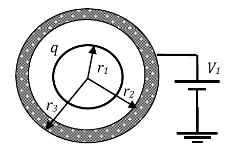

<b>Solución</b>

Solución paso a paso

**Paso 1 — Distribución de cargas.** $q$ en la superficie $r_1$; $-q$ inducida en $r_2$; en $r_3$ una carga $Q$ que fija la pila.

**Paso 2 — Campos por Gauss.**

- $r < r_1$ (conductor): $E = 0$.
- $r_1 < r < r_2$: $\vec E = \dfrac{q}{4\pi\varepsilon_0r^2}\hat e_r$.
- $r_2 < r < r_3$ (conductor): $E = 0$.
- $r > r_3$: encierra $q - q + Q = Q$, así que $\vec E = \dfrac{Q}{4\pi\varepsilon_0r^2}\hat e_r$.

**Paso 3 — Potencial.** La cáscara está a potencial $V_1$. Se integra hacia afuera y hacia adentro desde ella:

- $r > r_3$: $V(r) = V_1 + \dfrac{Q}{4\pi\varepsilon_0}\left(\dfrac1r - \dfrac{1}{r_3}\right)$.
- $r_2 < r < r_3$: $V = V_1$.
- $r_1 < r < r_2$: $V(r) = V_1 + \dfrac{q}{4\pi\varepsilon_0}\left(\dfrac1r - \dfrac{1}{r_2}\right)$.
- $r < r_1$: $V = V_1 + \dfrac{q}{4\pi\varepsilon_0}\left(\dfrac{1}{r_1} - \dfrac{1}{r_2}\right)$.

**Paso 4 — Carga Q (ítem a).** La pila está referida a tierra, que se toma como $V(\infty) = 0$. Pidiendo $V(r \to \infty) = 0$ en la región exterior:

$$V_1 - \frac{Q}{4\pi\varepsilon_0r_3} = 0 \quad\Rightarrow\quad Q = 4\pi\varepsilon_0V_1r_3$$

**Paso 5 — Ítems c y d.** El cero se puede poner en cualquier lugar donde no haya cargas. La distribución es finita (no hay cargas en el infinito) y en el origen tampoco hay cargas: ambas elecciones son posibles.

**Respuesta:**

- a) $Q = 4\pi\varepsilon_0V_1r_3$
- b)

| Región | $\vec E$ | $V(r)$ |
|---|---|---|
| $r < r_1$ | $0$ | $V_1 + \dfrac{q}{4\pi\varepsilon_0}\left(\dfrac{1}{r_1} - \dfrac{1}{r_2}\right)$ |
| $r_1 < r < r_2$ | $\dfrac{q}{4\pi\varepsilon_0r^2}\hat e_r$ | $V_1 + \dfrac{q}{4\pi\varepsilon_0}\left(\dfrac1r - \dfrac{1}{r_2}\right)$ |
| $r_2 < r < r_3$ | $0$ | $V_1$ |
| $r > r_3$ | $\dfrac{Q}{4\pi\varepsilon_0r^2}\hat e_r$ | $V_1 + \dfrac{Q}{4\pi\varepsilon_0}\left(\dfrac1r - \dfrac{1}{r_3}\right)$ |

- c) Sí, porque en el infinito no hay cargas de esta distribución.
- d) Sí, porque esta distribución no tiene cargas en el origen.

---

### Ejercicio 32

Considere un alambre recto de longitud infinita, en vacío, cargado con densidad uniforme de carga λ>0.

a) halle la expresión del campo eléctrico generado por esta distribución;

b) halle la expresión del potencial electrostático para esta distribución de cargas;

c) justifique si en este caso puede considerar nulo el potencial de infinito;

d) justifique si para esta distribución de cargas puede considerar nulo el potencial sobre el alambre;

e) suponga que se cambia la densidad uniforme de carga por otra variable, digamos, la mitad superior de valor λ1 y la mitad inferior de valor λ2. Discuta y justifique cuáles son las simetrías que se conservan.

<b>Solución</b>

Solución paso a paso

**Paso 1 — Simetría.** El alambre es igual si se lo traslada a lo largo de su eje o si se lo rota alrededor de él. Entonces $\vec E = E(R)\,\hat e_R$, radial y dependiente solo de la distancia $R$.

**Paso 2 — Gauss (ítem a).** Cilindro coaxial de radio $R$ y altura $h$; solo la cara lateral tiene flujo:

$$E\cdot2\pi Rh = \frac{\lambda h}{\varepsilon_0} \quad\Rightarrow\quad \vec E = \frac{\lambda}{2\pi\varepsilon_0R}\,\hat e_R$$

**Paso 3 — Potencial (ítem b).** Integrando desde un radio de referencia $R_0$:

$$V(R) - V(R_0) = -\int_{R_0}^{R}\frac{\lambda}{2\pi\varepsilon_0R'}\,dR' \quad\Rightarrow\quad V(R) = V(R_0) - \frac{\lambda}{2\pi\varepsilon_0}\ln\!\left(\frac{R}{R_0}\right)$$

**Paso 4 — Ítems c y d.** Si $R_0 \to \infty$ o $R_0 \to 0$, el logaritmo diverge. No se puede poner el cero en el infinito (hay carga allí, porque el alambre es infinito) ni sobre el alambre (hay carga). Hay que elegir $0 < R_0 < \infty$.

**Paso 5 — Ítem e.** Si las mitades tienen densidades distintas, ya no es igual trasladar el alambre a lo largo del eje: se pierde la simetría de **traslación**. Sigue valiendo la de **rotación** alrededor del eje. El campo deja de ser cilíndricamente simétrico (puede tener componente a lo largo del eje y depender de la altura).

**Respuesta:**

- a) $\vec E(R) = \dfrac{\lambda}{2\pi\varepsilon_0R}\hat e_R$
- b) $V(R) = V(R_0) - \dfrac{\lambda}{2\pi\varepsilon_0}\ln\!\left(\dfrac{R}{R_0}\right)$, con $0 < R_0 < \infty$
- c) No, porque esta distribución tiene carga en el infinito.
- d) No, porque sobre el alambre hay cargas.
- e) Solo se conserva la simetría de rotación; se pierde la de traslación y el campo y el potencial dejan de ser cilíndricamente simétricos.

---

### Ejercicio 33

El anillo de la figura, de radio *R*, tiene densidad de carga lineal λ=λ0 cos ϕ (λ0>0). En el centro del anillo se aloja una carga puntual de valor *q* (*q*>0). Halle la expresión:

a) de la fuerza que la carga *q* ejerce sobre el sector del anillo comprendido entre ϕ=π/6 y ϕ=π/2;

b) el trabajo que realiza el campo para transportar a velocidad constante una carga *q* idéntica a la del centro del anillo desde *z* = *z1* > 0 hasta *z* = *z2*>*z1* en presencia del anillo y de la carga del centro. Indique el signo de este trabajo.

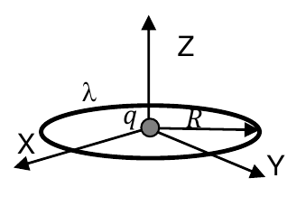

<b>Solución</b>

Solución paso a paso

**Paso 1 — Fuerza sobre un elemento del anillo (ítem a).** El elemento en $\phi$ tiene carga $\delta q = \lambda_0\cos\phi\,R\,d\phi$. La carga $q$ está en el centro, a distancia $R$, y lo empuja radialmente hacia afuera, en la dirección $(\cos\phi; \sin\phi)$:

$$d\vec F = \frac{kq\,\lambda_0\cos\phi\,R\,d\phi}{R^2}(\cos\phi;\ \sin\phi)$$

**Paso 2 — Integrar de $\pi/6$ a $\pi/2$.**

$$F_x = \frac{kq\lambda_0}{R}\int_{\pi/6}^{\pi/2}\cos^2\phi\,d\phi = \frac{kq\lambda_0}{R}\left[\frac\phi2 + \frac{\sin2\phi}{4}\right]_{\pi/6}^{\pi/2} = \frac{kq\lambda_0}{R}\left(\frac\pi6 - \frac{\sqrt3}{8}\right) = 0{,}307\,\frac{kq\lambda_0}{R}$$

$$F_y = \frac{kq\lambda_0}{R}\int_{\pi/6}^{\pi/2}\cos\phi\sin\phi\,d\phi = \frac{kq\lambda_0}{R}\left[\frac{\sin^2\phi}{2}\right]_{\pi/6}^{\pi/2} = \frac{kq\lambda_0}{R}\cdot\frac38 = 0{,}375\,\frac{kq\lambda_0}{R}$$

> La guía da $(kq\lambda_0/R)(-0{,}5\,\hat e_x; -0{,}867\,\hat e_y)$. Esos números ($\int\cos\phi = 0{,}5$, $\int\sin\phi = 0{,}866$) corresponden a una densidad **uniforme** $\lambda_0$ y a la fuerza **sobre q**. Con $\lambda = \lambda_0\cos\phi$ sale el resultado de arriba (la fuerza sobre $q$ es la opuesta).

**Paso 3 — Potencial del anillo en el eje (ítem b).** Todos los puntos del anillo están a la misma distancia $\sqrt{R^2 + z^2}$ del punto, así que el potencial es proporcional a la carga total del anillo:

$$Q_{anillo} = \int_0^{2\pi}\lambda_0\cos\phi\,R\,d\phi = 0 \quad\Rightarrow\quad V_{anillo}(z) = 0$$

El anillo no aporta trabajo; solo cuenta la carga del centro.

**Paso 4 — Trabajo del campo.**

$$W = -q\,[V(z_2) - V(z_1)] = -kq^2\left[\frac{1}{z_2} - \frac{1}{z_1}\right]$$

Como $z_2 > z_1$, el corchete es negativo y $W > 0$: la repulsión empuja a la carga hacia afuera.

**Respuesta:**

- a) $\vec F_{sobre\ sector} = \dfrac{kq\lambda_0}{R}\left(\dfrac\pi6 - \dfrac{\sqrt3}{8};\ \dfrac38\right) = \dfrac{kq\lambda_0}{R}(0{,}307\,\hat e_x + 0{,}375\,\hat e_y)$. (La guía da $\dfrac{kq\lambda_0}{R}(-0{,}5\,\hat e_x; -0{,}867\,\hat e_y)$; ver la nota del paso a paso.)
- b) $W = -kq^2\left[\dfrac{1}{z_2} - \dfrac{1}{z_1}\right] > 0$ (el CE del anillo es perpendicular al eje Z y su potencial en el eje es nulo).

---

### Ejercicio 34

Dos placas metálicas de longitud *d*, separadas una distancia *b*, se hallan a potencial *V*. Entre estas placas se inyecta con velocidad *v0* un haz de partículas α (núcleos de Helio, ${}^4_2He$) que consisten en dos protones y dos neutrones (en total 4 nucleones, de manera tal que la masa de esta partícula es *mα* = 4 *mp* = 6,68×10−27 kg y su carga vale *qα* =2 *qp* = 3,2×10−19 C, donde *mp* y *qp* representan la masa y la carga eléctrica del protón, respectivamente). Escriba la ecuación de la trayectoria, *y=f(x),* del haz de partículas cuando se mueve entre las placas.

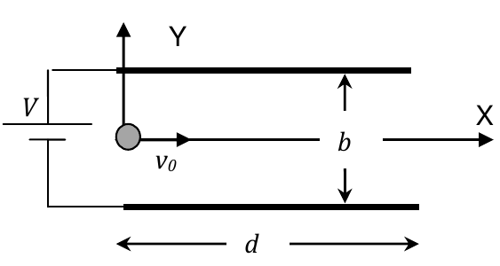

<b>Solución</b>

Solución paso a paso

**Paso 1 — Campo entre las placas.** Es un capacitor plano: campo uniforme vertical de módulo $E = V/b$. Con la placa superior a mayor potencial, apunta hacia $-y$.

**Paso 2 — Aceleración.** La partícula α es positiva:

$$a_y = -\frac{q_\alpha E}{m_\alpha} = -\frac{q_\alpha V}{m_\alpha b} \qquad a_x = 0$$

(Se desprecia el peso frente a la fuerza eléctrica.)

**Paso 3 — Ecuaciones horarias.** Es como un tiro horizontal:

$$x = v_0 t \qquad y = \frac12 a_y t^2$$

**Paso 4 — Eliminar $t$.** De la primera, $t = x/v_0$:

$$y = -\frac{q_\alpha V}{2m_\alpha b\,v_0^2}\,x^2 \qquad (x < d)$$

Es una **parábola**, igual que un tiro horizontal en un campo gravitatorio.

**Respuesta:** $y = -\dfrac{q_\alpha V}{2m_\alpha b\,v_0^2}\,x^2$, para $x < d$

---

### Ejercicio 35

Del siguiente conjunto de afirmaciones sólo dos son verdaderas. Indique cuáles son

- El potencial de una configuración de cargas es nulo si la carga total de la configuración es nula.
- El campo electrostático es tangente a la superficie de un conductor.
- El flujo de campo eléctrico se duplica si se duplica el área de la superficie que encierra las cargas.
- El CE en la superficie de un conductor en equilibrio electrostático es perpendicular a esa superficie.
- El potencial electrostático crece en el sentido del CE.
- El potencial de infinito siempre puede tomarse igual a cero cualquiera sea la configuración de cargas.
- Flujo de campo nulo implica campo eléctrico nulo.
- El potencial de una configuración de cargas crece en sentido opuesto al CE.
- Si la carga total de una configuración es cero, el CE que genera es nulo.
- El teorema de Gauss es válido sólo si la configuración de cargas posee muy alta simetría.
- El potencial de una configuración de cargas crece en sentido perpendicular al CE.

<b>Solución</b>

Solución paso a paso

- "Potencial nulo si la carga total es nula": **falso**. Por ejemplo, cerca de la $+q$ de un dipolo $V > 0$.
- "Campo tangente a la superficie de un conductor": **falso**. Es perpendicular.
- "El flujo se duplica si se duplica el área": **falso**. Depende solo de $Q_{enc}$.
- "CE perpendicular a la superficie de un conductor en equilibrio": **verdadero**. Si tuviera componente tangencial, las cargas se moverían.
- "El potencial crece en el sentido del CE": **falso**. Disminuye ($\vec E = -\nabla V$).
- "El potencial de infinito siempre puede tomarse igual a cero": **falso**. No para distribuciones infinitas (hilo, plano).
- "Flujo nulo implica campo nulo": **falso**. Por ejemplo, una superficie sin carga dentro de un campo uniforme.
- "El potencial crece en sentido opuesto al CE": **verdadero**.
- "Carga total cero implica CE nulo": **falso** (dipolo).
- "Gauss vale solo con alta simetría": **falso**. Vale siempre; la simetría solo hace falta para despejar $E$.
- "El potencial crece perpendicular al CE": **falso**. Perpendicular al campo, $V$ es constante.

**Respuesta:**

- El CE en la superficie de un conductor en equilibrio electrostático es perpendicular a esa superficie.
- El potencial de una configuración de cargas crece en sentido opuesto al CE.

---

### Ejercicio 36

Del siguiente conjunto de afirmaciones sólo dos son verdaderas. Indique cuáles son

- El potencial de una configuración de cargas es una función siempre decreciente con la distancia.
- El campo eléctrico es un vector siempre paralelo (igual dirección y sentido) a la fuerza eléctrica.
- En un campo eléctrico no nulo una carga en reposo puede mantenerse en reposo.
- El valor del potencial electrostático en un punto queda definido siempre de manera absoluta.
- El potencial de infinito de una configuración finita de cargas debe ser nulo.
- Una carga cualquiera puede permanecer en reposo entre dos cargas q1 y q2 sólo si sg(q1)=− sg(q2)
- Dadas dos cargas iguales no existe ningún punto en el que se anule su CE.
- Dadas dos cargas iguales existe un punto no infinito en el que se anula su potencial electrostático.
- El teorema de Gauss es válido sólo para superficies con simetría definida.
- El potencial electrostático es una medida del trabajo de la fuerza eléctrica por unidad de carga.

<b>Solución</b>

Solución paso a paso

- "Potencial siempre decreciente con la distancia": **falso**. Para cargas negativas crece (de $-\infty$ hacia 0).
- "$\vec E$ siempre con el mismo sentido que $\vec F$": **falso**. Para $q < 0$ son opuestos.
- "En un campo no nulo una carga en reposo puede mantenerse en reposo": **falso** (sin otras fuerzas). $\vec F = q\vec E \ne 0$ la acelera.
- "Potencial definido de manera absoluta": **falso**. Depende de la elección del cero.
- "El potencial de infinito debe ser nulo": **falso**. *Puede* tomarse nulo, pero no está obligado.
- "Una carga puede quedar en reposo entre $q_1$ y $q_2$ solo si sg($q_1$) = −sg($q_2$)": la guía la marca como **verdadera**, pero **así escrita es falsa**. Entre dos cargas de signo **opuesto** los campos se suman y nunca se anulan; entre dos cargas del **mismo** signo sí hay un punto con $E = 0$. Seguramente se quiso escribir sg($q_1$) = sg($q_2$) (el signo menos sería un error de tipeo).
- "Dadas dos cargas iguales no existe punto con CE nulo": **falso**. En el punto medio $E = 0$.
- "Dadas dos cargas iguales existe un punto no infinito con $V = 0$": **falso**. Ambos términos tienen el mismo signo.
- "Gauss vale solo con simetría definida": **falso**.
- "El potencial es una medida del trabajo por unidad de carga": **verdadero**. $\Delta V = -W_{campo}/q$.

**Respuesta (según la guía):**

- Una carga cualquiera puede permanecer en reposo entre dos cargas $q_1$ y $q_2$ solo si sg($q_1$) = −sg($q_2$). (Ojo: como está escrita es falsa; es verdadera con sg($q_1$) = sg($q_2$).)
- El potencial electrostático es una medida del trabajo de la fuerza eléctrica por unidad de carga.

