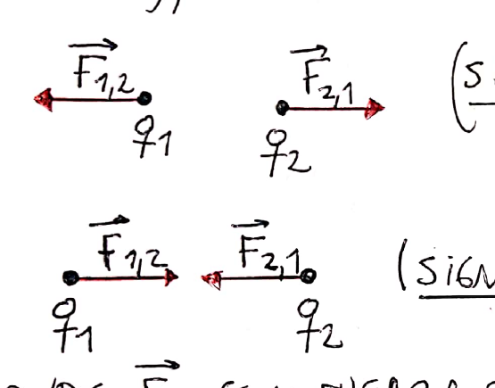
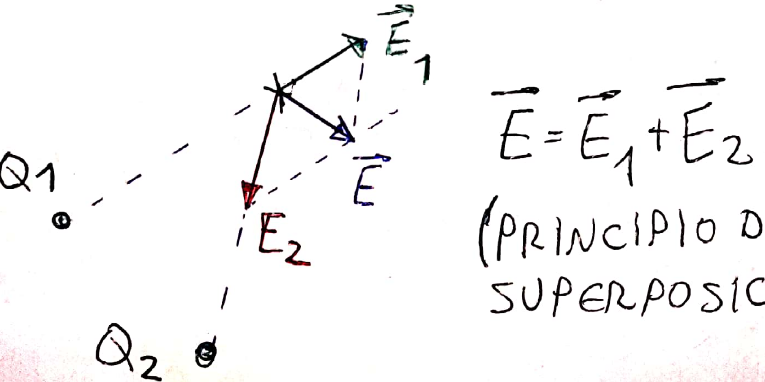
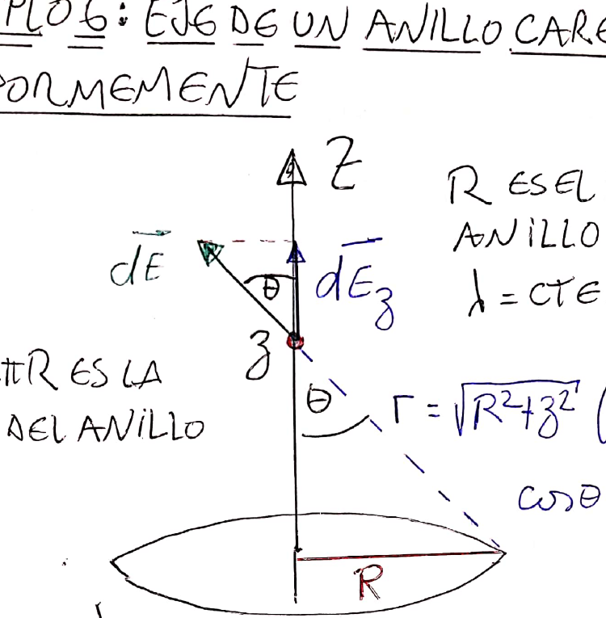
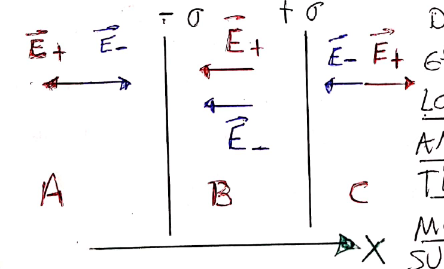
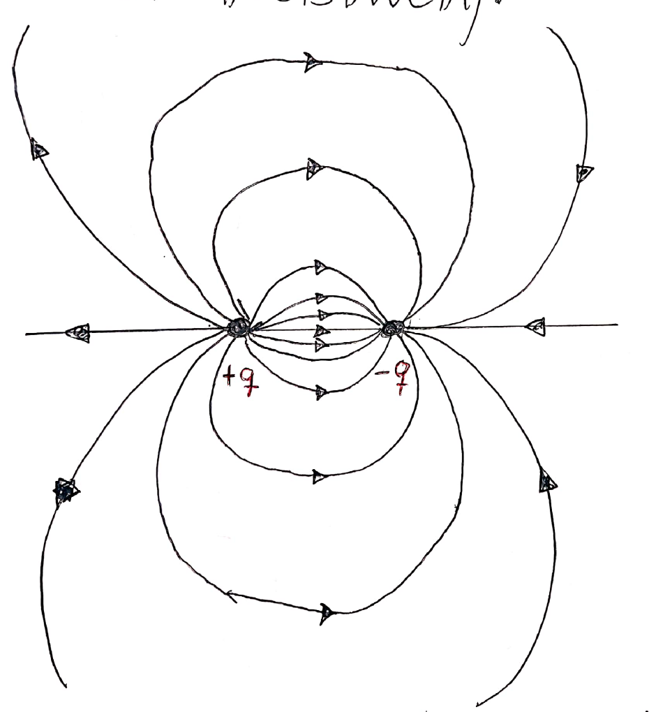
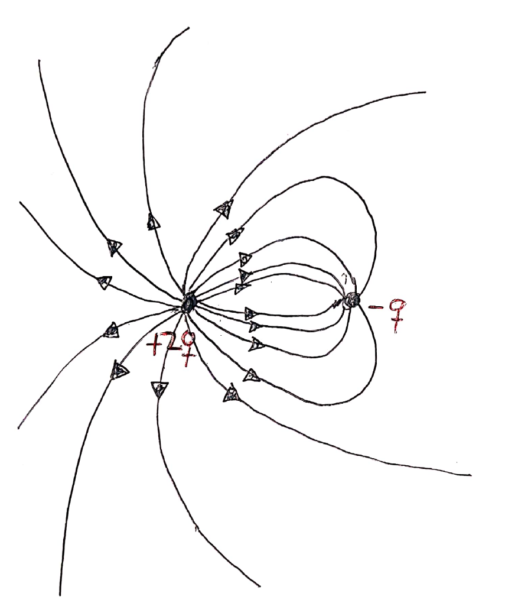
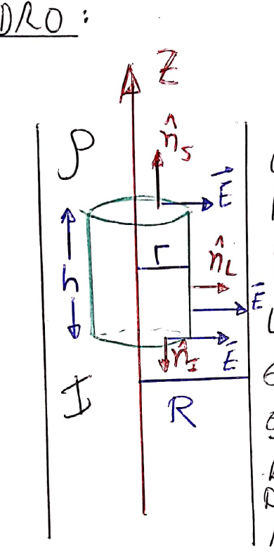
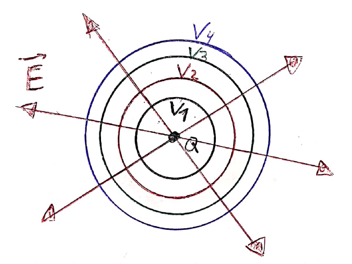
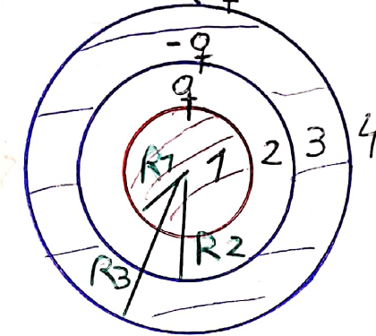

# Tema 2 — Electrostática: resumen teórico

Resumen de las clases del aula virtual: [Clase 1 — Fenómenos eléctricos y ley de Coulomb](Aula%20Virtual/Clase%201%20-%20Fen%C3%B3menos%20el%C3%A9ctricos%20y%20ley%20de%20Coulomb.pdf), [Clase 2 — Líneas de campo, flujo y ley de Gauss](Aula%20Virtual/Clase%202%20-%20L%C3%ADneas%20de%20campo%2C%20flujo%20y%20ley%20de%20Gauss.pdf) y [Clase 3 — Potencial eléctrico](Aula%20Virtual/Clase%203%20-%20Potencial%20el%C3%A9ctrico.pdf).

Ejercicios: [práctica del tema](practica.md).

---

## Índice

1. [Carga eléctrica](#1-carga-eléctrica)
2. [Conductores y dieléctricos](#2-conductores-y-dieléctricos)
3. [Ley de Coulomb](#3-ley-de-coulomb)
4. [Campo eléctrico](#4-campo-eléctrico)
5. [Distribuciones continuas de carga](#5-distribuciones-continuas-de-carga)
6. [Campos de distribuciones típicas](#6-campos-de-distribuciones-típicas)
7. [Líneas de campo](#7-líneas-de-campo)
8. [Flujo de campo eléctrico](#8-flujo-de-campo-eléctrico)
9. [Ley de Gauss](#9-ley-de-gauss)
10. [Conductores en equilibrio electrostático](#10-conductores-en-equilibrio-electrostático)
11. [Potencial eléctrico](#11-potencial-eléctrico)
12. [Superficies equipotenciales](#12-superficies-equipotenciales)
13. [Potenciales de distribuciones típicas](#13-potenciales-de-distribuciones-típicas)
14. [Ejemplos resueltos en clase](#14-ejemplos-resueltos-en-clase)
15. [Tabla de fórmulas](#15-tabla-de-fórmulas)

---

## 1. Carga eléctrica

- Hay dos tipos de carga, **positiva** y **negativa**. Cargas del **mismo signo se repelen**; de **signos opuestos se atraen**.
- La materia está formada por átomos: un núcleo con **protones** (carga $+e$) rodeado de **electrones** (carga $-e$). El protón tiene unas 2000 veces la masa del electrón ($m_e = 9{,}1\times10^{-31}$ kg, $m_p = 1{,}67\times10^{-27}$ kg), pero sus cargas tienen el mismo módulo.
- Unidad SI: el **coulomb** (C). La **carga fundamental** es

$$e = 1{,}6\times10^{-19}\ \text{C}$$

- **Cuantización:** la carga de cualquier objeto es siempre un múltiplo entero de $e$ (experiencia de Millikan, 1911).
- **Conservación:** al frotar dos materiales se transfieren electrones. El que los cede queda positivo y el que los recibe queda negativo, con cargas del mismo módulo. La carga total no cambia.
- **Triboelectricidad:** el signo que adquiere cada material depende de con cuál se lo frote (tabla triboeléctrica). En días húmedos el aire se vuelve conductor y los efectos disminuyen.

---

## 2. Conductores y dieléctricos

- **Conductores** (típicamente metales): tienen **electrones libres**. Las cargas se redistribuyen casi instantáneamente sobre la superficie.
- **Aislantes o dieléctricos:** no hay desplazamiento de carga; la carga se queda donde se depositó.
- **Inducción** (en conductores): al acercar un objeto cargado (sin tocarlo), las cargas del conductor se redistribuyen.
- **Polarización** (en dieléctricos): un objeto cargado reorienta los dipolos eléctricos del material, y la superficie del dieléctrico se carga con signo opuesto al del objeto inductor.

---

## 3. Ley de Coulomb

Vale para cargas **puntuales** en reposo (o a velocidades no relativistas).

$$|\vec F_{1,2}| = |\vec F_{2,1}| = k\,\frac{|q_1|\,|q_2|}{d^2}$$

$$k = \frac{1}{4\pi\varepsilon_0} = 9\times10^9\ \frac{\text{N m}^2}{\text{C}^2} \qquad \varepsilon_0 = 8{,}85\times10^{-12}\ \frac{\text{C}^2}{\text{N m}^2}\ \ (\text{permitividad del vacío})$$

$\vec F_{1,2}$ es la fuerza **sobre** $q_1$ debida a $q_2$. Por acción y reacción, $\vec F_{1,2} = -\vec F_{2,1}$.

---

## 4. Campo eléctrico

Cada carga genera un **campo eléctrico** $\vec E$ en el espacio que la rodea; las otras cargas interactúan con el campo, no directamente con la carga que lo genera.

Una carga $q$ en un campo $\vec E$ siente una fuerza:

$$\boxed{\vec F = q\,\vec E}$$

(Es el análogo del peso, $\vec P = m\vec g$.)

- ⚠️ **Una carga no interactúa con su propio campo.**
- $\vec F$ y $\vec E$ tienen la misma dirección; el **mismo sentido si $q > 0$** y **sentido opuesto si $q < 0$**.
- Unidades: $[E] = \text{N/C} = \text{V/m}$.

### Campo de una carga puntual

Se coloca una **carga de prueba** $q$ (positiva y pequeña) en el punto y se usa Coulomb:

$$\boxed{\vec E = \frac{kQ}{r^2}\,\hat r}$$

$\hat r$ es el versor que va **desde la carga fuente hacia el punto**. Si la carga está en $\vec r\,'$ y el punto en $\vec r$:

$$\vec E(\vec r) = kQ\,\frac{\vec r - \vec r\,'}{|\vec r - \vec r\,'|^3}$$

### Principio de superposición

Cada carga contribuye al campo independientemente de las demás. El campo total es la **suma vectorial**:

$$\vec E = \vec E_1 + \vec E_2 + \dots$$

> **Método para cargas puntuales:** para cada carga, armar el vector que va de la carga al punto, $\vec r - \vec r_i$; calcular su módulo; sumar $kq_i\,(\vec r - \vec r_i)/|\vec r - \vec r_i|^3$ componente a componente.

---

## 5. Distribuciones continuas de carga

A nivel macroscópico se ignora la discretización y se usan **densidades de carga**:

| Distribución | Densidad | Elemento de carga | Carga total | Unidades |
|---|---|---|---|---|
| Volumen | $\rho(\vec r)$ | $\delta q = \rho\,dV$ | $Q = \int_V \rho\,dV$ | C/m³ |
| Superficie | $\sigma(\vec r)$ | $\delta q = \sigma\,ds$ | $Q = \int_S \sigma\,ds$ | C/m² |
| Línea | $\lambda(\vec r)$ | $\delta q = \lambda\,d\ell$ | $Q = \int \lambda\,d\ell$ | C/m |

Si la densidad es uniforme: $Q = \rho V$, $Q = \sigma S$, $Q = \lambda\ell$.

**Campo:** cada elemento $\delta q$ se trata como una carga puntual y se **integra** en lugar de sumar:

$$\boxed{\vec E(\vec r) = k\int \frac{\vec r - \vec r\,'}{|\vec r - \vec r\,'|^3}\,\delta q'}$$

> **Receta para integrar un campo**
>
> 1. Elegir ejes convenientes y escribir $\delta q$ (por ejemplo $\lambda\,dx'$, $\lambda R\,d\phi$, $\sigma\,r\,dr\,d\theta$).
> 2. Escribir el vector $\vec r - \vec r\,'$ (del elemento al punto) y su módulo.
> 3. **Usar la simetría** para ver qué componentes se anulan antes de integrar.
> 4. Integrar las componentes que sobreviven.
> 5. Verificar un límite conocido (por ejemplo, muy lejos debe parecerse a una carga puntual).

---

## 6. Campos de distribuciones típicas

### Hilo finito, en un punto de su eje

Hilo con $\lambda$ uniforme entre $x_1$ y $x_2$, punto en $x > x_2$ sobre el mismo eje:

$$\vec E(x) = k\lambda\left[\frac{1}{x - x_2} - \frac{1}{x - x_1}\right]\hat\imath$$

### Fuerza entre dos hilos alineados

Dos hilos iguales de longitud $\ell$ y densidad $\lambda$, sobre el eje X, separados una distancia $a$:

$$\vec F = k\lambda^2\,\ln\!\left[\frac{(a + \ell)^2}{a\,(a + 2\ell)}\right]\hat\imath = \frac{kQ^2}{\ell^2}\,\ln\!\left[\frac{(a + \ell)^2}{a\,(a + 2\ell)}\right]\hat\imath$$

### Hilo finito, en un punto fuera de su eje

Punto a distancia $y$ del hilo. Conviene integrar en el ángulo $\theta$ (con $x = y\tan\theta$, $dx = y\,d\theta/\cos^2\theta$). Los ángulos se miden desde la perpendicular al hilo: positivos en sentido antihorario y negativos en sentido horario.

$$\vec E = \frac{k\lambda}{y}\Big[(\cos\theta_2 - \cos\theta_1)\,\hat\imath + (\sin\theta_2 - \sin\theta_1)\,\hat\jmath\Big]$$

**En la mediatriz** ($\theta_1 = -\theta_2$, con $\tan\theta_2 = \frac{\ell/2}{y}$): el campo es perpendicular al hilo:

$$\vec E = \frac{2k\lambda}{y}\sin\theta_2\,\hat\jmath = \frac{2k\lambda}{y}\,\frac{\ell/2}{\sqrt{(\ell/2)^2 + y^2}}\,\hat\jmath$$

### Hilo infinito

Haciendo $\theta_2 \to \pi/2$:

$$\boxed{\vec E = \frac{2k\lambda}{r}\,\hat r = \frac{\lambda}{2\pi\varepsilon_0\,r}\,\hat r}$$

Observar que $E \sim 1/r$, mientras que para la carga puntual $E \sim 1/r^2$. Los campos de distribuciones infinitas decaen más lentamente.

### Anillo en su eje

Anillo de radio $R$ y carga $Q = 2\pi R\lambda$. Por simetría, solo sobrevive la componente sobre el eje:

$$\boxed{\vec E = \frac{kQ\,z}{(R^2 + z^2)^{3/2}}\,\hat k}$$

Verificación: para $z \gg R$, $\vec E \approx kQ/z^2\,\hat k$ (carga puntual).

### Disco en su eje

Disco de radio $R$ con $\sigma$ uniforme. Se suman anillos de radio $r$ y espesor $dr$ ($ds = r\,dr\,d\theta$):

$$\vec E = \frac{\sigma z}{2\varepsilon_0}\int_0^R\frac{r\,dr}{(r^2 + z^2)^{3/2}}\,\hat k \quad\Rightarrow\quad \boxed{\vec E = \frac{\sigma}{2\varepsilon_0}\,\text{sg}(z)\left[1 - \frac{1}{\sqrt{1 + R^2/z^2}}\right]\hat k}$$

$\text{sg}(z) = z/|z|$ vale $+1$ si $z > 0$ y $-1$ si $z < 0$.

### Plano infinito

Haciendo $z \ll R$ en el disco:

$$\boxed{\vec E = \frac{\sigma}{2\varepsilon_0}\,\text{sg}(z)\,\hat k}$$

**¡Es uniforme!** No depende de la distancia al plano.

### Capacitor plano (dos planos con $+\sigma$ y $-\sigma$)

Se superponen los campos de ambos planos (despreciando efectos de borde):

- Afuera (zonas A y C) los campos son opuestos y se anulan: $\vec E = 0$.
- Entre las placas (zona B) se suman: $|\vec E| = \dfrac{\sigma}{\varepsilon_0}$, apuntando de la placa positiva a la negativa.

### Arco de circunferencia, en el centro

Arco de radio $R$ y $\lambda$ uniforme, entre los ángulos $\theta_1$ y $\theta_2$:

$$\vec E = \frac{k\lambda}{R}\Big[-(\sin\theta_2 - \sin\theta_1)\,\hat\imath + (\cos\theta_2 - \cos\theta_1)\,\hat\jmath\Big]$$

**Ejemplo (apunte):** semicircunferencia izquierda con $+Q$ en el cuarto superior ($\theta \in [\pi/2, \pi]$) y $-Q$ en el inferior ($\theta \in [\pi, 3\pi/2]$). Con $\lambda_1 = 2Q/(\pi R)$ y $\lambda_2 = -2Q/(\pi R)$:

$$\vec E_1 = \frac{2kQ}{\pi R^2}(\hat\imath - \hat\jmath) \qquad \vec E_2 = \frac{2kQ}{\pi R^2}(-\hat\imath - \hat\jmath) \qquad \vec E = -\frac{4kQ}{\pi R^2}\,\hat\jmath$$

---

## 7. Líneas de campo

Son una representación gráfica del campo:

- $\vec E$ es **tangente** a las líneas, con su mismo sentido.
- El **módulo** de $\vec E$ es proporcional a la **densidad** de líneas (cantidad de líneas por unidad de área perpendicular).
- **Nacen** en las cargas positivas y **mueren** en las negativas (o en el infinito). De cada carga salen en forma radial y equiespaciada, en un número **proporcional a $|q|$**.
- **Dos líneas de campo nunca se cruzan** (si no, en ese punto el campo tendría dos direcciones).
- En un **campo uniforme**, las líneas son paralelas y equiespaciadas.

**Dipolo** ($+q$ y $-q$): todas las líneas que nacen en la positiva mueren en la negativa.

**Cargas $+2q$ y $-q$:** de las líneas que salen de $+2q$, la mitad termina en $-q$ y la otra mitad se va al infinito.

---

## 8. Flujo de campo eléctrico

El flujo mide **cuántas líneas de campo atraviesan una superficie**.

- Campo uniforme, perpendicular a una superficie plana de área $A$: $\phi = EA$.
- Campo uniforme formando un ángulo $\theta$ con la normal $\hat n$: $\phi = EA\cos\theta = \vec E\cdot\hat n\,A$. Si las líneas son paralelas a la superficie ($\theta = 90°$), $\phi = 0$.
- **Caso general** (campo y superficie arbitrarios):

$$\boxed{\phi = \int_S \vec E\cdot\hat n\,ds}$$

---

## 9. Ley de Gauss

Una **superficie gaussiana** es una superficie **cerrada** imaginaria (sin realidad física), con la normal $\hat n$ apuntando **hacia afuera**.

- Carga puntual en el centro de una esfera de radio $r$: $\phi = E\cdot4\pi r^2 = \dfrac{q}{\varepsilon_0}$. Como el flujo cuenta líneas, vale lo mismo para **cualquier** superficie cerrada que encierre a $q$.
- Una carga **externa** no aporta flujo: toda línea que entra sale por otro lado.
- Por superposición:

$$\boxed{\phi = \oint \vec E\cdot\hat n\,ds = \frac{Q_{enc}}{\varepsilon_0}}$$

donde $Q_{enc}$ es la carga **encerrada** por la superficie. Es una de las cuatro **ecuaciones de Maxwell**.

> ⚠️ La ley de Gauss **siempre es válida**. Lo que requiere alta simetría es **usarla para despejar el campo**.

### Cómo usar Gauss para calcular $\vec E$

Sirve cuando se puede elegir una superficie gaussiana donde, en cada parte, o bien $\vec E \parallel \hat n$ con $|\vec E|$ constante, o bien $\vec E\cdot\hat n = 0$. Entonces:

$$\frac{Q_{enc}}{\varepsilon_0} = \oint \vec E\cdot\hat n\,ds = E\,S \quad\Rightarrow\quad E = \frac{Q_{enc}}{\varepsilon_0\,S}$$

> **Pasos**
>
> 1. **Simetría:** decidir de qué coordenada depende $E$ y en qué dirección apunta.
> 2. Elegir la superficie gaussiana **que pase por el punto** (esfera, cilindro coaxial, "pastillero").
> 3. Calcular el flujo (solo las partes donde $\vec E \parallel \hat n$ aportan).
> 4. Calcular $Q_{enc}$ (si la densidad no es uniforme, integrar).
> 5. Igualar y despejar.

**Funciona con:** carga puntual, plano infinito con $\sigma$ uniforme, esfera con $\sigma$ o $\rho(r)$, hilo infinito, cilindro infinito con $\sigma$ o $\rho(r)$.

**No funciona con:** anillos, discos, hilos o cilindros **finitos**, etc.

### Ejemplo: cilindro infinito con $\rho$ uniforme

Por simetría, $\vec E = E(r)\,\hat r$ (radial, depende solo de la distancia al eje). Gaussiana: cilindro coaxial de radio $r$ y altura $h$. En las tapas $\vec E \perp \hat n$ y no hay flujo; en la superficie lateral $\phi = E\,2\pi r h$.

- Adentro ($r < R$): $Q_{enc} = \rho\pi r^2 h$, entonces $\vec E = \dfrac{\rho}{2\varepsilon_0}\,r\,\hat r$.
- Afuera ($r > R$): $Q_{enc} = \rho\pi R^2 h$, entonces $\vec E = \dfrac{\rho R^2}{2\varepsilon_0}\,\dfrac{1}{r}\,\hat r$.

### Ejemplo: placa de espesor $d$ con $\rho$ uniforme

Por simetría, $\vec E = E(x)\,\hat\imath$, con campos opuestos a ambos lados del plano central. Gaussiana: cilindro de tapas $A$ entre $-x$ y $x$:

$$2E(x)\,A = \frac{\rho\,2x\,A}{\varepsilon_0} \quad\Rightarrow\quad \vec E(x) = \frac{\rho\,x}{\varepsilon_0}\,\hat\imath \quad(|x| < d/2)$$

---

## 10. Conductores en equilibrio electrostático

Un conductor está en equilibrio electrostático cuando sus cargas libres están en reposo. Entonces:

1. **El campo en el interior del conductor es nulo.** Si no, las cargas se acelerarían.
2. **La carga se distribuye en la superficie.** Por Gauss, cualquier superficie dentro del conductor tiene flujo nulo, así que $Q_{enc} = 0$.
3. **Las líneas de campo son perpendiculares a la superficie** (en sus proximidades). Si $\vec E$ tuviera componente tangencial, las cargas superficiales se moverían.
4. **En la superficie, $\vec E = \dfrac{\sigma}{\varepsilon_0}\,\hat n$.**
5. **Efecto de puntas:** la carga se acumula en las zonas puntiagudas (principio del pararrayos).
6. **Todo el conductor está al mismo potencial** y su superficie es equipotencial (ver sección 12).

> **Cáscaras conductoras:** si hay una carga $q$ dentro de una cáscara conductora, en la superficie **interna** de la cáscara se induce $-q$ (para que $E = 0$ dentro del metal) y en la **externa** queda el resto de la carga de la cáscara más $q$.

---

## 11. Potencial eléctrico

Cuando una carga $q$ se mueve de A a B en un campo, la fuerza eléctrica hace trabajo y cambia la **energía potencial electrostática** $U$. Se define el **potencial** como la energía por unidad de carga, que depende solo del campo y de la posición:

$$\boxed{\Delta V_{AB} = V_B - V_A = \frac{\Delta U_{AB}}{q}} \qquad dV = \frac{dU}{q}$$

- Es un **escalar**. Unidad: **volt**, $[V] = \text{J/C} = \text{V}$. (Se lo llama también tensión o voltaje.)
- Como $dU = -dW_c$ y $dW_c = q\vec E\cdot d\vec\ell$:

$$\boxed{dV = -\vec E\cdot d\vec\ell} \qquad\qquad \boxed{V_B - V_A = -\int_A^B \vec E\cdot d\vec\ell}$$

- El campo electrostático es **conservativo**: la integral **no depende del camino**.

### Trabajo y energía

$$\Delta U = q\,\Delta V \qquad W_{campo} = -\Delta U = -q\,(V_B - V_A) \qquad W_{externo}\ (\text{sin variar } E_c) = +q\,(V_B - V_A)$$

### Cero de potencial

Lo que está físicamente bien definido es la **diferencia** de potencial. El "potencial en un punto" es la diferencia respecto de un punto elegido arbitrariamente como cero (por ejemplo, la conexión a tierra):

$$V(\vec r) = -\int_{\vec r_0}^{\vec r}\vec E\cdot d\vec\ell$$

- Para distribuciones **localizadas** se suele elegir $V(\infty) = 0$.
- Para distribuciones **infinitas** (hilo infinito, plano infinito) **no** se puede poner el cero en el infinito, porque hay cargas allí.

### Del potencial al campo

$$\boxed{\vec E = -\nabla V} \qquad \text{en cartesianas: } \vec E = -\left(\frac{\partial V}{\partial x};\ \frac{\partial V}{\partial y};\ \frac{\partial V}{\partial z}\right)$$

> Calcular un potencial (escalar) suele ser más fácil que un campo (vector). La excepción son los casos donde el campo sale fácil por Gauss: ahí conviene integrar $\vec E$.

---

## 12. Superficies equipotenciales

Como el gradiente apunta hacia donde la función crece más rápido y $\vec E = -\nabla V$:

- **Las líneas de campo apuntan hacia donde el potencial disminuye.**
- **El potencial no cambia para desplazamientos perpendiculares a las líneas de campo.**
- Una superficie perpendicular a las líneas de campo es **equipotencial**: todos sus puntos están al mismo potencial.

Ejemplos: carga puntual, esferas centradas en la carga; campo uniforme, planos perpendiculares al campo; hilo infinito, cilindros coaxiales.

**En un conductor en equilibrio, todos los puntos están al mismo potencial y su superficie es equipotencial.**

---

## 13. Potenciales de distribuciones típicas

### Carga puntual (cero en el infinito)

$$\boxed{V(r) = \frac{kq}{r}}$$

Para varias cargas o distribuciones continuas, se **suman** (sin vectores): $V = \sum \dfrac{kq_i}{r_i}$ o $V = k\displaystyle\int\frac{\delta q}{|\vec r - \vec r\,'|}$.

### Anillo en su eje

Todos los elementos del anillo están a la misma distancia $\sqrt{R^2 + z^2}$ del punto:

$$\boxed{V(z) = \frac{kQ}{\sqrt{R^2 + z^2}}}$$

### Disco en su eje

$$V(z) = \frac{\sigma}{2\varepsilon_0}\left[\sqrt{R^2 + z^2} - |z|\right]$$

### Hilo infinito

Conviene calcular $E$ por Gauss e integrar. Con el cero en un cilindro de radio $r_0$ (que **no puede ser infinito**):

$$V(r) = -\frac{\lambda}{2\pi\varepsilon_0}\,\ln\!\left(\frac{r}{r_0}\right)$$

### Campo uniforme

Si se avanza una distancia $d$ **a favor** del campo, $\Delta V = -Ed$. Moverse perpendicular al campo no cambia el potencial.

### Regiones con $E(r)$ conocido (simetría esférica)

Como $V(r) = -\int E(r)\,dr$ (una primitiva), en cada región $V$ es una primitiva más una constante. Las constantes salen de:

1. el cero de potencial (por ejemplo, $V \to 0$ en el infinito, en la región exterior);
2. la **continuidad del potencial** en cada frontera entre regiones.

---

## 14. Ejemplos resueltos en clase

### Oscilaciones de una carga en el eje de un anillo

Una carga $-q$ de masa $m$ en el eje de un anillo con carga $+Q$: $m\ddot x = -\dfrac{kQq\,x}{(R^2 + x^2)^{3/2}}$. Para $x \ll R$ queda la ecuación del MAS, $\ddot x + \omega^2 x = 0$, con

$$\omega^2 = \frac{kQq}{mR^3} \qquad f = \frac{1}{2\pi}\sqrt{\frac{kQq}{mR^3}}$$

### Electrón dentro de una placa cargada

Con $\vec E = \rho x/\varepsilon_0\,\hat\imath$, un electrón cumple $\ddot x + \dfrac{e\rho}{\varepsilon_0 m}x = 0$, de modo que $f = \dfrac{1}{2\pi}\sqrt{\dfrac{e\rho}{\varepsilon_0 m}}$.

### Carga en campo uniforme

Si $A$ y $C$ están sobre la misma línea de campo, separados $d_1$, y $C$ y $B$ están sobre la misma equipotencial: $V_B - V_A = -Ed_1$ (B está a menor potencial), $\Delta U = -qEd_1$ y $W_c = qEd_1$.

### Disco con $\sigma = 850\ \mu\text{C/m}^2$, $R = 7$ cm

Con la fórmula del potencial del disco: $V(12\text{ cm}) = 9{,}1\times10^5$ V y $V(19\text{ cm}) = 6\times10^5$ V. El trabajo del campo sobre $q = 9\ \mu$C es $W_c = -q\,\Delta V = 2{,}8$ J.

### Esfera conductora dentro de un casquete conductor

Esfera de radio $R_1$ con carga $q$, rodeada por un casquete de radios $R_2 < R_3$ con carga $Q$. La carga se distribuye: $q$ en $R_1$, $-q$ en $R_2$ y $Q + q$ en $R_3$.

| Región | $\vec E$ | $V$ |
|---|---|---|
| 1: $r < R_1$ | 0 | $kq\left(\dfrac{1}{R_1} - \dfrac{1}{R_2} + \dfrac{1}{R_3}\right) + \dfrac{kQ}{R_3}$ |
| 2: $R_1 < r < R_2$ | $\dfrac{kq}{r^2}\hat r$ | $\dfrac{kq}{r} + \dfrac{k(q + Q)}{R_3} - \dfrac{kq}{R_2}$ |
| 3: $R_2 < r < R_3$ | 0 | $\dfrac{k(q + Q)}{R_3}$ |
| 4: $r > R_3$ | $\dfrac{k(Q + q)}{r^2}\hat r$ | $\dfrac{k(q + Q)}{r}$ |

- **Casquete a tierra:** $V_3 = 0$, así que adquiere carga $Q' = -q$ y todo $r \ge R_2$ queda a potencial cero.
- **Esfera interna a tierra:** $V_1 = 0$, de donde la esfera adquiere $q' = \dfrac{R_1R_2}{R_1R_3 - R_1R_2 - R_2R_3}\,Q$.
- **Ambos unidos por un cable:** forman un único conductor. Toda la carga $Q' = q + Q$ va a la superficie externa $R_3$.

---

## 15. Tabla de fórmulas

| Tema | Fórmula |
|---|---|
| Coulomb | $F = k\lvert q_1q_2\rvert/d^2$, $k = 1/(4\pi\varepsilon_0) = 9\times10^9$ N m²/C² |
| Fuerza y campo | $\vec F = q\vec E$ |
| Carga puntual | $\vec E = kq\,\hat r/r^2$, $V = kq/r$ |
| Distribución continua | $\vec E = k\int \delta q\,(\vec r - \vec r\,')/\lvert\vec r - \vec r\,'\rvert^3$ |
| Hilo infinito | $E = \lambda/(2\pi\varepsilon_0 r)$ |
| Anillo (eje) | $E = kQz/(R^2 + z^2)^{3/2}$, $V = kQ/\sqrt{R^2 + z^2}$ |
| Disco (eje) | $E = \frac{\sigma}{2\varepsilon_0}\text{sg}(z)\big[1 - 1/\sqrt{1 + R^2/z^2}\big]$ |
| Plano infinito | $E = \sigma/(2\varepsilon_0)$ |
| Capacitor plano | $E = \sigma/\varepsilon_0$ (adentro), 0 afuera |
| Superficie de conductor | $E = \sigma/\varepsilon_0$ |
| Flujo | $\phi = \int_S \vec E\cdot\hat n\,ds$ |
| Gauss | $\oint\vec E\cdot\hat n\,ds = Q_{enc}/\varepsilon_0$ |
| Potencial | $V_B - V_A = -\int_A^B\vec E\cdot d\vec\ell$, $\vec E = -\nabla V$ |
| Energía y trabajo | $\Delta U = q\Delta V$, $W_{campo} = -q\Delta V$ |
