# Tema 3 — Electrodinámica: ejercicios resueltos

Ejercicios de la [Guía de ejercicios de Electrodinámica](Aula%20Virtual/Gu%C3%ADa%20de%20ejercicios%20-%20Electrodin%C3%A1mica.pdf). Los enunciados están copiados textualmente de la guía.

Cada ejercicio tiene un botón **Solución**. Al abrirlo aparece la respuesta y, arriba, un segundo botón **Solución paso a paso** con el desarrollo completo. En el paso a paso primero se obtiene la fórmula en forma simbólica y recién al final se reemplazan los números. En los circuitos con varias mallas a veces conviene ir calculando valores intermedios; cuando se hace, se aclara.

Teoría: [resumen del tema](teoria.md). En las figuras, la placa **larga** de cada pila es el borne **positivo**.

| Bloque | Ejercicios |
|---|---|
| Resistencia y resistividad | [1](#ejercicio-1) · [2](#ejercicio-2) · [18](#ejercicio-18) |
| Serie, paralelo y potencia | [3](#ejercicio-3) · [4](#ejercicio-4) · [5](#ejercicio-5) · [6](#ejercicio-6) · [7](#ejercicio-7) |
| Kirchhoff | [8](#ejercicio-8) · [10](#ejercicio-10) · [12](#ejercicio-12) · [13](#ejercicio-13) · [16](#ejercicio-16) |
| Instrumentos | [9](#ejercicio-9) |
| Circuitos con capacitores | [11](#ejercicio-11) · [14](#ejercicio-14) · [15](#ejercicio-15) · [17](#ejercicio-17) |
| Conceptuales | [19](#ejercicio-19) · [20](#ejercicio-20) |

---

### Ejercicio 1

Un alambre de longitud *L* y resistencia *R*=6Ω se estira hasta una longitud *3L* conservando invariante su masa. Calcule la resistencia del alambre una vez estirado.

<b>Solución</b>

Solución paso a paso

**Paso 1 — Qué se conserva.** La masa no cambia y la densidad del material tampoco, así que el **volumen** se conserva:

$$L\,A = L'\,A' \quad\Rightarrow\quad A' = A\,\frac{L}{L'} = \frac{A}{3}$$

**Paso 2 — Nueva resistencia.** Con $R = \rho\,\dfrac{L}{A}$:

$$R' = \rho\,\frac{L'}{A'} = \rho\,\frac{3L}{A/3} = 9\,\rho\,\frac LA = 9R$$

**Paso 3 — Cálculo.**

$$R' = 9\cdot6\ \Omega = 54\ \Omega$$

**Respuesta:** $R' = 54\ \Omega$

---

### Ejercicio 2

Un bobinado de alambre de cobre de 1mm2 de sección (a 20°C la resistividad del cobre vale ρCu= 1,7×10−8 Ωm) tiene 5000 vueltas de 10 cm de longitud cada una. Después de algunas horas de trabajo continuo su resistencia aumenta a *R*=10, 2Ω. Calcule el aumento de temperatura del bobinado para α= 3,9×10−3°C−1.

<b>Solución</b>

Solución paso a paso

**Paso 1 — Resistencia a 20 °C.** La longitud total del alambre es $L = N\,\ell_{vuelta}$:

$$R_0 = \rho_{Cu}\,\frac{N\,\ell_{vuelta}}{A}$$

**Paso 2 — Variación con la temperatura.** $R = R_0\,(1 + \alpha\,\Delta T)$, entonces

$$\Delta T = \frac{1}{\alpha}\left(\frac{R}{R_0} - 1\right)$$

**Paso 3 — Cálculo.** $L = 5000\cdot0{,}1\ \text{m} = 500\ \text{m}$ y $A = 10^{-6}\ \text{m}^2$:

$$R_0 = 1{,}7\times10^{-8}\cdot\frac{500}{10^{-6}}\ \Omega = 8{,}5\ \Omega$$

$$\Delta T = \frac{1}{3{,}9\times10^{-3}}\left(\frac{10{,}2}{8{,}5} - 1\right)\ ^\circ\text{C} = \frac{0{,}2}{3{,}9\times10^{-3}}\ ^\circ\text{C} \approx 51\ ^\circ\text{C}$$

**Respuesta:** $\Delta T \approx 51\ ^\circ\text{C}$

---

### Ejercicio 3

En el circuito de la figura la tensión aplicada es de 58 V. Para *R1*=4Ω, *R2*=10Ω, *R3*=15Ω

a) calcule el valor de la resistencia equivalente;

b) calcule el valor de la intensidad de corriente que circula por cada resistencia;

c) calcule el valor de la caída de potencial en cada una de ellas;

d) calcule la potencia disipada en cada resistencia;

e) compare la potencia entregada por la fuente con la disipada por la resistencia equivalente;

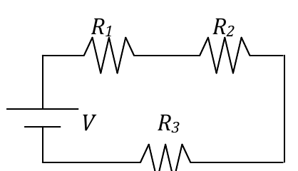

<b>Solución</b>

Solución paso a paso

**Paso 1 — Tipo de conexión.** Hay un único camino: las tres resistencias están **en serie** y por todas circula la misma corriente.

**Paso 2 — Fórmulas.**

$$R_{eq} = R_1 + R_2 + R_3 \qquad i = \frac{V}{R_{eq}} \qquad V_k = R_k\,i \qquad P_k = R_k\,i^2 \qquad P_{fuente} = V\,i$$

**Paso 3 — Cálculo.**

$$R_{eq} = (4 + 10 + 15)\ \Omega = 29\ \Omega \qquad i = \frac{58\ \text{V}}{29\ \Omega} = 2\ \text{A}$$

$$V_{R1} = 8\ \text{V} \qquad V_{R2} = 20\ \text{V} \qquad V_{R3} = 30\ \text{V} \qquad (\text{suman } 58\ \text{V}\ ✓)$$

$$P_{R1} = 4\cdot4 = 16\ \text{W} \qquad P_{R2} = 10\cdot4 = 40\ \text{W} \qquad P_{R3} = 15\cdot4 = 60\ \text{W}$$

$$P_{fuente} = 58\ \text{V}\cdot2\ \text{A} = 116\ \text{W} = P_{R1} + P_{R2} + P_{R3} = R_{eq}\,i^2$$

**Respuesta:**

- a) $R_{eq} = 29\ \Omega$
- b) $i_{CIRC} = i_1 = i_2 = i_3 = 2$ A
- c) $V_{R1} = 8$ V; $V_{R2} = 20$ V; $V_{R3} = 30$ V
- d) $P_{R1} = 16$ W; $P_{R2} = 40$ W; $P_{R3} = 60$ W
- e) $P_{FUENTE} = 58\ \text{V}\times2\ \text{A} = 116\ \text{W} = P_{R1} + P_{R2} + P_{R3}$

---

### Ejercicio 4

En el circuito de la figura, la resistencia R3 disipa 10 W. Para *V* =133 V, R2 = 750 Ω, R3 = 250 Ω, R4 = 100 Ω, calcule

a) el valor de R1;

b) la potencia total que disipa el circuito;

c) la diferencia de potencial *V*BA = *VA*-*VB*

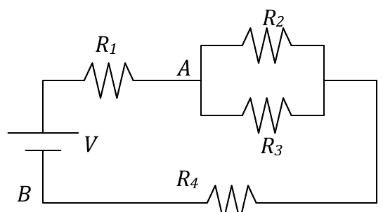

<b>Solución</b>

Solución paso a paso

**Paso 1 — Estructura.** $R_2$ y $R_3$ están en paralelo ($R_{23}$); ese paralelo está en serie con $R_1$, $R_4$ y la pila. Una sola corriente $I$ recorre el circuito.

**Paso 2 — Tensión del paralelo.** Con la potencia de $R_3$: $P_3 = \dfrac{V_{23}^2}{R_3}$, entonces

$$V_{23} = \sqrt{P_3\,R_3}$$

**Paso 3 — Corriente total.**

$$R_{23} = \frac{R_2R_3}{R_2 + R_3} \qquad I = \frac{V_{23}}{R_{23}}$$

**Paso 4 — $R_1$ (ítem a).** Por la ley de mallas, $V = I\,R_1 + V_{23} + I\,R_4$:

$$R_1 = \frac{V - V_{23}}{I} - R_4$$

**Paso 5 — Potencia total (ítem b)** $= V\,I$. **Diferencia de potencial (ítem c):** de B a A, pasando por $R_4$ y el paralelo, la tensión sube lo que cae en ellos: $V_A - V_B = V_{23} + I\,R_4$.

**Paso 6 — Cálculo.**

$$V_{23} = \sqrt{10\cdot250}\ \text{V} = 50\ \text{V} \qquad R_{23} = \frac{750\cdot250}{1000}\ \Omega = 187{,}5\ \Omega \qquad I = \frac{50}{187{,}5}\ \text{A} = 0{,}2667\ \text{A}$$

$$R_1 = \frac{133 - 50}{0{,}2667}\ \Omega - 100\ \Omega = 311{,}25\ \Omega - 100\ \Omega = 211\ \Omega$$

$$P = 133\cdot0{,}2667\ \text{W} = 35{,}5\ \text{W} \qquad V_A - V_B = 50 + 0{,}2667\cdot100 = 76{,}67\ \text{V}$$

**Respuesta:** a) $R_1 = 211\ \Omega$; b) 35,5 W; c) $V_A - V_B = 76{,}67$ V

---

### Ejercicio 5

En el circuito de la figura, las resistencias de 20 Ω disipan, cada una de ellas, 0,45 W, en tanto que la de 100 Ω disipa 0,25 W. Calcule:

a) el valor de R;

b) la potencia disipada por cada resistencia R;

c) la potencia entregada por la fuente;

d) el valor de la ddp entregada por la fuente.

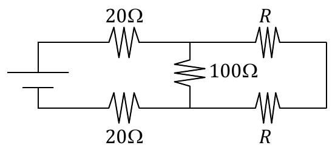

<b>Solución</b>

Solución paso a paso

**Paso 1 — Leer el circuito.** El borne superior de la fuente va a la 20 Ω de arriba y el inferior a la 20 Ω de abajo. Llamemos $M_1$ y $M_2$ a los nodos que siguen a cada 20 Ω. Entre $M_1$ y $M_2$ está la de 100 Ω. De $M_1$ sale una $R$ y de $M_2$ otra $R$, que se unen a la derecha en un nodo $N$.

**Paso 2 — Corrientes con las potencias** ($P = I^2R$):

$$I_{20} = \sqrt{\frac{0{,}45}{20}} = 0{,}15\ \text{A} \qquad I_{100} = \sqrt{\frac{0{,}25}{100}} = 0{,}05\ \text{A} \qquad V_{100} = 100\cdot0{,}05 = 5\ \text{V}$$

**Paso 3 — Nodos.** En $M_1$ entran 0,15 A; 0,05 A van por la de 100 Ω y el resto, $0{,}10$ A, por la $R$ de arriba. Esos 0,10 A vuelven por la $R$ de abajo hasta $M_2$, donde se juntan con los 0,05 A de la de 100 Ω y salen 0,15 A por la 20 Ω de abajo ✓.

**Paso 4 — Malla $M_1 \to N \to M_2$ vs. la de 100 Ω.** Entre $M_1$ y $M_2$ hay dos caminos con la misma tensión: la de 100 Ω y las dos $R$ en serie, que llevan $I_R = 0{,}10$ A:

$$2R\,I_R = V_{100} \quad\Rightarrow\quad R = \frac{V_{100}}{2I_R} = \frac{5}{0{,}2}\ \Omega = 25\ \Omega$$

**Paso 5 — Potencias.**

$$P_R = I_R^2R = 0{,}01\cdot25 = 0{,}25\ \text{W} \qquad P_{total} = 2\cdot0{,}45 + 0{,}25 + 2\cdot0{,}25 = 1{,}65\ \text{W}$$

**Paso 6 — Tensión de la fuente.** La fuente entrega $P = V\,I_{20}$:

$$V = \frac{1{,}65\ \text{W}}{0{,}15\ \text{A}} = 11\ \text{V}$$

**Respuesta:** a) $R = 25\ \Omega$; b) 0,25 W cada una; c) 1,65 W; d) 11 V

---

### Ejercicio 6

Dado el circuito de la figura, en el cual R1= 30 Ω, R2= 10 Ω, R3= 40 Ω, R4= 60 Ω y R5= 100 Ω, calcule:

a) la resistencia equivalente;

b) la intensidad de corriente que circula por el circuito;

c) la intensidad de corriente que circula por cada resistencia;

d) la caída de potencial en cada resistencia;

e) la potencia disipada por cada resistencia;

f) la potencia entregada por la batería.

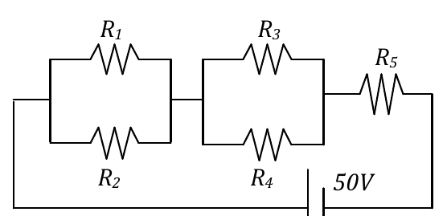

<b>Solución</b>

Solución paso a paso

**Paso 1 — Estructura.** $(R_1 \,/\!/\, R_2)$ en serie con $(R_3 \,/\!/\, R_4)$ en serie con $R_5$.

$$R_{12} = \frac{R_1R_2}{R_1 + R_2} \qquad R_{34} = \frac{R_3R_4}{R_3 + R_4} \qquad R_{eq} = R_{12} + R_{34} + R_5$$

**Paso 2 — Corriente total y tensiones.**

$$i = \frac{V}{R_{eq}} \qquad V_{12} = i\,R_{12} \qquad V_{34} = i\,R_{34} \qquad V_5 = i\,R_5$$

**Paso 3 — Corrientes en los paralelos.** $i_k = V_{par}/R_k$.

**Paso 4 — Cálculo.**

$$R_{12} = \frac{300}{40} = 7{,}5\ \Omega \qquad R_{34} = \frac{2400}{100} = 24\ \Omega \qquad R_{eq} = 7{,}5 + 24 + 100 = 131{,}5\ \Omega$$

$$i = \frac{50}{131{,}5}\ \text{A} = 0{,}380\ \text{A}$$

$$V_{12} = 2{,}85\ \text{V} \Rightarrow i_1 = \frac{2{,}85}{30} = 0{,}095\ \text{A},\ i_2 = \frac{2{,}85}{10} = 0{,}285\ \text{A}$$

$$V_{34} = 9{,}13\ \text{V} \Rightarrow i_3 = \frac{9{,}13}{40} = 0{,}228\ \text{A},\ i_4 = \frac{9{,}13}{60} = 0{,}152\ \text{A}$$

$$V_5 = 38{,}0\ \text{V}, \quad i_5 = 0{,}38\ \text{A}$$

**Paso 5 — Potencias** ($P = V^2/R$ en los paralelos e $I^2R$ en $R_5$):

$$P_1 = 0{,}271\ \text{W} \quad P_2 = 0{,}813\ \text{W} \quad P_3 = 2{,}08\ \text{W} \quad P_4 = 1{,}39\ \text{W} \quad P_5 = 14{,}46\ \text{W}$$

$$P_{pila} = V\,i = 50\cdot0{,}380\ \text{W} = 19\ \text{W}\quad(\text{igual a la suma de las disipadas})$$

**Respuesta:**

- a) $R_{eq} = 131{,}5\ \Omega$
- b) $i_{CIRC} = 0{,}38$ A
- c) $i_{R1} = 0{,}095$ A; $i_{R2} = 0{,}285$ A; $i_{R3} = 0{,}228$ A; $i_{R4} = 0{,}153$ A; $i_{R5} = 0{,}38$ A
- d) $V_{R1} = V_{R2} = 2{,}88$ V; $V_{R3} = V_{R4} = 9{,}12$ V; $V_{R5} = 38$ V
- e) $P_{R1} = 0{,}271$ W; $P_{R2} = 0{,}812$ W; $P_{R3} = 2{,}1$ W; $P_{R4} = 1{,}4$ W; $P_{R5} = 14{,}43$ W
- f) $P_{PILA} = 19$ W

---

### Ejercicio 7

Dado el arreglo de la figura halle la resistencia equivalente entre A y B (todas las resistencias valen R)

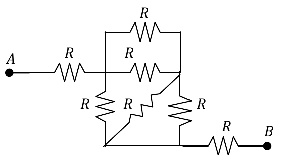

<b>Solución</b>

Solución paso a paso

**Paso 1 — Identificar los nodos.**

- **P:** después de la primera $R$ que sale de A.
- **Q:** el vértice superior derecho del bloque.
- **S:** la línea inferior del bloque. Sus dos esquinas están unidas por un cable, así que son **un solo nodo**.

**Paso 2 — Qué resistencias hay entre cada par de nodos.**

- Entre P y Q: la $R$ de arriba y la $R$ del medio, **en paralelo**: $R/2$.
- Entre Q y S: la $R$ vertical derecha y la $R$ diagonal, **en paralelo**: $R/2$.
- Entre P y S: la $R$ vertical izquierda.

**Paso 3 — Reducir.** El camino P → Q → S vale $R/2 + R/2 = R$, y está en paralelo con la $R$ directa P → S:

$$R_{PS} = \frac{R\cdot R}{R + R} = \frac R2$$

**Paso 4 — Total.** A → P ($R$), P → S ($R/2$), S → B ($R$), todo en serie:

$$R_{eq} = R + \frac R2 + R = 2{,}5\,R$$

**Respuesta:** $R_{eq} = 2{,}5\,R$

---

### Ejercicio 8

Sabiendo que *R*=2Ω y *V* = 10V

a) calcule la diferencia de potencial entre A y B;

b) discuta y justifique en qué sentido circularía la corriente si los terminales A y B se cortocircuitaran.

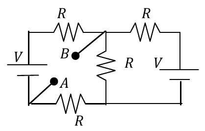

<b>Solución</b>

Solución paso a paso

**Paso 1 — Nodos y potenciales.** Se toma $V_A = 0$ (A está unido a la esquina inferior izquierda, el borne negativo de la pila izquierda). Las dos pilas tienen el borne positivo arriba.

- Arriba a la izquierda: $V_A + V = V$.
- B está unido al nodo superior central $X$.
- Abajo al centro: nodo $Y$, unido por cable al borne negativo de la pila derecha. Arriba a la derecha: $Y + V$.

**Paso 2 — Ley de nodos.** Todas las resistencias valen $R$, así que cada corriente es (diferencia de potencial)/$R$:

- Nodo X: $(V - X) + (Y + V - X) = (X - Y)$.
- Nodo Y: $(X - Y) = (Y + V - X) + (Y - 0)$.

(Lo que baja por la $R$ central sale por la pila derecha y por la $R$ inferior izquierda.)

**Paso 3 — Resolver.** De la segunda: $2X = 3Y + V$. Reemplazando en la primera ($3X = 2V + 2Y$):

$$\frac32(3Y + V) = 2V + 2Y \quad\Rightarrow\quad Y = \frac V5 \qquad X = \frac{3Y + V}{2} = \frac{4V}{5}$$

El resultado **no depende de $R$** (todas son iguales).

**Paso 4 — Cálculo.**

$$V_B - V_A = X - 0 = \frac45\cdot10\ \text{V} = 8\ \text{V}$$

**Paso 5 — Cortocircuito (ítem b).** B está 8 V por encima de A. Si se los une con un cable, la corriente circula por el cable desde el punto de **mayor** potencial (B) hacia el de **menor** (A).

**Respuesta:** a) $V_{AB} = V_B - V_A = 8$ V; b) circularía desde B hacia A.

---

### Ejercicio 9

Los instrumentos del circuito de la figura no son ideales. Los amperímetros tienen resistencia interna de 1Ω y el voltímetro tiene resistencia interna de 1 kΩ.

a) justifique por qué el amperímetro debe conectarse en serie con la resistencia;

b) justifique por qué el voltímetro debe conectarse en paralelo;

c) calcule la intensidad de la corriente que circula por cada resistencia y la ddp a la que se halla si no se conectan los instrumentos, para *V*= 6V, R1= 24Ω, R2=15Ω, R3=10Ω;

d) indique cuánto marcan los instrumentos cuando se conectan, para los valores de tensión y resistencia dados en (c).

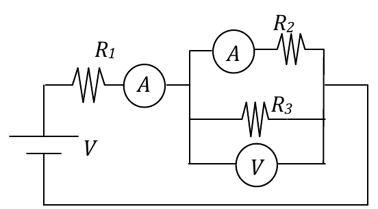

<b>Solución</b>

Solución paso a paso

**Paso 1 — Ítems a y b.** El amperímetro tiene que medir la corriente **de** la resistencia: en serie lo atraviesa la misma corriente. El voltímetro tiene que medir la tensión **de** la resistencia: en paralelo está a la misma diferencia de potencial.

**Paso 2 — Sin instrumentos (ítem c).** $R_1$ en serie con $(R_2 \,/\!/\, R_3)$:

$$R_{23} = \frac{15\cdot10}{25} = 6\ \Omega \qquad i_1 = \frac{V}{R_1 + R_{23}} = \frac{6}{30} = 0{,}2\ \text{A}$$

$$V_{R1} = 24\cdot0{,}2 = 4{,}8\ \text{V} \qquad V_{23} = 6\cdot0{,}2 = 1{,}2\ \text{V} \qquad i_2 = \frac{1{,}2}{15} = 0{,}08\ \text{A} \qquad i_3 = \frac{1{,}2}{10} = 0{,}12\ \text{A}$$

**Paso 3 — Con instrumentos (ítem d).** Cada instrumento se reemplaza por su resistencia interna:

- Rama de $R_1$: $R_1 + 1 = 25\ \Omega$.
- Rama de $R_2$: $R_2 + 1 = 16\ \Omega$.
- Rama de $R_3$ con el voltímetro en paralelo: $R_3' = \dfrac{10\cdot1000}{1010} = 9{,}90\ \Omega$.

$$R_p = \frac{16\cdot9{,}90}{16 + 9{,}90} = 6{,}116\ \Omega \qquad i_1 = \frac{6}{25 + 6{,}116}\ \text{A} = 0{,}193\ \text{A}$$

$$V_p = 0{,}193\cdot6{,}116 = 1{,}18\ \text{V} \qquad i_2 = \frac{1{,}18}{16} = 0{,}0737\ \text{A}$$

**Respuesta:**

- a) Porque al estar en serie le circula la misma corriente que a la resistencia.
- b) Porque en paralelo está a idéntico potencial que la resistencia.
- c) $i_{R1} = 0{,}2$ A, $V_{R1} = 4{,}8$ V; $i_{R2} = 0{,}08$ A, $V_{R2} = 1{,}2$ V; $i_{R3} = 0{,}12$ A, $V_{R3} = 1{,}2$ V
- d) El amperímetro en serie con $R_1$ indica 0,193 A; el amperímetro en serie con $R_2$ indica 0,0737 A; el voltímetro en paralelo con $R_3$ indica 1,18 V.

---

### Ejercicio 10

Los valores de los diferentes elementos del circuito de la figura son: *R1*= 5 Ω, *R2*= 5Ω, *R3*= 10 Ω, *R4*= 20 Ω, *R5*= 10 Ω, *R6*= 10 Ω, *V1* = 15V, *V2* = 5V, *V3* = 10V y *V4* = 5V.

a) indique cuántas ecuaciones son suficientes para determinar las corrientes por cada resistencia aludiendo a la conservación de la energía;

b) indique cuántas ecuaciones son suficientes para determinar las corrientes por cada resistencia aludiendo a la conservación de la carga;

c) calcule la corriente que circula por cada resistencia;

d) calcule el trabajo requerido para transportar una carga *q*=1μC entre A y B (en contra de la fuerza eléctrica).

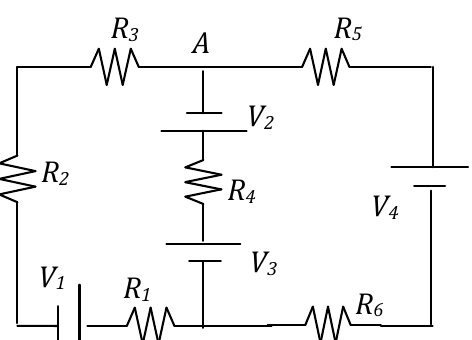

<b>Solución</b>

Solución paso a paso

**Paso 1 — Estructura.** Hay **2 nodos** (A y B) unidos por **3 ramas**:

- Izquierda: $R_3$, $R_2$, $V_1$, $R_1$. Resistencia total $R_I = 20\ \Omega$.
- Central: $V_2$, $R_4$, $V_3$. $R_C = 20\ \Omega$.
- Derecha: $R_5$, $V_4$, $R_6$. $R_D = 20\ \Omega$.

**Paso 2 — Ítems a y b.** Con 3 incógnitas (una corriente por rama):

- Ecuaciones de nodos independientes: $N - 1 = 1$ (conservación de la carga).
- Ecuaciones de mallas independientes: $B - N + 1 = 2$ (conservación de la energía).

**Paso 3 — fem neta de cada rama, recorriéndola de B hacia A** (placa larga = +):

- Izquierda: se atraviesa $V_1$ del + al − (cae): $\mathcal E_I = -15$ V.
- Central: $V_3$ del − al + (sube 10) y $V_2$ del + al − (cae 5): $\mathcal E_C = +5$ V.
- Derecha: $V_4$ del − al + (sube): $\mathcal E_D = +5$ V.

**Paso 4 — Método del nodo.** Para cada rama, $V_A = V_B + \mathcal E_k - R_k\,i_k$, donde $i_k$ es la corriente de B hacia A. Despejando, $i_k = \dfrac{\mathcal E_k - V_{AB}}{R_k}$ con $V_{AB} = V_A - V_B$. La ley de nodos en A pide $\sum i_k = 0$:

$$V_{AB} = \frac{\sum \mathcal E_k/R_k}{\sum 1/R_k} = \frac{\mathcal E_I + \mathcal E_C + \mathcal E_D}{3}\quad(\text{las tres } R \text{ son iguales})$$

**Paso 5 — Cálculo.**

$$V_{AB} = \frac{-15 + 5 + 5}{3}\ \text{V} = -1{,}67\ \text{V}$$

$$i_I = \frac{-15 + 1{,}67}{20}\ \text{A} = -0{,}667\ \text{A} \qquad i_C = i_D = \frac{5 + 1{,}67}{20}\ \text{A} = 0{,}333\ \text{A}$$

Por la rama izquierda circulan 667 mA **de A hacia B**, y vuelven 333 mA por cada una de las otras dos ramas.

**Paso 6 — Trabajo (ítem d).** El trabajo externo para llevar $q$ de A a B es $W = q\,(V_B - V_A)$:

$$W = 10^{-6}\ \text{C}\cdot1{,}67\ \text{V} = 1{,}67\ \mu\text{J}$$

**Respuesta:**

- a) N = 2; b) N = 1
- c) $i_{R1} = i_{R2} = i_{R3} = 667$ mA; $i_{R4} = i_{R5} = i_{R6} = 333$ mA
- d) $W_{AB} = 1{,}67\ \mu$J

---

### Ejercicio 11

En régimen estacionario, la potencia que disipa la resistencia de 5Ω del circuito de la figura es 0,05W. En régimen estacionario:

a) calcule el valor de *V2*;

b) calcule la potencia disipada por la resistencia de 120Ω;

c) calcule la diferencia de potencial entre los puntos A y B;

d) calcule la carga del capacitor;

e) estime el tiempo que le lleva al circuito alcanzar el régimen estacionario.

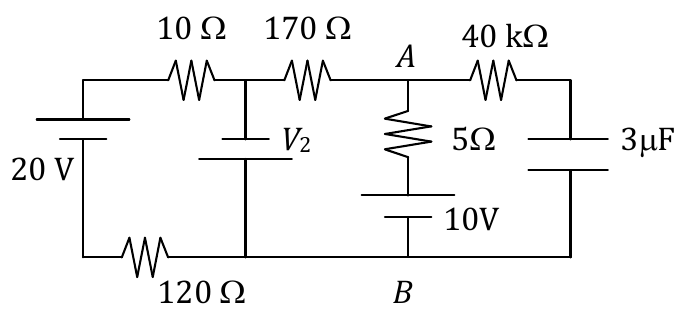

<b>Solución</b>

Solución paso a paso

**Paso 1 — Régimen estacionario.** Por la rama del capacitor (40 kΩ + 3 μF) no circula corriente. Quedan dos mallas:

- **Malla izquierda:** 20 V, 10 Ω, $V_2$, 120 Ω.
- **Malla derecha:** $V_2$, 170 Ω, 5 Ω, 10 V.

La línea inferior es un único nodo (B).

**Paso 2 — Corriente de la malla derecha.** Con la potencia de la de 5 Ω:

$$I_D = \sqrt{\frac{P_5}{5\ \Omega}} = \sqrt{\frac{0{,}05}{5}}\ \text{A} = 0{,}1\ \text{A}$$

**Paso 3 — $V_2$ (ítem a).** En la malla derecha, con las pilas sumándose (según su orientación en la figura):

$$V_2 + 10\ \text{V} = I_D\,(170 + 5)\ \Omega \quad\Rightarrow\quad V_2 = 0{,}1\cdot175 - 10 = 7{,}5\ \text{V}$$

**Paso 4 — Malla izquierda (ítem b).** La rama de $V_2$ no tiene resistencia, así que la malla izquierda queda determinada sola:

$$I_I = \frac{20 + V_2}{10 + 120}\ \text{A} = \frac{27{,}5}{130}\ \text{A} = 0{,}2115\ \text{A} \qquad P_{120} = 120\cdot0{,}2115^2\ \text{W} = 5{,}37\ \text{W}$$

**Paso 5 — $V_A - V_B$ (ítem c).** De A a B por la rama de 5 Ω y la pila de 10 V: la pila suma 10 V y la resistencia resta $5\cdot0{,}1 = 0{,}5$ V:

$$V_A - V_B = 10 - 0{,}5 = 9{,}5\ \text{V}$$

**Paso 6 — Carga del capacitor (ítem d).** Por la de 40 kΩ no pasa corriente, así que no tiene caída y el capacitor está a $V_A - V_B$:

$$Q = C\,(V_A - V_B) = 3\ \mu\text{F}\cdot9{,}5\ \text{V} = 28{,}5\ \mu\text{C}$$

**Paso 7 — Tiempo (ítem e).** El capacitor se carga a través de unos 40 kΩ (el resto del circuito aporta resistencias despreciables frente a eso):

$$\tau = RC \approx 40\times10^3\cdot3\times10^{-6}\ \text{s} = 0{,}12\ \text{s} \qquad t \approx 5\tau \approx 0{,}6\ \text{s}$$

**Respuesta:** a) $V_2 = 7{,}5$ V; b) $P_{120} = 5{,}37$ W; c) $V_A - V_B = 9{,}5$ V; d) $Q_C = 28{,}5\ \mu$C; e) $t \sim 0{,}6$ s

---

### Ejercicio 12

Calcule la intensidad de corriente que circula por el cortocircuito del arreglo de la figura.

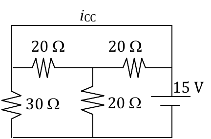

<b>Solución</b>

Solución paso a paso

**Paso 1 — Juntar los nodos unidos por el cortocircuito.** El cable superior une la esquina izquierda (extremo de la 30 Ω y de la primera 20 Ω) con la esquina derecha (extremo de la segunda 20 Ω y borne superior de la pila). Es **un solo nodo**, que llamamos T. La línea inferior es otro nodo, F.

- Pila de 15 V: entre T y F.
- 30 Ω: entre T y F.
- Las dos 20 Ω horizontales: ambas entre T y el nodo central M, **en paralelo** (10 Ω).
- 20 Ω vertical: entre M y F.

**Paso 2 — Corrientes.** La pila impone 15 V entre T y F:

$$I_{30} = \frac{15}{30} = 0{,}5\ \text{A} \qquad I_{TMF} = \frac{15}{10 + 20} = 0{,}5\ \text{A}$$

La pila entrega $0{,}5 + 0{,}5 = 1$ A por su borne superior (esquina derecha).

**Paso 3 — Reparto en el paralelo.** Las dos 20 Ω horizontales son iguales: cada una lleva $0{,}25$ A. La de la derecha toma sus 0,25 A directamente de la esquina derecha.

**Paso 4 — Corriente por el cortocircuito.** Desde la esquina derecha, la corriente que no baja por la 20 Ω derecha tiene que ir por el cable superior hacia la izquierda (para alimentar la 30 Ω y la 20 Ω izquierda):

$$i_{CC} = 1 - 0{,}25 = 0{,}5 + 0{,}25 = 0{,}75\ \text{A}$$

**Respuesta:** $i_{CC} = 0{,}75$ A

---

### Ejercicio 13

Dado el circuito de la figura, calcule la intensidad de la corriente derivada a tierra *i*T y el potencial del punto A (respecto a tierra) para R1= 20 Ω, R2= 50Ω, R3= 40 Ω, *V1* = 12V, *V2* = 6V, *V3* = 10V, *i*1= 5A, *i*2= 4A.

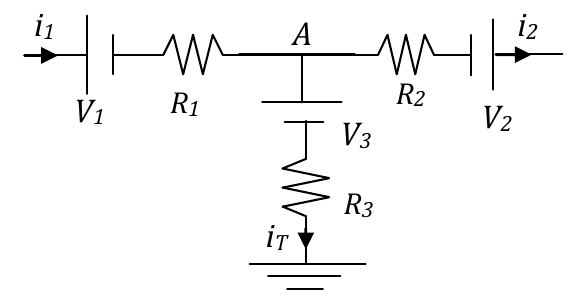

<b>Solución</b>

Solución paso a paso

**Paso 1 — Ley de nodos en A.** Entra $i_1$ (por la izquierda); salen $i_2$ (hacia la derecha) e $i_T$ (hacia tierra):

$$i_T = i_1 - i_2 = 5 - 4 = 1\ \text{A}$$

**Paso 2 — Potencial de A.** Tierra está a 0 V. Se recorre la rama de tierra hasta A, en sentido opuesto a $i_T$. Al atravesar $R_3$ en contra de la corriente, la tensión sube $R_3\,i_T$; la pila $V_3$, con la polaridad de la figura, también suma:

$$V_A = R_3\,i_T + V_3 = 40\cdot1 + 10 = 50\ \text{V}$$

**Respuesta:** $i_T = 1$ A; $V_A = 50$ V (respecto de tierra)

---

### Ejercicio 14

El capacitor del circuito de la figura tiene, en vacío, capacidad *C0* = 25 μF. Se rellena totalmente su espacio interplacas con un dieléctrico de constante *εR* = 20 y se lo conecta al circuito de la figura. Calcule la carga del capacitor una vez alcanzado el régimen estacionario.

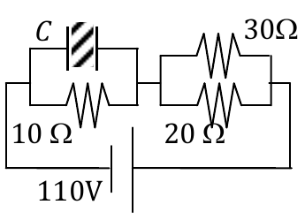

<b>Solución</b>

Solución paso a paso

**Paso 1 — Capacidad con dieléctrico.** $C = \varepsilon_R\,C_0$.

**Paso 2 — Estacionario.** Por el capacitor no pasa corriente. Queda la 10 Ω (en paralelo con C) en serie con el paralelo $30 \,/\!/\, 20 = 12\ \Omega$:

$$I = \frac{110\ \text{V}}{10 + 12\ \Omega} = 5\ \text{A}$$

**Paso 3 — Tensión del capacitor.** Es la de la 10 Ω: $V_C = 10\ \Omega\cdot I$.

$$Q = \varepsilon_R C_0\,V_C = 20\cdot25\ \mu\text{F}\cdot50\ \text{V} = 25000\ \mu\text{C}$$

**Respuesta:** $Q = 25000\ \mu$C

---

### Ejercicio 15

El circuito de la figura se halla en estado estacionario y el amperímetro marca 0,2A.

a) En esas condiciones, calcule la potencia que disipa la resistencia *R1*;

b) se cambian la pila *V1* y la resistencia *R3*, dejando inalterada la lectura inicial del amperímetro (0,2A). En tales condiciones, la corriente por *R1* es de 0,35A. Calcule la carga que tiene el capacitor en esta configuración.

*R1*= 16Ω *R2* = 15 Ω *R3* = 65Ω *R4* =40Ω *C*=20 μF

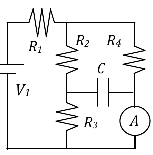

<b>Solución</b>

Solución paso a paso

**Paso 1 — Estructura.** Pila → $R_1$ → nodo superior. De allí bajan dos ramas en paralelo hasta la línea inferior:

- rama izquierda: $R_2$ y $R_3$ (punto intermedio P);
- rama derecha: $R_4$ y el amperímetro ideal (punto intermedio Q).

El capacitor une P y Q y en estacionario no lleva corriente.

**Paso 2 — Tensión del paralelo.** Por la rama derecha pasan $I_A = 0{,}2$ A, así que $V_{par} = R_4\,I_A$. La rama izquierda tiene la misma tensión:

$$I_{23} = \frac{R_4\,I_A}{R_2 + R_3} \qquad I_1 = I_A + I_{23}$$

**Paso 3 — Ítem a.**

$$V_{par} = 40\cdot0{,}2 = 8\ \text{V} \qquad I_{23} = \frac{8}{80} = 0{,}1\ \text{A} \qquad I_1 = 0{,}3\ \text{A} \qquad P_{R1} = 16\cdot0{,}3^2 = 1{,}44\ \text{W}$$

**Paso 4 — Ítem b: nueva $R_3$.** El amperímetro sigue marcando 0,2 A, así que $V_{par} = 8$ V sigue igual. Ahora $I_{23}' = 0{,}35 - 0{,}2 = 0{,}15$ A:

$$R_3' = \frac{V_{par}}{I_{23}'} - R_2 = \frac{8}{0{,}15} - 15 = 38{,}33\ \Omega$$

**Paso 5 — Tensión del capacitor.** Q está al potencial de la línea inferior (el amperímetro ideal no tiene caída). P está $R_3'\,I_{23}'$ por encima:

$$V_C = R_3'\,I_{23}' = V_{par} - R_2\,I_{23}' = 8 - 15\cdot0{,}15 = 5{,}75\ \text{V}$$

$$Q = C\,V_C = 20\ \mu\text{F}\cdot5{,}75\ \text{V} = 115\ \mu\text{C}$$

**Respuesta:** a) $P_{R1} = 1{,}44$ W; b) $Q = 115\ \mu$C

---

### Ejercicio 16

La resistencia de 5Ω se halla sumergida en un recipiente que contiene 7g de aceite industrial (punto de fusión: –5ºC; punto de ebullición: 380ºC; cACEITE=0,4cal/gºC) a 25ºC. El recipiente puede considerarse de equivalente en agua despreciable e idealmente adiabático. Calcule el tiempo que se requiere para llevar el aceite a 60ºC.

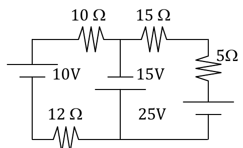

<b>Solución</b>

Solución paso a paso

**Paso 1 — Observación clave.** La rama central tiene **solo** la pila de 15 V (sin resistencia): fija la diferencia de potencial entre el nodo superior central y la línea inferior. Las dos mallas quedan **desacopladas** y la de la izquierda no afecta a la de 5 Ω.

**Paso 2 — Malla derecha.** Contiene 15 V (central), 15 Ω, 5 Ω y 25 V (derecha). Con la orientación de la figura las dos pilas se suman:

$$I = \frac{15 + 25}{15 + 5}\ \text{A} = 2\ \text{A} \qquad P_5 = 5\cdot2^2 = 20\ \text{W}$$

**Paso 3 — Calor necesario.** No hay cambio de fase (60 °C está entre −5 °C y 380 °C):

$$Q = m\,c\,\Delta T$$

**Paso 4 — Tiempo.** $P\,t = Q$:

$$t = \frac{m\,c\,\Delta T}{P_5}$$

**Paso 5 — Cálculo.**

$$Q = 7\cdot0{,}4\cdot35\ \text{cal} = 98\ \text{cal} = 98\cdot4{,}18\ \text{J} = 409{,}6\ \text{J} \qquad t = \frac{409{,}6}{20}\ \text{s} = 20{,}5\ \text{s}$$

**Respuesta:** $t = 20{,}5$ s

---

### Ejercicio 17

Sea el circuito de la figura, en el que los capacitores están inicialmente descargados.

a) calcule el valor de la intensidad de corriente que circula por cada resistencia, indicando el sentido de circulación;

b) calcule la potencia disipada por la resistencia de 5Ω en régimen estacionario;

c) calcule la energía almacenada en los capacitores (en régimen estacionario);

d) estime el tiempo que le lleva al circuito alcanzar el régimen estacionario.

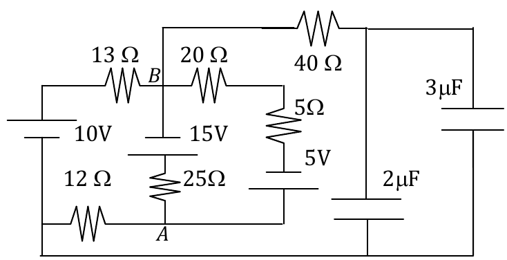

<b>Solución</b>

Solución paso a paso

**Paso 1 — Estacionario.** La rama de 40 Ω termina en los capacitores: no lleva corriente. Quedan dos mallas:

- **Izquierda:** 10 V, 13 Ω, B, 15 V, 25 Ω, A, 12 Ω.
- **Derecha:** B, 20 Ω, 5 Ω, 5 V, A, 25 Ω, 15 V.

**Paso 2 — Incógnitas.** $i_1$ (horaria en la izquierda, por 12 Ω y 13 Ω), $i_2$ (horaria en la derecha, por 20 Ω y 5 Ω) e $i_{25} = i_1 - i_2$ (de B hacia A por la rama central).

**Paso 3 — Mallas** (con las polaridades de la figura, en la malla izquierda las pilas de 10 V y 15 V se suman; en la derecha la de 5 V se opone a la de 15 V):

$$\text{Izquierda: } 10 + 15 = 13\,i_1 + 25\,(i_1 - i_2) + 12\,i_1 \quad\Rightarrow\quad 50\,i_1 - 25\,i_2 = 25$$

$$\text{Derecha: } 5 - 15 = 20\,i_2 + 5\,i_2 - 25\,(i_1 - i_2) \quad\Rightarrow\quad -25\,i_1 + 50\,i_2 = -10$$

**Paso 4 — Resolver.** Multiplicando la segunda por 2 y sumándola a la primera: $75\,i_2 = 5$.

$$i_2 = \frac{1}{15}\ \text{A} = 66{,}7\ \text{mA} \qquad i_1 = \frac{25 + 25\,i_2}{50} = 533\ \text{mA} \qquad i_{25} = 466{,}7\ \text{mA}$$

**Paso 5 — Potencia en 5 Ω (ítem b).**

$$P_5 = 5\cdot\left(\tfrac{1}{15}\right)^2\ \text{W} = 22{,}2\ \text{mW}$$

**Paso 6 — Energía en los capacitores (ítem c).** Los dos capacitores conectan el extremo derecho de la 40 Ω con la línea inferior: están **en paralelo**, $C = 5\ \mu$F. Por la 40 Ω no pasa corriente, así que ese extremo está al potencial de B. La línea inferior es el borne negativo de la pila de 10 V:

$$V_C = 10 - 13\,i_1 = 10 - 6{,}93 = 3{,}07\ \text{V} \qquad U = \tfrac12\,C\,V_C^2 = \tfrac12\cdot5\ \mu\text{F}\cdot3{,}07^2 = 23{,}5\ \mu\text{J}$$

> La guía da $U = 27{,}9\ \mu$J, que corresponde a usar $|V_B - V_A| = 3{,}33$ V. Con la conexión de la figura (los capacitores van a la línea inferior, no al punto A) la tensión es 3,07 V.

**Paso 7 — Tiempo (ítem d).** Los capacitores se cargan a través de la 40 Ω (más unos pocos ohms del resto): $\tau \approx 40\cdot5\times10^{-6} = 0{,}2$ ms, y $t \approx 5\tau \approx 1$ ms.

**Respuesta:**

- a) $i_{12} = i_{13} = 533$ mA (horaria); $i_{20} = i_5 = 66{,}7$ mA (horaria); $i_{25} = 466{,}3$ mA (de B hacia A)
- b) $P_5 = 22{,}2$ mW (la guía escribe "mJ")
- c) $U \approx 23{,}5\ \mu$J (la guía: 27,9 μJ; ver nota)
- d) $t \sim 1$ ms

---

### Ejercicio 18

a) las lámparas incandescentes de 12 V que generalmente usan los mecánicos se conectan a la batería del auto. Discuta qué le pasa a esa lámpara si usted la conecta a la línea domiciliaria (220 V).

b) Calcule la relación L/S entre la longitud y la sección del filamento de una lámpara de tungsteno (ρW=5,25×10−8 Ωm) que opera a 12 V y disipa 60W.

c) En su casa usted tiene conectados al mismo tiempo diversos aparatos eléctricos, cada uno con una determinada resistencia eléctrica interna ¿Están conectados en serie o están conectados en paralelo? La plancha, por ejemplo, "consume más" que el televisor, pero ¿consume más corriente o más tensión?

<b>Solución</b>

Solución paso a paso

**Paso 1 — Ítem a.** Con la misma resistencia, $P = V^2/R$ crece con el cuadrado de la tensión: $\left(\dfrac{220}{12}\right)^2 \approx 336$ veces la potencia nominal. El filamento se funde: la lámpara literalmente explota.

**Paso 2 — Ítem b.** De $P = V^2/R$ sale $R = V^2/P$. Con $R = \rho\,\dfrac LS$:

$$\frac LS = \frac{R}{\rho} = \frac{V^2}{P\,\rho} = \frac{144}{60\cdot5{,}25\times10^{-8}}\ \text{m}^{-1} = 4{,}57\times10^7\ \text{m}^{-1}$$

**Paso 3 — Ítem c.** Todos los aparatos de una casa reciben la misma tensión (220 V) y funcionan independientemente: están **en paralelo**. "Consumir más" significa más potencia $P = V\,I$; con la misma $V$, la plancha toma **más corriente** (tiene menor resistencia).

**Respuesta:** a) La lámpara literalmente explota. b) $L/S = 4{,}57\times10^7$ m⁻¹. c) Están conectados en paralelo (todos los aparatos se hallan a idéntico potencial, 220 V); la plancha consume más corriente.

---

### Ejercicio 19

Del siguiente conjunto de afirmaciones sólo una es verdadera. Indique cuál es

- Dos resistencias iguales en serie con una pila disipan dos veces la potencia que disipan conectadas en paralelo a esa pila.
- La resistencia de un cuerpo cilíndrico se duplica si se reduce su radio a la mitad.
- Los dieléctricos con εRELATIVO < 1 son los mejores aislantes.
- Dos resistencias iguales en serie con una pila disipan cuatro veces la potencia que disipan conectadas en paralelo a esa pila.
- La resistencia de un arreglo de resistores se duplica si se duplica la intensidad de la corriente.
- La intensidad de corriente es una medida del número de electrones que circulan por un circuito.

<b>Solución</b>

Solución paso a paso

**Potencia serie vs. paralelo.** Con una pila $V$ y dos resistencias $R$:

$$P_{serie} = \frac{V^2}{2R} \qquad P_{paralelo} = \frac{V^2}{R/2} = \frac{2V^2}{R} = 4\,P_{serie}$$

Es decir, en **paralelo** disipan cuatro veces lo que en serie.

- "Serie disipa dos veces la de paralelo": **falso**.
- "La resistencia se duplica si el radio se reduce a la mitad": **falso**. El área baja a 1/4, así que $R$ se **cuadruplica**.
- "Dieléctricos con $\varepsilon_R < 1$": **falso**. Siempre $\varepsilon_R \ge 1$.
- "Serie disipa cuatro veces la de paralelo": es la que marca la guía, pero **así escrita está invertida**: es el paralelo el que disipa cuatro veces más. La idea correcta es la relación 4:1.
- "$R$ se duplica si se duplica $I$": **falso**. $R$ depende del material y la geometría.
- "La corriente mide el número de electrones": **falso** tal como está. Mide la carga que atraviesa una sección **por unidad de tiempo**.

**Respuesta (según la guía):** "Dos resistencias iguales en serie con una pila disipan cuatro veces la potencia que disipan conectadas en paralelo a esa pila." Ojo: la relación correcta es al revés: **en paralelo** disipan cuatro veces más que en serie.

---

### Ejercicio 20

Del siguiente conjunto de afirmaciones sólo una es verdadera. Indique cuál es

- La caída de potencial es la misma sobre dos resistencias en serie.
- Dos cuerpos tienen conductividades σ1 y σ2= 2σ1, igual sección e igual longitud. Entonces R2=2R1.
- Dos resistencias en paralelo poseen resistencia equivalente mayor que la de ellas por separado.
- La Req de tres resistencias iguales, de valor R, en serie es 3R y conectadas en paralelo es R/3.
- Dos pilas ideales V1 y V2 en serie entregan más potencia que una única pila ideal de valor V1+V2.
- Un nodo en un circuito es un punto al que entran cuatro o más corrientes de rama.

<b>Solución</b>

Solución paso a paso

- "Misma caída en serie": **falso**. Lo común es la corriente; la caída es $RI$ y depende de cada $R$.
- "$\sigma_2 = 2\sigma_1 \Rightarrow R_2 = 2R_1$": **falso**. $R = \ell/(\sigma A)$, así que $R_2 = R_1/2$.
- "Paralelo mayor que cada una": **falso**. Es menor que la menor.
- "Tres iguales: 3R en serie y R/3 en paralelo": **verdadero**.
- "Dos pilas en serie entregan más que una de $V_1 + V_2$": **falso**. Son equivalentes.
- "Nodo con cuatro o más corrientes": **falso**. Basta con tres ramas.

**Respuesta:** La $R_{eq}$ de tres resistencias iguales, de valor $R$, en serie es $3R$ y conectadas en paralelo es $R/3$.

