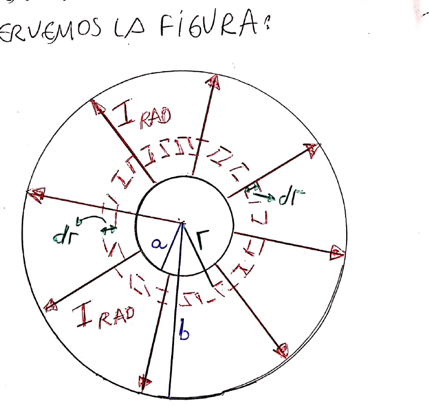
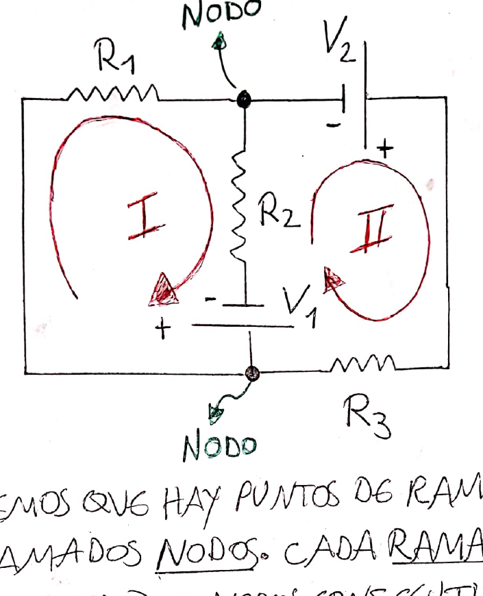
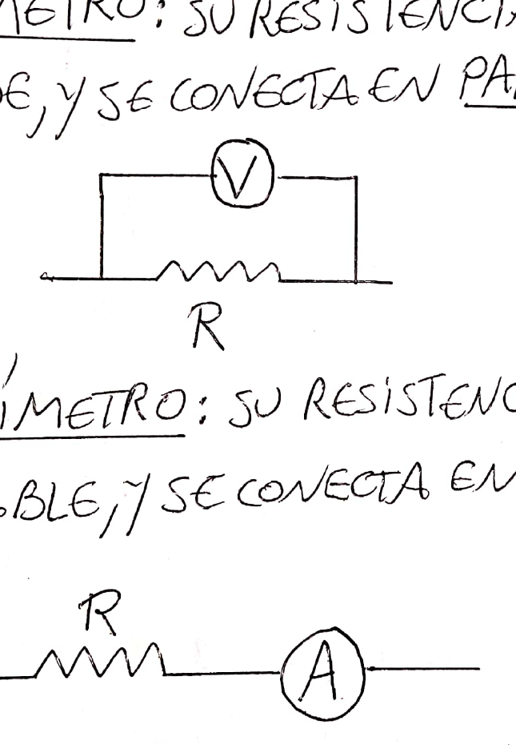
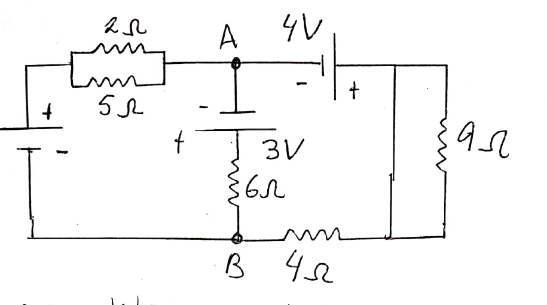
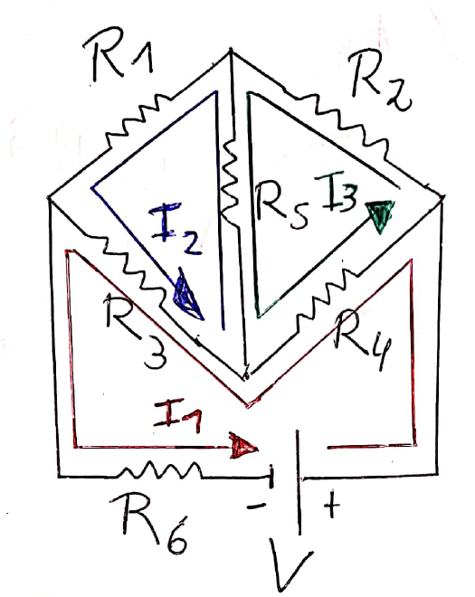

# Tema 3 — Electrodinámica: resumen teórico

Resumen de la clase del aula virtual: [Clase 4 — Corriente eléctrica](Aula%20Virtual/Clase%204%20-%20Corriente%20el%C3%A9ctrica.pdf).

Ejercicios: [práctica del tema](practica.md).

---

## Índice

1. [Corriente eléctrica](#1-corriente-eléctrica)
2. [Densidad de corriente y conductividad](#2-densidad-de-corriente-y-conductividad)
3. [Resistividad y temperatura](#3-resistividad-y-temperatura)
4. [Ley de Ohm y resistencia](#4-ley-de-ohm-y-resistencia)
5. [Potencia y efecto Joule](#5-potencia-y-efecto-joule)
6. [Conexión de resistencias](#6-conexión-de-resistencias)
7. [Resistencia radial de un cable coaxial](#7-resistencia-radial-de-un-cable-coaxial)
8. [Fuerza electromotriz y baterías](#8-fuerza-electromotriz-y-baterías)
9. [Circuitos: nodos, ramas y mallas](#9-circuitos-nodos-ramas-y-mallas)
10. [Leyes de Kirchhoff](#10-leyes-de-kirchhoff)
11. [Instrumentos de medición](#11-instrumentos-de-medición)
12. [Capacitores en circuitos de corriente continua](#12-capacitores-en-circuitos-de-corriente-continua)
13. [Ejemplos resueltos en clase](#13-ejemplos-resueltos-en-clase)
14. [Tabla de fórmulas](#14-tabla-de-fórmulas)

---

## 1. Corriente eléctrica

Se usa un modelo **clásico**: los electrones libres se mueven dentro de la red de iones del conductor. Ya **no** hay equilibrio electrostático: hay un campo eléctrico **dentro** del conductor que empuja a los electrones. Además de su movimiento aleatorio, los electrones adquieren una **velocidad de arrastre (o de deriva)** impuesta por el campo.

En su movimiento, los electrones chocan con los iones y les transfieren energía cinética. Eso aumenta la agitación térmica de los iones y la temperatura del material: es una transformación **irreversible** de energía eléctrica en calor (**efecto Joule**).

**La corriente eléctrica es el flujo de carga en el conductor.**

> **Convención:** se razona como si la corriente estuviera formada por **portadores positivos**, aunque en realidad son electrones (negativos) moviéndose en sentido opuesto.

**Corriente media e instantánea.** Si una carga $\Delta Q$ atraviesa una sección en un tiempo $\Delta t$:

$$I_m = \frac{\Delta Q}{\Delta t} \qquad\qquad \boxed{I = \frac{dQ}{dt}} \qquad [I] = \frac{\text{C}}{\text{s}} = \text{A (ampere)}$$

La corriente es **la carga que atraviesa una sección del conductor por unidad de tiempo**.

**Corriente en términos microscópicos.** Si los portadores tienen carga $q$, densidad $n$ (portadores por unidad de volumen) y velocidad de deriva $v$, en un tiempo $\Delta t$ cruzan la sección $A$ todos los que están en un volumen $A\,v\,\Delta t$:

$$\Delta Q = q\,n\,A\,v\,\Delta t \quad\Rightarrow\quad \boxed{I = q\,n\,A\,v}$$

(En una instalación domiciliaria, la velocidad de deriva resulta mucho más baja de lo que uno imaginaría: del orden de décimas de milímetro por segundo.)

---

## 2. Densidad de corriente y conductividad

La **densidad de corriente** $\vec J$ es un vector cuyo módulo es la corriente por unidad de área y cuya dirección es la de la velocidad de deriva:

$$I = \int_S \vec J\cdot\hat n\,ds \qquad \text{(uniforme y } \vec J\parallel\hat n\text{):}\quad J = \frac{I}{A} \qquad \vec J = q\,n\,\vec v \qquad [J] = \frac{\text{A}}{\text{m}^2}$$

**Materiales óhmicos.** Hay proporcionalidad directa entre la densidad de corriente y el campo:

$$\boxed{\vec J = \sigma\,\vec E}$$

$\sigma$ es la **conductividad eléctrica** y depende del material:

- $\sigma$ pequeña: un campo intenso produce una corriente débil (**dieléctricos**). El dieléctrico ideal tiene $\sigma = 0$.
- $\sigma$ grande: un campo débil produce una corriente intensa (**conductores**). El conductor ideal ($\sigma \to \infty$) no existe.

Se define el **ohm**: $\Omega = \text{V/A}$. Entonces $[\sigma] = \dfrac{1}{\text{m}\,\Omega}$.

---

## 3. Resistividad y temperatura

La **resistividad** es la inversa de la conductividad e indica cuánto se opone el material a la corriente:

$$\boxed{\rho = \frac{1}{\sigma}} \qquad [\rho] = \Omega\,\text{m}$$

Depende de la temperatura. En los rangos de interés la dependencia es aproximadamente **lineal**:

$$\boxed{\rho(T) = \rho_{20\,^\circ\text{C}}\,\big[1 + \alpha\,(T - 20\,^\circ\text{C})\big]}$$

$\rho_{20\,^\circ\text{C}}$ y $\alpha$ (coeficiente de temperatura de la resistividad, $[\alpha] = 1/^\circ\text{C}$) están tabulados. Como $R \propto \rho$, la resistencia varía igual: $R(T) = R_{20}\,[1 + \alpha\,\Delta T]$.

---

## 4. Ley de Ohm y resistencia

Se toma un tramo de conductor de longitud $\ell$ y sección $A$, con campo uniforme:

$$V_2 - V_1 = -\int_1^2\vec E\cdot d\vec\ell = -E\,\ell \qquad\text{con}\quad E = \frac{J}{\sigma} = \rho\,J = \rho\,\frac{I}{A}$$

$$\boxed{V_1 - V_2 = R\,I}\quad(\text{ley de Ohm}) \qquad\qquad \boxed{R = \rho\,\frac{\ell}{A}} \qquad [R] = \Omega$$

La ley de Ohm dice que, en los materiales óhmicos, la tensión y la corriente son **proporcionales**, con la **resistencia** como constante de proporcionalidad. La corriente circula del punto de **mayor** potencial al de **menor** potencial: al atravesar una resistencia **a favor** de la corriente, el potencial **cae** $RI$.

> **Estirar un alambre conservando la masa:** el volumen $\ell A$ no cambia. Si la longitud se multiplica por $k$, la sección se divide por $k$, así que $R = \rho\ell/A$ queda multiplicada por $k^2$.

---

## 5. Potencia y efecto Joule

Una carga $Q$ que atraviesa una caída de potencial $\Delta V$ pierde energía $Q\,\Delta V$, que se disipa como calor:

$$P = \frac{dU}{dt} = \frac{d}{dt}(Q\,\Delta V) = I\,\Delta V$$

$$\boxed{P = I\,\Delta V = I^2R = \frac{(\Delta V)^2}{R}} \qquad [P] = \text{W}$$

Se elige la forma más cómoda: $I^2R$ si se conoce la corriente (elementos en serie) y $V^2/R$ si se conoce la tensión (elementos en paralelo). La energía disipada en un tiempo $t$ (con $P$ constante) es $E = P\,t$.

---

## 6. Conexión de resistencias

Un **cable** se dibuja como una línea y tiene resistencia despreciable: todos sus puntos están al mismo potencial.

**Serie:** la **misma corriente** atraviesa todos los elementos (no hay fuentes ni sumideros de carga entre ellos).

**Paralelo:** todos los elementos están a la **misma tensión** $V_{AB}$.

**Resistencia equivalente:** la que puede reemplazar a un conjunto sin cambiar la física (a la misma tensión, la misma corriente):

$$\boxed{\text{Serie: } R_{eq} = R_1 + R_2 + \dots} \qquad \boxed{\text{Paralelo: } \frac{1}{R_{eq}} = \frac{1}{R_1} + \frac{1}{R_2} + \dots}$$

Casos útiles:

- Dos en paralelo: $R_{eq} = \dfrac{R_1R_2}{R_1 + R_2}$.
- $N$ resistencias iguales: en serie $NR$; en paralelo $R/N$.
- El paralelo siempre es **menor** que la menor de las resistencias.

**Divisores:**

- Divisor de tensión (serie): $V_k = V\,\dfrac{R_k}{R_{eq}}$.
- Divisor de corriente (dos en paralelo): $I_1 = I\,\dfrac{R_2}{R_1 + R_2}$.

> **Puntos unidos por un cable** están al mismo potencial y se pueden "juntar" en un solo nodo. Una resistencia con ambos extremos al mismo potencial no lleva corriente.

---

## 7. Resistencia radial de un cable coaxial

Dos cilindros conductores coaxiales de radios $a < b$ y longitud $\ell$ tienen entre ellos un material de resistividad $\rho$. Como no existe el dieléctrico ideal, aparece una pequeña **corriente de fuga radial**.

La corriente atraviesa capas cilíndricas de radio $r$, espesor $dr$ y sección $A(r) = 2\pi r\ell$, **en serie**:

$$dR = \rho\,\frac{dr}{2\pi r\,\ell} \quad\Rightarrow\quad \boxed{R = \frac{\rho}{2\pi\ell}\,\ln\!\left(\frac ba\right)}$$

---

## 8. Fuerza electromotriz y baterías

Un conductor aislado tiene todos sus puntos al mismo potencial y no hay corriente. Para **sostener** una corriente hace falta una **batería** (fem, "fuerza electromotriz"). El nombre es histórico e inadecuado: **el rol de la batería es establecer una diferencia de potencial entre sus bornes**.

- Símbolo: dos placas paralelas. La **larga** es el borne **positivo** y la **corta** el **negativo**.
- La fem es la circulación del campo **no conservativo** que establece la batería: $\mathcal E = \oint\vec E\cdot d\vec\ell$, $[\mathcal E] = \text{V}$.
- La batería **no aporta cargas**: **hace trabajo**. Cuando una carga $q$ pasa del borne negativo al positivo, su energía aumenta en $q\mathcal E$. Si la corriente sale por el borne positivo, la batería **entrega** potencia $P = \mathcal E\,I$; si entra por el positivo, la **absorbe** (se está cargando).
- La batería tiene una **resistencia interna**. Si es despreciable, la batería es **ideal**: la tensión entre bornes coincide con la fem solo si es ideal o si no circula corriente.
- La batería es el elemento **activo** (entrega energía) y la resistencia el **pasivo** (la disipa irreversiblemente como calor).

---

## 9. Circuitos: nodos, ramas y mallas

- **Nodo:** punto de ramificación del circuito.
- **Rama:** tramo que une dos nodos consecutivos. Cada rama tiene **una** corriente de rama.
- **Malla:** cualquier camino cerrado.

Antes de resolver no se conoce el sentido de las corrientes, así que se les asigna uno **arbitrario**. Si al resolver una sale **negativa**, circula en sentido opuesto al supuesto.

En un nodo es imposible que todas las corrientes entren o que todas salgan: el nodo no es fuente ni sumidero de carga.

---

## 10. Leyes de Kirchhoff

**Ley de nodos** (conservación de la carga): en cada nodo,

$$\boxed{\sum_{\text{entran}} I_i = \sum_{\text{salen}} I_i}$$

**Ley de mallas** (conservación de la energía): recorriendo cualquier malla y sumando subidas y caídas de tensión hasta volver al punto de partida, el resultado es cero:

$$\boxed{\sum_{\text{malla}}\Delta V_i = 0}$$

> **Reglas de signos al recorrer una malla**
>
> - Resistencia recorrida **a favor** de la corriente: la tensión **cae**, $-RI$.
> - Resistencia recorrida **en contra** de la corriente: la tensión **sube**, $+RI$.
> - Batería recorrida del borne $-$ al $+$: **sube**, $+\mathcal E$.
> - Batería recorrida del borne $+$ al $-$: **cae**, $-\mathcal E$.
>
> La malla se puede recorrer en cualquier sentido (se obtiene la misma ecuación con el signo cambiado).

**¿Cuántas ecuaciones hacen falta?** No todas son independientes. Con $N$ nodos y $B$ ramas:

- ecuaciones de nodos independientes: $N - 1$;
- ecuaciones de mallas independientes: $B - N + 1$ (las mallas "ventana" del dibujo).

**Método de corrientes de malla.** Se asigna una corriente a cada malla ventana. Por las ramas compartidas pasa la diferencia de dos corrientes de malla. Así se evitan las ecuaciones de nodos y se reduce el número de incógnitas.

> **Diferencia de potencial entre dos puntos:** $V_B = V_A + \sum(\text{subidas y caídas})$ recorriendo **cualquier** camino de A a B.

---

## 11. Instrumentos de medición

Una medición no debe alterar lo que se mide:

- **Voltímetro:** mide la diferencia de potencial entre dos puntos. Su resistencia es **muy grande** y se conecta **en paralelo**: así está a la misma tensión que el elemento y casi no le "roba" corriente.
- **Amperímetro:** mide la corriente en una rama. Su resistencia es **despreciable** y se conecta **en serie**: así lo atraviesa la misma corriente que al elemento y casi no agrega caída de tensión.

Si los instrumentos **no son ideales**, se los reemplaza por su resistencia interna y se resuelve el circuito.

---

## 12. Capacitores en circuitos de corriente continua

(Se desarrolla en el [Tema 4 — Capacitores](../4%20-%20Capacitores%20y%20Diel%C3%A9ctricos/teoria.md), pero aparece en la guía de este tema.)

- En **régimen estacionario** un capacitor está cargado y **no circula corriente por su rama**. Se lo trata como un **circuito abierto**: las resistencias en serie con él no tienen caída de tensión.
- Su carga es $Q = C\,V_C$, donde $V_C$ es la diferencia de potencial entre sus bornes, que se calcula con el resto del circuito. La energía almacenada es $U = \tfrac12CV_C^2$.
- El tiempo que tarda en alcanzarse el régimen estacionario es de unas pocas **constantes de tiempo** $\tau = R\,C$ (típicamente se toma $\approx 5\tau$), donde $R$ es la resistencia que "ve" el capacitor.

---

## 13. Ejemplos resueltos en clase

### Circuito con dos mallas

- La resistencia de 9 Ω tiene sus dos extremos unidos por un cable: está al mismo potencial y no lleva corriente.
- 2 Ω y 5 Ω en paralelo: $R_{eq} = 1{,}43\ \Omega$.
- Nodos (A y B dan la misma ecuación): $I_1 + I_3 = I_2$.
- Malla I (horario): $21\ \text{V} = 1{,}43\,I_1 + 6\,I_2$.
- Malla II (horario): $-1\ \text{V} = 6\,I_2 + 4\,I_3$.
- Resultado: $I_1 = 5{,}62$ A, $I_2 = 2{,}16$ A, $I_3 = -3{,}49$ A (circula al revés de lo supuesto).
- Potencia entregada: $18\cdot I_1 + 3\cdot I_2 + 4\cdot|I_3| = 121{,}6$ W. Potencia disipada: $1{,}43I_1^2 + 6I_2^2 + 4I_3^2 = 121{,}9$ W. Son iguales salvo redondeo.
- Corriente en la de 2 Ω: $I_4 = \dfrac{1{,}43}{2}\cdot5{,}62 = 4{,}02$ A, que disipa $P = 2\cdot4{,}02^2 = 32{,}3$ W.
- $V_B = V_A + 3\ \text{V} - 6\,I_2 = V_A - 10\ \text{V}$, así que $V_A > V_B$.

### Puente de Wheatstone

Con corrientes de malla $I_1$, $I_2$, $I_3$ (antihorarias) se obtienen tres ecuaciones. Si la corriente por $R_5$ es nula ($I_2 = I_3$, **puente en equilibrio**):

$$\boxed{R_1R_4 = R_2R_3}$$

Sirve para **medir una resistencia desconocida**: se varía $R_3$ hasta que un amperímetro en la rama central marque cero y se despeja $R_4$.

---

## 14. Tabla de fórmulas

| Tema | Fórmula |
|---|---|
| Corriente | $I = dQ/dt$, $I = qnAv$ |
| Densidad de corriente | $J = I/A$, $\vec J = \sigma\vec E$ |
| Resistividad | $\rho = 1/\sigma$, $\rho(T) = \rho_{20}[1 + \alpha(T - 20)]$ |
| Resistencia | $R = \rho\,\ell/A$ |
| Ley de Ohm | $V = RI$ |
| Potencia | $P = IV = I^2R = V^2/R$ |
| Serie | $R_{eq} = \sum R_i$ (misma $I$) |
| Paralelo | $1/R_{eq} = \sum 1/R_i$ (misma $V$) |
| Coaxial (radial) | $R = \frac{\rho}{2\pi\ell}\ln(b/a)$ |
| Batería | $P = \mathcal E I$ |
| Nodos | $\sum I_{entran} = \sum I_{salen}$ |
| Mallas | $\sum\Delta V = 0$ |
| Wheatstone (equilibrio) | $R_1R_4 = R_2R_3$ |
| Capacitor estacionario | $I = 0$, $Q = CV_C$, $\tau = RC$ |
