# Tema 4 — Capacitores y dieléctricos: ejercicios resueltos

Ejercicios de la [Guía de ejercicios de Capacitores y dieléctricos](Aula%20Virtual/Gu%C3%ADa%20de%20ejercicios%20-%20Capacitores%20y%20diel%C3%A9ctricos.pdf). Los enunciados están copiados textualmente de la guía.

Cada ejercicio tiene un botón **Solución**. Al abrirlo aparece la respuesta y, arriba, un segundo botón **Solución paso a paso** con el desarrollo completo. El paso a paso está escrito para alguien que no sabe nada del tema: arranca con **Qué piden, en palabras** (el enunciado traducido) y **La idea, desde cero** (la teoría necesaria, explicada sobre ese ejercicio), y después resuelve deduciendo cada fórmula. Primero se obtiene la fórmula en forma simbólica y recién al final se reemplazan los números.

Teoría: [resumen del tema](teoria.md). Constantes: $\varepsilon_0 = 8{,}85\times10^{-12}$ C²/(N m²), $k_0 = 9\times10^9$ N m²/C².

**⭐ Para el 2º Parcial:** 3 de los 15 ejercicios están marcados con ⭐. Son los que practican un tipo de ejercicio que se tomó en los parciales (el de capacitores con llaves, que se toma desde 2024). Para el 1er Parcial, ver su [guía de resolución](../Primer%20Parcial/guia-de-resolucion.md). Si estudiás para el 2º Parcial, alcanza con hacer los marcados; los demás se pueden saltear.

| Bloque | Ejercicios |
|---|---|
| Asociación de capacitores | [1](#ejercicio-1) ⭐ · [3](#ejercicio-3) · [5](#ejercicio-5) ⭐ · [6](#ejercicio-6) ⭐ |
| Geometría y capacidad | [2](#ejercicio-2) · [4](#ejercicio-4) · [12](#ejercicio-12) |
| Dieléctricos, D, P | [7](#ejercicio-7) · [8](#ejercicio-8) · [9](#ejercicio-9) · [10](#ejercicio-10) · [11](#ejercicio-11) · [13](#ejercicio-13) · [14](#ejercicio-14) |
| Conceptual | [15](#ejercicio-15) |

---

### Ejercicio 1

⭐ **Sirve para el 2º Parcial**: practica el [tipo 1: Capacitores con llaves: energía disipada](../Segundo%20Parcial/guia-de-resolucion.md#1-capacitores-con-llaves-energ%C3%ADa-disipada) de la guía de resolución.

Los capacitores del circuito de la figura valen *C1*=4μF; *C2*=6μF; *C3*=12,6μF; *C4*=2μF; *C5*=8μF. En régimen estacionario, calcule:

a) la capacidad equivalente de la configuración;

b) la carga almacenada en cada capacitor;

c) la ddp a la que se encuentra cada capacitor;

d) la energía almacenada por cada capacitor y la del sistema

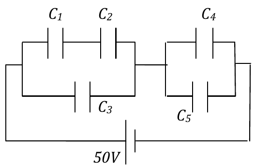

<b>Solución</b>

Solución paso a paso

**Qué piden, en palabras.**

- Cinco capacitores conectados a una pila de 50 V: $C_1 = 4$, $C_2 = 6$, $C_3 = 12{,}6$, $C_4 = 2$ y $C_5 = 8$, todos en μF.
- "Régimen estacionario": pasó mucho tiempo, los capacitores terminaron de cargarse y ya no circula corriente.
- **a)** Un único capacitor que equivalga a todo el circuito. **b)** y **c)** La carga y la tensión de cada uno. **d)** La energía de cada uno y la total.

**La idea, desde cero.** Un capacitor son dos placas metálicas enfrentadas que no se tocan. La pila saca electrones de una placa y los pone en la otra: una queda con $+Q$ y la otra con $-Q$. La corriente no lo atraviesa, solo lo carga. Cuanta más carga tiene, mayor es la tensión entre sus placas: $Q = CV$, donde $C$ (la capacidad) es cuánta carga guarda por cada volt. Para resolver circuitos de capacitores hay que reconocer dos formas de conexión:

| | Cómo se ve | Qué tienen igual |
|---|---|---|
| **Paralelo** | los dos extremos de uno están unidos a los dos extremos del otro | la misma **tensión** |
| **Serie** | uno a continuación del otro, sin nada más conectado en la unión | la misma **carga** |

- *Por qué en paralelo tienen la misma tensión.* Un cable sin corriente está todo al mismo potencial. Las placas de la izquierda están unidas por cable y tienen el mismo potencial; lo mismo las de la derecha. La diferencia entre los dos lados es la misma para los dos capacitores.
- *Por qué en serie tienen la misma carga.* El pedazo de metal entre los dos (la placa derecha de uno, el cable y la placa izquierda del otro) está aislado. Antes de conectar la pila tenía carga total cero, y la carga no puede entrar ni salir. Si una de sus placas queda con $-Q$, la otra tiene que quedar con $+Q$.

**Paso 1 — Leer el circuito.** $C_1$ y $C_2$ están uno detrás del otro, en serie. $C_3$ va de los mismos dos puntos que ese par, así que está en paralelo con él: eso forma el bloque izquierdo. $C_4$ y $C_5$ comparten sus dos extremos: están en paralelo y forman el bloque derecho. Los dos bloques están en serie con la pila.

**Paso 2 — Fórmulas de combinación (deducidas).**

*Paralelo*: misma $V$, y las cargas se suman:

$$Q = C_aV + C_bV = (C_a + C_b)V \quad\Rightarrow\quad C_{eq} = C_a + C_b$$

*Serie*: misma $Q$, y las tensiones se suman:

$$V = \frac{Q}{C_a} + \frac{Q}{C_b} \quad\Rightarrow\quad \frac{1}{C_{eq}} = \frac1{C_a} + \frac1{C_b} \quad\Leftrightarrow\quad C_{eq} = \frac{C_aC_b}{C_a + C_b}$$

En serie, la equivalente siempre es menor que la menor de las dos.

**Paso 3 — Ítem a: simplificar de adentro hacia afuera** (todo en μF).

$$C_{12} = \frac{4\cdot6}{4 + 6} = 2{,}4 \qquad C_A = C_{12} + C_3 = 2{,}4 + 12{,}6 = 15 \qquad C_B = C_4 + C_5 = 10$$

$$C_{eq} = \frac{C_AC_B}{C_A + C_B} = \frac{15\cdot10}{25} = 6\ \mu\text{F}$$

**Paso 4 — Carga que entrega la pila.** Todo el circuito equivale a un capacitor de 6 μF conectado a 50 V:

$$Q = C_{eq}V = 6\cdot50 = 300\ \mu\text{C}$$

**Paso 5 — Volver hacia atrás: los dos bloques.** Están en serie, así que los dos tienen 300 μC:

$$V_A = \frac{300}{15} = 20\ \text{V} \qquad V_B = \frac{300}{10} = 30\ \text{V} \qquad (20 + 30 = 50\ \text{V}\ ✓)$$

**Paso 6 — Abrir el bloque derecho.** $C_4$ y $C_5$ están en paralelo, así que los dos tienen 30 V:

$$Q_4 = 2\cdot30 = 60\ \mu\text{C} \qquad Q_5 = 8\cdot30 = 240\ \mu\text{C} \qquad (60 + 240 = 300\ ✓)$$

**Paso 7 — Abrir el bloque izquierdo.** $C_3$ y el par $C_{12}$ están en paralelo, así que los dos tienen 20 V:

$$Q_3 = 12{,}6\cdot20 = 252\ \mu\text{C} \qquad Q_{12} = 2{,}4\cdot20 = 48\ \mu\text{C} \qquad (252 + 48 = 300\ ✓)$$

**Paso 8 — Abrir el par $C_1$–$C_2$.** Están en serie, así que cada uno tiene 48 μC (no se suman):

$$V_1 = \frac{48}{4} = 12\ \text{V} \qquad V_2 = \frac{48}{6} = 8\ \text{V} \qquad (12 + 8 = 20\ \text{V}\ ✓)$$

Con la misma carga, el capacitor más chico de una serie se queda con la mayor tensión ($V = Q/C$).

**Paso 9 — Ítem d: energía.** *De dónde sale:* con carga $q$, la tensión del capacitor es $q/C$, y agregar $dq$ cuesta $\frac qC\,dq$. Sumando de 0 a $Q$:

$$U = \int_0^Q\frac qC\,dq = \frac{Q^2}{2C} = \tfrac12CV^2$$

En μF y V, la energía sale en μJ:

$$U_1 = \tfrac12\cdot4\cdot12^2 = 288 \quad U_2 = \tfrac12\cdot6\cdot8^2 = 192 \quad U_3 = \tfrac12\cdot12{,}6\cdot20^2 = 2520 \quad U_4 = \tfrac12\cdot2\cdot30^2 = 900 \quad U_5 = \tfrac12\cdot8\cdot30^2 = 3600$$

Total: 7500 μJ. Control: $\tfrac12C_{eq}V^2 = \tfrac12\cdot6\cdot50^2 = 7500\ \mu\text{J}$ ✓.

**Resumen del método.** (1) Identificar serie y paralelo. (2) Simplificar hasta $C_{eq}$. (3) $Q = C_{eq}V$. (4) Volver hacia atrás: en serie se copia la carga y se reparte la tensión; en paralelo se copia la tensión y se reparte la carga. (5) $U = \tfrac12CV^2$ para cada uno, y verificar con $\tfrac12C_{eq}V^2$.

**Respuesta:**

- a) $C_{eq} = 6\ \mu\text{F}$
- b) $Q_1 = Q_2 = 48\ \mu\text{C}$; $Q_3 = 252\ \mu\text{C}$; $Q_4 = 60\ \mu\text{C}$; $Q_5 = 240\ \mu\text{C}$
- c) $V_1 = 12$ V; $V_2 = 8$ V; $V_3 = 20$ V; $V_4 = V_5 = 30$ V
- d) $U_1 = 288\ \mu\text{J}$; $U_2 = 192\ \mu\text{J}$; $U_3 = 2520\ \mu\text{J}$; $U_4 = 900\ \mu\text{J}$; $U_5 = 3600\ \mu\text{J}$; $U_T = U_1 + \dots + U_5 = C_{eq}V^2/2 = 7500\ \mu\text{J}$

---

### Ejercicio 2

Entre las placas de un capacitor plano paralelo de placas de área *A* y distancia interplacas *d* se introduce una lámina metálica de espesor *e < d* y de igual área *A* que la placa.

a) calcule la nueva capacidad del capacitor;

b) demuestre que la ubicación de la placa dentro del capacitor es irrelevante.

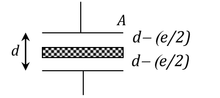

<b>Solución</b>

Solución paso a paso

**Qué piden, en palabras.**

- Un capacitor de placas paralelas (área $A$, separación $d$). Entre las placas se mete una lámina de metal de espesor $e$, paralela a ellas.
- **a)** La nueva capacidad. **b)** Mostrar que no importa a qué altura se ponga la lámina.

**La idea, desde cero.** Un capacitor plano son dos placas de área $A$ a distancia $d$, y su capacidad es $C = \varepsilon_0A/d$: más área, más lugar para carga; más distancia, menos capacidad. Dentro de un metal en equilibrio el campo eléctrico es cero, porque sus electrones libres se mueven hasta anularlo. Por eso la lámina metálica "se come" un espesor $e$ en el que no hay campo, y en sus dos caras aparecen cargas $-Q$ y $+Q$ enfrentadas a las de las placas. El resultado es lo mismo que dos capacitores puestos uno detrás del otro (en serie): de la placa de arriba a la lámina, y de la lámina a la placa de abajo.

**Resolución.**

**Paso 1 — Qué hace la lámina.** En sus caras se inducen cargas $\mp Q$ y adentro del metal $E = 0$. El sistema queda como **dos capacitores en serie**: uno entre la placa superior y la lámina (separación $D_1$) y otro entre la lámina y la placa inferior (separación $D_2$). El espesor que queda vacío es $D_1 + D_2 = d - e$.

**Paso 2 — Serie.**

$$\frac{1}{C'} = \frac{D_1}{\varepsilon_0A} + \frac{D_2}{\varepsilon_0A} = \frac{D_1 + D_2}{\varepsilon_0A} = \frac{d - e}{\varepsilon_0A}$$

$$C' = \frac{\varepsilon_0A}{d - e}$$

**Paso 3 — Ítem b.** El resultado depende solo de $D_1 + D_2 = d - e$, no de cómo se reparte esa distancia: la posición de la lámina no importa.

**Respuesta:**

- a) $C' = \varepsilon_0A/(d - e)$
- b) Uno de los capacitores tendrá separación $D_1$ y el otro $D_2$, con $D_1 + D_2 = d - e$. Los capacitores quedan en serie, y su capacidad equivalente será $C_{eq} = \varepsilon_0A/(D_1 + D_2) = \varepsilon_0A/(d - e)$.

---

### Ejercicio 3

Sean los capacitores de la figura, para los que se cumple la relación *C1 < C2 < C3*.

a) justifique por qué el valor de la capacidad equivalente del sistema es menor que *C1*;

b) si se retira el capacitor *C3*, justifique si la capacidad del sistema aumenta, disminuye o permanece inalterada;

c) si se retira el capacitor *C3*, justifique si la carga almacenada por *C1* aumenta, disminuye o permanece inalterada.

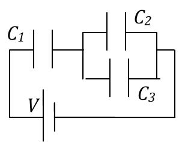

<b>Solución</b>

Solución paso a paso

**Qué piden, en palabras.**

- $C_1$ en serie con el grupo de $C_2$ y $C_3$ en paralelo, y se sabe que $C_1 < C_2 < C_3$.
- **a)** Explicar por qué la capacidad total es menor que $C_1$. **b)** Si se saca $C_3$, ¿la capacidad total sube, baja o queda igual? **c)** Y la carga de $C_1$, ¿sube, baja o queda igual?

**La idea, desde cero.** En **paralelo** (mismos dos extremos) las capacidades se suman, porque es como agrandar las placas. En **serie** (uno detrás del otro) se suman las inversas, $1/C_{eq} = 1/C_a + 1/C_b$, porque los dos tienen la misma carga y las tensiones se suman. Una consecuencia: en serie la equivalente es siempre menor que la menor de las capacidades. Además, en una serie todos los elementos tienen la misma carga que el conjunto, $Q = C_{eq}V$.

**Resolución.**

**Estructura.** $C_1$ en serie con el paralelo $C_{23} = C_2 + C_3$:

$$C_{eq} = \frac{C_1\,C_{23}}{C_1 + C_{23}} = \frac{C_1}{1 + C_1/C_{23}} < C_1$$

**Ítem a.** En serie, $1/C_{eq} = 1/C_1 + 1/C_{23} > 1/C_1$, así que $C_{eq} < C_1$: la equivalente en serie es menor que la menor.

**Ítem b.** Sin $C_3$, el paralelo pasa de $C_2 + C_3$ a $C_2$ (disminuye) y, con él, la $C_{eq}$ de la serie.

**Ítem c.** $C_1$ está en serie, así que su carga es la del sistema: $Q_1 = C_{eq}V$. Con la misma $V$ y menor $C_{eq}$, $Q_1$ **disminuye**.

**Respuesta:**

- a) Porque hay una serie y la capacidad equivalente es menor que la menor de las capacidades.
- b) Disminuye, porque disminuye la capacidad del paralelo.
- c) Disminuye, porque la capacidad total es menor y la carga de la serie disminuye.

---

### Ejercicio 4

La esfera metálica de radio *r1* tiene carga *Q>0* y se halla rodeada por una cáscara metálica, esférica y concéntrica, de radios *r2* y *r3 > r2*. Calcule:

a) la diferencia de potencial entre las superficies de radios *r1* y *r3*;

b) el potencial de la esfera de radio *r1*;

c) la capacidad del sistema;

d) la capacidad de la esfera de radio *r1*.

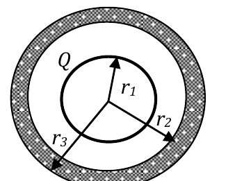

<b>Solución</b>

Solución paso a paso

**Qué piden, en palabras.**

- Una esfera de metal de radio $r_1$ con carga $Q$, rodeada por una cáscara esférica de metal (radios $r_2$ y $r_3$), con el mismo centro. La cáscara no tiene carga propia.
- **a)** La diferencia de potencial entre la esfera y la superficie exterior de la cáscara. **b)** El potencial de la esfera, tomando cero en el infinito. **c)** La capacidad del par esfera–cáscara. **d)** La capacidad de la esfera sola.

**La idea, desde cero.** En un metal en equilibrio el campo es cero, y toda su carga se va a las superficies. La carga $Q$ de la esfera atrae carga negativa a la cara interior de la cáscara: aparece $-Q$ en $r_2$. Como la cáscara es neutra, en su cara exterior queda $+Q$. El campo se calcula con **Gauss**: el flujo del campo a través de una esfera imaginaria de radio $r$ es la carga encerrada sobre $\varepsilon_0$, lo que da $E = kQ/r^2$ donde hay carga neta encerrada y $E = 0$ dentro del metal. El **potencial** es la integral del campo: $V(a) - V(b) = \int_a^b E\,dr$ yendo hacia afuera. Y la **capacidad** es carga dividida por la diferencia de potencial entre los dos conductores, $C = Q/\Delta V$.

**Resolución.**

**Paso 1 — Cargas.** Esfera: $Q$ en $r_1$. La cáscara (neutra) tiene $-Q$ inducida en $r_2$ y $+Q$ en $r_3$.

**Paso 2 — Campos (Gauss).** $E = kQ/r^2$ para $r_1 < r < r_2$; $E = 0$ en el metal ($r_2 < r < r_3$); $E = kQ/r^2$ para $r > r_3$.

**Paso 3 — Ítem a.** Solo hay campo entre $r_1$ y $r_2$ (dentro del metal no cae potencial):

$$V(r_3) - V(r_1) = -\int_{r_1}^{r_2}\frac{k_0Q}{r^2}dr = k_0Q\left(\frac{1}{r_2} - \frac{1}{r_1}\right)$$

**Paso 4 — Ítem b.** Con $V(\infty) = 0$: $V(r_3) = k_0Q/r_3$, y sumando la caída del ítem a:

$$V(r_1) = k_0Q\left(\frac{1}{r_3} + \frac{1}{r_1} - \frac{1}{r_2}\right)$$

**Paso 5 — Ítem c.** El "sistema" es el capacitor esfera–cáscara, con cargas $\pm Q$ en $r_1$ y $r_2$:

$$C = \frac{Q}{|V(r_1) - V(r_2)|} = \frac{1}{k_0\left(\dfrac{1}{r_1} - \dfrac{1}{r_2}\right)}$$

**Paso 6 — Ítem d.** Capacidad de la esfera respecto del infinito: $C = Q/V(r_1)$.

**Respuesta:**

- a) $V(r_3) - V(r_1) = k_0Q\left(\dfrac{1}{r_2} - \dfrac{1}{r_1}\right)$
- b) $V(r_1) = k_0Q\left(\dfrac{1}{r_3} + \dfrac{1}{r_1} - \dfrac{1}{r_2}\right)$
- c) $C = \dfrac{1}{k_0\left(\frac{1}{r_1} - \frac{1}{r_2}\right)}$
- d) $C = \dfrac{1}{k_0\left(\frac{1}{r_3} + \frac{1}{r_1} - \frac{1}{r_2}\right)}$

---

### Ejercicio 5

⭐ **Sirve para el 2º Parcial**: practica el [tipo 1: Capacitores con llaves: energía disipada](../Segundo%20Parcial/guia-de-resolucion.md#1-capacitores-con-llaves-energ%C3%ADa-disipada) de la guía de resolución.

Los capacitores *C1* = 12μF y *C2*= 6μF de la figura se cargan con la llave en la posición (1). Una vez cargados se lleva la llave a la posición (2). Suponiendo que el capacitor *C3* = 2μF está inicialmente descargado, calcule:

a) la carga final almacenada por el capacitor *C3*;

b) la energía almacenada por el sistema *C1 C2* antes de conmutar la llave, y por el sistema *C1 C2 C3* después de hacerlo.

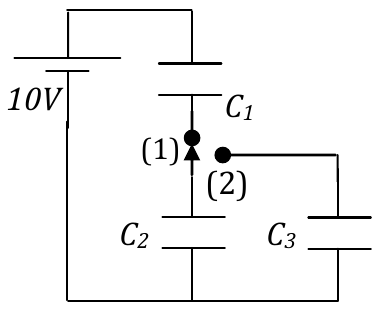

<b>Solución</b>

Solución paso a paso

**Qué piden, en palabras.**

- Llave en posición (1): $C_1 = 12$ μF y $C_2 = 6$ μF quedan en serie con la pila de 10 V y se cargan.
- Llave en posición (2): $C_2$ queda conectado con $C_3 = 2$ μF, que estaba descargado.
- **a)** La carga final de $C_3$. **b)** La energía guardada antes de mover la llave y después.

**La idea, desde cero.** Un capacitor guarda carga: $Q = CV$. En serie, todos tienen la misma carga; en paralelo, la misma tensión. Cuando un capacitor cargado se desconecta de la pila y se conecta con otro descargado, la carga no puede aparecer ni desaparecer: **se conserva** y se reparte hasta que los dos quedan con la misma tensión. Es como dos tanques de agua que se conectan por abajo y quedan al mismo nivel. En ese reparto se pierde energía en forma de calor en los cables, aunque la carga total sea la misma. La energía de un capacitor es $U = \int_0^Q\frac qC\,dq = \frac{Q^2}{2C} = \tfrac12CV^2$.

**Resolución.**

**Paso 1 — Posición (1).** La llave une $C_1$ con $C_2$: quedan **en serie** con la pila de 10 V.

$$C_s = \frac{C_1C_2}{C_1 + C_2} \qquad Q_0 = C_s\,V \qquad U_0 = \tfrac12C_sV^2$$

$$C_s = \frac{72}{18} = 4\ \mu\text{F} \qquad Q_0 = 40\ \mu\text{C} \qquad U_0 = \tfrac12\cdot4\cdot100 = 200\ \mu\text{J}$$

**Paso 2 — Posición (2).** La llave pasa a unir el borne de $C_2$ con $C_3$. $C_1$ queda **desconectado** de un lado: conserva sus 40 μC. $C_2$ queda **en paralelo con $C_3$** (comparten los dos nodos) y le pasa parte de su carga. Conservación de la carga en ese par:

$$Q_2' + Q_3' = Q_0 \qquad \frac{Q_2'}{C_2} = \frac{Q_3'}{C_3} = V' \quad\Rightarrow\quad V' = \frac{Q_0}{C_2 + C_3} \qquad Q_3' = C_3V'$$

**Paso 3 — Cálculo.**

$$V' = \frac{40}{8} = 5\ \text{V} \qquad Q_3' = 2\cdot5 = 10\ \mu\text{C} \qquad Q_2' = 30\ \mu\text{C}$$

**Paso 4 — Energía final.**

$$U' = \frac{Q_0^2}{2C_1} + \tfrac12(C_2 + C_3)V'^2 = \frac{1600}{24} + \tfrac12\cdot8\cdot25 = 66{,}67 + 100 = 166{,}67\ \mu\text{J}$$

La energía disminuye: la diferencia se disipa en los cables durante la redistribución de carga.

**Respuesta:** a) $Q_3 = 10\ \mu\text{C}$; b) $U_0 = 200\ \mu\text{J}$ y $U' = 166{,}67\ \mu\text{J}$

---

### Ejercicio 6

⭐ **Sirve para el 2º Parcial**: practica el [tipo 1: Capacitores con llaves: energía disipada](../Segundo%20Parcial/guia-de-resolucion.md#1-capacitores-con-llaves-energ%C3%ADa-disipada) de la guía de resolución.

Los capacitores *C1* y *C2* de la figura son de 25nF y 20nF, respectivamente. El capacitor *C3* es de placas plano paralelas y sus dimensiones son: área de placa *A*= 0,5m2, distancia interplacas *d*=0,1mm, dieléctrico de constante relativa εR=4 llenando todo el espacio interplacas. *C2* y *C3* están descargados, y *C1* se ha cargado a 60V. Calcule:

a) el valor de la carga de cada capacitor cuando se cierra la llave K, una vez alcanzado el régimen estacionario;

b) el valor de la ddp en cada capacitor una vez alcanzado el régimen estacionario.

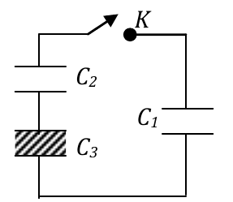

<b>Solución</b>

Solución paso a paso

**Qué piden, en palabras.**

- $C_1 = 25$ nF está cargado a 60 V. $C_2 = 20$ nF y $C_3$ (placas de 0,5 m², separadas 0,1 mm, con un aislante de $\varepsilon_R = 4$) están descargados.
- Se cierra la llave K y se espera a que deje de circular corriente.
- **a)** La carga final de cada capacitor. **b)** La tensión final de cada uno.

**La idea, desde cero.** La capacidad de un capacitor plano es $C = \varepsilon_R\varepsilon_0A/d$. El factor $\varepsilon_R$ aparece cuando entre las placas hay un aislante (dieléctrico), que permite guardar más carga con la misma tensión. Al cerrar K, la carga de $C_1$ se reparte, porque no tiene de dónde salir más carga ni a dónde irse: **se conserva**. Al final no circula corriente, así que los elementos conectados a los mismos dos puntos tienen la misma tensión. Acá $C_2$ y $C_3$ están uno detrás del otro (en serie, con la misma carga), y ese par queda conectado a los mismos puntos que $C_1$ (en paralelo, con la misma tensión).

**Resolución.**

**Paso 1 — Capacidad de $C_3$.**

$$C_3 = \frac{\varepsilon_R\varepsilon_0A}{d}$$

**Paso 2 — Estructura al cerrar K.** $C_2$ y $C_3$ están en serie ($C_{23}$), y esa serie queda conectada en paralelo con $C_1$, que es el único con carga inicial $Q_0 = C_1V_0$.

**Paso 3 — Conservación de la carga.** La carga de $C_1$ se reparte entre $C_1$ y la serie, y al final todos están a la misma tensión $V'$:

$$Q_1' + Q_{23}' = Q_0 \qquad V' = \frac{Q_0}{C_1 + C_{23}} \qquad Q_1' = C_1V' \qquad Q_2' = Q_3' = C_{23}V'$$

**Paso 4 — Tensiones:** $V_2' = Q_2'/C_2$ y $V_3' = Q_3'/C_3$ (con $V_2' + V_3' = V'$).

**Paso 5 — Cálculo.**

$$C_3 = \frac{4\cdot8{,}85\times10^{-12}\cdot0{,}5}{10^{-4}}\ \text{F} = 177\ \text{nF} \qquad C_{23} = \frac{20\cdot177}{197}\ \text{nF} = 17{,}97\ \text{nF}$$

$$Q_0 = 25\ \text{nF}\cdot60\ \text{V} = 1500\ \text{nC} \qquad V' = \frac{1500}{25 + 17{,}97}\ \text{V} = 34{,}9\ \text{V}$$

$$Q_1' = 25\cdot34{,}9 = 872\ \text{nC} \qquad Q_2' = Q_3' = 17{,}97\cdot34{,}9 = 628\ \text{nC}$$

$$V_2' = \frac{628}{20} = 31{,}4\ \text{V} \qquad V_3' = \frac{628}{177} = 3{,}5\ \text{V}$$

**Respuesta:** a) $Q_1' = 872$ nC; $Q_2' = Q_3' = 628$ nC; b) $\Delta V_1' = 34{,}88$ V; $\Delta V_2' = 31{,}4$ V; $\Delta V_3' = 3{,}48$ V (con más decimales, 3,54 V, de modo que $V_2' + V_3' = V_1'$)

---

### Ejercicio 7

El capacitor de la figura es de placas plano paralelas, *d*=5mm y *A*=40cm2. La mitad superior del espacio interplacas está llena con un dieléctrico de constante εR1=2,3 y la otra mitad con un dieléctrico de constante εR2=2,6. El arreglo se carga a potencial *V*=1000V. Calcule:

a) la cantidad de carga libre frente a cada uno de los dieléctricos;

b) el módulo del vector desplazamiento en cada sector del arreglo;

c) el valor del campo eléctrico en cada sector del arreglo.

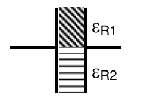

<b>Solución</b>

Solución paso a paso

**Qué piden, en palabras.**

- Capacitor plano de placas verticales (área 40 cm², separación 5 mm). La mitad de arriba del espacio entre placas tiene un aislante con $\varepsilon_{R1} = 2{,}3$ y la mitad de abajo, otro con $\varepsilon_{R2} = 2{,}6$. Está conectado a 1000 V.
- **a)** La carga en las placas frente a cada aislante. **b)** El vector desplazamiento $D$ en cada parte. **c)** El campo eléctrico en cada parte.

**La idea, desde cero.** Un **dieléctrico** es un aislante cuyas moléculas se orientan con el campo, como pequeños imanes eléctricos (dipolos). Eso debilita el campo adentro y permite guardar más carga con la misma tensión: la capacidad se multiplica por $\varepsilon_R$. El **vector desplazamiento** $\vec D = \varepsilon_R\varepsilon_0\vec E$ es un campo auxiliar que solo "ve" la carga libre (la de las placas): en la superficie de una placa, $D$ es igual a la carga libre por unidad de área. Acá cada aislante ocupa la mitad del área con todo el espesor, así que las dos mitades son dos capacitores uno al lado del otro, en paralelo: tienen la misma tensión y la misma distancia, y por lo tanto el mismo $E = V/d$.

**Resolución.**

**Paso 1 — Disposición.** Las placas son verticales y cada dieléctrico ocupa la mitad del **área** con todo el espesor $d$: son dos capacitores **en paralelo**, ambos a la tensión $V$.

**Paso 2 — Campo (ítem c).** En los dos sectores, $E = V/d$ (la misma tensión y la misma distancia):

$$E_1 = E_2 = \frac Vd$$

**Paso 3 — Desplazamiento (ítem b):** $D_i = \varepsilon_{Ri}\varepsilon_0E$.

**Paso 4 — Carga libre (ítem a):** la densidad de carga libre en la placa es $\sigma_i = D_i$, así que $Q_{Li} = D_i\,\dfrac A2 = \dfrac{\varepsilon_{Ri}\varepsilon_0(A/2)V}{d}$.

**Paso 5 — Cálculo.**

$$E = \frac{1000}{0{,}005}\ \tfrac{\text{V}}{\text{m}} = 2\times10^5\ \tfrac{\text{V}}{\text{m}} = 200\ \tfrac{\text{kV}}{\text{m}}$$

$$D_1 = 2{,}3\cdot8{,}85\times10^{-12}\cdot2\times10^5 = 4{,}07\times10^{-6}\ \tfrac{\text{C}}{\text{m}^2} \qquad D_2 = 4{,}6\times10^{-6}\ \tfrac{\text{C}}{\text{m}^2}$$

$$Q_{L1} = 4{,}07\times10^{-6}\cdot0{,}002\ \text{C} = 8{,}142\ \text{nC} \qquad Q_{L2} = 9{,}204\ \text{nC}$$

**Respuesta:** a) $Q_{L1} = 8{,}142$ nC; $Q_{L2} = 9{,}204$ nC; b) $D_1 = 4\times10^{-6}$ C/m²; $D_2 = 4{,}6\times10^{-6}$ C/m²; c) $E_1 = E_2 = 200$ kV/m

---

### Ejercicio 8

Regresemos a la esfera del ejercicio 4 y supongamos que el espacio entre *r1* y *r2* se llena con un dieléctrico de constante εR=3. Para Q=1μC, *r1* = 2cm, *r2* = 4cm y *r3*= 8cm, calcule los valores de ***E*** y ***D*** en los punto A, B y C ubicados respectivamente a 3cm, 6 cm y 10 cm del centro del arreglo.

<b>Solución</b>

Solución paso a paso

**Qué piden, en palabras.**

- La esfera y la cáscara del ejercicio 4, ahora con un aislante de $\varepsilon_R = 3$ entre la esfera y la cáscara. $Q = 1$ μC; radios de 2, 4 y 8 cm.
- Calcular $E$ y $D$ en tres puntos: A a 3 cm (en el aislante), B a 6 cm (dentro del metal de la cáscara) y C a 10 cm (afuera).

**La idea, desde cero.** **Gauss para $D$:** el flujo de $\vec D$ a través de una superficie cerrada es la carga **libre** encerrada (la de los metales, sin contar la que aparece en el dieléctrico al polarizarse). Con una esfera imaginaria de radio $r$, la simetría da $D\cdot4\pi r^2 = Q_{libre}$. Después, $E = D/(\varepsilon_R\varepsilon_0)$: el dieléctrico divide el campo por $\varepsilon_R$, y en el vacío $\varepsilon_R = 1$. Dentro de un metal en equilibrio, $E = 0$.

**Resolución.**

**Paso 1 — Gauss para D.** Esfera de radio $r$; solo cuenta la carga **libre** encerrada:

$$D\cdot4\pi r^2 = Q_{libre,enc} \quad\Rightarrow\quad D = \frac{Q_{libre,enc}}{4\pi r^2} \qquad E = \frac{D}{\varepsilon}$$

**Paso 2 — Cada punto.**

- **A** (3 cm, en el dieléctrico): encierra $Q$. $D_A = \dfrac{Q}{4\pi r_A^2}$ y $E_A = \dfrac{D_A}{3\varepsilon_0} = \dfrac{k_0Q}{3r_A^2}$.
- **B** (6 cm, dentro del metal de la cáscara): en un conductor en equilibrio $E = 0$, y como el metal no es un dieléctrico ($\vec P = 0$), también $D = 0$. (Encierra $Q - Q = 0$.)
- **C** (10 cm, vacío exterior): encierra $Q - Q + Q = Q$. $D_C = \dfrac{Q}{4\pi r_C^2}$ y $E_C = \dfrac{k_0Q}{r_C^2}$.

**Paso 3 — Cálculo.**

$$D_A = \frac{10^{-6}}{4\pi\cdot0{,}0009}\ \tfrac{\text{C}}{\text{m}^2} = 88{,}4\ \tfrac{\mu\text{C}}{\text{m}^2} \qquad E_A = \frac{9\times10^9\cdot10^{-6}}{3\cdot0{,}0009}\ \tfrac{\text{V}}{\text{m}} = 3{,}33\times10^6\ \tfrac{\text{V}}{\text{m}}$$

$$D_C = \frac{10^{-6}}{4\pi\cdot0{,}01}\ \tfrac{\text{C}}{\text{m}^2} = 7{,}96\ \tfrac{\mu\text{C}}{\text{m}^2} \qquad E_C = \frac{9\times10^3}{0{,}01}\ \tfrac{\text{V}}{\text{m}} = 9\times10^5\ \tfrac{\text{V}}{\text{m}}$$

**Respuesta:**

- $\vec D_A = 88{,}5\ \mu\text{C}$/m² $\hat e_r$; $\vec E_A = 3{,}33\times10^6$ V/m $\hat e_r$
- $\vec D_B = 0$; $\vec E_B = 0$
- $\vec D_C = 7{,}96\ \mu\text{C}$/m² $\hat e_r$; $\vec E_C = 9\times10^5$ V/m $\hat e_r$

---

### Ejercicio 9

En una región del espacio de constante relativa εR=3 existe un campo eléctrico de intensidad 104 V/m, que forma un ángulo de 60° con la superficie que lo separa de otro medio, de constante relativa εR=18. Calcule:

a) las componentes normal (EN) y tangencial (ET) del campo eléctrico en la región con dieléctrico de constante εR=18;

b) el ángulo que forma el vector ***D*** (respecto de la superficie de separación) en la región con dieléctrico de constante εR=18

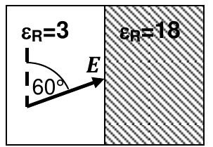

<b>Solución</b>

Solución paso a paso

**Qué piden, en palabras.**

- Dos dieléctricos distintos ($\varepsilon_R = 3$ y $\varepsilon_R = 18$) separados por una superficie plana. En el primero el campo vale $10^4$ V/m y forma 60° con la superficie.
- **a)** Las componentes del campo en el segundo medio: la perpendicular a la superficie ($E_N$) y la paralela ($E_T$). **b)** El ángulo de $\vec D$ con la superficie en el segundo medio.

**La idea, desde cero.** Cuando el campo cruza de un dieléctrico a otro, cambia de tamaño y de dirección, como la luz que se quiebra al pasar del aire al agua. Las reglas de ese cruce (**condiciones de contorno**), cuando en la superficie no hay carga libre, son dos. (1) La componente **paralela** a la superficie de $\vec E$ es la misma de los dos lados. (2) La componente **perpendicular** de $\vec D = \varepsilon\vec E$ es la misma de los dos lados. Por la segunda, en el medio de mayor $\varepsilon$ la componente perpendicular de $\vec E$ es más chica, y el campo se "acuesta" hacia la superficie.

**Resolución.**

**Paso 1 — Componentes en el medio 1.** El ángulo de 60° se mide desde la **superficie**:

$$E_{1t} = E_1\cos60^\circ \qquad E_{1n} = E_1\sin60^\circ$$

**Paso 2 — Condiciones de contorno** (sin carga libre en la interfaz):

$$E_{2t} = E_{1t} \qquad D_{2n} = D_{1n} \;\Rightarrow\; \varepsilon_{R2}E_{2n} = \varepsilon_{R1}E_{1n} \;\Rightarrow\; E_{2n} = \frac{\varepsilon_{R1}}{\varepsilon_{R2}}E_1\sin60^\circ$$

**Paso 3 — Ángulo de $\vec D_2$ con la superficie.** $\vec D_2 = \varepsilon_2\vec E_2$ es paralelo a $\vec E_2$:

$$\tan\alpha = \frac{D_{2n}}{D_{2t}} = \frac{E_{2n}}{E_{2t}} = \frac{\varepsilon_{R1}}{\varepsilon_{R2}}\tan60^\circ$$

**Paso 4 — Cálculo.**

$$E_T = 10^4\cdot0{,}5 = 5\times10^3\ \tfrac{\text{V}}{\text{m}} \qquad E_N = \frac{3}{18}\cdot10^4\cdot0{,}866 = 1{,}44\times10^3\ \tfrac{\text{V}}{\text{m}}$$

$$\tan\alpha = \frac16\cdot1{,}732 = 0{,}289 \quad\Rightarrow\quad \alpha \approx 16^\circ$$

**Respuesta:** a) $E_N = 1{,}44\times10^3$ V/m; $E_T = 5\times10^3$ V/m; b) $\sim16^\circ$

---

### Ejercicio 10

Dos placas plano paralelas de área *A* = 0,2m2 se hallan separadas una distancia *d*=4mm, y conectadas a una fuente de potencial *V*=50 V. Se desconecta la fuente (abriendo la llave K) y se llena la mitad del espacio interplacas con un dieléctrico de constante relativa εR1 = 10 y la otra mitad con otro dieléctrico, de constante εR2 = 30, como muestra la figura. Calcule el valor

a) de la capacidad en vacío;

b) de la capacidad de la configuración final;

c) de la carga inicial y discuta por qué no cambia su valor al desconectar la batería;

d) de la diferencia de potencial en las placas una vez que se ha desconectado la batería y se ha insertado por completo el dieléctrico;

e) de los campos ***E, D, P*** en todo punto del espacio dentro de cada dieléctrico;

f) de la carga libre y de la densidad de carga de polarización en cada superficie;

g) de la energía antes y después de introducir los dieléctricos. Discuta a qué se debe que la energía disminuya.

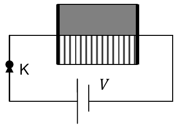

<b>Solución</b>

Solución paso a paso

**Qué piden, en palabras.**

- Capacitor plano de 0,2 m² y 4 mm, cargado a 50 V. Se desconecta la fuente y se llena el espacio entre placas con dos aislantes ($\varepsilon_R = 10$ y $30$), cada uno en la mitad del área.
- Piden la capacidad antes y después, la carga, la nueva tensión, los campos $E$, $D$ y $P$, las cargas libres y de polarización, y la energía antes y después.

**La idea, desde cero.** Al desconectar la fuente, el capacitor queda **aislado**: su carga no puede cambiar. Si después se meten dieléctricos, la capacidad aumenta (se multiplica por $\varepsilon_R$ en cada parte), y como $V = Q/C$ con $Q$ fija, la tensión **baja**. Cada aislante ocupa la mitad del área con todo el espesor: son dos capacitores en paralelo, con el mismo $E$. El dieléctrico se **polariza**: sus moléculas se orientan, y en sus caras aparece una carga ligada que debilita el campo. $\vec P$ (la polarización) mide cuánto se orientó, $\vec P = \vec D - \varepsilon_0\vec E$, y la carga de polarización por unidad de área en cada cara vale $P$. La energía es $U = \tfrac12QV$.

**Resolución.**

**Paso 1 — Disposición.** Cada dieléctrico ocupa la mitad del **área** y todo el espesor: es un **paralelo** de dos capacitores de área $A/2$ (así lo confirma el resultado de la guía).

**Paso 2 — Fórmulas.**

$$C_0 = \frac{\varepsilon_0A}{d} \qquad C' = \frac{\varepsilon_{R1}\varepsilon_0(A/2)}{d} + \frac{\varepsilon_{R2}\varepsilon_0(A/2)}{d} = \frac{\varepsilon_{R1} + \varepsilon_{R2}}{2}\,C_0$$

**Paso 3 — Carga y tensión.** Con la fuente desconectada, el capacitor queda aislado y la carga se conserva: $Q' = Q_0 = C_0V$.

$$\Delta V' = \frac{Q_0}{C'} = \frac{2V}{\varepsilon_{R1} + \varepsilon_{R2}}$$

**Paso 4 — Campos.** En paralelo, $E$ es el mismo en ambos medios: $E = \Delta V'/d$. Además $D_i = \varepsilon_{Ri}\varepsilon_0E$ y $P_i = D_i - \varepsilon_0E = (\varepsilon_{Ri} - 1)\varepsilon_0E$. Todos apuntan de la placa + a la − ($\hat e_x$).

**Paso 5 — Cargas.** Carga libre frente a cada dieléctrico: $Q_{Li} = D_i\,A/2$. Densidad de polarización: $\sigma_{Pi} = P_i$.

**Paso 6 — Energías:** $U_0 = \tfrac12Q_0V$ y $U' = \tfrac12Q_0\Delta V'$.

**Paso 7 — Cálculo.**

$$C_0 = \frac{8{,}85\times10^{-12}\cdot0{,}2}{0{,}004}\ \text{F} = 0{,}44\ \text{nF} \qquad C' = 20\,C_0 = 8{,}85\ \text{nF}$$

$$Q_0 = 0{,}4425\ \text{nF}\cdot50\ \text{V} = 22\ \text{nC} \qquad \Delta V' = \frac{100}{40}\ \text{V} = 2{,}5\ \text{V} \qquad E = \frac{2{,}5}{0{,}004}\ \tfrac{\text{V}}{\text{m}} = 625\ \tfrac{\text{V}}{\text{m}}$$

$$D_1 = 10\cdot8{,}85\times10^{-12}\cdot625 = 5{,}5\times10^{-8}\ \tfrac{\text{C}}{\text{m}^2} \qquad D_2 = 1{,}65\times10^{-7}\ \tfrac{\text{C}}{\text{m}^2}$$

$$P_1 = 9\varepsilon_0E = 4{,}95\times10^{-8}\ \tfrac{\text{C}}{\text{m}^2} \qquad P_2 = 29\varepsilon_0E = 1{,}6\times10^{-7}\ \tfrac{\text{C}}{\text{m}^2}$$

$$Q_{L1} = D_1\cdot0{,}1 = 5{,}5\times10^{-9}\ \text{C} \qquad Q_{L2} = 1{,}65\times10^{-8}\ \text{C}\quad(\text{suman } 22\ \text{nC}\ ✓)$$

$$U_0 = \tfrac12\cdot22\times10^{-9}\cdot50 = 55\times10^{-8}\ \text{J} \qquad U' = \tfrac12\cdot22\times10^{-9}\cdot2{,}5 = 2{,}75\times10^{-8}\ \text{J}$$

(La guía usa $\Delta V' = 2{,}49$ V y $E = 622{,}5$ V/m por redondear $C_0$.)

**Respuesta:**

- a) $C_0 = 0{,}44\times10^{-9}$ F ≡ 0,44 nF
- b) $C'_{eq} = 8{,}85\times10^{-9}$ F
- c) $Q_0 = Q' = 22$ nC. No cambia porque al desconectar la batería el sistema queda aislado.
- d) $\Delta V' = 2{,}49$ V
- e) $\vec E_1 = \vec E_2 = 622{,}5$ V/m $\hat e_x$; $\vec D_1 = 5{,}5\times10^{-8}$ C/m² $\hat e_x$; $\vec D_2 = 1{,}65\times10^{-7}$ C/m² $\hat e_x$; $\vec P_1 = 4{,}95\times10^{-8}$ C/m² $\hat e_x$; $\vec P_2 = 1{,}6\times10^{-7}$ C/m² $\hat e_x$
- f) $Q_{L1} = 5{,}51\times10^{-9}$ C; $Q_{L2} = 1{,}65\times10^{-8}$ C; $\sigma_{P1} = 4{,}95\times10^{-8}$ C/m²; $\sigma_{P2} = 1{,}6\times10^{-7}$ C/m²
- g) $U_0 = 55\times10^{-8}$ J; $U' = 2{,}7\times10^{-8}$ J. La energía disminuye porque el trabajo de polarización de los dieléctricos se realiza a expensas de la energía interna del sistema (la energía contenida en el campo electrostático).

---

### Ejercicio 11

Repita el ejercicio anterior suponiendo ahora que los dieléctricos se conectan como muestra la figura. Asuma que cada dieléctrico ocupa la mitad del espacio interplacas.

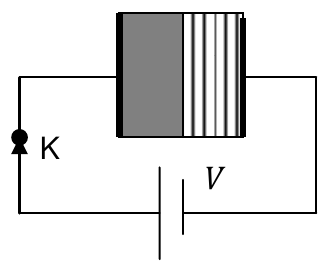

<b>Solución</b>

Solución paso a paso

**Qué piden, en palabras.**

- El mismo capacitor del ejercicio 10, pero ahora cada aislante ocupa todo el área y la mitad del espesor: uno arriba del otro.
- Las mismas preguntas del ejercicio 10.

**La idea, desde cero.** Si los aislantes se apilan uno sobre otro en el espesor, son dos capacitores **en serie**: la carga libre es la misma en todo el área, así que $D = \sigma = Q/A$ es el mismo en los dos. Pero el campo $E = D/(\varepsilon_R\varepsilon_0)$ es distinto en cada uno: más débil en el de mayor $\varepsilon_R$. La tensión total es la suma de las dos caídas, $E_1\frac d2 + E_2\frac d2$. Comparar con el ejercicio 10: allá era igual $E$ y distinto $D$; acá es al revés.

**Resolución.**

**Paso 1 — Disposición.** Ahora cada dieléctrico ocupa todo el **área** y la mitad del **espesor** ($d/2$): son dos capacitores **en serie**.

$$C_1 = \frac{\varepsilon_{R1}\varepsilon_0A}{d/2} = 2\varepsilon_{R1}C_0 \qquad C_2 = 2\varepsilon_{R2}C_0 \qquad C' = \frac{C_1C_2}{C_1 + C_2}$$

**Paso 2 — Campos.** En serie, la carga libre es la misma en todo el área: $D_1 = D_2 = \sigma = Q_0/A$. Después:

$$E_i = \frac{D}{\varepsilon_{Ri}\varepsilon_0} \qquad P_i = D - \varepsilon_0E_i = D\left(1 - \frac{1}{\varepsilon_{Ri}}\right) \qquad \Delta V' = (E_1 + E_2)\frac d2$$

**Paso 3 — Cálculo.** $C_0 = 0{,}4425$ nF y $Q_0 = 22$ nC, igual que en el ejercicio 10.

$$C_1 = 20\,C_0 \qquad C_2 = 60\,C_0 \qquad C' = 15\,C_0 = 6{,}64\ \text{nF}$$

$$D = \frac{22\times10^{-9}}{0{,}2}\ \tfrac{\text{C}}{\text{m}^2} = 1{,}1\times10^{-7}\ \tfrac{\text{C}}{\text{m}^2} \qquad E_1 = \frac{1{,}1\times10^{-7}}{10\cdot8{,}85\times10^{-12}}\ \tfrac{\text{V}}{\text{m}} = 1243\ \tfrac{\text{V}}{\text{m}} \qquad E_2 = 414\ \tfrac{\text{V}}{\text{m}}$$

$$\Delta V' = (1243 + 414)\cdot0{,}002\ \text{V} = 3{,}31\ \text{V} \qquad P_1 = 0{,}9\,D = 9{,}9\times10^{-8}\ \tfrac{\text{C}}{\text{m}^2} \qquad P_2 = \tfrac{29}{30}D = 1{,}06\times10^{-7}\ \tfrac{\text{C}}{\text{m}^2}$$

$$Q_{L1} = Q_{L2} = 22\ \text{nC} \qquad U' = \tfrac12\cdot22\times10^{-9}\cdot3{,}31\ \text{J} = 3{,}65\times10^{-8}\ \text{J}$$

**Respuesta:**

- a) $C_0 = 0{,}44\times10^{-9}$ F ≡ 0,44 nF
- b) $C'_{eq} = 6{,}64\times10^{-9}$ F
- c) $Q_0 = Q' = 22$ nC. No cambia porque al desconectar la batería el sistema queda aislado.
- d) $\Delta V' = 3{,}31$ V
- e) $\vec D_1 = \vec D_2 = 1{,}1\times10^{-7}$ C/m² $\hat e_x$; $\vec E_1 = 1242{,}9$ V/m $\hat e_x$; $\vec E_2 = 414{,}3$ V/m $\hat e_x$; $\vec P_1 = 9{,}9\times10^{-8}$ C/m² $\hat e_x$; $\vec P_2 = 1{,}1\times10^{-7}$ C/m² $\hat e_x$
- f) $Q_{L1} = Q_{L2} = 22\times10^{-9}$ C; $\sigma_{P1} = 9{,}9\times10^{-8}$ C/m²; $\sigma_{P2} = 1{,}1\times10^{-7}$ C/m²
- g) $U_0 = 55\times10^{-8}$ J; $U' = 3{,}7\times10^{-8}$ J. La energía disminuye porque el trabajo de polarización de los dieléctricos se realiza a expensas de la energía interna del sistema (la energía contenida en el campo electrostático).

---

### Ejercicio 12

La figura representa una esfera conductora de radio *R1* = 5 cm que está rodeada de un dieléctrico de constante dieléctrica relativa *εR* = 4, dentro de una esfera conductora hueca de radio interior *R2* = 20 cm y radio exterior *R3* = 22 cm concéntrica con la primera. La carga propia de la esfera interior es *Q1* = 40 nC y la de la exterior es *Q2* = 30 nC. Halle

a) la expresión y el valor de la diferencia de potencial entre las dos esferas.

b) la cantidad de carga distribuida en cada superficie (interior y exterior) de la esfera conductora hueca (justifique la respuesta).

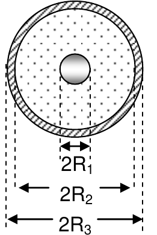

<b>Solución</b>

Solución paso a paso

**Qué piden, en palabras.**

- Esfera de metal de 5 cm con 40 nC, rodeada por un aislante de $\varepsilon_R = 4$ y por una esfera hueca de metal (radios 20 y 22 cm) con 30 nC propios.
- **a)** La diferencia de potencial entre las dos esferas. **b)** Cuánta carga hay en cada superficie de la esfera hueca.

**La idea, desde cero.** Gauss para $\vec D$ (solo cuenta la carga libre) da $D = Q_1/(4\pi r^2)$ entre las esferas, y el dieléctrico divide el campo por $\varepsilon_R$: $E = kQ_1/(\varepsilon_Rr^2)$. La diferencia de potencial es la integral del campo entre las dos esferas. Para las cargas: dentro del metal de la esfera hueca $E = 0$, así que una superficie imaginaria dentro de ese metal tiene que encerrar carga neta cero. Por eso en la cara interior aparece $-Q_1$, y la cara exterior se queda con todo lo demás.

**Resolución.**

**Paso 1 — Campo entre las esferas.** Gauss para D: $D = \dfrac{Q_1}{4\pi r^2}$, y en el dieléctrico $E = \dfrac{D}{\varepsilon_R\varepsilon_0} = \dfrac{kQ_1}{\varepsilon_Rr^2}$.

**Paso 2 — Diferencia de potencial.**

$$V(R_2) - V(R_1) = -\int_{R_1}^{R_2}\frac{kQ_1}{\varepsilon_Rr^2}dr = \frac{kQ_1}{\varepsilon_R}\left(\frac{1}{R_2} - \frac{1}{R_1}\right)$$

**Paso 3 — Cálculo.**

$$V(R_2) - V(R_1) = \frac{9\times10^9\cdot40\times10^{-9}}{4}\left(\frac{1}{0{,}2} - \frac{1}{0{,}05}\right)\ \text{V} = 90\cdot(5 - 20)\ \text{V} = -1350\ \text{V}$$

**Paso 4 — Cargas en la esfera hueca (ítem b).** Dentro de su metal $E = 0$, así que una gaussiana dentro del metal encierra carga libre nula: en $R_2$ se induce $-Q_1$. El resto de la carga de la esfera hueca va a $R_3$: $Q_2 - (-Q_1) = Q_1 + Q_2$.

**Respuesta:**

- a) $V(R_2) - V(R_1) = \dfrac{kQ_1}{\varepsilon_R}\left(\dfrac{1}{R_2} - \dfrac{1}{R_1}\right) = -1350$ V
- b) Como el campo eléctrico en el interior de la esfera hueca es nulo, sobre $R_2$ se induce $-Q_1 = -40$ nC, de manera tal que la cantidad de carga en la esfera de radio $R_3$ es $Q = Q_1 + Q_2 = 70$ nC.

---

### Ejercicio 13

Suponga que en el ejercicio 10 los dieléctricos se introducen sin desconectar la batería. Discuta cualitativa y cuantitativamente cuáles son los resultados que cambian.

<b>Solución</b>

Solución paso a paso

**Qué piden, en palabras.**

- Como el ejercicio 10, pero los dieléctricos se meten **con la fuente conectada**.
- Decir qué resultados cambian y calcularlos.

**La idea, desde cero.** Con la fuente conectada, lo que queda fijo es la **tensión** (la fuente la mantiene en 50 V), no la carga. Al meter el dieléctrico la capacidad aumenta, y como $Q = CV$ con $V$ fija, la fuente manda **más carga**. La capacidad depende solo de la geometría y los materiales, así que es la misma que en el ejercicio 10. El campo es $E = V/d$, igual que sin dieléctrico. La energía $\tfrac12CV^2$ aumenta: la pone la fuente.

**Resolución.**

**Paso 1 — Qué cambia.** La batería sigue conectada, así que la **tensión** se mantiene en 50 V y la **carga** cambia. Las capacidades (ítems a y b) solo dependen de la geometría: no cambian.

**Paso 2 — Fórmulas.**

$$Q' = C'V \qquad E = \frac Vd \qquad D_i = \varepsilon_{Ri}\varepsilon_0E \qquad P_i = (\varepsilon_{Ri} - 1)\varepsilon_0E \qquad Q_{Li} = D_i\frac A2 \qquad U' = \tfrac12C'V^2$$

**Paso 3 — Cálculo.**

$$Q' = 8{,}85\ \text{nF}\cdot50\ \text{V} = 442{,}5\ \text{nC} \qquad E = \frac{50}{0{,}004}\ \tfrac{\text{V}}{\text{m}} = 12500\ \tfrac{\text{V}}{\text{m}}$$

$$D_1 = 10\varepsilon_0E = 1{,}1\times10^{-6}\ \tfrac{\text{C}}{\text{m}^2} \qquad D_2 = 3{,}3\times10^{-6}\ \tfrac{\text{C}}{\text{m}^2} \qquad P_1 = 9{,}96\times10^{-7}\ \tfrac{\text{C}}{\text{m}^2} \qquad P_2 = 3{,}21\times10^{-6}\ \tfrac{\text{C}}{\text{m}^2}$$

$$Q_{L1} = 1{,}11\times10^{-7}\ \text{C} \qquad Q_{L2} = 3{,}32\times10^{-7}\ \text{C} \qquad U' = \tfrac12\cdot8{,}85\times10^{-9}\cdot2500\ \text{J} = 1{,}1\times10^{-5}\ \text{J}$$

La energía **aumenta** (20 veces): la batería entrega trabajo para mover la carga adicional y polarizar el dieléctrico.

**Respuesta:**

- (a) y (b) son los mismos.
- La carga inicial y la final no son iguales: $Q_0 = 22$ nC y $Q' = 441{,}5$ nC.
- $\Delta V = \Delta V' = 50$ V
- $\vec E_1 = \vec E_2 = 12500$ V/m $\hat e_x$; $\vec D_1 = 1{,}1\times10^{-6}$ C/m² $\hat e_x$; $\vec D_2 = 3{,}3\times10^{-6}$ C/m² $\hat e_x$; $\vec P_1 = 9{,}9\times10^{-7}$ C/m² $\hat e_x$; $\vec P_2 = 3{,}19\times10^{-6}$ C/m² $\hat e_x$
- f) $Q_{L1} = 1{,}11\times10^{-7}$ C; $Q_{L2} = 3{,}32\times10^{-7}$ C; $\sigma_{P1} = 9{,}96\times10^{-7}$ C/m²; $\sigma_{P2} = 3{,}21\times10^{-6}$ C/m²
- g) $U_0 = 55\times10^{-8}$ J; $U' = 1{,}1\times10^{-5}$ J. La batería entrega trabajo para polarizar el dieléctrico y esa energía queda almacenada en la configuración; por eso la energía final es mayor que la inicial.

---

### Ejercicio 14

a) en la región con ε1 existe un campo eléctrico ***E1***, que forma un ángulo α con la dirección horizontal. Sea *W1* el trabajo requerido para transportar a velocidad constante una carga *Q* desde A hasta B. Calcule el trabajo *W2* para transportarla entre B y D en términos de ε1, ε2 y *W1*;

b) calcule el valor de la densidad de carga de polarización en A y en D.

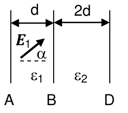

<b>Solución</b>

Solución paso a paso

**Qué piden, en palabras.**

- Dos dieléctricos ($\varepsilon_1$ y $\varepsilon_2$) separados por una superficie vertical. En el primero hay un campo $\vec E_1$ que forma un ángulo $\alpha$ con la horizontal.
- **a)** Si llevar una carga $Q$ de A a B (en el medio 1, distancia $d$) cuesta $W_1$, ¿cuánto cuesta llevarla de B a D (en el medio 2, distancia $2d$)? **b)** La carga de polarización por unidad de área en A y en D.

**La idea, desde cero.** El trabajo para mover una carga a velocidad constante contra un campo uniforme es $W = Q\,E\,\ell$, usando solo la componente del campo a lo largo del camino. Acá el camino es horizontal, perpendicular a las superficies, así que importa la componente **normal** del campo. Al pasar de un medio a otro sin carga libre en la superficie, se conserva la componente normal de $\vec D = \varepsilon\vec E$, así que $E_N$ se divide por $\varepsilon_2/\varepsilon_1$. La carga de polarización por unidad de área en una cara del dieléctrico es la componente normal de $\vec P = (\varepsilon - \varepsilon_0)\vec E$.

**Resolución.**

**Paso 1 — Geometría.** A, B y D son superficies verticales: el medio 1 ocupa de A a B (espesor $d$) y el medio 2 de B a D (espesor $2d$). La dirección **horizontal** es la **normal** a las superficies. La carga se mueve horizontalmente, así que solo importa la componente normal del campo.

**Paso 2 — Trabajo en el medio 1.** El campo es uniforme en cada medio:

$$W_1 = Q\,E_{1N}\,d = Q\,E_1\cos\alpha\,d$$

**Paso 3 — Componente normal en el medio 2.** Sin carga libre en la interfaz, $D_{1N} = D_{2N}$, es decir $\varepsilon_1E_{1N} = \varepsilon_2E_{2N}$:

$$E_{2N} = \frac{\varepsilon_1}{\varepsilon_2}E_{1N}$$

**Paso 4 — Trabajo en el medio 2** (espesor $2d$):

$$W_2 = Q\,E_{2N}\,2d = Q\,E_{1N}\frac{\varepsilon_1}{\varepsilon_2}\,2d = 2\frac{\varepsilon_1}{\varepsilon_2}W_1$$

**Paso 5 — Polarización (ítem b).** La densidad de carga de polarización en una superficie es la componente normal de $\vec P = (\varepsilon - \varepsilon_0)\vec E$:

$$\sigma_{PA} = (\varepsilon_1 - \varepsilon_0)E_{1N} = (\varepsilon_1 - \varepsilon_0)|E_1|\cos\alpha \qquad \sigma_{PD} = (\varepsilon_2 - \varepsilon_0)E_{2N} = (\varepsilon_2 - \varepsilon_0)\frac{\varepsilon_1}{\varepsilon_2}|E_1|\cos\alpha$$

(En valor absoluto; en A la polarización es negativa porque es la cara por donde "entra" el campo.)

**Respuesta:**

- a) $W_1 = QE_{1N}\times d = QE_1\cos\alpha\times d$; $W_2 = QE_{2N}\times2d = QE_{1N}\dfrac{\varepsilon_1}{\varepsilon_2}\times2d = 2\dfrac{\varepsilon_1}{\varepsilon_2}W_1$
- b) $\sigma_{PA} = (\varepsilon_1 - \varepsilon_0)|E_1|\cos\alpha$; $\sigma_{PD} = (\varepsilon_2 - \varepsilon_0)(\varepsilon_1/\varepsilon_2)|E_1|\cos\alpha$

---

### Ejercicio 15

Tres de las siguientes afirmaciones son correctas. Indique cuáles son.

- Dos capacitores iguales en paralelo almacenan el doble de energía que conectados en serie.
- La capacidad de un capacitor se duplica si se duplica la ddp a la que se lo conecta.
- El vector polarización es una medida del número de dipolos orientados por unidad de volumen.
- La capacidad de un capacitor puede aumentar o disminuir cuando se lo llena con un dieléctrico.
- El vector desplazamiento se asocia siempre a la carga total.
- La capacidad de un sistema es un factor puramente geométrico, siempre positivo.
- La componente normal de ***D*** se conserva si σP=0 en la superficie de separación de los medios
- La polarizabilidad de un medio aumenta con la temperatura.
- El vector desplazamiento se asocia a la carga libre y el CE a la carga total.
- Un capacitor es un sistema almacenador de carga eléctrica.

<b>Solución</b>

Solución paso a paso

**Qué piden, en palabras.**

- Diez afirmaciones sobre capacitores y dieléctricos; tres son correctas. Encontrarlas.

**La idea, desde cero.** Lo que hay que tener claro: $C$ depende solo de la geometría y del material (no de $Q$ ni de $V$); un dieléctrico siempre **aumenta** la capacidad, porque $\varepsilon_R > 1$; $\vec D$ está asociado a la carga libre y $\vec E$ a la carga total; $\vec P$ cuenta los dipolos orientados por unidad de volumen. La energía guardada es $\tfrac12CV^2$, y a la misma $V$ dos capacitores iguales valen $2C$ en paralelo y $C/2$ en serie.

**Resolución.**

- "Paralelo almacena el doble que serie": **falso**. A la misma $V$: en paralelo, $C_{eq} = 2C$ y $U = CV^2$; en serie, $C_{eq} = C/2$ y $U = CV^2/4$. Es **cuatro** veces.
- "C se duplica si se duplica la ddp": **falso**. $C$ no depende de $V$.
- "$\vec P$ mide los dipolos orientados por unidad de volumen": **verdadero**. $\vec P = n\vec p$.
- "C puede aumentar o disminuir con un dieléctrico": **falso**. $K > 1$, así que siempre aumenta.
- "$\vec D$ se asocia siempre a la carga total": **falso**. A la carga libre.
- "C es geométrico, siempre positivo": **verdadero** (incluye el material, pero no depende de $Q$ ni de $V$).
- "$D_n$ se conserva si $\sigma_P = 0$": **falso**. La condición es $\sigma_{libre} = 0$.
- "La polarizabilidad aumenta con T": **falso**. La agitación térmica desordena los dipolos.
- "$\vec D$ a la carga libre y $\vec E$ a la total": **verdadero**.
- "Un capacitor almacena carga": **falso** según la guía. Su carga neta es nula; lo que almacena es **energía** (separa cargas).

**Respuesta:**

- El vector polarización es una medida del número de dipolos orientados por unidad de volumen.
- La capacidad de un sistema es un factor puramente geométrico, siempre positivo.
- El vector desplazamiento se asocia a la carga libre y el CE a la carga total.

