# Tema 4 — Capacitores y dieléctricos: ejercicios resueltos

Ejercicios de la [Guía de ejercicios de Capacitores y dieléctricos](Aula%20Virtual/Gu%C3%ADa%20de%20ejercicios%20-%20Capacitores%20y%20diel%C3%A9ctricos.pdf). Los enunciados están copiados textualmente de la guía.

Cada ejercicio tiene un botón **Solución**. Al abrirlo aparece la respuesta y, arriba, un segundo botón **Solución paso a paso** con el desarrollo completo. En el paso a paso primero se obtiene la fórmula en forma simbólica y recién al final se reemplazan los números.

Teoría: [resumen del tema](teoria.md). Constantes: $\varepsilon_0 = 8{,}85\times10^{-12}$ C²/(N m²), $k_0 = 9\times10^9$ N m²/C².

| Bloque | Ejercicios |
|---|---|
| Asociación de capacitores | [1](#ejercicio-1) · [3](#ejercicio-3) · [5](#ejercicio-5) · [6](#ejercicio-6) |
| Geometría y capacidad | [2](#ejercicio-2) · [4](#ejercicio-4) · [12](#ejercicio-12) |
| Dieléctricos, D, P | [7](#ejercicio-7) · [8](#ejercicio-8) · [9](#ejercicio-9) · [10](#ejercicio-10) · [11](#ejercicio-11) · [13](#ejercicio-13) · [14](#ejercicio-14) |
| Conceptual | [15](#ejercicio-15) |

---

### Ejercicio 1

Los capacitores del circuito de la figura valen *C1*=4μF; *C2*=6μF; *C3*=12,6μF; *C4*=2μF; *C5*=8μF. En régimen estacionario, calcule:

a) la capacidad equivalente de la configuración;

b) la carga almacenada en cada capacitor;

c) la ddp a la que se encuentra cada capacitor;

d) la energía almacenada por cada capacitor y la del sistema

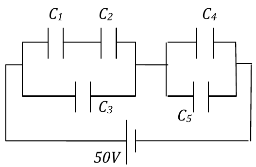

<b>Solución</b>

Solución paso a paso

**Paso 1 — Estructura.** Bloque izquierdo: $C_1$ y $C_2$ en serie, y ese conjunto en paralelo con $C_3$. Bloque derecho: $C_4$ en paralelo con $C_5$. Los dos bloques están en serie con la pila de 50 V.

$$C_{12} = \frac{C_1C_2}{C_1 + C_2} \qquad C_a = C_{12} + C_3 \qquad C_b = C_4 + C_5 \qquad C_{eq} = \frac{C_aC_b}{C_a + C_b}$$

**Paso 2 — Carga total y tensión de cada bloque.** Los bloques están en serie: tienen la **misma carga** $Q = C_{eq}V$.

$$V_a = \frac{Q}{C_a} \qquad V_b = \frac{Q}{C_b}$$

**Paso 3 — Cargas de cada capacitor.**

- $C_3$, $C_4$ y $C_5$ están directamente a la tensión de su bloque: $Q_i = C_iV_{bloque}$.
- $C_1$ y $C_2$ están en serie: $Q_1 = Q_2 = C_{12}V_a$, y luego $V_1 = Q_1/C_1$, $V_2 = Q_2/C_2$.

**Paso 4 — Energías:** $U_i = \dfrac{Q_iV_i}{2}$.

**Paso 5 — Cálculo** (en μF, μC, V y μJ):

$$C_{12} = \frac{24}{10} = 2{,}4 \qquad C_a = 2{,}4 + 12{,}6 = 15 \qquad C_b = 10 \qquad C_{eq} = \frac{150}{25} = 6\ \mu\text{F}$$

$$Q = 6\cdot50 = 300\ \mu\text{C} \qquad V_a = \frac{300}{15} = 20\ \text{V} \qquad V_b = \frac{300}{10} = 30\ \text{V}$$

$$Q_1 = Q_2 = 2{,}4\cdot20 = 48 \qquad Q_3 = 12{,}6\cdot20 = 252 \qquad Q_4 = 2\cdot30 = 60 \qquad Q_5 = 8\cdot30 = 240$$

$$V_1 = \frac{48}{4} = 12\ \text{V} \qquad V_2 = \frac{48}{6} = 8\ \text{V} \qquad V_3 = 20\ \text{V} \qquad V_4 = V_5 = 30\ \text{V}$$

$$U_1 = 288 \quad U_2 = 192 \quad U_3 = 2520 \quad U_4 = 900 \quad U_5 = 3600 \qquad U_T = 7500\ \mu\text{J} = \tfrac12C_{eq}V^2 = \tfrac12\cdot6\cdot2500\ ✓$$

**Respuesta:**

- a) $C_{eq} = 6\ \mu$F
- b) $Q_1 = Q_2 = 48\ \mu$C; $Q_3 = 252\ \mu$C; $Q_4 = 60\ \mu$C; $Q_5 = 240\ \mu$C
- c) $V_1 = 12$ V; $V_2 = 8$ V; $V_3 = 20$ V; $V_4 = V_5 = 30$ V
- d) $U_1 = 288\ \mu$J; $U_2 = 192\ \mu$J; $U_3 = 2520\ \mu$J; $U_4 = 900\ \mu$J; $U_5 = 3600\ \mu$J; $U_T = U_1 + \dots + U_5 = C_{eq}V^2/2 = 7500\ \mu$J

---

### Ejercicio 2

Entre las placas de un capacitor plano paralelo de placas de área *A* y distancia interplacas *d* se introduce una lámina metálica de espesor *e < d* y de igual área *A* que la placa.

a) calcule la nueva capacidad del capacitor;

b) demuestre que la ubicación de la placa dentro del capacitor es irrelevante.

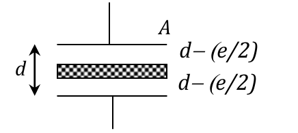

<b>Solución</b>

Solución paso a paso

**Paso 1 — Qué hace la lámina.** En sus caras se inducen cargas $\mp Q$ y adentro del metal $E = 0$. El sistema queda como **dos capacitores en serie**: uno entre la placa superior y la lámina (separación $D_1$) y otro entre la lámina y la placa inferior (separación $D_2$). El espesor que queda vacío es $D_1 + D_2 = d - e$.

**Paso 2 — Serie.**

$$\frac{1}{C'} = \frac{D_1}{\varepsilon_0A} + \frac{D_2}{\varepsilon_0A} = \frac{D_1 + D_2}{\varepsilon_0A} = \frac{d - e}{\varepsilon_0A}$$

$$C' = \frac{\varepsilon_0A}{d - e}$$

**Paso 3 — Ítem b.** El resultado depende solo de $D_1 + D_2 = d - e$, no de cómo se reparte esa distancia: la posición de la lámina no importa.

**Respuesta:**

- a) $C' = \varepsilon_0A/(d - e)$
- b) Uno de los capacitores tendrá separación $D_1$ y el otro $D_2$, con $D_1 + D_2 = d - e$. Los capacitores quedan en serie, y su capacidad equivalente será $C_{eq} = \varepsilon_0A/(D_1 + D_2) = \varepsilon_0A/(d - e)$.

---

### Ejercicio 3

Sean los capacitores de la figura, para los que se cumple la relación *C1 < C2 < C3*.

a) justifique por qué el valor de la capacidad equivalente del sistema es menor que *C1*;

b) si se retira el capacitor *C3*, justifique si la capacidad del sistema aumenta, disminuye o permanece inalterada;

c) si se retira el capacitor *C3*, justifique si la carga almacenada por *C1* aumenta, disminuye o permanece inalterada.

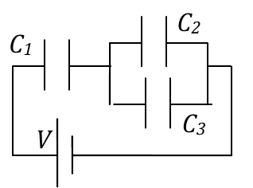

<b>Solución</b>

Solución paso a paso

**Estructura.** $C_1$ en serie con el paralelo $C_{23} = C_2 + C_3$:

$$C_{eq} = \frac{C_1\,C_{23}}{C_1 + C_{23}} = \frac{C_1}{1 + C_1/C_{23}} < C_1$$

**Ítem a.** En serie, $1/C_{eq} = 1/C_1 + 1/C_{23} > 1/C_1$, así que $C_{eq} < C_1$: la equivalente en serie es menor que la menor.

**Ítem b.** Sin $C_3$, el paralelo pasa de $C_2 + C_3$ a $C_2$ (disminuye) y, con él, la $C_{eq}$ de la serie.

**Ítem c.** $C_1$ está en serie, así que su carga es la del sistema: $Q_1 = C_{eq}V$. Con la misma $V$ y menor $C_{eq}$, $Q_1$ **disminuye**.

**Respuesta:**

- a) Porque hay una serie y la capacidad equivalente es menor que la menor de las capacidades.
- b) Disminuye, porque disminuye la capacidad del paralelo.
- c) Disminuye, porque la capacidad total es menor y la carga de la serie disminuye.

---

### Ejercicio 4

La esfera metálica de radio *r1* tiene carga *Q>0* y se halla rodeada por una cáscara metálica, esférica y concéntrica, de radios *r2* y *r3 > r2*. Calcule:

a) la diferencia de potencial entre las superficies de radios *r1* y *r3*;

b) el potencial de la esfera de radio *r1*;

c) la capacidad del sistema;

d) la capacidad de la esfera de radio *r1*.

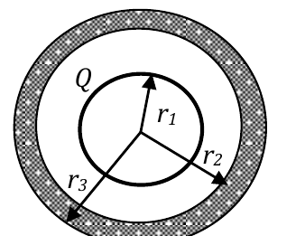

<b>Solución</b>

Solución paso a paso

**Paso 1 — Cargas.** Esfera: $Q$ en $r_1$. La cáscara (neutra) tiene $-Q$ inducida en $r_2$ y $+Q$ en $r_3$.

**Paso 2 — Campos (Gauss).** $E = kQ/r^2$ para $r_1 < r < r_2$; $E = 0$ en el metal ($r_2 < r < r_3$); $E = kQ/r^2$ para $r > r_3$.

**Paso 3 — Ítem a.** Solo hay campo entre $r_1$ y $r_2$ (dentro del metal no cae potencial):

$$V(r_3) - V(r_1) = -\int_{r_1}^{r_2}\frac{k_0Q}{r^2}dr = k_0Q\left(\frac{1}{r_2} - \frac{1}{r_1}\right)$$

**Paso 4 — Ítem b.** Con $V(\infty) = 0$: $V(r_3) = k_0Q/r_3$, y sumando la caída del ítem a:

$$V(r_1) = k_0Q\left(\frac{1}{r_3} + \frac{1}{r_1} - \frac{1}{r_2}\right)$$

**Paso 5 — Ítem c.** El "sistema" es el capacitor esfera–cáscara, con cargas $\pm Q$ en $r_1$ y $r_2$:

$$C = \frac{Q}{|V(r_1) - V(r_2)|} = \frac{1}{k_0\left(\dfrac{1}{r_1} - \dfrac{1}{r_2}\right)}$$

**Paso 6 — Ítem d.** Capacidad de la esfera respecto del infinito: $C = Q/V(r_1)$.

**Respuesta:**

- a) $V(r_3) - V(r_1) = k_0Q\left(\dfrac{1}{r_2} - \dfrac{1}{r_1}\right)$
- b) $V(r_1) = k_0Q\left(\dfrac{1}{r_3} + \dfrac{1}{r_1} - \dfrac{1}{r_2}\right)$
- c) $C = \dfrac{1}{k_0\left(\frac{1}{r_1} - \frac{1}{r_2}\right)}$
- d) $C = \dfrac{1}{k_0\left(\frac{1}{r_3} + \frac{1}{r_1} - \frac{1}{r_2}\right)}$

---

### Ejercicio 5

Los capacitores *C1* = 12μF y *C2*= 6μF de la figura se cargan con la llave en la posición (1). Una vez cargados se lleva la llave a la posición (2). Suponiendo que el capacitor *C3* = 2μF está inicialmente descargado, calcule:

a) la carga final almacenada por el capacitor *C3*;

b) la energía almacenada por el sistema *C1 C2* antes de conmutar la llave, y por el sistema *C1 C2 C3* después de hacerlo.

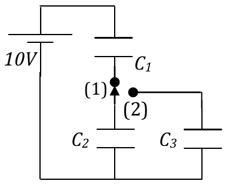

<b>Solución</b>

Solución paso a paso

**Paso 1 — Posición (1).** La llave une $C_1$ con $C_2$: quedan **en serie** con la pila de 10 V.

$$C_s = \frac{C_1C_2}{C_1 + C_2} \qquad Q_0 = C_s\,V \qquad U_0 = \tfrac12C_sV^2$$

$$C_s = \frac{72}{18} = 4\ \mu\text{F} \qquad Q_0 = 40\ \mu\text{C} \qquad U_0 = \tfrac12\cdot4\cdot100 = 200\ \mu\text{J}$$

**Paso 2 — Posición (2).** La llave pasa a unir el borne de $C_2$ con $C_3$. $C_1$ queda **desconectado** de un lado: conserva sus 40 μC. $C_2$ queda **en paralelo con $C_3$** (comparten los dos nodos) y le pasa parte de su carga. Conservación de la carga en ese par:

$$Q_2' + Q_3' = Q_0 \qquad \frac{Q_2'}{C_2} = \frac{Q_3'}{C_3} = V' \quad\Rightarrow\quad V' = \frac{Q_0}{C_2 + C_3} \qquad Q_3' = C_3V'$$

**Paso 3 — Cálculo.**

$$V' = \frac{40}{8} = 5\ \text{V} \qquad Q_3' = 2\cdot5 = 10\ \mu\text{C} \qquad Q_2' = 30\ \mu\text{C}$$

**Paso 4 — Energía final.**

$$U' = \frac{Q_0^2}{2C_1} + \tfrac12(C_2 + C_3)V'^2 = \frac{1600}{24} + \tfrac12\cdot8\cdot25 = 66{,}67 + 100 = 166{,}67\ \mu\text{J}$$

La energía disminuye: la diferencia se disipa en los cables durante la redistribución de carga.

**Respuesta:** a) $Q_3 = 10\ \mu$C; b) $U_0 = 200\ \mu$J y $U' = 166{,}67\ \mu$J

---

### Ejercicio 6

Los capacitores *C1* y *C2* de la figura son de 25nF y 20nF, respectivamente. El capacitor *C3* es de placas plano paralelas y sus dimensiones son: área de placa *A*= 0,5m2, distancia interplacas *d*=0,1mm, dieléctrico de constante relativa εR=4 llenando todo el espacio interplacas. *C2* y *C3* están descargados, y *C1* se ha cargado a 60V. Calcule:

a) el valor de la carga de cada capacitor cuando se cierra la llave K, una vez alcanzado el régimen estacionario;

b) el valor de la ddp en cada capacitor una vez alcanzado el régimen estacionario.

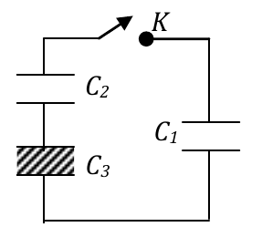

<b>Solución</b>

Solución paso a paso

**Paso 1 — Capacidad de $C_3$.**

$$C_3 = \frac{\varepsilon_R\varepsilon_0A}{d}$$

**Paso 2 — Estructura al cerrar K.** $C_2$ y $C_3$ están en serie ($C_{23}$), y esa serie queda conectada en paralelo con $C_1$, que es el único con carga inicial $Q_0 = C_1V_0$.

**Paso 3 — Conservación de la carga.** La carga de $C_1$ se reparte entre $C_1$ y la serie, y al final todos están a la misma tensión $V'$:

$$Q_1' + Q_{23}' = Q_0 \qquad V' = \frac{Q_0}{C_1 + C_{23}} \qquad Q_1' = C_1V' \qquad Q_2' = Q_3' = C_{23}V'$$

**Paso 4 — Tensiones:** $V_2' = Q_2'/C_2$ y $V_3' = Q_3'/C_3$ (con $V_2' + V_3' = V'$).

**Paso 5 — Cálculo.**

$$C_3 = \frac{4\cdot8{,}85\times10^{-12}\cdot0{,}5}{10^{-4}}\ \text{F} = 177\ \text{nF} \qquad C_{23} = \frac{20\cdot177}{197}\ \text{nF} = 17{,}97\ \text{nF}$$

$$Q_0 = 25\ \text{nF}\cdot60\ \text{V} = 1500\ \text{nC} \qquad V' = \frac{1500}{25 + 17{,}97}\ \text{V} = 34{,}9\ \text{V}$$

$$Q_1' = 25\cdot34{,}9 = 872\ \text{nC} \qquad Q_2' = Q_3' = 17{,}97\cdot34{,}9 = 628\ \text{nC}$$

$$V_2' = \frac{628}{20} = 31{,}4\ \text{V} \qquad V_3' = \frac{628}{177} = 3{,}5\ \text{V}$$

**Respuesta:** a) $Q_1' = 872$ nC; $Q_2' = Q_3' = 628$ nC; b) $\Delta V_1' = 34{,}88$ V; $\Delta V_2' = 31{,}4$ V; $\Delta V_3' = 3{,}48$ V (con más decimales, 3,54 V, de modo que $V_2' + V_3' = V_1'$)

---

### Ejercicio 7

El capacitor de la figura es de placas plano paralelas, *d*=5mm y *A*=40cm2. La mitad superior del espacio interplacas está llena con un dieléctrico de constante εR1=2,3 y la otra mitad con un dieléctrico de constante εR2=2,6. El arreglo se carga a potencial *V*=1000V. Calcule:

a) la cantidad de carga libre frente a cada uno de los dieléctricos;

b) el módulo del vector desplazamiento en cada sector del arreglo;

c) el valor del campo eléctrico en cada sector del arreglo.

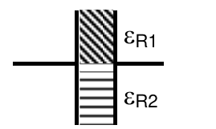

<b>Solución</b>

Solución paso a paso

**Paso 1 — Disposición.** Las placas son verticales y cada dieléctrico ocupa la mitad del **área** con todo el espesor $d$: son dos capacitores **en paralelo**, ambos a la tensión $V$.

**Paso 2 — Campo (ítem c).** En los dos sectores, $E = V/d$ (la misma tensión y la misma distancia):

$$E_1 = E_2 = \frac Vd$$

**Paso 3 — Desplazamiento (ítem b):** $D_i = \varepsilon_{Ri}\varepsilon_0E$.

**Paso 4 — Carga libre (ítem a):** la densidad de carga libre en la placa es $\sigma_i = D_i$, así que $Q_{Li} = D_i\,\dfrac A2 = \dfrac{\varepsilon_{Ri}\varepsilon_0(A/2)V}{d}$.

**Paso 5 — Cálculo.**

$$E = \frac{1000}{0{,}005}\ \tfrac{\text{V}}{\text{m}} = 2\times10^5\ \tfrac{\text{V}}{\text{m}} = 200\ \tfrac{\text{kV}}{\text{m}}$$

$$D_1 = 2{,}3\cdot8{,}85\times10^{-12}\cdot2\times10^5 = 4{,}07\times10^{-6}\ \tfrac{\text{C}}{\text{m}^2} \qquad D_2 = 4{,}6\times10^{-6}\ \tfrac{\text{C}}{\text{m}^2}$$

$$Q_{L1} = 4{,}07\times10^{-6}\cdot0{,}002\ \text{C} = 8{,}142\ \text{nC} \qquad Q_{L2} = 9{,}204\ \text{nC}$$

**Respuesta:** a) $Q_{L1} = 8{,}142$ nC; $Q_{L2} = 9{,}204$ nC; b) $D_1 = 4\times10^{-6}$ C/m²; $D_2 = 4{,}6\times10^{-6}$ C/m²; c) $E_1 = E_2 = 200$ kV/m

---

### Ejercicio 8

Regresemos a la esfera del ejercicio 4 y supongamos que el espacio entre *r1* y *r2* se llena con un dieléctrico de constante εR=3. Para Q=1μC, *r1* = 2cm, *r2* = 4cm y *r3*= 8cm, calcule los valores de ***E*** y ***D*** en los punto A, B y C ubicados respectivamente a 3cm, 6 cm y 10 cm del centro del arreglo.

<b>Solución</b>

Solución paso a paso

**Paso 1 — Gauss para D.** Esfera de radio $r$; solo cuenta la carga **libre** encerrada:

$$D\cdot4\pi r^2 = Q_{libre,enc} \quad\Rightarrow\quad D = \frac{Q_{libre,enc}}{4\pi r^2} \qquad E = \frac{D}{\varepsilon}$$

**Paso 2 — Cada punto.**

- **A** (3 cm, en el dieléctrico): encierra $Q$. $D_A = \dfrac{Q}{4\pi r_A^2}$ y $E_A = \dfrac{D_A}{3\varepsilon_0} = \dfrac{k_0Q}{3r_A^2}$.
- **B** (6 cm, dentro del metal de la cáscara): en un conductor en equilibrio $E = 0$, y como el metal no es un dieléctrico ($\vec P = 0$), también $D = 0$. (Encierra $Q - Q = 0$.)
- **C** (10 cm, vacío exterior): encierra $Q - Q + Q = Q$. $D_C = \dfrac{Q}{4\pi r_C^2}$ y $E_C = \dfrac{k_0Q}{r_C^2}$.

**Paso 3 — Cálculo.**

$$D_A = \frac{10^{-6}}{4\pi\cdot0{,}0009}\ \tfrac{\text{C}}{\text{m}^2} = 88{,}4\ \tfrac{\mu\text{C}}{\text{m}^2} \qquad E_A = \frac{9\times10^9\cdot10^{-6}}{3\cdot0{,}0009}\ \tfrac{\text{V}}{\text{m}} = 3{,}33\times10^6\ \tfrac{\text{V}}{\text{m}}$$

$$D_C = \frac{10^{-6}}{4\pi\cdot0{,}01}\ \tfrac{\text{C}}{\text{m}^2} = 7{,}96\ \tfrac{\mu\text{C}}{\text{m}^2} \qquad E_C = \frac{9\times10^3}{0{,}01}\ \tfrac{\text{V}}{\text{m}} = 9\times10^5\ \tfrac{\text{V}}{\text{m}}$$

**Respuesta:**

- $\vec D_A = 88{,}5\ \mu$C/m² $\hat e_r$; $\vec E_A = 3{,}33\times10^6$ V/m $\hat e_r$
- $\vec D_B = 0$; $\vec E_B = 0$
- $\vec D_C = 7{,}96\ \mu$C/m² $\hat e_r$; $\vec E_C = 9\times10^5$ V/m $\hat e_r$

---

### Ejercicio 9

En una región del espacio de constante relativa εR=3 existe un campo eléctrico de intensidad 104 V/m, que forma un ángulo de 60° con la superficie que lo separa de otro medio, de constante relativa εR=18. Calcule:

a) las componentes normal (EN) y tangencial (ET) del campo eléctrico en la región con dieléctrico de constante εR=18;

b) el ángulo que forma el vector ***D*** (respecto de la superficie de separación) en la región con dieléctrico de constante εR=18

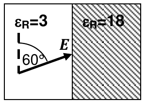

<b>Solución</b>

Solución paso a paso

**Paso 1 — Componentes en el medio 1.** El ángulo de 60° se mide desde la **superficie**:

$$E_{1t} = E_1\cos60^\circ \qquad E_{1n} = E_1\sin60^\circ$$

**Paso 2 — Condiciones de contorno** (sin carga libre en la interfaz):

$$E_{2t} = E_{1t} \qquad D_{2n} = D_{1n} \;\Rightarrow\; \varepsilon_{R2}E_{2n} = \varepsilon_{R1}E_{1n} \;\Rightarrow\; E_{2n} = \frac{\varepsilon_{R1}}{\varepsilon_{R2}}E_1\sin60^\circ$$

**Paso 3 — Ángulo de $\vec D_2$ con la superficie.** $\vec D_2 = \varepsilon_2\vec E_2$ es paralelo a $\vec E_2$:

$$\tan\alpha = \frac{D_{2n}}{D_{2t}} = \frac{E_{2n}}{E_{2t}} = \frac{\varepsilon_{R1}}{\varepsilon_{R2}}\tan60^\circ$$

**Paso 4 — Cálculo.**

$$E_T = 10^4\cdot0{,}5 = 5\times10^3\ \tfrac{\text{V}}{\text{m}} \qquad E_N = \frac{3}{18}\cdot10^4\cdot0{,}866 = 1{,}44\times10^3\ \tfrac{\text{V}}{\text{m}}$$

$$\tan\alpha = \frac16\cdot1{,}732 = 0{,}289 \quad\Rightarrow\quad \alpha \approx 16^\circ$$

**Respuesta:** a) $E_N = 1{,}44\times10^3$ V/m; $E_T = 5\times10^3$ V/m; b) $\sim16^\circ$

---

### Ejercicio 10

Dos placas plano paralelas de área *A* = 0,2m2 se hallan separadas una distancia *d*=4mm, y conectadas a una fuente de potencial *V*=50 V. Se desconecta la fuente (abriendo la llave K) y se llena la mitad del espacio interplacas con un dieléctrico de constante relativa εR1 = 10 y la otra mitad con otro dieléctrico, de constante εR2 = 30, como muestra la figura. Calcule el valor

a) de la capacidad en vacío;

b) de la capacidad de la configuración final;

c) de la carga inicial y discuta por qué no cambia su valor al desconectar la batería;

d) de la diferencia de potencial en las placas una vez que se ha desconectado la batería y se ha insertado por completo el dieléctrico;

e) de los campos ***E, D, P*** en todo punto del espacio dentro de cada dieléctrico;

f) de la carga libre y de la densidad de carga de polarización en cada superficie;

g) de la energía antes y después de introducir los dieléctricos. Discuta a qué se debe que la energía disminuya.

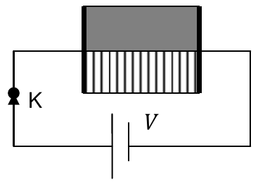

<b>Solución</b>

Solución paso a paso

**Paso 1 — Disposición.** Cada dieléctrico ocupa la mitad del **área** y todo el espesor: es un **paralelo** de dos capacitores de área $A/2$ (así lo confirma el resultado de la guía).

**Paso 2 — Fórmulas.**

$$C_0 = \frac{\varepsilon_0A}{d} \qquad C' = \frac{\varepsilon_{R1}\varepsilon_0(A/2)}{d} + \frac{\varepsilon_{R2}\varepsilon_0(A/2)}{d} = \frac{\varepsilon_{R1} + \varepsilon_{R2}}{2}\,C_0$$

**Paso 3 — Carga y tensión.** Con la fuente desconectada, el capacitor queda aislado y la carga se conserva: $Q' = Q_0 = C_0V$.

$$\Delta V' = \frac{Q_0}{C'} = \frac{2V}{\varepsilon_{R1} + \varepsilon_{R2}}$$

**Paso 4 — Campos.** En paralelo, $E$ es el mismo en ambos medios: $E = \Delta V'/d$. Además $D_i = \varepsilon_{Ri}\varepsilon_0E$ y $P_i = D_i - \varepsilon_0E = (\varepsilon_{Ri} - 1)\varepsilon_0E$. Todos apuntan de la placa + a la − ($\hat e_x$).

**Paso 5 — Cargas.** Carga libre frente a cada dieléctrico: $Q_{Li} = D_i\,A/2$. Densidad de polarización: $\sigma_{Pi} = P_i$.

**Paso 6 — Energías:** $U_0 = \tfrac12Q_0V$ y $U' = \tfrac12Q_0\Delta V'$.

**Paso 7 — Cálculo.**

$$C_0 = \frac{8{,}85\times10^{-12}\cdot0{,}2}{0{,}004}\ \text{F} = 0{,}44\ \text{nF} \qquad C' = 20\,C_0 = 8{,}85\ \text{nF}$$

$$Q_0 = 0{,}4425\ \text{nF}\cdot50\ \text{V} = 22\ \text{nC} \qquad \Delta V' = \frac{100}{40}\ \text{V} = 2{,}5\ \text{V} \qquad E = \frac{2{,}5}{0{,}004}\ \tfrac{\text{V}}{\text{m}} = 625\ \tfrac{\text{V}}{\text{m}}$$

$$D_1 = 10\cdot8{,}85\times10^{-12}\cdot625 = 5{,}5\times10^{-8}\ \tfrac{\text{C}}{\text{m}^2} \qquad D_2 = 1{,}65\times10^{-7}\ \tfrac{\text{C}}{\text{m}^2}$$

$$P_1 = 9\varepsilon_0E = 4{,}95\times10^{-8}\ \tfrac{\text{C}}{\text{m}^2} \qquad P_2 = 29\varepsilon_0E = 1{,}6\times10^{-7}\ \tfrac{\text{C}}{\text{m}^2}$$

$$Q_{L1} = D_1\cdot0{,}1 = 5{,}5\times10^{-9}\ \text{C} \qquad Q_{L2} = 1{,}65\times10^{-8}\ \text{C}\quad(\text{suman } 22\ \text{nC}\ ✓)$$

$$U_0 = \tfrac12\cdot22\times10^{-9}\cdot50 = 55\times10^{-8}\ \text{J} \qquad U' = \tfrac12\cdot22\times10^{-9}\cdot2{,}5 = 2{,}75\times10^{-8}\ \text{J}$$

(La guía usa $\Delta V' = 2{,}49$ V y $E = 622{,}5$ V/m por redondear $C_0$.)

**Respuesta:**

- a) $C_0 = 0{,}44\times10^{-9}$ F ≡ 0,44 nF
- b) $C'_{eq} = 8{,}85\times10^{-9}$ F
- c) $Q_0 = Q' = 22$ nC. No cambia porque al desconectar la batería el sistema queda aislado.
- d) $\Delta V' = 2{,}49$ V
- e) $\vec E_1 = \vec E_2 = 622{,}5$ V/m $\hat e_x$; $\vec D_1 = 5{,}5\times10^{-8}$ C/m² $\hat e_x$; $\vec D_2 = 1{,}65\times10^{-7}$ C/m² $\hat e_x$; $\vec P_1 = 4{,}95\times10^{-8}$ C/m² $\hat e_x$; $\vec P_2 = 1{,}6\times10^{-7}$ C/m² $\hat e_x$
- f) $Q_{L1} = 5{,}51\times10^{-9}$ C; $Q_{L2} = 1{,}65\times10^{-8}$ C; $\sigma_{P1} = 4{,}95\times10^{-8}$ C/m²; $\sigma_{P2} = 1{,}6\times10^{-7}$ C/m²
- g) $U_0 = 55\times10^{-8}$ J; $U' = 2{,}7\times10^{-8}$ J. La energía disminuye porque el trabajo de polarización de los dieléctricos se realiza a expensas de la energía interna del sistema (la energía contenida en el campo electrostático).

---

### Ejercicio 11

Repita el ejercicio anterior suponiendo ahora que los dieléctricos se conectan como muestra la figura. Asuma que cada dieléctrico ocupa la mitad del espacio interplacas.

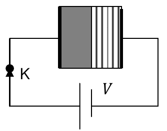

<b>Solución</b>

Solución paso a paso

**Paso 1 — Disposición.** Ahora cada dieléctrico ocupa todo el **área** y la mitad del **espesor** ($d/2$): son dos capacitores **en serie**.

$$C_1 = \frac{\varepsilon_{R1}\varepsilon_0A}{d/2} = 2\varepsilon_{R1}C_0 \qquad C_2 = 2\varepsilon_{R2}C_0 \qquad C' = \frac{C_1C_2}{C_1 + C_2}$$

**Paso 2 — Campos.** En serie, la carga libre es la misma en todo el área: $D_1 = D_2 = \sigma = Q_0/A$. Después:

$$E_i = \frac{D}{\varepsilon_{Ri}\varepsilon_0} \qquad P_i = D - \varepsilon_0E_i = D\left(1 - \frac{1}{\varepsilon_{Ri}}\right) \qquad \Delta V' = (E_1 + E_2)\frac d2$$

**Paso 3 — Cálculo.** $C_0 = 0{,}4425$ nF y $Q_0 = 22$ nC, igual que en el ejercicio 10.

$$C_1 = 20\,C_0 \qquad C_2 = 60\,C_0 \qquad C' = 15\,C_0 = 6{,}64\ \text{nF}$$

$$D = \frac{22\times10^{-9}}{0{,}2}\ \tfrac{\text{C}}{\text{m}^2} = 1{,}1\times10^{-7}\ \tfrac{\text{C}}{\text{m}^2} \qquad E_1 = \frac{1{,}1\times10^{-7}}{10\cdot8{,}85\times10^{-12}}\ \tfrac{\text{V}}{\text{m}} = 1243\ \tfrac{\text{V}}{\text{m}} \qquad E_2 = 414\ \tfrac{\text{V}}{\text{m}}$$

$$\Delta V' = (1243 + 414)\cdot0{,}002\ \text{V} = 3{,}31\ \text{V} \qquad P_1 = 0{,}9\,D = 9{,}9\times10^{-8}\ \tfrac{\text{C}}{\text{m}^2} \qquad P_2 = \tfrac{29}{30}D = 1{,}06\times10^{-7}\ \tfrac{\text{C}}{\text{m}^2}$$

$$Q_{L1} = Q_{L2} = 22\ \text{nC} \qquad U' = \tfrac12\cdot22\times10^{-9}\cdot3{,}31\ \text{J} = 3{,}65\times10^{-8}\ \text{J}$$

**Respuesta:**

- a) $C_0 = 0{,}44\times10^{-9}$ F ≡ 0,44 nF
- b) $C'_{eq} = 6{,}64\times10^{-9}$ F
- c) $Q_0 = Q' = 22$ nC. No cambia porque al desconectar la batería el sistema queda aislado.
- d) $\Delta V' = 3{,}31$ V
- e) $\vec D_1 = \vec D_2 = 1{,}1\times10^{-7}$ C/m² $\hat e_x$; $\vec E_1 = 1242{,}9$ V/m $\hat e_x$; $\vec E_2 = 414{,}3$ V/m $\hat e_x$; $\vec P_1 = 9{,}9\times10^{-8}$ C/m² $\hat e_x$; $\vec P_2 = 1{,}1\times10^{-7}$ C/m² $\hat e_x$
- f) $Q_{L1} = Q_{L2} = 22\times10^{-9}$ C; $\sigma_{P1} = 9{,}9\times10^{-8}$ C/m²; $\sigma_{P2} = 1{,}1\times10^{-7}$ C/m²
- g) $U_0 = 55\times10^{-8}$ J; $U' = 3{,}7\times10^{-8}$ J. La energía disminuye porque el trabajo de polarización de los dieléctricos se realiza a expensas de la energía interna del sistema (la energía contenida en el campo electrostático).

---

### Ejercicio 12

La figura representa una esfera conductora de radio *R1* = 5 cm que está rodeada de un dieléctrico de constante dieléctrica relativa *εR* = 4, dentro de una esfera conductora hueca de radio interior *R2* = 20 cm y radio exterior *R3* = 22 cm concéntrica con la primera. La carga propia de la esfera interior es *Q1* = 40 nC y la de la exterior es *Q2* = 30 nC. Halle

a) la expresión y el valor de la diferencia de potencial entre las dos esferas.

b) la cantidad de carga distribuida en cada superficie (interior y exterior) de la esfera conductora hueca (justifique la respuesta).

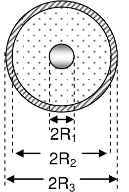

<b>Solución</b>

Solución paso a paso

**Paso 1 — Campo entre las esferas.** Gauss para D: $D = \dfrac{Q_1}{4\pi r^2}$, y en el dieléctrico $E = \dfrac{D}{\varepsilon_R\varepsilon_0} = \dfrac{kQ_1}{\varepsilon_Rr^2}$.

**Paso 2 — Diferencia de potencial.**

$$V(R_2) - V(R_1) = -\int_{R_1}^{R_2}\frac{kQ_1}{\varepsilon_Rr^2}dr = \frac{kQ_1}{\varepsilon_R}\left(\frac{1}{R_2} - \frac{1}{R_1}\right)$$

**Paso 3 — Cálculo.**

$$V(R_2) - V(R_1) = \frac{9\times10^9\cdot40\times10^{-9}}{4}\left(\frac{1}{0{,}2} - \frac{1}{0{,}05}\right)\ \text{V} = 90\cdot(5 - 20)\ \text{V} = -1350\ \text{V}$$

**Paso 4 — Cargas en la esfera hueca (ítem b).** Dentro de su metal $E = 0$, así que una gaussiana dentro del metal encierra carga libre nula: en $R_2$ se induce $-Q_1$. El resto de la carga de la esfera hueca va a $R_3$: $Q_2 - (-Q_1) = Q_1 + Q_2$.

**Respuesta:**

- a) $V(R_2) - V(R_1) = \dfrac{kQ_1}{\varepsilon_R}\left(\dfrac{1}{R_2} - \dfrac{1}{R_1}\right) = -1350$ V
- b) Como el campo eléctrico en el interior de la esfera hueca es nulo, sobre $R_2$ se induce $-Q_1 = -40$ nC, de manera tal que la cantidad de carga en la esfera de radio $R_3$ es $Q = Q_1 + Q_2 = 70$ nC.

---

### Ejercicio 13

Suponga que en el ejercicio 10 los dieléctricos se introducen sin desconectar la batería. Discuta cualitativa y cuantitativamente cuáles son los resultados que cambian.

<b>Solución</b>

Solución paso a paso

**Paso 1 — Qué cambia.** La batería sigue conectada, así que la **tensión** se mantiene en 50 V y la **carga** cambia. Las capacidades (ítems a y b) solo dependen de la geometría: no cambian.

**Paso 2 — Fórmulas.**

$$Q' = C'V \qquad E = \frac Vd \qquad D_i = \varepsilon_{Ri}\varepsilon_0E \qquad P_i = (\varepsilon_{Ri} - 1)\varepsilon_0E \qquad Q_{Li} = D_i\frac A2 \qquad U' = \tfrac12C'V^2$$

**Paso 3 — Cálculo.**

$$Q' = 8{,}85\ \text{nF}\cdot50\ \text{V} = 442{,}5\ \text{nC} \qquad E = \frac{50}{0{,}004}\ \tfrac{\text{V}}{\text{m}} = 12500\ \tfrac{\text{V}}{\text{m}}$$

$$D_1 = 10\varepsilon_0E = 1{,}1\times10^{-6}\ \tfrac{\text{C}}{\text{m}^2} \qquad D_2 = 3{,}3\times10^{-6}\ \tfrac{\text{C}}{\text{m}^2} \qquad P_1 = 9{,}96\times10^{-7}\ \tfrac{\text{C}}{\text{m}^2} \qquad P_2 = 3{,}21\times10^{-6}\ \tfrac{\text{C}}{\text{m}^2}$$

$$Q_{L1} = 1{,}11\times10^{-7}\ \text{C} \qquad Q_{L2} = 3{,}32\times10^{-7}\ \text{C} \qquad U' = \tfrac12\cdot8{,}85\times10^{-9}\cdot2500\ \text{J} = 1{,}1\times10^{-5}\ \text{J}$$

La energía **aumenta** (20 veces): la batería entrega trabajo para mover la carga adicional y polarizar el dieléctrico.

**Respuesta:**

- (a) y (b) son los mismos.
- La carga inicial y la final no son iguales: $Q_0 = 22$ nC y $Q' = 441{,}5$ nC.
- $\Delta V = \Delta V' = 50$ V
- $\vec E_1 = \vec E_2 = 12500$ V/m $\hat e_x$; $\vec D_1 = 1{,}1\times10^{-6}$ C/m² $\hat e_x$; $\vec D_2 = 3{,}3\times10^{-6}$ C/m² $\hat e_x$; $\vec P_1 = 9{,}9\times10^{-7}$ C/m² $\hat e_x$; $\vec P_2 = 3{,}19\times10^{-6}$ C/m² $\hat e_x$
- f) $Q_{L1} = 1{,}11\times10^{-7}$ C; $Q_{L2} = 3{,}32\times10^{-7}$ C; $\sigma_{P1} = 9{,}96\times10^{-7}$ C/m²; $\sigma_{P2} = 3{,}21\times10^{-6}$ C/m²
- g) $U_0 = 55\times10^{-8}$ J; $U' = 1{,}1\times10^{-5}$ J. La batería entrega trabajo para polarizar el dieléctrico y esa energía queda almacenada en la configuración; por eso la energía final es mayor que la inicial.

---

### Ejercicio 14

a) en la región con ε1 existe un campo eléctrico ***E1***, que forma un ángulo α con la dirección horizontal. Sea *W1* el trabajo requerido para transportar a velocidad constante una carga *Q* desde A hasta B. Calcule el trabajo *W2* para transportarla entre B y D en términos de ε1, ε2 y *W1*;

b) calcule el valor de la densidad de carga de polarización en A y en D.

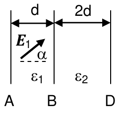

<b>Solución</b>

Solución paso a paso

**Paso 1 — Geometría.** A, B y D son superficies verticales: el medio 1 ocupa de A a B (espesor $d$) y el medio 2 de B a D (espesor $2d$). La dirección **horizontal** es la **normal** a las superficies. La carga se mueve horizontalmente, así que solo importa la componente normal del campo.

**Paso 2 — Trabajo en el medio 1.** El campo es uniforme en cada medio:

$$W_1 = Q\,E_{1N}\,d = Q\,E_1\cos\alpha\,d$$

**Paso 3 — Componente normal en el medio 2.** Sin carga libre en la interfaz, $D_{1N} = D_{2N}$, es decir $\varepsilon_1E_{1N} = \varepsilon_2E_{2N}$:

$$E_{2N} = \frac{\varepsilon_1}{\varepsilon_2}E_{1N}$$

**Paso 4 — Trabajo en el medio 2** (espesor $2d$):

$$W_2 = Q\,E_{2N}\,2d = Q\,E_{1N}\frac{\varepsilon_1}{\varepsilon_2}\,2d = 2\frac{\varepsilon_1}{\varepsilon_2}W_1$$

**Paso 5 — Polarización (ítem b).** La densidad de carga de polarización en una superficie es la componente normal de $\vec P = (\varepsilon - \varepsilon_0)\vec E$:

$$\sigma_{PA} = (\varepsilon_1 - \varepsilon_0)E_{1N} = (\varepsilon_1 - \varepsilon_0)|E_1|\cos\alpha \qquad \sigma_{PD} = (\varepsilon_2 - \varepsilon_0)E_{2N} = (\varepsilon_2 - \varepsilon_0)\frac{\varepsilon_1}{\varepsilon_2}|E_1|\cos\alpha$$

(En valor absoluto; en A la polarización es negativa porque es la cara por donde "entra" el campo.)

**Respuesta:**

- a) $W_1 = QE_{1N}\times d = QE_1\cos\alpha\times d$; $W_2 = QE_{2N}\times2d = QE_{1N}\dfrac{\varepsilon_1}{\varepsilon_2}\times2d = 2\dfrac{\varepsilon_1}{\varepsilon_2}W_1$
- b) $\sigma_{PA} = (\varepsilon_1 - \varepsilon_0)|E_1|\cos\alpha$; $\sigma_{PD} = (\varepsilon_2 - \varepsilon_0)(\varepsilon_1/\varepsilon_2)|E_1|\cos\alpha$

---

### Ejercicio 15

Tres de las siguientes afirmaciones son correctas. Indique cuáles son.

- Dos capacitores iguales en paralelo almacenan el doble de energía que conectados en serie.
- La capacidad de un capacitor se duplica si se duplica la ddp a la que se lo conecta.
- El vector polarización es una medida del número de dipolos orientados por unidad de volumen.
- La capacidad de un capacitor puede aumentar o disminuir cuando se lo llena con un dieléctrico.
- El vector desplazamiento se asocia siempre a la carga total.
- La capacidad de un sistema es un factor puramente geométrico, siempre positivo.
- La componente normal de ***D*** se conserva si σP=0 en la superficie de separación de los medios
- La polarizabilidad de un medio aumenta con la temperatura.
- El vector desplazamiento se asocia a la carga libre y el CE a la carga total.
- Un capacitor es un sistema almacenador de carga eléctrica.

<b>Solución</b>

Solución paso a paso

- "Paralelo almacena el doble que serie": **falso**. A la misma $V$: en paralelo, $C_{eq} = 2C$ y $U = CV^2$; en serie, $C_{eq} = C/2$ y $U = CV^2/4$. Es **cuatro** veces.
- "C se duplica si se duplica la ddp": **falso**. $C$ no depende de $V$.
- "$\vec P$ mide los dipolos orientados por unidad de volumen": **verdadero**. $\vec P = n\vec p$.
- "C puede aumentar o disminuir con un dieléctrico": **falso**. $K > 1$, así que siempre aumenta.
- "$\vec D$ se asocia siempre a la carga total": **falso**. A la carga libre.
- "C es geométrico, siempre positivo": **verdadero** (incluye el material, pero no depende de $Q$ ni de $V$).
- "$D_n$ se conserva si $\sigma_P = 0$": **falso**. La condición es $\sigma_{libre} = 0$.
- "La polarizabilidad aumenta con T": **falso**. La agitación térmica desordena los dipolos.
- "$\vec D$ a la carga libre y $\vec E$ a la total": **verdadero**.
- "Un capacitor almacena carga": **falso** según la guía. Su carga neta es nula; lo que almacena es **energía** (separa cargas).

**Respuesta:**

- El vector polarización es una medida del número de dipolos orientados por unidad de volumen.
- La capacidad de un sistema es un factor puramente geométrico, siempre positivo.
- El vector desplazamiento se asocia a la carga libre y el CE a la carga total.

