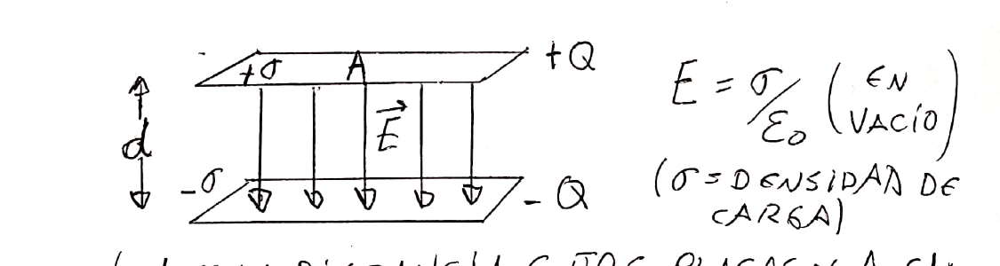
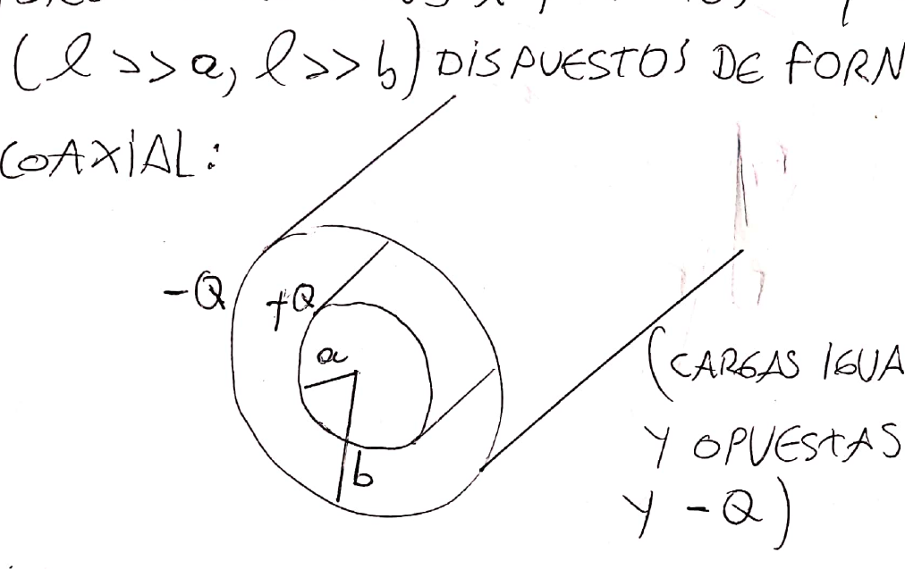
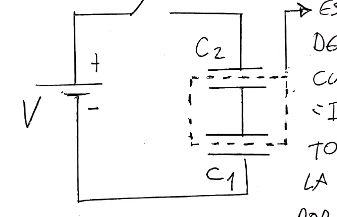
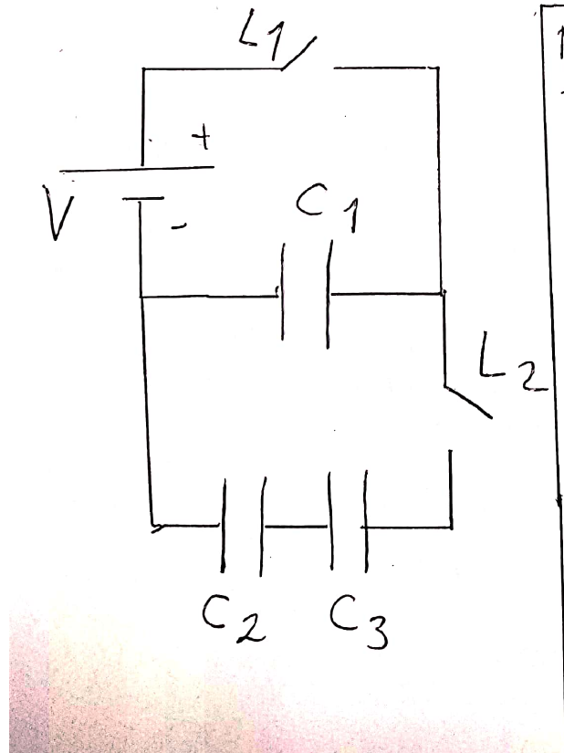
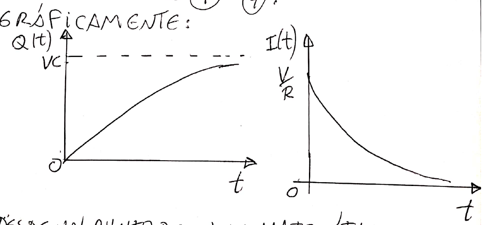
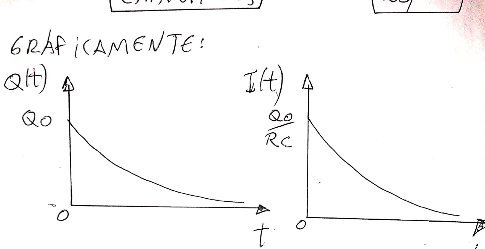
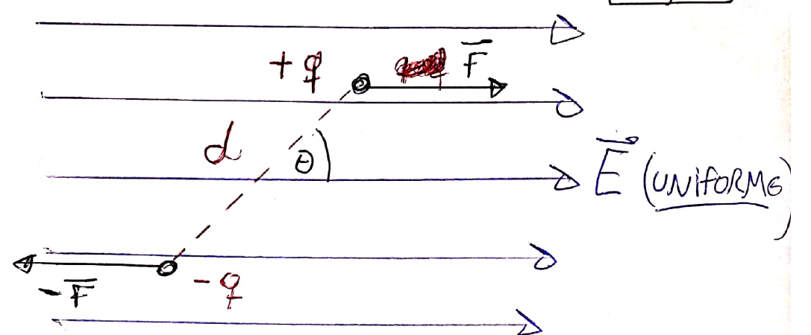
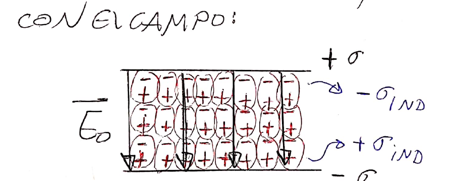
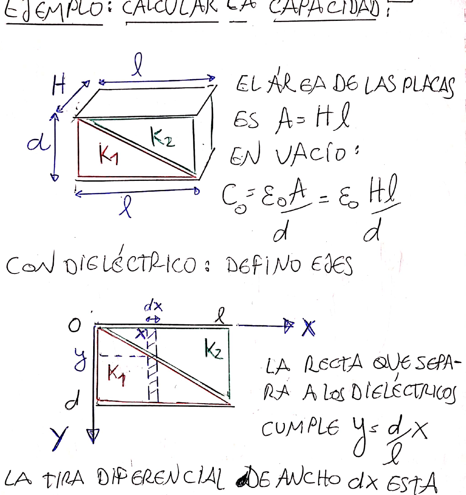

# Tema 4 — Capacitores y dieléctricos: resumen teórico

Resumen de la clase del aula virtual: [Clase 5 — Capacitores](Aula%20Virtual/Clase%205%20-%20Capacitores.pdf).

Ejercicios: [práctica del tema](practica.md).

---

## Índice

1. [Capacitor y capacitancia](#1-capacitor-y-capacitancia)
2. [Capacitor plano](#2-capacitor-plano)
3. [Capacitor cilíndrico](#3-capacitor-cilíndrico)
4. [Capacitor esférico](#4-capacitor-esférico)
5. [Carga de un capacitor](#5-carga-de-un-capacitor)
6. [Conexión en serie y en paralelo](#6-conexión-en-serie-y-en-paralelo)
7. [Redistribución de carga entre capacitores](#7-redistribución-de-carga-entre-capacitores)
8. [Energía almacenada](#8-energía-almacenada)
9. [Transitorios RC: carga y descarga](#9-transitorios-rc-carga-y-descarga)
10. [Densidad de energía del campo](#10-densidad-de-energía-del-campo)
11. [Dipolo en un campo externo](#11-dipolo-en-un-campo-externo)
12. [Dieléctricos en capacitores](#12-dieléctricos-en-capacitores)
13. [Energía con dieléctrico: batería conectada o desconectada](#13-energía-con-dieléctrico-batería-conectada-o-desconectada)
14. [Polarización y desplazamiento eléctrico](#14-polarización-y-desplazamiento-eléctrico)
15. [Condiciones de contorno entre dos dieléctricos](#15-condiciones-de-contorno-entre-dos-dieléctricos)
16. [Capacitores con varios dieléctricos](#16-capacitores-con-varios-dieléctricos)
17. [Tabla de fórmulas](#17-tabla-de-fórmulas)

---

## 1. Capacitor y capacitancia

Un **capacitor** es un sistema de **dos conductores con cargas iguales y opuestas**. Sirve para almacenar carga eléctrica (o, dicho de otro modo, **energía eléctrica**) para usarla cuando se necesite.

Notación: $Q$ es el **módulo** de la carga de cualquiera de los dos conductores y $V$ el **módulo** de la diferencia de potencial entre ellos. Siempre $Q > 0$ y $V > 0$.

La **capacitancia** dice cuánta carga almacena el capacitor por cada volt aplicado:

$$\boxed{C = \frac QV} \qquad [C] = \frac{\text{C}}{\text{V}} = \text{F (faradio)}$$

Depende **solo de la geometría** y del **material entre las placas**, no de $Q$ ni de $V$. El faradio es muy grande; se usan $1\ \mu\text{F} = 10^{-6}$ F, $1\ \text{nF} = 10^{-9}$ F y $1\ \text{pF} = 10^{-12}$ F.

> **Receta para calcular C:** suponer cargas $\pm Q$; calcular $\vec E$ entre los conductores (por Gauss); integrar para obtener $V = \left|\int\vec E\cdot d\vec\ell\right|$; hacer $C = Q/V$. La $Q$ siempre se simplifica.

---

## 2. Capacitor plano

Dos placas de área $A$ separadas una distancia $d$ pequeña frente a sus dimensiones (se desprecian los efectos de borde).

Entre las placas se superponen los campos de los dos planos ($\frac{\sigma}{2\varepsilon_0} + \frac{\sigma}{2\varepsilon_0}$); afuera se cancelan:

$$E = \frac{\sigma}{\varepsilon_0} = \frac{Q}{\varepsilon_0A} \qquad V = Ed = \frac{Qd}{\varepsilon_0A} \qquad \boxed{C = \frac{\varepsilon_0A}{d}}\ (\text{vacío})$$

Para aumentar $C$: más área o placas más cercanas.

---

## 3. Capacitor cilíndrico

Dos cilindros coaxiales de radios $a < b$ y longitud $\ell \gg a, b$, con cargas $+Q$ (interior) y $-Q$ (exterior).

Entre ambos, solo contribuye el cilindro interior (Gauss): $\vec E = \dfrac{Q}{2\pi\varepsilon_0\ell\,r}\hat r$.

$$V = \frac{Q}{2\pi\varepsilon_0\ell}\int_a^b\frac{dr}{r} = \frac{Q}{2\pi\varepsilon_0\ell}\ln\frac ba \qquad \boxed{C = \frac{2\pi\varepsilon_0\ell}{\ln(b/a)}}$$

---

## 4. Capacitor esférico

(Aparece en la guía.) Esfera de radio $r_1$ con $+Q$ y cáscara concéntrica de radio interno $r_2$ con $-Q$. Entre ambas, $E = kQ/r^2$:

$$V = kQ\left(\frac{1}{r_1} - \frac{1}{r_2}\right) \qquad \boxed{C = \frac{1}{k\left(\frac{1}{r_1} - \frac{1}{r_2}\right)} = \frac{4\pi\varepsilon_0\,r_1r_2}{r_2 - r_1}}$$

Una **esfera aislada** de radio $R$ (el otro conductor en el infinito) tiene $C = 4\pi\varepsilon_0R = R/k$.

---

## 5. Carga de un capacitor

Al conectar un capacitor descargado a una batería, la batería **redistribuye** las cargas: la placa conectada al borne + cede electrones (queda $+Q$) y la otra los recibe (queda $-Q$). El proceso termina cuando la tensión del capacitor iguala la de la batería. La carga total sigue siendo nula; parte de la energía de la batería se almacena en el capacitor y otra parte se disipa en las resistencias.

---

## 6. Conexión en serie y en paralelo

### Serie: misma carga

La parte del circuito entre dos capacitores en serie (las placas internas y el cable que las une) está **aislada**: es una **isla**. Su carga total no puede cambiar (si estaba descargada, sigue con carga total cero). Se carga por **inducción**: queda $-Q$ en una placa y $+Q$ en la otra. Por eso:

**Todos los capacitores en serie tienen la misma carga $Q$.**

Por la ley de mallas, $V = \dfrac{Q}{C_1} + \dfrac{Q}{C_2}$:

$$\boxed{\frac{1}{C_{eq}} = \sum_i\frac{1}{C_i}}\quad(\text{serie, misma carga})$$

$C_{eq}$ en serie es **menor que la menor** de las capacidades.

### Paralelo: misma tensión

$$\boxed{C_{eq} = \sum_iC_i}\quad(\text{paralelo, misma tensión})$$

> Ojo: es **al revés** que con resistencias.

---

## 7. Redistribución de carga entre capacitores

**Ejemplo de clase:** $V = 18$ V, $C_1 = 6\ \mu$F, $C_2 = 9\ \mu$F, $C_3 = 12\ \mu$F. Se cierra $L_1$, se carga $C_1$; se abre $L_1$ y se cierra $L_2$, que conecta $C_1$ con la serie $C_2$–$C_3$.

1. Con $L_1$ cerrada: $Q_1 = C_1V = 108\ \mu$C.
2. Al cerrar $L_2$ (batería afuera), se plantean tres ecuaciones:
   - $C_2$ y $C_3$ en serie: $Q_2' = Q_3'$.
   - **Conservación de la carga** (en la isla que forman las placas conectadas): $Q_1' + Q_2' = Q_1$.
   - **Ley de mallas:** $\dfrac{Q_1'}{C_1} - \dfrac{Q_2'}{C_2} - \dfrac{Q_3'}{C_3} = 0$.
3. Resultado: $Q_1' = 58{,}15\ \mu$C, $Q_2' = Q_3' = 49{,}85\ \mu$C.

> **Método general:** (1) en cada isla, la carga total se conserva; (2) en cada malla sin batería, $\sum Q_i/C_i = 0$ con los signos de las placas; (3) los capacitores en serie tienen la misma carga.

---

## 8. Energía almacenada

Mientras se carga el capacitor, cada carga $\delta q$ que pasa de una placa a la otra:

- recibe de la batería $\delta U_{BAT} = V_{BAT}\,\delta q$, y en total $U_{BAT} = V_{BAT}\,Q$;
- se almacena en el capacitor $\delta U_{CAP} = \frac qC\,\delta q$, y en total $U_{CAP} = \dfrac{Q^2}{2C}$.

Como $Q = CV_{BAT}$, resulta $U_{CAP} = \dfrac{V_{BAT}Q}{2} = \dfrac{U_{BAT}}{2}$: **la mitad de la energía entregada se almacena y la otra mitad se disipa** en las resistencias (sea cual sea su valor).

$$\boxed{U = \frac{Q^2}{2C} = \frac{QV}{2} = \frac{CV^2}{2}}$$

Para un conjunto, la energía total es la suma de las de cada capacitor, igual a la del equivalente: $U_T = \tfrac12C_{eq}V^2$.

---

## 9. Transitorios RC: carga y descarga

Al conectar un capacitor se pasa por un **régimen transitorio** en el que carga y corriente dependen del tiempo, hasta llegar al **estacionario** (capacitor cargado, corriente nula en su rama).

### Carga (circuito RC con batería $V$)

Malla: $V - RI - \dfrac QC = 0$ con $I = \dfrac{dQ}{dt}$. Separando variables e integrando desde $Q(0) = 0$:

$$\boxed{Q(t) = CV\left(1 - e^{-t/RC}\right)} \qquad \boxed{I(t) = \frac VR\,e^{-t/RC}}$$

### Descarga (capacitor con $Q_0$ sobre una resistencia $R$)

Malla: $\dfrac QC - RI = 0$ con $I = -\dfrac{dQ}{dt}$:

$$\boxed{Q(t) = Q_0\,e^{-t/RC}} \qquad \boxed{I(t) = \frac{Q_0}{RC}\,e^{-t/RC}}$$

### Constante de tiempo

$$\boxed{\tau = RC}$$

Matemáticamente los valores estacionarios se alcanzan solo asintóticamente. Con el criterio de que $e^{-5} = 0{,}0067$ es despreciable, se considera que **el estacionario se alcanza para $t > 5RC$**.

> **Regla práctica:** **inicialmente, el capacitor (descargado) se comporta como un cable; a tiempos muy largos, como una llave abierta.**

**Ejemplo de clase:** batería de 18 V, 2 Ω en serie, luego 3 Ω en paralelo con (8 Ω + 6 μF).

- Al cerrar: el capacitor es un cable, así que $3 \,/\!/\, 8 = 2{,}18\ \Omega$; $I = 18/4{,}18 = 4{,}3$ A y $P = 77{,}5$ W.
- Tiempo largo: el capacitor es una llave abierta, así que $I = 18/5 = 3{,}6$ A; $V_C = V_{3\Omega} = 10{,}8$ V y $Q = 64{,}8\ \mu$C.

---

## 10. Densidad de energía del campo

En un capacitor plano, $U = \tfrac12CV^2 = \tfrac12\varepsilon_0E^2\,(Ad)$, y $Ad$ es el volumen donde hay campo. Se interpreta que **la energía está almacenada en el campo eléctrico**, con densidad

$$\boxed{u = \frac12\varepsilon_0E^2} \qquad \boxed{U = \int_{Vol}u\,dVol = \frac12\varepsilon_0\int E^2\,dVol}$$

Vale en general (no solo para campo uniforme). Con dieléctrico: $u = \tfrac12\varepsilon E^2 = \tfrac12\vec D\cdot\vec E$.

**Ejemplo:** esfera de radio $R$ con carga $Q$ en la superficie. $E = 0$ adentro y $kQ/r^2$ afuera:

$$U = 4\pi\int_R^\infty\frac{Q^2}{32\pi^2\varepsilon_0}\frac{1}{r^4}\,r^2dr = \frac{Q^2}{8\pi\varepsilon_0R}$$

---

## 11. Dipolo en un campo externo

Las moléculas tienen cargas positivas y negativas. Si sus centros no coinciden, la molécula está **polarizada**:

- **moléculas polares**: polarizadas permanentemente (por ejemplo, el agua);
- **no polares**: se polarizan solo en presencia de un campo externo.

Se modelan como un **dipolo** ($+q$ y $-q$ separadas $d$). El **momento dipolar** $\vec p$ va de $-q$ a $+q$ y tiene módulo $p = qd$.

En un campo **uniforme**, la fuerza neta es nula (no se traslada), pero hay un **torque** que tiende a **alinear el dipolo con el campo**:

$$\boxed{\vec M = \vec p\times\vec E} \qquad M = pE\sin\theta$$

---

## 12. Dieléctricos en capacitores

Al llenar un capacitor con un dieléctrico, los dipolos se alinean con el campo $\vec E_0$. En las caras del dieléctrico aparecen **cargas inducidas (de polarización)**: $-\sigma_{ind}$ junto a la placa $+\sigma$ y $+\sigma_{ind}$ junto a la placa $-\sigma$.

Esas cargas generan un campo $\vec E_{ind}$ **opuesto** a $\vec E_0$, así que el campo neto **disminuye**: $E = E_0 - E_{ind}$. Se define la **constante dieléctrica** $K$ (o permitividad relativa $\varepsilon_R$):

$$\boxed{E = \frac{E_0}{K}} \qquad K > 1\ (K = 1 \text{ en vacío})$$

$$\boxed{\sigma_{ind} = \frac{K - 1}{K}\,\sigma} \quad (\sigma_{ind} < \sigma)$$

**Capacitancia.** Con el capacitor desconectado, $Q$ no cambia y $V = Ed = V_0/K$:

$$\boxed{C = K\,C_0}$$

El dieléctrico **aumenta** la capacidad: para eso se lo pone. Si el campo supera la **rigidez dieléctrica** del material, este se vuelve conductor y el capacitor deja de funcionar.

**Permitividad:** $\varepsilon = K\varepsilon_0$, es decir $K = \varepsilon/\varepsilon_0 = \varepsilon_R$. En todas las fórmulas con vacío basta cambiar $\varepsilon_0$ por $\varepsilon$: por ejemplo, $C = \varepsilon A/d$.

---

## 13. Energía con dieléctrico: batería conectada o desconectada

| | **Conectado a la batería** | **Desconectado (aislado)** |
|---|---|---|
| Qué se mantiene | $V$ (la fija la batería) | $Q$ (no tiene por dónde irse) |
| Capacidad | $C = KC_0$ | $C = KC_0$ |
| Carga | $Q = KQ_0$ (aumenta: entra carga por la batería) | $Q = Q_0$ |
| Tensión | $V = V_0$ | $V = V_0/K$ (disminuye) |
| Campo | $E = E_0$ | $E = E_0/K$ |
| Energía | $U = KU_0$ (**aumenta**: la batería hace trabajo) | $U = U_0/K$ (**disminuye**) |

Con el capacitor desconectado la energía disminuye porque el capacitor **"chupa" al dieléctrico** hacia adentro: el sistema evoluciona espontáneamente a un estado de menor energía (el trabajo de polarización sale de la energía del campo).

---

## 14. Polarización y desplazamiento eléctrico

**Polarización:** momento dipolar por unidad de volumen. Si hay $n$ moléculas por unidad de volumen, cada una con $\vec p$:

$$\boxed{\vec P = n\,\vec p}$$

En la mayoría de los materiales es paralela al campo:

$$\boxed{\vec P = \chi\,\varepsilon_0\,\vec E}$$

$\chi$ es la **susceptibilidad eléctrica** (adimensional). En el capacitor plano, el momento dipolar total es $Q_{ind}\,d = |\vec P|\,Ad$, de donde:

$$\boxed{|\vec P| = \sigma_{ind}}\quad(\text{la densidad de carga de polarización en la superficie vale } \vec P\cdot\hat n) \qquad \boxed{\chi = K - 1}$$

**Desplazamiento eléctrico.** De $E = \dfrac{\sigma}{\varepsilon_0} - \dfrac{P}{\varepsilon_0}$ sale $\sigma = \varepsilon_0E + P$. Se define:

$$\boxed{\vec D = \varepsilon_0\vec E + \vec P = \varepsilon\,\vec E} \qquad \vec D\cdot\hat n = \sigma_{libre}$$

**Gauss para $\vec D$:**

$$\boxed{\oint\vec D\cdot\hat n\,ds = Q_{libre}}$$

Es decir, **el flujo de $\vec D$ depende solo de las cargas libres**. En casos de alta simetría se calcula $\vec D$ por Gauss y después $\vec E = \vec D/\varepsilon$.

Resumen de qué "ve" cada vector: $\vec D$ se asocia a la **carga libre**; $\vec E$ a la **carga total** (libre + polarización); $\vec P$ a la de **polarización**.

**Ejemplo de clase:** esfera de permitividad $\varepsilon_1$ con $\rho$ uniforme, rodeada por un medio $\varepsilon_2$.

- $\vec D = \frac{\rho}{3}r\,\hat r$ ($r < R$) y $\frac{\rho R^3}{3r^2}\hat r$ ($r > R$).
- Entonces $\vec E = \frac{\rho r}{3\varepsilon_1}\hat r$ adentro y $\frac{\rho R^3}{3\varepsilon_2r^2}\hat r$ afuera.

---

## 15. Condiciones de contorno entre dos dieléctricos

En la superficie que separa dos medios ($\hat n$ apuntando del 1 al 2):

- **Componente normal de $\vec D$** (Gauss en un cilindro infinitesimal): $D_{2n} - D_{1n} = \sigma_{libre}$. **Sin carga libre en la interfaz, $D_n$ se conserva**: $D_{1n} = D_{2n}$, es decir $\varepsilon_1E_{1n} = \varepsilon_2E_{2n}$.
- **Componente tangencial de $\vec E$** (el campo es conservativo, $\oint\vec E\cdot d\vec\ell = 0$ en un rectángulo infinitesimal): $\boxed{E_{1t} = E_{2t}}$.

**Ejemplo de clase:** $K_1 = 3$, $K_2 = 18$, $E_1 = 10^4$ V/m formando 60° con la superficie.

- $E_{2t} = E_{1t} = E_1\cos60^\circ = 5000$ V/m.
- $E_{1n} = E_1\sin60^\circ$, así que $D_{2n} = D_{1n} = 3\varepsilon_0\frac{\sqrt3}{2}10^4$.
- $E_{2n} = D_{2n}/(18\varepsilon_0) = 1443{,}4$ V/m.
- Ángulo de $\vec D_2$ con la superficie: $\tan\alpha = \dfrac{D_{2n}}{D_{2t}} = \dfrac{25980{,}8}{90000}$, de donde $\alpha = 16{,}1^\circ$.

---

## 16. Capacitores con varios dieléctricos

- **Dieléctricos uno al lado del otro** (cada uno ocupa una parte del **área** y todo el espesor $d$): están a la misma tensión, así que van **en paralelo**: $C = \dfrac{\varepsilon_1A_1}{d} + \dfrac{\varepsilon_2A_2}{d}$. El campo $E = V/d$ es el **mismo** en ambos; $D = \varepsilon E$ es distinto.
- **Dieléctricos apilados** (cada uno ocupa todo el área y una parte del **espesor**): tienen la misma carga, así que van **en serie**: $\dfrac1C = \dfrac{d_1}{\varepsilon_1A} + \dfrac{d_2}{\varepsilon_2A}$. $D = \sigma_{libre}$ es el **mismo** en ambos; $E = D/\varepsilon$ es distinto.
- **Lámina metálica** de espesor $e$ insertada: dentro del metal $E = 0$. Equivale a reducir la separación a $d - e$, sin importar dónde esté la lámina.

**Ejemplo de clase (interfaz diagonal):** dieléctricos $K_1$ y $K_2$ separados por la diagonal de un capacitor de $d\times\ell\times H$. Cada tira vertical de ancho $dx$ son dos capacitores en serie, y las tiras están en paralelo:

$$C = C_0\,\frac{K_1K_2}{K_1 - K_2}\ln\!\left(\frac{K_1}{K_2}\right)$$

---

## 17. Tabla de fórmulas

| Tema | Fórmula |
|---|---|
| Capacitancia | $C = Q/V$ |
| Plano | $C = \varepsilon A/d$ |
| Cilíndrico | $C = 2\pi\varepsilon\ell/\ln(b/a)$ |
| Esférico | $C = 1/\left[k(1/r_1 - 1/r_2)\right]$ |
| Serie | $1/C_{eq} = \sum 1/C_i$ (misma $Q$) |
| Paralelo | $C_{eq} = \sum C_i$ (misma $V$) |
| Energía | $U = Q^2/(2C) = QV/2 = CV^2/2$ |
| Densidad de energía | $u = \tfrac12\varepsilon E^2$ |
| Carga RC | $Q = CV(1 - e^{-t/RC})$, $I = \frac VR e^{-t/RC}$ |
| Descarga RC | $Q = Q_0e^{-t/RC}$ |
| Constante de tiempo | $\tau = RC$; estacionario si $t > 5\tau$ |
| Dipolo | $\vec p = q\vec d$, $\vec M = \vec p\times\vec E$ |
| Dieléctrico | $E = E_0/K$, $C = KC_0$, $\varepsilon = K\varepsilon_0$ |
| Carga inducida | $\sigma_{ind} = \frac{K - 1}{K}\sigma = P$ |
| Polarización | $\vec P = \chi\varepsilon_0\vec E$, $\chi = K - 1$ |
| Desplazamiento | $\vec D = \varepsilon_0\vec E + \vec P = \varepsilon\vec E$ |
| Gauss para D | $\oint\vec D\cdot\hat n\,ds = Q_{libre}$ |
| Contorno | $D_{1n} = D_{2n}$ (sin $\sigma_{libre}$), $E_{1t} = E_{2t}$ |
