# Tema 5 — Magnetostática: ejercicios resueltos

Ejercicios de la [Guía de ejercicios de Magnetostática](Aula%20Virtual/Gu%C3%ADa%20de%20ejercicios%20-%20Magnetost%C3%A1tica.pdf). Los enunciados están copiados textualmente de la guía.

Cada ejercicio tiene un botón **Solución**. Al abrirlo aparece la respuesta y, arriba, un segundo botón **Solución paso a paso** con el desarrollo completo. En el paso a paso primero se obtiene la fórmula en forma simbólica y recién al final se reemplazan los números.

Teoría: [resumen del tema](teoria.md). Constante: $\mu_0 = 4\pi\times10^{-7}$ T m/A. Versores: $\hat e_x$, $\hat e_y$, $\hat e_z$ (= $\hat\imath$, $\hat\jmath$, $\hat k$).

| Bloque | Ejercicios |
|---|---|
| Cargas en campos magnéticos | [1](#ejercicio-1) · [2](#ejercicio-2) · [3](#ejercicio-3) · [4](#ejercicio-4) · [5](#ejercicio-5) |
| Fuerza sobre conductores | [6](#ejercicio-6) · [7](#ejercicio-7) · [8](#ejercicio-8) · [9](#ejercicio-9) · [10](#ejercicio-10) |
| Hilos rectos | [11](#ejercicio-11) · [12](#ejercicio-12) · [13](#ejercicio-13) · [14](#ejercicio-14) · [15](#ejercicio-15) · [16](#ejercicio-16) · [17](#ejercicio-17) · [18](#ejercicio-18) · [19](#ejercicio-19) |
| Espiras y solenoides | [20](#ejercicio-20) · [21](#ejercicio-21) · [22](#ejercicio-22) · [23](#ejercicio-23) · [24](#ejercicio-24) · [25](#ejercicio-25) · [26](#ejercicio-26) |
| Conceptual | [27](#ejercicio-27) |

---

### Ejercicio 1

Un haz de isótopos ${}^{56}_{26}Fe^{++}$ (masa *m=8,96 x 10−27 kg*; carga *q=+3,2 ×10−19 C*) ingresa por el punto A de la figura a una región del espacio donde existe un campo magnético de valor B = 0,1T. La energía de cada elemento del haz es de 10 keV.

a) justifique cuál es la dirección y el sentido del campo ***B***;

b) calcule el valor de la distancia AC. (1 keV= 1,6 × 10−16 J).

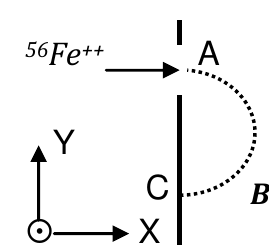

<b>Solución</b>

Solución paso a paso

**Paso 1 — Dirección de B (ítem a).** El ion entra en A moviéndose hacia $+x$ y describe una semicircunferencia hacia abajo, hasta C. En A, la fuerza tiene que apuntar hacia el centro de la circunferencia, es decir hacia $-\hat e_y$. Con $q > 0$:

$$\vec F = q\,v\,\hat e_x\times\vec B = -F\,\hat e_y$$

Como $\hat e_x\times\hat e_z = -\hat e_y$, el campo tiene que ser $\vec B = B_0\,\hat e_z$ (saliente de la hoja). Además, $\vec B$ tiene que ser perpendicular a la velocidad para que la trayectoria sea una circunferencia en el plano XY.

**Paso 2 — Velocidad.** La energía es toda cinética:

$$E = \tfrac12mv^2 \quad\Rightarrow\quad v = \sqrt{\frac{2E}{m}}$$

**Paso 3 — Distancia AC.** A y C son extremos de un diámetro:

$$AC = 2R_{CICL} = 2\,\frac{mv}{qB} = \frac{2\sqrt{2mE}}{qB}$$

**Paso 4 — Cálculo.** $E = 10\ \text{keV} = 1{,}6\times10^{-15}$ J:

$$v = \sqrt{\frac{2\cdot1{,}6\times10^{-15}}{8{,}96\times10^{-27}}}\ \tfrac{\text{m}}{\text{s}} = 5{,}98\times10^5\ \tfrac{\text{m}}{\text{s}}$$

$$AC = 2\cdot\frac{8{,}96\times10^{-27}\cdot5{,}98\times10^5}{3{,}2\times10^{-19}\cdot0{,}1}\ \text{m} = 0{,}335\ \text{m}$$

**Respuesta:** a) $\vec B = B_0\,\hat e_z$; b) $2R_{CICL} = 2\dfrac{mv}{qB} \approx 0{,}336$ m

---

### Ejercicio 2

Una partícula de masa $m$ =1,67x10-27 kg y carga ***q*** =1,6x10-19 C se desplaza con una velocidad de 106 m/s describiendo una circunferencia en un plano perpendicular a un campo de inducción magnética ***B***. El módulo de dicho campo es de 1,75 T. Halle el valor de la frecuencia de giro de la partícula.

<b>Solución</b>

Solución paso a paso

**Paso 1 — Período del MCU.** De $|q|vB = mv^2/R$ sale $R = mv/(|q|B)$, y entonces $T = \dfrac{2\pi R}{v} = \dfrac{2\pi m}{|q|B}$.

**Paso 2 — Frecuencia.** $f = 1/T$:

$$f = \frac{|q|B}{2\pi m}$$

La velocidad no interviene: la frecuencia de ciclotrón no depende de la rapidez.

**Paso 3 — Cálculo.**

$$f = \frac{1{,}6\times10^{-19}\cdot1{,}75}{2\pi\cdot1{,}67\times10^{-27}}\ \text{Hz} = 2{,}67\times10^7\ \text{Hz} = 26{,}7\ \text{MHz}$$

**Respuesta:** $f = \dfrac{|q||\vec B|}{2\pi m} = 26{,}7$ MHz

---

### Ejercicio 3

Una carga *q* > 0 ingresa a la región entre las placas de un capacitor plano. El espacio entre las placas es vacío, y en él existe un campo magnético uniforme ***B***, como indica la figura. Discuta cuáles son las tres afirmaciones correctas

- La carga se desviará hacia la placa positiva si |***v***×***B*** | > |***E***|.
- La carga no se desvía porque está en vacío.
- La carga no se desvía si E=0.
- La carga no se desvía si B=0.
- La carga sigue una trayectoria rectilínea si |***v***×***B*** | = |***E***|.
- Si B=0 la carga se acelera hacia la placa positiva.
- Si se invierte el sentido de B la carga se desvía hacia la placa positiva.
- Si se invierte el sentido de B la carga se desvía hacia la placa negativa.
- El signo de q es irrelevante y que se desvíe o no, depende sólo de ***v***, ***B***, ***E***.

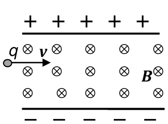

<b>Solución</b>

Solución paso a paso

**Paso 1 — Fuerza eléctrica.** El campo $\vec E$ va de la placa + (arriba) a la − (abajo). Con $q > 0$, $\vec F_E = q\vec E$ apunta **hacia abajo** (hacia la placa negativa), con módulo $qE$.

**Paso 2 — Fuerza magnética.** $\vec v = v\,\hat e_x$, $\vec B = -B\,\hat e_z$ (entrante):

$$\vec F_M = q\,v\,\hat e_x\times(-B\,\hat e_z) = qvB\,\hat e_y$$

Apunta **hacia arriba** (placa positiva), con módulo $qvB$.

**Paso 3 — Analizar cada afirmación.**

- Se desvía hacia la positiva si $|\vec v\times\vec B| > |\vec E|$: **verdadero**. La magnética le gana a la eléctrica.
- "No se desvía porque está en vacío": **falso**. Hay campos.
- "No se desvía si $E = 0$": **falso**. Queda la fuerza magnética.
- "No se desvía si $B = 0$": **falso**. Queda la eléctrica.
- Trayectoria rectilínea si $|\vec v\times\vec B| = |\vec E|$: **verdadero** (selector de velocidades).
- "Si $B = 0$ se acelera hacia la positiva": **falso**. Hacia la negativa.
- "Si se invierte $B$ se desvía hacia la positiva": **falso**.
- "Si se invierte $B$ se desvía hacia la negativa": **verdadero**. Ambas fuerzas quedan hacia abajo.
- "El signo de $q$ es irrelevante…": **falso** como está escrito. La condición de no desviarse ($v = E/B$) no depende del signo, pero hacia dónde se desvía sí.

**Respuesta:**

- La carga se desviará hacia la placa positiva si $|\vec v\times\vec B| > |\vec E|$.
- La carga sigue una trayectoria rectilínea si $|\vec v\times\vec B| = |\vec E|$.
- Si se invierte el sentido de B la carga se desvía hacia la placa negativa.

---

### Ejercicio 4

Un electrón (masa $m$ =9,1x10-31 kg y carga $q$ =−1,6x10-19 C) con energía de 2 keV ingresa a un campo magnético uniforme de 0,1T formando un ángulo de 89° con la dirección del campo. La trayectoria del electrón será entonces una hélice alrededor de una línea de campo. Halle los valores característicos de la hélice, esto es, su período, paso y radio. (1 keV= 1,6 × 10−16 J).

<b>Solución</b>

Solución paso a paso

**Paso 1 — Descomponer la velocidad.** Con $\theta = 89^\circ$ entre $\vec v$ y $\vec B$:

$$v_\perp = v\sin\theta \qquad v_\parallel = v\cos\theta \qquad v = \sqrt{\frac{2E}{m}}$$

**Paso 2 — Fórmulas de la hélice.**

$$T = \frac{2\pi m}{|q|B} \qquad p = v_\parallel\,T \qquad r = \frac{m\,v_\perp}{|q|B}$$

**Paso 3 — Cálculo.** $E = 2\ \text{keV} = 3{,}2\times10^{-16}$ J:

$$v = \sqrt{\frac{2\cdot3{,}2\times10^{-16}}{9{,}1\times10^{-31}}}\ \tfrac{\text{m}}{\text{s}} = 2{,}65\times10^7\ \tfrac{\text{m}}{\text{s}}$$

$$T = \frac{2\pi\cdot9{,}1\times10^{-31}}{1{,}6\times10^{-19}\cdot0{,}1}\ \text{s} = 3{,}57\times10^{-10}\ \text{s}$$

$$p = 2{,}65\times10^7\cdot\cos89^\circ\cdot3{,}57\times10^{-10}\ \text{m} = 1{,}65\times10^{-4}\ \text{m} = 0{,}16\ \text{mm}$$

$$r = \frac{9{,}1\times10^{-31}\cdot2{,}65\times10^7\cdot\sin89^\circ}{1{,}6\times10^{-19}\cdot0{,}1}\ \text{m} = 1{,}5\times10^{-3}\ \text{m}$$

**Respuesta:** $\tau = 3{,}57\times10^{-10}$ s; $p = 0{,}16$ mm; $r = 1{,}5$ mm

---

### Ejercicio 5

Un protón (mP=1,67×10−27kg, qP=1,6×10−19 C) ingresa a una región del espacio en la que existe un campo magnético uniforme cuyas líneas son perpendiculares a la velocidad del protón. El protón describe una trayectoria circular de período τ=10−8 seg.

a) calcule la intensidad del campo B;

b) suponiendo que el protón fue acelerado desde el reposo por una diferencia de potencial de 3kV, calcule el radio de la órbita.

<b>Solución</b>

Solución paso a paso

**Paso 1 — Campo (ítem a).** De $\tau = \dfrac{2\pi m}{qB}$:

$$B = \frac{2\pi m}{q\,\tau}$$

**Paso 2 — Velocidad (ítem b).** La energía ganada al acelerarse es $q\Delta V = \tfrac12mv^2$:

$$v = \sqrt{\frac{2q\Delta V}{m}}$$

**Paso 3 — Radio.** $r = \dfrac{mv}{qB}$.

**Paso 4 — Cálculo.**

$$B = \frac{2\pi\cdot1{,}67\times10^{-27}}{1{,}6\times10^{-19}\cdot10^{-8}}\ \text{T} = 6{,}56\ \text{T}$$

$$v = \sqrt{\frac{2\cdot1{,}6\times10^{-19}\cdot3000}{1{,}67\times10^{-27}}}\ \tfrac{\text{m}}{\text{s}} = 7{,}58\times10^5\ \tfrac{\text{m}}{\text{s}}$$

$$r = \frac{1{,}67\times10^{-27}\cdot7{,}58\times10^5}{1{,}6\times10^{-19}\cdot6{,}56}\ \text{m} = 1{,}2\times10^{-3}\ \text{m}$$

**Respuesta:** a) $B = 6{,}56$ T; b) $r = 1{,}2$ mm

---

### Ejercicio 6

Un alambre de 1m de longitud transporta una corriente de intensidad *i*=10A. El alambre se halla en una región donde existe un campo magnético uniforme B=1,5T, y forma un ángulo α=30° con la dirección del campo. Calcule la fuerza que el campo ejerce sobre el alambre.

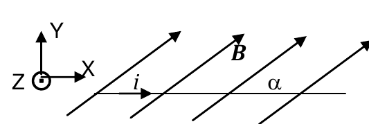

<b>Solución</b>

Solución paso a paso

**Paso 1 — Vectores.** El alambre está sobre el eje X con la corriente hacia $+x$: $\vec\ell = L\,\hat e_x$. El campo está en el plano XY formando $\alpha$ con el alambre: $\vec B = B(\cos\alpha;\ \sin\alpha;\ 0)$.

**Paso 2 — Fuerza.**

$$\vec F = i\,\vec\ell\times\vec B = iLB\,(\hat e_x\times(\cos\alpha\,\hat e_x + \sin\alpha\,\hat e_y)) = iLB\sin\alpha\,\hat e_z$$

**Paso 3 — Cálculo.**

$$\vec F = 10\cdot1\cdot1{,}5\cdot0{,}5\ \text{N}\ \hat e_z = 7{,}5\ \text{N}\ \hat e_z$$

**Respuesta:** $\vec F = 7{,}5$ N $\hat e_z$

---

### Ejercicio 7

Un alambre metálico de masa *m* desliza sin fricción sobre dos rieles metálicos separados una distancia *D*. El sistema está alojado en una región del espacio en la que existe un campo magnético uniforme ***B***. Entre los rieles se establece una corriente i por medio del generador de corriente *GC* que se muestra en la figura. Halle la expresión del vector velocidad del alambre en función del tiempo sabiendo que en t=0 el alambre está en reposo.

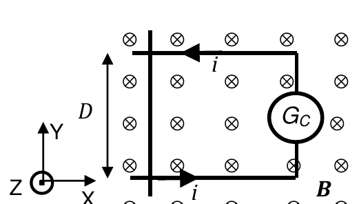

<b>Solución</b>

Solución paso a paso

**Paso 1 — Sentido de la corriente en el alambre.** En la figura, la corriente viene por el riel superior hacia la izquierda, baja por el alambre y vuelve por el riel inferior hacia la derecha. En el alambre: $\vec\ell = D\,(-\hat e_y)$.

**Paso 2 — Fuerza.** El campo es entrante, $\vec B = B\,(-\hat e_z)$:

$$\vec F = i\,D(-\hat e_y)\times B(-\hat e_z) = iDB\,(\hat e_y\times\hat e_z) = iDB\,\hat e_x$$

**Paso 3 — Movimiento.** La fuerza es constante (no hay fricción): MRUV con $a = iDB/m$ desde el reposo:

$$\vec v(t) = \frac{iDB}{m}\,t\ \hat e_x$$

**Respuesta:** $\vec v = \dfrac{iDBt}{m}\,\hat e_x$

---

### Ejercicio 8

El alambre de la figura, que consiste en dos tramos rectos y semiinfinitos unidos por un tramo en forma de semicircunferencia de radio *R*, transporta una corriente de intensidad *i*. Todo el alambre se halla sumergido en un campo magnético uniforme ***B***= *B0* (− ***e****y*).

a) halle la expresión de la fuerza que el campo externo ejerce sobre el alambre;

b) discuta cómo cambian los resultados si el campo B invierte su sentido;

c) discuta cómo cambian los resultados si la corriente *i* invierte su sentido sin invertir el sentido del campo externo;

d) discuta cómo cambian los resultados si el campo B tuviera la dirección ***e****x*.

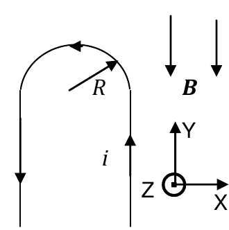

<b>Solución</b>

Solución paso a paso

**Paso 1 — Tramos rectos.** Son verticales, paralelos a $\vec B$: $\vec\ell\times\vec B = 0$. No aportan.

**Paso 2 — Arco.** La corriente sube por el tramo derecho, recorre la semicircunferencia en sentido antihorario (de $\theta = 0$ a $\theta = \pi$) y baja por el izquierdo. Con $d\vec\ell = R\,d\theta\,(-\sin\theta;\ \cos\theta;\ 0)$:

$$d\vec F = i\,d\vec\ell\times\vec B = iR\,d\theta\,(-\sin\theta\,\hat e_x + \cos\theta\,\hat e_y)\times(-B_0\,\hat e_y) = iRB_0\sin\theta\,d\theta\,\hat e_z$$

(se usó $\hat e_x\times\hat e_y = \hat e_z$ y $\hat e_y\times\hat e_y = 0$).

**Paso 3 — Integrar.**

$$\vec F = iRB_0\,\hat e_z\int_0^\pi\sin\theta\,d\theta = 2iB_0R\,\hat e_z$$

Atajo: en un campo uniforme, la fuerza sobre el arco es la misma que sobre la cuerda que une sus extremos, $\vec L = -2R\,\hat e_x$: $\vec F = i(-2R\hat e_x)\times(-B_0\hat e_y) = 2iRB_0\hat e_z$ ✓.

**Paso 4 — Ítems b y c.** La fuerza es lineal en $\vec B$ y en $i$. Invertir cualquiera de los dos invierte la fuerza.

**Paso 5 — Ítem d.** Con $\vec B = B_0\hat e_x$: el arco (cuerda horizontal paralela a $\vec B$) no aporta. Los tramos rectos llevan corrientes opuestas, así que reciben fuerzas iguales y opuestas en $\pm\hat e_z$, aplicadas en lugares distintos: hay un torque y **el alambre tiende a rotar alrededor del eje Y**.

**Respuesta:** a) $\vec F = 2iB_0R\,\hat e_z$; b) $\vec F = 2iB_0R\,(-\hat e_z)$; c) $\vec F = 2iB_0R\,(-\hat e_z)$; d) el alambre tendería a rotar alrededor del eje Y.

---

### Ejercicio 9

El semianillo metálico de la figura, de radio *R* y masa *m*, se halla en el plano XY y transporta una corriente de intensidad *i* (no se muestran los alambres rectos semiinfinitos sin masa que completan el circuito). La semiespira se halla en equilibrio sujeta a la acción de dos campos externos: el campo gravitatorio y un campo magnético uniforme de intensidad *B0*.

a) discuta y justifique cuál debe ser la dirección del campo ***B*** para lograr el equilibrio;

b) discuta y justifique cuál debe ser la dirección de los alambres que completan el circuito para no influir en el equilibrio (recuerde que estos alambres no tienen masa);

c) halle la expresión de la intensidad *B0* del campo magnético.

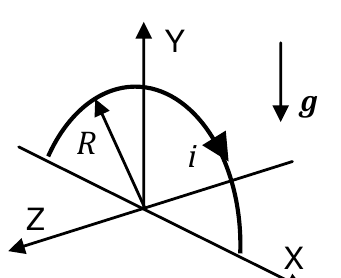

<b>Solución</b>

Solución paso a paso

**Paso 1 — Fuerza sobre la semiespira.** En un campo uniforme, equivale a la de la cuerda que une los extremos. La corriente recorre el arco desde el extremo izquierdo hasta el derecho (sentido horario visto desde +Z), así que la cuerda es $\vec L = 2R\,\hat e_x$:

$$\vec F = i\,(2R\,\hat e_x)\times\vec B$$

**Paso 2 — Dirección de B (ítem a).** La fuerza tiene que compensar el peso, así que debe apuntar en $+\hat e_y$. Como $\hat e_x\times(-\hat e_z) = \hat e_y$, el campo tiene que ser $\vec B = B_0\,(-\hat e_z)$.

**Paso 3 — Alambres de conexión (ítem b).** Para que no sientan fuerza, tienen que ser **paralelos a $\vec B$** (es decir, ir en la dirección Z): así $d\vec\ell\times\vec B = 0$.

**Paso 4 — Módulo (ítem c).** $2iRB_0 = mg$:

$$B_0 = \frac{mg}{2iR}$$

**Respuesta:** a) en la dirección $-\hat e_z$, para que la fuerza magnética vaya en la dirección $\hat e_y$; b) paralelos al campo magnético; c) $B_0 = mg/(2iR)$

---

### Ejercicio 10

La barra conductora de la figura, de longitud *L*=40cm de longitud y masa *m*=30g, desliza libremente sobre hilos metálicos apoyados sobre un plano inclinado α=37° respecto de la horizontal. Además del campo gravitatorio existe un campo magnético uniforme ***B***=0,2 T (−***e****y*). Por los hilos y la barra circula una corriente de intensidad *i*.

a) calcule el valor de la intensidad de corriente de modo tal que la barra permanezca en equilibrio;

b) si la corriente fuera de 2A, calcule la aceleración de la barra a lo largo del plano inclinado.

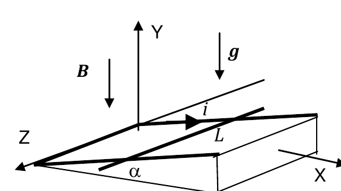

<b>Solución</b>

Solución paso a paso

**Paso 1 — Fuerza magnética.** La barra es perpendicular al campo vertical: $F_M = iLB$, **horizontal**, empujando hacia el lado alto del plano.

**Paso 2 — Proyectar sobre el plano.** Es el mismo esquema que el ejemplo de clase. A lo largo del plano (positivo hacia abajo):

$$m\,a = mg\sin\alpha - iLB\cos\alpha$$

**Paso 3 — Equilibrio (ítem a).** $a = 0$:

$$i = \frac{mg\tan\alpha}{LB}$$

**Paso 4 — Aceleración con $i = 2$ A (ítem b).**

$$a = g\sin\alpha - \frac{iLB\cos\alpha}{m}$$

**Paso 5 — Cálculo** (la guía usa $g = 10$ m/s²):

$$i = \frac{0{,}03\cdot10\cdot0{,}7536}{0{,}4\cdot0{,}2}\ \text{A} = 2{,}83\ \text{A}$$

$$a = 10\cdot0{,}6018 - \frac{2\cdot0{,}4\cdot0{,}2\cdot0{,}7986}{0{,}03}\ \tfrac{\text{m}}{\text{s}^2} = (6{,}02 - 4{,}26)\ \tfrac{\text{m}}{\text{s}^2} = 1{,}76\ \tfrac{\text{m}}{\text{s}^2}$$

Es positiva: la barra baja por el plano (con 2 A la fuerza magnética no alcanza). Con $g = 9{,}8$ resultan 2,77 A y 1,64 m/s².

**Respuesta:** a) 2,82 A; b) 1,75 m/s²

---

### Ejercicio 11

Calcule el campo magnético generado a una distancia *R* por un alambre recto infinito circulado por una corriente eléctrica de intensidad *i*. Discuta cómo cambia el resultado si se invirtiera el sentido de la corriente.

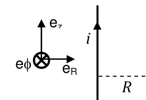

<b>Solución</b>

Solución paso a paso

**Paso 1 — Simetría.** El campo circula alrededor del alambre ($\hat e_\phi$) y su módulo depende solo de la distancia $R$.

**Paso 2 — Ampère.** En una circunferencia de radio $R$ centrada en el alambre, $\vec B\parallel d\vec\ell$ y $|\vec B|$ es constante:

$$\oint\vec B\cdot d\vec\ell = B\,2\pi R = \mu_0 i \quad\Rightarrow\quad \vec B = \frac{\mu_0 i}{2\pi R}\,\hat e_\phi$$

(Se obtiene lo mismo con Biot-Savart, $\theta_1 = -\pi/2$, $\theta_2 = \pi/2$.)

**Paso 3 — Invertir la corriente.** Por la regla de la mano derecha, el sentido de circulación del campo se invierte.

**Respuesta:** $\vec B = \dfrac{\mu_0 i}{2\pi R}\,\hat e_\phi$. Si se invierte el sentido de $i$, el campo tiene sentido opuesto.

---

### Ejercicio 12

Por dos alambres infinitos paralelos, separados una distancia *D*=0,6m, circulan corrientes *i1*=0,2A e *i2*=0,3A, respectivamente. Calcule la fuerza que por unidad de longitud la corriente superior ejerce sobre la corriente inferior si:

a) las corrientes son paralelas;

b) las corrientes son antiparalelas. (μ0=4π×10−7 N/A2)

<b>Solución</b>

Solución paso a paso

**Paso 1 — Fórmula.** El hilo inferior está en el campo del superior, $B = \mu_0 i_1/(2\pi D)$, perpendicular a él:

$$\frac F\ell = i_2\,B = \frac{\mu_0\,i_1i_2}{2\pi D}$$

**Paso 2 — Cálculo.**

$$\frac F\ell = \frac{4\pi\times10^{-7}\cdot0{,}2\cdot0{,}3}{2\pi\cdot0{,}6}\ \tfrac{\text{N}}{\text{m}} = 2\times10^{-8}\ \tfrac{\text{N}}{\text{m}}$$

**Paso 3 — Sentido.** Corrientes paralelas se atraen; antiparalelas se repelen. El módulo es el mismo en ambos casos.

**Respuesta:** En ambos casos es $F = 2\times10^{-8}$ N/m, atractiva en (a) y repulsiva en (b).

---

### Ejercicio 13

Dos alambres paralelos infinitos, separados una distancia *d*, están circulados por corrientes *i*1 e *i*2, respectivamente. El campo magnético generado por estos alambres se anula a una distancia *d/3* del que transporta la corriente *i*1 en la región externa a los dos alambres.

a) halle la relación entre los valores de las corrientes y su sentido de circulación;

b) halle la expresión de la intensidad del campo magnético generado en el punto medio entre los alambres;

c) discuta cuáles son las componentes que tendrá el campo magnético generado por los alambres en el punto medio entre ellos, a una altura *z* del plano que los contiene.

<b>Solución</b>

Solución paso a paso

**Paso 1 — Sentidos.** En la región **externa** a dos hilos, los campos son opuestos solo si las corrientes son **antiparalelas** (con corrientes paralelas, afuera se suman).

**Paso 2 — Igualar módulos (ítem a).** El punto está a $d/3$ del hilo 1 y a $d + d/3 = 4d/3$ del hilo 2:

$$\frac{\mu_0 i_1}{2\pi(d/3)} = \frac{\mu_0 i_2}{2\pi(4d/3)} \quad\Rightarrow\quad 3i_1 = \frac34 i_2 \quad\Rightarrow\quad i_2 = 4i_1$$

**Paso 3 — Punto medio (ítem b).** Entre dos hilos antiparalelos los campos se **suman**. Cada hilo está a $d/2$:

$$B = \frac{\mu_0 i_1}{2\pi(d/2)} + \frac{\mu_0 i_2}{2\pi(d/2)} = \frac{\mu_0}{\pi d}(i_1 + i_2)$$

**Paso 4 — Fuera del plano (ítem c).** Cada hilo genera un campo perpendicular al hilo y perpendicular a la recta que lo une con el punto. A una altura $z$, esas direcciones tienen componentes tanto en la dirección que une los hilos como en la normal al plano, pero **ninguna componente a lo largo de los hilos**.

**Respuesta:** a) $i_2 = 4i_1$, antiparalelas; b) $B = \dfrac{\mu_0}{\pi d}(i_1 + i_2)$; c) en ambas direcciones perpendiculares a la dirección de los alambres.

---

### Ejercicio 14

Una carga *q*=2 μC se mueve con velocidad ***v*** = 0,05 m/seg **e**Y desde el alambre inferior de la figura al superior. Los dos alambres tienen longitud L>>1,5m. Cuando la carga pasa por el punto A, situado a 0,6 m del alambre inferior, se encienden las corrientes iINF=2mA iSUP=3mA, ambas en la dirección **e**X.

a) calcule la fuerza ***F*** sobre la carga en el punto A;

b) halle la expresión del campo magnético sobre el plano que contiene a los alambres, en la región 0< y < L=1,5m;

c) el tiempo que le lleva a la carga desplazarse hasta un punto B, situado a 0,7m del alambre inferior.

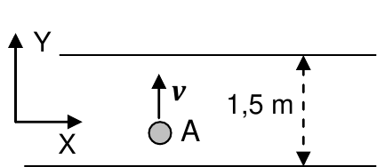

<b>Solución</b>

Solución paso a paso

**Paso 1 — Campo entre los alambres (ítem b).** (En la respuesta de la guía, $L$ es la separación entre alambres, 1,5 m.)

- Alambre inferior ($y = 0$, corriente $+x$): en un punto de arriba, $\hat e_x\times\hat e_y = \hat e_z$, así que $\vec B_{inf} = \dfrac{\mu_0 i_{INF}}{2\pi y}\hat e_z$.
- Alambre superior ($y = L$, corriente $+x$): en un punto de abajo, $\hat e_x\times(-\hat e_y) = -\hat e_z$, así que $\vec B_{sup} = -\dfrac{\mu_0 i_{SUP}}{2\pi(L - y)}\hat e_z$.

$$\vec B = \frac{\mu_0}{2\pi}\left(\frac{i_{INF}}{y} - \frac{i_{SUP}}{L - y}\right)\hat e_z = \frac{\mu_0}{2\pi}\left(\frac{2}{y} - \frac{3}{L - y}\right)\times10^{-3}\ \hat e_z\ \ (\text{SI})$$

**Paso 2 — Fuerza en A (ítem a).** En $y = 0{,}6$ m: $\dfrac{2}{0{,}6} - \dfrac{3}{0{,}9} = 3{,}33 - 3{,}33 = 0$. El campo es nulo en A, así que $\vec F = 0$.

**Paso 3 — Tiempo hasta B (ítem c).** La fuerza magnética no cambia la rapidez. Además, los campos son tan pequeños (~$10^{-9}$ T) que la desviación es despreciable: la carga sigue prácticamente con $v_y = 0{,}05$ m/s.

$$t = \frac{y_B - y_A}{v} = \frac{0{,}7 - 0{,}6}{0{,}05}\ \text{s} = 2\ \text{s}$$

**Respuesta:** a) $F = 0$; b) $\vec B = \dfrac{\mu_0}{2\pi}\left(\dfrac2y - \dfrac{3}{L - y}\right)\hat e_z$ (corrientes en mA); c) $t = 2$ s

---

### Ejercicio 15

La figura muestra un alambre recto semiinfinito circulado por una corriente de intensidad *i*. Por comodidad se ha hecho coincidir al cable con el semieje positivo Z. Calcule el campo magnético generado por este alambre en puntos a una distancia *R* enfrentados al semieje que contiene al cable (por ejemplo, el punto P1 de la figura) y puntos a una distancia *R* enfrentados al semieje que no contiene corrientes (como el punto P2 de la figura).

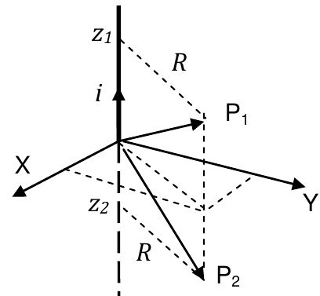

<b>Solución</b>

Solución paso a paso

**Paso 1 — Fórmula del hilo finito.** Con $\theta$ medido desde la perpendicular al hilo que pasa por el punto:

$$B = \frac{\mu_0 i}{4\pi R}(\sin\theta_2 - \sin\theta_1)$$

**Paso 2 — Ángulos.** El punto está a altura $z_0$ y distancia $R$ del eje. El hilo va de $z = 0$ a $z = \infty$.

- Extremo en el infinito: $\sin\theta_2 = 1$.
- Extremo en el origen, que está a una altura $-z_0$ respecto del punto: $\sin\theta_1 = \dfrac{-z_0}{\sqrt{R^2 + z_0^2}}$.

**Paso 3 — Resultado.**

$$B = \frac{\mu_0 i}{4\pi R}\left(1 + \frac{z_0}{\sqrt{R^2 + z_0^2}}\right) = \frac{\mu_0 i}{4\pi R}\left(1 + \frac{\text{sg}(z_0)}{\sqrt{1 + R^2/z_0^2}}\right)$$

- Para P₁ ($z_0 > 0$, enfrentado al cable) el campo es **mayor** que el de un hilo semiinfinito visto desde su extremo; para $z_0 \to \infty$ tiende al del hilo infinito, $\mu_0 i/(2\pi R)$.
- Para P₂ ($z_0 < 0$) es menor y tiende a 0 al alejarse.
- La dirección es $\hat e_\phi$ (circula alrededor del eje Z según la mano derecha).

**Respuesta:** $\vec B(R) = \dfrac{\mu_0 i}{4\pi R}\left(1 + \dfrac{\text{sg}(z_0)}{\sqrt{1 + \frac{R^2}{z_0^2}}}\right)\hat e_\phi$

---

### Ejercicio 16

La figura muestra un segmento rectilíneo de alambre, de longitud *L*, que conduce una corriente de intensidad *i* (no se muestran los alambres que completan el circuito y que a los efectos de este cálculo pueden ser ignorados). Calcule el campo magnético que la corriente genera en un punto *P* ubicado a una distancia *R* del alambre, y a una distancia *h>L/2* del centro del mismo.

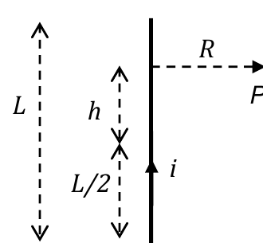

<b>Solución</b>

Solución paso a paso

**Paso 1 — Ubicar los extremos respecto del punto.** P está a una altura $h$ por encima del centro del segmento. Los extremos están en $\pm L/2$, es decir a alturas $-(h - L/2)$ y $-(h + L/2)$ respecto de P: **los dos por debajo**.

**Paso 2 — Senos de los ángulos.** Con la fórmula $B = \frac{\mu_0 i}{4\pi R}(\sin\theta_2 - \sin\theta_1)$:

$$\sin\theta_2 = \frac{-(h - L/2)}{\sqrt{R^2 + (h - L/2)^2}} \qquad \sin\theta_1 = \frac{-(h + L/2)}{\sqrt{R^2 + (h + L/2)^2}}$$

**Paso 3 — Resultado.**

$$\vec B = \frac{\mu_0 i}{4\pi R}\left[\frac{h + L/2}{\left(R^2 + (h + L/2)^2\right)^{1/2}} - \frac{h - L/2}{\left(R^2 + (h - L/2)^2\right)^{1/2}}\right]\hat e_\phi$$

Es positivo, porque el primer término es mayor.

**Respuesta:** $\vec B = \dfrac{\mu_0 i}{4\pi R}\left[\dfrac{h + (L/2)}{\left(R^2 + \left(h + \frac L2\right)^2\right)^{1/2}} - \dfrac{h - (L/2)}{\left(R^2 + \left(h - \frac L2\right)^2\right)^{1/2}}\right]\hat e_\phi$

---

### Ejercicio 17

Por el alambre de la figura, en forma de U abierta, cuyo lado vertical mide L, circula una corriente *i*. Las ramas horizontales son rectas. En tal caso halle la expresión

a) de la fuerza que por unidad de longitud el alambre horizontal superior ejerce sobre el horizontal inferior (NO considere el alambre vertical);

b) del valor del campo magnético generado por la corriente *i* en un punto P situado a una distancia D a la izquierda del alambre vertical y a una altura L/2 del alambre inferior (en el plano del cuadro).

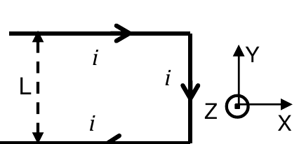

<b>Solución</b>

Solución paso a paso

**Geometría.** Esquina superior derecha en el origen. Rama superior: semiinfinita hacia la izquierda, a $y = L$ (relativo a la rama inferior), con corriente $+x$. Lado vertical en $x = 0$, con corriente hacia abajo. Rama inferior: semiinfinita, a $y = 0$, con corriente $-x$.

**Paso 1 — Ítem a.** Sugerencia de la guía: usar el ejercicio 15 con $\text{sg}(z_0) = 1$ (el punto de la rama inferior está enfrentado a la rama superior) y hacer $z_0\to\infty$ (lejos de la esquina):

$$B = \frac{\mu_0 i}{4\pi L}\left(1 + \frac{1}{\sqrt{1 + L^2/z_0^2}}\right)\xrightarrow{z_0\to\infty}\frac{\mu_0 i}{2\pi L}$$

Las corrientes son antiparalelas, así que se repelen. Sobre el alambre inferior la fuerza va hacia abajo:

$$\frac{\vec F}{\ell} = i\,B\,(-\hat e_y) = \frac{\mu_0 i^2}{2\pi L}\,(-\hat e_y)$$

**Paso 2 — Ítem b: ramas horizontales.** P está a $L/2$ de cada rama, enfrentado a ellas (el pie de la perpendicular cae sobre el alambre, a una distancia $D$ de su extremo). Con el ejercicio 15, $R = L/2$, $z_0 = D$:

$$B_{rama} = \frac{\mu_0 i}{4\pi(L/2)}\left(1 + \frac{1}{\sqrt{1 + \frac{L^2}{4D^2}}}\right)$$

Sentidos: rama superior (corriente $+x$, P abajo): $\hat e_x\times(-\hat e_y) = -\hat e_z$. Rama inferior (corriente $-x$, P arriba): $(-\hat e_x)\times\hat e_y = -\hat e_z$. Se suman.

**Paso 3 — Ítem b: lado vertical.** P está en la mediatriz del segmento de longitud $L$, a distancia $D$:

$$B_{vert} = \frac{\mu_0 i}{4\pi D}\cdot2\cdot\frac{L/2}{\sqrt{L^2/4 + D^2}} = \frac{\mu_0 i}{\pi}\,\frac{L}{4D\sqrt{\frac{L^2}{4} + D^2}}$$

Sentido: corriente $-\hat e_y$, P a la izquierda: $(-\hat e_y)\times(-\hat e_x) = -\hat e_z$.

**Paso 4 — Suma.**

$$\vec B = \frac{\mu_0 i}{\pi}\left[\frac1L\left(1 + \frac{1}{\sqrt{1 + \frac{L^2}{4D^2}}}\right) + \frac{L}{4D\sqrt{\frac{L^2}{4} + D^2}}\right]\,(-\hat e_z)$$

> La guía escribe $\dfrac2L$ en lugar de $\dfrac1L$ y $\sqrt{L^2/(4D^2)}$ en lugar de $\sqrt{1 + L^2/(4D^2)}$. Con el resultado del ejercicio 15, cada rama aporta $\frac{\mu_0 i}{2\pi L}(1 + \dots)$ y las dos juntas $\frac{\mu_0 i}{\pi L}(1 + \dots)$.

**Respuesta:**

- a) $\dfrac{\vec F}{\ell} = \dfrac{\mu_0 i^2}{2\pi L}(-\hat e_y)$
- b) $\vec B = \dfrac{\mu_0 i}{\pi}\left[\dfrac1L\left(1 + \dfrac{1}{\sqrt{1 + \frac{L^2}{4D^2}}}\right) + \dfrac{L}{4D\sqrt{\frac{L^2}{4} + D^2}}\right]\,(-\hat e_z)$ (la guía: $\dfrac{\mu_0 i}{\pi}\left[\dfrac2L\left(1 + \dfrac{1}{\sqrt{L^2/4D^2}}\right) + \dfrac{L}{4D\sqrt{L^2/4 + D^2}}\right]\,(-\hat e_z)$; ver nota)

---

### Ejercicio 18

Calcule el campo magnético generado en su centro por una espira cuadrada de lado *L* circulada por una corriente eléctrica de intensidad *i*.

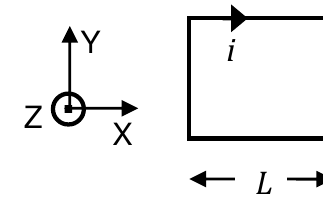

<b>Solución</b>

Solución paso a paso

**Paso 1 — Un lado.** Está a $L/2$ del centro, con $\theta_1 = -45^\circ$ y $\theta_2 = 45^\circ$:

$$B_{lado} = \frac{\mu_0 i}{4\pi(L/2)}\left(\sin45^\circ - \sin(-45^\circ)\right) = \frac{\mu_0 i}{2\pi L}\sqrt2$$

**Paso 2 — Cuatro lados.** Todos aportan lo mismo y en el mismo sentido:

$$B = 4\,B_{lado} = 2\sqrt2\,\frac{\mu_0 i}{\pi L}$$

**Paso 3 — Sentido.** En la figura la corriente circula en sentido **horario** (en el lado superior va hacia la derecha), así que el campo en el centro es **entrante**: $-\hat e_z$.

**Respuesta:** $\vec B = 2\sqrt2\,\dfrac{\mu_0 i}{\pi L}\,(-\hat e_z)$

---

### Ejercicio 19

La figura muestra un sector de un conductor recto y de gran longitud, por el que circula una corriente continua y estacionaria de intensidad *i* = 8 A, y que está doblado en ángulo recto. Halle el vector inducción magnética en el punto ***P*** de coordenadas (0; 0; 0,5 m) generado por la corriente *i.*

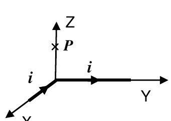

<b>Solución</b>

Solución paso a paso

**Paso 1 — Dos tramos semiinfinitos.** Tramo 1: sobre el eje X, la corriente viene desde $+\infty$ hacia el origen ($d\vec\ell\parallel-\hat e_x$). Tramo 2: sobre el eje Y, sale del origen hacia $+\infty$ ($d\vec\ell\parallel+\hat e_y$). P está sobre el eje Z, a distancia $R = 0{,}5$ m de ambos, y el pie de cada perpendicular es el **extremo** (el origen).

**Paso 2 — Módulo de cada tramo.** Para un hilo semiinfinito visto desde su extremo ($\theta$ de 0 a 90°):

$$B_1 = B_2 = \frac{\mu_0 i}{4\pi R}$$

**Paso 3 — Direcciones.** $\hat r$ apunta desde el hilo hacia P, es decir aproximadamente $+\hat e_z$:

- Tramo 1: $(-\hat e_x)\times\hat e_z = \hat e_y$.
- Tramo 2: $\hat e_y\times\hat e_z = \hat e_x$.

$$\vec B = \frac{\mu_0 i}{4\pi R}(\hat e_x + \hat e_y)$$

**Paso 4 — Cálculo.**

$$\frac{\mu_0 i}{4\pi R} = \frac{10^{-7}\cdot8}{0{,}5}\ \text{T} = 1{,}6\times10^{-6}\ \text{T} \qquad \vec B = 1{,}6\times10^{-6}\ \text{T}\ (\hat e_x + \hat e_y)$$

**Respuesta:** $\vec B = \dfrac{\mu_0 i}{4\pi R}(\hat e_x + \hat e_y) = 1{,}6\times10^{-6}$ T $(\hat e_x + \hat e_y)$

---

### Ejercicio 20

a) halle la expresión general del campo magnético generado por un anillo de radio *R,* circulado por una corriente de intensidad *i,* en cada punto de su eje de revolución (eje Z en la figura);

b) a partir de (a), calcule el campo generado por la media espira derecha a lo largo del eje Z;

c) escriba ahora la expresión que permite calcular el campo generado por un anillo de abertura arbitraria a lo largo del eje de revolución de la espira completa.

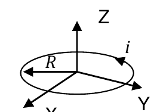

<b>Solución</b>

Solución paso a paso

**Paso 1 — Biot-Savart.** Elemento en $\vec r' = R(\cos\phi';\ \sin\phi';\ 0)$, con $d\vec\ell = R\,d\phi'(-\sin\phi';\ \cos\phi';\ 0)$. Vector del elemento al punto $(0;0;z)$: $(-R\cos\phi';\ -R\sin\phi';\ z)$, de módulo $\sqrt{R^2 + z^2}$.

**Paso 2 — Producto vectorial.**

$$d\vec\ell\times(\vec r - \vec r') = R\,d\phi'\,(z\cos\phi';\ z\sin\phi';\ R)$$

$$\vec B(z) = \frac{\mu_0 i}{4\pi}\int\frac{(Rz\cos\phi';\ Rz\sin\phi';\ R^2)}{(R^2 + z^2)^{3/2}}\,d\phi'$$

**Paso 3 — Ítem a (de 0 a 2π).** Las integrales de $\cos\phi'$ y $\sin\phi'$ se anulan:

$$\vec B(z) = \frac{\mu_0 i}{4\pi}\,\frac{2\pi R^2}{(R^2 + z^2)^{3/2}}\,\hat e_z = \frac{\mu_0 i}{2}\,\frac{R^2}{(R^2 + z^2)^{3/2}}\,\hat e_z$$

**Paso 4 — Ítem b (de 0 a π).** $\int_0^\pi\cos\phi' = 0$, $\int_0^\pi\sin\phi' = 2$, $\int_0^\pi d\phi' = \pi$:

$$\vec B(z) = \frac{\mu_0 i}{4\pi(R^2 + z^2)^{3/2}}\left(2Rz\,\hat e_y + \pi R^2\,\hat e_z\right)$$

Ahora aparece una componente perpendicular al eje, porque la media espira no es simétrica. La componente $z$ es la mitad de la del anillo completo, como era de esperar.

**Paso 5 — Ítem c.** Basta con cambiar los límites de integración por $\phi_1$ y $\phi_2$.

**Respuesta:**

- a) $\vec B(z) = \dfrac{\mu_0 i}{4\pi}\displaystyle\int_0^{2\pi}\dfrac{(Rz\cos\phi';\ Rz\sin\phi';\ R^2)}{(R^2 + z^2)^{3/2}}\,d\phi' = \dfrac{\mu_0 i}{2}\,\dfrac{R^2}{(R^2 + z^2)^{3/2}}\,\hat e_z$
- b) $\vec B(z) = \dfrac{\mu_0 i}{4\pi}\displaystyle\int_0^{\pi}\dfrac{(Rz\cos\phi';\ Rz\sin\phi';\ R^2)}{(R^2 + z^2)^{3/2}}\,d\phi' = \dfrac{\mu_0 i}{4\pi(R^2 + z^2)^{3/2}}\left(2Rz\,\hat e_y + \pi R^2\,\hat e_z\right)$
- c) $\vec B(z) = \dfrac{\mu_0 i}{4\pi}\displaystyle\int_{\phi_1}^{\phi_2}\dfrac{(Rz\cos\phi';\ Rz\sin\phi';\ R^2)}{(R^2 + z^2)^{3/2}}\,d\phi'$

(La guía escribe en b el factor $\dfrac{\mu_0 i}{4(R^2 + z^2)^{3/2}}$, sin $\pi$ en el denominador. Así, la componente $z$ quedaría $\pi/2$ veces la del anillo completo, cuando tiene que ser la mitad: falta el $\pi$.)

---

### Ejercicio 21

Halle la expresión del vector ***B*** en el centro *C* de las siguientes configuraciones de semiespiras (recuerde que un segmento recto de alambre circulado por una corriente *i* genera campo nulo en su prolongación). La configuración (d) es una sucesión infinita de semiespiras concéntricas, de radios *Rn*= *ra* /(2*n*) (*n* ≥1). La corriente que circula por cada espira decrece (por efecto de la resistencia) como *i n*= *i0* / *n*2. En cada caso discuta qué sucede si se invierte el sentido de la corriente

(tenga en cuenta que $\sum_1^\infty\frac{(-1)^n}{n} = -\ln2$ )

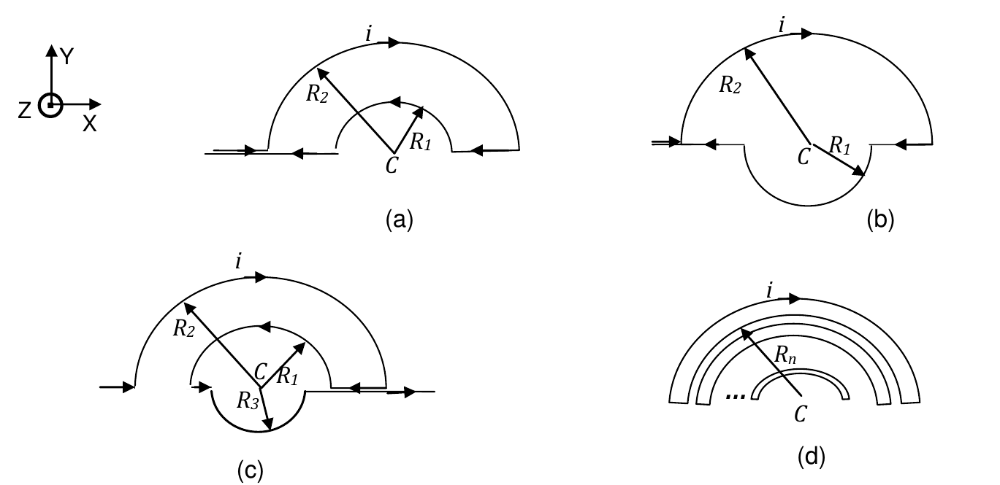

<b>Solución</b>

Solución paso a paso

**Paso 1 — Herramientas.**

- Los tramos rectos están alineados con C: no aportan campo.
- Cada semiespira de radio $R$ aporta $\dfrac{\mu_0 i}{4R}$ en C: saliente ($+\hat e_z$) si la corriente la recorre en sentido antihorario y entrante ($-\hat e_z$) si la recorre en sentido horario.

**Paso 2 — (a).** La semiespira exterior $R_2$ se recorre en sentido horario ($-\hat e_z$) y la interior $R_1$ en sentido antihorario ($+\hat e_z$):

$$\vec B = \frac{\mu_0 i}{4}\left(\frac{1}{R_1} - \frac{1}{R_2}\right)\hat e_z$$

**Paso 3 — (b).** La semiespira superior $R_2$ y la inferior $R_1$ se recorren ambas en sentido horario:

$$\vec B = \frac{\mu_0 i}{4}\left(\frac{1}{R_2} + \frac{1}{R_1}\right)(-\hat e_z)$$

**Paso 4 — (c).** $R_3$ (abajo) y $R_1$ (arriba) en sentido antihorario; $R_2$ en sentido horario:

$$\vec B = \frac{\mu_0 i}{4}\left(\frac{1}{R_3} + \frac{1}{R_1} - \frac{1}{R_2}\right)\hat e_z$$

**Paso 5 — (d).** Las semiespiras consecutivas se recorren alternadamente en un sentido y en el otro. Cada una aporta

$$\frac{\mu_0 i_n}{4R_n} = \frac{\mu_0\,(i_0/n^2)}{4\,r_a/(2n)} = \frac{\mu_0 i_0}{2r_a}\cdot\frac1n$$

con signos alternados $(-1)^n$:

$$\vec B = \frac{\mu_0 i_0}{2r_a}\sum_{n=1}^\infty\frac{(-1)^n}{n}\,\hat e_z = \frac{\mu_0 i_0}{2r_a}(-\ln2)\,\hat e_z = \frac{\mu_0 i}{2r_a}\ln2\,(-\hat e_z)$$

**Paso 6 — Invertir la corriente.** En todos los casos el campo cambia de sentido (el módulo no cambia).

**Respuesta:**

- a) $\vec B = \dfrac{\mu_0 i}{4}\left(\dfrac{1}{R_1} - \dfrac{1}{R_2}\right)(\hat e_z)$
- b) $\vec B = \dfrac{\mu_0 i}{4}\left(\dfrac{1}{R_2} + \dfrac{1}{R_1}\right)(-\hat e_z)$
- c) $\vec B = \dfrac{\mu_0 i}{4}\left(\dfrac{1}{R_3} + \dfrac{1}{R_1} - \dfrac{1}{R_2}\right)(\hat e_z)$
- d) $\vec B = \dfrac{\mu_0 i}{2r_a}\ln2\ (-\hat e_z)$
- Si se invierte la corriente, en todos los casos el campo cambia de sentido.

---

### Ejercicio 22

Suponga que al anillo del ejercicio 19 está construido con un alambre muy fino y aislado (por ejemplo con un barniz) y se le superpone otro anillo idéntico. Se hace circular la misma corriente por las dos espiras.

a) discuta cómo se modifican los resultados del ejercicio 20(a);

b) en función del resultado anterior ¿es válido postular que al superponerse N espiras, el campo en el eje de revolución común es N veces el de una espira, cualquiera sea N?

<b>Solución</b>

Solución paso a paso

**Paso 1 — Ítem a.** Por superposición, dos espiras idénticas en el mismo lugar con la misma corriente generan el doble de campo: $B$ se duplica.

**Paso 2 — Ítem b.** Con $N$ espiras ya no están todas "en el mismo lugar": forman un paquete de espesor $\sim Nd$ ($d$ = diámetro del alambre), y cada espira está a una distancia distinta del punto. El factor $N$ es una buena aproximación solo si el punto está lejos comparado con el espesor del paquete ($z \gg Nd$). Si no, hay que integrar como en un solenoide (ejercicio 23).

**Respuesta:** a) el campo B se duplica; b) NO, es una buena aproximación si el punto $z$ donde se calcula el campo está muy alejado del paquete de espiras, o sea, si $z \gg Nd$ ($d$ es el diámetro del cable de cada espira).

---

### Ejercicio 23

En términos de la respuesta al ejercicio anterior, cuando se tiene un conjunto extendido de espiras de radio *ra*, lo más razonable parece ser dividir la longitud total del arreglo en elementos diferenciales de longitud que contengan *dn* espiras cada uno (*n* es la densidad de espiras, *n=N/L*, con *N* número total de espiras y *L* la longitud del arreglo). Demuestre que la integración de estos elementos resulta en la expresión del campo magnético en el interior de un *solenoide* como el de la figura en la forma

$$\vec B(z) = \frac{\mu_0 n i}{2}\left(\frac{z}{(r_a^2 + z^2)^{1/2}} + \frac{L - z}{(r_a^2 + (L - z)^2)^{1/2}}\right)\hat e_z$$

o, equivalentemente

$$\vec B(z) = \frac{\mu_0 n i}{2}(\cos\phi_I + \cos\phi_D)\,\hat e_z$$

(Observe que este resultado es válido para puntos dentro o fuera del solenoide, pero siempre sobre su eje de simetría axial).

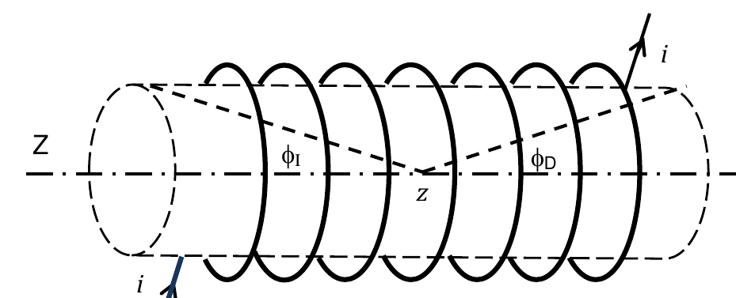

<b>Solución</b>

Solución paso a paso

**Paso 1 — Un elemento.** Una rebanada de espesor $dz'$ en la posición $z'$ contiene $n\,dz'$ espiras: equivale a un anillo con corriente $di = n\,i\,dz'$. Su campo en $z$ (ejercicio 20a):

$$dB = \frac{\mu_0\,n\,i\,dz'}{2}\,\frac{r_a^2}{\left(r_a^2 + (z - z')^2\right)^{3/2}}$$

**Paso 2 — Integrar de 0 a L.** Con $u = z' - z$ y la primitiva $\displaystyle\int\frac{du}{(u^2 + r_a^2)^{3/2}} = \frac{u}{r_a^2\sqrt{u^2 + r_a^2}}$:

$$B(z) = \frac{\mu_0 n i\,r_a^2}{2}\left[\frac{u}{r_a^2\sqrt{u^2 + r_a^2}}\right]_{-z}^{L - z} = \frac{\mu_0 n i}{2}\left(\frac{L - z}{\sqrt{r_a^2 + (L - z)^2}} + \frac{z}{\sqrt{r_a^2 + z^2}}\right)$$

**Paso 3 — Forma con ángulos.** $\dfrac{z}{\sqrt{r_a^2 + z^2}}$ es el coseno del ángulo $\phi_I$ con que se ve el borde del extremo izquierdo desde el punto, y $\dfrac{L - z}{\sqrt{r_a^2 + (L - z)^2}}$ el de $\phi_D$:

$$\vec B(z) = \frac{\mu_0 n i}{2}(\cos\phi_I + \cos\phi_D)\,\hat e_z\ ✓$$

Afuera del solenoide uno de los cosenos resulta negativo y la expresión sigue valiendo.

**Respuesta:** Queda demostrado integrando anillos de corriente $di = n\,i\,dz'$ a lo largo de la longitud del solenoide.

---

### Ejercicio 24

A partir del ejercicio anterior, calcule el campo magnético en cada punto del eje de simetría de un solenoide infinito y de un toroide. Discuta cuál es la condición para que un solenoide pueda ser considerado infinito y cuál es la condición para que la expresión valga para un toroide.

<b>Solución</b>

Solución paso a paso

**Paso 1 — Solenoide infinito.** Si los extremos están muy lejos del punto comparados con el radio, $\phi_I, \phi_D \to 0$ y ambos cosenos valen 1:

$$\vec B_{sol} = \mu_0\,n\,i\,\hat e_z$$

Condición: $L \gg r_{espira}$ (y el punto lejos de los extremos).

**Paso 2 — Toroide.** Es un solenoide "doblado" sobre sí mismo: no tiene extremos. Si su radio es mucho mayor que el de las espiras, localmente se ve como un solenoide infinito, con el campo a lo largo del toro:

$$\vec B_{tor} = \mu_0\,n\,i\,\hat e_\phi$$

Condición: $R_{tor} \gg r_{espira}$ (y $n = N/(2\pi R_{tor})$).

**Respuesta:** $\vec B_{sol} = \mu_0 n i\,\hat e_z$ (válido si $L \gg r_{espira}$); $\vec B_{tor} = \mu_0 n i\,\hat e_\phi$ (válido si $R_{tor} \gg r_{espira}$)

---

### Ejercicio 25

Calcule el campo magnético en un punto sobre el eje, y a 8 cm de uno de los extremos, de un solenoide de 14 cm de longitud, 420 vueltas y espiras de 6 cm de radio cada una, circulado por una corriente de 200 mA. Compare los resultados que se obtienen con la expresión exacta (ejercicio 24) y la aproximada (ejercicio 25).

<b>Solución</b>

Solución paso a paso

**Paso 1 — Datos.** $n = \dfrac{420}{0{,}14\ \text{m}} = 3000$ m⁻¹, $i = 0{,}2$ A, $r_a = 0{,}06$ m. El punto está dentro del solenoide, a $z = 0{,}08$ m de un extremo y $L - z = 0{,}06$ m del otro.

**Paso 2 — Expresión exacta (la del ejercicio 23).**

$$B_{exacto} = \frac{\mu_0 n i}{2}\left(\frac{z}{\sqrt{r_a^2 + z^2}} + \frac{L - z}{\sqrt{r_a^2 + (L - z)^2}}\right)$$

**Paso 3 — Expresión aproximada (solenoide infinito).** $B_{aprox} = \mu_0\,n\,i$.

**Paso 4 — Cálculo.**

$$\mu_0 n i = 4\pi\times10^{-7}\cdot3000\cdot0{,}2\ \text{T} = 7{,}54\times10^{-4}\ \text{T}$$

$$\frac{0{,}08}{\sqrt{0{,}0036 + 0{,}0064}} = 0{,}8 \qquad \frac{0{,}06}{\sqrt{0{,}0036 + 0{,}0036}} = 0{,}707$$

$$B_{exacto} = \frac{7{,}54\times10^{-4}}{2}\,(0{,}8 + 0{,}707)\ \text{T} = 5{,}68\times10^{-4}\ \text{T}$$

La diferencia es grande (≈ 25 %): el solenoide **no es largo** comparado con el radio de sus espiras (14 cm contra 6 cm), así que la aproximación de solenoide infinito no es buena.

> La guía da $B_{EXACTO} = 5{,}49\times10^{-4}$ T. Con los datos del enunciado la fórmula da $5{,}68\times10^{-4}$ T; la diferencia parece de redondeo o de cálculo en la guía.

**Respuesta:** $B_{EXACTO} \approx 5{,}68\times10^{-4}$ T (guía: $5{,}49\times10^{-4}$ T); $B_{APROX} = 7{,}53\times10^{-4}$ T

---

### Ejercicio 26

Repita el cálculo del ejercicio anterior suponiendo ahora que el radio de las espiras es de 0,6 cm. Discuta por qué ahora los resultados son similares.

<b>Solución</b>

Solución paso a paso

**Paso 1 — Exacto** con $r_a = 0{,}006$ m:

$$\frac{0{,}08}{\sqrt{0{,}006^2 + 0{,}08^2}} = 0{,}9972 \qquad \frac{0{,}06}{\sqrt{0{,}006^2 + 0{,}06^2}} = 0{,}9950$$

$$B_{exacto} = \frac{7{,}54\times10^{-4}}{2}\,(0{,}9972 + 0{,}9950)\ \text{T} = 7{,}5\times10^{-4}\ \text{T}$$

**Paso 2 — Aproximado:** $B_{aprox} = \mu_0 n i = 7{,}53\times10^{-4}$ T, como antes.

**Paso 3 — Por qué coinciden.** Ahora el radio (0,6 cm) es mucho menor que la longitud y que la distancia a los extremos: los dos cosenos son casi 1 y el solenoide se comporta como infinito.

**Respuesta:** $B_{EXACTO} = 7{,}5\times10^{-4}$ T; $B_{APROX} = 7{,}53\times10^{-4}$ T. Son similares porque ahora $L \gg r_{espira}$.

---

### Ejercicio 27

Indique cuáles son las dos proposiciones correctas del siguiente conjunto de enunciados

- el CM generado por dos corrientes antiparalelas se anula en algún punto entre los alambres
- el campo magnético generado por una carga acelerada es proporcional a su aceleración.
- la energía cinética de un cuerpo de carga Q y masa m que se mueve a lo largo del eje de simetría axial de un anillo circulado por una corriente *i* es invariante.
- una carga eléctrica siempre se acelera en presencia de un campo magnético.
- el CM de un solenoide es homogéneo y constante en todo punto de su interior.
- el teorema de Ampere sólo es válido para configuraciones de corriente de muy alta simetría.
- Dos corrientes por alambres rectos infinitos paralelos se atraen si circulan en sentido opuesto.
- una corriente estacionaria genera un campo magnético estacionario y no necesariamente uniforme.

<b>Solución</b>

Solución paso a paso

- "Antiparalelas: el CM se anula entre los alambres": **falso**. Entre ellos los campos se suman.
- "El campo de una carga acelerada es proporcional a su aceleración": **falso** (fuera del alcance de la materia; el campo de una carga en movimiento lento depende de su velocidad).
- "La energía cinética de una carga en el eje de un anillo con corriente es invariante": **verdadero**. En el eje, $\vec B$ es paralelo a la velocidad, así que $\vec F = 0$; y en general la fuerza magnética no hace trabajo.
- "Una carga siempre se acelera en un campo magnético": **falso**. Si está en reposo o se mueve paralela a $\vec B$, no hay fuerza.
- "El CM de un solenoide es homogéneo en todo su interior": **falso**. Solo en el solenoide ideal infinito; cerca de los extremos disminuye.
- "Ampère solo es válido con alta simetría": **falso**. Vale siempre; la simetría hace falta para despejar $B$.
- "Hilos con corrientes opuestas se atraen": **falso**. Se repelen.
- "Una corriente estacionaria genera un campo estacionario y no necesariamente uniforme": **verdadero**.

**Respuesta:**

- La energía cinética de un cuerpo de carga Q y masa m que se mueve a lo largo del eje de simetría axial de un anillo circulado por una corriente $i$ es invariante.
- Una corriente estacionaria genera un campo magnético estacionario y no necesariamente uniforme.

