# Tema 5 — Magnetostática: resumen teórico

Resumen de la clase del aula virtual: [Clase 6 — Magnetismo](Aula%20Virtual/Clase%206%20-%20Magnetismo.pdf).

Ejercicios: [práctica del tema](practica.md).

---

## Índice

1. [Fuerza magnética sobre una carga](#1-fuerza-magnética-sobre-una-carga)
2. [Fuerza de Lorentz y Gauss para B](#2-fuerza-de-lorentz-y-gauss-para-b)
3. [Movimiento de una carga en un campo uniforme](#3-movimiento-de-una-carga-en-un-campo-uniforme)
4. [Aplicaciones: ciclotrón, selector de velocidades, espectrómetro](#4-aplicaciones-ciclotrón-selector-de-velocidades-espectrómetro)
5. [Fuerza sobre un conductor con corriente](#5-fuerza-sobre-un-conductor-con-corriente)
6. [Momento sobre una espira: momento dipolar magnético](#6-momento-sobre-una-espira-momento-dipolar-magnético)
7. [Ley de Biot-Savart](#7-ley-de-biot-savart)
8. [Campos de configuraciones típicas](#8-campos-de-configuraciones-típicas)
9. [Ley de Ampère](#9-ley-de-ampère)
10. [Ecuaciones de Maxwell de la estática](#10-ecuaciones-de-maxwell-de-la-estática)
11. [Fuerza entre dos hilos paralelos](#11-fuerza-entre-dos-hilos-paralelos)
12. [Flujo magnético](#12-flujo-magnético)
13. [Ejemplos resueltos en clase](#13-ejemplos-resueltos-en-clase)
14. [Tabla de fórmulas](#14-tabla-de-fórmulas)

---

## 1. Fuerza magnética sobre una carga

Una carga $q$ que se mueve con velocidad $\vec v$ ($v \ll c$) en una región sin campo eléctrico experimenta una fuerza

$$\boxed{\vec F_M = q\,\vec v\times\vec B}$$

Esa expresión **define** el campo magnético $\vec B$. Unidad SI: el **tesla**,

$$[B] = \frac{\text{N}}{\text{C}\cdot\text{m/s}} = \frac{\text{N}}{\text{A m}} = \text{T}$$

Propiedades:

- El sentido de la fuerza depende del **signo de la carga**.
- $\vec F_M \perp \vec v$ y $\vec F_M \perp \vec B$.
- Módulo: $F_M = |q|\,v\,B\sin\theta$, con $\theta$ el ángulo entre $\vec v$ y $\vec B$.
- Si la partícula está en reposo, o si $\vec v \parallel \vec B$, la fuerza es nula.
- El sentido se obtiene con la **regla de la mano derecha** para $\vec v\times\vec B$.
- A diferencia del campo eléctrico (fuerza tangente a las líneas), **la fuerza magnética es perpendicular a las líneas de campo**.

> **La fuerza magnética no realiza trabajo.** Como $\vec F_M \perp \vec v$, es perpendicular al desplazamiento. Un campo magnético puede cambiar la **dirección** de la velocidad, pero **no su rapidez ni la energía cinética** de la carga.

**Productos vectoriales útiles** (terna derecha): $\hat\imath\times\hat\jmath = \hat k$, $\hat\jmath\times\hat k = \hat\imath$, $\hat k\times\hat\imath = \hat\jmath$, y cambiar el orden cambia el signo. En los dibujos, ⊙ es un vector **saliente** de la hoja y ⊗ **entrante**.

---

## 2. Fuerza de Lorentz y Gauss para B

Si hay campo eléctrico y magnético, la fuerza total es la **fuerza de Lorentz**:

$$\boxed{\vec F = q\,\vec E + q\,\vec v\times\vec B}$$

No se conocen fuentes ni sumideros de líneas de campo magnético: **no existe la carga magnética** (monopolo). Las líneas de $\vec B$ son cerradas y el flujo por cualquier superficie cerrada es nulo:

$$\boxed{\oint_S\vec B\cdot\hat n\,ds = 0}\quad(\text{Gauss para }\vec B)$$

---

## 3. Movimiento de una carga en un campo uniforme

### Velocidad perpendicular al campo: MCU

La fuerza no cambia la rapidez pero se mantiene siempre perpendicular a la velocidad: la carga describe un **movimiento circular uniforme**. La fuerza magnética hace de fuerza centrípeta:

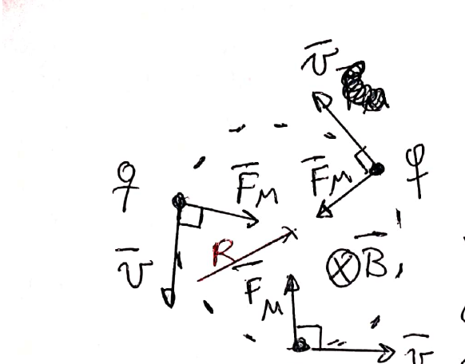

$$|q|\,v\,B = m\,\frac{v^2}{R} \quad\Rightarrow\quad \boxed{R = \frac{mv}{|q|B}}$$

$$\boxed{T = \frac{2\pi m}{|q|B}} \qquad \boxed{f = \frac{|q|B}{2\pi m}}\ (\text{frecuencia de ciclotrón}) \qquad \boxed{\omega = \frac{|q|B}{m}}$$

> El período **no depende de la velocidad ni del radio**: partículas más rápidas describen círculos más grandes en el mismo tiempo.

Si la carga es negativa, o si el campo se invierte, el sentido de giro se invierte.

### Velocidad oblicua: hélice

Se descompone $\vec v = \vec v_\perp + \vec v_\parallel$ respecto de $\vec B$. Solo $\vec v_\perp$ aporta fuerza; $\vec v_\parallel$ no cambia.

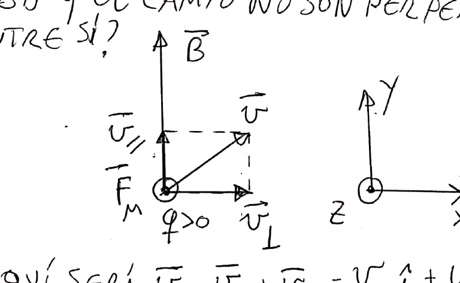

El resultado es un **MCU en el plano perpendicular a $\vec B$** combinado con un **MRU a lo largo de $\vec B$**: un **movimiento helicoidal**.

$$R = \frac{m\,v_\perp}{|q|B} \qquad T = \frac{2\pi m}{|q|B} \qquad \text{paso: } p = v_\parallel\,T$$

Si $\theta$ es el ángulo entre $\vec v$ y $\vec B$: $v_\perp = v\sin\theta$, $v_\parallel = v\cos\theta$.

### Energía de la partícula

Si una partícula de carga $q$ se acelera desde el reposo con una diferencia de potencial $\Delta V$, adquiere $E_c = |q|\Delta V = \tfrac12mv^2$, de modo que $v = \sqrt{2|q|\Delta V/m}$. (Recordar $1\ \text{eV} = 1{,}6\times10^{-19}$ J.)

---

## 4. Aplicaciones: ciclotrón, selector de velocidades, espectrómetro

### Ciclotrón

Acelerador de partículas: dos recintos semicirculares con campo magnético uniforme, separados por una zona con una diferencia de potencial cuya polaridad **se invierte periódicamente**. La partícula hace medio círculo en cada recinto y se acelera cada vez que cruza la zona central. Funciona porque el período del MCU, $T = 2\pi m/(|q|B)$, **no depende de la rapidez**: se lo hace coincidir con el período del potencial (resonancia).

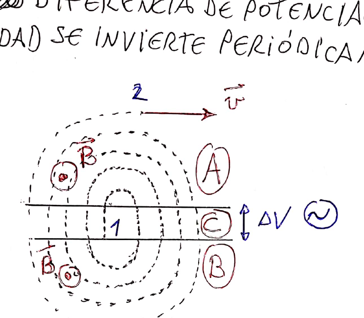

### Selector de velocidades (campos cruzados)

Un campo eléctrico uniforme (placas cargadas) y un campo magnético uniforme perpendicular. Para una carga positiva que entra horizontal, la fuerza eléctrica y la magnética son opuestas.

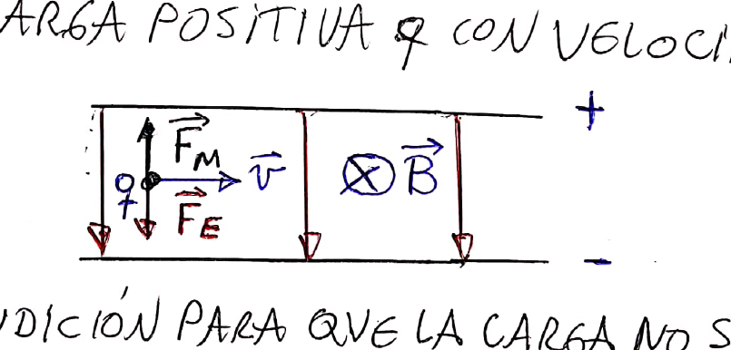

La carga no se desvía si $|q|vB = |q|E$:

$$\boxed{v = \frac EB}\quad(\text{independiente del signo de la carga})$$

### Espectrómetro de masas de Bainbridge

Un selector de velocidades ($E$, $B_1$) seguido de una zona con campo $B_2$, donde la carga describe medio círculo de radio $R$ e impacta en un detector:

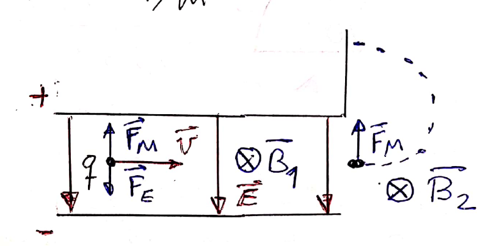

$$R = \frac{mv}{|q|B_2},\quad v = \frac{E}{B_1} \quad\Rightarrow\quad \boxed{\frac{|q|}{m} = \frac{E}{R\,B_1B_2}}$$

Sirve para medir la relación carga/masa o las masas de los distintos isótopos de un ion. (Thomson usó una variante en 1897 para medir $q/m$ del electrón.)

---

## 5. Fuerza sobre un conductor con corriente

### Conductor recto en un campo uniforme

En un tramo de longitud $\ell$ y sección $A$ hay $N = nA\ell$ portadores, cada uno con fuerza $q\vec v\times\vec B$. Usando $I = qnAv$ y definiendo $\vec\ell$ (módulo $\ell$, sentido de la corriente):

$$\boxed{\vec F = I\,\vec\ell\times\vec B}\quad(\text{tramo recto, campo uniforme})$$

### Caso general

Para un conductor de forma arbitraria o un campo no uniforme, se toma un elemento $d\vec\ell$ en el sentido de la corriente:

$$\boxed{d\vec F = I\,d\vec\ell\times\vec B} \qquad \vec F = \int_{cond}I\,d\vec\ell\times\vec B$$

> **Propiedad:** la fuerza magnética neta sobre una **espira cerrada** en un campo **uniforme** es **nula**. Y la fuerza sobre un alambre cualquiera en un campo uniforme es igual a la que sentiría un alambre **recto** que una sus extremos: $\vec F = I\,\vec L_{AB}\times\vec B$.

### Coordenadas polares (repaso)

$\hat r = \cos\theta\,\hat\imath + \sin\theta\,\hat\jmath$ y $\hat\theta = -\sin\theta\,\hat\imath + \cos\theta\,\hat\jmath$. En un arco de radio $R$ recorrido en sentido antihorario, $d\vec\ell = R\,d\theta\,\hat\theta$.

**Ejemplo (apunte):** espira formada por dos radios y un cuarto de circunferencia en un campo saliente $B\hat k$. Tramo sobre el eje X: $\vec F_1 = IR\hat\imath\times B\hat k = -IRB\hat\jmath$. Tramo sobre el eje Y (bajando): $\vec F_3 = -IRB\hat\imath$. Arco: $d\vec F_2 = IRB\,d\theta\,\hat r$, entonces $\vec F_2 = IRB(\hat\imath + \hat\jmath)$. Total: **cero**, como se esperaba.

---

## 6. Momento sobre una espira: momento dipolar magnético

Una espira rectangular de lados $a$ y $b$ con corriente $I$, en un campo uniforme que forma un ángulo $\theta$ con la normal $\hat n$ (dada por la regla de la mano derecha según el sentido de la corriente):

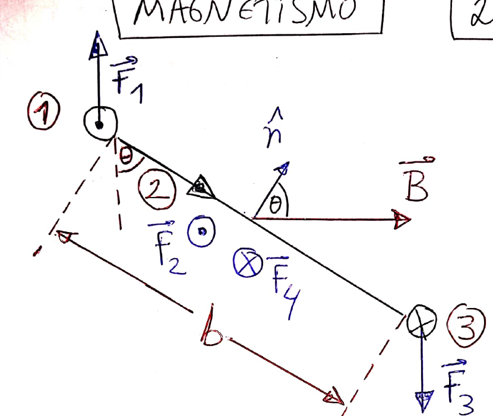

La fuerza neta es nula (la espira no se traslada), pero dos de las fuerzas forman una **cupla** que tiende a hacerla girar para alinear $\hat n$ con $\vec B$:

$$M = IabB\sin\theta = IAB\sin\theta$$

Se define el **momento dipolar magnético** de una espira de $N$ vueltas y área $A$:

$$\boxed{\vec\mu = N\,I\,A\,\hat n} \qquad \boxed{\vec M = \vec\mu\times\vec B}$$

Vale para **cualquier espira plana** en un campo uniforme. Es el análogo del dipolo eléctrico, $\vec M = \vec p\times\vec E$.

---

## 7. Ley de Biot-Savart

Las corrientes (cargas en movimiento) **generan** campos magnéticos (Oersted, 1819: una brújula se desvía cerca de un cable con corriente). Para un elemento de corriente $I\,d\vec\ell$, el campo que genera en un punto P a distancia $r$ es

$$\boxed{d\vec B = \frac{\mu_0 I}{4\pi}\,\frac{d\vec\ell\times\hat r}{r^2}} \qquad \mu_0 = 4\pi\times10^{-7}\ \frac{\text{T m}}{\text{A}}$$

donde $\hat r$ va **desde el elemento hacia P**. $\mu_0$ es la **permeabilidad del vacío**.

- $d\vec B \perp d\vec\ell$ y $d\vec B\perp\hat r$.
- $|d\vec B| \propto I$, $\propto 1/r^2$, $\propto \sin\theta$ (ángulo entre $d\vec\ell$ y $\hat r$).
- **En la prolongación de un tramo recto el campo es nulo**, porque $d\vec\ell \parallel \hat r$.

> **Regla de la mano derecha para hilos:** con el pulgar en el sentido de la corriente, los dedos indican el sentido en que $\vec B$ circula alrededor del hilo.

---

## 8. Campos de configuraciones típicas

### Hilo recto finito

Punto a distancia $y$ del hilo. Los ángulos $\theta_1$ y $\theta_2$ se miden desde la perpendicular al hilo que pasa por el punto, hasta cada extremo: **positivos en sentido antihorario, negativos en sentido horario**.

$$\boxed{B = \frac{\mu_0 I}{4\pi y}\,(\sin\theta_2 - \sin\theta_1)}$$

La dirección se obtiene con la regla de la mano derecha (en el dibujo del apunte, $\hat k$).

### Hilo infinito

$\theta_1 = -\pi/2$, $\theta_2 = \pi/2$:

$$\boxed{B = \frac{\mu_0 I}{2\pi r}}\quad(\text{circula alrededor del hilo, } \hat\phi)$$

### Hilo semiinfinito

Si la perpendicular por el punto cae justo en el extremo del hilo ($\theta_1 = 0$, $\theta_2 = \pm\pi/2$): $B = \dfrac{\mu_0 I}{4\pi r}$, la **mitad** del infinito.

### Espira cuadrada de lado $a$, en su centro

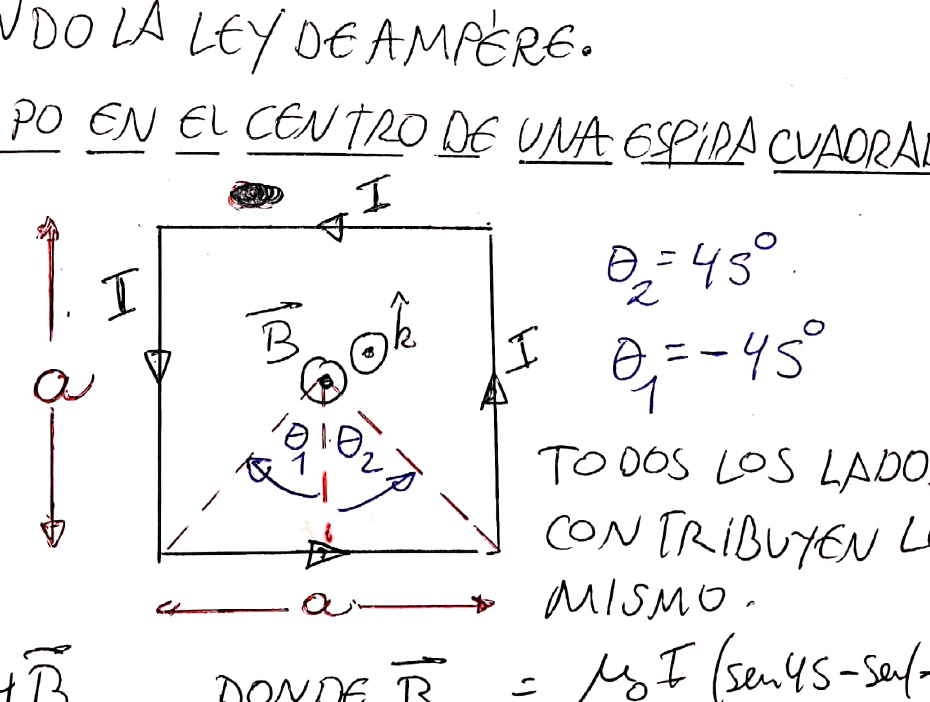

Cada lado está a $a/2$ con $\theta = \pm45^\circ$, y los cuatro aportan lo mismo:

$$B = 4\cdot\frac{\mu_0 I}{4\pi(a/2)}\cdot2\cdot\frac{\sqrt2}{2} \quad\Rightarrow\quad \boxed{B = \frac{2\sqrt2\,\mu_0 I}{\pi a}}$$

### Espira circular, en su eje

Las componentes perpendiculares al eje se cancelan de a pares y solo queda la axial:

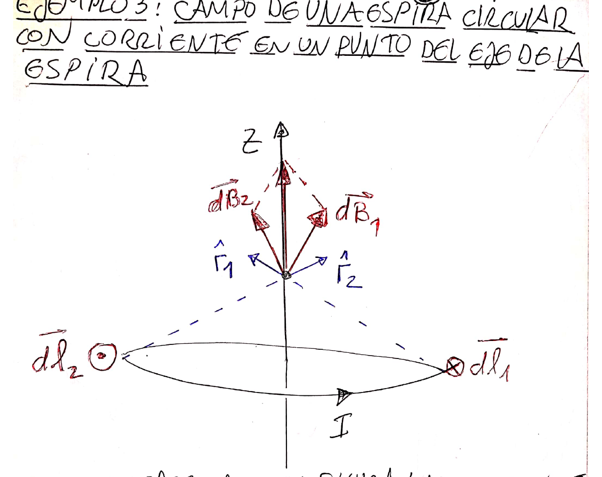

$$\boxed{B(z) = \frac{\mu_0 I R^2}{2\,(R^2 + z^2)^{3/2}}}\quad(\text{sobre el eje})$$

En el centro ($z = 0$): $\boxed{B = \dfrac{\mu_0 I}{2R}}$.

### Arco de circunferencia, en el centro

Cada elemento aporta lo mismo ($d\vec\ell\perp\hat r$, misma distancia $R$). El campo es proporcional al ángulo abarcado:

$$\boxed{B = \frac{\mu_0 I}{2R}\,\frac{\theta_2 - \theta_1}{2\pi}}$$

Una **semiespira** da $B = \dfrac{\mu_0 I}{4R}$.

### Solenoide finito, en su eje

Solenoide de radio $R$, $N$ vueltas, longitud $\ell$ y corriente $I$. Una rebanada de espesor $dz'$ es un anillo con corriente $dI = I\,N\,dz'/\ell$. Integrando:

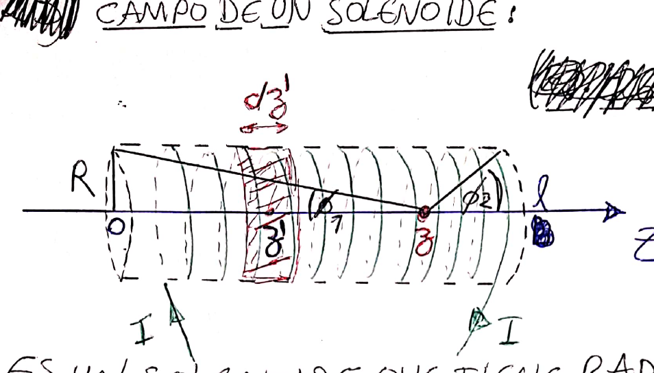

$$\boxed{B(z) = \frac{\mu_0 N I}{2\ell}\left[\frac{\ell - z}{\sqrt{(\ell - z)^2 + R^2}} + \frac{z}{\sqrt{z^2 + R^2}}\right] = \frac{\mu_0 N I}{2\ell}(\cos\phi_1 + \cos\phi_2)}$$

$\phi_1$ y $\phi_2$ son los ángulos con que se ve cada extremo desde el punto.

### Solenoide infinito

$\phi_1, \phi_2 \to 0$:

$$\boxed{B = \mu_0\,n\,I} \qquad n = \frac N\ell\ (\text{densidad de espiras})$$

Es un campo **uniforme** en el interior. Un solenoide puede considerarse infinito si su longitud es mucho mayor que el radio de sus espiras. Un **toroide** de radio mucho mayor que el de sus espiras tiene adentro $B = \mu_0 n I$ circulando a lo largo del toro.

---

## 9. Ley de Ampère

Las limaduras de hierro alrededor de un cable con corriente se ordenan en circunferencias: el campo es tangente a circunferencias centradas en el hilo.

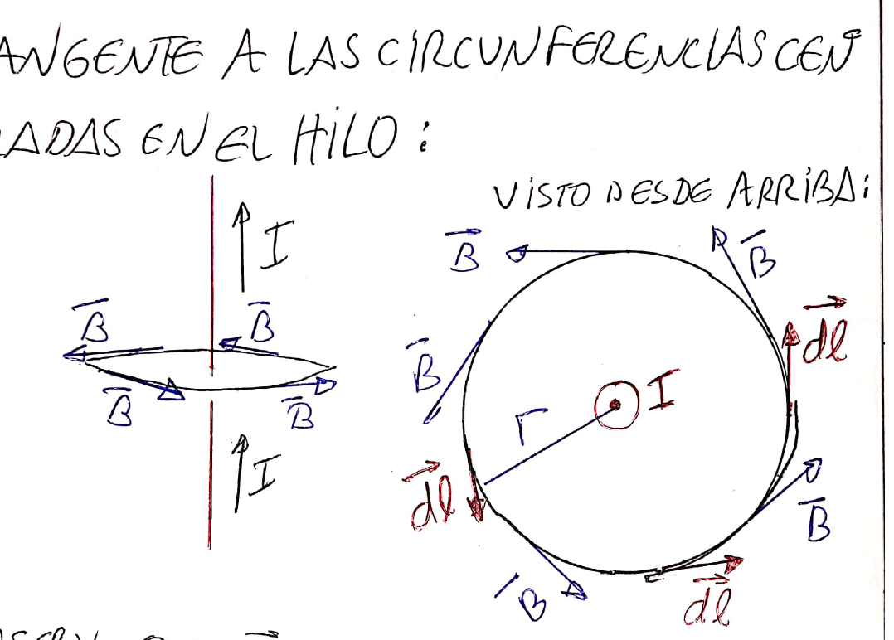

Para el hilo infinito, a lo largo de una circunferencia de radio $r$: $\oint\vec B\cdot d\vec\ell = B\,2\pi r = \mu_0 I$. Ese resultado vale en general:

$$\boxed{\oint_C\vec B\cdot d\vec\ell = \mu_0\,I_C}\quad(\text{ley de Ampère})$$

$I_C$ es la corriente **concatenada** por la curva: la que atraviesa cualquier superficie limitada por ella. Igual que con Gauss, la ley vale siempre, pero **sirve para calcular $B$ solo si hay mucha simetría** (hilos infinitos, cilindros, solenoides infinitos, toroides).

> **Pasos para usar Ampère**
>
> 1. Por simetría, decidir la dirección de $\vec B$ y de qué depende su módulo (en cilindros, $\vec B = B(r)\hat\theta$).
> 2. Elegir una curva sobre la que $\vec B\parallel d\vec\ell$ y $|\vec B|$ es constante (circunferencia coaxial).
> 3. Calcular $I_C$: si la corriente está distribuida, usar $J = I/A$ y multiplicar por el área encerrada; las corrientes opuestas se restan.
> 4. Igualar $B\,2\pi r = \mu_0 I_C$ y despejar.

### Ejemplo: cable coaxial

Conductor interior de radio $a$ con corriente $I$; conductor exterior entre $b$ y $c$ con la misma corriente en sentido opuesto.

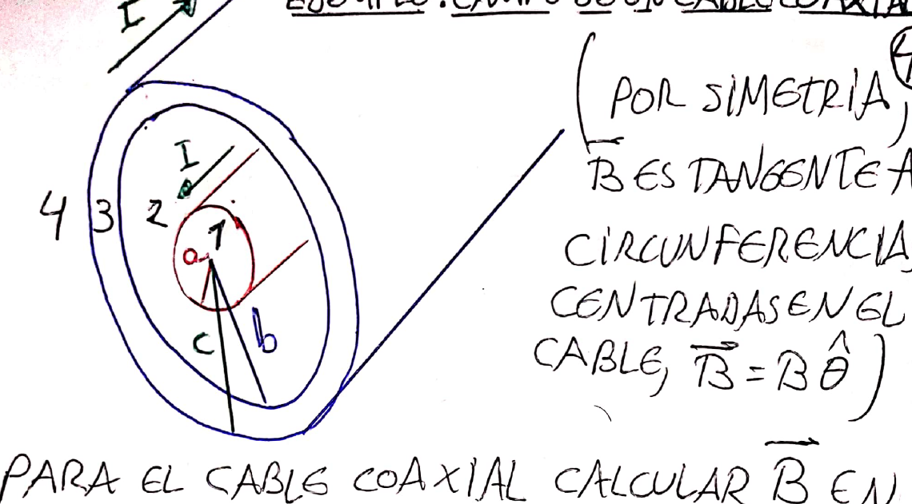

| Zona | $I_C$ | $\vec B$ |
|---|---|---|
| $r < a$ | $I\,r^2/a^2$ | $\dfrac{\mu_0 I}{2\pi a^2}\,r\,\hat\theta$ |
| $a < r < b$ | $I$ | $\dfrac{\mu_0 I}{2\pi r}\,\hat\theta$ |
| $b < r < c$ | $I\left(1 - \dfrac{r^2 - b^2}{c^2 - b^2}\right)$ | $\dfrac{\mu_0 I}{2\pi r}\left(1 - \dfrac{r^2 - b^2}{c^2 - b^2}\right)\hat\theta$ |
| $r > c$ | $0$ | $0$ |

---

## 10. Ecuaciones de Maxwell de la estática

| Ley | Forma integral |
|---|---|
| Gauss para $\vec E$ | $\oint_S\vec E\cdot\hat n\,ds = Q_{enc}/\varepsilon_0$ |
| Campo electrostático conservativo | $\oint_C\vec E\cdot d\vec\ell = 0$ |
| Gauss para $\vec B$ | $\oint_S\vec B\cdot\hat n\,ds = 0$ |
| Ampère | $\oint_C\vec B\cdot d\vec\ell = \mu_0 I_C$ |

---

## 11. Fuerza entre dos hilos paralelos

El hilo 2 está en el campo del hilo 1, $B_1 = \mu_0 I_1/(2\pi D)$, que es el mismo en todo el hilo 2. La fuerza sobre un tramo $\ell$ es $F_2 = I_2\,\ell\,B_1$:

$$\boxed{\frac F\ell = \frac{\mu_0\,I_1I_2}{2\pi D}}$$

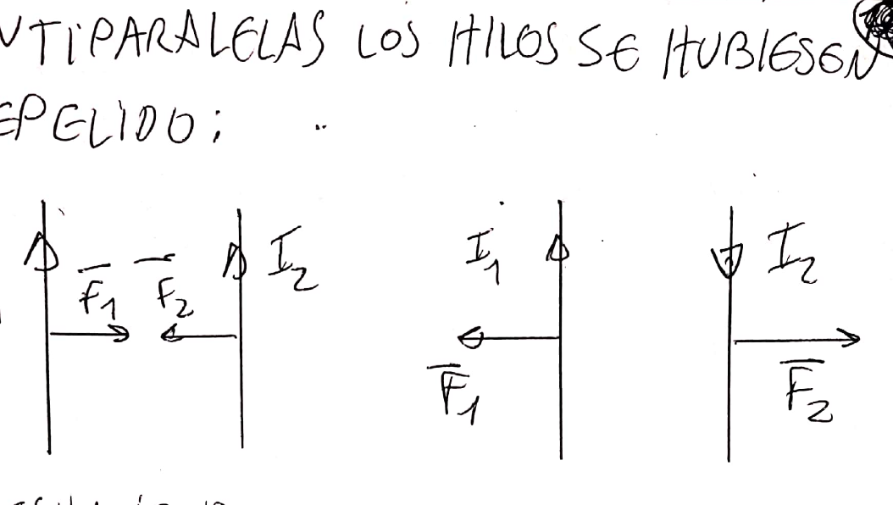

> **Corrientes paralelas se atraen; corrientes antiparalelas se repelen.** Por acción y reacción, $\vec F_1 = -\vec F_2$.

Con $I_1 = I_2 = 1$ A y $D = 1$ m resulta $F/\ell = 2\times10^{-7}$ N/m: así se **definía el ampere**, y a partir de él el coulomb (la carga que atraviesa en 1 s la sección de un conductor con 1 A).

---

## 12. Flujo magnético

$$\boxed{\phi_B = \int_S\vec B\cdot\hat n\,ds} \qquad [\phi_B] = \text{T m}^2 = \text{Wb (weber)}$$

**Ejemplo (apunte):** espira rectangular de lados $b$ (horizontal) y $c$, coplanar con un hilo infinito con corriente $I$, con su lado más cercano a distancia $a$. Como $B = \mu_0 I/(2\pi x)$ depende de $x$, se integra en tiras verticales $ds = c\,dx$:

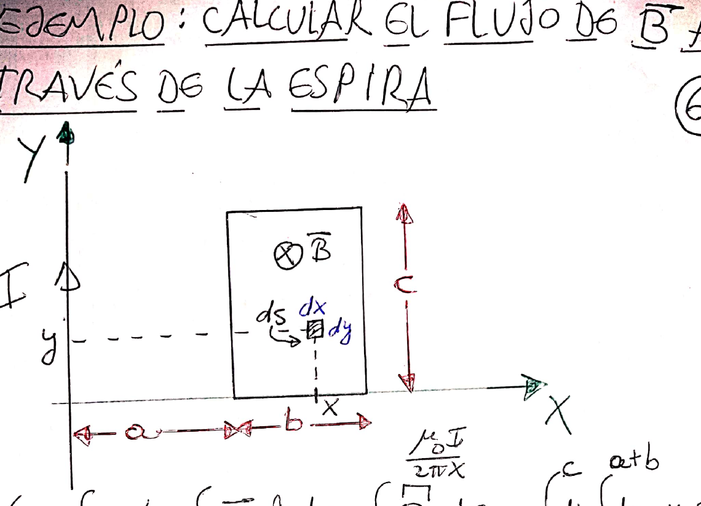

$$\phi = \int_a^{a+b}\frac{\mu_0 I}{2\pi x}\,c\,dx \quad\Rightarrow\quad \boxed{\phi = \frac{\mu_0 I c}{2\pi}\ln\!\left(\frac{a + b}{a}\right)}$$

Este resultado se usa mucho en el tema de inducción.

---

## 13. Ejemplos resueltos en clase

### Dos hilos antiparalelos (campo nulo en un punto exterior)

Hilos separados $D$; el campo se anula en P, a $D/3$ del hilo 1 por fuera. Como el punto está afuera y el campo se anula, las corrientes tienen sentidos **opuestos** y el hilo lejano tiene más corriente:

$$\frac{\mu_0I_1}{2\pi(D/3)} = \frac{\mu_0I_2}{2\pi(4D/3)} \quad\Rightarrow\quad I_2 = 4I_1$$

En el punto medio Q los dos campos se suman: $B_Q = \dfrac{\mu_0}{\pi D}(I_1 + I_2) = \dfrac{5\mu_0I_1}{\pi D}$.

### Semiespiras concéntricas

Los tramos rectos alineados con el centro no aportan. Cada semiespira aporta $\mu_0 I/(4R)$, con signo según su sentido de circulación:

- Corrientes opuestas en las dos semiespiras: $B = \dfrac{\mu_0 I}{4}\left(\dfrac{1}{R_1} - \dfrac{1}{R_2}\right)$.
- Mismo sentido de giro: $B = \dfrac{\mu_0 I}{4}\left(\dfrac{1}{R_1} + \dfrac{1}{R_2}\right)$.

### Hilo con un arco de 120° y dos tramos rectos

Arco: $\dfrac{\mu_0 I}{2R}\cdot\dfrac{120^\circ}{360^\circ} = \dfrac{\mu_0 I}{6R}$. Tramo semiinfinito con el extremo al pie de la perpendicular: $\dfrac{\mu_0 I}{4\pi R}$. Tramo con $\theta$ de −30° a −90° a distancia $R\cos30^\circ$: $\dfrac{\mu_0 I}{4\sqrt3\pi R}$. Todas entrantes:

$$B = \frac{\mu_0 I}{R}\left(\frac16 + \frac{3}{8\pi}\right)$$

### Barra sobre rieles inclinados con campo vertical

Equilibrio: $mg\sin\theta = I\ell B\cos\theta$, de donde $B = \dfrac{mg}{I\ell}\tan\theta$. Con el doble de campo: $a = -g\sin\theta$ (sube por el plano).

### Alambre en U con semicírculo en campo uniforme

Con $\vec B = B\hat\jmath$ (paralelo a los tramos rectos): solo el arco aporta, $\vec F = -2IRB\,\hat k$. Con $\vec B = B\hat\imath$: el arco no aporta y los tramos rectos dan fuerzas opuestas, de modo que **el conjunto tiende a girar alrededor del eje Y**.

### Electrón en campos $\vec E$ y $\vec B$ paralelos

$\vec E = E\hat k$, $\vec B = B\hat k$, electrón que pasa por el origen con $\vec v$ perpendicular. Es un MRUV en Z más un MCU en XY:

$$z = -\frac{eE}{2m}t^2 \qquad x(t) = -\frac{mv_0}{eB}\left(1 - \cos\frac{eB}{m}t\right) \qquad y(t) = \frac{mv_0}{eB}\sin\frac{eB}{m}t$$

### Espira rectangular junto a un hilo

$I_1 = 100$ A, $I_2 = 10$ A, $a = b = 1$ cm, $c = 4$ cm. Las fuerzas sobre los lados horizontales se cancelan; el lado cercano (corriente antiparalela) es repelido más que lo que el lejano es atraído:

$$\vec F = c\,\frac{\mu_0I_1I_2}{2\pi}\left(\frac1a - \frac{1}{a + b}\right)\hat\imath = 4\times10^{-4}\ \text{N}\ \hat\imath$$

---

## 14. Tabla de fórmulas

| Tema | Fórmula |
|---|---|
| Fuerza sobre una carga | $\vec F = q\vec v\times\vec B$ |
| Lorentz | $\vec F = q\vec E + q\vec v\times\vec B$ |
| MCU | $R = mv/(\lvert q\rvert B)$, $T = 2\pi m/(\lvert q\rvert B)$, $\omega = \lvert q\rvert B/m$ |
| Hélice | $R = mv_\perp/(\lvert q\rvert B)$, paso $p = v_\parallel T$ |
| Selector | $v = E/B$ |
| Espectrómetro | $\lvert q\rvert/m = E/(RB_1B_2)$ |
| Conductor | $\vec F = I\vec\ell\times\vec B$, $d\vec F = I\,d\vec\ell\times\vec B$ |
| Momento dipolar | $\vec\mu = NIA\hat n$, $\vec M = \vec\mu\times\vec B$ |
| Biot-Savart | $d\vec B = \frac{\mu_0 I}{4\pi}\frac{d\vec\ell\times\hat r}{r^2}$ |
| Hilo finito | $B = \frac{\mu_0 I}{4\pi y}(\sin\theta_2 - \sin\theta_1)$ |
| Hilo infinito | $B = \mu_0 I/(2\pi r)$ |
| Espira circular (eje) | $B = \mu_0 IR^2/[2(R^2 + z^2)^{3/2}]$; centro $\mu_0 I/(2R)$ |
| Arco (centro) | $B = \frac{\mu_0 I}{2R}\frac{\Delta\theta}{2\pi}$ |
| Espira cuadrada (centro) | $B = 2\sqrt2\mu_0 I/(\pi a)$ |
| Solenoide | $B = \frac{\mu_0 NI}{2\ell}(\cos\phi_1 + \cos\phi_2)$; infinito $\mu_0 nI$ |
| Ampère | $\oint\vec B\cdot d\vec\ell = \mu_0 I_C$ |
| Gauss para B | $\oint\vec B\cdot\hat n\,ds = 0$ |
| Hilos paralelos | $F/\ell = \mu_0 I_1I_2/(2\pi D)$ |
| Flujo | $\phi_B = \int\vec B\cdot\hat n\,ds$ |
