# Tema 6 — Inducción magnética: ejercicios resueltos

Ejercicios de la [Guía de ejercicios de Fenómenos de inducción magnética](Aula%20Virtual/Gu%C3%ADa%20de%20ejercicios%20-%20Inducci%C3%B3n%20magn%C3%A9tica.pdf). Los enunciados están copiados textualmente de la guía.

Cada ejercicio tiene un botón **Solución**. Al abrirlo aparece la respuesta y, arriba, un segundo botón **Solución paso a paso** con el desarrollo completo. En el paso a paso primero se obtiene la fórmula en forma simbólica y recién al final se reemplazan los números.

Teoría: [resumen del tema](teoria.md). En el aula virtual también está la [resolución manuscrita de la guía](Aula%20Virtual/Resoluci%C3%B3n%20gu%C3%ADa%20-%20Inducci%C3%B3n%20magn%C3%A9tica.pdf). Constante: $\mu_0 = 4\pi\times10^{-7}$ T m/A.

> **Resultado que se usa muchas veces:** flujo del campo de un hilo infinito con corriente $i$ a través de una espira rectangular coplanar, de lado $c$ paralelo al hilo, que se extiende desde una distancia $a$ hasta $a + b$:
>
> $$\phi = \frac{\mu_0 i c}{2\pi}\ln\!\left(\frac{a + b}{a}\right)$$

| Bloque | Ejercicios |
|---|---|
| Flujo | [1](#ejercicio-1) · [2](#ejercicio-2) · [3](#ejercicio-3) |
| Faraday-Lenz | [4](#ejercicio-4) · [5](#ejercicio-5) · [6](#ejercicio-6) · [9](#ejercicio-9) · [13](#ejercicio-13) · [14](#ejercicio-14) · [20](#ejercicio-20) · [22](#ejercicio-22) |
| Fem de movimiento | [7](#ejercicio-7) · [8](#ejercicio-8) · [10](#ejercicio-10) · [11](#ejercicio-11) · [12](#ejercicio-12) · [15](#ejercicio-15) |
| Inductancia | [16](#ejercicio-16) · [17](#ejercicio-17) · [18](#ejercicio-18) · [19](#ejercicio-19) · [21](#ejercicio-21) |
| Conceptuales | [23](#ejercicio-23) · [24](#ejercicio-24) |

---

### Ejercicio 1

Por el conductor recto de la figura circula una corriente de 10A. Para los valores ab=cd=5cm; bc=da=2cm; L=1cm

a) calcule el valor del flujo que atraviesa a la espira abcd;

b) discuta si al invertir la corriente se modifica el resultado anterior;

c) calcule el valor del flujo que atraviesa a la espira abcd, pero suponiendo ahora que el lado bc es el que está enfrentado al cable;

d) suponga que en la situación (a) la superficie de la espira se redujera a la mitad ¿el flujo cambia a la mitad o depende de la manera geométrica en que se reduce la superficie?

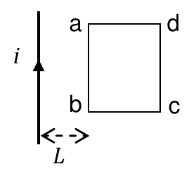

<b>Solución</b>

Solución paso a paso

**Paso 1 — Por qué hay que integrar.** El campo del hilo, $B = \dfrac{\mu_0 i}{2\pi x}$, no es uniforme: depende de la distancia $x$. Se divide la espira en tiras paralelas al hilo, de ancho $dx$ y largo $c$ (el lado paralelo al hilo); en cada tira $B$ es constante.

$$\phi = \int_a^{a+b}\frac{\mu_0 i}{2\pi x}\,c\,dx = \frac{\mu_0 i c}{2\pi}\ln\!\left(\frac{a + b}{a}\right)$$

**Paso 2 — Ítem a.** El lado enfrentado al hilo es ab (5 cm, paralelo), a $a = L = 1$ cm, y la espira se extiende $b = 2$ cm:

$$\phi = \frac{4\pi\times10^{-7}\cdot10\cdot0{,}05}{2\pi}\ln\!\left(\frac{3}{1}\right)\ \text{Wb} = 10^{-7}\cdot1{,}0986\ \text{Wb} = 1{,}1\times10^{-7}\ \text{Wb}$$

**Paso 3 — Ítem b.** Si se invierte la corriente, $\vec B$ cambia de sentido y el flujo cambia de signo. Pero el signo depende de la orientación elegida para $d\vec S$, que también se puede invertir: el **módulo** no cambia.

**Paso 4 — Ítem c.** Ahora el lado paralelo al hilo es bc ($c = 2$ cm) y la espira se extiende $b = 5$ cm, desde $a = 1$ cm hasta 6 cm:

$$\phi = \frac{4\pi\times10^{-7}\cdot10\cdot0{,}02}{2\pi}\ln6\ \text{Wb} = 4\times10^{-8}\cdot1{,}792\ \text{Wb} = 7{,}17\times10^{-8}\ \text{Wb}$$

**Paso 5 — Ítem d.** Como $B$ no es uniforme, el flujo depende de **qué parte** del área se quita. Si se reduce el lado paralelo al hilo a la mitad, el flujo se reduce a la mitad; si se acorta la dimensión perpendicular, no (las partes cercanas al hilo pesan más).

**Respuesta:** a) $\phi = 1{,}1\times10^{-7}$ Wb; b) el valor no se modifica porque también puede invertirse $d\vec S$; c) $\phi = 7{,}17\times10^{-8}$ Wb; d) depende de la manera geométrica en que se reduce el área.

---

### Ejercicio 2

Una bobina de 50 espiras se halla próxima a dos conductores por los que circulan corrientes de intensidades *i1*=50A e *i2*=200A, respectivamente. La bobina y los conductores son coplanares. Calcule:

a) el flujo magnético que atraviesa la espira;

b) el valor que tendría que tener *i2* para que el flujo fuera nulo.

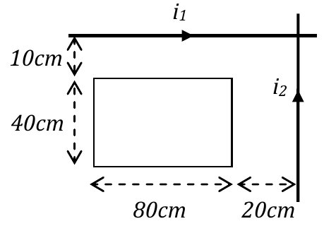

<b>Solución</b>

Solución paso a paso

**Paso 1 — Sentidos de los campos.**

- $i_1$ (horizontal, hacia la derecha), con la bobina debajo: $\hat e_x\times(-\hat e_y) = -\hat e_z$, **entrante**.
- $i_2$ (vertical, hacia arriba), con la bobina a la izquierda: $\hat e_y\times(-\hat e_x) = +\hat e_z$, **saliente**.

Los flujos se **restan**.

**Paso 2 — Flujo de cada hilo** (resultado del recuadro):

- $i_1$: lado paralelo de 80 cm, desde 10 cm hasta 50 cm: $\phi_1 = \dfrac{\mu_0 i_1\cdot0{,}8}{2\pi}\ln5$.
- $i_2$: lado paralelo de 40 cm, desde 20 cm hasta 100 cm: $\phi_2 = \dfrac{\mu_0 i_2\cdot0{,}4}{2\pi}\ln5$.

$$\phi_{bob} = N\,|\phi_2 - \phi_1| = N\frac{\mu_0\ln5}{2\pi}\,|0{,}4\,i_2 - 0{,}8\,i_1|$$

**Paso 3 — Cálculo.**

$$\phi_{bob} = 50\cdot2\times10^{-7}\cdot1{,}609\cdot|80 - 40|\ \text{Wb} = 6{,}44\times10^{-4}\ \text{Wb}$$

**Paso 4 — Flujo nulo (ítem b).** $0{,}4\,i_2 = 0{,}8\,i_1$, entonces $i_2 = 2i_1 = 100$ A.

**Respuesta:** a) $\phi = 6{,}44\times10^{-4}$ Wb; b) $i_2 = 100$ A

---

### Ejercicio 3

Un cable rectilíneo (que puede considerarse infinito) transporta una corriente de intensidad *i*(t) como muestra la figura. Este alambre es perpendicular al plano de la espira cuadrada de lado *L* a la que atraviesa por su centro ¿Cuánto vale la fem inducida en la espira? Justifique su respuesta.

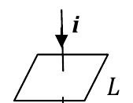

<b>Solución</b>

Solución paso a paso

Las líneas de campo del hilo son circunferencias centradas en él, contenidas en planos perpendiculares al hilo: en este caso, **en el plano de la espira**. Entonces $\vec B\perp\hat n$ en todos los puntos de la espira y el flujo es nulo **en todo momento**, aunque $i(t)$ varíe. Sin variación de flujo no hay fem.

**Respuesta:** Las líneas del campo magnético generado por la corriente del alambre son tangentes al plano de la espira; en consecuencia generan un flujo de inducción magnética igual a cero y constante en el tiempo, por lo tanto la fem inducida en la espira vale cero.

---

### Ejercicio 4

Un solenoide de 500 vueltas, radio *rS*=0,5cm, longitud *L*=20cm, está circulado por una corriente *i*=10A. En el interior del solenoide hay una pequeña bobina de 10 vueltas, radio *rB*=0,3cm y resistencia total *R*=0,2Ω. Si el campo de inducción se invierte en 0,2 seg, calcule la cantidad de carga que por unidad de tiempo circula por la bobina interior.

<b>Solución</b>

Solución paso a paso

**Paso 1 — Campo del solenoide.** Como $L \gg r_S$, se lo aproxima por un solenoide infinito:

$$B = \mu_0\frac{N_S}{L}i$$

**Paso 2 — Flujo en la bobina interior.** Su área es $\pi r_B^2$ (está toda dentro del campo):

$$\phi = N_B\,B\,\pi r_B^2$$

**Paso 3 — Variación.** El campo se **invierte**, así que el flujo pasa de $+\phi$ a $-\phi$: $|\Delta\phi| = 2\phi$.

**Paso 4 — Carga por unidad de tiempo.** La fem media es $|\Delta\phi|/\Delta t$, y la corriente (carga por unidad de tiempo) es $I = \mathcal E/R$:

$$I = \frac{2N_B\,\mu_0\frac{N_S}{L}i\,\pi r_B^2}{R\,\Delta t}$$

**Paso 5 — Cálculo.**

$$B = 4\pi\times10^{-7}\cdot\frac{500}{0{,}2}\cdot10\ \text{T} = 0{,}0314\ \text{T} \qquad \phi = 10\cdot0{,}0314\cdot\pi\cdot(0{,}003)^2\ \text{Wb} = 8{,}88\times10^{-6}\ \text{Wb}$$

$$I = \frac{2\cdot8{,}88\times10^{-6}}{0{,}2\cdot0{,}2}\ \text{A} = 4{,}4\times10^{-4}\ \text{A} = 444\ \mu\text{C/s}$$

> La guía da 22,2 μC/s, que no se reproduce con los datos del enunciado (es 20 veces menor). Planteando $I = |\Delta\phi|/(R\,\Delta t)$ con la inversión del campo, sale 444 μC/s.

**Respuesta:** Como $L \gg r_S$, vale aproximar por solenoide infinito. En esa hipótesis circulan ≈ 444 μC/s (la guía: 22,2 μC/s; ver nota).

---

### Ejercicio 5

Una bobina de 20 espiras circulares de 1cm de radio está colocada en un campo uniforme y estacionario de intensidad *B* = 0,8 T, de tal forma que el flujo de inducción magnética *ΦB* es máximo. La resistencia total del circuito es de 5 Ω. Halle la carga total que circula por dicho circuito si la bobina es rápidamente girada hasta anular el flujo *ΦB*.

<b>Solución</b>

Solución paso a paso

**Paso 1 — Relación entre fem, corriente y carga.**

$$|\mathcal E| = N\frac{d\phi}{dt} = iR = \frac{dq}{dt}R$$

**Paso 2 — Integrar.** Se simplifica $dt$: $dq = \dfrac{N}{R}d\phi$, entonces

$$Q = N\frac{\Delta\phi}{R}$$

La carga total **no depende de lo rápido** que se gire la bobina: solo de la variación total de flujo.

**Paso 3 — Variación de flujo.** De máximo ($B\pi r^2$ por espira) a cero:

$$Q = \frac{N\,B\,\pi r^2}{R}$$

**Paso 4 — Cálculo.**

$$Q = \frac{20\cdot0{,}8\cdot\pi\cdot10^{-4}}{5}\ \text{C} = 1\times10^{-3}\ \text{C}$$

**Respuesta:** $Q = N\dfrac{\Delta\phi}{R} = \dfrac{NB\pi r^2}{R} = 1\times10^{-3}$ C

---

### Ejercicio 6

La figura, muestra un alambre "infinito" y una bobina rectangular. Indique la dirección de la corriente inducida en cada uno de los siguientes casos

a) la bobina se acerca al cable y la corriente *i* (t) aumenta;

b) la corriente *i* (t) disminuye y la bobina está en reposo respecto del cable;

c) la bobina gira alrededor del cable con velocidad angular constante ω, manteniendo su condición coplanar con el cable y su distancia a él, y la corriente es constante;

d) la bobina se achica, fija en su posición, y la corriente es constante;

e) la bobina se agranda, fija en su posición, y la corriente es constante.

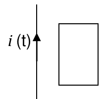

<b>Solución</b>

Solución paso a paso

**Paso 1 — Campo externo.** La corriente sube; a la derecha del cable el campo es **entrante** ($\hat e_y\times\hat e_x = -\hat e_z$).

**Paso 2 — Regla de Lenz.** Si el flujo entrante **crece**, la corriente inducida genera campo **saliente**: sentido **antihorario**. Si **decrece**, genera campo entrante: sentido **horario**.

- a) Acercarse aumenta $B$ y además aumenta $i$: el flujo crece, **antihorario**.
- b) $i$ disminuye: el flujo decrece, **horario**.
- c) Girar alrededor del cable manteniendo la distancia no cambia nada: flujo constante, **no hay corriente**.
- d) Achicarse reduce el área: el flujo decrece, **horario**.
- e) Agrandarse aumenta el área: el flujo crece, **antihorario**.

**Respuesta:**

- a) Sentido antihorario porque el flujo debido al campo externo crece.
- b) Sentido horario porque el flujo debido al campo externo decrece.
- c) No circula corriente inducida porque el flujo es constante.
- d) Sentido horario porque el flujo debido al campo externo decrece.
- e) Sentido antihorario porque el flujo debido al campo externo crece.

---

### Ejercicio 7

La espira rectangular de la figura se introduce a velocidad constante $\vec v = 0{,}25\ cm/seg\ (\hat e_x)$ en una región semiinfinita (idealizada) del espacio en la que existe un campo magnético uniforme $\vec B = 3T\ (-\hat e_z)$. Si la resistencia eléctrica de la espira es de 0,5Ω, calcule:

a) el flujo que atraviesa la espira en función del tiempo;

b) la fem inducida en la espira en función del tiempo;

c) la corriente que se induce en la espira (valor y sentido de circulación);

d) la fuerza que debe realizarse para mantener a la espira en movimiento uniforme.

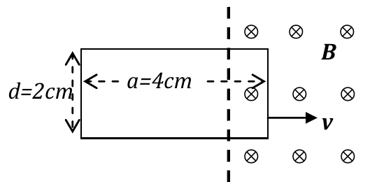

<b>Solución</b>

Solución paso a paso

**Datos.** $d = 2$ cm (lado vertical), $a = 4$ cm (lado horizontal), $v = 0{,}25$ cm/s, $B = 3$ T, $R = 0{,}5$ Ω. Se toma $t = 0$ cuando el borde derecho llega al límite de la región.

**Paso 1 — Flujo (ítem a).** Mientras la espira entra, la parte dentro del campo es un rectángulo de $d\times vt$. Termina de entrar en $t_1 = a/v = 16$ s.

$$\phi(t) = B\,d\,v\,t\quad(t \le 16\ \text{s}) \qquad \phi = B\,d\,a\quad(t > 16\ \text{s})$$

**Paso 2 — Fem (ítem b).**

$$|\mathcal E| = \frac{d\phi}{dt} = B\,d\,v\quad(t\le16\ \text{s}) \qquad \mathcal E = 0\quad(t > 16\ \text{s})$$

**Paso 3 — Corriente (ítem c).** $i = \mathcal E/R$. El flujo **entrante crece**, así que la corriente inducida genera campo saliente: sentido **antihorario**.

**Paso 4 — Fuerza (ítem d).** Solo el lado vertical que está dentro del campo siente fuerza neta: $F = i\,d\,B$, frenando, en $-\hat e_x$. El agente externo tiene que hacer una fuerza igual y opuesta.

**Paso 5 — Cálculo.**

$$\mathcal E = 3\cdot0{,}02\cdot0{,}0025\ \text{V} = 1{,}5\times10^{-4}\ \text{V} \qquad i = \frac{1{,}5\times10^{-4}}{0{,}5}\ \text{A} = 0{,}3\ \text{mA}$$

$$F = 3\times10^{-4}\cdot0{,}02\cdot3\ \text{N} = 1{,}8\times10^{-5}\ \text{N}$$

**Respuesta:**

- a) $\phi(t) = (Bdv)\,t$ para $t \le 16$ s; $\phi(t) = Bda$ para $t > 16$ s
- b) $\mathcal E = Bdv$ para $t \le 16$ s; $\mathcal E = 0$ para $t > 16$ s
- c) $i = 0{,}3$ mA en sentido antihorario para $t \le 16$ s; $i = 0$ para $t > 16$ s
- d) $\vec F = idB\,(-\hat e_x) = 1{,}8\times10^{-5}$ N $(-\hat e_x)$ para $t \le 16$ s (es la fuerza magnética; el agente externo aplica la opuesta)

---

### Ejercicio 8

La barra metálica de longitud *L* de la figura gira con velocidad angular constante ω solidaria al pivote *P*, sumergida en un campo magnético uniforme $\vec B = B_0\,(-\hat e_z)$.

a) halle la expresión de la fem inducida en la barra;

b) indique el sentido de circulación que tendría la corriente inducida en la barra.

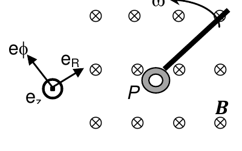

<b>Solución</b>

Solución paso a paso

**Paso 1 — Velocidad de cada punto.** Un punto a distancia $r$ del pivote tiene $\vec v = \omega r\,\hat e_\phi$ (gira en sentido antihorario).

**Paso 2 — $\vec v\times\vec B$.** Con $\hat e_\phi\times(-\hat e_z) = -\hat e_R$:

$$\vec v\times\vec B = \omega rB_0\,(-\hat e_R)$$

Apunta **hacia el pivote**.

**Paso 3 — Fem de movimiento.**

$$|\mathcal E| = \int_0^L\omega rB_0\,dr = \frac{B_0L^2\omega}{2}$$

(También sale con el flujo: el área barrida es $\tfrac12\omega L^2t$.)

**Paso 4 — Sentido.** El "campo" $\vec v\times\vec B$ empuja las cargas positivas hacia P: la corriente inducida circularía en sentido radial **entrante**, hacia el pivote.

**Respuesta:** a) $\mathcal E = B_0L^2\omega/2$; b) en sentido radial entrante, hacia el pivote P.

---

### Ejercicio 9

La bobina de la figura, de radio *r* =10cm, tiene 5 vueltas y se halla inmersa en un campo magnético espacialmente uniforme $\vec B_{EXT} = \alpha t^2\,\hat e_X$ (***nS*** representa la normal a la superficie de la espira). Para *α = 0,04 Tseg−2*, calcule la fem inducida en la bobina como función del tiempo.

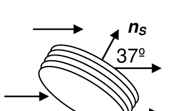

<b>Solución</b>

Solución paso a paso

**Paso 1 — Flujo.** El campo es uniforme y forma 37° con la normal:

$$\phi = N\,B\,\pi r^2\cos37^\circ = N\,\alpha t^2\,\pi r^2\cos37^\circ$$

**Paso 2 — Fem.**

$$|\mathcal E| = \frac{d\phi}{dt} = 2N\alpha t\,\pi r^2\cos37^\circ$$

**Paso 3 — Cálculo.**

$$|\mathcal E| = 2\cdot5\cdot0{,}04\cdot\pi\cdot0{,}01\cdot0{,}8\ t\ \text{V} = 10^{-2}\,t\ \text{V}$$

**Respuesta:** $|\mathcal E| = N\displaystyle\iint\frac{\partial\vec B_{EXT}}{\partial t}\cdot d\vec S = 2N\alpha t\,\pi r^2\cos37^\circ = 10^{-2}\,t$ V

---

### Ejercicio 10

La barra metálica de la figura desliza idealmente en contacto con un cuadro metálico en presencia de un campo magnético externo uniforme $\vec B = 0{,}5T\ (-\hat e_z)$. La resistencia eléctrica del conjunto es de 0,2 Ω, *L*=0,5m y velocidad de la barra es uniforme y vale $\vec v = 4\ m/seg\ (\hat e_x)$.

a) calcule el valor de la fem inducida;

b) indique y justifique el sentido de circulación de la corriente inducida;

c) calcule el valor de la fuerza externa que se requiere para mantener la velocidad constante;

d) calcule la potencia que se disipa por efecto Joule y compárela con la desarrollada por la fuerza externa.

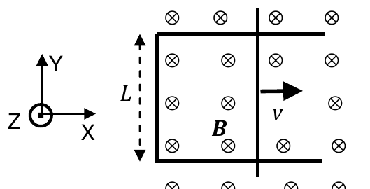

<b>Solución</b>

Solución paso a paso

**Paso 1 — Fem (ítem a).** Barra perpendicular a $\vec B$ y a $\vec v$:

$$\mathcal E = B\,L\,v$$

**Paso 2 — Sentido (ítem b).** El área del circuito (y el flujo **entrante**) crece, así que la corriente genera campo saliente: sentido **antihorario**.

**Paso 3 — Corriente y fuerza (ítem c).**

$$i = \frac{\mathcal E}{R} \qquad F = iLB = \frac{B^2L^2v}{R}$$

La fuerza magnética frena la barra ($-\hat e_x$); la externa tiene que ser igual y en $+\hat e_x$.

**Paso 4 — Potencias (ítem d).** $P_{Joule} = i^2R$ y $P_{ext} = F\,v$. Son iguales: $\dfrac{B^2L^2v^2}{R}$.

**Paso 5 — Cálculo.**

$$\mathcal E = 0{,}5\cdot0{,}5\cdot4\ \text{V} = 1\ \text{V} \qquad i = \frac{1}{0{,}2}\ \text{A} = 5\ \text{A} \qquad F = 5\cdot0{,}5\cdot0{,}5\ \text{N} = 1{,}25\ \text{N}$$

$$P = 5^2\cdot0{,}2\ \text{W} = 5\ \text{W} = 1{,}25\ \text{N}\cdot4\ \text{m/s}$$

**Respuesta:** a) $\mathcal E = 1$ V; b) la corriente inducida circula en sentido antihorario; c) $\vec F = 1{,}25$ N $\hat e_x$; d) $P = 5$ W (igual a la potencia de la fuerza externa).

---

### Ejercicio 11

La figura muestra una barra metálica móvil que desliza idealmente en contacto con un cuadro metálico en presencia de un campo magnético externo uniforme. La barra tiene masa *M* y cae con velocidad constante *v0*. Suponiendo que el cuadro completo tiene resistencia eléctrica *R* (que no varía con el movimiento de la barra).

a) justifique claramente la dirección de la corriente inducida en el cuadro;

b) halle la expresión de la velocidad de caída de la barra (en términos de *M, g, B, L*).

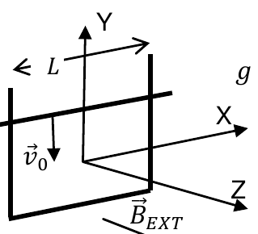

<b>Solución</b>

Solución paso a paso

**Paso 1 — Sentido (ítem a).** Al caer la barra, el área del cuadro **por encima** de ella se achica: el flujo dentro del cuadro disminuye. La corriente inducida tiende a reforzarlo. (Así lo plantea la guía, con el cuadro cerrado por arriba.)

**Paso 2 — Velocidad constante.** Si cae a velocidad constante, la fuerza magnética equilibra el peso:

$$iLB = Mg \qquad i = \frac{\mathcal E}{R} = \frac{BLv_0}{R}$$

**Paso 3 — Despeje (ítem b).**

$$\frac{B^2L^2v_0}{R} = Mg \quad\Rightarrow\quad v_0 = \frac{MgR}{B^2L^2}$$

Es la **velocidad terminal** (ver [teoría](teoria.md#barra-que-cae-rieles-verticales)).

**Respuesta:** a) sentido antihorario porque el flujo dentro del cuadro disminuye y la corriente inducida tiende a reforzarlo; b) $v_0 = \dfrac{MgR}{B^2L^2}$

---

### Ejercicio 12

El dispositivo de la figura consiste en un marco metálico, uno de cuyos lados forma un ángulo α con la horizontal y puede moverse con velocidad ***v***. El marco está colocado en una región del espacio en la que existe un campo magnético ***B***.

a) indique el sentido en el que circula la corriente inducida en el cuadro si *v*=0 y ***B***(t) = *B0* e –bt (−***e****Z*), b>0;

b) halle la expresión del flujo de campo ∀t>0 si ***B***=*B0* (−***e****z*) y ***v***= *v0* (−***e****x*).

c) si la barra tiene resistencia propia *R*, halle la expresión de la fuerza de frenado en función del tiempo.

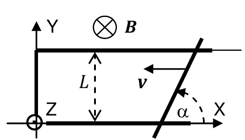

<b>Solución</b>

Solución paso a paso

**Paso 1 — Ítem a.** El campo es entrante y se extingue exponencialmente: el flujo entrante disminuye. La corriente inducida refuerza el campo entrante: sentido **horario**.

**Paso 2 — Ítem b.** El lado inclinado se mueve horizontalmente con velocidad $v_0$. El área que barre por unidad de tiempo es la de un paralelogramo de altura $L$ y base $v_0\,dt$: $dA = L\,v_0\,dt$ (la inclinación no importa). El flujo varía a razón de

$$\left|\frac{d\phi}{dt}\right| = LB_0v_0$$

La guía lo expresa como $\phi = LB_0v_0\,t$ (la parte del flujo que cambia con el tiempo; como la barra se mueve hacia $-x$, en realidad el área disminuye: $\phi(t) = B_0(A_0 - Lv_0t)$).

**Paso 3 — Corriente.** $i = \dfrac{\mathcal E}{R} = \dfrac{LB_0v_0}{R}$ (constante).

**Paso 4 — Fuerza (ítem c).** La barra inclinada tiene longitud $L/\sin\alpha$ y dirección $(\cos\alpha;\ \sin\alpha)$. La fuerza es $\vec F = i\,\vec\ell\times\vec B$:

$$\vec F = i\,\frac{L}{\sin\alpha}(\cos\alpha;\ \sin\alpha;\ 0)\times(0;\ 0;\ -B_0) = iLB_0\,(\pm1;\ \mp\cot\alpha)$$

(el signo global depende del sentido de la corriente). Con $i = LB_0v_0/R$:

$$\vec F = \frac{L^2B_0^2v_0}{R}\,(\hat e_x - \cot\alpha\,\hat e_y)$$

La componente $x$ se opone a la velocidad ($-\hat e_x$): frena la barra. No depende del tiempo.

**Respuesta:**

- a) Circula en sentido horario, tratando de reforzar el campo en el interior de la espira, que se extingue.
- b) $\phi = LB_0v_0\,t$ (variación del flujo con el tiempo)
- c) $\vec F = L^2B_0^2v_0\,(\hat e_x - \cot\alpha\,\hat e_y)/R$

---

### Ejercicio 13

La espira cuadrada de lado ℓ de la figura está en reposo, ubicada en el plano *XZ* y en presencia de un campo magnético externo que varía temporalmente como $\vec B(t) = B_0e^{-\alpha t}\,\hat\jmath$ con α > 0.

a) Indique y justifique cuál es el sentido de circulación de la corriente inducida en la espira.

b) Halle la expresión del módulo de la fem inducida en la espira.

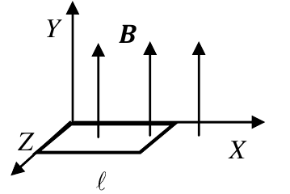

<b>Solución</b>

Solución paso a paso

**Paso 1 — Flujo.** El campo es uniforme y perpendicular a la espira:

$$\phi = B_0e^{-\alpha t}\,\ell^2$$

**Paso 2 — Fem.**

$$|\mathcal E| = \left|\frac{d\phi}{dt}\right| = B_0\ell^2\alpha\,e^{-\alpha t}$$

**Paso 3 — Sentido.** El campo hacia $+\hat\jmath$ (hacia arriba) disminuye. La corriente inducida lo refuerza: genera campo hacia arriba, así que, mirada desde arriba (desde $+Y$), circula en sentido **antihorario**.

**Respuesta:** a) el campo externo disminuye, la corriente inducida tiende a reforzarlo, de manera tal que $i_{IND}$ circula en sentido antihorario; b) $|\mathcal E| = B_0\ell^2\alpha\,e^{-\alpha t}$

---

### Ejercicio 14

La espira cuadrada de lado ℓ de la figura se mueve con velocidad uniforme $\vec v = v_0\hat e_x$, ubicada en el plano *XZ* y en presencia de un campo magnético externo que varía espacialmente como $\vec B(x) = (\alpha B_0/x^2)\,\hat y$. (α, *B0* > 0)

a) indique y justifique cuál es el sentido de circulación de la corriente inducida en la espira.

b) halle la expresión del módulo de la fem inducida en la espira.

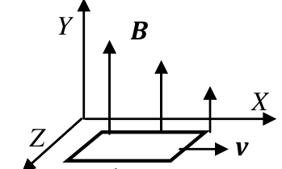

<b>Solución</b>

Solución paso a paso

**Paso 1 — Flujo con la espira entre $x$ y $x + \ell$.** El campo depende de $x$, así que se integra en tiras de ancho $dx'$ y largo $\ell$:

$$\phi(x) = \int_x^{x+\ell}\frac{\alpha B_0}{x'^2}\,\ell\,dx' = \alpha B_0\ell\left[\frac1x - \frac{1}{x + \ell}\right]$$

**Paso 2 — Fem.** Con $dx/dt = v_0$ (regla de la cadena):

$$|\mathcal E| = \left|\frac{d\phi}{dx}\frac{dx}{dt}\right| = \alpha B_0\ell\,v_0\left[\frac{1}{x^2} - \frac{1}{(x + \ell)^2}\right]$$

**Paso 3 — Sentido.** Al alejarse hacia $+x$ el campo se debilita: el flujo hacia arriba disminuye. La corriente inducida lo refuerza: sentido **antihorario** visto desde arriba.

**Respuesta:** a) sentido antihorario, porque tiende a reforzar el campo externo que se extingue; b) $|\mathcal E| = \alpha B_0\ell\,v_0\left[\dfrac{1}{x^2} - \dfrac{1}{(x + \ell)^2}\right]$, para $x > 0$

---

### Ejercicio 15

Un alambre recto (y a los efectos prácticos fijo e infinito) conduce una corriente *ial* = 7A. A una distancia ℓ = 10 cm se halla una bobina cuadrada (N=100 vueltas, que puede moverse) de lado *a* = 25 cm, coplanar con el alambre y por la que circula una corriente *ibob* = 1 A en sentido antihorario.

a) Calcule la fuerza neta que el campo magnético del alambre le ejerce a la espira en la situación de la figura.

b) Indique claramente y justifique el sentido de la corriente que se induciría en la bobina si alguna fuerza la arrastrara hacia el cable. (*μ0* = 4π10-7 N/A2).

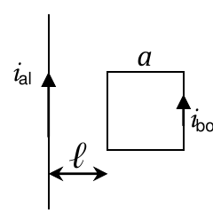

<b>Solución</b>

Solución paso a paso

**Paso 1 — Qué lados importan.** Las fuerzas sobre los lados horizontales (arriba y abajo) son iguales y opuestas: se cancelan. Quedan los lados verticales, de longitud $a$, a distancias $\ell$ y $\ell + a$ del alambre.

**Paso 2 — Sentidos.** La bobina circula en sentido antihorario: el lado izquierdo (cercano) lleva corriente **hacia abajo**, antiparalela a la del alambre, y es **repelido**; el lado derecho (lejano) lleva corriente hacia arriba, paralela, y es atraído. Gana el cercano.

**Paso 3 — Fuerza neta.** Para $N$ vueltas:

$$\vec F_{NETA} = N\,\frac{\mu_0 i_{AL}}{2\pi}a\,i_{bob}\left(\frac1\ell - \frac{1}{\ell + a}\right)(\hat e_x)$$

**Paso 4 — Cálculo.**

$$F = 100\cdot2\times10^{-7}\cdot7\cdot0{,}25\cdot1\cdot\left(10 - 2{,}857\right)\ \text{N} = 2{,}5\times10^{-4}\ \text{N}$$

(La guía omite el factor $N$ en la fórmula, pero su valor numérico lo incluye.)

**Paso 5 — Ítem b.** Si se acerca al cable, el campo externo (entrante a la derecha del cable) crece. El campo inducido tiende a disminuirlo, así que apunta hacia afuera del papel: la corriente inducida circula en sentido **antihorario**.

**Respuesta:** a) $\vec F_{NETA} = N\dfrac{\mu_0 i_{AL}}{2\pi}a\,i_{bob}\left(\dfrac1\ell - \dfrac{1}{\ell + a}\right)(\hat e_x) = 2{,}5\times10^{-4}\,(\hat e_x)$ N; b) como el CM externo crecería hacia adentro de la hoja, el CM inducido tendería a disminuirlo y, en consecuencia, apuntaría hacia afuera del papel; luego, la corriente inducida circularía en sentido antihorario.

---

### Ejercicio 16

Por una bobina de 2 cm de radio y 40 cm de longitud, que tiene arrolladas 2000 vueltas de alambre, circula una corriente *i* (t)=*2 sen (100π t)*. Calcule: a) el valor del coeficiente de autoinducción *L* de la bobina; b) la fem autoinducida en función del tiempo.

<b>Solución</b>

Solución paso a paso

**Paso 1 — Inductancia (ítem a).** Se aproxima por solenoide largo ($40\ \text{cm} \gg 2\ \text{cm}$):

$$L = \mu_0\frac{N^2}{\ell}\pi r^2$$

**Paso 2 — Fem (ítem b).**

$$\mathcal E = -L\frac{di}{dt} = -L\cdot2\cdot100\pi\cos(100\pi t)$$

**Paso 3 — Cálculo.**

$$L = 4\pi\times10^{-7}\cdot\frac{4\times10^6}{0{,}4}\cdot\pi\cdot4\times10^{-4}\ \text{H} = 15{,}8\ \text{mH}$$

$$|\mathcal E(t)| = 200\pi L\cos(100\pi t) = 9{,}92\cos(100\pi t)\ \text{V}$$

**Respuesta:** a) $L = 15{,}8$ mH; b) $\mathcal E(t) = 200\pi L\cos(100\pi t)$ (en módulo, ≈ 9,9 V × cos(100πt))

---

### Ejercicio 17

Dos cables delgados, paralelos e infinitos, separados una distancia *D*, transportan corrientes de igual intensidad $i_C = i_0e^{-bt}$ y de sentidos opuestos. A la derecha de uno de ellos, a una distancia *D*, hay un cuadro de *N* vueltas de sección cuadrada, de lado *h* y coeficiente de autoinducción *L*, por el que circula una corriente propia $i_{ESP} = i_1\,sen(\omega t)$ en sentido horario. Halle la expresión: a) del coeficiente de inducción mutua entre el cuadro y el alambre más lejano;

b) el valor absoluto de la fem inducida en el cuadro en función del tiempo a partir de *t=0*.

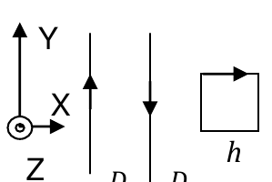

<b>Solución</b>

Solución paso a paso

**Paso 1 — Geometría.** El cuadro está a $D$ del cable cercano, así que a $2D$ del lejano. Se extiende una distancia $h$.

**Paso 2 — Mutua con el cable lejano (ítem a).** Por $M_{12} = M_{21}$, se calcula el flujo del campo del cable a través del cuadro (resultado del recuadro, con lado paralelo $h$, de $2D$ a $2D + h$):

$$M = \frac{N\phi}{i} = \frac{N\mu_0}{2\pi}h\ln\!\left(1 + \frac{h}{2D}\right)$$

**Paso 3 — Flujo total de los cables.** Las corrientes son opuestas: sus flujos tienen signos opuestos.

$$\phi_{cables} = \frac{N\mu_0}{2\pi}h\left[\ln\!\left(1 + \frac hD\right) - \ln\!\left(1 + \frac{h}{2D}\right)\right]i_C(t)$$

**Paso 4 — Fem total.** Se suman la fem debida a los cables y la autoinducida:

$$|\mathcal E| = \left|\frac{N\mu_0}{2\pi}h\left[\ln\!\left(1 + \frac hD\right) - \ln\!\left(1 + \frac{h}{2D}\right)\right]\frac{di_C}{dt} + L\frac{di_{ESP}}{dt}\right|$$

con $\dfrac{di_C}{dt} = -b\,i_0e^{-bt}$ y $\dfrac{di_{ESP}}{dt} = \omega i_1\cos(\omega t)$.

**Respuesta:**

- a) $M = \dfrac{N\mu_0}{2\pi}h\ln\!\left(1 + \dfrac{h}{2D}\right)$
- b) $|\mathcal E| = \left|\dfrac{N\mu_0}{2\pi}h\left[\ln\!\left(1 + \dfrac hD\right) - \ln\!\left(1 + \dfrac{h}{2D}\right)\right]\,(-b)\,i_0e^{-bt} + L\omega i_1\cos(\omega t)\right|$

---

### Ejercicio 18

Suponga que se arregla la configuración de corrientes y espiras del ejercicio anterior de la forma en que indica la figura. Discuta y justifique si alguno de los resultados cambia. En particular, analice el valor del coeficiente de inducción mutua entre los alambres y la espira si las corrientes en este arreglo fueran antiparalelas.

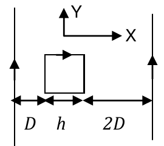

<b>Solución</b>

Solución paso a paso

**Paso 1 — Nueva geometría.** Ahora el cuadro está **entre** los dos cables: a $D$ del izquierdo y a $2D$ del derecho. El cable que está a $2D$ del cuadro sigue a $2D$, así que $M$ con ese cable (ítem a) **no cambia**.

**Paso 2 — Entre los cables.** Con corrientes **paralelas**, entre los cables los campos son opuestos y los flujos se restan; con corrientes **antiparalelas**, entre los cables los campos van en el mismo sentido y los flujos se **suman**. Así cambia el ítem b, y el coeficiente $M$ conjunto (cables–espira) **aumenta**, porque los dos logaritmos se suman.

**Respuesta:** Los valores del ítem (a) del ejercicio anterior permanecen inalterados. Los del ítem (b) cambian. Si las corrientes fueran antiparalelas aumenta el valor del coeficiente M porque los dos logaritmos se sumarían.

---

### Ejercicio 19

El alambre recto de la figura transporta una corriente *i*, de valor constante, y pasa por el centro de un toroide de perfil cuadrado de densidad de espiras *n*, radio *R* y lado *a*, como se muestra en la figura.

a) halle la expresión del coeficiente de inducción mutua del arreglo;

b) halle la expresión del valor absoluto de la fem inducida en el toroide;

c) discuta y justifique cómo se modifica el resultado anterior si el toroide se cortara a la mitad.

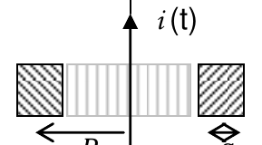

<b>Solución</b>

Solución paso a paso

**Paso 1 — Flujo por una espira del toroide.** Cada espira es un cuadrado de lado $a$, que se extiende radialmente desde $R - a/2$ hasta $R + a/2$ ($R$ = radio medio). El campo del hilo es perpendicular a cada espira:

$$\phi_1 = \int_{R - a/2}^{R + a/2}\frac{\mu_0 i}{2\pi r}\,a\,dr = \frac{\mu_0 i a}{2\pi}\ln\!\left(\frac{2R + a}{2R - a}\right)$$

**Paso 2 — Número de espiras.** $N = n\cdot2\pi R$.

**Paso 3 — Mutua (ítem a).**

$$M = \frac{N\phi_1}{i} = R\,n\,\mu_0\,a\ln\!\left(\frac{2R + a}{2R - a}\right)$$

**Paso 4 — Fem (ítem b).** $|\mathcal E| = M\left|\dfrac{di}{dt}\right|$. (Si la corriente es estrictamente constante, la fem es nula; la expresión sirve para una corriente variable $i(t)$, como en la figura.)

**Paso 5 — Ítem c.** Con medio toroide hay la mitad de espiras: $M' = M/2$ y $\mathcal E' = \mathcal E/2$.

> La guía escribe en (a) $\ln\!\left(\frac{R + a}{R - a}\right)$ y en (b) $\ln\!\left(\frac{2R + a}{2R - a}\right)$. Con $R$ como radio medio y $a$ como lado, el correcto es el segundo en ambos casos (el primero correspondería a un perfil de lado $2a$).

**Respuesta:** a) $M = Rn\mu_0a\ln\!\left(\dfrac{2R + a}{2R - a}\right)$ (la guía: $\ln\frac{R + a}{R - a}$); b) $|\mathcal E| = Rn\mu_0a\ln\!\left(\dfrac{2R + a}{2R - a}\right)\left|\dfrac{di}{dt}\right|$; c) $M' = M/2$, $\mathcal E' = \mathcal E/2$

---

### Ejercicio 20

A una distancia *d*= 25cm de un alambre recto infinito por el que circula una corriente *i* (t) se encuentra una bobina cuadrada de 100 vueltas y lado *a*=10cm.

a) para *i* (t) = 0,3 (1−e−βt) A (β=0,1 seg−1) y la espira en reposo respecto del alambre, calcule el valor absoluto de la fem inducida en función del tiempo e indique el sentido de circulación de la corriente inducida en la espira;

b) estime el tiempo que transcurre hasta que se anula la fem;

c) calcule el valor absoluto de la fem inducida en función de la posición e indique el sentido de circulación de la corriente inducida en la espira para *i*(t) = *i0* constante y la espira acercándose al alambre con velocidad constante *v*.

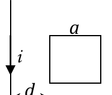

<b>Solución</b>

Solución paso a paso

**Paso 1 — Flujo.** Bobina de $N$ vueltas, lado paralelo $a$, desde $x$ hasta $x + a$:

$$\phi = N\frac{\mu_0 i a}{2\pi}\ln\!\left(\frac{x + a}{x}\right)$$

**Paso 2 — Ítem a (espira quieta en $x = d$).**

$$|\mathcal E| = N\frac{\mu_0 a}{2\pi}\ln\!\left(\frac{d + a}{d}\right)\frac{di}{dt} \qquad \frac{di}{dt} = 0{,}3\,\beta\,e^{-\beta t}$$

$$|\mathcal E| = 100\cdot2\times10^{-7}\cdot0{,}1\cdot\ln(1{,}4)\cdot0{,}03\,e^{-\beta t}\ \text{V} = 2\times10^{-8}e^{-\beta t}\ \text{V}$$

Sentido: la corriente baja por el cable, así que a la derecha el campo es saliente, y **crece**. La corriente inducida genera campo entrante: sentido **horario**.

**Paso 3 — Ítem b.** $e^{-\beta t}$ es prácticamente nula para $\beta t \sim 5$, es decir $t\sim5/\beta = 50$ s. A partir de ahí la corriente es constante y la fem se anula.

**Paso 4 — Ítem c (espira que se acerca).** Ahora cambia $x$, con $dx/dt = -v$:

$$\frac{d}{dx}\ln\!\left(\frac{x + a}{x}\right) = \frac{1}{x + a} - \frac1x = -\frac{a}{x(x + a)}$$

$$|\mathcal E| = N\frac{\mu_0 i_0 a}{2\pi}\,\frac{1}{a + x}\left(\frac ax\right)v$$

Al acercarse, el flujo saliente crece: sentido **horario**.

**Respuesta:**

- a) $|\mathcal E| = 2\times10^{-8}e^{-\beta t}$ V; la corriente inducida circula en sentido horario porque tiende a generar un flujo que disminuya el flujo externo, que crece.
- b) La función $e^{-\beta t}$ se hace prácticamente nula para $\beta t\sim5$, de modo tal que la corriente se hace constante en $t\sim5/\beta = 50$ s y, con $i$ constante, se anula la fem inducida.
- c) $|\mathcal E| = N\dfrac{\mu_0 i_0 a}{2\pi}\dfrac{1}{a + x}\left(\dfrac ax\right)v$; la corriente inducida circula en sentido horario porque tiende a generar un flujo que disminuya el flujo externo, que crece porque la espira se acerca al alambre.

---

### Ejercicio 21

Un solenoide de radio *r1*, longitud ℓ1 y *N1* vueltas se halla en el interior de otro solenoide, de radio *r2 >> r1*, *N2* vueltas y longitud ℓ2 >> ℓ1. Los solenoides son coaxiales y por el externo circula una corriente variable de la forma *i2*(t) = 2 sen (10seg−1 t) A. Suponiendo *r1* = 10 cm y que la bobina exterior tiene *N2*= 1000 vueltas/cm ≡ 105 vueltas/m, a primer orden calcule:

a) el coeficiente de inducción mutua del sistema;

b) suponiendo *r2 >> r1* y ℓ2>>ℓ1, el valor absoluto de la fem inducida en la bobina exterior si *i1*(t) = 3sen (20seg−1 t) A, ℓ2=40cm, *r2*= *50 r1*. Explique por qué son necesarias estas hipótesis.

<b>Solución</b>

Solución paso a paso

**Paso 1 — Mutua (ítem a).** Conviene calcular el flujo del campo del solenoide **exterior** (uniforme, $B_2 = \mu_0 n_2 i_2$) a través del **interior** (área $\pi r_1^2$, $N_1$ vueltas):

$$M = \frac{N_1B_2\pi r_1^2}{i_2} = \mu_0\,n_2\,N_1\,\pi r_1^2$$

**Paso 2 — Cálculo.**

$$\mu_0 n_2\pi r_1^2 = 4\pi\times10^{-7}\cdot10^5\cdot\pi\cdot0{,}01\ \text{H} = 3{,}9\times10^{-3}\ \text{H}$$

Es decir $M = 3{,}9\ \text{mH}\times N_1$. El enunciado no da $N_1$; el valor de la guía (3,9 mH) corresponde a $N_1 = 1$ (por espira del solenoide interno).

**Paso 3 — Fem en la bobina exterior (ítem b).** Se suman la fem mutua (por $i_1$) y la autoinducida (por $i_2$):

$$|\mathcal E_2| = \left|M\frac{di_1}{dt} + L_2\frac{di_2}{dt}\right| \qquad L_2 = \frac{N_2^2\mu_0\pi r_2^2}{\ell_2}$$

con $N_2$ = número total de vueltas ($n_2\ell_2$), $\dfrac{di_1}{dt} = 60\cos(20t)$ A/s y $\dfrac{di_2}{dt} = 20\cos(10t)$ A/s.

**Paso 4 — Hipótesis.** Que $r_2 \gg r_1$ y $\ell_2 \gg \ell_1$ asegura que el solenoide interno está todo en una zona donde el campo del externo es **uniforme** (lejos de los bordes), condición para usar $B_2 = \mu_0 n_2 i_2$.

**Respuesta:** a) $M = \mu_0 n_2 N_1\pi r_1^2 = 3{,}9$ mH (por vuelta del solenoide interno); b) $|\mathcal E_2| = \left|M\dfrac{di_1}{dt} + L_2\dfrac{di_2}{dt}\right|$ con $L_2 = \dfrac{N_2^2\mu_0\pi r_2^2}{\ell_2}$. Las hipótesis son necesarias para poder suponer que el campo en la región del solenoide interno es uniforme.

---

### Ejercicio 22

Un generador de tensión alterna está constituido por una bobina de 10 espiras rectangulares, cada una de ellas de 60 cm2 de área. La bobina gira a razón de 300rpm en la región donde existe un campo magnético uniforme de 3T. Calcule:

a) el flujo de inducción magnética en cada espira en función del tiempo;

b) el valor eficaz de la fem inducida.

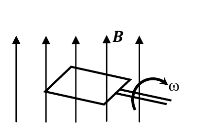

<b>Solución</b>

Solución paso a paso

**Paso 1 — Velocidad angular.** $\omega = 300\ \text{rpm} = 300\cdot\dfrac{2\pi}{60}\ \text{s}^{-1} = 10\pi\ \text{s}^{-1}$.

**Paso 2 — Flujo por espira (ítem a).** $\phi = BA\cos(\omega t)$:

$$\phi(t) = 3\cdot0{,}006\cos(10\pi t)\ \text{Wb} = 18\cos(10\pi\ \text{s}^{-1}t)\ \text{mWb}$$

**Paso 3 — Fem.** $\mathcal E = NBA\omega\sin(\omega t)$, cuyo valor máximo es $NBA\omega$. El valor eficaz de una senoidal es el máximo dividido $\sqrt2$:

$$\mathcal E_{ef} = \frac{NBA\omega}{\sqrt2} = \frac{10\cdot0{,}018\cdot10\pi}{\sqrt2}\ \text{V} = 4\ \text{V}$$

**Respuesta:** a) $\phi(t) = 18\cos(10\pi\ \text{s}^{-1}t)$ mWb; b) $\mathcal E_{ef}\approx 4$ V

---

### Ejercicio 23

Indique cuáles son los dos enunciados verdaderos

- el coeficiente de inducción mutua entre dos espiras circuladas por la misma corriente se duplica si se duplica el valor de una de las corrientes.
- ∬ ***B*** · *d**S*** = 0 ⇔ ƐIND=0
- el signo negativo de la ley de Faraday es consecuencia del principio de acción y reacción.
- ƐIND≠0 ⇒ ∯ ***B*** · *d**S*** ≠ 0
- un solenoide puede considerarse ideal si es muy largo.
- una corriente variable no puede inducir una fem de valor constante.
- ƐIND≠0 ⇒ ∬ ***B*** · *d**S*** ≠ 0
- una corriente estacionaria genera un flujo magnético estacionario y no necesariamente uniforme.

<b>Solución</b>

Solución paso a paso

- "M se duplica si se duplica una corriente": **falso**. $M$ depende solo de la geometría.
- "Flujo nulo ⇔ fem nula": **falso**. Lo que importa es la **variación** del flujo; el flujo puede valer cero en un instante y estar cambiando.
- "El signo negativo es por acción y reacción": **falso**. Es por conservación de la energía.
- "Fem ≠ 0 ⇒ flujo por superficie **cerrada** ≠ 0": **falso**. El flujo de $\vec B$ por una superficie cerrada es siempre cero.
- "Un solenoide es ideal si es muy largo": la guía no la marca. Estrictamente hace falta que sea largo **comparado con su radio**.
- "Una corriente variable no puede inducir una fem constante": **falso**. Por ejemplo, una corriente que crece linealmente induce una fem constante.
- "Fem ≠ 0 ⇒ flujo por superficie abierta ≠ 0": **verdadero** según la guía. Si hay fem, el flujo está variando, así que no puede ser idénticamente nulo.
- "Una corriente estacionaria genera un flujo estacionario y no necesariamente uniforme": **verdadero**.

**Respuesta:**

- ƐIND≠0 ⇒ ∬ **B** · d**S** ≠ 0
- Una corriente estacionaria genera un flujo magnético estacionario y no necesariamente uniforme.

---

### Ejercicio 24

Indique cuáles son los dos enunciados verdaderos

- una bobina almacena energía del campo eléctrico
- dos bobinas de igual radio e igual longitud tienen igual coeficiente de autoinducción.
- la energía almacenada por una bobina es independiente del valor de la corriente que la circula.
- un campo magnético variable siempre induce una fem en toda espira sumergida en él.
- el CM inducido es siempre opuesto al CM externo.
- el coeficiente de autoinducción depende sólo de la geometría de la bobina y es siempre positivo.
- el coeficiente de autoinducción de una bobina vale cero cuando no lo circula corriente alguna.
- el signo negativo en la ley de Faraday Lenz es consecuencia de la conservación de la energía.

<b>Solución</b>

Solución paso a paso

- "Almacena energía del campo eléctrico": **falso**. Del campo **magnético**.
- "Igual radio e igual longitud implica igual L": **falso**. Depende también del número de vueltas ($L\propto N^2$).
- "La energía no depende de la corriente": **falso**. $U = \tfrac12LI^2$.
- "Un campo variable siempre induce fem en toda espira": **falso**. Por ejemplo, si el campo es paralelo al plano de la espira (ejercicio 3), el flujo es siempre cero.
- "El campo inducido es siempre opuesto al externo": **falso**. Se opone a la **variación**; si el flujo disminuye, lo refuerza.
- "L depende solo de la geometría y es siempre positiva": **verdadero**.
- "L vale cero sin corriente": **falso**. Es geométrica.
- "El signo negativo es por conservación de la energía": **verdadero**.

**Respuesta:**

- El coeficiente de autoinducción depende sólo de la geometría de la bobina y es siempre positivo.
- El signo negativo en la ley de Faraday Lenz es consecuencia de la conservación de la energía.

