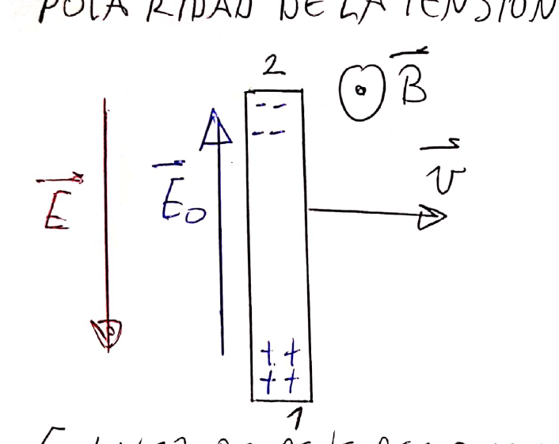
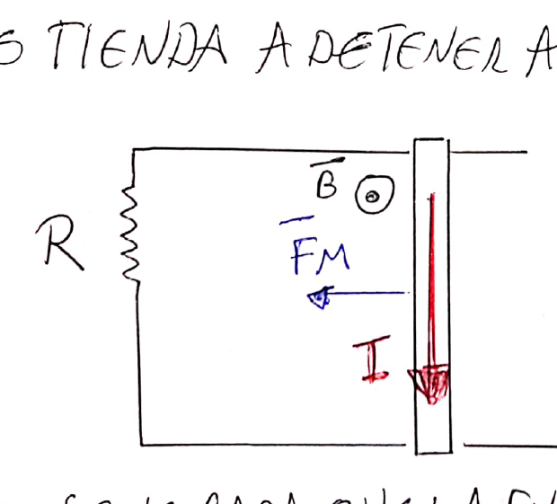
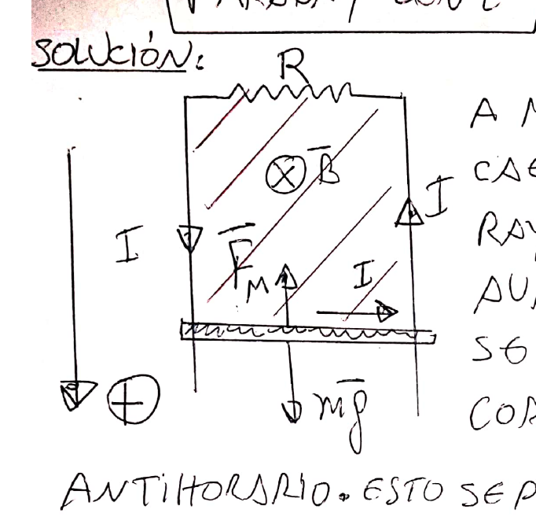
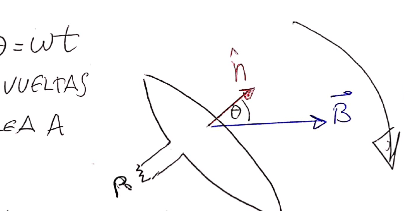
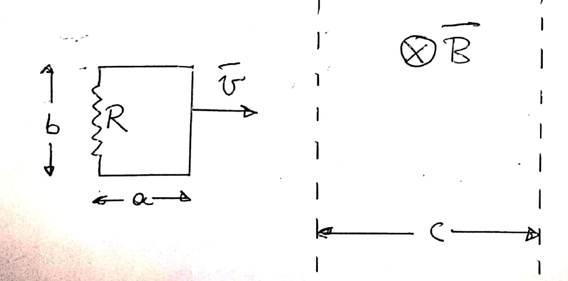
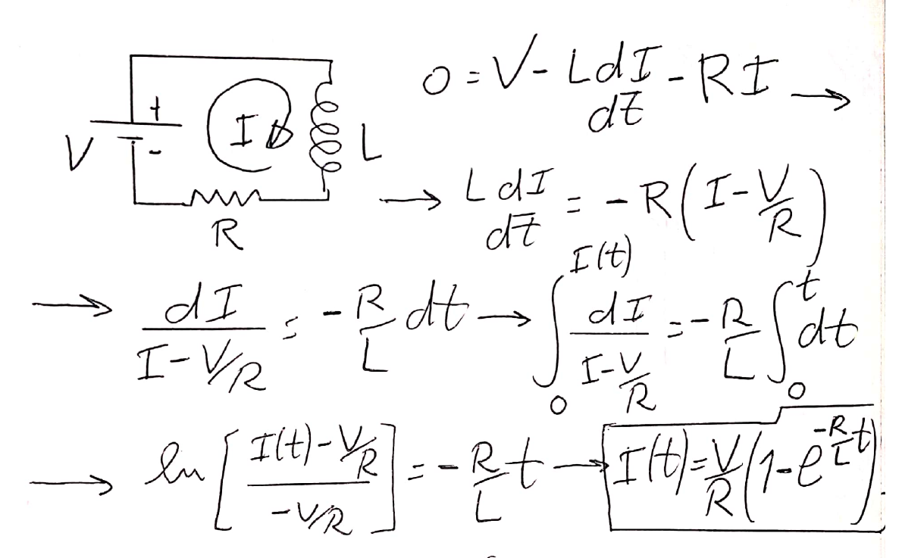
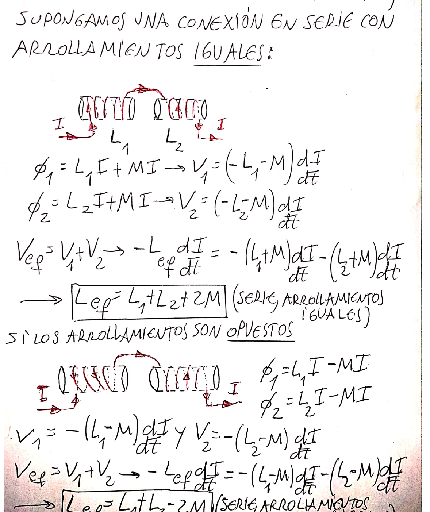
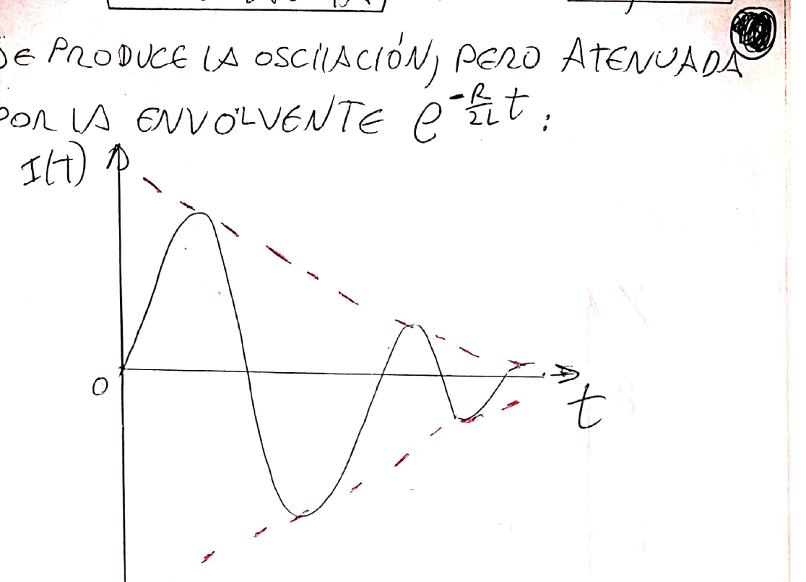

# Tema 6 — Inducción magnética: resumen teórico

Resumen de las clases del aula virtual: [Clase 7 — Ley de Faraday-Lenz](Aula%20Virtual/Clase%207%20-%20Ley%20de%20Faraday-Lenz.pdf) y [Clase 8 — Inductancia](Aula%20Virtual/Clase%208%20-%20Inductancia.pdf).

Ejercicios: [práctica del tema](practica.md).

---

## Índice

1. [Flujo magnético](#1-flujo-magnético)
2. [Ley de Faraday-Lenz](#2-ley-de-faraday-lenz)
3. [Cómo determinar el sentido de la corriente inducida](#3-cómo-determinar-el-sentido-de-la-corriente-inducida)
4. [Fem de movimiento](#4-fem-de-movimiento)
5. [Barra sobre rieles](#5-barra-sobre-rieles)
6. [Generador y motor](#6-generador-y-motor)
7. [Ejemplos resueltos en clase](#7-ejemplos-resueltos-en-clase)
8. [Autoinductancia](#8-autoinductancia)
9. [Circuito RL](#9-circuito-rl)
10. [Inductancia mutua](#10-inductancia-mutua)
11. [Conexión de inductancias](#11-conexión-de-inductancias)
12. [Energía magnética](#12-energía-magnética)
13. [Circuito RLC](#13-circuito-rlc)
14. [Tabla de fórmulas](#14-tabla-de-fórmulas)

---

## 1. Flujo magnético

Una espira en presencia de un campo magnético es atravesada por un **flujo magnético**:

$$\boxed{\phi = \int_S\vec B\cdot\hat n\,ds} \qquad [\phi] = \text{T m}^2 = \text{Wb (weber)}$$

$\hat n$ es la normal a la superficie de la espira. El campo puede deberse a un imán, a una corriente cercana o a la corriente de la **propia** espira. Para una bobina de $N$ vueltas, el flujo total es $N$ veces el de una espira.

- Campo uniforme y espira plana de área $A$: $\phi = BA\cos\theta$ ($\theta$ = ángulo entre $\vec B$ y $\hat n$).
- Espira rectangular de lados $b$ (perpendicular) y $c$ (paralelo), coplanar con un hilo infinito, con el lado cercano a distancia $a$ (ver [Magnetostática](../5%20-%20Magnetost%C3%A1tica/teoria.md#12-flujo-magnético)):

$$\phi = \frac{\mu_0 I c}{2\pi}\ln\!\left(\frac{a + b}{a}\right)$$

---

## 2. Ley de Faraday-Lenz

En 1831 Faraday (y, por separado, Henry) descubrieron que **una variación del flujo a través de una espira induce la aparición de un campo eléctrico en ella**. La variación puede deberse a que se mueve un imán, a que cambia una corriente cercana o la propia, o a que la espira se mueve o se deforma.

La **fem inducida** es la circulación de ese campo:

$$\mathcal E = \oint_C\vec E\cdot d\vec\ell$$

¡Sin ninguna pila! Si la espira es conductora, la fem se detecta porque aparece una corriente $I = \mathcal E/R$; la fem existe aunque la espira no sea conductora (la corriente, no).

Resultados experimentales:

1. Una variación $\Delta\phi$ genera una fem inducida.
2. $|\mathcal E| = \left|\dfrac{d\phi}{dt}\right|$.
3. **Ley de Lenz:** la polaridad es tal que la corriente inducida genera una variación de flujo que **se opone** a la variación original.

Si fuera al revés (que la corriente inducida reforzara la variación), se acumularían variaciones del mismo sentido y la corriente crecería indefinidamente sin ninguna fuente de energía: se violaría la **conservación de la energía**. Por eso el signo menos:

$$\boxed{\oint_C\vec E\cdot d\vec\ell = \mathcal E = -\frac{d\phi}{dt} = -\frac{d}{dt}\int_{S(C)}\vec B\cdot\hat n\,ds}\qquad(\text{ley de Faraday-Lenz})$$

El sentido de $\hat n$ queda fijado por el sentido de $d\vec\ell$ en la integral de línea (regla de la mano derecha).

Observaciones:

- Como $\oint\vec E\cdot d\vec\ell \ne 0$, este campo eléctrico inducido es **no conservativo**. No es el campo electrostático de cargas en reposo.
- La ley **no depende del material** de la espira: vale para cualquier circuito, material o no.
- La fem puede deberse a que cambia $\vec B$ en el tiempo, o a que la espira se mueve o deforma. Este último caso se llama **fem de movimiento**.

---

## 3. Cómo determinar el sentido de la corriente inducida

> **Receta (Lenz)**
>
> 1. Ver el sentido del flujo externo a través de la espira (entrante o saliente).
> 2. Ver si ese flujo **aumenta** o **disminuye**.
> 3. Si aumenta, la corriente inducida genera un campo **opuesto** al externo dentro de la espira; si disminuye, genera un campo **en el mismo sentido** (para "reforzarlo").
> 4. Con la regla de la mano derecha, el sentido del campo inducido fija el sentido de circulación (saliente = antihorario; entrante = horario, mirando el dibujo).

Forma equivalente: la corriente inducida produce fuerzas que **se oponen al movimiento** que causa la variación (frenan la barra, repelen el imán que se acerca, etc.).

---

## 4. Fem de movimiento

Una barra conductora de longitud $\ell$ se mueve con velocidad $\vec v$ en un campo uniforme $\vec B$.

Sobre cada electrón actúa $\vec F_M = -e\,\vec v\times\vec B$, que lo empuja hacia un extremo. Ese extremo se carga negativamente y el otro positivamente: se induce una fem. La separación de cargas crea un campo electrostático $\vec E_0$ y el movimiento cesa cuando $-e\vec E_0 - e\vec v\times\vec B = 0$.

Para un observador sobre la barra (que ve los electrones en reposo), es "como si" hubiera un campo eléctrico **no conservativo**:

$$\vec E = \vec v\times\vec B$$

$$\boxed{\mathcal E_{12} = \int_1^2(\vec v\times\vec B)\cdot d\vec\ell}\quad(\text{fem de movimiento})$$

Para una barra recta perpendicular a $\vec B$ y a $\vec v$: $|\mathcal E| = B\,\ell\,v$.

> El resultado es el mismo que se obtiene derivando el flujo del área que barre la barra. Se puede usar cualquiera de los dos métodos.

---

## 5. Barra sobre rieles

Barra de longitud $\ell$ sobre rieles sin rozamiento, cerrados por una resistencia $R$, en un campo saliente $\vec B$; la barra se mueve hacia la derecha con $\vec v$.

- **Sentido:** el área y el flujo saliente aumentan, así que la corriente inducida genera flujo entrante: circula en sentido **horario**. Equivalentemente, por la barra pasa de arriba hacia abajo, de modo que $\vec F_M = I\vec\ell\times\vec B$ apunta hacia la izquierda y **frena** la barra.
- **Fem:** $\phi = B\ell x = B\ell(x_0 + vt)$, entonces $|\mathcal E| = B\ell v$.
- **Corriente y fuerza:**

$$I = \frac{B\ell v}{R} \qquad F_M = I\ell B = \frac{B^2\ell^2 v}{R}$$

- **Velocidad constante:** un agente externo tiene que aplicar $\vec F_{AE} = \dfrac{B^2\ell^2v}{R}\hat\imath$. La potencia que entrega, $P = F_{AE}\,v = \dfrac{B^2\ell^2v^2}{R}$, es igual a la disipada en la resistencia, $RI^2$: **el trabajo mecánico se convierte en energía eléctrica**, que se disipa como calor.
- **Si el agente deja de actuar** (con $v(0) = v_0$): $-I\ell B = m\,\dfrac{dv}{dt}$, con $I = B\ell v/R$:

$$v(t) = v_0\,e^{-\frac{B^2\ell^2}{Rm}t}\quad(\text{cae exponencialmente})$$

### Barra que cae (rieles verticales)

Con el eje positivo hacia abajo: $mg - \dfrac{B^2\ell^2}{R}v = m\dfrac{dv}{dt}$. Al crecer $v$ crece la fuerza magnética, hasta equilibrar el peso. La barra alcanza una **velocidad terminal**:

$$\boxed{v_T = \frac{mgR}{B^2\ell^2}} \qquad v(t) = v_T\left(1 - e^{-\frac{B^2\ell^2}{mR}t}\right)$$

Para $t$ pequeño, $v \approx gt$ (caída libre: al principio la corriente y la fuerza son pequeñas).

---

## 6. Generador y motor

**Generador de corriente alterna:** una bobina de $N$ vueltas y área $A$ gira con $\omega$ constante en un campo uniforme ($\theta = \omega t$):

$$\phi = NBA\cos\omega t \qquad \mathcal E = \omega NBA\sin\omega t \qquad I = \frac{\omega NBA}{R}\sin\omega t$$

Se convierte **trabajo mecánico en energía eléctrica** (por ejemplo, con agua que cae sobre una turbina en una central hidroeléctrica). El valor eficaz de la fem es $\mathcal E_{ef} = \mathcal E_{máx}/\sqrt2$.

**Motor eléctrico:** es la situación inversa. Se suministra energía eléctrica, la corriente en la bobina (dentro del campo) produce un momento que la hace girar y se obtiene trabajo mecánico.

---

## 7. Ejemplos resueltos en clase

### Espira que atraviesa una región de campo

Espira de lados $a$ (en la dirección del movimiento) y $b$, con resistencia $R$, que se mueve con $v$ constante a través de una región de ancho $c > a$ con $\vec B$ entrante.

| Etapa | Flujo | Corriente | Energía disipada |
|---|---|---|---|
| Antes de entrar | 0, constante | 0 | 0 |
| Entrando | $\phi = bvtB$, crece | $I = bvB/R$, antihoraria | $E_1 = \dfrac{ab^2vB^2}{R}$ |
| Totalmente adentro | constante | 0 | 0 |
| Saliendo | decrece | $I = bvB/R$, horaria | $E_2 = E_1$ |
| Afuera | 0 | 0 | 0 |

Energía total: $E = \dfrac{2ab^2vB^2}{R}$.

### Barra que gira alrededor de un extremo

Barra de longitud $\ell$ que gira con $\omega$ alrededor de A, con $\vec B$ saliente. Con el flujo: el área barrida es $\tfrac12\omega\ell^2t$, entonces $|\mathcal E| = \tfrac12B\omega\ell^2$. Con la fem de movimiento: $\vec v\times\vec B = \omega rB\,\hat r$, de donde $V_B - V_A = \int_0^\ell\omega Br\,dr = \tfrac12B\omega\ell^2$. El extremo libre B queda a mayor potencial.

Si gira alrededor de un punto O a distancia $d$ de A: $V_B - V_A = \tfrac12B\omega\ell(\ell - 2d)$.

### Barra que se mueve paralela a un hilo

Barra de longitud $\ell$, perpendicular a un hilo infinito con corriente $I$, que se mueve con $v$ paralela al hilo; su extremo cercano está a distancia $d$:

$$V_1 - V_2 = \frac{\mu_0 I v}{2\pi}\ln\!\left(1 + \frac\ell d\right)$$

(El extremo cercano al hilo, 1, queda a mayor potencial si la corriente y la velocidad van en el mismo sentido.)

---

## 8. Autoinductancia

Una espira con corriente $I$ genera un campo $\vec B\propto I$ (Biot-Savart), y ese campo genera a través de la **propia** espira un flujo $\phi\propto B\propto I$. La constante de proporcionalidad es la **inductancia** (o coeficiente de autoinducción):

$$\boxed{\phi = L\,I} \qquad [L] = \frac{\text{T m}^2}{\text{A}} = \frac{\text{V s}}{\text{A}} = \text{H (henry)}$$

$L$ depende **solo de la geometría** (y del medio) y es siempre positiva.

**Solenoide largo** de longitud $\ell$, sección $A$ y $N$ vueltas ($B = \mu_0 NI/\ell$):

$$LI = NBA = \mu_0\frac{N^2}{\ell}AI \quad\Rightarrow\quad \boxed{L = \mu_0\frac{N^2}{\ell}A}$$

Un elemento con mucha inductancia es un **inductor** (bobina). Si la corriente cambia, aparece una **fem autoinducida**:

$$\boxed{\mathcal E = -L\frac{dI}{dt}}$$

- Si $I$ crece, $\mathcal E < 0$: se opone a la batería (**fuerza contraelectromotriz**).
- Si $I$ decrece, la fem tiende a mantener la corriente.
- **El inductor siempre se opone a los cambios de corriente**: evita los saltos bruscos. **La corriente a través de una bobina es siempre continua.** Con corriente constante, el inductor no cumple ningún rol.

---

## 9. Circuito RL

Batería $V$, resistencia $R$ e inductor $L$ en serie. Se cierra la llave en $t = 0$ (con $I(0) = 0$):

$$0 = V - L\frac{dI}{dt} - RI \quad\Rightarrow\quad \boxed{I(t) = \frac VR\left(1 - e^{-\frac RLt}\right)} \qquad \frac{dI}{dt} = \frac VL e^{-\frac RLt}$$

- En $t = 0$: $I = 0$ y $dI/dt = V/L$. **La bobina se comporta como una llave abierta.**
- A tiempos largos: $I\to V/R$ y $dI/dt\to 0$. **La bobina se comporta como un cable.**
- Constante de tiempo: $\boxed{\tau = L/R}$; se considera $I = V/R$ para $t > 5\tau$.
- Si después de mucho tiempo se abre la llave, la corriente cae bruscamente y la fem autoinducida es enorme: salta una **chispa** en la llave.

> Comparar con el capacitor: el capacitor descargado empieza como un cable y termina como una llave abierta. La bobina, al revés.

---

## 10. Inductancia mutua

Dos bobinas 1 y 2: la corriente $I_2$ genera un flujo $\phi_{12}$ en la bobina 1, y la corriente $I_1$ genera un flujo $\phi_{21}$ en la bobina 2:

$$\phi_{12} = M_{12}I_2 \qquad \phi_{21} = M_{21}I_1 \qquad \boxed{M_{12} = M_{21} = M}$$

$M$ es la **inductancia mutua**; depende de la geometría y del medio y se mide en henrios.

$$\mathcal E_1 = -M\frac{dI_2}{dt} \qquad \mathcal E_2 = -M\frac{dI_1}{dt}$$

> **Truco:** como $M_{12} = M_{21}$, se calcula el flujo en el sentido más fácil. Por ejemplo, entre un hilo y una espira, conviene calcular el flujo del campo del **hilo** a través de la **espira**.

**Ejemplo:** solenoides coaxiales de radios $R_1 < R_2$, $N_1$ y $N_2$ vueltas y la misma longitud $\ell$:

$$M = \frac{\mu_0N_1N_2\pi R_1^2}{\ell}$$

Ojo: el área es la del solenoide **interior** (el campo del exterior atraviesa solo $\pi R_1^2$ de la bobina interna, y el del interior está confinado a $\pi R_1^2$).

---

## 11. Conexión de inductancias

**Sin inductancia mutua** ($M = 0$), igual que las resistencias:

$$\text{Serie: } L_{ef} = L_1 + L_2 \qquad \text{Paralelo: } \frac{1}{L_{ef}} = \frac{1}{L_1} + \frac{1}{L_2}$$

**Con inductancia mutua**, en serie:

$$L_{ef} = L_1 + L_2 + 2M\ (\text{arrollamientos iguales}) \qquad L_{ef} = L_1 + L_2 - 2M\ (\text{arrollamientos opuestos})$$

---

## 12. Energía magnética

En un circuito RL: $0 = VI - RI^2 - LI\dfrac{dI}{dt}$. El término $VI$ es la potencia que entrega la fuente; $RI^2$, la disipada. El resto, $LI\dfrac{dI}{dt} = \dfrac{d}{dt}\left(\tfrac12LI^2\right)$, es la energía que por unidad de tiempo se almacena en el inductor:

$$\boxed{U_M = \frac12LI^2}\quad(\text{análogo a } \tfrac12CV^2)$$

**Densidad de energía magnética** (con el solenoide, pero el resultado es general):

$$\boxed{u_M = \frac{B^2}{2\mu_0}} \qquad U = \frac{1}{2\mu_0}\int_{Vol}B^2\,dVol$$

Análogo a $u_E = \tfrac12\varepsilon_0E^2$.

**Ejemplo:** cable coaxial (cilindros de radios $a$ y $b$, corrientes opuestas). $B = \mu_0 I/(2\pi r)$ solo entre ellos:

$$U = \frac{\mu_0}{4\pi}\ell\ln\!\left(\frac ba\right)I^2 \quad\Rightarrow\quad L = \frac{\mu_0}{2\pi}\ell\ln\!\left(\frac ba\right)$$

---

## 13. Circuito RLC

Malla con batería: $0 = V - RI - L\dfrac{dI}{dt} - \dfrac QC$, con $I = dQ/dt$:

$$\frac{d^2Q}{dt^2} + \frac RL\frac{dQ}{dt} + \frac{Q}{LC} = \frac VL \qquad \frac{d^2I}{dt^2} + \frac RL\frac{dI}{dt} + \frac{I}{LC} = 0$$

La carga tiene solución particular $Q_p = VC$ (a tiempos largos, el capacitor queda cargado a la tensión de la batería y la corriente se anula). Proponiendo $I\sim e^{-\lambda t}$:

$$\lambda_\pm = \frac{R}{2L}\pm\sqrt{\frac{R^2}{4L^2} - \frac{1}{LC}}$$

| Caso | Condición | Corriente |
|---|---|---|
| **Sobreamortiguado** (no oscila) | $R^2 > 4L/C$ | $I = Ae^{-\lambda_+t} + Be^{-\lambda_-t}$ |
| **Subamortiguado** (oscila) | $R^2 < 4L/C$ | $I = Ce^{-\frac{R}{2L}t}\cos(\omega t + \varphi)$, $\omega = \sqrt{\frac{1}{LC} - \frac{R^2}{4L^2}}$ |
| **Crítico** | $R^2 = 4L/C$ | $I = Ae^{-\frac{R}{2L}t} + Bte^{-\frac{R}{2L}t}$ |

Las constantes salen de las condiciones iniciales: $I(0) = 0$ (la corriente en la bobina es continua) y $L\,\dfrac{dI}{dt}\Big|_0$ = la tensión que queda sobre la bobina en $t = 0$.

**Ejemplos de clase:**

- RLC sin batería, $R = 50$ mΩ, $C = 4$ μF; la amplitud cae a 1/3 en 0,09 s. Entonces $e^{-\frac{R}{2L}0{,}09} = \tfrac13$, de donde $L = 2$ mH (y se verifica que $R^2 < 4L/C$: oscila).
- RLC con batería, $V = 10$ V, $R = 500$ Ω, $L = 0{,}5$ H, $C = 100$ μF: $R^2 > 4L/C$, sobreamortiguado. Con $I(0) = 0$ y $dI/dt|_0 = V/L = 20$ A/s:

$$I(t) = 0{,}021\ \text{A}\left(e^{-20{,}42t} - e^{-979{,}58t}\right)$$

---

## 14. Tabla de fórmulas

| Tema | Fórmula |
|---|---|
| Flujo | $\phi = \int\vec B\cdot\hat n\,ds$ |
| Faraday-Lenz | $\mathcal E = \oint\vec E\cdot d\vec\ell = -d\phi/dt$ |
| Bobina de N vueltas | $\mathcal E = -N\,d\phi_1/dt$ |
| Fem de movimiento | $\mathcal E = \int(\vec v\times\vec B)\cdot d\vec\ell$; barra recta $B\ell v$ |
| Barra que gira | $\mathcal E = \tfrac12B\omega\ell^2$ |
| Barra sobre rieles | $I = B\ell v/R$, $F = B^2\ell^2v/R$ |
| Velocidad terminal | $v_T = mgR/(B^2\ell^2)$ |
| Generador | $\mathcal E = NBA\omega\sin\omega t$ |
| Carga inducida | $Q = \Delta\phi/R$ |
| Autoinductancia | $\phi = LI$, $\mathcal E = -L\,dI/dt$ |
| Solenoide | $L = \mu_0N^2A/\ell$ |
| RL | $I = \frac VR(1 - e^{-Rt/L})$, $\tau = L/R$ |
| Mutua | $\phi_{12} = MI_2$, $\mathcal E_1 = -M\,dI_2/dt$ |
| Solenoides coaxiales | $M = \mu_0N_1N_2\pi R_1^2/\ell$ |
| Serie con M | $L_{ef} = L_1 + L_2\pm2M$ |
| Energía | $U = \tfrac12LI^2$, $u_M = B^2/(2\mu_0)$ |
| Coaxial | $L = \frac{\mu_0\ell}{2\pi}\ln(b/a)$ |
| RLC | oscila si $R^2 < 4L/C$, $\omega = \sqrt{1/(LC) - R^2/(4L^2)}$ |
