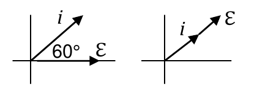
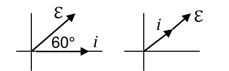
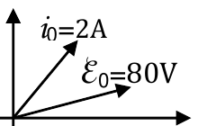
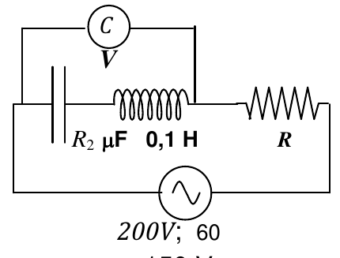
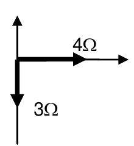
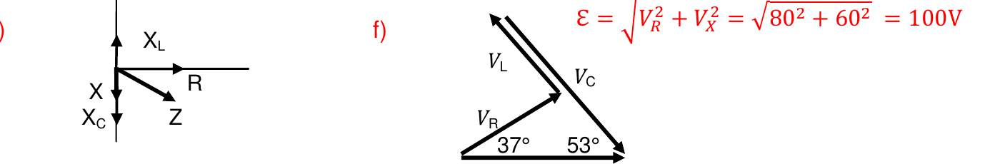
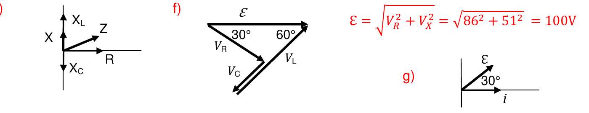
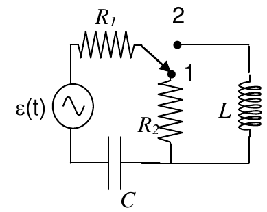

# Tema 7 — Corriente alterna: ejercicios resueltos

Ejercicios de la [Guía de ejercicios de Corriente alterna](Aula%20Virtual/Gu%C3%ADa%20de%20ejercicios%20-%20Corriente%20alterna.pdf). Los enunciados están copiados textualmente de la guía.

Cada ejercicio tiene un botón **Solución**. Al abrirlo aparece la respuesta y, arriba, un segundo botón **Solución paso a paso** con el desarrollo completo. En el paso a paso primero se obtiene la fórmula en forma simbólica y recién al final se reemplazan los números.

Teoría: [resumen del tema](teoria.md). En el aula virtual también está la [resolución manuscrita de la guía](Aula%20Virtual/Resoluci%C3%B3n%20gu%C3%ADa%20-%20Corriente%20alterna.pdf).

| Bloque | Ejercicios |
|---|---|
| Circuitos de dos elementos | [1](#ejercicio-1) · [2](#ejercicio-2) · [3](#ejercicio-3) · [4](#ejercicio-4) |
| RLC serie | [5](#ejercicio-5) · [6](#ejercicio-6) · [7](#ejercicio-7) · [8](#ejercicio-8) · [9](#ejercicio-9) · [10](#ejercicio-10) · [11](#ejercicio-11) |
| Conceptual | [12](#ejercicio-12) |

---

### Ejercicio 1

Un generador de corriente alterna que entrega 100V de tensión eficaz a 50 Hz se halla conectado a un circuito RC serie. Por el circuito circula una corriente eficaz *ief*= 0,2 sen (2π50 t + π/3) A.

a) calcule el valor de la impedancia del circuito RC serie;

b) calcule el valor de R y el valor de C;

c) calcule el valor de la tensión eficaz sobre el resistor;

d) calcule el valor de la tensión eficaz sobre el capacitor;

e) calcule el valor de inductancia que debe conectarse en serie al circuito RC serie para que entre en resonancia a frecuencia doble de la de trabajo;

f) calcule la potencia disipada por el circuito RC serie;

g) indique y justifique cuál sería el valor de la caída en la resistencia si el circuito RC estuviera en paralelo;

h) realice el diagrama de fasores correspondientes a los circuitos RC y RLC serie.

<b>Solución</b>

Solución paso a paso

**Lectura de datos.** La guía llama "corriente eficaz" a la expresión, así que se toma $I_{EF} = 0{,}2$ A. La fase $+\pi/3$ indica que la corriente **adelanta 60°** a la tensión (capacitivo, como corresponde a un RC). $\omega = 2\pi\cdot50 = 314{,}16$ s⁻¹.

**Paso 1 — Impedancia (ítem a).**

$$Z = \frac{\mathcal E_{EF}}{I_{EF}}$$

**Paso 2 — R y C (ítem b).** Del triángulo de impedancias, con $\phi = 60^\circ$:

$$R = Z\cos\phi \qquad X_C = Z\operatorname{sen}\phi \qquad C = \frac{1}{\omega X_C}$$

**Paso 3 — Tensiones (ítems c y d).** $V_{R,EF} = RI_{EF}$ y $V_{C,EF} = X_CI_{EF}$ (comprobando que $\sqrt{V_R^2 + V_C^2} = 100$ V).

**Paso 4 — Inductancia (ítem e).** Resonancia en $\omega' = 2\omega$: $\omega'^2LC = 1$, de donde

$$L = \frac{1}{(2\omega)^2C}$$

**Paso 5 — Potencia (ítem f).** $P = RI_{EF}^2$.

**Paso 6 — Cálculo.**

$$Z = \frac{100}{0{,}2}\ \Omega = 500\ \Omega \qquad R = 500\cdot0{,}5 = 250\ \Omega \qquad X_C = 500\cdot0{,}866 = 433\ \Omega$$

$$C = \frac{1}{314{,}16\cdot433}\ \text{F} = 7{,}35\ \mu\text{F} \qquad V_{R,EF} = 250\cdot0{,}2 = 50\ \text{V} \qquad V_{C,EF} = 433\cdot0{,}2 = 86{,}6\ \text{V}$$

$$L = \frac{1}{(628{,}3)^2\cdot7{,}35\times10^{-6}}\ \text{H} = 0{,}345\ \text{H} \qquad P = 250\cdot0{,}04\ \text{W} = 10\ \text{W}$$

**Paso 7 — Ítem g.** En paralelo, cada rama está conectada directamente al generador: la resistencia tiene los 100 V completos.

**Paso 8 — Ítem h.** RC: la corriente adelanta 60° a $\mathcal E$. RLC en resonancia (a la frecuencia doble): corriente y tensión en fase.

**Respuesta:**

- a) $Z = \mathcal E_{ef}/i_{ef} = 500\ \Omega$
- b) $R = Z\cos\phi = 250\ \Omega$; $|X_C| = Z\operatorname{sen}\phi = 433\ \Omega \Rightarrow C = 7{,}35\ \mu$F
- c) $V_{ef,R} = 50$ V
- d) $V_{ef,C} = (100^2 - 50^2)^{1/2}$ V $= 86{,}6$ V
- e) $L = 345$ mH
- f) $\langle P\rangle = 10$ W
- g) $V_{R,ef} = 100$ V, porque no deja de ser un circuito en paralelo.
- h) Diagramas de la guía:

---

### Ejercicio 2

Suponga que el circuito del ejercicio anterior fuera un RL serie, con la corriente ahora de valor *ief*= 0,2 sen (2π50 t − π/3) A y los 80 V cayendo sobre el inductor. Indique y justifique cuáles resultados cambiarían y cómo.

<b>Solución</b>

Solución paso a paso

**Paso 1 — Qué se mantiene.** La tensión, la corriente eficaz y el **módulo** del ángulo (60°) son los mismos. Ahora la corriente **atrasa**: es inductivo. Por lo tanto $Z$, $R$, $|X|$, $V_R$, $V_X$ y la potencia no cambian.

**Paso 2 — Inductancia.** Ahora la reactancia de 433 Ω es inductiva:

$$L = \frac{X_L}{\omega} = \frac{433}{314{,}16}\ \text{H} = 1{,}38\ \text{H}$$

**Paso 3 — Ítem e.** Hay que agregar un **capacitor** que resuene a 100 Hz con esa $L$:

$$C = \frac{1}{(2\omega)^2L} = \frac{1}{(628{,}3)^2\cdot1{,}378}\ \text{F} = 1{,}84\ \mu\text{F}$$

> El enunciado menciona "80 V cayendo sobre el inductor", pero con los mismos $Z$ y $\phi$ la tensión en el inductor es $433\cdot0{,}2 = 86{,}6$ V. La guía también considera que el ítem d no cambia.

**Paso 4 — Fasores.** Ahora la tensión adelanta 60° a la corriente; en resonancia siguen en fase.

**Respuesta:**

- (a) no cambia; (b) el valor de $|X|$ no cambia, y $|X_L| = Z\operatorname{sen}\phi = 433\ \Omega \Rightarrow L = 1{,}38$ H
- (c) no cambia; (d) no cambia; (e) $C = 1{,}83\ \mu$F; (f) no cambia
- g) Diagramas de la guía:

---

### Ejercicio 3

En las especificaciones de una lámpara incandescente se lee: 120 V, 60 W. Se sabe que la resistencia del filamento es de 240 Ω. Se desea conectar la lámpara a la red domiciliaria (220 V de tensión eficaz, 50 Hz) de manera tal que provea la misma potencia lumínica. Calcule el valor de la inductancia *L* que debe conectarse en serie con la lámpara para lograr el objetivo.

<b>Solución</b>

Solución paso a paso

**Paso 1 — Corriente nominal.** Para dar la misma potencia, por la lámpara tiene que pasar la misma corriente que a 120 V:

$$I = \frac{P}{V_{nom}}$$

**Paso 2 — Impedancia necesaria con 220 V.**

$$Z = \frac{V_{red}}{I}$$

**Paso 3 — Reactancia y L.** $Z^2 = R^2 + X_L^2$:

$$L = \frac{\sqrt{Z^2 - R^2}}{\omega}$$

**Paso 4 — Cálculo.**

$$I = \frac{60}{120}\ \text{A} = 0{,}5\ \text{A} \qquad Z = \frac{220}{0{,}5}\ \Omega = 440\ \Omega$$

$$L = \frac{\sqrt{440^2 - 240^2}}{2\pi\cdot50}\ \text{H} = \frac{368{,}8}{314{,}16}\ \text{H} = 1{,}17\ \text{H}$$

(Se usa una inductancia y no una resistencia porque la bobina no disipa potencia.)

**Respuesta:** $L = 1{,}17$ H

---

### Ejercicio 4

El diagrama de fases de la figura corresponde a un circuito de CA de sólo dos elementos pasivos que disipa 40W a 50Hz. Calcule el valor de esos elementos.

<b>Solución</b>

Solución paso a paso

**Paso 1 — Qué elementos son.** En el diagrama la corriente está **adelantada** respecto de la tensión: es un circuito capacitivo, con dos elementos **R y C**. Los valores son de pico: $i_0 = 2$ A y $\mathcal E_0 = 80$ V.

**Paso 2 — R.** Solo la resistencia disipa: $P = \tfrac12i_0^2R$:

$$R = \frac{2P}{i_0^2}$$

**Paso 3 — C.** $Z = \mathcal E_0/i_0$ y $X_C = \sqrt{Z^2 - R^2}$:

$$C = \frac{1}{\omega X_C}$$

**Paso 4 — Cálculo.**

$$R = \frac{80}{4}\ \Omega = 20\ \Omega \qquad Z = \frac{80}{2}\ \Omega = 40\ \Omega \qquad X_C = \sqrt{1600 - 400}\ \Omega = 34{,}6\ \Omega$$

$$C = \frac{1}{314{,}16\cdot34{,}6}\ \text{F} = 92\ \mu\text{F}$$

**Respuesta:** $R = 20\ \Omega$; $C = 92\ \mu$F

---

### Ejercicio 5

Un circuito RLC serie de CA disipa 80 W. Se sabe que la corriente atrasa respecto de la tensión, cuyos valores de pico son *i0* = 2 A y *ℰ0* = 100 V, respectivamente.

a) Halle el valor de la diferencia *XL − XC* entre los valores de las reactancias inductiva y capacitiva.

b) ¿Aumentaría o disminuiría usted el valor de *C* si se propusiera hacer entrar al circuito en resonancia manteniendo constante el valor de *L* y la frecuencia del generador? Justifique su respuesta.

<b>Solución</b>

Solución paso a paso

**Paso 1 — R.** $P = \tfrac12i_0^2R$, así que $R = \dfrac{2P}{i_0^2}$.

**Paso 2 — Z.** $Z = \dfrac{\mathcal E_0}{i_0}$.

**Paso 3 — Reactancia neta.** La corriente atrasa, así que es inductivo y $X_L - X_C > 0$:

$$X_L - X_C = \sqrt{Z^2 - R^2}$$

**Paso 4 — Cálculo.**

$$R = \frac{160}{4}\ \Omega = 40\ \Omega \qquad Z = 50\ \Omega \qquad X_L - X_C = \sqrt{2500 - 1600}\ \Omega = 30\ \Omega$$

**Paso 5 — Ítem b.** Para la resonancia hace falta $X_C = X_L$, es decir **aumentar** $X_C = \dfrac{1}{\omega C}$. Con $\omega$ fija, eso se logra **disminuyendo** $C$.

**Respuesta:**

- a) $X_L - X_C = 30\ \Omega$
- b) Como la tensión adelanta a la corriente, el circuito es inductivo ($X_L > X_C$). Para que entre en resonancia hay que lograr que $X_L = X_C$; se debe aumentar $X_C = (\omega C)^{-1}$, y para conseguirlo sin variar la frecuencia (ni la pulsación del generador) hay que disminuir $C$.

---

### Ejercicio 6

A un circuito RLC serie que opera a 50Hz y resuena a 40 Hz, se le suministra una potencia aparente de 60 VA. Si la corriente (cuya intensidad de pico es *i0* = 0,4 A) retrasa 37° respecto de la tensión, calcule:

a) el valor de *R*;

b) los valores de *L* y *C*.

<b>Solución</b>

Solución paso a paso

**Paso 1 — Corriente eficaz.** $I_{EF} = i_0/\sqrt2 = 0{,}283$ A.

**Paso 2 — R (ítem a).** La potencia activa es $P = S\cos\phi = RI_{EF}^2$:

$$R = \frac{S\cos\phi}{I_{EF}^2}$$

$$R = \frac{60\cdot0{,}8}{0{,}08}\ \Omega = 600\ \Omega$$

**Paso 3 — Reactancia neta.** La corriente atrasa, así que es inductivo: $X = R\tan\phi$.

**Paso 4 — L y C (ítem b).** Usando $X = \omega L\left(1 - \dfrac{\omega_R^2}{\omega^2}\right)$:

$$L = \frac{R\tan\phi}{\omega\left(1 - (f_R/f)^2\right)} \qquad C = \frac{1}{\omega_R^2L}$$

**Paso 5 — Cálculo.**

$$X = 600\cdot0{,}7536\ \Omega = 452\ \Omega \qquad L = \frac{452}{314{,}16\cdot(1 - 0{,}64)}\ \text{H} = \frac{452}{113{,}1}\ \text{H} = 4{,}0\ \text{H}$$

$$C = \frac{1}{(2\pi\cdot40)^2\cdot4{,}0}\ \text{F} = 3{,}96\ \mu\text{F}$$

> La guía da $L \approx 0{,}84$ H y $C \approx 18{,}8\ \mu$F. Ese par cumple la condición de resonancia a 40 Hz, pero con él $X = 0{,}84\cdot113{,}1 = 95\ \Omega$ y $\tan\phi = 95/600$, es decir $\phi = 9°$ en lugar de 37°. Con los datos del enunciado ($R = 600\ \Omega$ y $\phi = 37°$) se obtiene $L = 4$ H y $C = 3{,}96\ \mu$F.

**Respuesta:** a) $R = 600\ \Omega$; b) $L \approx 4{,}0$ H y $C \approx 3{,}96\ \mu$F (la guía: $L \approx 0{,}84$ H, $C \approx 18{,}8\ \mu$F; ver nota)

---

### Ejercicio 7

El voltímetro representado en el circuito serie RLC de la figura indica 90V. Calcule:

a) la tensión eficaz en cada elemento.

b) el valor de la frecuencia *f0* que debería tener el generador para que el circuito esté en resonancia.

> ⚠️ En el PDF de la guía los rótulos de la figura están superpuestos ("200V; 60 Hz", "150 V; 400 Hz", "R₂ μF"). Los resultados de la guía se reproducen con: **generador de 150 V eficaces**, $C = 25\ \mu$F, $L = 0{,}1$ H y $\omega = 800$ s⁻¹ ($f \approx 127$ Hz). Se resuelve con esos datos.

<b>Solución</b>

Solución paso a paso

**Paso 1 — Qué mide el voltímetro.** Está conectado sobre el capacitor y la bobina juntos. Sus tensiones están en **contrafase** (una a +90° y otra a −90° de la corriente), así que el voltímetro mide la **diferencia**:

$$V_{LC} = |V_L - V_C| = 90\ \text{V}$$

**Paso 2 — Tensión en R.** Por el triángulo de tensiones, $\mathcal E^2 = V_R^2 + (V_L - V_C)^2$:

$$V_R = \sqrt{\mathcal E^2 - V_{LC}^2} = \sqrt{150^2 - 90^2}\ \text{V} = 120\ \text{V}$$

**Paso 3 — Reactancias.**

$$X_L = \omega L = 800\cdot0{,}1 = 80\ \Omega \qquad X_C = \frac{1}{\omega C} = \frac{1}{800\cdot25\times10^{-6}} = 50\ \Omega$$

**Paso 4 — Corriente y tensiones (ítem a).**

$$I = \frac{V_{LC}}{X_L - X_C} = \frac{90}{30}\ \text{A} = 3\ \text{A}$$

$$V_L = 80\cdot3 = 240\ \text{V} \qquad V_C = 50\cdot3 = 150\ \text{V} \qquad V_R = 120\ \text{V}\ (R = 40\ \Omega)$$

Observar que $V_L$ y $V_C$ son **mayores** que la tensión del generador: es posible porque se restan.

**Paso 5 — Resonancia (ítem b).**

$$f_0 = \frac{1}{2\pi\sqrt{LC}} = \frac{1}{2\pi\sqrt{0{,}1\cdot25\times10^{-6}}}\ \text{Hz} = 101\ \text{Hz}$$

**Respuesta:** a) $V_{ef,L} = 240$ V; $V_{ef,C} = 150$ V; $V_{ef,R} = 120$ V; b) $f_0 \approx 101$ Hz

---

### Ejercicio 8

A un circuito RLC serie se le conecta una fuente que entrega una tensión ℰ(t)= 10 *sen* (500 s−1 *t*) V. La inductancia es variable, en tanto que la resistencia es de 4Ω y el capacitor de 200 μF. Se ajusta el valor de *L* de tal manera que el diagrama de impedancias es el de la figura. En estas condiciones calcule:

a) los valores de la potencia que se suministra al circuito (potencia aparente) y la que entrega el circuito (potencia activa);

b) la tensión en función del tiempo en el resistor, en la bobina y en el capacitor.

<b>Solución</b>

Solución paso a paso

**Paso 1 — Leer el diagrama.** $R = 4\ \Omega$ y reactancia neta $X = X_L - X_C = -3\ \Omega$ (hacia abajo): es **capacitivo**. $Z = \sqrt{4^2 + 3^2} = 5\ \Omega$.

**Paso 2 — Reactancias.** $X_C = \dfrac{1}{500\cdot200\times10^{-6}} = 10\ \Omega$, así que $X_L = X_C - 3 = 7\ \Omega$ ($L = 14$ mH).

**Paso 3 — Corriente.** $i_0 = \mathcal E_0/Z = 2$ A. Como es capacitivo, la corriente **adelanta** $\phi = \arctan\dfrac34 = 37^\circ$:

$$i(t) = 2\operatorname{sen}(500t + 37^\circ)\ \text{A}$$

**Paso 4 — Potencias (ítem a).**

$$S = \tfrac12\mathcal E_0i_0 = \tfrac12\cdot10\cdot2 = 10\ \text{VA} \qquad P = \tfrac12i_0^2R = \tfrac12\cdot4\cdot4 = 8\ \text{W}$$

**Paso 5 — Tensiones (ítem b).** Cada una con su amplitud ($i_0$ por la reactancia o resistencia) y su fase respecto de la corriente:

$$V_R = i_0R\operatorname{sen}(500t + 37^\circ) = 8\operatorname{sen}(500t + 37^\circ)\ \text{V}$$

$$V_C = i_0X_C\operatorname{sen}(500t + 37^\circ - 90^\circ) = 20\operatorname{sen}(500t - 53^\circ)\ \text{V}$$

$$V_L = i_0X_L\operatorname{sen}(500t + 37^\circ + 90^\circ) = 14\operatorname{sen}(500t + 127^\circ)\ \text{V}$$

**Respuesta:**

- a) $S = 10$ VA; $P = 8$ W
- b) $V_R = i_0R = 8\operatorname{sen}(500t + 37^\circ)$ V; $V_C = i_0|X_C|\operatorname{sen}(500t + 37^\circ - 90^\circ) = 20\operatorname{sen}(500t - 53^\circ)$ V; $V_L = i_0X_L\operatorname{sen}(500t + 37^\circ + 90^\circ) = 14\operatorname{sen}(500t + 127^\circ)$ V

---

### Ejercicio 9

Por un circuito *RLC* serie circula una corriente *i*(t) = 20 sen (2π50 t +37°) A. Sabiendo que la potencia activa es de 800 W y *C* = 530,7 μF

a) calcule los valores de *R* y *L*;

b) calcule cuál debería ser el valor de *L* para que la fuente entregara máxima potencia.

c) justifique por qué en este caso *L* debe aumentar para máxima potencia;

d) escriba las expresiones de la tensión en cada elemento del circuito;

e) realice el diagrama de impedancias;

f) construya el diagrama de tensiones y muestre que vale Kirchhoff;

<b>Solución</b>

Solución paso a paso

**Paso 1 — R.** $P = \tfrac12i_0^2R$, de donde $R = \dfrac{2P}{i_0^2} = \dfrac{1600}{400} = 4\ \Omega$.

**Paso 2 — Tipo de circuito.** La corriente adelanta 37° (respecto de una tensión de fase 0): es **capacitivo**, con $X_C - X_L = R\tan37^\circ$.

**Paso 3 — L (ítem a).**

$$X_C = \frac{1}{\omega C} = \frac{1}{314{,}16\cdot530{,}7\times10^{-6}} = 6\ \Omega \qquad X_L = X_C - R\tan37^\circ = 6 - 3 = 3\ \Omega$$

$$L = \frac{X_L}{\omega} = \frac{3}{314{,}16}\ \text{H} = 9{,}55\ \text{mH}$$

**Paso 4 — Máxima potencia (ítem b).** Se da en resonancia, $X_L = X_C = 6\ \Omega$:

$$L = \frac{6}{314{,}16}\ \text{H} = 19{,}1\ \text{mH}$$

**Paso 5 — Ítem c.** Al ser capacitivo, la frecuencia de resonancia está **por debajo** de la de trabajo. Para correrla hacia arriba hay que aumentar $X_L$, es decir aumentar $L$.

**Paso 6 — Tensiones (ítem d).**

$$V_R = 20\cdot4 = 80\operatorname{sen}(2\pi50t + 37^\circ)\ \text{V}$$

$$V_C = 20\cdot6 = 120\operatorname{sen}(2\pi50t - 53^\circ)\ \text{V}$$

$$V_L = 20\cdot3 = 60\operatorname{sen}(2\pi50t + 127^\circ)\ \text{V}$$

**Paso 7 — Kirchhoff (ítem f).** Sumando fasores: $\mathcal E = \sqrt{V_R^2 + (V_C - V_L)^2} = \sqrt{80^2 + 60^2} = 100$ V $= Z\,i_0 = 5\cdot20$ ✓.

**Respuesta:**

- a) $R = 4\ \Omega$; $L = 9{,}55$ mH
- b) $L = 19{,}1$ mH
- c) Porque si la tensión atrasa, el circuito es capacitivo. Luego, la frecuencia de resonancia se halla por debajo de la frecuencia de trabajo, de manera tal que para correr la frecuencia de resonancia hacia la derecha debe aumentarse la reactancia inductiva.
- d) $V_R = i(t)R = 80\operatorname{sen}(2\pi50t + 37^\circ)$ V; $V_C = i(t)|X_C| = 120\operatorname{sen}(2\pi50t - 53^\circ)$ V; $V_L = i(t)X_L = 60\operatorname{sen}(2\pi50t + 127^\circ)$ V
- e) y f) Diagramas de la guía ($\mathcal E = \sqrt{V_R^2 + V_X^2} = \sqrt{80^2 + 60^2} = 100$ V):

---

### Ejercicio 10

La potencia media que entrega un circuito *RLC* serie es de 86 W con un factor de potencia 0,86. El circuito trabaja a 50 Hz y resuena a 40 Hz. La corriente de pico es de 2 A.

a) justifique si el circuito es capacitivo o inductivo;

b) calcule los valores de *R* y *L*;

c) escriba la expresión de la tensión y de la corriente en el circuito;

d) escriba las expresiones de la tensión en cada elemento del circuito;

e) realice el diagrama de impedancias;

f) realice el diagrama de tensiones y muestre que vale Kirchhoff;

g) realice el diagrama de fases;

h) calcule el valor de las potencias aparente y reactiva y relaciónelas con la potencia activa.

<b>Solución</b>

Solución paso a paso

**Paso 1 — Ítem a.** Trabaja **por encima** de la resonancia ($50 > 40$ Hz), así que $X_L > X_C$: **inductivo**. La tensión adelanta a la corriente.

**Paso 2 — R.** $P = \tfrac12i_0^2R$, entonces $R = \dfrac{2P}{i_0^2} = \dfrac{172}{4} = 43\ \Omega$.

**Paso 3 — Reactancia neta.** $\phi = \arccos0{,}86 = 30{,}7^\circ \approx 30^\circ$, así que $X = R\tan\phi$.

**Paso 4 — L y C.** Con $X = \omega L\left(1 - \dfrac{f_R^2}{f^2}\right)$:

$$L = \frac{R\tan\phi}{\omega(1 - 0{,}64)} \qquad C = \frac{1}{\omega_R^2L}$$

$$X = 43\cdot0{,}593 = 25{,}5\ \Omega \qquad L = \frac{25{,}5}{113{,}1}\ \text{H} = 0{,}226\ \text{H} \qquad C = \frac{1}{(251{,}3)^2\cdot0{,}226}\ \text{F} = 70\ \mu\text{F}$$

(La guía, redondeando $\phi = 30^\circ$, da $L = 222$ mH y $C = 72\ \mu$F.)

**Paso 5 — Tensión y corriente (ítem c).** $Z = R/\cos\phi = 50\ \Omega$, $\mathcal E_0 = Zi_0 = 100$ V. Tomando la tensión con fase 0, la corriente atrasa 30°:

$$\mathcal E(t) = 100\operatorname{sen}(2\pi50t)\ \text{V} \qquad i(t) = 2\operatorname{sen}(2\pi50t - \pi/6)\ \text{A}$$

**Paso 6 — Tensiones (ítem d).** $X_L = \omega L = 70{,}9\ \Omega$ y $X_C = 45{,}4\ \Omega$ (con los valores de la guía, 69,7 y 44,2):

$$V_R = 86\operatorname{sen}(2\pi50t - 30^\circ) \qquad V_C \approx 88{,}4\operatorname{sen}(2\pi50t - 120^\circ) \qquad V_L \approx 139{,}4\operatorname{sen}(2\pi50t + 60^\circ)$$

**Paso 7 — Kirchhoff (ítem f).** $\sqrt{86^2 + (139{,}4 - 88{,}4)^2} = \sqrt{86^2 + 51^2} = 100$ V ✓.

**Paso 8 — Potencias (ítem h).**

$$S = \tfrac12\mathcal E_0i_0 = 100\ \text{VA} \qquad Q = S\operatorname{sen}\phi = 51\ \text{VAR} \qquad P = \sqrt{S^2 - Q^2} = 86\ \text{W}$$

**Respuesta:**

- a) El circuito es inductivo porque la frecuencia de resonancia está por debajo de la de trabajo. Luego, la tensión adelanta a la corriente.
- b) $R = 43\ \Omega$; $L = 222$ mH; $C = 72\ \mu$F
- c) $\mathcal E(t) = 100\operatorname{sen}(2\pi50t)$ V; $i(t) = 2\operatorname{sen}(2\pi50t - \pi/6)$ A
- d) $V_R = 86\operatorname{sen}(2\pi50t - \pi/3)$ V (la guía; con la corriente atrasada 30° corresponde −π/6); $V_C = 88{,}4\operatorname{sen}(2\pi50t - 120^\circ)$ V; $V_L = 139{,}4\operatorname{sen}(2\pi50t + 60^\circ)$ V
- e), f), g) Diagramas de la guía ($\mathcal E = \sqrt{86^2 + 51^2} = 100$ V):

- h) $S = 100$ VA; $Q = 51$ VAR; $P = [S^2 - Q^2]^{1/2} = 86$ W

---

### Ejercicio 11

Cuando la llave del circuito de la figura está en la posición 2, la tensión y la corriente están en fase. Calcule:

a) el coeficiente de autoinducción *L* de la bobina.

b) el factor de potencia del circuito cuando la llave está en la posición 1.

*R1* = 12 Ω ; *R2* = 8 Ω ; *C* = 500 μF ; ε(t) = 10 V sen(400 s−1*t*)

<b>Solución</b>

Solución paso a paso

**Paso 1 — Posición 2.** El circuito es $R_1$, $L$ y $C$ en serie. Si tensión y corriente están en fase, hay **resonancia**: $X_L = X_C$.

$$L = \frac{X_C}{\omega} = \frac{1}{\omega^2C}$$

$$X_C = \frac{1}{400\cdot500\times10^{-6}} = 5\ \Omega \qquad L = \frac{5}{400}\ \text{H} = 12{,}5\ \text{mH}$$

**Paso 2 — Posición 1.** La llave conecta $R_1$ con $R_2$, que va a la línea inferior: la bobina queda **fuera** del circuito. Queda un circuito RC serie con $R_{eq} = R_1 + R_2$:

$$\cos\phi = \cos\!\left[\arctan\frac{X_C}{R_1 + R_2}\right] = \cos\!\left[\arctan\frac{5}{20}\right] = 0{,}97$$

**Respuesta:** a) $L = 12{,}5$ mH; b) FP $= \cos\phi = \cos[\arctan X/R_{eq}] = 0{,}97$

---

### Ejercicio 12

Del siguiente conjunto de proposiciones, indique cuáles son las dos correctas

- La impedancia de un circuito de CA es independiente de la frecuencia.
- Por encima de la frecuencia de resonancia un circuito RLC serie de CA tiene carácter capacitivo.
- En un circuito RLC serie capacitivo la tensión adelanta a la corriente
- La potencia activa es una medida de la potencia que por ciclo disipan la bobina y el capacitor.
- La potencia aparente es una medida de la potencia total desarrollada en un circuito de CA.
- Un circuito RLC serie de CA es inductivo cuando el valor de L es mayor que el de C.
- En un circuito de CA la potencia aparente es de 1 VA. Entonces, si la potencia reactiva vale 0,707 VAR el factor de potencia vale 0,707.
- La corriente sólo es alterna si es una onda senoidal.

<b>Solución</b>

Solución paso a paso

- "Z independiente de la frecuencia": **falso**. $X_L$ y $X_C$ dependen de $\omega$.
- "Por encima de resonancia es capacitivo": **falso**. Es inductivo.
- "Capacitivo: la tensión adelanta": **falso**. Adelanta la corriente.
- "La activa es lo que disipan la bobina y el capacitor": **falso**. Ellos no disipan; disipa la resistencia.
- "La aparente mide la potencia total desarrollada": **verdadero**.
- "Inductivo si L > C": **falso**. No tiene sentido comparar henrios con faradios; se comparan $X_L$ y $X_C$.
- "S = 1 VA, Q = 0,707 VAR ⇒ FP = 0,707": **verdadero**. $P = \sqrt{1 - 0{,}5} = 0{,}707$ W, y $\cos\phi = P/S = 0{,}707$.
- "Solo es alterna si es senoidal": **falso**. Basta con que cambie de sentido periódicamente (cuadrada, triangular, etc.).

**Respuesta:**

- La potencia aparente es una medida de la potencia total desarrollada en un circuito de CA.
- En un circuito de CA la potencia aparente es de 1 VA. Entonces, si la potencia reactiva vale 0,707 VAR el factor de potencia vale 0,707.

