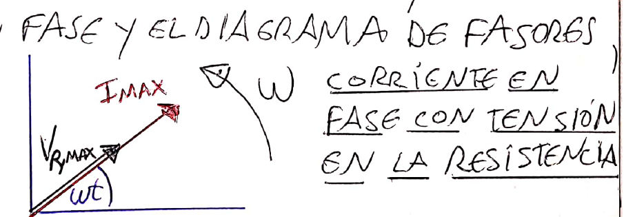
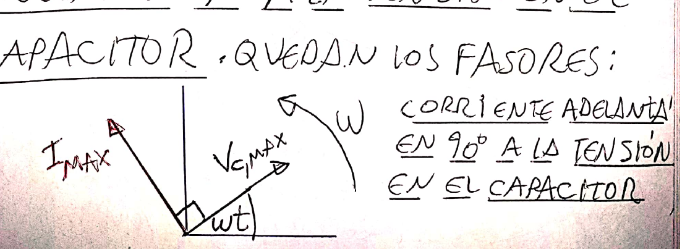
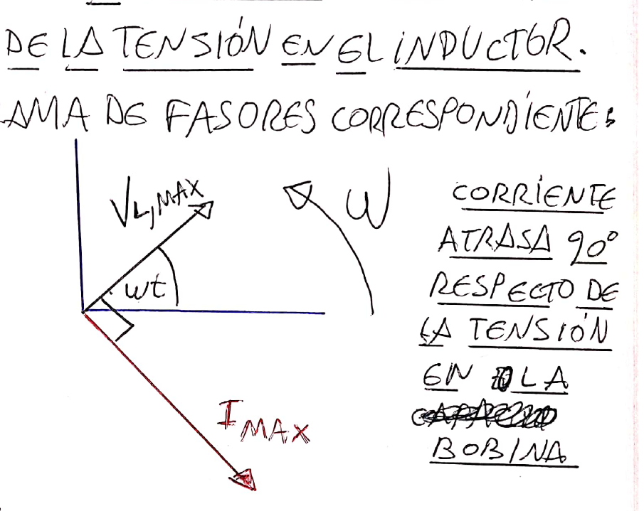
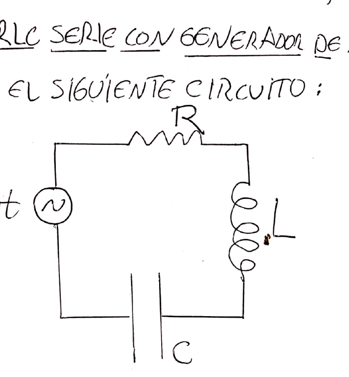
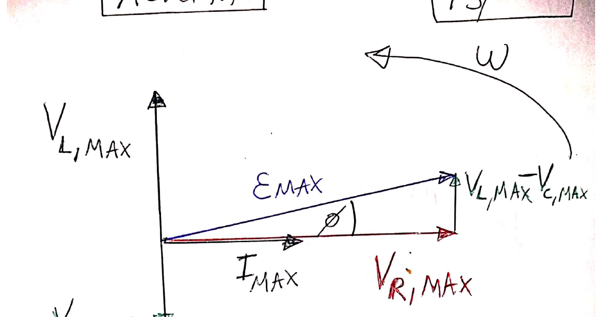
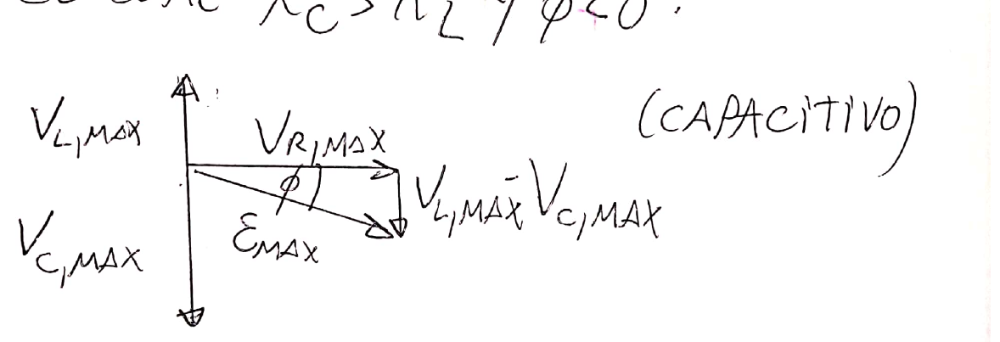
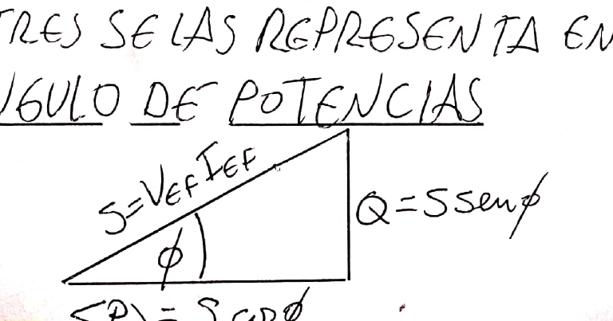
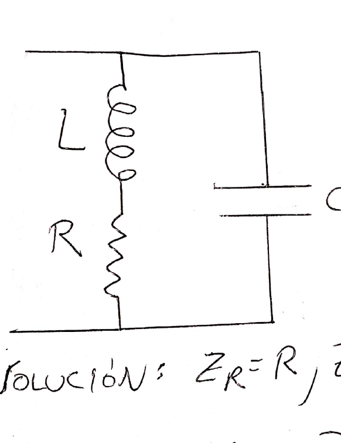
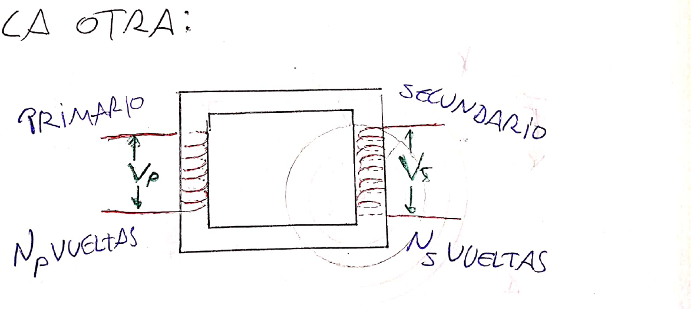

# Tema 7 — Corriente alterna: resumen teórico

Resumen de las clases del aula virtual: [Clase 9 — Corriente alterna](Aula%20Virtual/Clase%209%20-%20Corriente%20alterna.pdf) y [Clase 10 — Formalismo complejo y transformador](Aula%20Virtual/Clase%2010%20-%20Formalismo%20complejo.pdf).

Ejercicios: [práctica del tema](practica.md).

---

## Índice

1. [Tensión alterna](#1-tensión-alterna)
2. [Resistencia con generador de alterna](#2-resistencia-con-generador-de-alterna)
3. [Valores eficaces](#3-valores-eficaces)
4. [Capacitor con generador de alterna](#4-capacitor-con-generador-de-alterna)
5. [Inductor con generador de alterna](#5-inductor-con-generador-de-alterna)
6. [Circuito RLC serie](#6-circuito-rlc-serie)
7. [Potencias: activa, aparente y reactiva](#7-potencias-activa-aparente-y-reactiva)
8. [Resonancia](#8-resonancia)
9. [Formalismo complejo](#9-formalismo-complejo)
10. [Transformador](#10-transformador)
11. [Cómo encarar un ejercicio de RLC serie](#11-cómo-encarar-un-ejercicio-de-rlc-serie)
12. [Tabla de fórmulas](#12-tabla-de-fórmulas)

---

## 1. Tensión alterna

Haciendo girar una espira en un campo magnético uniforme (ver el [generador del tema 6](../6%20-%20Inducci%C3%B3n%20Magn%C3%A9tica/teoria.md#6-generador-y-motor)) se obtiene una tensión cuya polaridad se invierte periódicamente:

$$\boxed{\mathcal E(t) = \mathcal E_{MAX}\cos\omega t} \qquad f = \frac{\omega}{2\pi}$$

$\mathcal E_{MAX}$ es el **valor de pico**. En las redes domiciliarias $f = 50$ o $60$ Hz según el país. En los circuitos el generador se dibuja como un círculo con una onda adentro.

> Algunos textos (y la guía) usan $\operatorname{sen}\omega t$ en lugar de $\cos\omega t$; lo único que cambia es el origen de tiempos.

---

## 2. Resistencia con generador de alterna

$$V_R = \mathcal E_{MAX}\cos\omega t \qquad I = \frac{V_R}{R} = I_{MAX}\cos\omega t \qquad I_{MAX} = \frac{\mathcal E_{MAX}}{R}$$

**En una resistencia la corriente está en fase con la tensión.**

**Fasores.** Son vectores que representan tensiones y corrientes: su longitud es el **valor de pico**, giran en sentido **antihorario** con velocidad angular $\omega$, y su proyección sobre el eje horizontal da el **valor instantáneo**.

**Potencia media.** Con $\langle\cos^2\omega t\rangle = \tfrac12$:

$$\langle P\rangle = R\,\langle I^2\rangle = \frac{RI_{MAX}^2}{2} = \frac12V_{R,MAX}\,I_{MAX}$$

---

## 3. Valores eficaces

$$\boxed{V_{EF} = \frac{V_{MAX}}{\sqrt2}} \qquad \boxed{I_{EF} = \frac{I_{MAX}}{\sqrt2}}$$

Con ellos, la potencia en la resistencia queda igual que en continua:

$$\langle P\rangle = RI_{EF}^2 = I_{EF}V_{EF} = \frac{V_{EF}^2}{R}$$

- **Son los valores de continua que disiparían la misma potencia** en la resistencia.
- También se llaman valores **RMS** (*root mean square*): $I_{EF} = \sqrt{\langle I^2\rangle}$.
- **Los instrumentos miden valores eficaces.** Los 220 V domiciliarios son eficaces (el pico es $220\sqrt2 \approx 311$ V).

---

## 4. Capacitor con generador de alterna

$V_C = \mathcal E_{MAX}\cos\omega t$ y $I = C\,\dfrac{dV_C}{dt}$:

$$I = \omega CV_{C,MAX}\cos\!\left(\omega t + \frac\pi2\right)$$

**Reactancia capacitiva:**

$$\boxed{X_C = \frac{1}{\omega C}} \qquad V_{C,MAX} = X_CI_{MAX} \qquad V_{C,EF} = X_CI_{EF} \qquad [X_C] = \Omega$$

- Hace un papel análogo al de la resistencia: dificulta el paso de la carga.
- **A menor frecuencia, mayor $X_C$.** Para $f = 0$ (continua) es infinita: el capacitor es una llave abierta, como en el estacionario de continua.
- **La corriente adelanta 90° a la tensión en el capacitor.**
- **Potencia media nula:** $P = -\dfrac{V_{C,MAX}^2}{2X_C}\operatorname{sen}2\omega t$, de promedio cero. La energía va y viene entre el generador y el capacitor.

---

## 5. Inductor con generador de alterna

$V_L = L\,\dfrac{dI}{dt} = \mathcal E_{MAX}\cos\omega t$:

$$I = \frac{\mathcal E_{MAX}}{\omega L}\cos\!\left(\omega t - \frac\pi2\right)$$

**Reactancia inductiva:**

$$\boxed{X_L = \omega L} \qquad V_{L,MAX} = X_LI_{MAX} \qquad V_{L,EF} = X_LI_{EF}$$

- **$X_L$ crece con la frecuencia.** Es nula para $f = 0$: en continua estacionaria el inductor es un cable.
- **La corriente atrasa 90° respecto de la tensión en el inductor.**
- **Potencia media nula** (igual que el capacitor).

> **Regla para recordar:** "**ELI the ICE man**". En la **L**, la tensión (E) va antes que la corriente (I). En la **C**, la corriente (I) va antes que la tensión (E).

---

## 6. Circuito RLC serie

En serie, **la corriente es la misma en todos los elementos**. Se dibuja el fasor de corriente horizontal; entonces:

- $V_R$ está en fase con $I$ (horizontal);
- $V_L$ adelanta 90° (hacia arriba);
- $V_C$ atrasa 90° (hacia abajo).

> ⚠️ **La tensión del generador NO es la suma de las tensiones de pico (o eficaces) de cada elemento.** Hay que sumar **fasores**:

$$\boxed{\mathcal E_{MAX} = \sqrt{V_{R,MAX}^2 + (V_{L,MAX} - V_{C,MAX})^2}}$$

Dividiendo por $I_{MAX}$ aparece la **impedancia**:

$$\boxed{Z = \frac{\mathcal E_{MAX}}{I_{MAX}} = \frac{\mathcal E_{EF}}{I_{EF}} = \sqrt{R^2 + (X_L - X_C)^2}} \qquad [Z] = \Omega$$

**Ángulo de fase $\phi$** entre la tensión del generador y la corriente:

$$\boxed{\tan\phi = \frac{X_L - X_C}{R}} \qquad \boxed{\cos\phi = \frac RZ}\ (\text{factor de potencia})$$

| Caso | Condición | Fase |
|---|---|---|
| **Inductivo** | $X_L > X_C$, $\phi > 0$ | la tensión **adelanta** a la corriente (la corriente atrasa) |
| **Capacitivo** | $X_C > X_L$, $\phi < 0$ | la corriente **adelanta** a la tensión |
| **Resistivo (resonancia)** | $X_L = X_C$, $\phi = 0$ | en fase |

> **Diagrama de impedancias:** $R$ en el eje horizontal, $X_L$ hacia arriba, $X_C$ hacia abajo y $Z$ como hipotenusa. Es el mismo triángulo que el de tensiones, dividido por $I$.

---

## 7. Potencias: activa, aparente y reactiva

Solo la resistencia disipa energía. La potencia media es

$$\langle P\rangle = RI_{EF}^2 = ZI_{EF}^2\cos\phi = \mathcal E_{EF}I_{EF}\cos\phi$$

La potencia **depende de la fase**. Los circuitos reales suelen ser inductivos (por las bobinas), y el factor de potencia se mejora **agregando un capacitor**. El factor de potencia mide qué parte de la oposición al paso de carga corresponde a la resistencia (lo que efectivamente disipa).

| Potencia | Fórmula | Unidad | Significado |
|---|---|---|---|
| **Activa** | $\langle P\rangle = V_{EF}I_{EF}\cos\phi = RI_{EF}^2$ | W | La que efectivamente se entrega al circuito |
| **Aparente** | $S = V_{EF}I_{EF} = ZI_{EF}^2$ | VA | No tiene en cuenta la fase |
| **Reactiva** | $Q = V_{EF}I_{EF}\operatorname{sen}\phi = XI_{EF}^2$ | VAR | Va y viene entre las reactancias y el generador |

**Triángulo de potencias:**

$$S^2 = P^2 + Q^2 \qquad \cos\phi = \frac PS$$

> Si los datos son de pico: $\langle P\rangle = \tfrac12\mathcal E_{MAX}I_{MAX}\cos\phi = \tfrac12RI_{MAX}^2$ y $S = \tfrac12\mathcal E_{MAX}I_{MAX}$.

---

## 8. Resonancia

En resonancia: $X_L = X_C$, $\cos\phi = 1$, $Z = R$ (circuito resistivo). **La corriente y la potencia media alcanzan su máximo.**

$$\omega_RL = \frac{1}{\omega_RC} \quad\Rightarrow\quad \boxed{\omega_R = \frac{1}{\sqrt{LC}}} \qquad \boxed{f_R = \frac{1}{2\pi\sqrt{LC}}}$$

En la frecuencia de resonancia, toda la oposición al paso de la corriente proviene de la resistencia.

**Relación útil para saber si el circuito es inductivo o capacitivo:**

- **Por encima** de la resonancia ($f > f_R$): $X_L > X_C$, **inductivo**.
- **Por debajo** ($f < f_R$): $X_C > X_L$, **capacitivo**.

Como $\omega_R^2 = 1/(LC)$:

$$X_L - X_C = \omega L - \frac{1}{\omega C} = \omega L\left(1 - \frac{\omega_R^2}{\omega^2}\right)$$

Esta fórmula es muy útil cuando se conocen la frecuencia de trabajo y la de resonancia.

---

## 9. Formalismo complejo

Como las expresiones de alterna contienen información sobre los valores de pico y sobre las fases, conviene describirlas con **números complejos**. Los diagramas de fasores son la representación polar de esos números.

$$V = \operatorname{Re}(\mathbb V) \qquad I = \operatorname{Re}(\mathbb I) \qquad \mathbb V = \mathbb V_0e^{j\omega t} \qquad \mathbb I = \mathbb I_0e^{j\omega t}$$

($j$ es la unidad imaginaria.) Se recupera una relación lineal, como la ley de Ohm:

$$\boxed{\mathbb V = \mathbb Z\,\mathbb I}$$

**Impedancias complejas:**

$$\mathbb Z_R = R \qquad \mathbb Z_L = jX_L = j\omega L \qquad \mathbb Z_C = -jX_C = -\frac{j}{\omega C}$$

**Asociación** (igual que las resistencias):

$$\text{Serie: } \mathbb Z_{EQ} = \sum\mathbb Z_i \qquad \text{Paralelo: } \mathbb Z_{EQ}^{-1} = \sum\mathbb Z_i^{-1}$$

La impedancia tiene una parte **resistiva** $\operatorname{Re}(\mathbb Z)$ y una **reactiva** $\operatorname{Im}(\mathbb Z)$:

$$\tan\phi = \frac{\operatorname{Im}\mathbb Z}{\operatorname{Re}\mathbb Z} \qquad \cos\phi = \frac{\operatorname{Re}\mathbb Z}{|\mathbb Z|}$$

**Condición de resonancia:** $\operatorname{Im}(\mathbb Z) = 0$ (tensión y corriente en fase).

**Ejemplo (apunte): bobina con resistencia interna $R$ en paralelo con un capacitor.**

$\mathbb Z_{RL} = R + j\omega L$ y $\mathbb Z_{ef} = \dfrac{\mathbb Z_{RL}\mathbb Z_C}{\mathbb Z_{RL} + \mathbb Z_C}$. Pidiendo $\operatorname{Im}(\mathbb Z_{ef}) = 0$:

$$f = \frac{1}{2\pi}\sqrt{\frac{1}{LC} - \frac{R^2}{L^2}}$$

---

## 10. Transformador

Una planta generadora entrega potencia $P = IV$. Las pérdidas en los cables de transporte son $RI^2$, así que conviene transportar con **corriente baja y tensión alta** (del orden de $10^6$ V) y reducir la tensión al llegar a los domicilios. Eso lo hace el **transformador**, que funciona **solo con alterna**.

Son dos bobinas arrolladas sobre un núcleo de hierro, que asegura que todas las líneas de campo que pasan por una bobina pasen también por la otra.

Si $\phi_1$ es el flujo por una vuelta: $\phi_P = N_P\phi_1$ y $\phi_S = N_S\phi_1$. Por Faraday, $V_P = N_P\dfrac{d\phi_1}{dt}$ y $V_S = N_S\dfrac{d\phi_1}{dt}$:

$$\boxed{\frac{V_P}{V_S} = \frac{N_P}{N_S}} \qquad V_S = \frac{N_S}{N_P}V_P$$

Variando la relación de vueltas se obtiene una tensión de salida distinta de la de entrada. (En un transformador ideal, la potencia se conserva: $V_PI_P = V_SI_S$.)

---

## 11. Cómo encarar un ejercicio de RLC serie

> 1. Pasar todo a **eficaces** (o todo a **pico**) y no mezclar. Si el dato es $i(t) = I_0\operatorname{sen}(\dots)$, entonces $I_0$ es pico.
> 2. Con la potencia activa y la corriente: $R = P/I_{EF}^2$.
> 3. Con la potencia aparente o la tensión: $Z = V_{EF}/I_{EF} = S/I_{EF}^2$.
> 4. Con el ángulo o el factor de potencia: $\cos\phi = R/Z$, $X = X_L - X_C = R\tan\phi$ (o $\pm\sqrt{Z^2 - R^2}$).
> 5. Signo de $X$: positivo si la corriente **atrasa** (inductivo, o $f > f_R$); negativo si **adelanta** (capacitivo, o $f < f_R$).
> 6. Si se conoce $f_R$: $X = \omega L(1 - \omega_R^2/\omega^2)$ da $L$, y luego $C = 1/(\omega_R^2L)$.
> 7. Tensiones: $V_R = RI$, $V_L = X_LI$, $V_C = X_CI$; las fases se miden respecto de la corriente ($+90°$ para L, $-90°$ para C).

---

## 12. Tabla de fórmulas

| Tema | Fórmula |
|---|---|
| Tensión alterna | $\mathcal E = \mathcal E_{MAX}\cos\omega t$, $\omega = 2\pi f$ |
| Eficaces | $V_{EF} = V_{MAX}/\sqrt2$, $I_{EF} = I_{MAX}/\sqrt2$ |
| Reactancias | $X_L = \omega L$, $X_C = 1/(\omega C)$ |
| Fases | R en fase; L: $I$ atrasa 90°; C: $I$ adelanta 90° |
| Impedancia | $Z = \sqrt{R^2 + (X_L - X_C)^2}$, $V = ZI$ |
| Fase | $\tan\phi = (X_L - X_C)/R$, $\cos\phi = R/Z$ |
| Tensión total | $\mathcal E = \sqrt{V_R^2 + (V_L - V_C)^2}$ |
| Activa | $P = V_{EF}I_{EF}\cos\phi = RI_{EF}^2$ [W] |
| Aparente | $S = V_{EF}I_{EF}$ [VA] |
| Reactiva | $Q = V_{EF}I_{EF}\operatorname{sen}\phi$ [VAR], $S^2 = P^2 + Q^2$ |
| Resonancia | $\omega_R = 1/\sqrt{LC}$, $Z = R$ |
| Reactancia neta | $X = \omega L(1 - \omega_R^2/\omega^2)$ |
| Complejos | $\mathbb Z_L = j\omega L$, $\mathbb Z_C = -j/(\omega C)$, $\mathbb V = \mathbb Z\mathbb I$ |
| Transformador | $V_P/V_S = N_P/N_S$ |
