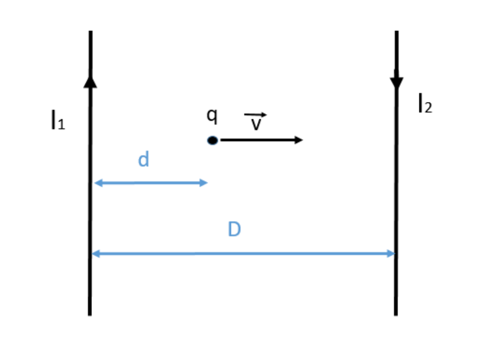
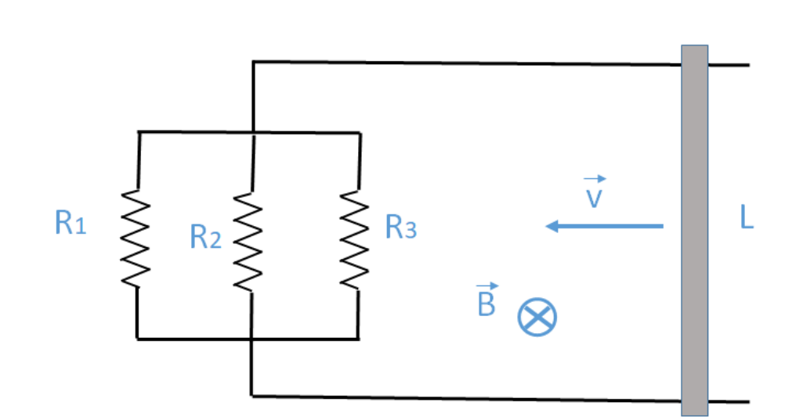
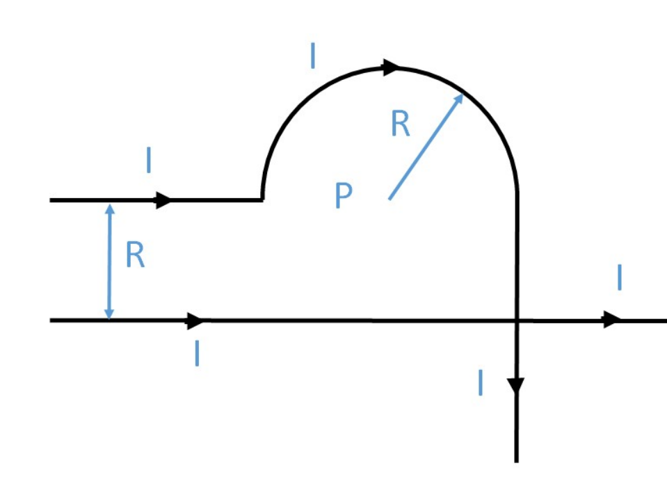

# 2º Parcial — 03/12/2020

[Enunciado original (PDF)](Aula%20Virtual/2020-12-03%20-%202do%20Parcial.pdf) · Temas: magnetostática (hilos, espiras, Biot-Savart), inducción (barra sobre rieles) y corriente alterna.

Cada ejercicio tiene un botón **Solución** con la respuesta y, adentro, un botón **Solución paso a paso**. No hay resolución oficial de este examen en el aula virtual: las soluciones son propias.

Volver al [índice de parciales](README.md).

---

### Ejercicio 1

Dos hilos infinitos, paralelos entre sí y situados a una distancia D=19 cm uno del otro, transportan corrientes I1=3 A y I2=5 A, de sentidos opuestos. En un instante dado, una carga q=−9μC pasa por un punto ubicado entre ambos hilos y a una distancia d=7 cm del primero, con una velocidad perpendicular a los hilos y de módulo 7 x 105 m/s (ver figura). **a)** Calcular el valor del campo en un punto entre los hilos equidistante de ambos. **b)** Determinar la fuerza ejercida sobre la carga. **Dato:** μ0 = 4π x 10-7 Tm/A.

<b>Solución</b>

Solución paso a paso

**Ejes.** X hacia la derecha (de I₁ a I₂), Y hacia arriba (sentido de I₁), Z saliente de la hoja. I₁ sube y I₂ baja.

**Paso 1 — Sentido de cada campo entre los hilos.** Regla de la mano derecha:

- I₁ (sube), punto a su derecha: $\hat y\times\hat x = -\hat z$ (entrante).
- I₂ (baja), punto a su izquierda: $(-\hat y)\times(-\hat x) = -\hat z$ (entrante).

Con corrientes **opuestas**, entre los hilos los campos se **suman**.

**Paso 2 — Campo en un punto a distancia $x$ del hilo 1.**

$$\vec B(x) = -\frac{\mu_0}{2\pi}\left(\frac{I_1}{x} + \frac{I_2}{D - x}\right)\hat z$$

**Paso 3 — Ítem a ($x = D/2$).**

$$B = \frac{\mu_0}{2\pi}\,\frac{I_1 + I_2}{D/2} = 2\times10^{-7}\cdot\frac{8}{0{,}095}\ \text{T} = 16{,}8\ \mu\text{T}\quad(\text{entrante})$$

**Paso 4 — Ítem b ($x = d = 7$ cm).**

$$B = 2\times10^{-7}\left(\frac{3}{0{,}07} + \frac{5}{0{,}12}\right)\ \text{T} = (8{,}57 + 8{,}33)\ \mu\text{T} = 16{,}9\ \mu\text{T}\quad(-\hat z)$$

**Paso 5 — Fuerza.** $\vec F = q\,\vec v\times\vec B$ con $\vec v = v\,\hat x$ y $\vec B = -B\,\hat z$:

$$\vec F = q\,vB\,(\hat x\times(-\hat z)) = q\,vB\,\hat y$$

Como $q < 0$:

$$\vec F = -9\times10^{-6}\cdot7\times10^5\cdot16{,}9\times10^{-6}\ \text{N}\ \hat y = -1{,}06\times10^{-4}\ \text{N}\ \hat y$$

Módulo $1{,}06\times10^{-4}$ N, paralela a los hilos, en el sentido de I₂ (hacia abajo en la figura).

**Respuesta:** a) $B = 16{,}8\ \mu$T (entrante a la hoja); b) $\vec F = -1{,}06\times10^{-4}$ N $\hat y$ (paralela a los hilos, hacia abajo).

---

### Ejercicio 2

Una espira conductora circular de radio 1,9 cm transporta una corriente de 0,2 A. Una espira cuadrada de lado D transporta una corriente de 1,1 A. Calcular el valor de D para que en el centro de la espira cuadrada el campo magnético tenga una intensidad cinco veces mayor que la intensidad del campo en el centro de la espira circular. **Dato:** μ0 = 4π x 10-7 Tm/A.

<b>Solución</b>

Solución paso a paso

**Paso 1 — Campos en los centros** (ver [teoría](../5%20-%20Magnetost%C3%A1tica/teoria.md#8-campos-de-configuraciones-típicas)):

$$B_{circ} = \frac{\mu_0 I_c}{2R} \qquad B_{cuad} = \frac{2\sqrt2\,\mu_0 I_q}{\pi D}$$

**Paso 2 — Condición $B_{cuad} = 5B_{circ}$ y despeje.**

$$\frac{2\sqrt2\,\mu_0 I_q}{\pi D} = \frac{5\mu_0 I_c}{2R} \quad\Rightarrow\quad D = \frac{4\sqrt2\,I_qR}{5\pi I_c}$$

**Paso 3 — Cálculo.**

$$D = \frac{4\sqrt2\cdot1{,}1\cdot0{,}019}{5\pi\cdot0{,}2}\ \text{m} = \frac{0{,}1182}{3{,}1416}\ \text{m} = 0{,}0376\ \text{m}$$

**Respuesta:** $D \approx 3{,}76$ cm

---

### Ejercicio 3

La barra de longitud L=11 cm se desplaza con velocidad constante hacia la izquierda y de módulo 15 m/s, sobre rieles conductores, en presencia de un campo magnético entrante y uniforme de módulo B=3 T. No hay rozamiento. Determine: **a)** Valor y sentido de circulación de la corriente inducida, y **b)** Módulo, dirección y sentido de la fuerza magnética y de la fuerza del agente externo que actúan sobre la barra. R1=5Ω, R2=2Ω, R3=6Ω.

<b>Solución</b>

Solución paso a paso

**Paso 1 — Fem.** $\mathcal E = BLv$.

**Paso 2 — Resistencia del circuito.** Las tres resistencias están en paralelo entre los dos rieles:

$$\frac{1}{R_{eq}} = \frac{1}{R_1} + \frac{1}{R_2} + \frac{1}{R_3} \qquad I = \frac{\mathcal E}{R_{eq}} = \frac{BLv}{R_{eq}}$$

**Paso 3 — Sentido (Lenz).** La barra va hacia la izquierda: el área encerrada y el flujo **entrante** **disminuyen**. La corriente inducida refuerza el campo entrante: circula en sentido **horario**. En la barra (lado derecho del circuito) va **hacia abajo**. Se confirma con la fuerza sobre las cargas: $\vec v\times\vec B = (-\hat x)\times(-\hat z) = -\hat y$.

**Paso 4 — Fuerza magnética.** $\vec F_M = I\,\vec L\times\vec B$, con $\vec L = -L\,\hat y$ y $\vec B = -B\,\hat z$:

$$\vec F_M = ILB\,((-\hat y)\times(-\hat z)) = ILB\,\hat x$$

Apunta hacia la **derecha**, opuesta a la velocidad: frena la barra. Como la velocidad es constante, el agente externo aplica $\vec F_{AE} = -ILB\,\hat x$.

**Paso 5 — Cálculo.**

$$\mathcal E = 3\cdot0{,}11\cdot15\ \text{V} = 4{,}95\ \text{V} \qquad R_{eq} = \frac{1}{0{,}2 + 0{,}5 + 0{,}1667}\ \Omega = 1{,}154\ \Omega$$

$$I = \frac{4{,}95}{1{,}154}\ \text{A} = 4{,}29\ \text{A} \qquad F = 4{,}29\cdot0{,}11\cdot3\ \text{N} = 1{,}42\ \text{N}$$

**Respuesta:**

- a) $I = 4{,}29$ A, en sentido horario (hacia abajo por la barra).
- b) $\vec F_M = 1{,}42$ N $\hat x$ (hacia la derecha, frenando); $\vec F_{AE} = 1{,}42$ N $(-\hat x)$ (hacia la izquierda).

---

### Ejercicio 4

Determinar el campo magnético en el punto P (I=3 A, R=4 cm). Dato: μ0= 4π x 10-7 Tm/A.

<b>Solución</b>

Solución paso a paso

**Lectura de la figura.** P es el centro de la semicircunferencia. El alambre superior llega desde la izquierda a la altura de P, recorre la semicircunferencia por arriba (sentido horario) y baja verticalmente hasta $-\infty$. Abajo, a una distancia $R$ de P, hay un hilo infinito horizontal con corriente hacia la derecha.

**Paso 1 — Contribución de cada tramo.**

- **Tramo horizontal superior** (semiinfinito, de $-\infty$ hasta la semicircunferencia): P está sobre su prolongación, así que **no aporta**.
- **Semicircunferencia** (horaria): $B_1 = \dfrac{\mu_0 I}{4R}$, **entrante**.
- **Tramo vertical** (semiinfinito, desde la altura de P hacia abajo, a distancia $R$ de P): el pie de la perpendicular es su extremo, así que $B_2 = \dfrac{\mu_0 I}{4\pi R}$. Corriente $-\hat y$, P a la izquierda: $(-\hat y)\times(-\hat x) = -\hat z$, **entrante**.
- **Hilo infinito inferior** (corriente $+\hat x$, P arriba a distancia $R$): $B_3 = \dfrac{\mu_0 I}{2\pi R}$, con $\hat x\times\hat y = \hat z$, **saliente**.

**Paso 2 — Suma** (positivo saliente):

$$B = \frac{\mu_0 I}{R}\left(\frac{1}{2\pi} - \frac14 - \frac{1}{4\pi}\right) = \frac{\mu_0 I}{R}\left(\frac{1}{4\pi} - \frac14\right)$$

**Paso 3 — Cálculo.**

$$\frac{\mu_0 I}{R} = \frac{4\pi\times10^{-7}\cdot3}{0{,}04}\ \text{T} = 9{,}42\times10^{-5}\ \text{T} \qquad B = 9{,}42\times10^{-5}\cdot(0{,}0796 - 0{,}25)\ \text{T} = -1{,}61\times10^{-5}\ \text{T}$$

El signo negativo indica que el campo es **entrante**.

**Respuesta:** $\vec B = \dfrac{\mu_0 I}{R}\left(\dfrac{1}{4\pi} - \dfrac14\right)\hat z \approx 16{,}1\ \mu$T, entrante a la hoja.

---

### Ejercicio 5

En un circuito RLC serie con generador de alterna la frecuencia es de 50 Hz y la corriente adelanta en 300 a la tensión. La lectura del amperímetro es de 4 A, y la potencia aparente es de 800 VA. **a)** Calcular el valor de la resistencia. **b)** Si L=60 mH, determinar C. **c)** ¿Cuál es la frecuencia de resonancia?

<b>Solución</b>

Solución paso a paso

**Paso 1 — Impedancia.** El amperímetro mide eficaces: $S = I_{EF}^2Z$, así que $Z = S/I_{EF}^2$.

**Paso 2 — R (ítem a).** $R = Z\cos\phi$.

**Paso 3 — C (ítem b).** La corriente adelanta, así que es **capacitivo**: $X_C - X_L = Z\operatorname{sen}\phi$.

$$X_C = \omega L + Z\operatorname{sen}\phi \qquad C = \frac{1}{\omega X_C}$$

**Paso 4 — Resonancia (ítem c).** $f_0 = \dfrac{1}{2\pi\sqrt{LC}}$.

**Paso 5 — Cálculo.**

$$Z = \frac{800}{16}\ \Omega = 50\ \Omega \qquad R = 50\cdot0{,}866 = 43{,}3\ \Omega$$

$$X_L = 314{,}16\cdot0{,}06 = 18{,}85\ \Omega \qquad X_C = 18{,}85 + 25 = 43{,}85\ \Omega \qquad C = \frac{1}{314{,}16\cdot43{,}85}\ \text{F} = 72{,}6\ \mu\text{F}$$

$$f_0 = \frac{1}{2\pi\sqrt{0{,}06\cdot72{,}6\times10^{-6}}}\ \text{Hz} = 76{,}3\ \text{Hz}$$

Es coherente: el circuito es capacitivo porque trabaja por debajo de la resonancia (50 Hz < 76 Hz).

**Respuesta:** a) $R = 43{,}3\ \Omega$; b) $C = 72{,}6\ \mu$F; c) $f_0 \approx 76{,}3$ Hz

