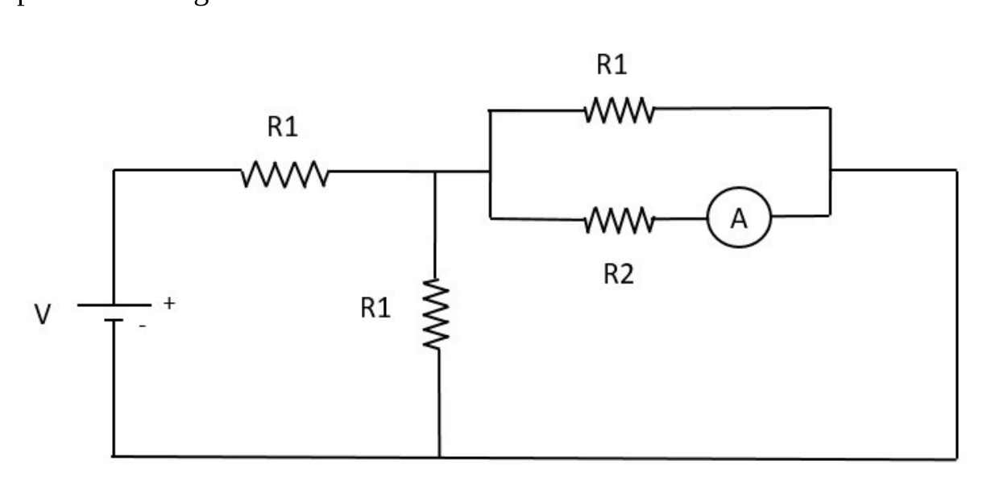

# 2º Recuperatorio del 1er Parcial — 12/02/2021

[Enunciado original (PDF)](Aula%20Virtual/2021-02-12%20-%202do%20Recuperatorio%201er%20Parcial.pdf) · [Resolución del profesor (PDF)](Aula%20Virtual/2021-02-12%20-%202do%20Recuperatorio%201er%20Parcial%20-%20Resoluci%C3%B3n.pdf) · Temas: circuitos de continua, Gauss y potencial, hilos cargados, conducción del calor.

Cada ejercicio tiene un botón **Solución** con la respuesta y, adentro, un botón **Solución paso a paso**. Los resultados coinciden con la resolución del profesor.

Volver al [índice de parciales](README.md).

---

### Ejercicio 1

Considere el circuito de la figura. **a)** Sabiendo que V=15 V, R2=2R1 y la lectura del amperímetro es 1 A, calcule R1. **b)** ¿Qué potencia entrega la fuente?

<b>Solución</b>

Solución paso a paso

**Paso 1 — Estructura.** Después de la R₁ horizontal (en serie con la fuente) hay un nodo. De ahí van a la línea inferior: la R₁ vertical, y el paralelo (R₁ superior ∥ R₂ con amperímetro) que vuelve por la derecha. Las **tres resistencias** (R₁, R₁ y R₂) están entre los mismos dos nodos: **en paralelo**, con la misma tensión $V_p$.

**Paso 2 — Corrientes del paralelo.** Por R₂ pasa 1 A, así que $V_p = R_2\cdot1\ \text{A} = 2R_1\cdot1\ \text{A}$. Por cada R₁ pasa $V_p/R_1 = 2$ A. La corriente total es $I = 2 + 2 + 1 = 5$ A.

**Paso 3 — Malla.** $V = R_1I + V_p$:

$$15\ \text{V} = R_1\cdot5\ \text{A} + 2R_1\cdot1\ \text{A} = 7R_1\ \text{A} \quad\Rightarrow\quad R_1 = \frac{15}{7}\ \Omega$$

(Equivalentemente: $R_{eq} = R_1 + (1/R_1 + 1/R_1 + 1/2R_1)^{-1} = \tfrac75R_1 = V/I$.)

**Paso 4 — Potencia (ítem b).** $P = VI = 15\cdot5 = 75$ W.

**Respuesta:** a) $R_1 = 15/7\ \Omega = 2{,}14\ \Omega$; b) $P = 75$ W

---

### Ejercicio 2

Una esfera de radio R tiene densidad de carga en volumen uniforme. **a)** Sabiendo que en un punto a distancia R/2 del centro de la esfera el módulo del campo eléctrico es 8 V/m, determine el módulo del campo en un punto a distancia 2R del centro. **b)** Sabiendo que la diferencia de potencial entre un punto a distancia 2R del centro y un punto a distancia 3R del centro es de 1 V, calcule R. **c)** ¿Qué trabajo realiza el campo cuando una carga q=5 μC se desplaza desde un punto a distancia 3R del centro de la esfera hasta otro a distancia 4R del centro?

<b>Solución</b>

Solución paso a paso

**Paso 1 — Campo por Gauss** (esfera concéntrica de radio $r$):

$$\vec E = \frac{\rho r}{3\varepsilon_0}\hat r\ (r < R) \qquad \vec E = \frac{\rho R^3}{3\varepsilon_0r^2}\hat r\ (r > R)$$

**Paso 2 — Ítem a.** En $r = R/2$: $\dfrac{\rho R}{6\varepsilon_0} = 8$ V/m, de donde $\dfrac{\rho R}{\varepsilon_0} = 48$ V/m. En $r = 2R$:

$$E(2R) = \frac{\rho R^3}{3\varepsilon_0\cdot4R^2} = \frac{\rho R}{12\varepsilon_0} = \frac{48}{12}\ \tfrac{\text{V}}{\text{m}} = 4\ \tfrac{\text{V}}{\text{m}}$$

**Paso 3 — Ítem b.** Integrando el campo exterior entre $2R$ y $3R$:

$$|\Delta V| = \frac{\rho R^3}{3\varepsilon_0}\left(\frac{1}{2R} - \frac{1}{3R}\right) = \frac{\rho R^2}{18\varepsilon_0} = \frac{\rho R}{\varepsilon_0}\cdot\frac{R}{18}$$

$$1\ \text{V} = 48\ \tfrac{\text{V}}{\text{m}}\cdot\frac{R}{18} \quad\Rightarrow\quad R = \frac{18}{48}\ \text{m} = 0{,}375\ \text{m}$$

**Paso 4 — Ítem c.** $W = -q\,[V(4R) - V(3R)]$, con

$$V(4R) - V(3R) = -\frac{\rho R^3}{3\varepsilon_0}\left(\frac{1}{3R} - \frac{1}{4R}\right) = -\frac{\rho R^2}{36\varepsilon_0}$$

$$W = \frac{q\,\rho R^2}{36\varepsilon_0} = 5\times10^{-6}\cdot\frac{48\cdot0{,}375}{36}\ \text{J} = 2{,}5\times10^{-6}\ \text{J}$$

**Respuesta:** a) $E(2R) = 4$ V/m; b) $R = 37{,}5$ cm; c) $W = 2{,}5\ \mu$J

---

### Ejercicio 3

Un hilo finito con densidad de carga uniforme λ1=5 μC/m se halla sobre el eje de las X, entre los puntos x1=2 cm y x2=6 cm. Otro hilo finito, con densidad de carga uniforme λ2=-3 μC/m, se halla sobre el eje de las X, entre los puntos x3=13 cm y x4=19 cm. Determine: **a)** El campo eléctrico en el punto x5=9cm. **b)** La fuerza electrostática neta sobre una carga puntual q=-6 μC que se halla en el punto x5. **Dato:** k=9 x 109 Nm2/C2.

<b>Solución</b>

Solución paso a paso

**Paso 1 — Campo de un hilo sobre su propio eje.** Integrando $k\lambda\,dx'/(x - x')^2$:

- Para un punto a la **derecha** del hilo ($x > x_b > x_a$): $\vec E = k\lambda\left[\dfrac{1}{x - x_b} - \dfrac{1}{x - x_a}\right]\hat\imath$.
- Para un punto a la **izquierda** ($x < x_a < x_b$): $\vec E = k\lambda\left[\dfrac{1}{x_a - x} - \dfrac{1}{x_b - x}\right](-\hat\imath)$.

**Paso 2 — Hilo 1** (a la izquierda de $x_5$, positivo; empuja hacia $+x$):

$$\vec E_1 = k\lambda_1\left[\frac{1}{x_5 - x_2} - \frac{1}{x_5 - x_1}\right]\hat\imath = 9\times10^9\cdot5\times10^{-6}\left[\frac{1}{0{,}03} - \frac{1}{0{,}07}\right]\hat\imath = 8{,}57\times10^5\ \tfrac{\text{N}}{\text{C}}\ \hat\imath$$

**Paso 3 — Hilo 2** (a la derecha, negativo; atrae hacia él, también $+x$):

$$\vec E_2 = k\lambda_2\left[\frac{1}{x_3 - x_5} - \frac{1}{x_4 - x_5}\right](-\hat\imath) = 9\times10^9\cdot(-3\times10^{-6})\left[\frac{1}{0{,}04} - \frac{1}{0{,}10}\right](-\hat\imath) = 4{,}05\times10^5\ \tfrac{\text{N}}{\text{C}}\ \hat\imath$$

**Paso 4 — Total y fuerza.**

$$\vec E = 12{,}62\times10^5\ \tfrac{\text{N}}{\text{C}}\ \hat\imath \qquad \vec F = q\vec E = -6\times10^{-6}\cdot12{,}62\times10^5\ \text{N}\ \hat\imath = -7{,}57\ \text{N}\ \hat\imath$$

**Respuesta:** a) $\vec E(x_5) = 12{,}62\times10^5$ N/C $\hat\imath$; b) $\vec F = -7{,}57$ N $\hat\imath$

---

### Ejercicio 4

Tres barras cilíndricas, de longitudes L1=33 cm, L2=39 cm y L3=51 cm, todas ellas de radio 1,4 cm y aisladas térmicamente excepto en los extremos, se hallan dispuestas en serie entre dos focos térmicos a temperaturas 3ºC y 85ºC, con la barra 1 en contacto con el foco frío, y la barra 3 en contacto con el foco caliente. Las conductividades térmicas son k1=320 W/mºC, k2=380 W/mºC y k3=510 W/mºC. **a)** Determine la temperatura en el punto de contacto entre las barras 2 y 3. **b)** En caso de ser posible, calcule el valor que debería tener k3 para que la corriente térmica se reduzca a 0,9 veces la anterior.

<b>Solución</b>

Solución paso a paso

**Paso 1 — Resistencias térmicas.** $R_i = \dfrac{L_i}{k_iA}$, con $A = \pi r^2$. En serie: $R_{eq} = R_1 + R_2 + R_3$.

**Paso 2 — Corriente y temperatura (ítem a).** $I = \dfrac{T_C - T_F}{R_{eq}}$. La unión 2-3 está separada del foco caliente solo por la barra 3:

$$T_C - T = R_3\,I \quad\Rightarrow\quad T = T_C - R_3\,\frac{T_C - T_F}{R_1 + R_2 + R_3}$$

**Paso 3 — Ítem b.** Para que $I' = 0{,}9\,I$ con la misma $\Delta T$, la resistencia total tiene que ser $R'_{eq} = R_{eq}/0{,}9$. Solo cambia $R_3$:

$$R'_3 = \frac{R_{eq}}{0{,}9} - R_1 - R_2 \qquad k'_3 = \frac{L_3}{R'_3A}$$

Es posible porque $R'_3$ resulta positivo.

**Paso 4 — Cálculo.** $A = \pi(0{,}014)^2 = 6{,}158\times10^{-4}$ m².

$$R_1 = \frac{0{,}33}{320\cdot6{,}158\times10^{-4}} = 1{,}6748\ \tfrac{^\circ\text{C}}{\text{W}} \qquad R_2 = 1{,}6666\ \tfrac{^\circ\text{C}}{\text{W}} \qquad R_3 = 1{,}6239\ \tfrac{^\circ\text{C}}{\text{W}}$$

$$R_{eq} = 4{,}9653\ \tfrac{^\circ\text{C}}{\text{W}} \qquad I = \frac{82}{4{,}9653}\ \text{W} = 16{,}51\ \text{W} \qquad T = 85 - 16{,}51\cdot1{,}6239 = 58{,}18\ ^\circ\text{C}$$

$$R'_3 = \frac{4{,}9653}{0{,}9} - 3{,}3414 = 2{,}1756\ \tfrac{^\circ\text{C}}{\text{W}} \qquad k'_3 = \frac{0{,}51}{2{,}1756\cdot6{,}158\times10^{-4}} = 380{,}7\ \tfrac{\text{W}}{\text{m}\,^\circ\text{C}}$$

**Respuesta:** a) $T = 58{,}18\ ^\circ$C; b) $k_3 = 380{,}67$ W/(m °C)

