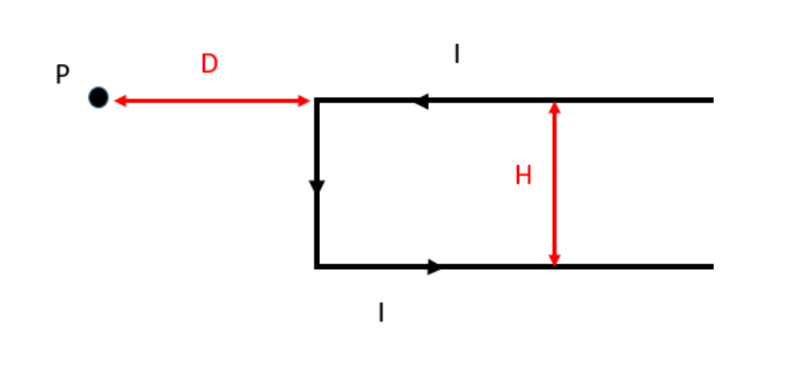
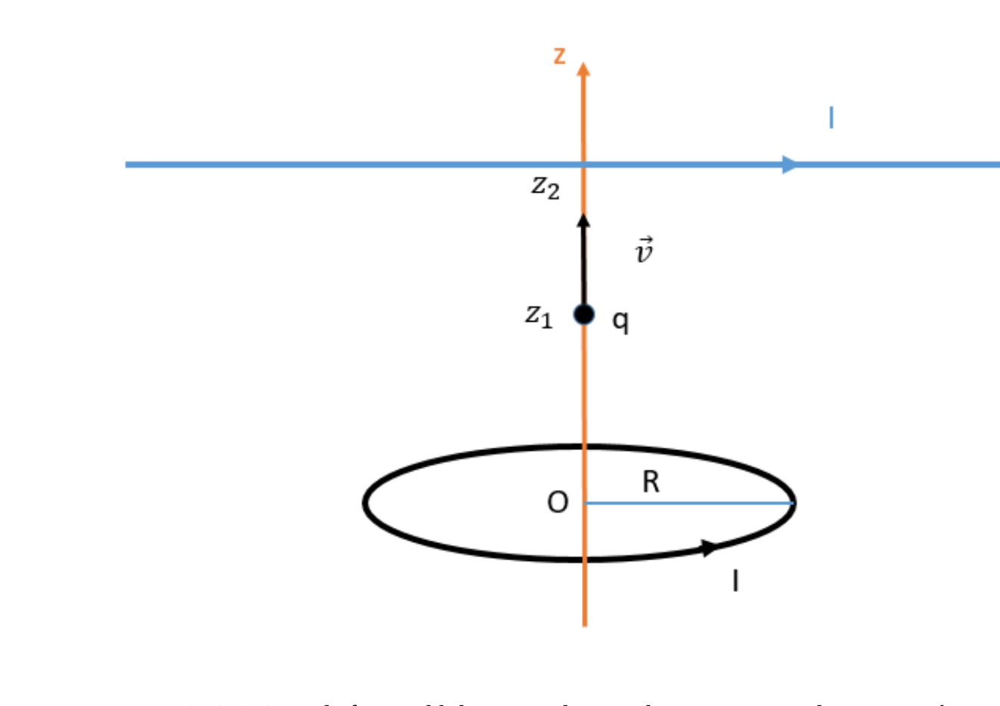
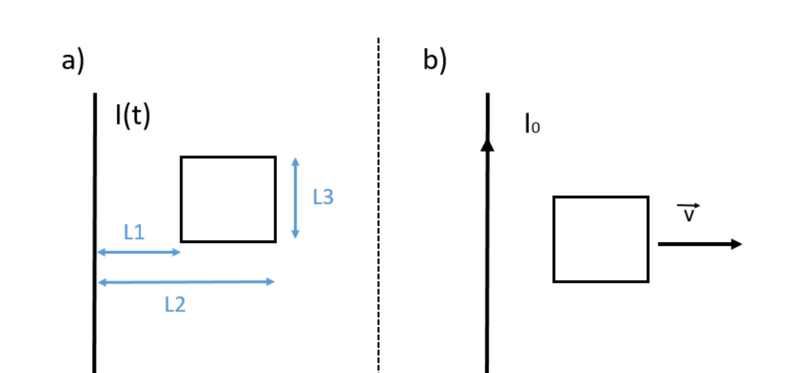

# 2º Recuperatorio del 2º Parcial — 19/02/2021

[Enunciado original (PDF)](Aula%20Virtual/2021-02-19%20-%202do%20Recuperatorio%202do%20Parcial.pdf) · Temas: Biot-Savart (hilos y anillo), fuerza sobre una carga, inducción, corriente alterna.

Cada ejercicio tiene un botón **Solución** con la respuesta y, adentro, un botón **Solución paso a paso**. No hay resolución oficial de este examen en el aula virtual: las soluciones son propias.

Volver al [índice de parciales](README.md).

---

### Ejercicio 1

Un hilo muy largo que transporta una corriente I=2 A adopta la forma indicada en la figura. Sabiendo que H=5 cm y D=8 cm, determine el campo magnético en el punto P. **Dato:** μ0= 4π x 10-7 Tm/A.

<b>Solución</b>

Solución paso a paso

**Ejes.** Origen en la esquina superior izquierda del hilo. X hacia la derecha, Y hacia arriba, Z saliente. P está en $(-D;\ 0)$.

**Paso 1 — Tramo superior** (de $+\infty$ al origen, sobre $y = 0$): P está **sobre su prolongación**, así que no aporta.

**Paso 2 — Tramo vertical** (de $(0;0)$ a $(0;-H)$, corriente hacia abajo). Distancia perpendicular $D$; el pie de la perpendicular es el extremo superior. Los ángulos van de 0 a $\arctan(H/D)$:

$$B_v = \frac{\mu_0 I}{4\pi D}\,\frac{H}{\sqrt{H^2 + D^2}}$$

Sentido: $(-\hat y)\times(-\hat x) = -\hat z$ (**entrante**).

**Paso 3 — Tramo inferior** (de $(0;-H)$ a $+\infty$, corriente hacia la derecha). Distancia perpendicular $H$; el pie de la perpendicular está en $x = -D$, fuera del hilo. Los senos van de $D/\sqrt{D^2 + H^2}$ a 1:

$$B_i = \frac{\mu_0 I}{4\pi H}\left(1 - \frac{D}{\sqrt{H^2 + D^2}}\right)$$

Sentido: $\hat x\times\hat y = \hat z$ (**saliente**).

**Paso 4 — Cálculo.** $\dfrac{\mu_0 I}{4\pi} = 2\times10^{-7}$ T m y $\sqrt{H^2 + D^2} = 9{,}434$ cm:

$$B_v = \frac{2\times10^{-7}}{0{,}08}\cdot0{,}530\ \text{T} = 1{,}325\ \mu\text{T} \qquad B_i = \frac{2\times10^{-7}}{0{,}05}\cdot(1 - 0{,}848)\ \text{T} = 0{,}608\ \mu\text{T}$$

$$B = B_v - B_i = 0{,}72\ \mu\text{T}\quad(\text{entrante})$$

**Respuesta:** $\vec B(P) \approx 0{,}72\ \mu$T $(-\hat z)$, entrante a la hoja.

---

### Ejercicio 2

Un anillo de radio R=8 cm, cuyo eje coincide con el eje de las Z y cuyo centro es el punto z=0, transporta una corriente I=2 A. Un hilo muy largo perpendicular al eje de las Z y que lo intersecta en el punto z2=18 cm, transporta la misma corriente I. **a)** Determine el campo magnético en el punto z1=10 cm. **b)** En un instante dado, una carga q=6 μC pasa por el punto z1 con velocidad **v**=5 x 104 m/s **k**. Determinar la fuerza magnética sobre la carga, en ese instante. **Dato:** μ0= 4π x 10-7 Tm/A.

<b>Solución</b>

Solución paso a paso

**Ejes.** Z hacia arriba, X hacia la derecha (sentido de la corriente del hilo) e Y hacia adentro de la hoja, formando una terna derecha. En la figura, el anillo circula en sentido antihorario visto desde arriba.

**Paso 1 — Campo del anillo en el eje:**

$$\vec B_a = \frac{\mu_0 IR^2}{2(R^2 + z_1^2)^{3/2}}\,\hat k$$

**Paso 2 — Campo del hilo** (a distancia $z_2 - z_1$ por debajo de él). Corriente $\hat\imath$ y vector del hilo al punto $-\hat k$: $\hat\imath\times(-\hat k) = \hat\jmath$:

$$\vec B_h = \frac{\mu_0 I}{2\pi(z_2 - z_1)}\,\hat\jmath$$

**Paso 3 — Cálculo.**

$$B_a = \frac{4\pi\times10^{-7}\cdot2\cdot0{,}0064}{2\cdot(0{,}0164)^{3/2}}\ \text{T} = 3{,}83\ \mu\text{T} \qquad B_h = \frac{2\times10^{-7}\cdot2}{0{,}08}\ \text{T} = 5\ \mu\text{T}$$

$$\vec B(z_1) = (5\,\hat\jmath + 3{,}83\,\hat k)\ \mu\text{T}$$

**Paso 4 — Fuerza (ítem b).** $\vec F = q\,\vec v\times\vec B$. La parte de $\vec B$ paralela a $\vec v$ (la del anillo) no aporta:

$$\vec F = q\,v\,B_h\,(\hat k\times\hat\jmath) = -q\,v\,B_h\,\hat\imath = -6\times10^{-6}\cdot5\times10^4\cdot5\times10^{-6}\ \text{N}\ \hat\imath = -1{,}5\times10^{-6}\ \text{N}\ \hat\imath$$

**Respuesta:** a) $\vec B = (5\,\hat\jmath + 3{,}83\,\hat k)\ \mu$T (el signo de cada componente depende de los sentidos de la figura); b) $|\vec F| = 1{,}5\ \mu$N, en la dirección del hilo ($-\hat\imath$ con los ejes elegidos).

---

### Ejercicio 3

En la figura el hilo es muy largo, y la corriente por el mismo varía en el tiempo según la ley I(t) = I0 sen (ωt). **a)** Determine la fem inducida en la espira. **b)** Suponga ahora que la corriente en el hilo se mantiene constante en el tiempo con valor I0, y que la espira parte de la posición inicial anterior y se aleja del hilo con velocidad constante de módulo 5 cm/s. Determinar la fem inducida en la espira. **c)** Suponga que la espira es conductora, con resistencia 3Ω. Determinar, para el caso del ítem anterior, la corriente inducida en la espira, indicando el sentido de circulación. **Datos:** L1=12 cm, L2=20 cm, L3=15 cm, I0=3 A, ω=5π 1/s, μ0=4π x 10-7 Tm/A.

<b>Solución</b>

Solución paso a paso

**Paso 1 — Flujo.** La espira tiene lado paralelo al hilo $L_3$ y se extiende desde $L_1$ hasta $L_2$:

$$\phi = \frac{\mu_0 I L_3}{2\pi}\ln\frac{L_2}{L_1}$$

**Paso 2 — Ítem a.** Solo varía la corriente:

$$|\mathcal E| = \frac{\mu_0 L_3}{2\pi}\ln\frac{L_2}{L_1}\,\frac{dI}{dt} = \frac{\mu_0 L_3}{2\pi}\ln\frac{L_2}{L_1}\,I_0\omega\cos(\omega t)$$

$$|\mathcal E| = 2\times10^{-7}\cdot0{,}15\cdot\ln\frac{20}{12}\cdot3\cdot5\pi\cos(5\pi t)\ \text{V} = 7{,}2\times10^{-7}\cos(5\pi t)\ \text{V}$$

**Paso 3 — Ítem b.** Con $b = L_2 - L_1 = 8$ cm y la distancia al lado cercano $x(t) = L_1 + vt$:

$$\phi(x) = \frac{\mu_0 I_0L_3}{2\pi}\ln\frac{x + b}{x} \quad\Rightarrow\quad |\mathcal E| = \frac{\mu_0 I_0L_3}{2\pi}\,\frac{b\,v}{x(x + b)}$$

En el instante inicial ($x = L_1$):

$$|\mathcal E| = 2\times10^{-7}\cdot3\cdot0{,}15\cdot\frac{0{,}08\cdot0{,}05}{0{,}12\cdot0{,}20}\ \text{V} = 1{,}5\times10^{-8}\ \text{V}$$

**Paso 4 — Ítem c.** $I = \mathcal E/R = 5\times10^{-9}$ A (en el instante inicial). Sentido: a la derecha del hilo (corriente hacia arriba) el campo es **entrante**; al alejarse, el flujo entrante **disminuye**. La corriente inducida lo refuerza: sentido **horario**.

**Respuesta:**

- a) $\mathcal E(t) = 7{,}2\times10^{-7}\cos(5\pi t)$ V (en módulo)
- b) $\mathcal E(t) = \dfrac{\mu_0 I_0L_3}{2\pi}\dfrac{bv}{x(x + b)}$ con $x = L_1 + vt$; inicialmente $1{,}5\times10^{-8}$ V
- c) $I = 5\times10^{-9}$ A (inicial), en sentido horario.

---

### Ejercicio 4

**a)** Un circuito RLC serie con generador de alterna y resistencia R=3Ω opera a una frecuencia por debajo de la de resonancia. La corriente eficaz es 2 A, con una potencia aparente de 20 VA. Entonces, si la reactancia inductiva es de 6Ω, determine la reactancia capacitiva. **b)** ¿Se puede resolver el ítem anterior suponiendo que el circuito opera a una frecuencia por encima de la de resonancia? En caso afirmativo, hágalo. En caso negativo, justifique.

<b>Solución</b>

Solución paso a paso

**Paso 1 — Impedancia.** $S = I_{EF}^2Z$, así que $Z = \dfrac{S}{I_{EF}^2} = \dfrac{20}{4} = 5\ \Omega$.

**Paso 2 — Reactancia neta.** $|X_L - X_C| = \sqrt{Z^2 - R^2} = \sqrt{25 - 9} = 4\ \Omega$.

**Paso 3 — Ítem a.** Por debajo de la resonancia es capacitivo ($X_C > X_L$):

$$X_C = X_L + 4\ \Omega = 10\ \Omega$$

**Paso 4 — Ítem b.** Por encima es inductivo ($X_L > X_C$): $X_C = X_L - 4\ \Omega = 2\ \Omega$. Es posible, porque el resultado es positivo.

**Respuesta:** a) $X_C = 10\ \Omega$; b) sí: $X_C = 2\ \Omega$

---

### Ejercicio 5

Considere las siguientes tres afirmaciones:

**Afirmación 1:** Por encima de la frecuencia de resonancia, un circuito RLC serie con generador de alterna es capacitivo.

**Afirmación 2:** Dado un circuito RLC serie con generador de alterna, si el circuito es inductivo, entonces aumentando progresivamente el valor de C podemos llegar a tornarlo capacitivo.

**Afirmación 3:** Una bobina con resistencia interna se conecta con un generador de alterna, obteniéndose un factor de potencia menor a 0,9 a una cierta frecuencia. Entonces, existen exactamente dos valores posibles de capacitancia C que pueden ser agregadas en serie al circuito, de modo de llevar el factor de potencia hasta 0,9.

**Indique cuál de las siguientes opciones es la correcta:**

- a) Solo una de las afirmaciones es verdadera.
- b) Solo una de las afirmaciones es falsa
- c) Todas las afirmaciones son verdaderas.
- d) Todas las afirmaciones son falsas.
- e) La verdad o falsedad de las afirmaciones depende del valor de la resistencia conectada al circuito.

<b>Solución</b>

Solución paso a paso

**Afirmación 1 — falsa.** Por encima de la resonancia, $X_L > X_C$: el circuito es **inductivo**.

**Afirmación 2 — falsa.** Si es inductivo, $X_L > X_C$. Aumentar $C$ **disminuye** $X_C = 1/(\omega C)$, así que el circuito se vuelve **más** inductivo, nunca capacitivo. (Habría que **disminuir** $C$.)

**Afirmación 3 — verdadera.** Con la bobina sola, $\cos\phi = R/\sqrt{R^2 + X_L^2} < 0{,}9$, es decir $X_L > R\tan(\arccos0{,}9) = 0{,}484R$. Para llegar a FP = 0,9 hace falta $|X_L - X_C| = 0{,}484R$:

$$X_C = X_L - 0{,}484R \qquad\text{o}\qquad X_C = X_L + 0{,}484R$$

Ambas son positivas (porque $X_L > 0{,}484R$): hay exactamente **dos** capacitores posibles.

Hay una sola afirmación verdadera.

**Respuesta:** a) Solo una de las afirmaciones es verdadera (la 3).

