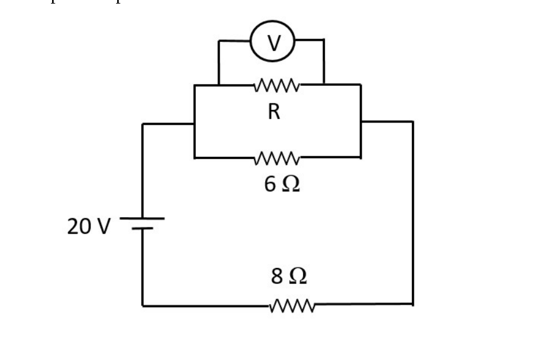
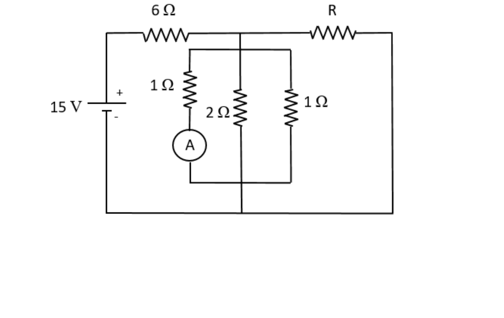
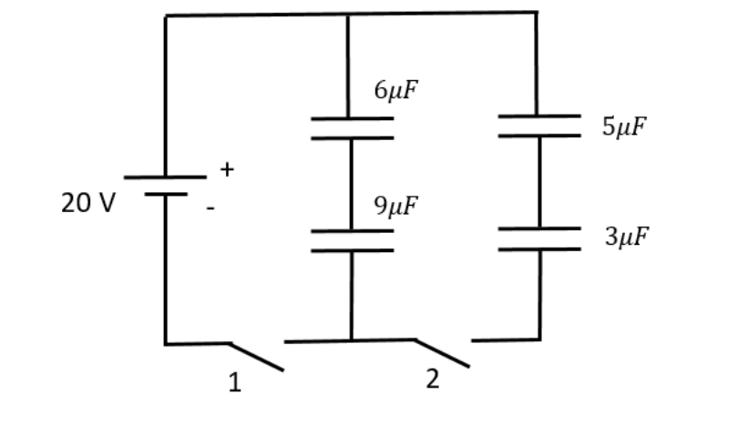
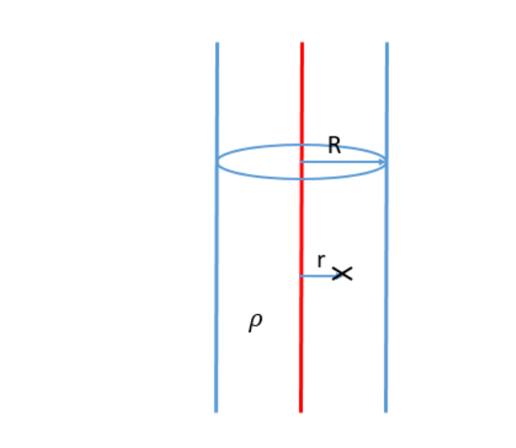

# 1er Parcial — 19/08/2021

[Enunciado original (PDF)](Aula%20Virtual/2021-08-19%20-%201er%20Parcial.pdf) · [Resolución del profesor (PDF)](Aula%20Virtual/2021-08-19%20-%201er%20Parcial%20-%20Resoluci%C3%B3n.pdf) · Temas: circuitos de continua, capacitores, anillo cargado, Gauss con densidad variable, conducción del calor.

Cada ejercicio tiene un botón **Solución** con la respuesta y, adentro, un botón **Solución paso a paso**. Los resultados coinciden con la resolución del profesor.

Volver al [índice de parciales](README.md).

---

### Ejercicio 1

**a)** Considere el circuito de la figura. Sabiendo que la lectura del voltímetro es de 4 V, determine, en caso de ser posible, la potencia que entregaría la batería si la resistencia de 8 Ω fuese reemplazada por otra de 4Ω.

**b)** Considere el circuito de la figura. ¿Existen valores de R tales que la lectura del amperímetro sea 0,8 A? En caso de ser posible, calcúlelos. En caso negativo, justifique.

<b>Solución</b>

Solución paso a paso

**Ítem a.**

**Paso 1 — Corriente.** El voltímetro mide la tensión del paralelo (R ∥ 6 Ω): $V_p = 4$ V. Por la malla, la de 8 Ω tiene el resto, $20 - 4 = 16$ V:

$$I = \frac{20 - V_p}{8\ \Omega} = 2\ \text{A}$$

**Paso 2 — Paralelo.** $R_\parallel = V_p/I = 2\ \Omega$ (de ahí $R = 3\ \Omega$, porque $3 \,/\!/\, 6 = 2$).

**Paso 3 — Con 4 Ω en lugar de 8 Ω.** $R_{eq} = R_\parallel + 4 = 6\ \Omega$:

$$I' = \frac{20}{6}\ \text{A} = 3{,}33\ \text{A} \qquad P = V\,I' = 20\cdot3{,}33\ \text{W} = 66{,}7\ \text{W}$$

**Ítem b.**

**Paso 4 — El grupo de tres resistencias.** La de 1 Ω con el amperímetro, la de 2 Ω y la otra de 1 Ω están en paralelo: $R_\parallel = (1 + \tfrac12 + 1)^{-1} = 0{,}4\ \Omega$. Si el amperímetro marca 0,8 A, la tensión del grupo es $V_p = 0{,}8$ V, y la corriente total del grupo es $I_2 = 0{,}8 + 0{,}4 + 0{,}8 = 2$ A.

**Paso 5 — R está en paralelo con el grupo.** R va del nodo superior al lado derecho, que baja a la línea inferior: tiene la misma tensión $V_p$. Por la 6 Ω pasa $I_1 = I_2 + I_3$.

**Paso 6 — Malla con la fuente:**

$$15\ \text{V} = 6\ \Omega\cdot I_1 + V_p \quad\Rightarrow\quad I_1 = \frac{15 - 0{,}8}{6}\ \text{A} = 2{,}367\ \text{A}$$

$$I_3 = I_1 - I_2 = 0{,}367\ \text{A} \qquad R = \frac{V_p}{I_3} = \frac{0{,}8}{0{,}367}\ \Omega = 2{,}18\ \Omega$$

Sí existe, porque $I_3 > 0$.

**Respuesta:** a) $P = 66{,}7$ W; b) sí: $R = 2{,}18\ \Omega$

---

### Ejercicio 2

En el circuito de la figura los capacitores se hallan inicialmente descargados y la llave abierta. Se cierra la llave 1 y pasado un tiempo muy largo se abre la llave 1 y luego se cierra la llave 2. Determine las cargas finales en los capacitores.

<b>Solución</b>

Solución paso a paso

**Paso 1 — Llave 1 cerrada.** La batería carga la columna izquierda: $C_1 = 6\ \mu$F y $C_2 = 9\ \mu$F **en serie** (misma carga):

$$Q_0 = \frac{C_1C_2}{C_1 + C_2}V = \frac{54}{15}\ \mu\text{F}\cdot20\ \text{V} = 72\ \mu\text{C}$$

**Paso 2 — Llave 1 abierta y llave 2 cerrada.** La batería queda afuera. La columna izquierda (serie, $C_{izq} = 3{,}6\ \mu$F, con 72 μC) queda conectada con la derecha (serie de 5 μF y 3 μF, $C_{der} = 1{,}875\ \mu$F, descargada). Las dos columnas quedan **en paralelo** y comparten la carga.

**Paso 3 — Conservación de la carga y misma tensión.**

$$Q_{izq} + Q_{der} = Q_0 \qquad \frac{Q_{izq}}{C_{izq}} = \frac{Q_{der}}{C_{der}} \quad\Rightarrow\quad V' = \frac{Q_0}{C_{izq} + C_{der}}$$

**Paso 4 — Cálculo.**

$$V' = \frac{72}{5{,}475}\ \text{V} = 13{,}15\ \text{V} \qquad Q_1 = Q_2 = 3{,}6\cdot13{,}15 = 47{,}4\ \mu\text{C} \qquad Q_3 = Q_4 = 1{,}875\cdot13{,}15 = 24{,}6\ \mu\text{C}$$

**Respuesta:** $Q_{6\mu F} = Q_{9\mu F} = 47{,}4\ \mu$C; $Q_{5\mu F} = Q_{3\mu F} = 24{,}6\ \mu$C

---

### Ejercicio 3

Considere un anillo de radio R=6 cm con densidad de carga uniforme λ=7 μC/m. Una carga q=-8 μC se puede mover sobre el eje del anillo. Calcule: **a)** La fuerza sobre la carga q cuando esta se halla en un punto a 12 cm del centro del anillo. **b)** El trabajo realizado por el campo cuando la carga se desplaza desde el punto del ítem anterior hasta otro ubicado a 18 cm del centro del anillo. **Dato:** k=9 x 109 Nm2/C2.

<b>Solución</b>

Solución paso a paso

**Paso 1 — Campo y potencial en el eje.** Con $Q = 2\pi R\lambda$:

$$\vec E(z) = \frac{kQz}{(R^2 + z^2)^{3/2}}\hat k \qquad V(z) = \frac{kQ}{\sqrt{R^2 + z^2}}$$

**Paso 2 — Fuerza (ítem a).** $\vec F = q\vec E(z_1)$, con $z_1 = 0{,}12$ m.

**Paso 3 — Trabajo (ítem b).**

$$W = -q\,[V(z_2) - V(z_1)] = -q\,kQ\left[\frac{1}{\sqrt{R^2 + z_2^2}} - \frac{1}{\sqrt{R^2 + z_1^2}}\right]$$

**Paso 4 — Cálculo.** $kQ = 9\times10^9\cdot2\pi\cdot0{,}06\cdot7\times10^{-6} = 23751$ V m.

$$E(z_1) = \frac{23751\cdot0{,}12}{(0{,}018)^{3/2}}\ \tfrac{\text{N}}{\text{C}} = 1{,}18\times10^6\ \tfrac{\text{N}}{\text{C}} \qquad \vec F = -8\times10^{-6}\cdot1{,}18\times10^6\ \text{N}\ \hat k = -9{,}44\ \text{N}\ \hat k$$

(La carga negativa es atraída hacia el anillo.)

$$V(0{,}12) = \frac{23751}{0{,}1342} = 177035\ \text{V} \qquad V(0{,}18) = \frac{23751}{0{,}1897} = 125180\ \text{V}$$

$$W = -(-8\times10^{-6})(125180 - 177035)\ \text{J} = -0{,}41\ \text{J}$$

Es negativo: al alejarla, el campo "tira" de la carga hacia el anillo.

**Respuesta:** a) $\vec F = -9{,}44$ N $\hat k$ (hacia el anillo); b) $W_C = -0{,}41$ J

---

### Ejercicio 4

Un cilindro muy largo de radio R=7 cm tiene una densidad volumétrica de carga dependiente de la distancia r al eje del cilindro, dada por ρ(r)=(90 μC/m3) r. Determine el campo eléctrico: **a)** en un punto a 4 cm del eje; **b)** en un punto a 12 cm del eje. **Justifique los pasos dados**. **Dato:** ε0=8,85 x 10-12 C2/(Nm2).

<b>Solución</b>

Solución paso a paso

(En el enunciado, ρ(r) = ρ₀ r con ρ₀ = 90 μC/m⁴; la unidad "μC/m³" corresponde al producto ρ₀·(1 m).)

**Paso 1 — Simetría.** El cilindro es muy largo y la densidad depende solo de $r$: $\vec E = E(r)\,\hat r$ (radial). Superficie gaussiana: cilindro coaxial de radio $r$ y altura $h$. Las tapas no tienen flujo; la cara lateral da $E\,2\pi rh$.

**Paso 2 — Carga encerrada adentro ($r < R$).** La densidad no es uniforme: se integra en cáscaras $dV = 2\pi r'h\,dr'$:

$$Q_{enc} = \int_0^r\rho_0r'\,2\pi r'h\,dr' = \frac{2\pi h\rho_0r^3}{3}$$

$$E\,2\pi rh = \frac{2\pi h\rho_0r^3}{3\varepsilon_0} \quad\Rightarrow\quad \vec E_1 = \frac{\rho_0r^2}{3\varepsilon_0}\hat r$$

**Paso 3 — Afuera ($r > R$).** Se encierra toda la carga, $\dfrac{2\pi h\rho_0R^3}{3}$:

$$\vec E_2 = \frac{\rho_0R^3}{3\varepsilon_0}\,\frac1r\,\hat r$$

**Paso 4 — Cálculo.** $3\varepsilon_0 = 2{,}655\times10^{-11}$:

$$E(4\ \text{cm}) = \frac{90\times10^{-6}\cdot(0{,}04)^2}{2{,}655\times10^{-11}}\ \tfrac{\text{V}}{\text{m}} = 5423{,}7\ \tfrac{\text{V}}{\text{m}}$$

$$E(12\ \text{cm}) = \frac{90\times10^{-6}\cdot(0{,}07)^3}{2{,}655\times10^{-11}\cdot0{,}12}\ \tfrac{\text{V}}{\text{m}} = 9689{,}3\ \tfrac{\text{V}}{\text{m}}$$

**Respuesta:** a) $\vec E(4\text{ cm}) = 5423{,}73$ V/m $\hat r$; b) $\vec E(12\text{ cm}) = 9689{,}27$ V/m $\hat r$

---

### Ejercicio 5

Dos barras cilíndricas térmicamente aisladas excepto en los extremos, de radios idénticos, longitudes 20 cm y 40 cm, y conductividades k y 3k, respectivamente, se conectan en serie entre dos focos térmicos a temperaturas T1=5 0C y T2= 49 0C. La primera barra se halla en contacto con el foco a T1. **a)** Determine la temperatura en la unión entre ambas barras. **b)** Se desea reemplazar ambas barras por una sola, de longitud 60 cm y radio igual al de las otras dos, hecha de un material de conductividad térmica K, y que conduzca una corriente térmica por unidad de área igual al cuádruple de la que transportan las otras dos. Suponiendo (sólo para este ítem) k=230 W/(m 0C), determine K.

<b>Solución</b>

Solución paso a paso

**Paso 1 — Resistencias en función de $R_1$.**

$$R_1 = \frac{0{,}2}{kA} \qquad R_2 = \frac{0{,}4}{3kA} = \frac23R_1 \qquad R_{12} = \frac53R_1$$

**Paso 2 — Temperatura de la unión (ítem a).** $I = \Delta T/R_{12}$ y la unión está a $R_1I$ por encima del foco frío:

$$T - T_1 = R_1\,\frac{T_2 - T_1}{\frac53R_1} = \frac35(T_2 - T_1) \quad\Rightarrow\quad T = 5 + \frac35\cdot44 = 31{,}4\ ^\circ\text{C}$$

**Paso 3 — Ítem b.** Igual área y misma $\Delta T$: para cuadruplicar la corriente, la resistencia nueva tiene que ser la cuarta parte:

$$\frac{0{,}6}{KA} = \frac14\cdot\frac53\cdot\frac{0{,}2}{kA} \quad\Rightarrow\quad K = \frac{0{,}6\cdot4\cdot3}{5\cdot0{,}2}\,k = 7{,}2\,k$$

$$K = 7{,}2\cdot230\ \tfrac{\text{W}}{\text{m}\,^\circ\text{C}} = 1656\ \tfrac{\text{W}}{\text{m}\,^\circ\text{C}}$$

**Respuesta:** a) $T = 31{,}4\ ^\circ$C; b) $K = 1656$ W/(m °C)

