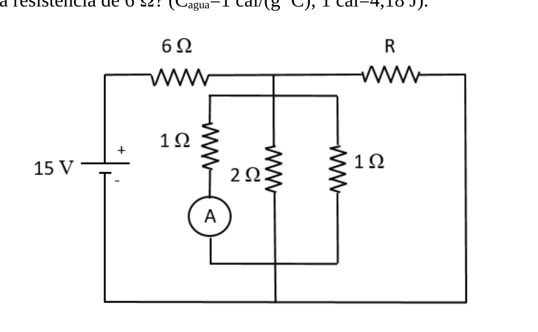

# 1er Recuperatorio del 1er Parcial — 16/12/2021

[Enunciado original (PDF)](Aula%20Virtual/2021-12-16%20-%201er%20Recuperatorio%201er%20Parcial.pdf) · [Resolución del profesor (PDF)](Aula%20Virtual/2021-12-16%20-%201er%20Recuperatorio%201er%20Parcial%20-%20Resoluci%C3%B3n.pdf) · Temas: circuitos con capacitores y efecto Joule, Carnot, anillo cargado, Gauss en cilindros, hilo cargado.

Cada ejercicio tiene un botón **Solución** con la respuesta y, adentro, un botón **Solución paso a paso**. Los resultados coinciden con la resolución del profesor.

Volver al [índice de parciales](README.md).

---

### Ejercicio 1

Considere el circuito de la figura. En caso de ser posible, responda las siguientes preguntas asumiendo el estado estacionario en todos los casos.

**a)** Si se conecta un capacitor de 200 μF en serie con la resistencia R, ¿qué carga adquirirá?

**b)** Suponga ahora que el capacitor se encuentra en serie con la resistencia de 2 Ω. Si la lectura del amperímetro es de 1 A, ¿cuál es el valor de R?

**c)** En el caso del ítem anterior, ¿qué variación de temperatura experimentará, en un lapso de 4 minutos, una masa de 50 g de agua líquida encerrada en un recipiente adiabático junto con la resistencia de 6 Ω? (Cagua=1 cal/(g 0C); 1 cal=4,18 J).

<b>Solución</b>

Solución paso a paso

**Estructura.** Después de la 6 Ω, el nodo superior baja al grupo de tres resistencias en paralelo (1 Ω con amperímetro, 2 Ω y 1 Ω). La rama de R va desde ese mismo nodo hasta la línea inferior por la derecha: está **en paralelo** con el grupo.

**Ítem a.**

**Paso 1 — Rama de R abierta.** En estacionario no circula corriente por el capacitor, así que la rama R + C no lleva corriente. Queda $15\ \text{V} = (6 + R_\parallel)I$, con $R_\parallel = (1 + \tfrac12 + 1)^{-1} = 0{,}4\ \Omega$:

$$I = \frac{15}{6{,}4}\ \text{A} = 2{,}34\ \text{A}$$

**Paso 2 — Tensión del capacitor.** R no tiene caída (no hay corriente), así que el capacitor está a la tensión del paralelo:

$$V_C = R_\parallel I = \frac{15}{16}\ \text{V} \qquad Q = CV_C = 200\ \mu\text{F}\cdot0{,}9375\ \text{V} = 187{,}5\ \mu\text{C}$$

**Ítem b.**

**Paso 3 — Rama de 2 Ω abierta.** Quedan las dos de 1 Ω en paralelo ($0{,}5\ \Omega$). El amperímetro marca 1 A, así que $V_p = 1$ V y la otra de 1 Ω también lleva 1 A: el grupo lleva $I_2 = 2$ A.

**Paso 4 — Malla.** $15 = 6I_1 + V_p$, de donde $I_1 = \dfrac{14}{6} = \dfrac73$ A. Por R pasa $I_3 = I_1 - I_2 = \dfrac13$ A, con la misma tensión $V_p$:

$$R = \frac{V_p}{I_3} = \frac{1\ \text{V}}{1/3\ \text{A}} = 3\ \Omega$$

**Ítem c.**

**Paso 5 — Calor en la de 6 Ω.** $P = 6\cdot(7/3)^2 = 32{,}67$ W $= 7{,}815$ cal/s. En $t = 240$ s:

$$Q = P\,t = 1875{,}6\ \text{cal} = m\,c\,\Delta T \quad\Rightarrow\quad \Delta T = \frac{1875{,}6}{50\cdot1}\ ^\circ\text{C} = 37{,}5\ ^\circ\text{C}$$

**Respuesta:** a) $Q = 187{,}5\ \mu$C; b) $R = 3\ \Omega$; c) $\Delta T = 37{,}5\ ^\circ$C

---

### Ejercicio 2

Una máquina de Carnot opera entre un foco frío a 00C y uno caliente a 1000C.

**a)** Sabiendo que el calor absorbido por ciclo es de 80 J, determine el calor cedido y el trabajo realizado.

**b)** Considere una máquina real que opera entre las mismas fuentes que la de Carnot, y cuyo rendimiento es la mitad que el de aquella. Si su trabajo en cada ciclo es de 15 J, ¿cuál es el calor cedido?

<b>Solución</b>

Solución paso a paso

**Paso 1 — Carnot (ítem a).** $T_1 = 373$ K, $T_2 = 273$ K:

$$\frac{Q_C}{Q_A} = -\frac{T_2}{T_1} \quad\Rightarrow\quad Q_C = -80\cdot\frac{273}{373}\ \text{J} = -58{,}55\ \text{J} \qquad W = Q_A + Q_C = 21{,}45\ \text{J}$$

**Paso 2 — Máquina real (ítem b).** $\varepsilon_{CAR} = 1 - 273/373 = 0{,}268$ y $\varepsilon_R = 0{,}134$:

$$Q_A = \frac{W}{\varepsilon_R} = \frac{15}{0{,}134}\ \text{J} = 111{,}9\ \text{J} \qquad Q_C = W - Q_A = -96{,}9\ \text{J}$$

**Respuesta:** a) $Q_C = -58{,}55$ J, $W = 21{,}45$ J; b) $Q_C = -96{,}9$ J

---

### Ejercicio 3

Un anillo de radio R tiene una de sus mitades cargada uniformemente con densidad λ1=7 μC/m, y la otra mitad cargada uniformemente con densidad λ2. Sabiendo que el módulo del campo eléctrico en el centro del anillo es 2kλ1/R, determine todos los posibles valores de λ2, en caso de que existan.

<b>Solución</b>

Solución paso a paso

**Paso 1 — Campo de una semicircunferencia en su centro.** Con la fórmula del arco (ver [teoría](../2%20-%20Electrost%C3%A1tica/teoria.md#arco-de-circunferencia-en-el-centro)), una semicircunferencia uniforme da $\dfrac{2k\lambda}{R}$, apuntando alejándose de ella (si $\lambda > 0$).

**Paso 2 — Superposición.** Con λ₁ en la mitad superior y λ₂ en la inferior:

$$\vec E_0 = \frac{2k}{R}(\lambda_2 - \lambda_1)\,\hat\jmath$$

**Paso 3 — Condición.**

$$\frac{2k}{R}|\lambda_2 - \lambda_1| = \frac{2k\lambda_1}{R} \quad\Rightarrow\quad \lambda_2 - \lambda_1 = \pm\lambda_1$$

Dos soluciones: $\lambda_2 = 2\lambda_1$ o $\lambda_2 = 0$.

**Respuesta:** $\lambda_2 = 14\ \mu$C/m o $\lambda_2 = 0$

---

### Ejercicio 4

En una primera experiencia, se dispone de un cilindro muy largo de radio 8 cm, que tiene una densidad de carga en volumen uniforme 600 μC/m3. En una segunda experiencia, independiente de la primera, se considera un segundo cilindro, también muy largo pero de radio 12 cm, que tiene densidad de carga en superficie uniforme. Se observa que la intensidad del campo eléctrico en un punto a 3 cm de distancia del eje del primer cilindro coincide con la intensidad del campo en un punto a 15 cm de distancia del eje del segundo cilindro. Se pide determinar el trabajo realizado por un agente externo al desplazar sin aceleración una carga q=5 μC desde un punto a 10 cm del eje del segundo cilindro, hasta un punto a 11 cm de ese mismo eje.

<b>Solución</b>

Solución paso a paso

**Paso 1 — Campo dentro del segundo cilindro.** Toda su carga está en la **superficie** ($r = 12$ cm). Por Gauss, un cilindro coaxial de radio $r < 12$ cm no encierra carga, así que $E = 0$ en todo el interior.

**Paso 2 — Trabajo.** Los puntos a 10 cm y 11 cm están **dentro** del segundo cilindro. Sin campo, el potencial es constante y no hace falta trabajo:

$$W = q\,[V(11\ \text{cm}) - V(10\ \text{cm})] = 0$$

Los datos de la primera experiencia sirven para hallar $\sigma$ (y el campo **afuera**), pero no se necesitan para la pregunta.

**Respuesta:** $W = 0$ (dentro del segundo cilindro el campo es nulo).

---

### Ejercicio 5

Un hilo finito con densidad de carga uniforme λ=20 μC/m se halla sobre el eje de las X, entre los puntos x1=6 cm y x2=14 cm. Una carga q=8 μC se encuentra en x3=22 cm. Determine:

**a)** La fuerza electrostática sobre la carga.

**b)** El trabajo realizado por el campo cuando la carga se desplaza desde x3 hasta x4=26 cm.

**Dato:** k=9 x 109 Nm2/C2.

<b>Solución</b>

Solución paso a paso

**Paso 1 — Fuerza (ítem a).** Campo del hilo en un punto a su derecha:

$$\vec F = q\vec E = kq\lambda\left[\frac{1}{x_3 - x_2} - \frac{1}{x_3 - x_1}\right]\hat\imath = 9\times10^9\cdot8\times10^{-6}\cdot20\times10^{-6}\left[\frac{1}{0{,}08} - \frac{1}{0{,}16}\right]\text{N}\ \hat\imath = 9\ \text{N}\ \hat\imath$$

**Paso 2 — Potencial del hilo en $x > x_2$.**

$$V(x) = k\lambda\int_{x_1}^{x_2}\frac{dx'}{x - x'} = k\lambda\ln\!\left(\frac{x - x_1}{x - x_2}\right)$$

**Paso 3 — Trabajo (ítem b).**

$$W = -q\,[V(x_4) - V(x_3)] = kq\lambda\ln\!\left[\frac{(x_3 - x_1)(x_4 - x_2)}{(x_3 - x_2)(x_4 - x_1)}\right]$$

$$W = 1{,}44\cdot\ln\!\left(\frac{16\cdot12}{8\cdot20}\right)\ \text{J} = 1{,}44\cdot\ln(1{,}2)\ \text{J} = 0{,}263\ \text{J}$$

**Respuesta:** a) $\vec F = 9$ N $\hat\imath$; b) $W = 0{,}263$ J

