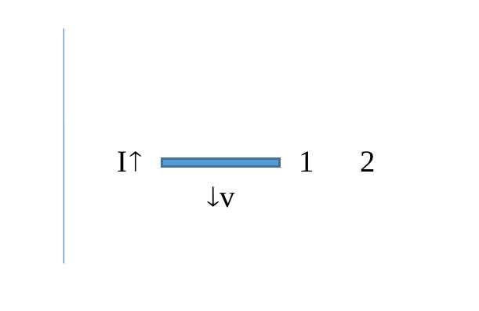

# 2º Recuperatorio del 2º Parcial — 18/02/2022

[Enunciado original (PDF)](Aula%20Virtual/2022-02-18%20-%202do%20Recuperatorio%202do%20Parcial.pdf) · Temas: espiras, fuerza magnética, fem de movimiento, autoinductancia, corriente alterna.

Cada ejercicio tiene un botón **Solución** con la respuesta y, adentro, un botón **Solución paso a paso**. No hay resolución oficial de este examen en el aula virtual: las soluciones son propias.

Volver al [índice de parciales](README.md).

**DATO:** μ0=4π x 10-7 Tm/A.

---

### Ejercicio 1

Una espira rectangular de lados L y 4L transporta una corriente de intensidad 1,5 A. **a)** Si L=2 cm, determine la intensidad del campo magnético en el centro de la espira. **b)** Una carga q=40 μC pasa por el centro de la espira con velocidad paralela al plano de la misma y de módulo 4 x 105 m/s. Determine el módulo de la fuerza sobre la carga.

<b>Solución</b>

Solución paso a paso

**Paso 1 — Campo en el centro de un rectángulo de lados $a$ y $b$.** Sumando los cuatro lados con la fórmula del hilo finito en la mediatriz:

- Los lados de longitud $b$ están a $a/2$: $B = \dfrac{\mu_0I}{4\pi(a/2)}\cdot\dfrac{2(b/2)}{\sqrt{(a/2)^2 + (b/2)^2}}$ cada uno.
- Lo análogo vale para los otros dos lados.

Sumando todo:

$$B = \frac{2\mu_0I\sqrt{a^2 + b^2}}{\pi\,a\,b}$$

**Paso 2 — Cálculo** con $a = 2$ cm y $b = 8$ cm:

$$B = \frac{2\cdot4\pi\times10^{-7}\cdot1{,}5\cdot\sqrt{0{,}02^2 + 0{,}08^2}}{\pi\cdot0{,}02\cdot0{,}08}\ \text{T} = \frac{9{,}90\times10^{-8}}{1{,}6\times10^{-3}}\ \text{T} = 61{,}8\ \mu\text{T}$$

**Paso 3 — Fuerza (ítem b).** El campo en el centro es perpendicular al plano de la espira y la velocidad es paralela al plano: $\vec v\perp\vec B$.

$$F = qvB = 40\times10^{-6}\cdot4\times10^5\cdot61{,}8\times10^{-6}\ \text{N} = 9{,}9\times10^{-4}\ \text{N}$$

**Respuesta:** a) $B = 61{,}8\ \mu$T; b) $F \approx 9{,}9\times10^{-4}$ N

---

### Ejercicio 2

Una carga puntual q=-14 μC se encuentra pasando por el punto (0; 0; 5 cm) con velocidad **v0** = 3 x 105 m/s **i**, cuando en t=0 se conecta en la región un campo magnético dependiente de la posición **B**(z) = 0,11 T/m z **j**. Determine el módulo de la velocidad de la carga, en t=0,2 s.

<b>Solución</b>

Solución paso a paso

**Paso 1 — Idea clave.** La fuerza magnética $\vec F = q\vec v\times\vec B$ es **siempre perpendicular a la velocidad**, así que no hace trabajo:

$$dW = \vec F\cdot d\vec r = (q\vec v\times\vec B)\cdot\vec v\,dt = 0$$

**Paso 2 — Conclusión.** La energía cinética, y con ella el **módulo** de la velocidad, se conserva, aunque el campo no sea uniforme y la trayectoria sea complicada. (Solo actúa la fuerza magnética.)

$$|\vec v(0{,}2\ \text{s})| = |\vec v_0| = 3\times10^5\ \text{m/s}$$

**Respuesta:** $|\vec v| = 3\times10^5$ m/s (la fuerza magnética no cambia el módulo de la velocidad).

---

### Ejercicio 3

La barra conductora de la figura, de longitud 30 cm, se mueve con velocidad constante **v** de módulo 40 m/s y paralela al hilo infinito que transporta una corriente I=10 A. La distancia entre el hilo y el extremo 1 de la barra es de 9 cm. Calcule V2-V1.

<b>Solución</b>

Solución paso a paso

**Ejes.** Hilo vertical con la corriente hacia arriba ($+\hat y$). La barra es perpendicular a él y va desde $x = d = 9$ cm (extremo 1) hasta $x = d + \ell = 39$ cm (extremo 2). La velocidad es hacia abajo ($-\hat y$).

**Paso 1 — Campo.** A la derecha del hilo: $\vec B = \dfrac{\mu_0I}{2\pi x}(-\hat z)$ (entrante).

**Paso 2 — $\vec v\times\vec B$.**

$$\vec v\times\vec B = (-v\,\hat y)\times\left(-\frac{\mu_0I}{2\pi x}\hat z\right) = \frac{\mu_0Iv}{2\pi x}\,\hat x$$

Empuja las cargas positivas hacia el extremo 2.

**Paso 3 — Fem de movimiento.**

$$V_2 - V_1 = \int_1^2(\vec v\times\vec B)\cdot d\vec\ell = \frac{\mu_0Iv}{2\pi}\int_d^{d+\ell}\frac{dx}{x} = \frac{\mu_0Iv}{2\pi}\ln\!\left(1 + \frac\ell d\right)$$

**Paso 4 — Cálculo.**

$$V_2 - V_1 = 2\times10^{-7}\cdot10\cdot40\cdot\ln\!\left(\frac{39}{9}\right)\ \text{V} = 8\times10^{-5}\cdot1{,}466\ \text{V} = 1{,}17\times10^{-4}\ \text{V}$$

**Respuesta:** $V_2 - V_1 = \dfrac{\mu_0Iv}{2\pi}\ln\!\left(1 + \dfrac\ell d\right) \approx 117\ \mu$V (el extremo 2 está a mayor potencial).

---

### Ejercicio 4

Por una bobina de 3 cm de radio y 70 cm de longitud, que tiene arrolladas 3000 vueltas de alambre, circula una corriente I(t)=3 A sen(200 1/s t). Calcule: **a)** el valor del coeficiente de autoinducción L de la bobina; **b)** la fem autoinducida en función del tiempo.

<b>Solución</b>

Solución paso a paso

**Paso 1 — Autoinductancia (ítem a).** Como la bobina es larga frente a su radio, se usa la fórmula del solenoide:

$$L = \mu_0\frac{N^2}{\ell}\pi r^2 = 4\pi\times10^{-7}\cdot\frac{3000^2}{0{,}7}\cdot\pi\cdot(0{,}03)^2\ \text{H} = 45{,}7\ \text{mH}$$

**Paso 2 — Fem (ítem b).**

$$\mathcal E(t) = -L\frac{dI}{dt} = -L\cdot3\cdot200\cos(200t) = -0{,}0457\cdot600\cos(200t)\ \text{V} = -27{,}4\cos(200\ \text{s}^{-1}t)\ \text{V}$$

**Respuesta:** a) $L = 45{,}7$ mH; b) $\mathcal E(t) = -27{,}4\cos(200\ \text{s}^{-1}t)$ V

---

### Ejercicio 5

La potencia activa que entrega un circuito RLC serie es de 70 W, con un factor de potencia 0,82. El circuito trabaja a 60 Hz y resuena a 45 Hz. La corriente de pico es de 2 A. **a)** Justifique si el circuito es capacitivo o inductivo. **b)** Calcule los valores de R, L y C. **c)** Determine las potencias aparente y reactiva.

<b>Solución</b>

Solución paso a paso

**Paso 1 — Ítem a.** Trabaja **por encima** de la resonancia (60 > 45 Hz), así que $X_L > X_C$: **inductivo**.

**Paso 2 — R.** $P = \tfrac12I_0^2R$, de donde $R = \dfrac{2P}{I_0^2} = \dfrac{140}{4} = 35\ \Omega$.

**Paso 3 — L y C.** $\phi = \arccos0{,}82 = 34{,}9^\circ$ y $X = R\tan\phi = 24{,}4\ \Omega$. Con $X = \omega L\left(1 - \dfrac{f_R^2}{f^2}\right)$:

$$L = \frac{R\tan\phi}{\omega\left(1 - (f_R/f)^2\right)} = \frac{24{,}4}{376{,}99\cdot0{,}4375}\ \text{H} = 0{,}148\ \text{H} \qquad C = \frac{1}{(2\pi\cdot45)^2L} = 84{,}5\ \mu\text{F}$$

**Paso 4 — Potencias (ítem c).**

$$S = \frac{P}{\cos\phi} = \frac{70}{0{,}82}\ \text{VA} = 85{,}4\ \text{VA} \qquad Q = S\operatorname{sen}\phi = 85{,}4\cdot0{,}572\ \text{VAR} = 48{,}9\ \text{VAR}$$

**Respuesta:** a) inductivo; b) $R = 35\ \Omega$, $L \approx 0{,}148$ H, $C \approx 84{,}5\ \mu$F; c) $S \approx 85{,}4$ VA, $Q \approx 48{,}9$ VAR

