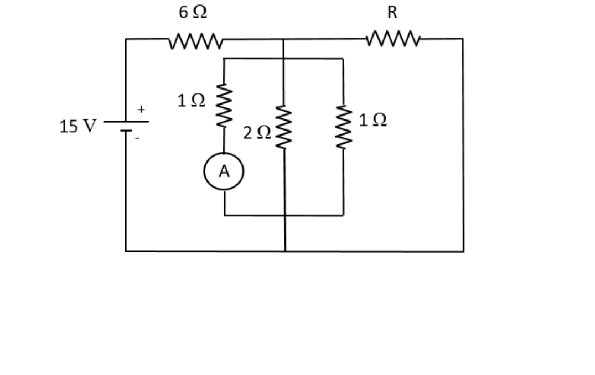
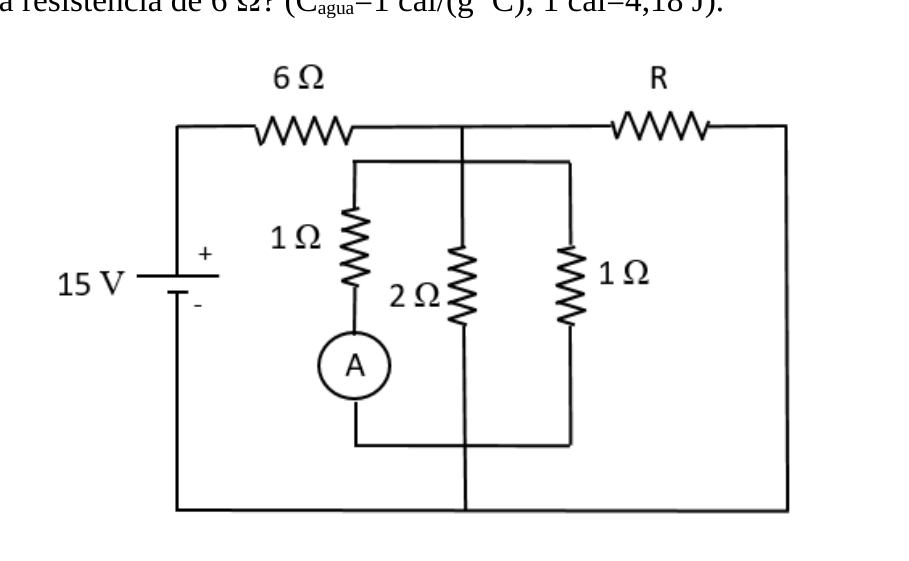
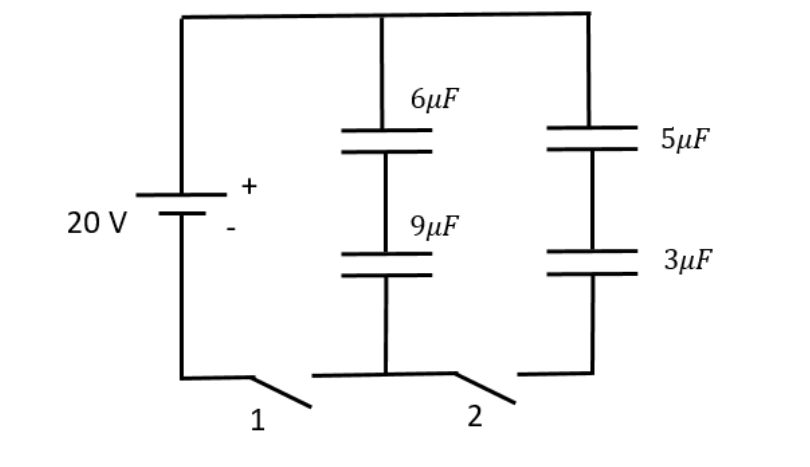
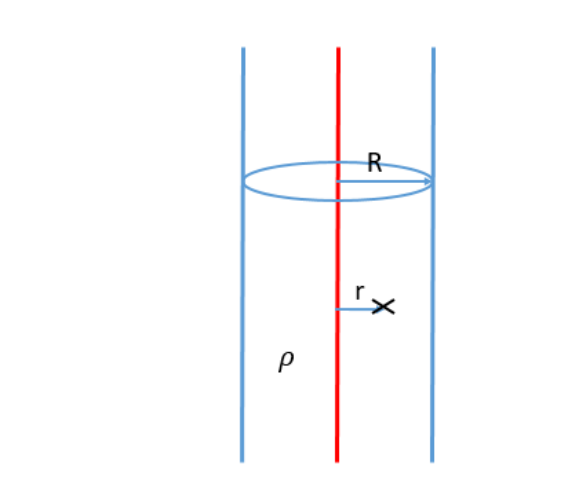

# Guía de resolución del 1er Parcial

Esta guía es para quien ya aprobó Análisis Matemático II (integrales múltiples, de línea, de superficie, teorema de la divergencia) pero **no sabe nada de Física II**. No hace falta haber leído la teoría del repo: todo lo necesario está acá.

Se revisaron los 14 ejercicios de los 3 exámenes del 1er Parcial de esta carpeta y se agruparon en **10 tipos**. Para cada tipo hay:

- **Cómo reconocerlo** en el enunciado.
- **Receta**: los pasos que siempre se siguen.
- **Ejemplo resuelto**: un ejercicio real de parcial, elegido como representante del tipo.
- **Variantes**: los demás ejercicios del mismo tipo, con lo que cambia respecto del ejemplo.

Primero conviene leer la [sección 0](#0-kit-mínimo-lo-que-am2-no-te-dio), que traduce la física a lenguaje de AM2. Después se puede ir directo al tipo que interese.

Volver al [índice de parciales](README.md).

---

## Índice

**[0. Kit mínimo](#0-kit-mínimo-lo-que-am2-no-te-dio)**: unidades, electrostática, circuitos, capacitores y térmica en lo que se usa.

**Circuitos y capacitores**

1. [Circuito de resistencias: hallar R, corrientes o potencia](#1-circuito-de-resistencias-hallar-r-corrientes-o-potencia)
2. [Capacitor en un circuito de continua y efecto Joule](#2-capacitor-en-un-circuito-de-continua-y-efecto-joule)
3. [Capacitores con llaves: reparto de carga](#3-capacitores-con-llaves-reparto-de-carga)

**Electrostática (campo y potencial de cargas)**

4. [Hilo cargado: campo, fuerza y trabajo sobre su propio eje](#4-hilo-cargado-campo-fuerza-y-trabajo-sobre-su-propio-eje)
5. [Anillo cargado: fuerza y trabajo sobre su eje](#5-anillo-cargado-fuerza-y-trabajo-sobre-su-eje)
6. [Arcos y semicircunferencias: campo en el centro](#6-arcos-y-semicircunferencias-campo-en-el-centro)
7. [Ley de Gauss: esfera cargada y potencial](#7-ley-de-gauss-esfera-cargada-y-potencial)
8. [Ley de Gauss: cilindros (densidad variable o carga superficial)](#8-ley-de-gauss-cilindros-densidad-variable-o-carga-superficial)

**Térmica**

9. [Conducción del calor: barras en serie](#9-conducción-del-calor-barras-en-serie)
10. [Máquina de Carnot](#10-máquina-de-carnot)

**[Tabla de cobertura](#tabla-de-cobertura)**: a qué tipo corresponde cada ejercicio de cada examen.

---

## 0. Kit mínimo (lo que AM2 no te dio)

### 0.1 Unidades y constantes

| Magnitud | Símbolo | Unidad |
|---|---|---|
| Carga | $q$, $Q$ | C (coulomb). 1 μC = $10^{-6}$ C |
| Densidad lineal / superficial / volumétrica | $\lambda$, $\sigma$, $\rho$ | C/m, C/m², C/m³ |
| Campo eléctrico | $\vec E$ | N/C = V/m |
| Potencial, tensión | $V$ | V (volt) = J/C |
| Corriente | $I$ | A (ampere) = C/s |
| Resistencia | $R$ | Ω (ohm) |
| Capacidad | $C$ | F (farad). 1 μF = $10^{-6}$ F |
| Potencia | $P$ | W (watt) = J/s |
| Calor, trabajo, energía | $Q$, $W$, $U$ | J (joule). 1 cal = 4,18 J |
| Temperatura | $T$ | °C o K ($T_K = T_{°C} + 273$) |

- **Constante de Coulomb:** $k = \dfrac{1}{4\pi\varepsilon_0} = 9\times10^9$ N m²/C².
- **Permitividad del vacío:** $\varepsilon_0 = 8{,}85\times10^{-12}$ C²/(N m²).
- Todo en el SI: los centímetros se pasan a metros **antes** de reemplazar.

### 0.2 Electrostática: campo y potencial (son integrales de AM2)

Una carga puntual $q$ genera en un punto a distancia $r$:

$$\vec E = \frac{kq}{r^2}\hat r \qquad V = \frac{kq}{r}$$

donde $\hat r$ apunta **desde la carga hacia el punto**. Las cargas positivas "empujan" el campo hacia afuera; las negativas lo "tiran" hacia ellas.

Si la carga está repartida en un cuerpo, se parte en elementos $dq$ y se suma (superposición). Según la forma, $dq = \lambda\,dl$ (curva), $\sigma\,dA$ (superficie) o $\rho\,dV$ (volumen):

$$\vec E(P) = k\int\frac{dq}{r^2}\hat r \qquad V(P) = k\int\frac{dq}{r}$$

La primera es una integral **vectorial**: conviene usar simetrías para ver qué componentes se cancelan antes de integrar. El potencial es escalar y suele ser más fácil.

**Relación entre campo y potencial.** $\vec E = -\nabla V$, o al revés, una integral de línea:

$$V(B) - V(A) = -\int_A^B\vec E\cdot d\vec l$$

El campo es conservativo (como los campos de gradiente de AM2): la integral no depende del camino.

**Fuerza y trabajo.**

- Fuerza sobre una carga $q$: $\vec F = q\vec E$. Si $q < 0$, la fuerza es **opuesta** al campo.
- Trabajo **del campo** al llevar $q$ de A a B: $W_{campo} = -q\,[V(B) - V(A)]$.
- Trabajo de un **agente externo** que la lleva "sin aceleración": $W_{ext} = +q\,[V(B) - V(A)]$.

### 0.3 Ley de Gauss (el teorema de la divergencia)

$$\oint_S\vec E\cdot d\vec A = \frac{Q_{enc}}{\varepsilon_0}$$

El flujo del campo por una superficie **cerrada** es la carga encerrada sobre $\varepsilon_0$. Solo sirve para despejar $E$ cuando hay mucha simetría, porque entonces $E$ sale de la integral:

| Simetría | Superficie gaussiana | Flujo |
|---|---|---|
| Esférica (esfera cargada) | esfera concéntrica de radio $r$ | $E\cdot4\pi r^2$ |
| Cilíndrica (cilindro o hilo infinito) | cilindro coaxial de radio $r$ y altura $h$ | $E\cdot2\pi rh$ (las tapas no aportan) |
| Plana (plano infinito) | cilindro que atraviesa el plano | $E\cdot2A$ |

$Q_{enc}$ es una integral de volumen de $\rho$ sobre lo que queda **adentro** de la superficie gaussiana. Si $\rho$ depende de $r$, se integra en cáscaras: $dV = 4\pi r^2dr$ (esfera) o $2\pi rh\,dr$ (cilindro).

**Conductores** (metales en equilibrio): adentro $E = 0$, el potencial es constante y toda la carga está en la superficie.

### 0.4 Formulario de campos

| Distribución | Campo | Potencial |
|---|---|---|
| Carga puntual | $\dfrac{kq}{r^2}$ radial | $\dfrac{kq}{r}$ |
| Hilo finito ($x_1$ a $x_2$), punto sobre su eje en $x > x_2$ | $k\lambda\left(\dfrac{1}{x - x_2} - \dfrac{1}{x - x_1}\right)$ en $+\hat x$ | $k\lambda\ln\dfrac{x - x_1}{x - x_2}$ |
| Anillo (carga total $Q$, radio $R$), sobre su eje a distancia $z$ | $\dfrac{kQz}{(R^2 + z^2)^{3/2}}$ a lo largo del eje | $\dfrac{kQ}{\sqrt{R^2 + z^2}}$ |
| Arco de ángulo $\theta$ y radio $R$, en el centro | $\dfrac{2k\lambda}{R}\mathrm{sen}\,\dfrac\theta2$ por la bisectriz | $\dfrac{k\lambda\theta R}{R} = k\lambda\theta$ |
| Semicircunferencia, en el centro ($\theta = \pi$) | $\dfrac{2k\lambda}{R}$ | $k\lambda\pi$ |
| Esfera de radio $R$ con $\rho$ uniforme | adentro $\dfrac{\rho r}{3\varepsilon_0}$; afuera $\dfrac{\rho R^3}{3\varepsilon_0r^2} = \dfrac{kQ}{r^2}$ | afuera $\dfrac{kQ}{r}$ |
| Hilo infinito / cilindro, afuera | $\dfrac{\lambda}{2\pi\varepsilon_0r}$ ($\lambda$ = carga por unidad de longitud) | $-\dfrac{\lambda}{2\pi\varepsilon_0}\ln r + cte$ |
| Plano infinito | $\dfrac{\sigma}{2\varepsilon_0}$ | |

### 0.5 Circuitos de corriente continua

- **Ley de Ohm:** $V = IR$ (la tensión en una resistencia es su resistencia por la corriente que la atraviesa).
- **Potencia** disipada en una resistencia (efecto Joule): $P = VI = I^2R = V^2/R$. Potencia que entrega una fuente: $P = VI$.
- **Serie** (misma corriente): $R_{eq} = R_1 + R_2 + \dots$
- **Paralelo** (misma tensión, conectadas entre los **mismos dos nodos**): $\dfrac{1}{R_{eq}} = \dfrac{1}{R_1} + \dfrac{1}{R_2} + \dots$
- **Leyes de Kirchhoff:** en cada nodo, la suma de corrientes que entran es igual a la que sale. En cada camino cerrado (malla), la suma de las fem de las fuentes es igual a la suma de las caídas $IR$.
- **Instrumentos ideales:** el **amperímetro** se pone en serie y es un cable ($R = 0$): mide la corriente de su rama. El **voltímetro** se pone en paralelo y es un circuito abierto: mide la tensión entre sus bornes.

Lo más difícil de los ejercicios de circuitos es **leer el dibujo**: identificar los nodos (todos los puntos unidos por cable sin resistencias en el medio son el mismo nodo) y ver qué está en paralelo.

### 0.6 Capacitores

- $Q = CV$: un capacitor con tensión $V$ guarda carga $+Q$ en una placa y $-Q$ en la otra.
- **Paralelo** (misma tensión): $C_{eq} = C_1 + C_2$. **Serie** (misma carga): $\dfrac{1}{C_{eq}} = \dfrac{1}{C_1} + \dfrac{1}{C_2}$. (Al revés que las resistencias.)
- Energía: $U = \tfrac12CV^2 = \dfrac{Q^2}{2C}$.
- En **estado estacionario** (mucho tiempo después de conectar) por un capacitor **no circula corriente**: se comporta como un circuito abierto.
- Un capacitor desconectado (aislado) **conserva su carga**.

### 0.7 Térmica

- **Calor sensible:** para cambiar la temperatura de una masa $m$ hace falta $Q = mc\Delta T$ ($c$ = calor específico; agua: 1 cal/(g °C)).
- **Conducción (ley de Fourier):** una barra de largo $L$, sección $A$ y conductividad $k$, con sus extremos a temperaturas que difieren en $\Delta T$, conduce una **corriente térmica** (calor por segundo, en W):

$$H = \frac{kA\,\Delta T}{L} = \frac{\Delta T}{R_T} \qquad R_T = \frac{L}{kA}$$

  Es exactamente la ley de Ohm con $\Delta T$ en lugar de $V$, $H$ en lugar de $I$ y $R_T$ en lugar de $R$. Las barras en **serie** suman resistencias térmicas.
- **Máquina térmica:** en cada ciclo absorbe $Q_A > 0$ del foco caliente, cede $Q_C < 0$ al frío y hace un trabajo $W = Q_A + Q_C$. Rendimiento $\eta = W/Q_A$.
- **Máquina de Carnot** (la ideal, con el mayor rendimiento posible entre dos focos), con temperaturas **en kelvin**:

$$\frac{Q_C}{Q_A} = -\frac{T_F}{T_C} \qquad \eta_{Carnot} = 1 - \frac{T_F}{T_C}$$

---

# Circuitos y capacitores

## 1. Circuito de resistencias: hallar R, corrientes o potencia

**Cómo reconocerlo.** Un circuito con una fuente, varias resistencias y un amperímetro o voltímetro con una lectura conocida. Piden una resistencia desconocida o la potencia.

**Receta.**

1. **Leer el circuito.** Marcar los nodos. Las resistencias conectadas entre los mismos dos nodos están en paralelo.
2. **Arrancar desde el instrumento.** La lectura da una corriente o tensión en una rama. Con Ohm se obtiene la tensión del grupo en paralelo, y con ella la corriente de cada rama del grupo.
3. **Nodos:** la corriente total es la suma de las de las ramas.
4. **Malla con la fuente:** $V_{fuente} = \sum IR$ a lo largo de un camino cerrado. De ahí sale lo que falta.
5. **"¿Existe R?":** existe si la corriente que se le asigna resulta **positiva** (con el sentido supuesto).

### Ejemplo — 1er Parcial 19/08/2021, Ej. 1b

> Considere el circuito de la figura. ¿Existen valores de R tales que la lectura del amperímetro sea 0,8 A? En caso de ser posible, calcúlelos. En caso negativo, justifique.

**Lectura.** Después de la de 6 Ω hay un nodo (arriba en el centro). Las tres resistencias verticales (1 Ω con el amperímetro, 2 Ω y 1 Ω) van de ese nodo a la línea inferior: están en **paralelo**. La rama de R también va de ese nodo a la línea inferior (por la derecha): está en paralelo con ellas. Todas tienen la misma tensión $V_p$.

**Desde el amperímetro.** Por la de 1 Ω pasan 0,8 A: $V_p = 1\ \Omega\cdot0{,}8\ \text{A} = 0{,}8$ V. Entonces por la de 2 Ω pasan $0{,}4$ A y por la otra de 1 Ω, $0{,}8$ A. Las tres juntas llevan $I_2 = 2$ A.

**Malla con la fuente.** Toda la corriente $I_1$ pasa por la de 6 Ω:

$$15\ \text{V} = 6\ \Omega\cdot I_1 + V_p \quad\Rightarrow\quad I_1 = \frac{15 - 0{,}8}{6}\ \text{A} = 2{,}367\ \text{A}$$

**Nodo.** Por R pasa lo que sobra: $I_3 = I_1 - I_2 = 0{,}367$ A. Es positiva, así que **sí existe**:

$$R = \frac{V_p}{I_3} = \frac{0{,}8}{0{,}367}\ \Omega = 2{,}18\ \Omega$$

**Variantes.**

- [1er Parcial 19/08/2021, Ej. 1a](2021-08-19-1er-parcial.md#ejercicio-1): el voltímetro mide la tensión de un paralelo; con la malla sale la corriente y de ahí $R_{eq}$. Después se cambia una resistencia y se recalcula $P = VI$.
- [2º Recuperatorio 12/02/2021, Ej. 1](2021-02-12-2do-recuperatorio-1er-parcial.md#ejercicio-1): igual, pero con R₁ desconocida y $R_2 = 2R_1$. Todo queda en función de $R_1$ y la malla da una ecuación lineal ($15 = 7R_1$).
- [1er Recuperatorio 16/12/2021, Ej. 1b](2021-12-16-1er-recuperatorio-1er-parcial.md#ejercicio-1): el **mismo circuito** con 1 A y la rama de 2 Ω abierta por un capacitor (ver [tipo 2](#2-capacitor-en-un-circuito-de-continua-y-efecto-joule)).

---

## 2. Capacitor en un circuito de continua y efecto Joule

**Cómo reconocerlo.** Un capacitor dentro de un circuito con resistencias, "en estado estacionario". A veces además una resistencia calienta agua.

**Receta.**

1. En estacionario, la rama del capacitor **no lleva corriente**: borrarla del circuito para calcular corrientes.
2. Resolver el circuito que queda ([tipo 1](#1-circuito-de-resistencias-hallar-r-corrientes-o-potencia)).
3. Tensión del capacitor: la diferencia de potencial entre los nodos a los que está conectada su rama. Las resistencias en serie con él no tienen caída (no hay corriente).
4. $Q = CV_C$.
5. Calor: $P = I^2R$, energía $E = Pt$ (pasar a calorías con 1 cal = 4,18 J), y $E = mc\Delta T$.

### Ejemplo — 1er Recuperatorio 16/12/2021, Ej. 1a y 1c

> Considere el circuito de la figura, en estado estacionario. **a)** Si se conecta un capacitor de 200 μF en serie con la resistencia R, ¿qué carga adquirirá? [...] **b)** Suponga ahora que el capacitor se encuentra en serie con la resistencia de 2 Ω. Si la lectura del amperímetro es de 1 A, ¿cuál es el valor de R? **c)** En el caso del ítem anterior, ¿qué variación de temperatura experimentará, en un lapso de 4 minutos, una masa de 50 g de agua líquida encerrada en un recipiente adiabático junto con la resistencia de 6 Ω? (c_agua=1 cal/(g °C); 1 cal=4,18 J).

Es el mismo circuito del ejemplo anterior.

**a)** La rama de R queda abierta. Queda la de 6 Ω en serie con el paralelo de tres resistencias:

$$R_\parallel = \left(\frac11 + \frac12 + \frac11\right)^{-1} = 0{,}4\ \Omega \qquad I = \frac{15}{6 + 0{,}4}\ \text{A} = 2{,}34\ \text{A}$$

La rama R + C está conectada entre los mismos nodos que el paralelo y R no tiene caída, así que el capacitor tiene la tensión del paralelo:

$$V_C = 0{,}4\cdot2{,}34\ \text{V} = 0{,}9375\ \text{V} \qquad Q = 200\ \mu\text{F}\cdot0{,}9375\ \text{V} = 187{,}5\ \mu\text{C}$$

**b)** (Igual que el [tipo 1](#1-circuito-de-resistencias-hallar-r-corrientes-o-potencia), sin la rama de 2 Ω.) $V_p = 1$ V; las dos de 1 Ω llevan 2 A en total; la malla da $I_1 = (15 - 1)/6 = 7/3$ A; por R pasa $1/3$ A y $R = 3\ \Omega$.

**c)** Potencia en la de 6 Ω, energía en 4 minutos, y calor sensible del agua:

$$P = 6\cdot\left(\tfrac73\right)^2\ \text{W} = 32{,}67\ \text{W} \qquad E = 32{,}67\cdot240\ \text{J} = 7840\ \text{J} = 1875{,}6\ \text{cal}$$

$$\Delta T = \frac{E}{mc} = \frac{1875{,}6\ \text{cal}}{50\ \text{g}\cdot1\ \text{cal/(g °C)}} = 37{,}5\ ^\circ\text{C}$$

---

## 3. Capacitores con llaves: reparto de carga

**Cómo reconocerlo.** Fuente, capacitores y dos llaves que se cierran y abren en orden. Piden las cargas finales (y a veces la energía disipada).

**Receta.**

1. **Etapa 1** (fuente conectada): calcular la $C_{eq}$ que ve la fuente y $Q_0 = C_{eq}V$. Si es una serie, todos los capacitores de la serie tienen la misma carga $Q_0$.
2. **Etapa 2** (fuente desconectada, se conecta un grupo descargado): lo cargado queda aislado, así que **la carga se conserva**. Los dos grupos terminan en paralelo, con la misma tensión:

$$V' = \frac{Q_0}{C_{grupo\,1} + C_{grupo\,2}} \qquad Q_{grupo} = C_{grupo}V'$$

3. Dentro de un grupo en serie, cada capacitor tiene la carga del grupo.
4. Si piden energía disipada: al cargar desde la fuente se pierde $\tfrac12C_{eq}V^2$ (la mitad de lo que entrega); en el reparto se pierde $U_{antes} - U_{después}$.

### Ejemplo — 1er Parcial 19/08/2021, Ej. 2

> En el circuito de la figura los capacitores se hallan inicialmente descargados y la llave abierta. Se cierra la llave 1 y pasado un tiempo muy largo se abre la llave 1 y luego se cierra la llave 2. Determine las cargas finales en los capacitores.

**Etapa 1.** La llave 1 conecta la fuente con la columna del medio: 6 μF y 9 μF **en serie**.

$$C_{izq} = \frac{6\cdot9}{6 + 9}\ \mu\text{F} = 3{,}6\ \mu\text{F} \qquad Q_0 = 3{,}6\ \mu\text{F}\cdot20\ \text{V} = 72\ \mu\text{C}$$

**Etapa 2.** Se abre la llave 1 (la fuente queda afuera) y se cierra la 2: la columna del medio queda en paralelo con la de la derecha, 5 μF y 3 μF en serie, descargada:

$$C_{der} = \frac{5\cdot3}{5 + 3}\ \mu\text{F} = 1{,}875\ \mu\text{F} \qquad V' = \frac{72\ \mu\text{C}}{(3{,}6 + 1{,}875)\ \mu\text{F}} = 13{,}15\ \text{V}$$

**Cargas finales.**

$$Q_{6} = Q_{9} = 3{,}6\cdot13{,}15\ \mu\text{C} = 47{,}4\ \mu\text{C} \qquad Q_{5} = Q_{3} = 1{,}875\cdot13{,}15\ \mu\text{C} = 24{,}6\ \mu\text{C}$$

Verificación: $47{,}4 + 24{,}6 = 72\ \mu\text{C}$ ✓.

---

# Electrostática

## 4. Hilo cargado: campo, fuerza y trabajo sobre su propio eje

**Cómo reconocerlo.** "Hilo finito con densidad λ sobre el eje X, entre $x_1$ y $x_2$", y una carga puntual sobre el mismo eje.

**Receta.**

1. Campo en un punto $x$ a la derecha del hilo (todo apunta en $\pm\hat x$, no hay que proyectar):

$$E(x) = k\lambda\int_{x_1}^{x_2}\frac{dx'}{(x - x')^2} = k\lambda\left(\frac{1}{x - x_2} - \frac{1}{x - x_1}\right)$$

   Si $\lambda > 0$ apunta alejándose del hilo; si $\lambda < 0$, hacia el hilo.
2. Con dos hilos: calcular cada uno y sumar con signo.
3. Fuerza: $\vec F = q\vec E$ (con el signo de $q$).
4. Trabajo: potencial $V(x) = k\lambda\displaystyle\int_{x_1}^{x_2}\frac{dx'}{x - x'} = k\lambda\ln\frac{x - x_1}{x - x_2}$ y $W_{campo} = -q[V(B) - V(A)]$.

### Ejemplo — 1er Recuperatorio 16/12/2021, Ej. 5

> Un hilo finito con densidad de carga uniforme λ=20 μC/m se halla sobre el eje de las X, entre los puntos x₁=6 cm y x₂=14 cm. Una carga q=8 μC se encuentra en x₃=22 cm. Determine: **a)** La fuerza electrostática sobre la carga. **b)** El trabajo realizado por el campo cuando la carga se desplaza desde x₃ hasta x₄=26 cm.

**a)** $kq\lambda = 9\times10^9\cdot8\times10^{-6}\cdot20\times10^{-6} = 1{,}44$ N m.

$$\vec F = kq\lambda\left(\frac{1}{x_3 - x_2} - \frac{1}{x_3 - x_1}\right)\hat x = 1{,}44\left(\frac{1}{0{,}08} - \frac{1}{0{,}16}\right)\ \text{N}\ \hat x = 9\ \text{N}\ \hat x$$

Repulsión: las dos cargas son positivas.

**b)**

$$W = -q[V(x_4) - V(x_3)] = kq\lambda\left[\ln\frac{x_3 - x_1}{x_3 - x_2} - \ln\frac{x_4 - x_1}{x_4 - x_2}\right] = 1{,}44\ln\frac{16\cdot12}{8\cdot20}\ \text{J} = 1{,}44\ln1{,}2\ \text{J} = 0{,}263\ \text{J}$$

Positivo, como corresponde: el campo empuja la carga hacia donde se mueve.

**Variantes.** [2º Recuperatorio 12/02/2021, Ej. 3](2021-02-12-2do-recuperatorio-1er-parcial.md#ejercicio-3): dos hilos, uno positivo a la izquierda y uno negativo a la derecha del punto. Los dos campos apuntan en $+\hat x$ (el positivo empuja, el negativo atrae) y se suman. La carga de prueba es negativa: la fuerza queda en $-\hat x$.

---

## 5. Anillo cargado: fuerza y trabajo sobre su eje

**Cómo reconocerlo.** Anillo con densidad λ y una carga que se mueve sobre su eje.

**Receta.**

1. Carga total $Q = 2\pi R\lambda$.
2. Por simetría, las componentes perpendiculares al eje se cancelan y solo queda la axial:

$$E(z) = \frac{kQz}{(R^2 + z^2)^{3/2}} \qquad V(z) = \frac{kQ}{\sqrt{R^2 + z^2}}$$

   (El potencial es inmediato: todos los $dq$ están a la misma distancia $\sqrt{R^2 + z^2}$ del punto.)
3. $\vec F = q\vec E$ y $W_{campo} = -q[V(z_2) - V(z_1)]$.

### Ejemplo — 1er Parcial 19/08/2021, Ej. 3

> Considere un anillo de radio R=6 cm con densidad de carga uniforme λ=7 μC/m. Una carga q=-8 μC se puede mover sobre el eje del anillo. Calcule: **a)** La fuerza sobre la carga q cuando esta se halla en un punto a 12 cm del centro del anillo. **b)** El trabajo realizado por el campo cuando la carga se desplaza desde el punto del ítem anterior hasta otro ubicado a 18 cm del centro del anillo.

$kQ = 9\times10^9\cdot2\pi\cdot0{,}06\cdot7\times10^{-6} = 23751$ V m.

**a)**

$$E(0{,}12) = \frac{23751\cdot0{,}12}{(0{,}06^2 + 0{,}12^2)^{3/2}}\ \tfrac{\text{N}}{\text{C}} = \frac{2850}{0{,}002415}\ \tfrac{\text{N}}{\text{C}} = 1{,}18\times10^6\ \tfrac{\text{N}}{\text{C}}$$

$$\vec F = -8\times10^{-6}\cdot1{,}18\times10^6\ \text{N}\ \hat k = -9{,}44\ \text{N}\ \hat k$$

La carga es negativa: es atraída hacia el anillo.

**b)**

$$V(0{,}12) = \frac{23751}{0{,}1342}\ \text{V} = 177035\ \text{V} \qquad V(0{,}18) = \frac{23751}{0{,}1897}\ \text{V} = 125180\ \text{V}$$

$$W = -q[V(0{,}18) - V(0{,}12)] = 8\times10^{-6}\cdot(-51855)\ \text{J} = -0{,}41\ \text{J}$$

Negativo: se aleja la carga del anillo, contra la atracción.

---

## 6. Arcos y semicircunferencias: campo en el centro

**Cómo reconocerlo.** Un anillo o arco con distintas densidades en distintos tramos; piden el campo en el centro.

**Receta.**

1. Campo de un arco uniforme en su centro: parametrizando con el ángulo, $dq = \lambda R\,d\varphi$, todos a distancia $R$. Las componentes perpendiculares a la bisectriz se cancelan:

$$E = \frac{k\lambda}{R}\int_{-\theta/2}^{\theta/2}\cos\varphi\,d\varphi = \frac{2k\lambda}{R}\mathrm{sen}\,\frac\theta2$$

   Para una semicircunferencia: $\dfrac{2k\lambda}{R}$, apuntando **alejándose** de ella si $\lambda > 0$.
2. Superponer los tramos con signo.
3. Si dan el módulo, la ecuación tiene valor absoluto → **dos soluciones**.

### Ejemplo — 1er Recuperatorio 16/12/2021, Ej. 3

> Un anillo de radio R tiene una de sus mitades cargada uniformemente con densidad λ₁=7 μC/m, y la otra mitad cargada uniformemente con densidad λ₂. Sabiendo que el módulo del campo eléctrico en el centro del anillo es 2kλ₁/R, determine todos los posibles valores de λ₂, en caso de que existan.

Con λ₁ en la mitad de arriba y λ₂ en la de abajo: la de arriba da $\dfrac{2k\lambda_1}{R}$ hacia abajo ($-\hat y$) y la de abajo da $\dfrac{2k\lambda_2}{R}$ hacia arriba ($+\hat y$):

$$\vec E_0 = \frac{2k}{R}(\lambda_2 - \lambda_1)\,\hat y$$

$$\frac{2k}{R}\lvert\lambda_2 - \lambda_1\rvert = \frac{2k\lambda_1}{R} \quad\Rightarrow\quad \lambda_2 - \lambda_1 = \pm\lambda_1 \quad\Rightarrow\quad \lambda_2 = 14\ \mu\text{C/m}\ \ \text{o}\ \ \lambda_2 = 0$$

---

## 7. Ley de Gauss: esfera cargada y potencial

**Cómo reconocerlo.** Esfera con densidad volumétrica uniforme; dan el campo en un punto y piden el campo en otro, una diferencia de potencial o un trabajo.

**Receta.**

1. Gauss con una esfera de radio $r$: $E\cdot4\pi r^2 = Q_{enc}/\varepsilon_0$.
   - Adentro ($r < R$): $Q_{enc} = \rho\tfrac43\pi r^3$, así que $E = \dfrac{\rho r}{3\varepsilon_0}$.
   - Afuera ($r > R$): $Q_{enc} = \rho\tfrac43\pi R^3$, así que $E = \dfrac{\rho R^3}{3\varepsilon_0r^2}$.
2. Con el dato, despejar la **combinación** de constantes que aparece (en general no hace falta $\rho$ sola).
3. Potencial: $V(b) - V(a) = -\displaystyle\int_a^bE\,dr$.
4. Trabajo del campo: $W = -q\,\Delta V$.

### Ejemplo — 2º Recuperatorio 12/02/2021, Ej. 2

> Una esfera de radio R tiene densidad de carga en volumen uniforme. **a)** Sabiendo que en un punto a distancia R/2 del centro de la esfera el módulo del campo eléctrico es 8 V/m, determine el módulo del campo en un punto a distancia 2R del centro. **b)** Sabiendo que la diferencia de potencial entre un punto a distancia 2R del centro y un punto a distancia 3R del centro es de 1 V, calcule R. **c)** ¿Qué trabajo realiza el campo cuando una carga q=5 μC se desplaza desde un punto a distancia 3R del centro de la esfera hasta otro a distancia 4R del centro?

**a)** En $R/2$ (adentro): $\dfrac{\rho R}{6\varepsilon_0} = 8$ V/m, así que $\dfrac{\rho R}{\varepsilon_0} = 48$ V/m. En $2R$ (afuera):

$$E(2R) = \frac{\rho R^3}{3\varepsilon_0(2R)^2} = \frac{1}{12}\,\frac{\rho R}{\varepsilon_0} = 4\ \text{V/m}$$

**b)**

$$\lvert V(2R) - V(3R)\rvert = \int_{2R}^{3R}\frac{\rho R^3}{3\varepsilon_0r^2}dr = \frac{\rho R^3}{3\varepsilon_0}\left(\frac{1}{2R} - \frac{1}{3R}\right) = \frac{\rho R}{\varepsilon_0}\cdot\frac{R}{18}$$

$$1\ \text{V} = 48\ \tfrac{\text{V}}{\text{m}}\cdot\frac{R}{18} \quad\Rightarrow\quad R = 0{,}375\ \text{m}$$

**c)** Igual que en b), entre $3R$ y $4R$: $V(3R) - V(4R) = \dfrac{\rho R}{\varepsilon_0}\cdot\dfrac{R}{36} = 48\cdot\dfrac{0{,}375}{36} = 0{,}5$ V.

$$W = -q[V(4R) - V(3R)] = 5\times10^{-6}\cdot0{,}5\ \text{J} = 2{,}5\ \mu\text{J}$$

---

## 8. Ley de Gauss: cilindros (densidad variable o carga superficial)

**Cómo reconocerlo.** "Cilindro muy largo" con densidad $\rho(r)$ o con carga en la superficie; piden el campo a cierta distancia del eje, o un trabajo.

**Receta.**

1. Justificar la simetría: cilindro infinito con densidad que depende solo de $r$ → $\vec E = E(r)\hat r$ radial. Superficie gaussiana: cilindro coaxial de radio $r$ y altura $h$. Las tapas no tienen flujo ($\vec E\perp d\vec A$) y la cara lateral da $E\cdot2\pi rh$.
2. $Q_{enc}$ con integral en cáscaras: $Q_{enc} = \displaystyle\int_0^{\min(r,R)}\rho(r')\,2\pi r'h\,dr'$.
3. Despejar $E$. Adentro y afuera dan fórmulas distintas.
4. Si toda la carga está en la **superficie**, adentro $Q_{enc} = 0$ → $E = 0$ → potencial constante → trabajo nulo entre dos puntos interiores.

### Ejemplo — 1er Parcial 19/08/2021, Ej. 4

> Un cilindro muy largo de radio R=7 cm tiene una densidad volumétrica de carga dependiente de la distancia r al eje del cilindro, dada por ρ(r)=(90 μC/m³) r. Determine el campo eléctrico: **a)** en un punto a 4 cm del eje; **b)** en un punto a 12 cm del eje. **Justifique los pasos dados**.

Sea $\rho = \rho_0r$ con $\rho_0 = 90\ \mu\text{C}$/m⁴.

**a) Adentro** ($r = 4$ cm $< R$):

$$Q_{enc} = \int_0^r\rho_0r'\,2\pi r'h\,dr' = \frac{2\pi h\rho_0r^3}{3} \qquad E\cdot2\pi rh = \frac{2\pi h\rho_0r^3}{3\varepsilon_0} \quad\Rightarrow\quad E = \frac{\rho_0r^2}{3\varepsilon_0}$$

$$E(0{,}04) = \frac{90\times10^{-6}\cdot0{,}04^2}{3\cdot8{,}85\times10^{-12}}\ \tfrac{\text{V}}{\text{m}} = 5424\ \tfrac{\text{V}}{\text{m}}$$

**b) Afuera** ($r = 12$ cm $> R$): se encierra toda la carga, $Q_{enc} = \dfrac{2\pi h\rho_0R^3}{3}$:

$$E = \frac{\rho_0R^3}{3\varepsilon_0r} = \frac{90\times10^{-6}\cdot0{,}07^3}{3\cdot8{,}85\times10^{-12}\cdot0{,}12}\ \tfrac{\text{V}}{\text{m}} = 9689\ \tfrac{\text{V}}{\text{m}}$$

Ambos radiales, hacia afuera.

**Variantes.** [1er Recuperatorio 16/12/2021, Ej. 4](2021-12-16-1er-recuperatorio-1er-parcial.md#ejercicio-4): dan muchos datos de dos cilindros, pero la pregunta es el trabajo entre dos puntos **dentro** de un cilindro con carga solo en la superficie. Ahí $E = 0$, así que $W = 0$. Es una trampa: los demás datos no se usan.

---

# Térmica

## 9. Conducción del calor: barras en serie

**Cómo reconocerlo.** Barras "aisladas excepto en los extremos" entre dos focos a temperaturas fijas.

**Receta.** Es un circuito de resistencias en serie (ver 0.7):

1. $R_i = \dfrac{L_i}{k_iA}$. Si todo es simbólico, expresar todas en función de una.
2. $R_{eq} = \sum R_i$ y $H = \dfrac{\Delta T}{R_{eq}}$ (la misma por todas las barras).
3. Temperatura de una unión: partir de un foco y restar (o sumar) la "caída" $HR_i$ de las barras que hay en el medio.
4. Si piden cambiar una barra para que $H$ cambie en un factor: la nueva $R_{eq}$ tiene que ser $R_{eq}/\text{factor}$.

### Ejemplo — 1er Parcial 19/08/2021, Ej. 5

> Dos barras cilíndricas térmicamente aisladas excepto en los extremos, de radios idénticos, longitudes 20 cm y 40 cm, y conductividades k y 3k, respectivamente, se conectan en serie entre dos focos térmicos a temperaturas T₁=5 °C y T₂=49 °C. La primera barra se halla en contacto con el foco a T₁. **a)** Determine la temperatura en la unión entre ambas barras. **b)** Se desea reemplazar ambas barras por una sola, de longitud 60 cm y radio igual al de las otras dos, hecha de un material de conductividad térmica K, y que conduzca una corriente térmica por unidad de área igual al cuádruple de la que transportan las otras dos. Suponiendo (sólo para este ítem) k=230 W/(m °C), determine K.

**a)**

$$R_1 = \frac{0{,}2}{kA} \qquad R_2 = \frac{0{,}4}{3kA} = \frac23R_1 \qquad R_{eq} = \frac53R_1$$

La unión está separada del foco frío solo por la barra 1:

$$T - T_1 = HR_1 = \frac{\Delta T}{\frac53R_1}R_1 = \frac35\cdot44\ ^\circ\text{C} = 26{,}4\ ^\circ\text{C} \quad\Rightarrow\quad T = 31{,}4\ ^\circ\text{C}$$

**b)** Misma área y misma $\Delta T$: para 4 veces la corriente hace falta un cuarto de la resistencia:

$$\frac{0{,}6}{KA} = \frac14\cdot\frac53\cdot\frac{0{,}2}{kA} \quad\Rightarrow\quad K = 7{,}2\,k = 1656\ \tfrac{\text{W}}{\text{m}\,^\circ\text{C}}$$

**Variantes.** [2º Recuperatorio 12/02/2021, Ej. 4](2021-02-12-2do-recuperatorio-1er-parcial.md#ejercicio-4): tres barras con números; piden una temperatura de unión y la conductividad de una barra para que la corriente baje a 0,9 veces. Se hace $R'_3 = R_{eq}/0{,}9 - R_1 - R_2$, y es posible si da positiva.

---

## 10. Máquina de Carnot

**Cómo reconocerlo.** "Máquina de Carnot entre focos a…", calor absorbido o cedido, trabajo, rendimiento; a veces una máquina real con una fracción del rendimiento de Carnot.

**Receta.**

1. Pasar las temperaturas a **kelvin**.
2. Carnot: $\dfrac{Q_C}{Q_A} = -\dfrac{T_F}{T_C}$, $\eta = 1 - \dfrac{T_F}{T_C}$.
3. Para cualquier máquina: $W = Q_A + Q_C$ (con $Q_C < 0$) y $\eta = W/Q_A$.

### Ejemplo — 1er Recuperatorio 16/12/2021, Ej. 2

> Una máquina de Carnot opera entre un foco frío a 0 °C y uno caliente a 100 °C. **a)** Sabiendo que el calor absorbido por ciclo es de 80 J, determine el calor cedido y el trabajo realizado. **b)** Considere una máquina real que opera entre las mismas fuentes que la de Carnot, y cuyo rendimiento es la mitad que el de aquella. Si su trabajo en cada ciclo es de 15 J, ¿cuál es el calor cedido?

$T_C = 373$ K, $T_F = 273$ K.

**a)**

$$Q_C = -80\cdot\frac{273}{373}\ \text{J} = -58{,}55\ \text{J} \qquad W = 80 - 58{,}55 = 21{,}45\ \text{J}$$

**b)** $\eta_{Carnot} = 1 - 273/373 = 0{,}268$, así que $\eta_{real} = 0{,}134$:

$$Q_A = \frac{W}{\eta_{real}} = \frac{15}{0{,}134}\ \text{J} = 111{,}9\ \text{J} \qquad Q_C = W - Q_A = -96{,}9\ \text{J}$$

---

## Tabla de cobertura

Cada ejercicio de los 3 exámenes, con el tipo de esta guía que lo resuelve. En negrita, los que se usaron como ejemplo.

| Examen | Ej. 1 | Ej. 2 | Ej. 3 | Ej. 4 | Ej. 5 |
|---|---|---|---|---|---|
| [12/02/2021](2021-02-12-2do-recuperatorio-1er-parcial.md) | 1 | **7** | 4 | 9 | — |
| [19/08/2021](2021-08-19-1er-parcial.md) | **1** (a y b) | **3** | **5** | **8** | **9** |
| [16/12/2021](2021-12-16-1er-recuperatorio-1er-parcial.md) | **2** + 1 | **10** | **6** | 8 | **4** |

**Lo que más se repite:** un circuito de continua (tipos 1-3), uno o dos de electrostática con integrales o Gauss (tipos 4-8) y uno de térmica (tipos 9-10). Otros temas que pueden tomar pero no aparecieron en estos exámenes (dilatación, gas ideal y primer principio, barras en paralelo) no están en esta guía; para esos ver la [teoría del 1er Parcial](teoria.md).

Volver al [índice de parciales](README.md).
