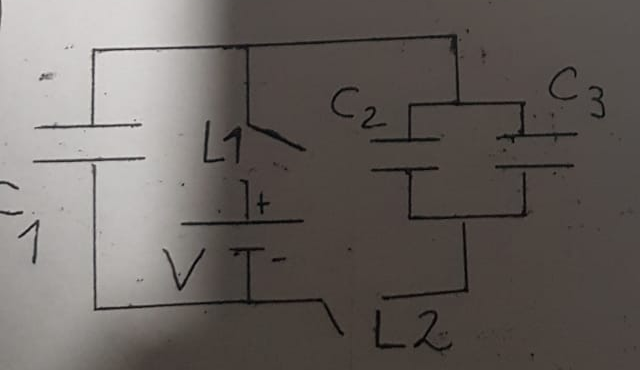
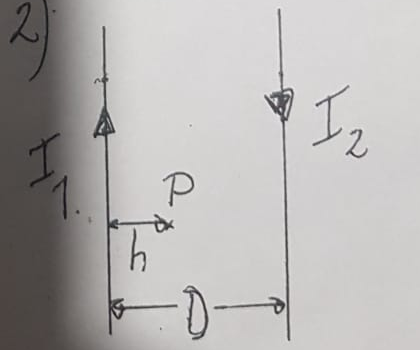

# 2º Parcial — 28/11/2024

[Enunciado original (foto)](Aula%20Virtual/2024-11-28%20-%202do%20Parcial.jpeg) · Temas: capacitores con llaves y energía disipada, hilos paralelos, autoinducción de un solenoide, RLC serie.

Cada ejercicio tiene un botón **Solución** con la respuesta y, adentro, un botón **Solución paso a paso**. No hay resolución oficial de este examen: las soluciones son propias.

Volver al [índice de parciales](README.md).

---

### Ejercicio 1

En el circuito de la figura, inicialmente los capacitores se encuentran descargados y las llaves se hallan abiertas. Se cierra la llave 1 y, transcurrido un tiempo muy largo, se abre la llave 1 y luego se cierra la llave 2. Determine la carga final de cada capacitor, y calcule la energía disipada en las resistencias del circuito desde que se cierra la llave 1 hasta alcanzado el estado final del sistema.
**Datos:** V=50 V, C1=30 μF, C2=20 μF, C3=60 μF.

<b>Solución</b>

Solución paso a paso

**Lectura del circuito.** Hay tres ramas entre el cable superior y el inferior:

- C₁;
- la fuente V con la llave L1;
- el paralelo C₂ ∥ C₃, que se conecta al cable inferior a través de la llave L2.

Las "resistencias" son las de los cables. Como se ve abajo, la energía disipada **no depende de su valor**.

**Paso 1 — Etapa 1 (L1 cerrada, L2 abierta).** La rama de C₂ ∥ C₃ está abierta, así que solo se carga C₁, hasta la tensión de la fuente:

$$Q_0 = C_1V = 30\ \mu\text{F}\cdot50\ \text{V} = 1500\ \mu\text{C} \qquad U_0 = \tfrac12C_1V^2 = 37{,}5\ \text{mJ}$$

**Paso 2 — Energía disipada al cargar.** La fuente entrega $W = Q_0V = C_1V^2 = 75$ mJ. En C₁ quedan 37,5 mJ, así que en las resistencias se disipan

$$E_1 = W - U_0 = \tfrac12C_1V^2 = 37{,}5\ \text{mJ}$$

(En la carga de un capacitor desde una fuente ideal se pierde siempre la mitad.)

**Paso 3 — Etapa 2 (L1 abierta, L2 cerrada).** La fuente queda desconectada y C₁ queda en paralelo con C₂ ∥ C₃. La carga se conserva y se reparte hasta que todos tienen la misma tensión:

$$C_{23} = C_2 + C_3 = 80\ \mu\text{F} \qquad V_f = \frac{Q_0}{C_1 + C_{23}} = \frac{1500\ \mu\text{C}}{110\ \mu\text{F}} = 13{,}64\ \text{V}$$

**Paso 4 — Cargas finales.**

$$Q_1 = C_1V_f = 409{,}1\ \mu\text{C} \qquad Q_2 = C_2V_f = 272{,}7\ \mu\text{C} \qquad Q_3 = C_3V_f = 818{,}2\ \mu\text{C}$$

Verificación: $409{,}1 + 272{,}7 + 818{,}2 = 1500\ \mu$C ✓.

**Paso 5 — Energía disipada en el reparto.**

$$U_f = \tfrac12(C_1 + C_{23})V_f^2 = \tfrac12\cdot110\ \mu\text{F}\cdot(13{,}64\ \text{V})^2 = 10{,}23\ \text{mJ}$$

$$E_2 = U_0 - U_f = 37{,}5 - 10{,}23 = 27{,}27\ \text{mJ}$$

Equivale a usar $E_2 = \tfrac12\dfrac{C_1C_{23}}{C_1 + C_{23}}V^2$.

**Paso 6 — Total.**

$$E = E_1 + E_2 = 37{,}5 + 27{,}27 = 64{,}77\ \text{mJ}$$

**Respuesta:** $Q_1 = 409{,}1\ \mu$C, $Q_2 = 272{,}7\ \mu$C, $Q_3 = 818{,}2\ \mu$C ($V_f = 13{,}64$ V); energía disipada $E \approx 64{,}8$ mJ (37,5 mJ en la carga + 27,3 mJ en el reparto)

---

### Ejercicio 2

Los hilos muy largos de la figura se hallan dispuestos de forma paralela y coplanar, y transportan corrientes antiparalelas I1=2 A e I2=3 A. La separación entre ambos es D=24 cm. Determine:
**a)** El campo magnético en el punto P situado entre ambos hilos y a distancia h=8 cm del hilo 1
**b)** Un punto del espacio donde el campo sea nulo.

<b>Solución</b>

Solución paso a paso

**Geometría.** En la figura, el hilo 1 está a la izquierda con I₁ hacia arriba, y el hilo 2 a la derecha con I₂ hacia abajo. P está entre ellos, a $h$ del hilo 1 y a $D - h = 16$ cm del hilo 2.

**Paso 1 — Sentidos en P.**

- Hilo 1 (corriente hacia arriba, P a su derecha): campo **entrante**.
- Hilo 2 (corriente hacia abajo, P a su izquierda): $(-\hat y)\times(-\hat x) = -\hat k$, también **entrante**.

Con corrientes antiparalelas, entre los hilos los campos se suman.

**Paso 2 — Módulo en P.**

$$B_P = \frac{\mu_0}{2\pi}\left(\frac{I_1}{h} + \frac{I_2}{D - h}\right) = 2\times10^{-7}\left(\frac{2}{0{,}08} + \frac{3}{0{,}16}\right)\ \text{T} = 8{,}75\times10^{-6}\ \text{T}$$

**Paso 3 — Dónde puede anularse (ítem b).** Entre los hilos los campos se suman, así que no hay cero ahí. Afuera tienen sentidos opuestos, y el cero queda del lado del hilo con **menos** corriente, que es el hilo 1, a la izquierda. A distancia $x$ a la izquierda del hilo 1:

$$\frac{\mu_0I_1}{2\pi x} = \frac{\mu_0I_2}{2\pi(x + D)} \quad\Rightarrow\quad I_1(x + D) = I_2x \quad\Rightarrow\quad x = \frac{I_1D}{I_2 - I_1} = \frac{2\cdot24}{1}\ \text{cm} = 48\ \text{cm}$$

**Respuesta:** a) $B_P = 8{,}75\ \mu$T, entrante a la hoja; b) en la recta paralela a los hilos, coplanar, a 48 cm a la izquierda del hilo 1 (72 cm del hilo 2)

---

### Ejercicio 3

Un solenoide muy largo de radio R=0,8 cm y autoinducción L=2 x 10-5 H transporta una corriente I=18 A. Sabiendo que el módulo del campo magnético en su interior es B=5 x 10-4 T, determinar la longitud del solenoide.

<b>Solución</b>

Solución paso a paso

**Paso 1 — Vueltas por unidad de longitud.** Dentro de un solenoide largo, $B = \mu_0nI$:

$$n = \frac{B}{\mu_0I} = \frac{5\times10^{-4}}{4\pi\times10^{-7}\cdot18}\ \text{m}^{-1} = 22{,}1\ \text{m}^{-1}$$

**Paso 2 — Autoinducción.** El flujo concatenado es $N\phi = (n\ell)(\mu_0nI)(\pi R^2)$, así que

$$L = \frac{N\phi}{I} = \mu_0n^2\pi R^2\ell \quad\Rightarrow\quad \ell = \frac{L}{\mu_0n^2\pi R^2}$$

**Paso 3 — Cálculo.** $\pi R^2 = \pi(0{,}008)^2 = 2{,}011\times10^{-4}$ m²:

$$\ell = \frac{2\times10^{-5}}{4\pi\times10^{-7}\cdot(22{,}1)^2\cdot2{,}011\times10^{-4}}\ \text{m} = 162\ \text{m}$$

**Verificación (por energía).** $\tfrac12LI^2 = \dfrac{B^2}{2\mu_0}\pi R^2\ell$ da $\ell = \dfrac{\mu_0LI^2}{B^2\pi R^2} = 162$ m ✓.

**Respuesta:** $\ell \approx 162$ m

---

### Ejercicio 4

Se desea armar un circuito RLC serie con generador de alterna con resistencia R=4Ω y reactancia inductiva XL=6Ω, y tal que la corriente eficaz sea de 2 A, con una potencia aparente de 24 VA. Sean C y C' las dos opciones posibles de capacitancias que, conectadas en este circuito, cumplen con todo lo antedicho. Si C corresponde a la opción para la cual la frecuencia está por encima de la de resonancia, determine el cociente C'/C, en caso de que ambas opciones efectivamente existan.

<b>Solución</b>

Solución paso a paso

**Paso 1 — Impedancia.** $S = I_{EF}^2Z$, así que $Z = \dfrac{S}{I_{EF}^2} = \dfrac{24}{4}\ \Omega = 6\ \Omega$.

**Paso 2 — Reactancia neta.**

$$|X_L - X_C| = \sqrt{Z^2 - R^2} = \sqrt{36 - 16}\ \Omega = \sqrt{20}\ \Omega = 4{,}472\ \Omega$$

**Paso 3 — Las dos opciones.**

- **Por encima de la resonancia** (circuito inductivo, $X_L > X_C$): $X_C = 6 - 4{,}472 = 1{,}528\ \Omega$. Corresponde a **C**.
- **Por debajo de la resonancia** (capacitivo, $X_C > X_L$): $X_{C'} = 6 + 4{,}472 = 10{,}472\ \Omega$. Corresponde a **C'**.

Las dos reactancias son positivas, así que **ambas opciones existen**.

**Paso 4 — Cociente.** A la misma frecuencia, $X_C = 1/(\omega C)$, es decir que $C \propto 1/X_C$:

$$\frac{C'}{C} = \frac{X_C}{X_{C'}} = \frac{6 - 2\sqrt5}{6 + 2\sqrt5} = \frac{3 - \sqrt5}{3 + \sqrt5} = \frac{7 - 3\sqrt5}{2} \approx 0{,}146$$

**Respuesta:** Ambas existen ($X_C = 1{,}53\ \Omega$, $X_{C'} = 10{,}47\ \Omega$) y $C'/C = \dfrac{7 - 3\sqrt5}{2} \approx 0{,}146$

