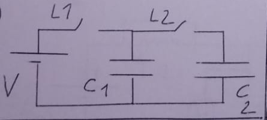
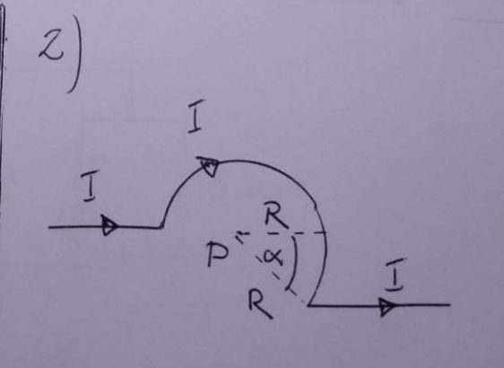
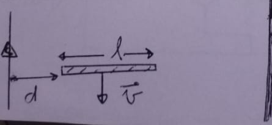

# 1er Recuperatorio del 2º Parcial — 12/12/2024

[Enunciado original (foto)](Aula%20Virtual/2024-12-12%20-%201er%20Recuperatorio%202do%20Parcial.jpeg) · Temas: capacitores con llaves y energía disipada, Biot-Savart (arco + hilo), capacitor cilíndrico en un RLC, fem de movimiento junto a un hilo.

Cada ejercicio tiene un botón **Solución** con la respuesta y, adentro, un botón **Solución paso a paso**. No hay resolución oficial de este examen: las soluciones son propias.

Volver al [índice de parciales](README.md).

---

### Ejercicio 1

En el circuito de la figura, inicialmente los capacitores se hallan descargados y las llaves se encuentran abiertas. Se cierra la llave 1 y, transcurrido un tiempo muy largo, se abre la llave 1 y a continuación se cierra la llave 2. Calcular la energía disipada en las resistencias en la evolución completa del sistema.
**Datos:** V=60 V; C1=20 μF; C2=30 μF.

<b>Solución</b>

Solución paso a paso

**Lectura del circuito.** La llave L1 conecta la fuente con C₁, y la llave L2 conecta C₁ con C₂. Las resistencias son las de los cables. La energía disipada no depende de su valor.

**Paso 1 — Carga de C₁ (L1 cerrada).** C₁ se carga a la tensión de la fuente:

$$Q_0 = C_1V = 20\ \mu\text{F}\cdot60\ \text{V} = 1200\ \mu\text{C} \qquad U_0 = \tfrac12C_1V^2 = 36\ \text{mJ}$$

La fuente entrega $W = Q_0V = C_1V^2 = 72$ mJ, así que en las resistencias se disipa

$$E_1 = W - U_0 = \tfrac12C_1V^2 = 36\ \text{mJ}$$

**Paso 2 — Reparto de carga (L1 abierta, L2 cerrada).** C₁ queda aislado de la fuente y en paralelo con C₂, que está descargado. Se conserva la carga:

$$V_f = \frac{Q_0}{C_1 + C_2} = \frac{1200\ \mu\text{C}}{50\ \mu\text{F}} = 24\ \text{V}$$

$$U_f = \tfrac12(C_1 + C_2)V_f^2 = \tfrac12\cdot50\ \mu\text{F}\cdot(24\ \text{V})^2 = 14{,}4\ \text{mJ}$$

$$E_2 = U_0 - U_f = 36 - 14{,}4 = 21{,}6\ \text{mJ}$$

Equivale a usar $E_2 = \tfrac12\dfrac{C_1C_2}{C_1 + C_2}V^2 = \tfrac12\cdot12\ \mu\text{F}\cdot3600\ \text{V}^2$.

**Paso 3 — Total.**

$$E = E_1 + E_2 = 36 + 21{,}6 = 57{,}6\ \text{mJ}$$

**Respuesta:** $E = 57{,}6$ mJ (36 mJ al cargar C₁ + 21,6 mJ al repartir la carga; carga final en C₁ = 480 μC y en C₂ = 720 μC, a 24 V)

---

### Ejercicio 2

Un hilo muy largo con corriente adopta la forma indicada en la figura. Determinar el campo magnético en el punto P.
**Datos:** R=8 cm; I=2 A; α=30°; μ0=4π x 10-7 Tm/A.

<b>Solución</b>

Solución paso a paso

**Lectura de la figura.** P es el centro del arco de radio R.

- El hilo entra desde la izquierda por la recta horizontal que pasa por P y llega al extremo izquierdo del arco.
- El arco pasa por arriba, en sentido **horario**, hasta un punto a un ángulo α **por debajo** de la horizontal. En total recorre $\pi + \alpha$.
- Desde ahí, el hilo sale hacia la derecha en forma horizontal, a una distancia $R\operatorname{sen}\alpha$ por debajo de P.

Se toma $\hat k$ saliente de la hoja.

**Paso 1 — Tramo de entrada.** Está sobre una recta que pasa por P, así que $d\vec l \parallel \hat r$ y su aporte es **nulo**.

**Paso 2 — Arco.** Cada elemento es perpendicular al radio y está a distancia R, así que

$$B_{arco} = \frac{\mu_0I}{4\pi R^2}\int dl = \frac{\mu_0I\,\theta}{4\pi R} \qquad \theta = \pi + \alpha = \frac{7\pi}{6}$$

$$B_{arco} = \frac{7\mu_0I}{24R} = \frac{7\cdot4\pi\times10^{-7}\cdot2}{24\cdot0{,}08}\ \text{T} = 9{,}16\ \mu\text{T}$$

Sentido: la corriente gira en sentido horario alrededor de P, así que el campo es **entrante** ($-\hat k$).

**Paso 3 — Tramo de salida.** Es un hilo semi-infinito a distancia $d = R\operatorname{sen}\alpha$ de P. Su pie de perpendicular queda directamente debajo de P ($x = 0$). El hilo empieza en $x = R\cos\alpha$, que se ve con $\operatorname{sen}\beta_1 = \dfrac{R\cos\alpha}{R} = \cos\alpha$, y llega a $+\infty$, con $\operatorname{sen}\beta_2 = 1$:

$$B_{rec} = \frac{\mu_0I}{4\pi R\operatorname{sen}\alpha}\left(1 - \cos\alpha\right) = \frac{10^{-7}\cdot2}{0{,}04}(1 - 0{,}866)\ \text{T} = 0{,}67\ \mu\text{T}$$

Sentido: la corriente va hacia $+\hat x$ y P está por encima, así que $\hat x\times\hat y = +\hat k$: es **saliente**.

**Paso 4 — Superposición.**

$$\vec B_P = \left[\frac{\mu_0I(\pi + \alpha)}{4\pi R} - \frac{\mu_0I(1 - \cos\alpha)}{4\pi R\operatorname{sen}\alpha}\right](-\hat k) = (9{,}16 - 0{,}67)\ \mu\text{T}\ (-\hat k) = 8{,}49\ \mu\text{T}\ (-\hat k)$$

**Respuesta:** $\vec B_P \approx 8{,}5\ \mu$T, entrante a la hoja (arco: 9,16 μT entrante; tramo de salida: 0,67 μT saliente; tramo de entrada: 0)

---

### Ejercicio 3

Un capacitor cilíndrico tiene una longitud de 200 m, y los radios interno y externo son de 0,4 cm y 0,85 cm, respectivamente. Este capacitor, junto con una bobina L, una resistencia R y un generador de alterna forman un circuito RLC serie del cual se sabe que la lectura de un amperímetro conectado en el mismo es de 0,5 A, que la potencia aparente es de 50 VA, que la frecuencia de resonancia es 300 Hz y que la fase entre corriente y tensión es de 30°, en módulo.
**a)** Calcular C.
**b)** Calcular R y L.
**Dato:** ε0=8,85 x 10-12 C2/(Nm2).

<b>Solución</b>

Solución paso a paso

**Paso 1 — Capacitancia de un cilindro (ítem a).** Por Gauss, entre las armaduras $E = \dfrac{\lambda}{2\pi\varepsilon_0r}$. Entonces

$$\Delta V = \frac{\lambda}{2\pi\varepsilon_0}\ln\frac{b}{a} \quad\Rightarrow\quad C = \frac{Q}{\Delta V} = \frac{\lambda\ell}{\Delta V} = \frac{2\pi\varepsilon_0\ell}{\ln(b/a)}$$

$$C = \frac{2\pi\cdot8{,}85\times10^{-12}\cdot200}{\ln(0{,}85/0{,}4)}\ \text{F} = \frac{1{,}112\times10^{-8}}{0{,}7538}\ \text{F} = 1{,}475\times10^{-8}\ \text{F} = 14{,}75\ \text{nF}$$

**Paso 2 — Tensión e impedancia.** $V_{EF} = \dfrac{S}{I_{EF}} = \dfrac{50}{0{,}5}\ \text{V} = 100$ V y $Z = \dfrac{V_{EF}}{I_{EF}} = 200\ \Omega$.

**Paso 3 — R (ítem b).** $R = Z\cos\varphi = 200\cos30^\circ\ \Omega = 173{,}2\ \Omega$.

**Paso 4 — L.** En la resonancia $\omega_0 = \dfrac{1}{\sqrt{LC}}$, así que

$$L = \frac{1}{\omega_0^2C} = \frac{1}{(2\pi\cdot300)^2\cdot1{,}475\times10^{-8}}\ \text{H} = 19{,}1\ \text{H}$$

La fase de 30° y la frecuencia de trabajo no hacen falta para L: alcanzan la resonancia y C. Con la fase se obtiene $|X_L - X_C| = Z\operatorname{sen}30^\circ = 100\ \Omega$, que sirve para hallar la frecuencia de trabajo si se pidiera.

**Respuesta:** a) $C \approx 14{,}75$ nF; b) $R \approx 173{,}2\ \Omega$, $L \approx 19{,}1$ H

---

### Ejercicio 4

Un hilo muy largo transporta una corriente I=3A. Una barra conductora de longitud l=10 cm se mueve en dirección paralela al hilo, con velocidad de módulo 20 m/s y de sentido opuesto al de circulación de la corriente. La distancia entre el hilo y el extremo más próximo de la barra es d=5 cm. Determinar la diferencia de potencial inducida entre los extremos de la barra. Justificar cuál se halla a mayor potencial.

<b>Solución</b>

Solución paso a paso

**Geometría.** El hilo es vertical con la corriente hacia arriba. La barra es horizontal, perpendicular al hilo, y va de $r = d$ a $r = d + l$. Su velocidad apunta hacia abajo, $\vec v = -v\hat y$. Se toma $\hat k$ saliente.

**Paso 1 — Campo del hilo.** A la derecha del hilo, $\vec B = \dfrac{\mu_0I}{2\pi r}(-\hat k)$, entrante.

**Paso 2 — Fem de movimiento.** El campo no es uniforme, así que se integra a lo largo de la barra:

$$\mathcal E = \int_d^{d + l}(\vec v\times\vec B)\cdot d\vec l = \int_d^{d + l}\frac{\mu_0Iv}{2\pi r}\,dr = \frac{\mu_0Iv}{2\pi}\ln\frac{d + l}{d}$$

**Paso 3 — Cálculo.**

$$\mathcal E = 2\times10^{-7}\cdot3\cdot20\cdot\ln3\ \text{V} = 1{,}2\times10^{-5}\cdot1{,}0986\ \text{V} = 13{,}2\ \mu\text{V}$$

**Paso 4 — Polaridad.** $\vec v\times\vec B = (-\hat y)\times(-\hat k) = \hat x$. La fuerza sobre las cargas positivas apunta en $+\hat x$, alejándose del hilo, y ahí se acumulan. El extremo **más lejano del hilo** queda a mayor potencial.

**Respuesta:** $|\Delta V| = \dfrac{\mu_0Iv}{2\pi}\ln\dfrac{d + l}{d} \approx 13{,}2\ \mu$V; el extremo más alejado del hilo está a mayor potencial

