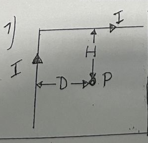
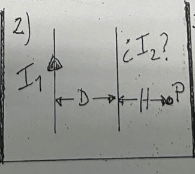
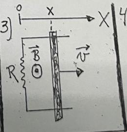
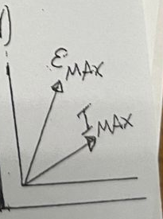

# 2º Parcial (Tema 2) — 27/11/2025

[Enunciado original (foto)](Aula%20Virtual/2025-11-27%20-%202do%20Parcial%20Tema%202.jpeg) · Temas: Biot-Savart (hilo doblado), fuerza entre hilos, fem de movimiento con B(x), diagrama de fasores.

Cada ejercicio tiene un botón **Solución** con la respuesta y, adentro, un botón **Solución paso a paso**. No hay resolución oficial de este examen: las soluciones son propias.

Volver al [índice de parciales](README.md).

---

### Ejercicio 1

Un hilo muy largo que transporta una corriente I adopta la forma indicada en la figura. Determine el campo magnético generado en el punto P. Exprese en términos de μ0, I y D.
**Dato:** H=4D.

<b>Solución</b>

Solución paso a paso

**Geometría.** Se toma P como origen, con $\hat x$ hacia la derecha, $\hat y$ hacia arriba y $\hat k$ saliente de la hoja.

- El tramo vertical sube por $x = -D$ desde $y = -\infty$ hasta la esquina $(-D,\ H)$, con corriente hacia arriba.
- Desde la esquina, el tramo horizontal va por $y = H$ hasta $x = +\infty$, con corriente hacia la derecha.

**Paso 1 — Hilo recto finito.** Un tramo recto a distancia $d$ de P genera

$$B = \frac{\mu_0I}{4\pi d}\left(\operatorname{sen}\beta_2 - \operatorname{sen}\beta_1\right)$$

donde $\beta_{1,2}$ son los ángulos con que se ven los extremos, medidos desde la perpendicular trazada por P.

**Paso 2 — Tramo vertical** ($d = D$). El pie de la perpendicular está en $y = 0$. Un extremo está en $-\infty$, así que $\operatorname{sen}\beta_1 = -1$. El otro está en $y = H$, así que $\operatorname{sen}\beta_2 = \dfrac{H}{\sqrt{H^2 + D^2}}$:

$$B_v = \frac{\mu_0I}{4\pi D}\left(1 + \frac{H}{\sqrt{H^2 + D^2}}\right)$$

Sentido: la corriente sube y P está a la derecha del hilo, así que $\vec B_v$ es **entrante** ($-\hat k$).

**Paso 3 — Tramo horizontal** ($d = H$). El pie de la perpendicular está en $x = 0$. Un extremo está en $x = -D$, así que $\operatorname{sen}\beta_1 = -\dfrac{D}{\sqrt{H^2 + D^2}}$. El otro está en $+\infty$, así que $\operatorname{sen}\beta_2 = 1$:

$$B_h = \frac{\mu_0I}{4\pi H}\left(1 + \frac{D}{\sqrt{H^2 + D^2}}\right)$$

Sentido: $d\vec l \times \hat r = \hat x \times (-\hat y) = -\hat k$, o sea que también es **entrante**. Los dos aportes se suman.

**Paso 4 — Reemplazo de H = 4D.** $\sqrt{H^2 + D^2} = \sqrt{17}\,D$:

$$B_v = \frac{\mu_0I}{4\pi D}\left(1 + \frac{4}{\sqrt{17}}\right) \qquad B_h = \frac{\mu_0I}{4\pi D}\cdot\frac14\left(1 + \frac{1}{\sqrt{17}}\right)$$

$$B = \frac{\mu_0I}{4\pi D}\left(\frac54 + \frac{17}{4\sqrt{17}}\right) = \frac{\mu_0I}{4\pi D}\cdot\frac{5 + \sqrt{17}}{4} = \frac{(5 + \sqrt{17})\,\mu_0I}{16\pi D}$$

**Paso 5 — Valor numérico del coeficiente.** $\dfrac{5 + \sqrt{17}}{16\pi} \approx 0{,}1815$.

**Respuesta:** $\vec B_P = \dfrac{(5 + \sqrt{17})\,\mu_0I}{16\pi D}\,(-\hat k) \approx 0{,}18\,\dfrac{\mu_0I}{D}$, entrante a la hoja

---

### Ejercicio 2

Dos hilos muy largos y que transportan corrientes I1=I e I2 de valor y sentido desconocidos se hallan dispuestos de forma coplanar, y separados por una distancia D.
**a)** Sabiendo que los hilos se atraen entre sí con una fuerza por unidad de longitud de módulo 4μ0I2/(3πD), determine el campo en el punto P (H=D/5). Exprese en términos de μ0, I y D.
**b)** ¿Existen puntos donde el campo magnético sea nulo? En caso afirmativo, determine alguno de ellos. En caso negativo, justifique claramente.

<b>Solución</b>

Solución paso a paso

**Geometría.** El hilo 1 está a la izquierda, con I hacia arriba. El hilo 2 está a una distancia D a su derecha. P está a la derecha del hilo 2, a $H = D/5$ de él, o sea a $6D/5$ del hilo 1.

**Paso 1 — Sentido de I₂.** Los hilos **se atraen**, así que las corrientes son **paralelas**: I₂ también va hacia arriba.

**Paso 2 — Valor de I₂.** La fuerza por unidad de longitud entre hilos es

$$\frac{F}{\ell} = \frac{\mu_0I_1I_2}{2\pi D} = \frac{4\mu_0I^2}{3\pi D} \quad\Rightarrow\quad I_2 = \frac{8}{3}I$$

**Paso 3 — Campo en P.** P está a la derecha de los dos hilos y ambas corrientes suben, así que los dos campos son **entrantes** y se suman:

$$B_P = \frac{\mu_0I}{2\pi(6D/5)} + \frac{\mu_0(8I/3)}{2\pi(D/5)} = \frac{\mu_0I}{2\pi D}\left(\frac56 + \frac{40}{3}\right) = \frac{\mu_0I}{2\pi D}\cdot\frac{85}{6}$$

$$B_P = \frac{85\,\mu_0I}{12\pi D} \approx 2{,}25\,\frac{\mu_0I}{D}$$

**Paso 4 — Puntos de campo nulo (ítem b).** Con corrientes paralelas, fuera de los hilos los dos campos tienen el mismo sentido y no se anulan. **Entre** los hilos tienen sentidos opuestos, y ahí sí puede haber un cero. A distancia $x$ del hilo 1:

$$\frac{\mu_0I}{2\pi x} = \frac{\mu_0(8I/3)}{2\pi(D - x)} \quad\Rightarrow\quad 3(D - x) = 8x \quad\Rightarrow\quad x = \frac{3D}{11}$$

El campo es nulo en toda la recta paralela a los hilos, contenida en su plano, a $3D/11$ del hilo 1 (más cerca del hilo con menos corriente).

**Respuesta:** a) $I_2 = \tfrac83 I$, paralela a I₁; $\vec B_P = \dfrac{85\,\mu_0I}{12\pi D}$ entrante. b) Sí: entre los hilos, a $x = \dfrac{3D}{11}$ del hilo 1

---

### Ejercicio 3

El sistema de la figura consiste en una barra conductora de longitud 24 cm que desliza sin fricción sobre rieles conductores. La barra parte en t=0 desde x=0 y mantiene una velocidad constante **v** dirigida hacia la derecha y de módulo 20 m/s. Todo el conjunto se halla en un plano horizontal y tiene resistencia R=8 Ω. Existe un campo magnético **B** saliente respecto del plano de la hoja y dependiente de la posición, de módulo B(x) = (0,5 T/m) x. Determine la corriente inducida en la barra, en t=2 s.

<b>Solución</b>

Solución paso a paso

**Datos.** $\ell = 0{,}24$ m, $v = 20$ m/s, $k = 0{,}5$ T/m (con $B = kx$), $R = 8\ \Omega$.

**Paso 1 — Posición de la barra.** $x(t) = vt$. En $t = 2$ s, $x = 40$ m.

**Paso 2 — Flujo.** El circuito va de la resistencia ($x = 0$) a la barra ($x$). Como B depende de x, se integra en franjas de ancho $dx'$:

$$\phi(x) = \int_0^x k x'\,\ell\,dx' = \frac{k\ell x^2}{2}$$

**Paso 3 — Fem (Faraday).**

$$|\mathcal E| = \frac{d\phi}{dt} = k\ell x\,\frac{dx}{dt} = k\ell x v = B(x)\,\ell\,v$$

Coincide con la fem de movimiento $B\ell v$ evaluada en la posición de la barra.

**Paso 4 — Valor en t = 2 s.**

$$|\mathcal E| = 0{,}5 \cdot 40 \cdot 0{,}24 \cdot 20\ \text{V} = 96\ \text{V} \qquad I = \frac{|\mathcal E|}{R} = \frac{96}{8}\ \text{A} = 12\ \text{A}$$

**Paso 5 — Sentido (Lenz).** El flujo saliente aumenta, porque crecen el área y B. La corriente inducida crea campo entrante, o sea que circula en **sentido horario**. En la barra, la corriente va **hacia abajo** en la figura. Se verifica con $\vec v \times \vec B = \hat x \times \hat k = -\hat y$.

**Respuesta:** $I = 12$ A, en sentido horario (hacia abajo en la barra)

---

### Ejercicio 4

El diagrama de fases de la figura corresponde a un circuito de CA de solo dos elementos pasivos que disipa 80W a 100Hz. Calcule el valor de esos elementos, en caso de que exista solución. **Datos:** IMAX = 4 A ; VMAX = 80 V.

<b>Solución</b>

Solución paso a paso

**Paso 1 — Qué elementos son.** En el diagrama, el fasor de la tensión ($\mathcal E_{MAX}$) está **adelantado** respecto del de la corriente. Eso pasa en un circuito **inductivo**. Disipa potencia, así que tiene que haber una resistencia. Los dos elementos son **R y L en serie**.

**Paso 2 — Factor de potencia.**

$$P = \frac{V_{MAX}I_{MAX}}{2}\cos\varphi \quad\Rightarrow\quad \cos\varphi = \frac{2P}{V_{MAX}I_{MAX}} = \frac{160}{320} = 0{,}5 \quad\Rightarrow\quad \varphi = 60^\circ$$

Como $\cos\varphi \le 1$, existe solución. El dibujo es esquemático y solo indica el **signo** del desfasaje.

**Paso 3 — R.** Toda la potencia la disipa R:

$$P = \frac{I_{MAX}^2}{2}R \quad\Rightarrow\quad R = \frac{2P}{I_{MAX}^2} = \frac{160}{16}\ \Omega = 10\ \Omega$$

**Paso 4 — L.** $Z = V_{MAX}/I_{MAX} = 20\ \Omega$ y $X_L = Z\operatorname{sen}\varphi = 20\cdot\tfrac{\sqrt3}{2} = 17{,}32\ \Omega$:

$$L = \frac{X_L}{2\pi f} = \frac{17{,}32}{2\pi\cdot100}\ \text{H} = 27{,}6\ \text{mH}$$

Verificación: $\sqrt{R^2 + X_L^2} = \sqrt{100 + 300} = 20\ \Omega$ ✓.

**Respuesta:** Una resistencia $R = 10\ \Omega$ y una bobina $L \approx 27{,}6$ mH, en serie ($\varphi = 60^\circ$, la tensión adelanta)

