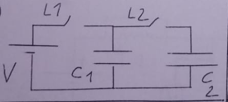
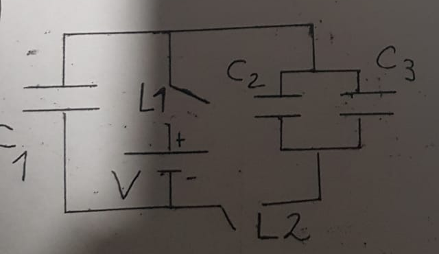

# Guía de ejercicios del 2º Parcial · Unidad 4: Capacitores y dieléctricos

Ejercicios 1 a 8 de la guía, de fácil a parcial. Cómo usarla, los niveles (🟢 🟡 🔴) y la composición de los parciales están en el [índice](guia-de-ejercicios.md).

[Índice de la guía de ejercicios](guia-de-ejercicios.md) · [Unidad 5 →](guia-de-ejercicios-5-magnetostatica.md)

---

Un capacitor guarda carga y energía. Se empieza por $Q = CV$ y la energía como integral, se sigue con serie y paralelo y con el reparto de carga entre capacitores, y se termina con los ejercicios de llaves que se toman en el parcial desde 2024.

---

### Ejercicio 1

**Nivel:** 🟢 Concepto · **Fuente:** ejercicio propio · **Tipo de la guía de resolución:** [1. Capacitores con llaves: energía disipada](guia-de-resolucion.md#1-capacitores-con-llaves-energ%C3%ADa-disipada)

Un capacitor de 10 μF se conecta a una pila de 12 V y se espera hasta que deja de circular corriente.

a) ¿Cuánta carga guarda?

b) ¿Cuánta energía guarda?

c) Si en vez de 12 V se usara una pila de 24 V, ¿cuánto valdrían la carga y la energía?

<b>Solución</b>

Solución paso a paso

**Qué piden, en palabras.**

- Un capacitor (capacidad $C = 10\ \mu\text{F}$) se conecta a una pila de 12 V.
- "Hasta que deja de circular corriente": el capacitor ya terminó de cargarse.
- **a)** La carga $Q$. **b)** La energía guardada $U$. **c)** Qué pasa con las dos si se duplica la tensión.

**La idea, desde cero.** Un capacitor son dos placas metálicas enfrentadas que no se tocan. Al conectarlo a una pila, la pila saca electrones de una placa y los pone en la otra: una placa queda con carga $+Q$ y la otra con $-Q$. La corriente no atraviesa el capacitor, solo lo carga. A medida que se carga, la tensión entre sus placas crece, hasta igualar la de la pila; en ese momento deja de circular corriente. La relación entre carga y tensión de un capacitor es

$$Q = C\ V$$

donde $C$, la **capacidad**, dice cuánta carga guarda por cada volt. Un faradio (F) es un coulomb por volt; $1\ \mu\text{F} = 10^{-6}$ F.

Cargar un capacitor cuesta trabajo: para meter más carga hay que empujarla contra la que ya está. Ese trabajo queda guardado como energía.

**Deducción de la energía** (atajo: $U = \tfrac12CV^2$). Cuando el capacitor ya tiene una carga $q$, la tensión entre sus placas es $v = q/C$. Llevar una carga pequeña $dq$ de una placa a la otra cuesta un trabajo $dW = v\ dq$ (la tensión es justamente energía por unidad de carga). La energía total es la suma de todos esos trabajos, desde $q = 0$ hasta la carga final $Q$:

$$U = \int_0^Q v\ dq = \int_0^Q\frac{q}{C}\ dq = \frac1C\left[\frac{q^2}{2}\right]_0^Q = \frac{Q^2}{2C}$$

Reemplazando $Q = CV$: $U = \dfrac{(CV)^2}{2C} = \tfrac12CV^2$. El $\tfrac12$ aparece porque la tensión no fue siempre $V$: empezó en 0 y creció de a poco.

#### Ítem a)

**Paso 1 — Carga.**

$$Q = CV = 10\ \mu\text{F}\cdot12\ \text{V} = 120\ \mu\text{C}$$

#### Ítem b)

**Paso 2 — Energía.** Con μF y V la energía sale en μJ:

$$U = \tfrac12CV^2 = \tfrac12\cdot10\cdot12^2\ \mu\text{J} = 720\ \mu\text{J}$$

#### Ítem c)

**Paso 3 — Con 24 V.** La carga es proporcional a $V$: se duplica, $Q = 240\ \mu\text{C}$. La energía es proporcional a $V^2$: se multiplica por 4, $U = \tfrac12\cdot10\cdot24^2 = 2880\ \mu\text{J}$.

**Respuesta:** a) $Q = 120\ \mu\text{C}$; b) $U = 720\ \mu\text{J}$; c) $Q = 240\ \mu\text{C}$ (el doble) y $U = 2880\ \mu\text{J}$ (cuatro veces más).

---

### Ejercicio 2

**Nivel:** 🟢 Concepto · **Fuente:** ejercicio propio · **Tipo de la guía de resolución:** [1. Capacitores con llaves: energía disipada](guia-de-resolucion.md#1-capacitores-con-llaves-energ%C3%ADa-disipada)

Se tienen dos capacitores, $C_1 = 3$ μF y $C_2 = 6$ μF, y una pila de 12 V.

a) Se conectan **en paralelo** a la pila. Calcule la capacidad equivalente, la carga de cada capacitor y la carga total que entregó la pila.

b) Se conectan **en serie** a la pila. Calcule la capacidad equivalente, la carga de cada capacitor y la tensión de cada uno.

<b>Solución</b>

Solución paso a paso

**Qué piden, en palabras.**

- Los mismos dos capacitores conectados de dos maneras distintas a la misma pila de 12 V.
- En cada caso, un único capacitor que haga lo mismo que los dos juntos (capacidad equivalente), y la carga y tensión de cada uno.

**La idea, desde cero.** Hay dos formas básicas de conectar dos elementos:

- **En paralelo:** cada extremo de un capacitor está unido por cable al mismo extremo del otro. Un cable por el que no circula corriente está todo al mismo potencial, así que los dos capacitores tienen **la misma tensión**: la de la pila.
- **En serie:** uno a continuación del otro, y en la unión no se conecta nada más. El pedazo de metal que queda entre los dos (placa de uno + cable + placa del otro) está aislado: tenía carga cero y la carga no puede entrar ni salir. Si una de sus placas queda con $-Q$, la otra tiene que quedar con $+Q$. Los dos capacitores tienen **la misma carga**.

**Deducción del paralelo** (atajo: $C_{eq} = C_1 + C_2$). Misma tensión $V$; la carga total que entrega la pila es la suma de las cargas:

$$Q_{tot} = Q_1 + Q_2 = C_1V + C_2V = (C_1 + C_2)V$$

Un único capacitor que guarde $Q_{tot}$ con la tensión $V$ tiene $C_{eq} = Q_{tot}/V = C_1 + C_2$. Es como agrandar las placas.

**Deducción de la serie** (atajo: $\dfrac1{C_{eq}} = \dfrac1{C_1} + \dfrac1{C_2}$). Misma carga $Q$; la tensión de la pila se reparte entre los dos (para ir de un borne al otro se pasa por los dos capacitores):

$$V = V_1 + V_2 = \frac{Q}{C_1} + \frac{Q}{C_2} = Q\left(\frac1{C_1} + \frac1{C_2}\right)$$

Un capacitor equivalente cumple $V = Q/C_{eq}$; comparando, $\dfrac1{C_{eq}} = \dfrac1{C_1} + \dfrac1{C_2}$, o sea $C_{eq} = \dfrac{C_1C_2}{C_1 + C_2}$. Siempre da menos que el más chico.

#### Ítem a)

**Paso 1 — Paralelo.**

$$C_{eq} = 3 + 6 = 9\ \mu\text{F} \qquad Q_1 = 3\cdot12 = 36\ \mu\text{C} \qquad Q_2 = 6\cdot12 = 72\ \mu\text{C}$$

$$Q_{tot} = 36 + 72 = 108\ \mu\text{C} = C_{eq}V = 9\cdot12\ ✓$$

#### Ítem b)

**Paso 2 — Serie.**

$$C_{eq} = \frac{3\cdot6}{3 + 6} = 2\ \mu\text{F} \qquad Q = C_{eq}V = 2\cdot12 = 24\ \mu\text{C}\ \text{(la misma en los dos)}$$

$$V_1 = \frac{24}{3} = 8\ \text{V} \qquad V_2 = \frac{24}{6} = 4\ \text{V} \qquad (8 + 4 = 12\ \text{V}\ ✓)$$

En serie, el capacitor más chico se queda con la mayor tensión ($V = Q/C$ con la misma $Q$).

**Respuesta:** a) $C_{eq} = 9\ \mu\text{F}$; $Q_1 = 36\ \mu\text{C}$, $Q_2 = 72\ \mu\text{C}$, total $108\ \mu\text{C}$. b) $C_{eq} = 2\ \mu\text{F}$; $Q_1 = Q_2 = 24\ \mu\text{C}$; $V_1 = 8$ V, $V_2 = 4$ V.

---

### Ejercicio 3

**Nivel:** 🟢 Concepto · **Fuente:** ejercicio propio · **Tipo de la guía de resolución:** [1. Capacitores con llaves: energía disipada](guia-de-resolucion.md#1-capacitores-con-llaves-energ%C3%ADa-disipada)

Una pila de 20 V carga, a través de una resistencia $R$ de valor desconocido, un capacitor de 5 μF inicialmente descargado. Se espera hasta que deja de circular corriente.

a) Calcule la carga final del capacitor y la energía que guarda.

b) Calcule la energía que entregó la pila.

c) ¿Cuánta energía se disipó en la resistencia? ¿Depende del valor de $R$?

<b>Solución</b>

Solución paso a paso

**Qué piden, en palabras.**

- Una pila carga un capacitor; en el camino la corriente pasa por una resistencia, que la calienta.
- **a)** Lo que queda guardado en el capacitor. **b)** Lo que entregó la pila. **c)** La diferencia, que se convirtió en calor.

**La idea, desde cero.** La energía se conserva: lo que entrega la pila tiene que ir a algún lado. Una parte queda guardada en el capacitor y el resto se pierde como calor en la resistencia (efecto Joule). Al final la corriente se detiene porque el capacitor llegó a la tensión de la pila. La diferencia clave entre la pila y el capacitor es que **la pila empuja cada coulomb con 20 V desde el principio**, mientras que el capacitor empezó en 0 V y fue subiendo.

**Deducción de la energía guardada** (atajo: $U = \tfrac12CV^2$). Con carga $q$ el capacitor tiene tensión $q/C$, y agregar $dq$ cuesta $\frac qC\ dq$:

$$U = \int_0^Q\frac qC\ dq = \frac{Q^2}{2C} = \tfrac12CV^2$$

**Deducción de la energía que entrega la pila** (atajo: $W = QV$). La pila mantiene su tensión $V$ **fija** mientras pasa cada pedacito de carga $dq$, y le entrega $V\ dq$:

$$W = \int_0^QV\ dq = V\int_0^Qdq = QV = CV^2$$

Comparando: la pila entrega $CV^2$ y el capacitor guarda $\tfrac12CV^2$. **Siempre se pierde la mitad**, y en ninguna de las dos cuentas aparece $R$.

#### Ítem a)

**Paso 1 — Capacitor.** Al final su tensión es 20 V:

$$Q = CV = 5\cdot20 = 100\ \mu\text{C} \qquad U = \tfrac12\cdot5\cdot20^2 = 1000\ \mu\text{J} = 1\ \text{mJ}$$

#### Ítem b)

**Paso 2 — Pila.**

$$W = QV = 100\ \mu\text{C}\cdot20\ \text{V} = 2000\ \mu\text{J} = 2\ \text{mJ}$$

#### Ítem c)

**Paso 3 — Disipada.**

$$E = W - U = 2 - 1 = 1\ \text{mJ}$$

No depende de $R$: con una resistencia grande la corriente es chica pero dura más; con una chica es grande pero dura poco. El calor total es el mismo.

**Respuesta:** a) $Q = 100\ \mu\text{C}$, $U = 1$ mJ; b) $W = 2$ mJ; c) se disipa 1 mJ, la mitad de lo entregado, sin importar el valor de $R$.

---

### Ejercicio 4

**Nivel:** 🟡 Práctica · **Fuente:** [Práctica de Capacitores y dieléctricos, Ej. 1](../4%20-%20Capacitores%20y%20Diel%C3%A9ctricos/practica.md#ejercicio-1) (enunciado textual de la guía de la cátedra) · **Tipo de la guía de resolución:** [1. Capacitores con llaves: energía disipada](guia-de-resolucion.md#1-capacitores-con-llaves-energ%C3%ADa-disipada)

Los capacitores del circuito de la figura valen *C1*=4μF; *C2*=6μF; *C3*=12,6μF; *C4*=2μF; *C5*=8μF. En régimen estacionario, calcule:

a) la capacidad equivalente de la configuración;

b) la carga almacenada en cada capacitor;

c) la ddp a la que se encuentra cada capacitor;

d) la energía almacenada por cada capacitor y la del sistema

<b>Solución</b>

Solución paso a paso

**Qué piden, en palabras.**

- Cinco capacitores conectados a una pila de 50 V: $C_1 = 4$, $C_2 = 6$, $C_3 = 12{,}6$, $C_4 = 2$ y $C_5 = 8$, todos en μF.
- "Régimen estacionario": pasó mucho tiempo, los capacitores terminaron de cargarse y ya no circula corriente.
- **a)** Un único capacitor que equivalga a todo el circuito. **b)** y **c)** La carga y la tensión de cada uno. **d)** La energía de cada uno y la total.

**La idea, desde cero.** Un capacitor son dos placas metálicas enfrentadas que no se tocan. La pila saca electrones de una placa y los pone en la otra: una queda con $+Q$ y la otra con $-Q$. La corriente no lo atraviesa, solo lo carga. Cuanta más carga tiene, mayor es la tensión entre sus placas: $Q = CV$, donde $C$ (la capacidad) es cuánta carga guarda por cada volt. Para resolver circuitos de capacitores hay que reconocer dos formas de conexión:

| | Cómo se ve | Qué tienen igual |
|---|---|---|
| **Paralelo** | los dos extremos de uno están unidos a los dos extremos del otro | la misma **tensión** |
| **Serie** | uno a continuación del otro, sin nada más conectado en la unión | la misma **carga** |

- *Por qué en paralelo tienen la misma tensión.* Un cable sin corriente está todo al mismo potencial. Las placas de la izquierda están unidas por cable y tienen el mismo potencial; lo mismo las de la derecha. La diferencia entre los dos lados es la misma para los dos capacitores.
- *Por qué en serie tienen la misma carga.* El pedazo de metal entre los dos (la placa derecha de uno, el cable y la placa izquierda del otro) está aislado. Antes de conectar la pila tenía carga total cero, y la carga no puede entrar ni salir. Si una de sus placas queda con $-Q$, la otra tiene que quedar con $+Q$.

**Paso 1 — Leer el circuito.** $C_1$ y $C_2$ están uno detrás del otro, en serie. $C_3$ va de los mismos dos puntos que ese par, así que está en paralelo con él: eso forma el bloque izquierdo. $C_4$ y $C_5$ comparten sus dos extremos: están en paralelo y forman el bloque derecho. Los dos bloques están en serie con la pila.

**Paso 2 — Fórmulas de combinación (deducidas).**

*Paralelo*: misma $V$, y las cargas se suman:

$$Q = C_aV + C_bV = (C_a + C_b)V \quad\Rightarrow\quad C_{eq} = C_a + C_b$$

*Serie*: misma $Q$, y las tensiones se suman:

$$V = \frac{Q}{C_a} + \frac{Q}{C_b} \quad\Rightarrow\quad \frac{1}{C_{eq}} = \frac1{C_a} + \frac1{C_b} \quad\Leftrightarrow\quad C_{eq} = \frac{C_aC_b}{C_a + C_b}$$

En serie, la equivalente siempre es menor que la menor de las dos.

#### Ítem a)

**Paso 3 — Simplificar de adentro hacia afuera** (todo en μF).

$$C_{12} = \frac{4\cdot6}{4 + 6} = 2{,}4 \qquad C_A = C_{12} + C_3 = 2{,}4 + 12{,}6 = 15 \qquad C_B = C_4 + C_5 = 10$$

$$C_{eq} = \frac{C_AC_B}{C_A + C_B} = \frac{15\cdot10}{25} = 6\ \mu\text{F}$$

#### Ítems b) y c)

**Paso 4 — Carga que entrega la pila.** Todo el circuito equivale a un capacitor de 6 μF conectado a 50 V:

$$Q = C_{eq}V = 6\cdot50 = 300\ \mu\text{C}$$

**Paso 5 — Volver hacia atrás: los dos bloques.** Están en serie, así que los dos tienen 300 μC:

$$V_A = \frac{300}{15} = 20\ \text{V} \qquad V_B = \frac{300}{10} = 30\ \text{V} \qquad (20 + 30 = 50\ \text{V}\ ✓)$$

**Paso 6 — Abrir el bloque derecho.** $C_4$ y $C_5$ están en paralelo, así que los dos tienen 30 V:

$$Q_4 = 2\cdot30 = 60\ \mu\text{C} \qquad Q_5 = 8\cdot30 = 240\ \mu\text{C} \qquad (60 + 240 = 300\ ✓)$$

**Paso 7 — Abrir el bloque izquierdo.** $C_3$ y el par $C_{12}$ están en paralelo, así que los dos tienen 20 V:

$$Q_3 = 12{,}6\cdot20 = 252\ \mu\text{C} \qquad Q_{12} = 2{,}4\cdot20 = 48\ \mu\text{C} \qquad (252 + 48 = 300\ ✓)$$

**Paso 8 — Abrir el par $C_1$–$C_2$.** Están en serie, así que cada uno tiene 48 μC (no se suman):

$$V_1 = \frac{48}{4} = 12\ \text{V} \qquad V_2 = \frac{48}{6} = 8\ \text{V} \qquad (12 + 8 = 20\ \text{V}\ ✓)$$

Con la misma carga, el capacitor más chico de una serie se queda con la mayor tensión ($V = Q/C$).

#### Ítem d)

**Paso 9 — Energía.** *De dónde sale:* con carga $q$, la tensión del capacitor es $q/C$, y agregar $dq$ cuesta $\frac qC\ dq$. Sumando de 0 a $Q$:

$$U = \int_0^Q\frac qC\ dq = \frac{Q^2}{2C} = \tfrac12CV^2$$

En μF y V, la energía sale en μJ:

$$U_1 = \tfrac12\cdot4\cdot12^2 = 288 \quad U_2 = \tfrac12\cdot6\cdot8^2 = 192 \quad U_3 = \tfrac12\cdot12{,}6\cdot20^2 = 2520 \quad U_4 = \tfrac12\cdot2\cdot30^2 = 900 \quad U_5 = \tfrac12\cdot8\cdot30^2 = 3600$$

Total: 7500 μJ. Control: $\tfrac12C_{eq}V^2 = \tfrac12\cdot6\cdot50^2 = 7500\ \mu\text{J}$ ✓.

**Resumen del método.** (1) Identificar serie y paralelo. (2) Simplificar hasta $C_{eq}$. (3) $Q = C_{eq}V$. (4) Volver hacia atrás: en serie se copia la carga y se reparte la tensión; en paralelo se copia la tensión y se reparte la carga. (5) $U = \tfrac12CV^2$ para cada uno, y verificar con $\tfrac12C_{eq}V^2$.

**Respuesta:**

- a) $C_{eq} = 6\ \mu\text{F}$
- b) $Q_1 = Q_2 = 48\ \mu\text{C}$; $Q_3 = 252\ \mu\text{C}$; $Q_4 = 60\ \mu\text{C}$; $Q_5 = 240\ \mu\text{C}$
- c) $V_1 = 12$ V; $V_2 = 8$ V; $V_3 = 20$ V; $V_4 = V_5 = 30$ V
- d) $U_1 = 288\ \mu\text{J}$; $U_2 = 192\ \mu\text{J}$; $U_3 = 2520\ \mu\text{J}$; $U_4 = 900\ \mu\text{J}$; $U_5 = 3600\ \mu\text{J}$; $U_T = U_1 + \dots + U_5 = C_{eq}V^2/2 = 7500\ \mu\text{J}$

---

### Ejercicio 5

**Nivel:** 🟡 Práctica · **Fuente:** [Práctica de Capacitores y dieléctricos, Ej. 5](../4%20-%20Capacitores%20y%20Diel%C3%A9ctricos/practica.md#ejercicio-5) (enunciado textual de la guía de la cátedra) · **Tipo de la guía de resolución:** [1. Capacitores con llaves: energía disipada](guia-de-resolucion.md#1-capacitores-con-llaves-energ%C3%ADa-disipada)

Los capacitores *C1* = 12μF y *C2*= 6μF de la figura se cargan con la llave en la posición (1). Una vez cargados se lleva la llave a la posición (2). Suponiendo que el capacitor *C3* = 2μF está inicialmente descargado, calcule:

a) la carga final almacenada por el capacitor *C3*;

b) la energía almacenada por el sistema *C1 C2* antes de conmutar la llave, y por el sistema *C1 C2 C3* después de hacerlo.

<b>Solución</b>

Solución paso a paso

**Qué piden, en palabras.**

- Llave en posición (1): $C_1 = 12$ μF y $C_2 = 6$ μF quedan en serie con la pila de 10 V y se cargan.
- Llave en posición (2): $C_2$ queda conectado con $C_3 = 2$ μF, que estaba descargado.
- **a)** La carga final de $C_3$. **b)** La energía guardada antes de mover la llave y después.

**La idea, desde cero.** Un capacitor guarda carga: $Q = CV$. En serie, todos tienen la misma carga; en paralelo, la misma tensión. Cuando un capacitor cargado se desconecta de la pila y se conecta con otro descargado, la carga no puede aparecer ni desaparecer: **se conserva** y se reparte hasta que los dos quedan con la misma tensión. Es como dos tanques de agua que se conectan por abajo y quedan al mismo nivel. En ese reparto se pierde energía en forma de calor en los cables, aunque la carga total sea la misma. La energía de un capacitor es $U = \int_0^Q\frac qC\ dq = \frac{Q^2}{2C} = \tfrac12CV^2$.

**Deducción de la serie** (atajo: $C_s = \dfrac{C_1C_2}{C_1 + C_2}$). En serie los dos tienen la misma carga $Q$ (el metal entre ellos está aislado y era neutro), y la tensión de la pila se reparte: $V = \dfrac{Q}{C_1} + \dfrac{Q}{C_2}$. Un equivalente cumple $V = Q/C_s$, así que $\dfrac1{C_s} = \dfrac1{C_1} + \dfrac1{C_2}$.

**Deducción del reparto** (atajo: $V' = \dfrac{Q_0}{C_2 + C_3}$). Cuando $C_2$, cargado, queda conectado a $C_3$, descargado, la carga solo puede pasar de uno al otro: $Q_2' + Q_3' = Q_0$. Al final no circula corriente, así que los dos tienen la misma tensión (están en paralelo): $Q_2' = C_2V'$ y $Q_3' = C_3V'$. Sumando, $(C_2 + C_3)V' = Q_0$.

**Deducción de la energía** (atajo: $U = \tfrac12CV^2 = \dfrac{Q^2}{2C}$). $U = \displaystyle\int_0^Q\frac qC\ dq = \frac{Q^2}{2C}$: cada $dq$ que se agrega cuesta la tensión que ya tiene el capacitor.

**Resolución.**

#### Ítem a)

**Paso 1 — Posición (1).** La llave une $C_1$ con $C_2$: quedan **en serie** con la pila de 10 V. Con la fórmula de la serie:

$$C_s = \frac{C_1C_2}{C_1 + C_2} = \frac{12\cdot6}{12 + 6} = 4\ \mu\text{F} \qquad Q_0 = C_sV = 4\cdot10 = 40\ \mu\text{C}$$

En serie la carga es la misma: $C_1$ y $C_2$ quedan con 40 μC cada uno.

**Paso 2 — Posición (2).** La llave pasa a unir el borne de $C_2$ con $C_3$. $C_1$ queda **desconectado** de un lado: conserva sus 40 μC. $C_2$ queda **en paralelo con $C_3$** (comparten los dos nodos) y le pasa parte de su carga. Conservación de la carga en ese par:

$$Q_2' + Q_3' = Q_0 \qquad \frac{Q_2'}{C_2} = \frac{Q_3'}{C_3} = V' \quad\Rightarrow\quad V' = \frac{Q_0}{C_2 + C_3} \qquad Q_3' = C_3V'$$

**Paso 3 — Cálculo.**

$$V' = \frac{40}{6 + 2} = 5\ \text{V} \qquad Q_3' = 2\cdot5 = 10\ \mu\text{C} \qquad Q_2' = 6\cdot5 = 30\ \mu\text{C}$$

#### Ítem b)

**Paso 4 — Energía antes de mover la llave.** Es la del par en serie, como un único capacitor de 4 μF a 10 V:

$$U_0 = \tfrac12C_sV^2 = \tfrac12\cdot4\cdot10^2 = 200\ \mu\text{J}$$

Control sumando cada uno con $Q^2/2C$: $\dfrac{40^2}{2\cdot12} + \dfrac{40^2}{2\cdot6} = 66{,}67 + 133{,}33 = 200\ \mu\text{J}$ ✓.

**Paso 5 — Energía después.** $C_1$ sigue con 40 μC, y $C_2$ y $C_3$ quedan a 5 V:

$$U' = \frac{Q_0^2}{2C_1} + \tfrac12(C_2 + C_3)V'^2 = \frac{1600}{24} + \tfrac12\cdot8\cdot25 = 66{,}67 + 100 = 166{,}67\ \mu\text{J}$$

La energía disminuye: la diferencia se disipa en los cables durante la redistribución de carga.

**Respuesta:** a) $Q_3 = 10\ \mu\text{C}$; b) $U_0 = 200\ \mu\text{J}$ y $U' = 166{,}67\ \mu\text{J}$

---

### Ejercicio 6

**Nivel:** 🟡 Práctica · **Fuente:** ejercicio propio · **Tipo de la guía de resolución:** [16. RLC serie con la frecuencia de resonancia como dato](guia-de-resolucion.md#16-rlc-serie-con-la-frecuencia-de-resonancia-como-dato)

Un capacitor cilíndrico está formado por un cilindro metálico interior de radio $a = 1$ mm y una cáscara cilíndrica coaxial de radio $b = 5$ mm, ambos de largo $\ell = 2$ m, con vacío entre ellos.

a) Deduzca la expresión de su capacidad y calcule su valor.

b) Si se lo conecta a 100 V, calcule la carga y el campo eléctrico justo afuera del cilindro interior.

<b>Solución</b>

Solución paso a paso

**Qué piden, en palabras.**

- Un capacitor con forma de cable coaxial: un cilindro adentro de otro, con el mismo eje.
- **a)** La fórmula de su capacidad, deducida, y su valor. **b)** La carga con 100 V y el campo eléctrico en la superficie del cilindro de adentro.

**La idea, desde cero.** La capacidad se calcula siempre igual: se supone que los conductores tienen cargas $+Q$ y $-Q$, se calcula el campo eléctrico entre ellos, se integra el campo para obtener la diferencia de potencial $V$, y se divide: $C = Q/V$. La carga se cancela y queda algo que depende solo de la forma. Para el campo se usa la **ley de Gauss**: el flujo del campo eléctrico a través de una superficie cerrada es la carga encerrada dividida por $\varepsilon_0$,

$$\oint\vec E\cdot d\vec A = \frac{Q_{enc}}{\varepsilon_0}$$

Con simetría cilíndrica el campo apunta hacia afuera (radial) y su módulo depende solo de la distancia $r$ al eje.

**Deducción del campo.** Sea $\lambda = Q/\ell$ la carga por metro del cilindro interior. Superficie de Gauss: un cilindro imaginario de radio $r$ ($a < r < b$) y largo $\ell$, coaxial. En su pared lateral el campo es perpendicular y constante, así que el flujo es $E\cdot2\pi r\ell$; en las tapas el campo es paralelo a la superficie y no aporta. Encierra la carga $\lambda\ell$:

$$E\cdot2\pi r\ell = \frac{\lambda\ell}{\varepsilon_0} \quad\Rightarrow\quad E(r) = \frac{\lambda}{2\pi\varepsilon_0r}$$

**Deducción de la tensión.** La diferencia de potencial entre los cilindros es la integral del campo a lo largo de un radio:

$$V = \int_a^bE\ dr = \frac{\lambda}{2\pi\varepsilon_0}\int_a^b\frac{dr}{r} = \frac{\lambda}{2\pi\varepsilon_0}\ln\frac ba$$

**Deducción de la capacidad** (atajo: $C = \dfrac{2\pi\varepsilon_0\ell}{\ln(b/a)}$).

$$C = \frac QV = \frac{\lambda\ell}{\dfrac{\lambda}{2\pi\varepsilon_0}\ln\dfrac ba} = \frac{2\pi\varepsilon_0\ell}{\ln(b/a)}$$

#### Ítem a)

**Paso 1 — Valor.** $\ln(5/1) = 1{,}609$:

$$C = \frac{2\pi\cdot8{,}85\times10^{-12}\cdot2}{1{,}609}\ \text{F} = 6{,}91\times10^{-11}\ \text{F} = 69{,}1\ \text{pF}$$

#### Ítem b)

**Paso 2 — Carga.** $Q = CV = 6{,}91\times10^{-11}\cdot100 = 6{,}91\times10^{-9}$ C = 6,91 nC.

**Paso 3 — Campo en $r = a$.** De la tensión, $\dfrac{\lambda}{2\pi\varepsilon_0} = \dfrac{V}{\ln(b/a)}$, y entonces

$$E(a) = \frac{V}{a\ln(b/a)} = \frac{100}{10^{-3}\cdot1{,}609}\ \tfrac{\text{V}}{\text{m}} = 6{,}21\times10^4\ \tfrac{\text{V}}{\text{m}}$$

**Respuesta:** a) $C = \dfrac{2\pi\varepsilon_0\ell}{\ln(b/a)} = 69{,}1$ pF; b) $Q = 6{,}91$ nC y $E(a) = 6{,}21\times10^4$ V/m.

---

### Ejercicio 7

**Nivel:** 🔴 Parcial · **Fuente:** [1er Recuperatorio del 2º Parcial — 12/12/2024, Ej. 1](2024-12-12-1er-recuperatorio-2do-parcial.md#ejercicio-1) (enunciado textual) · **Tipo de la guía de resolución:** [1. Capacitores con llaves: energía disipada](guia-de-resolucion.md#1-capacitores-con-llaves-energ%C3%ADa-disipada)

**Probabilidad de que aparezca uno parecido:** ≈ 65 % · el tipo 1 apareció en 2 de los 3 exámenes desde 2024 (antes no se tomaba), la última vez el 12/12/2024 ([cómo se calcula](guia-de-ejercicios.md#composición-de-los-parciales)).

En el circuito de la figura, inicialmente los capacitores se hallan descargados y las llaves se encuentran abiertas. Se cierra la llave 1 y, transcurrido un tiempo muy largo, se abre la llave 1 y a continuación se cierra la llave 2. Calcular la energía disipada en las resistencias en la evolución completa del sistema.
**Datos:** V=60 V; C1=20 μF; C2=30 μF.

<b>Solución</b>

Solución paso a paso

**Qué piden, en palabras.**

- Fuente de 60 V; $C_1 = 20\ \mu\text{F}$ y $C_2 = 30\ \mu\text{F}$, los dos descargados al principio.
- **Etapa 1:** se cierra la llave 1 y $C_1$ se carga desde la fuente hasta 60 V.
- **Etapa 2:** se abre la llave 1, así que la fuente queda desconectada, y se cierra la llave 2. $C_1$, cargado, queda conectado con $C_2$, descargado. Parte de la carga de $C_1$ pasa a $C_2$, hasta que los dos tienen la misma tensión.
- **Qué piden:** la "energía disipada en la evolución completa", o sea la energía que se convirtió en calor en las dos etapas.
- **Plan:** sumar la energía perdida en la etapa 1 y la perdida en la etapa 2.

**La idea, desde cero.** Un capacitor funciona como un tanque de carga: dos placas que se cargan con $+Q$ y $-Q$. Cuanta más carga tiene, mayor es la tensión entre sus placas: $V = Q/C$. Una llave es un interruptor: abierta corta el cable, cerrada lo conecta. "Transcurrido un tiempo muy largo" significa que la corriente ya dejó de circular, porque el capacitor se cargó hasta tener la misma tensión que la fuente.

Los cables reales tienen algo de resistencia, y mientras circula corriente parte de la energía se pierde ahí en forma de calor. Lo que pregunta este tipo de ejercicio es cuánta energía se pierde. El resultado sorprende: esa pérdida no depende de cuánto valga la resistencia, solo de las capacidades y de las tensiones del principio y del final. Por eso la piden sin dar R.

**La idea, aplicada a este ejercicio.**

El "tanque" de carga de este ejercicio es $C_1$. En la **etapa 1** la fuente de 60 V lo llena: entra carga hasta que la tensión de $C_1$ llega a 60 V, y mientras tanto se pierde calor en los cables. En la **etapa 2** la fuente ya no está, así que la carga de $C_1$ no puede aumentar ni desaparecer: solo puede repartirse con $C_2$. Es como dos tanques de agua que se conectan por abajo y quedan al mismo nivel; acá "mismo nivel" quiere decir misma tensión. En ese reparto también se pierde energía, aunque la carga total no cambie. La energía perdida en cada etapa se calcula como "lo que había (o lo que entregó la fuente) menos lo que quedó".

**Deducción de las energías.**

- *Energía guardada* (atajo: $U = \tfrac12CV^2 = \dfrac{Q^2}{2C}$). Para llevar una carga $dq$ de una placa a la otra cuando la tensión es $v = q/C$ hace falta $v\ dq$. Integrando de 0 a $Q$:

$$U = \int_0^Q\frac qC\ dq = \frac{Q^2}{2C} = \tfrac12CV^2$$

- *Energía que entrega la fuente* (atajo: $QV$, el doble de lo guardado). La fuente mantiene su tensión $V$ **fija** mientras pasa toda la carga, así que $W = \displaystyle\int_0^QV\ dq = QV = CV^2$. La diferencia $CV^2 - \tfrac12CV^2 = \tfrac12CV^2$ se disipa en las resistencias, valgan lo que valgan.
- *Reparto.* Con la fuente desconectada, la carga de C₁ no tiene a dónde ir más que a C₂: se conserva. Al final C₁ y C₂ quedan conectados entre sí, en paralelo, con la misma tensión $V_f$, así que $Q_0 = C_1V_f + C_2V_f$. Lo que falta de energía se disipó en el camino.

**Carga.** $Q_0 = 20\ \mu\text{F}\cdot60\ \text{V} = 1200\ \mu\text{C}$. Energía en C₁: $U_0 = \tfrac12\cdot20\times10^{-6}\cdot3600 = 36$ mJ. La fuente entregó $Q_0V = 72$ mJ, así que se disiparon $E_1 = 36$ mJ.

**Reparto.**

$$V_f = \frac{1200\ \mu\text{C}}{50\ \mu\text{F}} = 24\ \text{V} \qquad U_f = \tfrac12\cdot50\times10^{-6}\cdot24^2\ \text{J} = 14{,}4\ \text{mJ} \qquad E_2 = 36 - 14{,}4 = 21{,}6\ \text{mJ}$$

**Total.** $E = 36 + 21{,}6 = 57{,}6$ mJ. (Cargas finales: $Q_1 = 480\ \mu\text{C}$, $Q_2 = 720\ \mu\text{C}$.)

**Respuesta:** Energía disipada en total $E = 57{,}6$ mJ (36 mJ al cargar y 21,6 mJ en el reparto). Cargas finales $Q_1 = 480\ \mu\text{C}$ y $Q_2 = 720\ \mu\text{C}$.

---

### Ejercicio 8

**Nivel:** 🔴 Parcial · **Fuente:** [2º Parcial — 28/11/2024, Ej. 1](2024-11-28-2do-parcial.md#ejercicio-1) (enunciado textual) · **Tipo de la guía de resolución:** [1. Capacitores con llaves: energía disipada](guia-de-resolucion.md#1-capacitores-con-llaves-energ%C3%ADa-disipada)

**Probabilidad de que aparezca uno parecido:** ≈ 65 % · el tipo 1 apareció en 2 de los 3 exámenes desde 2024 (antes no se tomaba), la última vez el 12/12/2024 ([cómo se calcula](guia-de-ejercicios.md#composición-de-los-parciales)).

En el circuito de la figura, inicialmente los capacitores se encuentran descargados y las llaves se hallan abiertas. Se cierra la llave 1 y, transcurrido un tiempo muy largo, se abre la llave 1 y luego se cierra la llave 2. Determine la carga final de cada capacitor, y calcule la energía disipada en las resistencias del circuito desde que se cierra la llave 1 hasta alcanzado el estado final del sistema.
**Datos:** V=50 V, C1=30 μF, C2=20 μF, C3=60 μF.

<b>Solución</b>

Solución paso a paso

**Qué piden, en palabras.**

- Fuente de 50 V; $C_1 = 30\ \mu\text{F}$, $C_2 = 20\ \mu\text{F}$ y $C_3 = 60\ \mu\text{F}$, todos descargados al principio.
- **Etapa 1:** se cierra la llave 1 y se espera: $C_1$ se carga desde la fuente.
- **Etapa 2:** se abre la llave 1 (la fuente queda afuera) y se cierra la llave 2: $C_1$, cargado, queda conectado con $C_2$ y $C_3$, descargados.
- **Qué piden:** la carga final de cada capacitor y toda la energía que se convirtió en calor en los cables.

**La idea, desde cero.** Un capacitor funciona como un tanque de carga: dos placas que se cargan con $+Q$ y $-Q$. Cuanta más carga tiene, mayor es la tensión entre sus placas: $V = Q/C$. Una llave es un interruptor: abierta corta el cable, cerrada lo conecta. "Transcurrido un tiempo muy largo" significa que la corriente ya dejó de circular, porque el capacitor se cargó hasta tener la misma tensión que la fuente.

Los cables reales tienen algo de resistencia, y mientras circula corriente parte de la energía se pierde ahí en forma de calor. Lo que pregunta este tipo de ejercicio es cuánta energía se pierde. El resultado sorprende: esa pérdida no depende de cuánto valga la resistencia, solo de las capacidades y de las tensiones del principio y del final. Por eso la piden sin dar R.

**Deducción de las energías** (atajos: $U = \tfrac12CV^2$; la fuente entrega $QV$).

- *Energía guardada.* Con carga $q$, la tensión del capacitor es $q/C$, y agregar $dq$ cuesta $\frac qC\ dq$: $U = \displaystyle\int_0^Q\frac qC\ dq = \frac{Q^2}{2C} = \tfrac12CV^2$.
- *Energía de la fuente.* La fuente empuja cada $dq$ con su tensión fija $V$: $W = \displaystyle\int_0^QV\ dq = QV = CV^2$. Es el doble de lo guardado: al cargar desde una fuente siempre se disipa la mitad.

**Deducción del reparto** (atajo: $V_f = \dfrac{Q_0}{\sum C}$). Sin la fuente, la carga $Q_0$ de $C_1$ no puede aparecer ni desaparecer: solo se reparte. Al final no circula corriente y los capacitores conectados entre los mismos dos cables tienen la misma tensión $V_f$ (paralelo). Entonces $Q_0 = C_1V_f + C_2V_f + C_3V_f$.

**Lectura del circuito.** Hay tres ramas entre el cable superior y el inferior:

- C₁;
- la fuente V con la llave L1;
- el paralelo C₂ ∥ C₃, que se conecta al cable inferior a través de la llave L2.

Las "resistencias" son las de los cables. Como se ve abajo, la energía disipada **no depende de su valor**.

**Paso 1 — Etapa 1 (L1 cerrada, L2 abierta).** La rama de C₂ ∥ C₃ está abierta, así que solo se carga C₁, hasta la tensión de la fuente:

$$Q_0 = C_1V = 30\ \mu\text{F}\cdot50\ \text{V} = 1500\ \mu\text{C} \qquad U_0 = \tfrac12C_1V^2 = 37{,}5\ \text{mJ}$$

**Paso 2 — Energía disipada al cargar.** La fuente entrega $W = Q_0V = C_1V^2 = 75$ mJ. En C₁ quedan 37,5 mJ, así que en las resistencias se disipan

$$E_1 = W - U_0 = \tfrac12C_1V^2 = 37{,}5\ \text{mJ}$$

(En la carga de un capacitor desde una fuente ideal se pierde siempre la mitad.)

**Paso 3 — Etapa 2 (L1 abierta, L2 cerrada).** La fuente queda desconectada y C₁ queda en paralelo con C₂ ∥ C₃. La carga se conserva y se reparte hasta que todos tienen la misma tensión:

$$C_{23} = C_2 + C_3 = 80\ \mu\text{F} \qquad V_f = \frac{Q_0}{C_1 + C_{23}} = \frac{1500\ \mu\text{C}}{110\ \mu\text{F}} = 13{,}64\ \text{V}$$

**Paso 4 — Cargas finales.**

$$Q_1 = C_1V_f = 409{,}1\ \mu\text{C} \qquad Q_2 = C_2V_f = 272{,}7\ \mu\text{C} \qquad Q_3 = C_3V_f = 818{,}2\ \mu\text{C}$$

Verificación: $409{,}1 + 272{,}7 + 818{,}2 = 1500\ \mu\text{C}$ ✓.

**Paso 5 — Energía disipada en el reparto.**

$$U_f = \tfrac12(C_1 + C_{23})V_f^2 = \tfrac12\cdot110\ \mu\text{F}\cdot(13{,}64\ \text{V})^2 = 10{,}23\ \text{mJ}$$

$$E_2 = U_0 - U_f = 37{,}5 - 10{,}23 = 27{,}27\ \text{mJ}$$

Equivale a usar $E_2 = \tfrac12\dfrac{C_1C_{23}}{C_1 + C_{23}}V^2$.

**Paso 6 — Total.**

$$E = E_1 + E_2 = 37{,}5 + 27{,}27 = 64{,}77\ \text{mJ}$$

**Respuesta:** $Q_1 = 409{,}1\ \mu\text{C}$, $Q_2 = 272{,}7\ \mu\text{C}$, $Q_3 = 818{,}2\ \mu\text{C}$ ($V_f = 13{,}64$ V); energía disipada $E \approx 64{,}8$ mJ (37,5 mJ en la carga + 27,3 mJ en el reparto)

---

[Índice de la guía de ejercicios](guia-de-ejercicios.md) · [Unidad 5 →](guia-de-ejercicios-5-magnetostatica.md)
