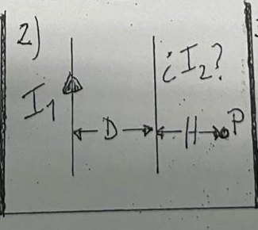
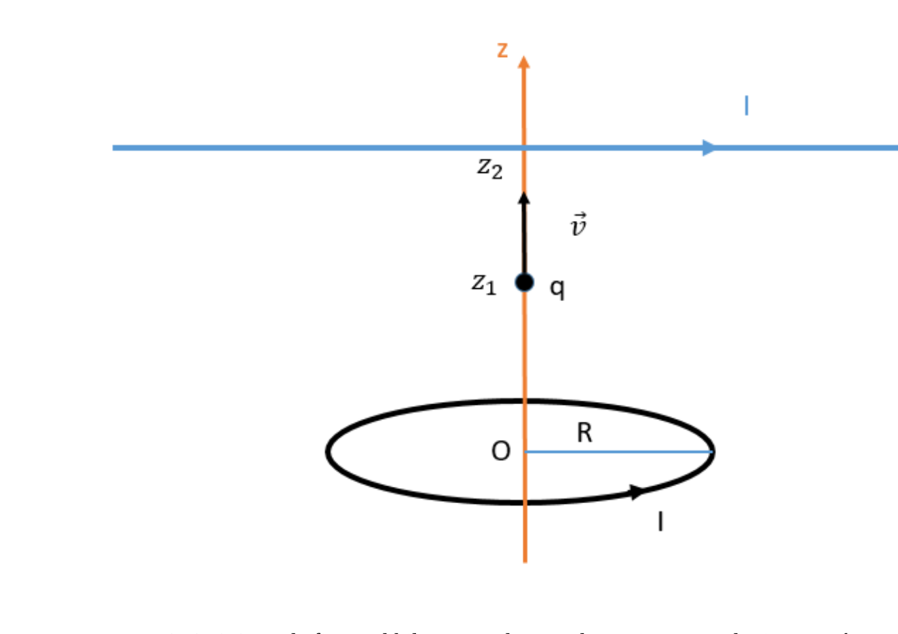
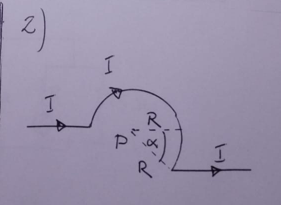

# Guía de ejercicios del 2º Parcial · Unidad 5: Magnetostática

Ejercicios 9 a 26 de la guía, de fácil a parcial. Cómo usarla, los niveles (🟢 🟡 🔴) y la composición de los parciales están en el [índice](guia-de-ejercicios.md).

[← Unidad 4](guia-de-ejercicios-4-capacitores.md) · [Índice de la guía de ejercicios](guia-de-ejercicios.md) · [Unidad 6 →](guia-de-ejercicios-6-induccion.md)

---

Las corrientes producen campo magnético, y el campo magnético empuja a las cargas que se mueven. Se empieza por la fuerza sobre una carga y su movimiento circular, se sigue con el campo de un hilo (Ampère y Biot-Savart), de varios hilos, de espiras y de tramos, y se termina con los ejercicios de parcial.

---

### Ejercicio 9

**Nivel:** 🟢 Concepto · **Fuente:** ejercicio propio · **Tipo de la guía de resolución:** [4. Campo en 3D (anillo + hilo) y fuerza sobre una carga](guia-de-resolucion.md#4-campo-en-3d-anillo--hilo-y-fuerza-sobre-una-carga)

Un protón ($q = 1{,}6\times10^{-19}$ C) se mueve con velocidad $\vec v = 2\times10^5$ m/s $\hat x$ en una región donde hay un campo magnético uniforme $\vec B = 0{,}5$ T $\hat y$.

a) Calcule el módulo de la fuerza magnética sobre el protón.

b) Indique su dirección y sentido.

c) ¿Qué cambia si la partícula es un electrón con la misma velocidad?

d) ¿Y si el protón se moviera en la dirección $\hat y$?

<b>Solución</b>

Solución paso a paso

**Qué piden, en palabras.**

- Una carga positiva que se mueve hacia la derecha ($\hat x$) dentro de un campo que apunta hacia arriba ($\hat y$).
- **a)** y **b)** La fuerza: cuánto vale y hacia dónde apunta. **c)** Lo mismo con carga negativa. **d)** Lo mismo con la velocidad paralela al campo.

**La idea, desde cero.** Un campo magnético no hace nada sobre una carga quieta: solo empuja a las cargas **que se mueven**. La fuerza es

$$\vec F = q\ \vec v\times\vec B$$

El producto vectorial $\vec v\times\vec B$ da un vector **perpendicular a los dos**, de módulo $vB\ \mathrm{sen}\ \theta$ ($\theta$ = ángulo entre $\vec v$ y $\vec B$). Su sentido sale de la regla de la mano derecha, o con los versores de una terna derecha:

$$\hat x\times\hat y = \hat z \qquad \hat y\times\hat z = \hat x \qquad \hat z\times\hat x = \hat y$$

y al invertir el orden cambia el signo. Un vector paralelo a otro tiene producto vectorial nulo ($\hat y\times\hat y = 0$). El signo de $q$ importa: una carga negativa siente la fuerza en sentido contrario.

#### Ítem a)

**Paso 1 — Módulo.** $\vec v\perp\vec B$, así que $\mathrm{sen}\ 90^\circ = 1$:

$$F = qvB = 1{,}6\times10^{-19}\cdot2\times10^5\cdot0{,}5\ \text{N} = 1{,}6\times10^{-14}\ \text{N}$$

#### Ítem b)

**Paso 2 — Dirección.**

$$\vec F = q\ v\ B\ (\hat x\times\hat y) = qvB\ \hat z$$

Apunta en $+\hat z$, perpendicular a la velocidad y al campo (si $x$ va a la derecha e $y$ hacia arriba en la hoja, $\hat z$ sale de la hoja).

#### Ítem c)

**Paso 3 — Electrón.** Mismo módulo, pero $q < 0$ invierte el sentido: $\vec F = -1{,}6\times10^{-14}$ N $\hat z$.

#### Ítem d)

**Paso 4 — Velocidad paralela al campo.** $\hat y\times\hat y = 0$: la fuerza es nula y el protón sigue derecho.

**Respuesta:** a) $F = 1{,}6\times10^{-14}$ N; b) $+\hat z$; c) mismo módulo, sentido $-\hat z$; d) $F = 0$.

---

### Ejercicio 10

**Nivel:** 🟢 Concepto · **Fuente:** ejercicio propio · **Tipo de la guía de resolución:** [7. Movimiento de una carga en un campo magnético](guia-de-resolucion.md#7-movimiento-de-una-carga-en-un-campo-magn%C3%A9tico)

El protón del ejercicio anterior ($m = 1{,}67\times10^{-27}$ kg, $q = 1{,}6\times10^{-19}$ C, $v = 2\times10^5$ m/s) entra perpendicularmente a un campo uniforme de 0,5 T y describe una circunferencia.

a) Calcule el radio de la circunferencia.

b) Calcule el tiempo que tarda en dar una vuelta (período).

c) ¿Qué pasa con el radio y con el período si la velocidad se duplica?

<b>Solución</b>

Solución paso a paso

**Qué piden, en palabras.**

- Una carga que entra perpendicular a un campo magnético uniforme gira en círculos.
- **a)** El tamaño del círculo. **b)** El tiempo de una vuelta. **c)** Cómo cambian si va más rápido.

**La idea, desde cero.** La fuerza magnética $q\ \vec v\times\vec B$ es siempre perpendicular a la velocidad. Una fuerza perpendicular a la velocidad no acelera ni frena: solo cambia la dirección del movimiento, como la tensión de una soga que hace girar una piedra. Como el campo es uniforme y $v$ no cambia, la fuerza tiene siempre el mismo módulo y siempre apunta hacia un mismo punto: el movimiento es **circular uniforme**. En un movimiento circular uniforme, la fuerza que apunta al centro (centrípeta) tiene que valer $m\dfrac{v^2}{r}$ (segunda ley de Newton con la aceleración centrípeta $v^2/r$).

**Deducción del radio** (atajo: $r = \dfrac{mv}{\lvert q\rvert B}$). La fuerza magnética hace de fuerza centrípeta:

$$\lvert q\rvert vB = m\frac{v^2}{r} \quad\Rightarrow\quad r = \frac{mv}{\lvert q\rvert B}$$

**Deducción del período** (atajo: $T = \dfrac{2\pi m}{\lvert q\rvert B}$). En una vuelta recorre la circunferencia, $2\pi r$, a velocidad $v$:

$$T = \frac{2\pi r}{v} = \frac{2\pi}{v}\cdot\frac{mv}{\lvert q\rvert B} = \frac{2\pi m}{\lvert q\rvert B}$$

La $v$ se simplifica: **el período no depende de la velocidad**.

#### Ítem a)

**Paso 1 — Radio.**

$$r = \frac{1{,}67\times10^{-27}\cdot2\times10^5}{1{,}6\times10^{-19}\cdot0{,}5}\ \text{m} = 4{,}18\times10^{-3}\ \text{m} = 4{,}18\ \text{mm}$$

#### Ítem b)

**Paso 2 — Período.**

$$T = \frac{2\pi\cdot1{,}67\times10^{-27}}{1{,}6\times10^{-19}\cdot0{,}5}\ \text{s} = 1{,}31\times10^{-7}\ \text{s}$$

Control: $2\pi r/v = 2\pi\cdot4{,}18\times10^{-3}/2\times10^5 = 1{,}31\times10^{-7}$ s ✓.

#### Ítem c)

**Paso 3 — Doble velocidad.** $r\propto v$: el radio se duplica (8,35 mm). $T$ no depende de $v$: queda igual. Va el doble de rápido pero recorre un círculo el doble de grande.

**Respuesta:** a) $r = 4{,}18$ mm; b) $T = 1{,}31\times10^{-7}$ s; c) el radio se duplica y el período no cambia.

---

### Ejercicio 11

**Nivel:** 🟡 Práctica · **Fuente:** [Práctica de Magnetostática, Ej. 4](../5%20-%20Magnetost%C3%A1tica/practica.md#ejercicio-4) (enunciado textual de la guía de la cátedra) · **Tipo de la guía de resolución:** [7. Movimiento de una carga en un campo magnético](guia-de-resolucion.md#7-movimiento-de-una-carga-en-un-campo-magn%C3%A9tico)

Un electrón (masa $m$ =9,1x10-31 kg y carga $q$ =−1,6x10-19 C) con energía de 2 keV ingresa a un campo magnético uniforme de 0,1T formando un ángulo de 89° con la dirección del campo. La trayectoria del electrón será entonces una hélice alrededor de una línea de campo. Halle los valores característicos de la hélice, esto es, su período, paso y radio. (1 keV= 1,6 × 10−16 J).

<b>Solución</b>

Solución paso a paso

**Qué piden, en palabras.**

- Un electrón con energía de 2 keV entra a un campo de 0,1 T formando 89° con él.
- **Qué piden:** las características de la hélice que describe: período (tiempo de una vuelta), paso (lo que avanza por vuelta) y radio.

**La idea, desde cero.** Una carga $q$ que se mueve con velocidad $\vec v$ dentro de un campo magnético $\vec B$ siente la fuerza $\vec F = q\ \vec v\times\vec B$. Esa fuerza es siempre perpendicular a la velocidad, así que no cambia la rapidez de la carga: solo la desvía. Si la carga entra perpendicular a un campo uniforme, describe una circunferencia, y la fuerza magnética cumple el papel de fuerza centrípeta:

$$\lvert q\rvert vB = \frac{mv^2}{r} \quad\Rightarrow\quad r = \frac{mv}{\lvert q\rvert B} \qquad T = \frac{2\pi r}{v} = \frac{2\pi m}{\lvert q\rvert B}$$

El período no depende de la velocidad: una carga más rápida da una vuelta más grande en el mismo tiempo. Si la carga entra **oblicua**, se separa la velocidad en dos partes: la perpendicular al campo, $v\sin\theta$, que la hace girar; y la paralela, $v\cos\theta$, que no siente fuerza y sigue derecho. Girar y avanzar a la vez es una **hélice**, con forma de resorte. El radio usa $v_\perp$, y el paso es lo que avanza durante una vuelta, $p = v_\parallel T$.

**Resolución.**

**Paso 1 — Descomponer la velocidad.** Con $\theta = 89^\circ$ entre $\vec v$ y $\vec B$:

$$v_\perp = v\sin\theta \qquad v_\parallel = v\cos\theta \qquad v = \sqrt{\frac{2E}{m}}$$

**Paso 2 — Fórmulas de la hélice.**

$$T = \frac{2\pi m}{|q|B} \qquad p = v_\parallel\ T \qquad r = \frac{m\ v_\perp}{|q|B}$$

**Paso 3 — Cálculo.** $E = 2\ \text{keV} = 3{,}2\times10^{-16}$ J:

$$v = \sqrt{\frac{2\cdot3{,}2\times10^{-16}}{9{,}1\times10^{-31}}}\ \tfrac{\text{m}}{\text{s}} = 2{,}65\times10^7\ \tfrac{\text{m}}{\text{s}}$$

$$T = \frac{2\pi\cdot9{,}1\times10^{-31}}{1{,}6\times10^{-19}\cdot0{,}1}\ \text{s} = 3{,}57\times10^{-10}\ \text{s}$$

$$p = 2{,}65\times10^7\cdot\cos89^\circ\cdot3{,}57\times10^{-10}\ \text{m} = 1{,}65\times10^{-4}\ \text{m} = 0{,}16\ \text{mm}$$

$$r = \frac{9{,}1\times10^{-31}\cdot2{,}65\times10^7\cdot\sin89^\circ}{1{,}6\times10^{-19}\cdot0{,}1}\ \text{m} = 1{,}5\times10^{-3}\ \text{m}$$

**Respuesta:** $\tau = 3{,}57\times10^{-10}$ s; $p = 0{,}16$ mm; $r = 1{,}5$ mm

---

### Ejercicio 12

**Nivel:** 🟢 Concepto · **Fuente:** ejercicio propio · **Tipo de la guía de resolución:** [2. Hilos paralelos: campo en un punto y punto de campo nulo](guia-de-resolucion.md#2-hilos-paralelos-campo-en-un-punto-y-punto-de-campo-nulo)

Por un hilo recto muy largo circula una corriente de 5 A hacia arriba.

a) Deduzca la expresión del campo magnético a una distancia $d$ del hilo.

b) Calcule el campo a 2 cm y a 10 cm del hilo.

c) Indique hacia dónde apunta el campo en un punto a la derecha del hilo y en uno a la izquierda (el hilo está en el plano de la hoja).

<b>Solución</b>

Solución paso a paso

**Qué piden, en palabras.**

- Un cable recto, tan largo que sus extremos no importan, con 5 A.
- **a)** La fórmula del campo a una distancia $d$, deducida. **b)** Su valor en dos puntos. **c)** Su sentido a cada lado del hilo.

**La idea, desde cero.** Una corriente produce un campo magnético a su alrededor. Alrededor de un hilo recto, las líneas de campo son **circunferencias centradas en el hilo**: el campo "da vueltas" alrededor de la corriente. El sentido de giro lo da la **regla de la mano derecha**: pulgar en el sentido de la corriente, y los dedos curvados indican hacia dónde gira el campo. Por simetría, a la misma distancia del hilo el campo tiene el mismo módulo.

Hay dos leyes para calcularlo, y las dos dan lo mismo.

#### Ítem a)

**Deducción con Ampère** (atajo: $B = \dfrac{\mu_0 I}{2\pi d}$). La ley de Ampère dice que la circulación del campo a lo largo de una curva cerrada es $\mu_0$ por la corriente que la atraviesa:

$$\oint\vec B\cdot d\vec l = \mu_0 I_{enc}$$

Se elige como curva una circunferencia de radio $d$ centrada en el hilo. Sobre ella $\vec B$ es tangente (paralelo a $d\vec l$) y de módulo constante, así que la integral es $B$ por el largo de la circunferencia:

$$B\cdot2\pi d = \mu_0 I \quad\Rightarrow\quad B = \frac{\mu_0 I}{2\pi d}$$

**Deducción con Biot-Savart** (el mismo resultado, como control). Cada pedacito del hilo aporta $dB = \dfrac{\mu_0 I}{4\pi}\dfrac{\lvert d\vec l\times\hat r\rvert}{r^2}$. Con el hilo sobre el eje $x$ y el punto a distancia $d$, $\lvert d\vec l\times\hat r\rvert/r^2 = \dfrac{d\ dx}{(x^2 + d^2)^{3/2}}$:

$$B = \frac{\mu_0 I}{4\pi}\int_{-\infty}^{\infty}\frac{d\ dx}{(x^2 + d^2)^{3/2}} = \frac{\mu_0 I}{4\pi d}\left[\frac{x}{\sqrt{x^2 + d^2}}\right]_{-\infty}^{\infty} = \frac{\mu_0 I}{4\pi d}(1 - (-1)) = \frac{\mu_0 I}{2\pi d}\ ✓$$

(primitiva con $x = d\tan u$.) $\mu_0 = 4\pi\times10^{-7}$ T m/A, así que $\dfrac{\mu_0}{2\pi} = 2\times10^{-7}$.

#### Ítem b)

**Paso 1 — Valores.**

$$B(2\ \text{cm}) = \frac{2\times10^{-7}\cdot5}{0{,}02}\ \text{T} = 5\times10^{-5}\ \text{T} = 50\ \mu\text{T} \qquad B(10\ \text{cm}) = \frac{2\times10^{-7}\cdot5}{0{,}1}\ \text{T} = 10\ \mu\text{T}$$

A 5 veces más distancia, 5 veces menos campo.

#### Ítem c)

**Paso 2 — Sentido.** Pulgar hacia arriba: los dedos entran en la hoja del lado derecho y salen del lado izquierdo. A la derecha el campo es **entrante** (⊗); a la izquierda, **saliente** (⊙).

**Respuesta:** a) $B = \dfrac{\mu_0 I}{2\pi d}$; b) 50 μT a 2 cm y 10 μT a 10 cm; c) entrante a la derecha, saliente a la izquierda.

---

### Ejercicio 13

**Nivel:** 🟢 Concepto · **Fuente:** ejercicio propio · **Tipo de la guía de resolución:** [2. Hilos paralelos: campo en un punto y punto de campo nulo](guia-de-resolucion.md#2-hilos-paralelos-campo-en-un-punto-y-punto-de-campo-nulo)

Dos hilos rectos muy largos y paralelos están separados 10 cm. Por uno circulan 4 A y por el otro 6 A.

a) Calcule el campo magnético en el punto medio entre los hilos si las corrientes tienen el mismo sentido.

b) Ídem si tienen sentidos opuestos.

<b>Solución</b>

Solución paso a paso

**Qué piden, en palabras.**

- Dos cables paralelos; el punto está a mitad de camino, a 5 cm de cada uno.
- El campo total en ese punto, con las corrientes en el mismo sentido y en sentidos opuestos.

**La idea, desde cero.** Cada hilo produce su propio campo, que da vueltas a su alrededor. El campo en un punto es la **suma vectorial** de los dos (principio de superposición). Si el punto está en el plano de los hilos, los dos campos son perpendiculares a ese plano (entran o salen de la hoja), así que sumar vectores se reduce a sumar los módulos si apuntan igual, o restarlos si apuntan opuesto. El sentido de cada uno sale de la mano derecha.

**Deducción del campo de cada hilo** (atajo: $B = \dfrac{\mu_0 I}{2\pi d}$). Ampère sobre una circunferencia de radio $d$ centrada en el hilo: el campo es tangente y constante, así que $\oint\vec B\cdot d\vec l = B\cdot2\pi d = \mu_0 I$ y $B = \dfrac{\mu_0 I}{2\pi d}$.

**Paso 1 — Módulos.** Cada hilo está a $d = 0{,}05$ m:

$$B_1 = \frac{2\times10^{-7}\cdot4}{0{,}05}\ \text{T} = 16\ \mu\text{T} \qquad B_2 = \frac{2\times10^{-7}\cdot6}{0{,}05}\ \text{T} = 24\ \mu\text{T}$$

#### Ítem a)

**Paso 2 — Mismo sentido.** Hilo 1 a la izquierda y hilo 2 a la derecha, las dos corrientes hacia arriba. El punto está a la derecha del hilo 1: su campo es entrante. Está a la izquierda del hilo 2: su campo es saliente. Se oponen:

$$B = 24 - 16 = 8\ \mu\text{T}\ \text{(saliente, el del hilo de más corriente)}$$

#### Ítem b)

**Paso 3 — Sentidos opuestos.** Si la corriente del hilo 2 baja, su campo a su izquierda pasa a ser entrante, igual que el del hilo 1. Se suman:

$$B = 16 + 24 = 40\ \mu\text{T}\ \text{(entrante)}$$

**Regla que queda:** entre dos hilos, corrientes del mismo sentido dan campos opuestos (y el campo puede anularse ahí); corrientes opuestas dan campos que se suman.

**Respuesta:** a) $B = 8\ \mu\text{T}$; b) $B = 40\ \mu\text{T}$.

---

### Ejercicio 14

**Nivel:** 🟡 Práctica · **Fuente:** [Práctica de Magnetostática, Ej. 12](../5%20-%20Magnetost%C3%A1tica/practica.md#ejercicio-12) (enunciado textual de la guía de la cátedra) · **Tipo de la guía de resolución:** [3. Fuerza entre hilos](guia-de-resolucion.md#3-fuerza-entre-hilos)

Por dos alambres infinitos paralelos, separados una distancia *D*=0,6m, circulan corrientes *i1*=0,2A e *i2*=0,3A, respectivamente. Calcule la fuerza que por unidad de longitud la corriente superior ejerce sobre la corriente inferior si:

a) las corrientes son paralelas;

b) las corrientes son antiparalelas. (μ0=4π×10−7 N/A2)

<b>Solución</b>

Solución paso a paso

**Qué piden, en palabras.**

- Dos hilos paralelos a 0,6 m, con 0,2 A y 0,3 A.
- **Qué piden:** la fuerza por metro que uno hace sobre el otro, con las corrientes en el mismo sentido y en sentidos opuestos.

**La idea, desde cero.** Cada hilo está dentro del campo del otro. El hilo de arriba produce, en el de abajo, $B = \mu_0 i_1/(2\pi D)$ (Ampère), perpendicular al hilo. Sobre un metro del hilo de abajo actúa $F = i_2\cdot1\cdot B$ (fuerza sobre un cable, $i\ \vec\ell\times\vec B$). Haciendo el producto vectorial con las direcciones se ve que las corrientes del mismo sentido se atraen y las de sentido opuesto se repelen. El módulo es el mismo en los dos casos.

**Deducción del campo de un hilo** (atajo: $B = \dfrac{\mu_0 i}{2\pi d}$). Por simetría el campo del hilo es tangente a las circunferencias centradas en él y tiene el mismo módulo en toda la circunferencia de radio $d$. La ley de Ampère dice que la circulación del campo en una curva cerrada es $\mu_0$ por la corriente que la atraviesa. Sobre esa circunferencia, $\vec B\parallel d\vec l$:

$$\oint\vec B\cdot d\vec l = B\cdot2\pi d = \mu_0 i \quad\Rightarrow\quad B = \frac{\mu_0 i}{2\pi d}$$

**Deducción de la fuerza entre hilos** (atajo: $\dfrac F\ell = \dfrac{\mu_0 i_1i_2}{2\pi D}$). El hilo de abajo está dentro del campo del de arriba, $B_1 = \dfrac{\mu_0 i_1}{2\pi D}$, que es el mismo en todo el hilo y perpendicular a él. La fuerza sobre cada pedacito es $d\vec F = i_2\ d\vec l\times\vec B_1$, de módulo $i_2B_1\ dl$. Sumando sobre un largo $\ell$: $F = i_2\ell B_1$, y dividiendo por $\ell$ sale la fórmula. Haciendo el producto vectorial con las direcciones: si las corrientes van en el mismo sentido, la fuerza apunta hacia el otro hilo (atracción).

**Resolución.**

#### Ítem a)

**Paso 1 — Fórmula.** El hilo inferior está en el campo del superior, $B = \dfrac{\mu_0 i_1}{2\pi D}$, perpendicular a él. Sobre un metro de hilo actúa $F = i_2\cdot1\cdot B$:

$$\frac F\ell = i_2B = \frac{\mu_0 i_1i_2}{2\pi D}$$

**Paso 2 — Cálculo.**

$$\frac F\ell = \frac{4\pi\times10^{-7}\cdot0{,}2\cdot0{,}3}{2\pi\cdot0{,}6}\ \tfrac{\text{N}}{\text{m}} = 2\times10^{-8}\ \tfrac{\text{N}}{\text{m}}$$

**Paso 3 — Sentido.** Con las corrientes en el mismo sentido, el producto vectorial $i_2\ d\vec l\times\vec B_1$ apunta hacia el hilo superior: la fuerza es **atractiva**.

#### Ítem b)

**Paso 4 — Corrientes antiparalelas.** El módulo no depende de los sentidos: sigue siendo $2\times10^{-8}$ N/m. Pero al invertir una corriente se invierte $d\vec l$ (o el campo), y con él la fuerza: ahora es **repulsiva**.

**Respuesta:** En ambos casos es $F = 2\times10^{-8}$ N/m, atractiva en (a) y repulsiva en (b).

---

### Ejercicio 15

**Nivel:** 🟡 Práctica · **Fuente:** [Práctica de Magnetostática, Ej. 13](../5%20-%20Magnetost%C3%A1tica/practica.md#ejercicio-13) (enunciado textual de la guía de la cátedra) · **Tipo de la guía de resolución:** [2. Hilos paralelos: campo en un punto y punto de campo nulo](guia-de-resolucion.md#2-hilos-paralelos-campo-en-un-punto-y-punto-de-campo-nulo)

Dos alambres paralelos infinitos, separados una distancia *d*, están circulados por corrientes *i*1 e *i*2, respectivamente. El campo magnético generado por estos alambres se anula a una distancia *d/3* del que transporta la corriente *i*1 en la región externa a los dos alambres.

a) halle la relación entre los valores de las corrientes y su sentido de circulación;

b) halle la expresión de la intensidad del campo magnético generado en el punto medio entre los alambres;

c) discuta cuáles son las componentes que tendrá el campo magnético generado por los alambres en el punto medio entre ellos, a una altura *z* del plano que los contiene.

<b>Solución</b>

Solución paso a paso

**Qué piden, en palabras.**

- Dos hilos paralelos separados $d$. El campo total es cero en un punto **afuera** de los hilos, a $d/3$ del hilo 1.
- **a)** La relación entre las corrientes y sus sentidos. **b)** El campo en el punto medio. **c)** Qué componentes tiene el campo en el punto medio pero a una altura $z$ sobre el plano de los hilos.

**La idea, desde cero.** Cada hilo produce $\mu_0 i/(2\pi r)$, con líneas circulares a su alrededor. En el plano de los hilos, los dos campos son perpendiculares al plano y se suman o se restan. Por la mano derecha: con corrientes en el mismo sentido, los campos se oponen **entre** los hilos y se suman afuera; con corrientes opuestas, al revés. Campo cero afuera obliga a corrientes opuestas, y el punto tiene que estar más cerca del hilo con menos corriente. Fuera del plano, cada campo sigue siendo tangente a la circunferencia que rodea a su hilo, y ya no son paralelos entre sí.

**Deducción del campo de un hilo** (atajo: $B = \dfrac{\mu_0 i}{2\pi d}$). Por simetría el campo del hilo es tangente a las circunferencias centradas en él y tiene el mismo módulo en toda la circunferencia de radio $d$. La ley de Ampère dice que la circulación del campo en una curva cerrada es $\mu_0$ por la corriente que la atraviesa. Sobre esa circunferencia, $\vec B\parallel d\vec l$:

$$\oint\vec B\cdot d\vec l = B\cdot2\pi d = \mu_0 i \quad\Rightarrow\quad B = \frac{\mu_0 i}{2\pi d}$$

**Resolución.**

**Paso 1 — Sentidos.** En la región **externa** a dos hilos, los campos son opuestos solo si las corrientes son **antiparalelas** (con corrientes paralelas, afuera se suman).

#### Ítem a)

**Paso 2 — Igualar módulos.** El punto está a $d/3$ del hilo 1 y a $d + d/3 = 4d/3$ del hilo 2:

$$\frac{\mu_0 i_1}{2\pi(d/3)} = \frac{\mu_0 i_2}{2\pi(4d/3)} \quad\Rightarrow\quad 3i_1 = \frac34 i_2 \quad\Rightarrow\quad i_2 = 4i_1$$

#### Ítem b)

**Paso 3 — Punto medio.** Entre dos hilos antiparalelos los campos se **suman**. Cada hilo está a $d/2$:

$$B = \frac{\mu_0 i_1}{2\pi(d/2)} + \frac{\mu_0 i_2}{2\pi(d/2)} = \frac{\mu_0}{\pi d}(i_1 + i_2)$$

#### Ítem c)

**Paso 4 — Fuera del plano.** Cada hilo genera un campo perpendicular al hilo y perpendicular a la recta que lo une con el punto. A una altura $z$, esas direcciones tienen componentes tanto en la dirección que une los hilos como en la normal al plano, pero **ninguna componente a lo largo de los hilos**.

**Respuesta:** a) $i_2 = 4i_1$, antiparalelas; b) $B = \dfrac{\mu_0}{\pi d}(i_1 + i_2)$; c) en ambas direcciones perpendiculares a la dirección de los alambres.

---

### Ejercicio 16

**Nivel:** 🟢 Concepto · **Fuente:** ejercicio propio · **Tipo de la guía de resolución:** [5. Espiras: campo en el centro](guia-de-resolucion.md#5-espiras-campo-en-el-centro)

Una espira circular de radio 5 cm transporta una corriente de 3 A en sentido antihorario (vista desde el lector).

a) Deduzca la expresión del campo en el centro de la espira y calcule su valor.

b) ¿Hacia dónde apunta?

c) ¿Cuánto valdría el campo en el centro si el cable fuera solo media circunferencia (y los cables que la alimentan apuntaran hacia el centro)?

<b>Solución</b>

Solución paso a paso

**Qué piden, en palabras.**

- Un anillo de cable con corriente; el punto es su centro.
- **a)** La fórmula del campo en el centro, deducida, y su valor. **b)** Su sentido. **c)** El campo de media vuelta de cable.

**La idea, desde cero.** La ley de **Biot-Savart** dice que cada pedacito de cable $d\vec l$ con corriente $I$ produce en un punto un campo

$$d\vec B = \frac{\mu_0 I}{4\pi}\ \frac{d\vec l\times\hat r}{r^2}$$

donde $\hat r$ apunta del pedacito al punto y $r$ es la distancia. El campo total es la suma (integral) de todos los pedacitos. En el centro de una espira circular todo es sencillo: todos los pedacitos están a la misma distancia $R$, y cada uno es perpendicular al radio que lo une con el centro.

**Deducción del campo de un arco** (atajo: $B = \dfrac{\mu_0 I\theta}{4\pi R}$). Como $d\vec l\perp\hat r$, $\lvert d\vec l\times\hat r\rvert = dl$, y todos los aportes apuntan en la misma dirección (perpendicular al plano de la espira). Con $dl = R\ d\varphi$ (arco de ángulo $d\varphi$):

$$B = \frac{\mu_0 I}{4\pi}\int\frac{dl}{R^2} = \frac{\mu_0 I}{4\pi}\int_0^\theta\frac{R\ d\varphi}{R^2} = \frac{\mu_0 I\theta}{4\pi R}$$

Para la vuelta completa, $\theta = 2\pi$: $B = \dfrac{\mu_0 I}{2R}$.

#### Ítem a)

**Paso 1 — Valor.**

$$B = \frac{4\pi\times10^{-7}\cdot3}{2\cdot0{,}05}\ \text{T} = 3{,}77\times10^{-5}\ \text{T} = 37{,}7\ \mu\text{T}$$

#### Ítem b)

**Paso 2 — Sentido.** Regla de la mano derecha para espiras: los dedos siguen la corriente y el pulgar da el campo en el centro. Antihoraria → el pulgar sale de la hoja: **saliente** (⊙). (Equivalente: $d\vec l\times\hat r$ apunta hacia afuera de la hoja.)

#### Ítem c)

**Paso 3 — Media vuelta.** Los cables que apuntan hacia el centro no aportan: en ellos $d\vec l$ es paralelo a $\hat r$ y $d\vec l\times\hat r = 0$. Queda el arco con $\theta = \pi$:

$$B = \frac{\mu_0 I\pi}{4\pi R} = \frac{\mu_0 I}{4R} = 18{,}8\ \mu\text{T}$$

**Respuesta:** a) $B = \dfrac{\mu_0 I}{2R} = 37{,}7\ \mu\text{T}$; b) saliente; c) $\dfrac{\mu_0 I}{4R} = 18{,}8\ \mu\text{T}$.

---

### Ejercicio 17

**Nivel:** 🟡 Práctica · **Fuente:** [Práctica de Magnetostática, Ej. 21](../5%20-%20Magnetost%C3%A1tica/practica.md#ejercicio-21) (enunciado textual de la guía de la cátedra) · **Tipo de la guía de resolución:** [6. Hilo doblado: Biot-Savart por tramos](guia-de-resolucion.md#6-hilo-doblado-biot-savart-por-tramos)

Halle la expresión del vector ***B*** en el centro *C* de las siguientes configuraciones de semiespiras (recuerde que un segmento recto de alambre circulado por una corriente *i* genera campo nulo en su prolongación). La configuración (d) es una sucesión infinita de semiespiras concéntricas, de radios *Rn*= *ra* /(2*n*) (*n* ≥1). La corriente que circula por cada espira decrece (por efecto de la resistencia) como *i n*= *i0* / *n*2. En cada caso discuta qué sucede si se invierte el sentido de la corriente

(tenga en cuenta que $\sum_1^\infty\frac{(-1)^n}{n} = -\ln2$ )

<b>Solución</b>

Solución paso a paso

**Qué piden, en palabras.**

- Varias configuraciones de semicircunferencias concéntricas unidas por tramos rectos que apuntan al centro C, más una sucesión infinita (d).
- **Qué piden:** el campo en C en cada caso.

**La idea, desde cero.** Dos herramientas. (1) Un tramo recto cuya prolongación pasa por C no aporta campo en C, porque cada pedacito apunta hacia C ($d\vec l\parallel\hat r$). (2) Una semicircunferencia de radio $R$ centrada en C aporta $\dfrac{\mu_0 i}{4R}$. Sale de Biot-Savart: cada pedacito está a distancia $R$ y es perpendicular al radio, así que $B = \dfrac{\mu_0 i}{4\pi}\displaystyle\int_0^\pi\frac{R\ d\varphi}{R^2} = \dfrac{\mu_0 i}{4R}$. El sentido sale de la mano derecha: recorrida antihoraria → saliente; horaria → entrante. Después se suma con signos.

**Resolución.**

**Paso 1 — Herramientas.**

- Los tramos rectos están alineados con C: no aportan campo.
- Cada semiespira de radio $R$ aporta $\dfrac{\mu_0 i}{4R}$ en C: saliente ($+\hat e_z$) si la corriente la recorre en sentido antihorario y entrante ($-\hat e_z$) si la recorre en sentido horario.

#### Configuración (a)

**Paso 2 — (a).** La semiespira exterior $R_2$ se recorre en sentido horario ($-\hat e_z$) y la interior $R_1$ en sentido antihorario ($+\hat e_z$):

$$\vec B = \frac{\mu_0 i}{4}\left(\frac{1}{R_1} - \frac{1}{R_2}\right)\hat e_z$$

#### Configuración (b)

**Paso 3 — (b).** La semiespira superior $R_2$ y la inferior $R_1$ se recorren ambas en sentido horario:

$$\vec B = \frac{\mu_0 i}{4}\left(\frac{1}{R_2} + \frac{1}{R_1}\right)(-\hat e_z)$$

#### Configuración (c)

**Paso 4 — (c).** $R_3$ (abajo) y $R_1$ (arriba) en sentido antihorario; $R_2$ en sentido horario:

$$\vec B = \frac{\mu_0 i}{4}\left(\frac{1}{R_3} + \frac{1}{R_1} - \frac{1}{R_2}\right)\hat e_z$$

#### Configuración (d)

**Paso 5 — (d).** Las semiespiras consecutivas se recorren alternadamente en un sentido y en el otro. Cada una aporta

$$\frac{\mu_0 i_n}{4R_n} = \frac{\mu_0\ (i_0/n^2)}{4\ r_a/(2n)} = \frac{\mu_0 i_0}{2r_a}\cdot\frac1n$$

con signos alternados $(-1)^n$:

$$\vec B = \frac{\mu_0 i_0}{2r_a}\sum_{n=1}^\infty\frac{(-1)^n}{n}\ \hat e_z = \frac{\mu_0 i_0}{2r_a}(-\ln2)\ \hat e_z = \frac{\mu_0 i}{2r_a}\ln2\ (-\hat e_z)$$

#### Si se invierte la corriente

**Paso 6 — Invertir la corriente.** En todos los casos el campo cambia de sentido (el módulo no cambia).

**Respuesta:**

- a) $\vec B = \dfrac{\mu_0 i}{4}\left(\dfrac{1}{R_1} - \dfrac{1}{R_2}\right)(\hat e_z)$
- b) $\vec B = \dfrac{\mu_0 i}{4}\left(\dfrac{1}{R_2} + \dfrac{1}{R_1}\right)(-\hat e_z)$
- c) $\vec B = \dfrac{\mu_0 i}{4}\left(\dfrac{1}{R_3} + \dfrac{1}{R_1} - \dfrac{1}{R_2}\right)(\hat e_z)$
- d) $\vec B = \dfrac{\mu_0 i}{2r_a}\ln2\ (-\hat e_z)$
- Si se invierte la corriente, en todos los casos el campo cambia de sentido.

---

### Ejercicio 18

**Nivel:** 🟡 Práctica · **Fuente:** [Práctica de Magnetostática, Ej. 16](../5%20-%20Magnetost%C3%A1tica/practica.md#ejercicio-16) (enunciado textual de la guía de la cátedra) · **Tipo de la guía de resolución:** [6. Hilo doblado: Biot-Savart por tramos](guia-de-resolucion.md#6-hilo-doblado-biot-savart-por-tramos)

La figura muestra un segmento rectilíneo de alambre, de longitud *L*, que conduce una corriente de intensidad *i* (no se muestran los alambres que completan el circuito y que a los efectos de este cálculo pueden ser ignorados). Calcule el campo magnético que la corriente genera en un punto *P* ubicado a una distancia *R* del alambre, y a una distancia *h>L/2* del centro del mismo.

<b>Solución</b>

Solución paso a paso

**Qué piden, en palabras.**

- Un segmento recto de largo $L$ con corriente $i$, y un punto P a distancia $R$ de su recta y a una altura $h > L/2$ del centro del segmento: el pie de la perpendicular cae **afuera** del segmento.
- **Qué piden:** el campo en P.

**La idea, desde cero.** El campo de un cable es la suma de lo que aporta cada pedacito, según Biot-Savart: $d\vec B = \dfrac{\mu_0 i}{4\pi}\dfrac{d\vec l\times\hat r}{r^2}$, con $\hat r$ apuntando del pedacito al punto. Para un tramo recto, con el punto a distancia $R$ de su recta y $x$ medido desde el pie de la perpendicular, $\lvert d\vec l\times\hat r\rvert = \dfrac{R\ dx}{\sqrt{x^2 + R^2}}$, y la integral da

$$B = \frac{\mu_0 i}{4\pi}\int_{x_1}^{x_2}\frac{R\ dx}{(x^2 + R^2)^{3/2}} = \frac{\mu_0 i}{4\pi R}\left[\frac{x}{\sqrt{x^2 + R^2}}\right]_{x_1}^{x_2} = \frac{\mu_0 i}{4\pi R}(\sin\theta_2 - \sin\theta_1)$$

(primitiva con $x = R\tan u$). $\theta$ es el ángulo con que el punto ve cada extremo, medido desde la perpendicular y con signo. Un tramo que apunta directo hacia el punto no aporta nada, porque ahí $d\vec l\parallel\hat r$. Como el pie de la perpendicular cae afuera del segmento, los dos extremos quedan del mismo lado: los dos senos tienen el mismo signo y se **restan**.

**Resolución.**

**Paso 1 — Ubicar los extremos respecto del punto.** P está a una altura $h$ por encima del centro del segmento. Los extremos están en $\pm L/2$, es decir a alturas $-(h - L/2)$ y $-(h + L/2)$ respecto de P: **los dos por debajo**.

**Paso 2 — Senos de los ángulos.** Con la fórmula $B = \frac{\mu_0 i}{4\pi R}(\sin\theta_2 - \sin\theta_1)$:

$$\sin\theta_2 = \frac{-(h - L/2)}{\sqrt{R^2 + (h - L/2)^2}} \qquad \sin\theta_1 = \frac{-(h + L/2)}{\sqrt{R^2 + (h + L/2)^2}}$$

**Paso 3 — Resultado.**

$$\vec B = \frac{\mu_0 i}{4\pi R}\left[\frac{h + L/2}{\left(R^2 + (h + L/2)^2\right)^{1/2}} - \frac{h - L/2}{\left(R^2 + (h - L/2)^2\right)^{1/2}}\right]\hat e_\phi$$

Es positivo, porque el primer término es mayor.

**Respuesta:** $\vec B = \dfrac{\mu_0 i}{4\pi R}\left[\dfrac{h + (L/2)}{\left(R^2 + \left(h + \frac L2\right)^2\right)^{1/2}} - \dfrac{h - (L/2)}{\left(R^2 + \left(h - \frac L2\right)^2\right)^{1/2}}\right]\hat e_\phi$

---

### Ejercicio 19

**Nivel:** 🟡 Práctica · **Fuente:** [Práctica de Magnetostática, Ej. 18](../5%20-%20Magnetost%C3%A1tica/practica.md#ejercicio-18) (enunciado textual de la guía de la cátedra) · **Tipo de la guía de resolución:** [5. Espiras: campo en el centro](guia-de-resolucion.md#5-espiras-campo-en-el-centro)

Calcule el campo magnético generado en su centro por una espira cuadrada de lado *L* circulada por una corriente eléctrica de intensidad *i*.

<b>Solución</b>

Solución paso a paso

**Qué piden, en palabras.**

- Una espira cuadrada de lado $L$ con corriente $i$.
- **Qué piden:** el campo en su centro.

**La idea, desde cero.** El campo de un cable es la suma de lo que aporta cada pedacito, según Biot-Savart: $d\vec B = \dfrac{\mu_0 i}{4\pi}\dfrac{d\vec l\times\hat r}{r^2}$, con $\hat r$ apuntando del pedacito al punto. Para un tramo recto, con el punto a distancia $R$ de su recta y $x$ medido desde el pie de la perpendicular, $\lvert d\vec l\times\hat r\rvert = \dfrac{R\ dx}{\sqrt{x^2 + R^2}}$, y la integral da

$$B = \frac{\mu_0 i}{4\pi}\int_{x_1}^{x_2}\frac{R\ dx}{(x^2 + R^2)^{3/2}} = \frac{\mu_0 i}{4\pi R}\left[\frac{x}{\sqrt{x^2 + R^2}}\right]_{x_1}^{x_2} = \frac{\mu_0 i}{4\pi R}(\sin\theta_2 - \sin\theta_1)$$

(primitiva con $x = R\tan u$). $\theta$ es el ángulo con que el punto ve cada extremo, medido desde la perpendicular y con signo. Un tramo que apunta directo hacia el punto no aporta nada, porque ahí $d\vec l\parallel\hat r$. Cada lado es un tramo recto visto desde su mediatriz, a distancia $L/2$, y ve sus extremos a $\pm45^\circ$. Los cuatro lados aportan lo mismo y en el mismo sentido (perpendicular al plano), así que se multiplica por 4.

**Resolución.**

**Paso 1 — Un lado.** Está a $L/2$ del centro, con $\theta_1 = -45^\circ$ y $\theta_2 = 45^\circ$:

$$B_{lado} = \frac{\mu_0 i}{4\pi(L/2)}\left(\sin45^\circ - \sin(-45^\circ)\right) = \frac{\mu_0 i}{2\pi L}\sqrt2$$

**Paso 2 — Cuatro lados.** Todos aportan lo mismo y en el mismo sentido:

$$B = 4\ B_{lado} = 2\sqrt2\ \frac{\mu_0 i}{\pi L}$$

**Paso 3 — Sentido.** En la figura la corriente circula en sentido **horario** (en el lado superior va hacia la derecha), así que el campo en el centro es **entrante**: $-\hat e_z$.

**Respuesta:** $\vec B = 2\sqrt2\ \dfrac{\mu_0 i}{\pi L}\ (-\hat e_z)$

---

### Ejercicio 20

**Nivel:** 🟡 Práctica · **Fuente:** [Práctica de Magnetostática, Ej. 20](../5%20-%20Magnetost%C3%A1tica/practica.md#ejercicio-20) (enunciado textual de la guía de la cátedra) · **Tipo de la guía de resolución:** [4. Campo en 3D (anillo + hilo) y fuerza sobre una carga](guia-de-resolucion.md#4-campo-en-3d-anillo--hilo-y-fuerza-sobre-una-carga)

a) halle la expresión general del campo magnético generado por un anillo de radio *R,* circulado por una corriente de intensidad *i,* en cada punto de su eje de revolución (eje Z en la figura);

b) a partir de (a), calcule el campo generado por la media espira derecha a lo largo del eje Z;

c) escriba ahora la expresión que permite calcular el campo generado por un anillo de abertura arbitraria a lo largo del eje de revolución de la espira completa.

<b>Solución</b>

Solución paso a paso

**Qué piden, en palabras.**

- Un anillo de radio $R$ con corriente $i$, en el plano XY.
- **a)** El campo en cualquier punto del eje Z. **b)** El campo de la mitad derecha del anillo. **c)** La expresión para un arco de cualquier abertura.

**La idea, desde cero.** Biot-Savart: cada pedacito del anillo aporta $d\vec B = \dfrac{\mu_0 i}{4\pi}\dfrac{d\vec l\times\vec r}{r^3}$, con $\vec r$ del pedacito al punto. Se parametriza el anillo con el ángulo $\phi'$, se escriben $d\vec l$ y $\vec r$ en componentes, se hace el producto vectorial y se integra en $\phi'$. En el anillo completo, las componentes perpendiculares al eje se cancelan de a pares (pedacitos opuestos) y queda solo la componente a lo largo del eje. En la media espira ya no hay pares opuestos, y aparece una componente perpendicular.

**Resolución.**

**Paso 1 — Biot-Savart.** Elemento en $\vec r' = R(\cos\phi';\ \sin\phi';\ 0)$, con $d\vec\ell = R\ d\phi'(-\sin\phi';\ \cos\phi';\ 0)$. Vector del elemento al punto $(0;0;z)$: $(-R\cos\phi';\ -R\sin\phi';\ z)$, de módulo $\sqrt{R^2 + z^2}$.

**Paso 2 — Producto vectorial.**

$$d\vec\ell\times(\vec r - \vec r') = R\ d\phi'\ (z\cos\phi';\ z\sin\phi';\ R)$$

$$\vec B(z) = \frac{\mu_0 i}{4\pi}\int\frac{(Rz\cos\phi';\ Rz\sin\phi';\ R^2)}{(R^2 + z^2)^{3/2}}\ d\phi'$$

#### Ítem a)

**Paso 3 (de 0 a 2π).** Las integrales de $\cos\phi'$ y $\sin\phi'$ se anulan:

$$\vec B(z) = \frac{\mu_0 i}{4\pi}\ \frac{2\pi R^2}{(R^2 + z^2)^{3/2}}\ \hat e_z = \frac{\mu_0 i}{2}\ \frac{R^2}{(R^2 + z^2)^{3/2}}\ \hat e_z$$

#### Ítem b)

**Paso 4 (de 0 a π).** $\int_0^\pi\cos\phi' = 0$, $\int_0^\pi\sin\phi' = 2$, $\int_0^\pi d\phi' = \pi$:

$$\vec B(z) = \frac{\mu_0 i}{4\pi(R^2 + z^2)^{3/2}}\left(2Rz\ \hat e_y + \pi R^2\ \hat e_z\right)$$

Ahora aparece una componente perpendicular al eje, porque la media espira no es simétrica. La componente $z$ es la mitad de la del anillo completo, como era de esperar.

#### Ítem c)

**Paso 5.** Basta con cambiar los límites de integración por $\phi_1$ y $\phi_2$.

**Respuesta:**

- a) $\vec B(z) = \dfrac{\mu_0 i}{4\pi}\displaystyle\int_0^{2\pi}\dfrac{(Rz\cos\phi';\ Rz\sin\phi';\ R^2)}{(R^2 + z^2)^{3/2}}\ d\phi' = \dfrac{\mu_0 i}{2}\ \dfrac{R^2}{(R^2 + z^2)^{3/2}}\ \hat e_z$
- b) $\vec B(z) = \dfrac{\mu_0 i}{4\pi}\displaystyle\int_0^{\pi}\dfrac{(Rz\cos\phi';\ Rz\sin\phi';\ R^2)}{(R^2 + z^2)^{3/2}}\ d\phi' = \dfrac{\mu_0 i}{4\pi(R^2 + z^2)^{3/2}}\left(2Rz\ \hat e_y + \pi R^2\ \hat e_z\right)$
- c) $\vec B(z) = \dfrac{\mu_0 i}{4\pi}\displaystyle\int_{\phi_1}^{\phi_2}\dfrac{(Rz\cos\phi';\ Rz\sin\phi';\ R^2)}{(R^2 + z^2)^{3/2}}\ d\phi'$

(La guía escribe en b el factor $\dfrac{\mu_0 i}{4(R^2 + z^2)^{3/2}}$, sin $\pi$ en el denominador. Así, la componente $z$ quedaría $\pi/2$ veces la del anillo completo, cuando tiene que ser la mitad: falta el $\pi$.)

---

### Ejercicio 21

**Nivel:** 🔴 Parcial · **Fuente:** [1er Recuperatorio del 2º Parcial — 09/12/2021, Ej. 1](2021-12-09-1er-recuperatorio-2do-parcial.md#ejercicio-1) (enunciado textual) · **Tipo de la guía de resolución:** [2. Hilos paralelos: campo en un punto y punto de campo nulo](guia-de-resolucion.md#2-hilos-paralelos-campo-en-un-punto-y-punto-de-campo-nulo)

**Probabilidad de que aparezca uno parecido:** ≈ 45 % · el tipo 2 apareció en 5 de los 10 exámenes, la última vez el 28/11/2024 ([cómo se calcula](guia-de-ejercicios.md#composición-de-los-parciales)).

Dos alambres paralelos infinitos, separados por una distancia de 8 cm, están circulados por corrientes I1=1 A e I2, respectivamente. El campo magnético generado por los alambres se anula a una distancia de 2 cm del primero, en la región externa a los dos alambres. **a)** Determine I2. **b)** Halle el campo magnético en el punto medio entre ambos alambres. **c)** Una carga q=6 μC pasa por el punto del ítem anterior con una velocidad de módulo 4 x 104 m/s y dirección coincidente con la de los hilos. Determine el módulo de la fuerza sobre la carga.

<b>Solución</b>

Solución paso a paso

**Qué piden, en palabras.**

- Dos hilos paralelos separados 8 cm. $I_1 = 1$ A; de $I_2$ no se conocen ni el valor ni el sentido.
- **Dato clave:** en un punto **afuera** de los hilos, a 2 cm del primero, el campo total es cero.
- **a)** Con esa condición, hallar $I_2$ y su sentido.
- **b)** Campo total en el punto medio, a 4 cm de cada hilo.
- **c)** Una carga pasa por el punto medio moviéndose paralela a los hilos y siente una fuerza magnética: hallar su módulo.

**La idea, desde cero.** Una corriente produce campo magnético a su alrededor. Un hilo "muy largo" o "infinito" es uno tan largo, comparado con las distancias del problema, que sus extremos no importan. Su campo tiene líneas que son circunferencias centradas en el hilo, y se debilita con la distancia como $1/d$.

Con dos hilos, el campo en un punto es la **suma vectorial** de los campos de cada uno (superposición). Si el punto está en el plano de los dos hilos, ambos campos son perpendiculares a ese plano (salen o entran de la hoja). Entonces sumar vectores se reduce a sumar o restar módulos, según el sentido de cada uno. "Campo nulo" en un punto significa que ahí los dos campos tienen igual módulo y sentidos opuestos.

**La idea, aplicada a este ejercicio.**

Cada hilo produce un campo que da vueltas a su alrededor y vale $\mu_0 I/2\pi d$. En el punto que está afuera, a 2 cm del hilo 1, el campo total es cero, así que ahí los dos campos tienen que apuntar en sentidos opuestos y tener el mismo módulo.

- Que apunten opuesto **afuera** de los hilos obliga a que las corrientes sean opuestas.
- Que tengan el mismo módulo, con el punto 5 veces más lejos del hilo 2 que del hilo 1, obliga a que $I_2$ sea 5 veces $I_1$.

En el punto medio, entre dos hilos con corrientes opuestas, los dos campos apuntan para el mismo lado y se suman. Por último, la carga se mueve paralela a los hilos y el campo es perpendicular a los hilos. Entonces $\vec v\perp\vec B$ y la fuerza es la máxima posible, $qvB$.

**Deducción del campo de un hilo infinito** (atajo: $B = \dfrac{\mu_0 I}{2\pi d}$). Por simetría, $\vec B$ es tangente a las circunferencias centradas en el hilo y tiene el mismo módulo en toda la circunferencia de radio $d$. Circulación de Ampère sobre esa circunferencia:

$$\oint\vec B\cdot d\vec l = B\cdot2\pi d = \mu_0 I \quad\Rightarrow\quad B = \frac{\mu_0 I}{2\pi d}$$

**Deducción de la tabla de campo nulo.** Hilo 1 en $x = 0$ con corriente hacia arriba; por la mano derecha, a su derecha el campo es ⊗ y a su izquierda ⊙. Si el hilo 2 (en $x = D$) también sube, entre los hilos el hilo 1 da ⊗ y el 2 da ⊙: se pueden cancelar. Afuera, por ejemplo a la derecha de los dos, ambos dan ⊗ y se suman. Con el hilo 2 bajando todo se invierte. Además, afuera el punto está más cerca de un hilo que del otro, así que para que $\dfrac{I_1}{d_1} = \dfrac{I_2}{d_2}$ con $d$ menor hace falta $I$ menor: el cero está del lado del hilo con menos corriente.

#### Ítem a)

El cero está **afuera**: por la tabla, las corrientes son **antiparalelas**. El punto está a 2 cm del hilo 1 y a $2 + 8 = 10$ cm del hilo 2:

$$\frac{\mu_0 I_1}{2\pi\cdot0{,}02} = \frac{\mu_0 I_2}{2\pi\cdot0{,}10} \quad\Rightarrow\quad I_2 = 5I_1 = 5\ \text{A}\ (\text{sentido opuesto a } I_1)$$

Coherente: el cero quedó del lado del hilo con menos corriente.

#### Ítem b)

Entre hilos antiparalelos los campos se suman. Cada uno está a 4 cm:

$$B = \frac{\mu_0}{2\pi}\left(\frac{I_1}{0{,}04} + \frac{I_2}{0{,}04}\right) = 2\times10^{-7}\cdot\frac{6}{0{,}04}\ \text{T} = 30\ \mu\text{T}$$

#### Ítem c)

El campo de un hilo es tangente a circunferencias alrededor del hilo, o sea **perpendicular** a él. La velocidad es paralela a los hilos, así que $\vec v\perp\vec B$ y, de $\vec F = q\ \vec v\times\vec B$, el módulo es $\lvert\vec F\rvert = qvB\ \mathrm{sen}\ 90^\circ = qvB$:

$$F = 6\times10^{-6}\cdot4\times10^4\cdot30\times10^{-6}\ \text{N} = 7{,}2\ \mu\text{N}$$

**Respuesta:** a) $I_2 = 5$ A, en sentido opuesto a $I_1$; b) $B = 30\ \mu\text{T}$; c) $F = 7{,}2\ \mu\text{N}$.

---

### Ejercicio 22

**Nivel:** 🔴 Parcial · **Fuente:** [2º Parcial (Tema 2) — 27/11/2025, Ej. 2](2025-11-27-2do-parcial-tema-2.md#ejercicio-2) (enunciado textual) · **Tipo de la guía de resolución:** [3. Fuerza entre hilos](guia-de-resolucion.md#3-fuerza-entre-hilos)

**Probabilidad de que aparezca uno parecido:** ≈ 25 % · el tipo 3 apareció en 2 de los 10 exámenes, la última vez el 27/11/2025 ([cómo se calcula](guia-de-ejercicios.md#composición-de-los-parciales)).

Dos hilos muy largos y que transportan corrientes I1=I e I2 de valor y sentido desconocidos se hallan dispuestos de forma coplanar, y separados por una distancia D.
**a)** Sabiendo que los hilos se atraen entre sí con una fuerza por unidad de longitud de módulo 4μ0I2/(3πD), determine el campo en el punto P (H=D/5). Exprese en términos de μ0, I y D.
**b)** ¿Existen puntos donde el campo magnético sea nulo? En caso afirmativo, determine alguno de ellos. En caso negativo, justifique claramente.

<b>Solución</b>

Solución paso a paso

**Qué piden, en palabras.**

- Dos hilos separados $D$. $I_1 = I$ es dato; de $I_2$ no se conocen ni el valor ni el sentido.
- **Dato:** los hilos se atraen con $F/\ell = \dfrac{4\mu_0I^2}{3\pi D}$.
- **a)** Con eso, sacar $I_2$ y su sentido. Después, el campo total en P, que está a $D/5$ a la derecha del hilo 2. El resultado va en función de $\mu_0$, $I$ y $D$, sin números.
- **b)** Decir si hay puntos donde el campo total es cero y, si los hay, encontrar uno.

**La idea, desde cero.** Un campo magnético empuja a las cargas que se mueven dentro de él, y por lo tanto también a los cables con corriente. Dos hilos con corriente se empujan entre sí porque cada uno está dentro del campo del otro. El resultado, que se deduce abajo, es que si las corrientes van en el mismo sentido los hilos se atraen, y si van en sentidos opuestos se repelen.

Como los hilos son infinitos, la fuerza total sería infinita. Por eso el dato es la fuerza **por unidad de longitud**, $F/\ell$: los newtons que siente cada metro de hilo.

**La idea, aplicada a este ejercicio.**

Los hilos se atraen, así que, por la regla "mismo sentido se atraen", $I_2$ va en el mismo sentido que $I_1$. La fuerza por metro crece con el producto de las corrientes, así que su valor dice cuánto vale $I_2$. Con las dos corrientes conocidas, P es un punto a la derecha de los dos hilos: ahí los dos campos apuntan igual (entrante) y se suman.

Para b): con corrientes del mismo sentido, los campos solo se oponen **entre** los hilos. Por eso el cero tiene que estar ahí, más cerca del hilo con menos corriente (el 1).

En la figura P está a la derecha del hilo 2, a $H = D/5$ de él (o sea a $6D/5$ del hilo 1).

**Deducción de la fuerza entre hilos** (atajo: $\dfrac F\ell = \dfrac{\mu_0 I_1I_2}{2\pi D}$, paralelas se atraen). Hilo 1 sobre el eje $y$ con $I_1$ hacia arriba, hilo 2 en $x = D$. El campo del hilo 1 en el hilo 2 sale de Ampère ([tipo 2](guia-de-resolucion.md#2-hilos-paralelos-campo-en-un-punto-y-punto-de-campo-nulo)): $\vec B_1 = -\dfrac{\mu_0 I_1}{2\pi D}\hat z$ (entrante, a la derecha del hilo). Es el mismo en todo el hilo 2, así que integrar $d\vec F = I_2\ d\vec l\times\vec B_1$ sobre un largo $\ell$ con $I_2$ hacia arriba da

$$\vec F = I_2\ell\ \hat y\times\left(-\frac{\mu_0 I_1}{2\pi D}\hat z\right) = -\frac{\mu_0 I_1I_2\ell}{2\pi D}\ \hat x$$

Apunta hacia el hilo 1: corrientes del mismo sentido se **atraen**. Si $I_2$ bajara, cambiaría el signo y se repelerían.

#### Ítem a)

Se atraen → I₂ va en el **mismo sentido** que I₁ (hacia arriba). Su valor:

$$\frac{\mu_0 I\ I_2}{2\pi D} = \frac{4\mu_0 I^2}{3\pi D} \quad\Rightarrow\quad I_2 = \frac83 I$$

P está a la derecha de ambos hilos y las dos corrientes suben: los dos campos son **entrantes** y se suman. Cada uno es el de un hilo infinito, $\dfrac{\mu_0 I}{2\pi d}$ (deducido con Ampère en el [tipo 2](guia-de-resolucion.md#2-hilos-paralelos-campo-en-un-punto-y-punto-de-campo-nulo)):

$$B_P = \frac{\mu_0 I}{2\pi(6D/5)} + \frac{\mu_0(8I/3)}{2\pi(D/5)} = \frac{\mu_0 I}{2\pi D}\left(\frac56 + \frac{40}{3}\right) = \frac{85\ \mu_0 I}{12\pi D}\ \text{entrante}$$

#### Ítem b)

Corrientes paralelas → el cero está **entre** los hilos. A distancia $x$ del hilo 1:

$$\frac{I}{x} = \frac{8I/3}{D - x} \quad\Rightarrow\quad 3(D - x) = 8x \quad\Rightarrow\quad x = \frac{3D}{11}$$

**Respuesta:** a) $I_2 = \tfrac83I$, en el mismo sentido que $I_1$; $B_P = \dfrac{85\ \mu_0 I}{12\pi D}$, entrante. b) Sí: sobre la recta entre los hilos, a $x = \tfrac{3D}{11}$ del hilo 1.

---

### Ejercicio 23

**Nivel:** 🔴 Parcial · **Fuente:** [2º Parcial — 25/11/2021, Ej. 2](2021-11-25-2do-parcial.md#ejercicio-2) (enunciado textual) · **Tipo de la guía de resolución:** [5. Espiras: campo en el centro](guia-de-resolucion.md#5-espiras-campo-en-el-centro)

**Probabilidad de que aparezca uno parecido:** ≈ 40 % · el tipo 5 apareció en 5 de los 10 exámenes, pero ninguno desde 2024, la última vez el 18/02/2022 ([cómo se calcula](guia-de-ejercicios.md#composición-de-los-parciales)).

**a)** Determine el campo magnético en el centro de una espira rectangular de lados 5 y 10 cm, que transporta una corriente de 2 A. **b)** ¿Qué radio debería tener una espira circular que transportase una corriente de 0,5 A, para que el campo en su centro tuviese un valor igual al determinado en **a)**?

<b>Solución</b>

Solución paso a paso

**Qué piden, en palabras.**

- **a)** Espira rectangular de 5 cm × 10 cm con 2 A: campo en su centro.
- **b)** Espira circular con 0,5 A: qué radio tiene que tener para que el campo en su centro sea igual al de a).
- **Plan:** calcular el campo de la rectangular sumando los 4 lados. Después igualarlo al campo de la circular y despejar el radio.

**La idea, desde cero.** Una **espira** es un cable cerrado con forma de curva (circunferencia, cuadrado o rectángulo) por el que circula corriente. En el centro de la espira, todos los pedazos de cable producen campo en el mismo sentido, perpendicular al plano de la espira, así que sus aportes se suman. En la espira circular, todos los pedazos están a la misma distancia del centro. En la rectangular, cada lado es un tramo recto y se suman los aportes de los cuatro.

**La idea, aplicada a este ejercicio.**

En la espira rectangular, cada uno de los cuatro lados es un tramo recto de cable, y todos empujan el campo del centro hacia el mismo lado (perpendicular a la hoja). Los lados largos están más cerca del centro y aportan más. Alcanza con calcular un lado de cada tipo y multiplicar por dos.

En b) se busca una espira circular "equivalente". Su campo es $\mu_0 I/2R$, así que cuanto más chico el radio, más campo. Con 0,5 A (cuatro veces menos corriente) va a hacer falta un radio chico.

**Deducción del campo de un lado** (atajo para el rectángulo entero: $B = \dfrac{2\mu_0 I\sqrt{a^2 + b^2}}{\pi ab}$). Biot-Savart sobre un tramo recto de largo $\ell$, visto desde su mediatriz a distancia $d$. Con el tramo sobre el eje $x$ y el origen en el pie de la perpendicular, $\lvert d\vec l\times\hat r\rvert = \dfrac{d\ dx}{\sqrt{x^2 + d^2}}$ y

$$B_{lado} = \frac{\mu_0 I}{4\pi}\int_{-\ell/2}^{\ell/2}\frac{d\ dx}{(x^2 + d^2)^{3/2}} = \frac{\mu_0 I}{4\pi d}\left[\frac{x}{\sqrt{x^2 + d^2}}\right]_{-\ell/2}^{\ell/2} = \frac{\mu_0 I}{4\pi d}\cdot\frac{\ell}{\sqrt{(\ell/2)^2 + d^2}}$$

(primitiva con $x = d\tan u$, o verificar derivando). Con la corriente circulando, los cuatro lados dan campo en el mismo sentido (perpendicular al plano), así que se suman.

#### Ítem a)

Lados de 10 cm: $\ell = 0{,}10$ m, $d = 0{,}025$ m, $\sqrt{0{,}05^2 + 0{,}025^2} = 0{,}0559$ m:

$$B_{10} = \frac{10^{-7}\cdot2}{0{,}025}\cdot\frac{0{,}10}{0{,}0559}\ \text{T} = 14{,}31\ \mu\text{T}$$

Lados de 5 cm: $\ell = 0{,}05$ m, $d = 0{,}05$ m, $\sqrt{0{,}025^2 + 0{,}05^2} = 0{,}0559$ m:

$$B_5 = \frac{10^{-7}\cdot2}{0{,}05}\cdot\frac{0{,}05}{0{,}0559}\ \text{T} = 3{,}58\ \mu\text{T}$$

$$B = 2(14{,}31 + 3{,}58)\ \mu\text{T} = 35{,}8\ \mu\text{T}$$

Con el atajo: $\dfrac{2\cdot4\pi\times10^{-7}\cdot2\cdot\sqrt{0{,}05^2 + 0{,}10^2}}{\pi\cdot0{,}05\cdot0{,}10} = 35{,}8\ \mu\text{T}$ ✓.

#### Ítem b)

**Deducción del campo de la espira circular en el centro** (atajo: $\dfrac{\mu_0 I}{2R}$). Biot-Savart: cada elemento está a distancia $R$ y es perpendicular al radio, así que $\lvert d\vec l\times\hat r\rvert = dl = R\ d\varphi$. Integrando la vuelta entera:

$$B = \frac{\mu_0 I}{4\pi}\int_0^{2\pi}\frac{R\ d\varphi}{R^2} = \frac{\mu_0 I}{2R}$$

Igualando:

$$\frac{\mu_0\cdot0{,}5}{2R} = 35{,}8\times10^{-6} \quad\Rightarrow\quad R = \frac{4\pi\times10^{-7}\cdot0{,}5}{2\cdot35{,}8\times10^{-6}}\ \text{m} = 8{,}8\ \text{mm}$$

**Respuesta:** a) $B = 35{,}8\ \mu\text{T}$; b) $R = 8{,}8$ mm.

---

### Ejercicio 24

**Nivel:** 🔴 Parcial · **Fuente:** [2º Recuperatorio del 2º Parcial — 19/02/2021, Ej. 2](2021-02-19-2do-recuperatorio-2do-parcial.md#ejercicio-2) (enunciado textual) · **Tipo de la guía de resolución:** [4. Campo en 3D (anillo + hilo) y fuerza sobre una carga](guia-de-resolucion.md#4-campo-en-3d-anillo--hilo-y-fuerza-sobre-una-carga)

**Probabilidad de que aparezca uno parecido:** ≈ 15 % · el tipo 4 apareció en 2 de los 10 exámenes, la última vez el 09/12/2021 ([cómo se calcula](guia-de-ejercicios.md#composición-de-los-parciales)).

Un anillo de radio R=8 cm, cuyo eje coincide con el eje de las Z y cuyo centro es el punto z=0, transporta una corriente I=2 A. Un hilo muy largo perpendicular al eje de las Z y que lo intersecta en el punto z2=18 cm, transporta la misma corriente I. **a)** Determine el campo magnético en el punto z1=10 cm. **b)** En un instante dado, una carga q=6 μC pasa por el punto z1 con velocidad **v**=5 x 104 m/s **k**. Determinar la fuerza magnética sobre la carga, en ese instante. **Dato:** μ0= 4π x 10-7 Tm/A.

<b>Solución</b>

Solución paso a paso

**Qué piden, en palabras.**

- Anillo de radio 8 cm, en un plano horizontal y centrado en el origen, con 2 A. Su eje es el eje $z$.
- Un hilo horizontal muy largo cruza el eje $z$ a 18 cm de altura, también con 2 A.
- **a)** Campo total en el punto del eje que está a 10 cm de altura. Es la suma del campo del anillo (vertical) y el del hilo (horizontal).
- **b)** Una carga de 6 μC pasa por ese punto subiendo, con velocidad en $+\hat k$. Calcular la fuerza magnética como vector.

**La idea, desde cero.** Acá los campos no están todos en la misma dirección, así que no alcanza con sumar módulos: hay que escribir cada campo como un vector con componentes $(x, y, z)$ y sumar componente a componente.

- Un **anillo** (espira circular) con corriente produce sobre su eje un campo dirigido a lo largo del eje, que se debilita al alejarse del anillo.
- Un **hilo** produce un campo que da vueltas alrededor de él.
- Una **carga** que se mueve dentro de un campo siente la fuerza $q\ \vec v\times\vec B$. Esa fuerza es perpendicular a la velocidad y al campo, y vale cero si la carga se mueve paralela al campo.

**La idea, aplicada a este ejercicio.**

El anillo está acostado en el plano horizontal, así que su campo sobre el eje es vertical ($\hat k$). El hilo es horizontal y pasa por encima del punto, así que su campo, que da vueltas alrededor del hilo, en el punto es horizontal y perpendicular al hilo ($\hat\jmath$). Los dos campos son perpendiculares: no se suman sus módulos, se arma el vector con las dos componentes.

La carga sube por el eje, paralela al campo del anillo, y esa parte del campo no le hace nada. Solo la empuja el campo del hilo, y la fuerza sale perpendicular a los dos ($\hat\imath$).

Ejes: $\hat k$ hacia arriba (eje del anillo), $\hat\imath$ en el sentido de la corriente del hilo, $\hat\jmath = \hat k\times\hat\imath$. El anillo circula en sentido antihorario visto desde arriba.

**Deducción del campo del anillo en su eje** (atajo: $B = \dfrac{\mu_0 IR^2}{2(R^2 + z^2)^{3/2}}$). Biot-Savart: cada elemento $d\vec l$ del anillo está a distancia $r = \sqrt{R^2 + z^2}$ del punto y es perpendicular a $\vec r$, así que $\lvert d\vec B\rvert = \dfrac{\mu_0 I\ dl}{4\pi r^2}$. El elemento diametralmente opuesto da un $d\vec B$ con la misma componente sobre el eje y la componente perpendicular al eje opuesta: estas se cancelan de a pares. La componente axial es $dB\cdot\dfrac Rr$ (el ángulo entre $d\vec B$ y el eje es el mismo que entre $\vec r$ y el plano del anillo). Integrando sobre el anillo, $\displaystyle\oint dl = 2\pi R$:

$$B = \frac{\mu_0 I}{4\pi r^2}\cdot\frac Rr\cdot2\pi R = \frac{\mu_0 IR^2}{2r^3} = \frac{\mu_0 IR^2}{2(R^2 + z^2)^{3/2}}$$

#### Ítem a)

*Anillo* (en $z_1 = 0{,}10$ m, apunta en $+\hat k$ por la mano derecha):

$$B_a = \frac{4\pi\times10^{-7}\cdot2\cdot0{,}08^2}{2\ (0{,}08^2 + 0{,}10^2)^{3/2}}\ \text{T} = \frac{1{,}608\times10^{-8}}{2\cdot0{,}0021}\ \text{T} = 3{,}83\ \mu\text{T}$$

*Hilo* (está en $z_2$, a $d = 8$ cm por encima del punto). Módulo $\dfrac{\mu_0 I}{2\pi d}$, de la circulación de Ampère sobre una circunferencia de radio $d$ ($B\cdot2\pi d = \mu_0 I$, ver [tipo 2](guia-de-resolucion.md#2-hilos-paralelos-campo-en-un-punto-y-punto-de-campo-nulo)). Dirección: la de $d\vec l\times\hat r$ de Biot-Savart, con $d\vec l\parallel\hat\imath$ y, del hilo al punto, $\hat u = -\hat k$. Queda $\hat\imath\times(-\hat k) = \hat\jmath$:

$$B_h = \frac{2\times10^{-7}\cdot2}{0{,}08}\ \text{T} = 5\ \mu\text{T}$$

$$\vec B(z_1) = (5\ \hat\jmath + 3{,}83\ \hat k)\ \mu\text{T}$$

#### Ítem b)

$\vec v = v\hat k$. La parte $\hat k$ del campo (la del anillo) es paralela a $\vec v$ y no aporta:

$$\vec F = q\ v\ B_h\ (\hat k\times\hat\jmath) = -qvB_h\ \hat\imath = -6\times10^{-6}\cdot5\times10^4\cdot5\times10^{-6}\ \text{N}\ \hat\imath = -1{,}5\ \mu\text{N}\ \hat\imath$$

**Respuesta:** a) $\vec B(z_1) = (5\ \hat\jmath + 3{,}83\ \hat k)\ \mu\text{T}$; b) $\vec F = -1{,}5\ \mu\text{N}\ \hat\imath$.

---

### Ejercicio 25

**Nivel:** 🔴 Parcial · **Fuente:** [1er Recuperatorio del 2º Parcial — 12/12/2024, Ej. 2](2024-12-12-1er-recuperatorio-2do-parcial.md#ejercicio-2) (enunciado textual) · **Tipo de la guía de resolución:** [6. Hilo doblado: Biot-Savart por tramos](guia-de-resolucion.md#6-hilo-doblado-biot-savart-por-tramos)

**Probabilidad de que aparezca uno parecido:** ≈ 55 % · el tipo 6 apareció en 5 de los 10 exámenes, dos de ellos desde 2024, la última vez el 27/11/2025 ([cómo se calcula](guia-de-ejercicios.md#composición-de-los-parciales)).

Un hilo muy largo con corriente adopta la forma indicada en la figura. Determinar el campo magnético en el punto P.
**Datos:** R=8 cm; I=2 A; α=30°; μ0=4π x 10-7 Tm/A.

<b>Solución</b>

Solución paso a paso

**Qué piden, en palabras.**

- El cable llega desde la izquierda por una recta que pasa por P. Después recorre un arco de radio 8 cm alrededor de P, y sale hacia la derecha por una recta horizontal que **no** pasa por P.
- $I = 2$ A, $\alpha = 30^\circ$.
- **Qué piden:** el campo total en P, con módulo y sentido.
- **Plan:** separar en tres tramos (entrada, arco, salida), calcular cada uno y sumarlos con su sentido.

**La idea, desde cero.** Este tipo tiene un solo cable que cambia de forma: tramos rectos y arcos. El campo de un cable es la suma de lo que aporta cada pedacito (eso dice Biot-Savart), así que se puede partir el cable en tramos, calcular lo que aporta cada uno en P y sumar.

Cada pedacito aporta en la dirección de $d\vec l\times\hat r$. Si el cable y P están en el plano de la hoja, todos los aportes son perpendiculares a la hoja (⊙ o ⊗), así que se suman o se restan. Un tramo que apunta directo hacia P, o que se aleja directo de P, no aporta nada.

**La idea, aplicada a este ejercicio.**

El cable tiene tres pedazos:

- **El tramo de entrada** viene por una recta que pasa justo por P. Cada pedacito apunta hacia P, así que no aporta.
- **El arco** está todo a 8 cm de P, y cada pedacito aporta lo mismo. Alcanza con saber cuántos radianes recorre: media vuelta más 30°.
- **El tramo de salida** es recto pero no pasa por P: va un poco más abajo, a $R\ \mathrm{sen}\ \alpha$. Aporta, pero poco, y hacia el lado contrario que el arco, porque visto desde P la corriente gira en el sentido opuesto.

El resultado es el campo del arco menos el del tramo de salida.

P es el centro del arco. El cable llega desde la izquierda por la horizontal que pasa por P, recorre el arco por arriba en sentido **horario** hasta un punto a un ángulo α **por debajo** de la horizontal, y sale hacia la derecha horizontalmente.

**Tramo de entrada.** Está sobre una recta que pasa por P, así que en todo el tramo $d\vec l$ y $\hat r$ son paralelos y $d\vec l\times\hat r = \vec0$ → aporta **0**.

**Arco.** Recorre media vuelta más α: $\theta = \pi + \alpha = 7\pi/6$. Gira en sentido horario alrededor de P → **entrante**.

*Deducción* (atajo: $\dfrac{\mu_0 I\theta}{4\pi R}$). Biot-Savart con cada elemento a distancia $R$ y perpendicular al radio: $\lvert d\vec l\times\hat r\rvert = R\ d\varphi$, y

$$B_{arco} = \frac{\mu_0 I}{4\pi}\int_0^\theta\frac{R\ d\varphi}{R^2} = \frac{\mu_0 I\theta}{4\pi R}$$

Con $\theta = 7\pi/6$:

$$B_{arco} = \frac{\mu_0 I\ (7\pi/6)}{4\pi R} = \frac{7\mu_0 I}{24R} = \frac{7\cdot4\pi\times10^{-7}\cdot2}{24\cdot0{,}08}\ \text{T} = 9{,}16\ \mu\text{T}$$

**Tramo de salida.** Es horizontal y está a $d = R\mathrm{sen}\ \alpha = 4$ cm por debajo de P. El pie de la perpendicular queda justo debajo de P. Con el origen ahí, el tramo va de $x_1 = R\cos\alpha$ a $+\infty$.

*Deducción* (atajo: $\dfrac{\mu_0 I}{4\pi d}(\mathrm{sen}\ \beta_2 - \mathrm{sen}\ \beta_1)$). Biot-Savart sobre el tramo recto, con $\lvert d\vec l\times\hat r\rvert = \dfrac{d\ dx}{\sqrt{x^2 + d^2}}$:

$$B_{rec} = \frac{\mu_0 I}{4\pi}\int_{R\cos\alpha}^{\infty}\frac{d\ dx}{(x^2 + d^2)^{3/2}} = \frac{\mu_0 I}{4\pi d}\left[\frac{x}{\sqrt{x^2 + d^2}}\right]_{R\cos\alpha}^{\infty} = \frac{\mu_0 I}{4\pi d}\left(1 - \frac{R\cos\alpha}{R}\right)$$

(en el límite inferior, $\sqrt{R^2\cos^2\alpha + R^2\mathrm{sen}^2\alpha} = R$). Entonces:

$$B_{rec} = \frac{\mu_0 I}{4\pi R\mathrm{sen}\ \alpha}(1 - \cos\alpha) = \frac{10^{-7}\cdot2}{0{,}04}(1 - 0{,}866)\ \text{T} = 0{,}67\ \mu\text{T}$$

Corriente hacia la derecha con P por encima: $\hat x\times\hat y = \hat z$ → **saliente**.

**Total** (se restan porque tienen sentidos opuestos):

$$B_P = 9{,}16 - 0{,}67 = 8{,}49\ \mu\text{T, entrante}$$

**Respuesta:** $B_P = 8{,}49\ \mu\text{T}$, entrante.

---

### Ejercicio 26

**Nivel:** 🔴 Parcial · **Fuente:** [2º Parcial — 25/11/2021, Ej. 3](2021-11-25-2do-parcial.md#ejercicio-3) (enunciado textual) · **Tipo de la guía de resolución:** [7. Movimiento de una carga en un campo magnético](guia-de-resolucion.md#7-movimiento-de-una-carga-en-un-campo-magn%C3%A9tico)

**Probabilidad de que aparezca uno parecido:** ≈ 15 % · el tipo 7 apareció en 2 de los 10 exámenes, la última vez el 18/02/2022 ([cómo se calcula](guia-de-ejercicios.md#composición-de-los-parciales)).

Una partícula cargada ingresa con una cierta velocidad en una zona de campo magnético uniforme de módulo 0,24 T y que forma un ángulo de 800 con la velocidad, observándose que la carga describe una trayectoria helicoidal de paso 0,85 mm. Teniendo esto en cuenta, se pide determinar el radio de la trayectoria circular que esa misma partícula, con esa misma velocidad, habría descrito si hubiese ingresado en una zona de campo uniforme perpendicular a la velocidad y de módulo 0,18 T.

<b>Solución</b>

Solución paso a paso

**Qué piden, en palabras.**

- Una partícula de la que no se conocen la masa, la carga ni la velocidad entra en un campo de 0,24 T, formando 80° con él, y describe una hélice de paso 0,85 mm.
- **Qué piden:** el radio de la circunferencia que describiría la misma partícula, con la misma velocidad, si entrara **perpendicular** a un campo de 0,18 T.
- **Plan:** del paso sale la combinación $mv/\lvert q\rvert$, y es lo único que hace falta para el radio. No hace falta conocer $m$, $q$ ni $v$ por separado.

**La idea, desde cero.** Una carga que se mueve en un campo magnético siente una fuerza **perpendicular a su velocidad**. Una fuerza así no la acelera ni la frena: solo la desvía, como la tensión de la soga cuando hacés girar una piedra. Por eso, si la carga entra perpendicular al campo, describe una circunferencia con rapidez constante.

Si entra oblicua, la parte de la velocidad paralela al campo no siente fuerza y sigue de largo. La combinación de girar y avanzar es una **hélice**, con forma de resorte. El **paso** de la hélice es lo que avanza en una vuelta.

**La idea, aplicada a este ejercicio.**

La partícula entra oblicua (a 80° del campo), así que describe una hélice: gira con la componente de la velocidad perpendicular al campo y avanza con la paralela. El paso, lo que avanza en una vuelta, mezcla las dos cosas: es el tiempo de una vuelta por la velocidad paralela. El tiempo de una vuelta depende de $m/\lvert q\rvert$ y de $B$, pero no de $v$. Así, del paso sale cuánto vale $mv/\lvert q\rvert$.

En la segunda situación la partícula entra perpendicular: toda su velocidad la hace girar, sin avanzar, y el radio depende justo de $mv/\lvert q\rvert$. No hace falta saber qué partícula es.

**Deducción del radio, el período y el paso** (atajos: $r = \dfrac{mv_\perp}{\lvert q\rvert B}$, $T = \dfrac{2\pi m}{\lvert q\rvert B}$, $p = v_\parallel T$). La fuerza $q\ \vec v\times\vec B$ es perpendicular a $\vec B$, así que no cambia $v_\parallel$; y es perpendicular a $\vec v$, así que no cambia el módulo de la velocidad. En el plano perpendicular a $\vec B$ queda una fuerza de módulo constante $\lvert q\rvert v_\perp B$, siempre perpendicular a la velocidad: es un movimiento circular uniforme, y esa fuerza es la centrípeta. Por Newton:

$$\lvert q\rvert v_\perp B = m\frac{v_\perp^2}{r} \quad\Rightarrow\quad r = \frac{mv_\perp}{\lvert q\rvert B} \qquad T = \frac{2\pi r}{v_\perp} = \frac{2\pi m}{\lvert q\rvert B}$$

Mientras da una vuelta, avanza a lo largo de $\vec B$ una distancia $p = v_\parallel T$ (el paso de la hélice).

No se conocen $m$, $q$ ni $v$, pero alcanza con la combinación $mv/\lvert q\rvert$. Del paso, con $v_\parallel = v\cos80^\circ$:

$$p = v\cos80^\circ\cdot\frac{2\pi m}{\lvert q\rvert B_1} \quad\Rightarrow\quad \frac{mv}{\lvert q\rvert} = \frac{pB_1}{2\pi\cos80^\circ}$$

Con el campo perpendicular, toda la velocidad es $v_\perp$:

$$r = \frac{mv}{\lvert q\rvert B_2} = \frac{pB_1}{2\pi B_2\cos80^\circ} = \frac{0{,}85\times10^{-3}\cdot0{,}24}{2\pi\cdot0{,}18\cdot0{,}1736}\ \text{m} = 1{,}04\ \text{mm}$$

**Respuesta:** $r = 1{,}04$ mm.

---

[← Unidad 4](guia-de-ejercicios-4-capacitores.md) · [Índice de la guía de ejercicios](guia-de-ejercicios.md) · [Unidad 6 →](guia-de-ejercicios-6-induccion.md)
