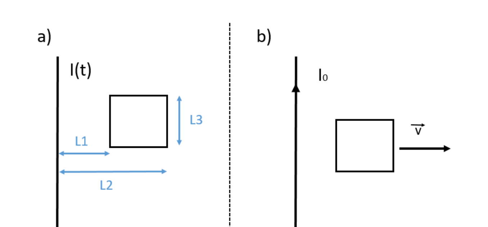
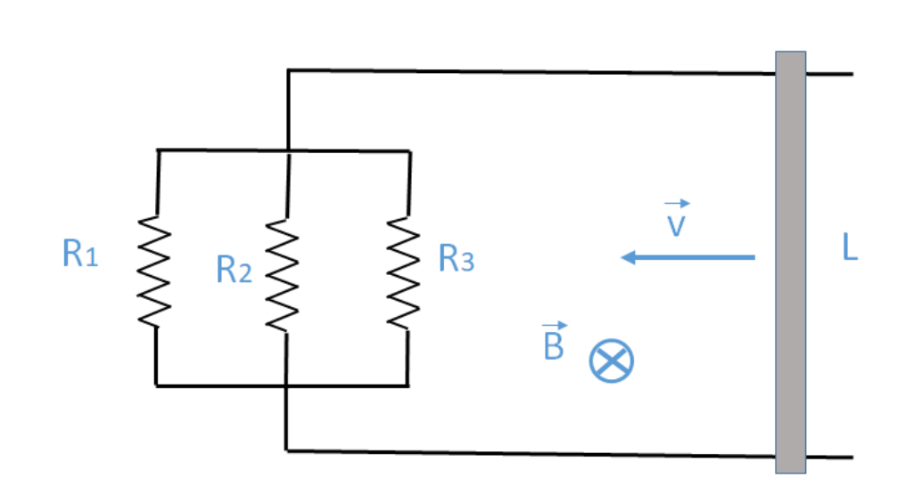
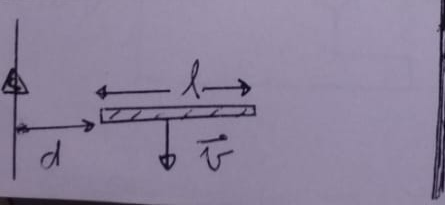

# Guía de ejercicios del 2º Parcial · Unidad 6: Inducción magnética

Ejercicios 27 a 44 de la guía, de fácil a parcial. Cómo usarla, los niveles (🟢 🟡 🔴) y la composición de los parciales están en el [índice](guia-de-ejercicios.md).

[← Unidad 5](guia-de-ejercicios-5-magnetostatica.md) · [Índice de la guía de ejercicios](guia-de-ejercicios.md) · [Unidad 7 →](guia-de-ejercicios-7-alterna.md)

---

Un flujo magnético que cambia induce una tensión (Faraday). Se empieza por el flujo y la ley de Faraday con números simples, se sigue con barras que se mueven, espiras junto a hilos e inductancias, y se termina con los ejercicios de parcial. Usa los campos de la unidad 5.

---

### Ejercicio 27

**Nivel:** 🟢 Concepto · **Fuente:** ejercicio propio · **Tipo de la guía de resolución:** [8. Bobina en un campo que varía con el tiempo](guia-de-resolucion.md#8-bobina-en-un-campo-que-var%C3%ADa-con-el-tiempo)

Una espira cuadrada de 10 cm de lado está en un campo magnético uniforme de 0,4 T. Calcule el flujo magnético a través de la espira si:

a) el campo es perpendicular al plano de la espira;

b) el campo forma 60° con la normal (perpendicular) a la espira;

c) el campo es paralelo al plano de la espira.

<b>Solución</b>

Solución paso a paso

**Qué piden, en palabras.**

- Una espira (cable cerrado) cuadrada de $0{,}1\times0{,}1$ m, dentro de un campo de 0,4 T que se va inclinando.
- El flujo en tres orientaciones.

**La idea, desde cero.** El **flujo magnético** $\phi$ mide cuánto campo "atraviesa" una superficie. Pensalo como la cantidad de lluvia que entra por una ventana: depende de cuán fuerte llueve ($B$), del tamaño de la ventana ($A$) y de la inclinación. Si la lluvia cae de frente entra toda; si cae rasante, no entra nada. La definición general es una integral de superficie:

$$\phi = \iint\vec B\cdot d\vec A$$

donde $d\vec A$ es un vector perpendicular a cada pedacito de superficie, de módulo igual a su área. El producto escalar $\vec B\cdot d\vec A = B\ dA\cos\theta$ se queda solo con la parte del campo que atraviesa la superficie ($\theta$ = ángulo entre $\vec B$ y la normal).

**Deducción del flujo uniforme** (atajo: $\phi = BA\cos\theta$). Si $\vec B$ es el mismo en toda la espira y la espira es plana, $B$ y $\cos\theta$ salen de la integral:

$$\phi = \iint B\cos\theta\ dA = B\cos\theta\iint dA = BA\cos\theta$$

La unidad es T m² = Wb (weber).

**Paso 1 — Área.** $A = 0{,}1\cdot0{,}1 = 0{,}01$ m².

#### Ítem a)

**Paso 2 — Perpendicular.** El campo es paralelo a la normal: $\theta = 0$, $\cos0 = 1$.

$$\phi = 0{,}4\cdot0{,}01 = 4\times10^{-3}\ \text{Wb}$$

#### Ítem b)

**Paso 3 — A 60°.** $\cos60^\circ = 0{,}5$: $\phi = 2\times10^{-3}$ Wb.

#### Ítem c)

**Paso 4 — Paralelo al plano.** El campo es perpendicular a la normal: $\theta = 90^\circ$, $\cos90^\circ = 0$. $\phi = 0$: el campo "pasa de costado" y no atraviesa la espira.

**Respuesta:** a) $4\times10^{-3}$ Wb; b) $2\times10^{-3}$ Wb; c) 0.

---

### Ejercicio 28

**Nivel:** 🟢 Concepto · **Fuente:** ejercicio propio · **Tipo de la guía de resolución:** [8. Bobina en un campo que varía con el tiempo](guia-de-resolucion.md#8-bobina-en-un-campo-que-var%C3%ADa-con-el-tiempo)

Una bobina de 50 vueltas y 20 cm² de área, con resistencia total de 4 Ω, está quieta en un campo magnético uniforme perpendicular a sus vueltas y entrante (⊗). El campo crece de manera uniforme desde 0,1 T hasta 0,5 T en 0,2 s.

a) Calcule la fem inducida.

b) Calcule la corriente.

c) Indique el sentido de la corriente (horario o antihorario, visto desde el lector).

<b>Solución</b>

Solución paso a paso

**Qué piden, en palabras.**

- Una bobina (muchas vueltas de cable) quieta; lo que cambia es el campo, que crece.
- **a)** La tensión que aparece. **b)** La corriente que circula. **c)** Para qué lado gira esa corriente.

**La idea, desde cero.** **Ley de Faraday:** si cambia el flujo magnético que atraviesa un circuito, aparece en él una tensión llamada **fem inducida**, igual a la rapidez con que cambia ese flujo:

$$\mathcal E = -N\frac{d\phi}{dt}$$

($N$ = número de vueltas: cada vuelta aporta su fem y se suman, como pilas en serie). Si el circuito está cerrado, circula corriente $I = \mathcal E/R$ (ley de Ohm), sin ninguna pila. El signo menos es la **ley de Lenz**: la corriente inducida circula de modo de **oponerse al cambio** de flujo. Si el flujo crece, genera campo en contra; si decrece, genera campo a favor.

Acá la bobina no se mueve; el flujo cambia porque cambia $B$.

**Deducción de la fem** (atajo: $\lvert\mathcal E\rvert = NA\left\lvert\dfrac{dB}{dt}\right\rvert$). El campo es uniforme y perpendicular, así que el flujo por cada vuelta es $\phi = \iint\vec B\cdot d\vec A = B(t)\ A$. Con $N$ vueltas y $A$ fija, derivando:

$$\lvert\mathcal E\rvert = N\left\lvert\frac{d(BA)}{dt}\right\rvert = NA\left\lvert\frac{dB}{dt}\right\rvert$$

Si $B$ crece "de manera uniforme" (lineal), la derivada es constante: $\dfrac{dB}{dt} = \dfrac{\Delta B}{\Delta t}$.

**Paso 1 — Rapidez de cambio del campo.**

$$\frac{dB}{dt} = \frac{0{,}5 - 0{,}1}{0{,}2}\ \tfrac{\text{T}}{\text{s}} = 2\ \tfrac{\text{T}}{\text{s}}$$

#### Ítem a)

**Paso 2 — Fem.** $A = 20\ \text{cm}^2 = 2\times10^{-3}$ m²:

$$\lvert\mathcal E\rvert = 50\cdot2\times10^{-3}\cdot2\ \text{V} = 0{,}2\ \text{V}$$

#### Ítem b)

**Paso 3 — Corriente.** $I = \mathcal E/R = 0{,}2/4 = 0{,}05$ A.

#### Ítem c)

**Paso 4 — Sentido.** El flujo **entrante crece**. La corriente inducida se opone: produce campo **saliente** dentro de la bobina. Por la mano derecha (dedos siguiendo la corriente, pulgar = campo en el centro), un campo saliente lo produce una corriente **antihoraria**.

**Respuesta:** a) $\lvert\mathcal E\rvert = 0{,}2$ V; b) $I = 0{,}05$ A; c) antihorario.

---

### Ejercicio 29

**Nivel:** 🟢 Concepto · **Fuente:** ejercicio propio · **Tipo de la guía de resolución:** [10. Barra sobre rieles](guia-de-resolucion.md#10-barra-sobre-rieles)

Dos rieles metálicos horizontales y paralelos, separados 0,5 m, están unidos en su extremo izquierdo por una resistencia de 1,5 Ω. Sobre ellos se desliza hacia la derecha, a 3 m/s constantes, una barra metálica perpendicular a los rieles. Todo está en un campo magnético uniforme de 0,2 T entrante (⊗).

a) Calcule la fem inducida.

b) Calcule la corriente y su sentido de circulación.

<b>Solución</b>

Solución paso a paso

**Qué piden, en palabras.**

- Rieles + resistencia + barra forman un rectángulo cerrado. La barra se aleja de la resistencia, así que el rectángulo se agranda.
- **a)** La tensión que aparece. **b)** La corriente y para qué lado circula.

**La idea, desde cero.** **Ley de Faraday:** si cambia el flujo magnético que atraviesa un circuito, aparece en él una tensión llamada **fem inducida**, igual a la rapidez con que cambia ese flujo:

$$\mathcal E = -N\frac{d\phi}{dt}$$

($N$ = número de vueltas: cada vuelta aporta su fem y se suman, como pilas en serie). Si el circuito está cerrado, circula corriente $I = \mathcal E/R$ (ley de Ohm), sin ninguna pila. El signo menos es la **ley de Lenz**: la corriente inducida circula de modo de **oponerse al cambio** de flujo. Si el flujo crece, genera campo en contra; si decrece, genera campo a favor.

Acá el campo es fijo; lo que cambia es el **área** del circuito, porque la barra se mueve. La barra funciona como una pila: es el único lugar donde "se genera" la tensión.

**Deducción de la fem** (atajo: $\mathcal E = B\ell v$). Sea $x$ la distancia de la barra a la resistencia. El rectángulo tiene área $\ell x$ y, con $B$ uniforme y perpendicular, $\phi = B\ell x$. Derivando ($B$ y $\ell$ fijos, $dx/dt = v$):

$$\lvert\mathcal E\rvert = \left\lvert\frac{d(B\ell x)}{dt}\right\rvert = B\ell\frac{dx}{dt} = B\ell v$$

**Otra forma, mirando la barra** (sale lo mismo). Los electrones libres de la barra se mueven con ella a velocidad $\vec v$, así que sienten la fuerza magnética $q\ \vec v\times\vec B$, que los empuja a lo largo de la barra. Eso hace de un campo eléctrico $\vec v\times\vec B$, de módulo $vB$ (porque $\vec v\perp\vec B$). La fem es su integral a lo largo de la barra:

$$\mathcal E = \int_0^\ell(\vec v\times\vec B)\cdot d\vec l = \int_0^\ell vB\ dl = B\ell v\ ✓$$

#### Ítem a)

**Paso 1 — Fem.**

$$\mathcal E = 0{,}2\cdot0{,}5\cdot3\ \text{V} = 0{,}3\ \text{V}$$

#### Ítem b)

**Paso 2 — Corriente.** $I = \mathcal E/R = 0{,}3/1{,}5 = 0{,}2$ A.

**Paso 3 — Sentido.** El área crece y el flujo **entrante crece**. La corriente inducida produce campo saliente adentro del rectángulo: sentido **antihorario**. Con la barra a la derecha, eso es: sube por la barra y baja por la resistencia. Control con $\vec v\times\vec B$: $\vec v = v\hat x$, $\vec B = -B\hat z$, $\hat x\times(-\hat z) = \hat y$: empuja las cargas positivas **hacia arriba** en la barra ✓.

**Respuesta:** a) $\mathcal E = 0{,}3$ V; b) $I = 0{,}2$ A, en sentido antihorario (hacia arriba por la barra).

---

### Ejercicio 30

**Nivel:** 🟡 Práctica · **Fuente:** [Práctica de Inducción magnética, Ej. 10](../6%20-%20Inducci%C3%B3n%20Magn%C3%A9tica/practica.md#ejercicio-10) (enunciado textual de la guía de la cátedra) · **Tipo de la guía de resolución:** [10. Barra sobre rieles](guia-de-resolucion.md#10-barra-sobre-rieles)

La barra metálica de la figura desliza idealmente en contacto con un cuadro metálico en presencia de un campo magnético externo uniforme $\vec B = 0{,}5T\ (-\hat e_z)$. La resistencia eléctrica del conjunto es de 0,2 Ω, *L*=0,5m y velocidad de la barra es uniforme y vale $\vec v = 4\ m/seg\ (\hat e_x)$.

a) calcule el valor de la fem inducida;

b) indique y justifique el sentido de circulación de la corriente inducida;

c) calcule el valor de la fuerza externa que se requiere para mantener la velocidad constante;

d) calcule la potencia que se disipa por efecto Joule y compárela con la desarrollada por la fuerza externa.

<b>Solución</b>

Solución paso a paso

**Qué piden, en palabras.**

- Una barra de 0,5 m desliza a 4 m/s sobre un marco metálico, en un campo entrante de 0,5 T. Resistencia total 0,2 Ω.
- **a)** La fem. **b)** El sentido de la corriente. **c)** La fuerza externa para mantener la velocidad. **d)** La potencia disipada en calor, comparada con la de la fuerza externa.

**La idea, desde cero.** **Fem de movimiento:** cuando un conductor se mueve dentro de un campo magnético, sus cargas libres se mueven con él y sienten la fuerza $q\ \vec v\times\vec B$, que las empuja a lo largo del conductor. Eso equivale a una pila: la fem es $\mathcal E = \int(\vec v\times\vec B)\cdot d\vec l$ a lo largo del conductor. Para una barra recta de largo $L$, perpendicular al campo y a la velocidad, da $BLv$. Es lo mismo que Faraday: la barra va cambiando el área del circuito, y $\dfrac{d(BLx)}{dt} = BLv$. La barra con corriente dentro del campo siente $i\ \vec\ell\times\vec B$, que la frena (Lenz). Para que vaya a velocidad constante, alguien tiene que empujar con una fuerza igual y opuesta. La energía se conserva: el trabajo por segundo del que empuja ($Fv$) termina convertido en calor en la resistencia ($i^2R$).

**Deducción de la fuerza sobre la barra** (atajo: $F = iLB$). Sobre cada pedacito de barra con corriente actúa $d\vec F = i\ d\vec l\times\vec B$. $i$ y $\vec B$ son constantes a lo largo de la barra, así que sumando queda $\vec F = i\ \vec L\times\vec B$, de módulo $iLB$ (la barra es perpendicular al campo). Con $i = \mathcal E/R = BLv/R$: $F = \dfrac{B^2L^2v}{R}$.

**Deducción de las potencias** (atajos: $P_{ext} = Fv$, $P_{Joule} = i^2R$). La potencia de una fuerza es fuerza por velocidad (trabajo por segundo): $Fv = \dfrac{B^2L^2v^2}{R}$. La potencia que se convierte en calor en la resistencia es $\mathcal Ei = i^2R = \dfrac{(BLv)^2}{R}$. Son iguales: la energía que pone el que empuja termina toda como calor.

**Resolución.**

#### Ítem a)

**Paso 1 — Fem.** La barra es perpendicular a $\vec B$ y a $\vec v$:

$$\mathcal E = BLv = 0{,}5\cdot0{,}5\cdot4\ \text{V} = 1\ \text{V}$$

#### Ítem b)

**Paso 2 — Sentido.** El área del circuito (y el flujo **entrante**) crece, así que la corriente genera campo saliente: sentido **antihorario**.

#### Ítem c)

**Paso 3 — Corriente y fuerza.**

$$i = \frac{\mathcal E}{R} = \frac{1}{0{,}2} = 5\ \text{A} \qquad F = iLB = \frac{B^2L^2v}{R} = 5\cdot0{,}5\cdot0{,}5 = 1{,}25\ \text{N}$$

La fuerza magnética frena la barra ($-\hat e_x$); para mantener la velocidad, la externa tiene que ser igual y opuesta: $\vec F = 1{,}25$ N $\hat e_x$.

#### Ítem d)

**Paso 4 — Potencias.**

$$P_{Joule} = i^2R = 5^2\cdot0{,}2 = 5\ \text{W} \qquad P_{ext} = Fv = 1{,}25\cdot4 = 5\ \text{W}$$

Son iguales, $\dfrac{B^2L^2v^2}{R}$: toda la energía que pone el que empuja termina como calor.

**Respuesta:** a) $\mathcal E = 1$ V; b) la corriente inducida circula en sentido antihorario; c) $\vec F = 1{,}25$ N $\hat e_x$; d) $P = 5$ W (igual a la potencia de la fuerza externa).

---

### Ejercicio 31

**Nivel:** 🟡 Práctica · **Fuente:** [Práctica de Inducción magnética, Ej. 1](../6%20-%20Inducci%C3%B3n%20Magn%C3%A9tica/practica.md#ejercicio-1) (enunciado textual de la guía de la cátedra) · **Tipo de la guía de resolución:** [9. Espira junto a un hilo: flujo con integral](guia-de-resolucion.md#9-espira-junto-a-un-hilo-flujo-con-integral)

Por el conductor recto de la figura circula una corriente de 10A. Para los valores ab=cd=5cm; bc=da=2cm; L=1cm

a) calcule el valor del flujo que atraviesa a la espira abcd;

b) discuta si al invertir la corriente se modifica el resultado anterior;

c) calcule el valor del flujo que atraviesa a la espira abcd, pero suponiendo ahora que el lado bc es el que está enfrentado al cable;

d) suponga que en la situación (a) la superficie de la espira se redujera a la mitad ¿el flujo cambia a la mitad o depende de la manera geométrica en que se reduce la superficie?

<b>Solución</b>

Solución paso a paso

**Qué piden, en palabras.**

- Un hilo recto con 10 A y, en el mismo plano, una espira rectangular de 5 cm × 2 cm, con su lado más cercano a 1 cm del hilo.
- **a)** El flujo a través de la espira. **b)** Si cambia al invertir la corriente. **c)** El flujo si la espira se gira y queda enfrentado el lado corto. **d)** Si al achicar la espira a la mitad el flujo también se reduce a la mitad.

**La idea, desde cero.** El **flujo magnético** mide cuánto campo atraviesa una superficie: si el campo es uniforme y perpendicular, es $B\cdot\text{área}$. El campo de un hilo infinito a distancia $x$ es $B = \dfrac{\mu_0 i}{2\pi x}$ (de Ampère, con una circunferencia de radio $x$: $B\cdot2\pi x = \mu_0 i$). No es uniforme: es más fuerte cerca del hilo. Por eso el flujo a través de una espira rectangular coplanar no es "$B$ por el área": se corta la espira en tiras paralelas al hilo, de ancho $dx$ y largo $c$, en cada una de las cuales $B$ es constante, y se suma: $\phi = \displaystyle\int_{x_1}^{x_2}\frac{\mu_0 i}{2\pi x}c\ dx = \frac{\mu_0 ic}{2\pi}\ln\frac{x_2}{x_1}$.

**Resolución.**

**Paso 1 — Por qué hay que integrar.** El campo del hilo, $B = \dfrac{\mu_0 i}{2\pi x}$, no es uniforme: depende de la distancia $x$. Se divide la espira en tiras paralelas al hilo, de ancho $dx$ y largo $c$ (el lado paralelo al hilo); en cada tira $B$ es constante.

$$\phi = \int_a^{a+b}\frac{\mu_0 i}{2\pi x}\ c\ dx = \frac{\mu_0 i c}{2\pi}\ln\left(\frac{a + b}{a}\right)$$

#### Ítem a)

**Paso 2.** El lado enfrentado al hilo es ab (5 cm, paralelo), a $a = L = 1$ cm, y la espira se extiende $b = 2$ cm:

$$\phi = \frac{4\pi\times10^{-7}\cdot10\cdot0{,}05}{2\pi}\ln\left(\frac{3}{1}\right)\ \text{Wb} = 10^{-7}\cdot1{,}0986\ \text{Wb} = 1{,}1\times10^{-7}\ \text{Wb}$$

#### Ítem b)

**Paso 3.** Si se invierte la corriente, $\vec B$ cambia de sentido y el flujo cambia de signo. Pero el signo depende de la orientación elegida para $d\vec S$, que también se puede invertir: el **módulo** no cambia.

#### Ítem c)

**Paso 4.** Ahora el lado paralelo al hilo es bc ($c = 2$ cm) y la espira se extiende $b = 5$ cm, desde $a = 1$ cm hasta 6 cm:

$$\phi = \frac{4\pi\times10^{-7}\cdot10\cdot0{,}02}{2\pi}\ln6\ \text{Wb} = 4\times10^{-8}\cdot1{,}792\ \text{Wb} = 7{,}17\times10^{-8}\ \text{Wb}$$

#### Ítem d)

**Paso 5.** Como $B$ no es uniforme, el flujo depende de **qué parte** del área se quita. Si se reduce el lado paralelo al hilo a la mitad, el flujo se reduce a la mitad; si se acorta la dimensión perpendicular, no (las partes cercanas al hilo pesan más).

**Respuesta:** a) $\phi = 1{,}1\times10^{-7}$ Wb; b) el valor no se modifica porque también puede invertirse $d\vec S$; c) $\phi = 7{,}17\times10^{-8}$ Wb; d) depende de la manera geométrica en que se reduce el área.

---

### Ejercicio 32

**Nivel:** 🟡 Práctica · **Fuente:** [Práctica de Inducción magnética, Ej. 20](../6%20-%20Inducci%C3%B3n%20Magn%C3%A9tica/practica.md#ejercicio-20) (enunciado textual de la guía de la cátedra) · **Tipo de la guía de resolución:** [9. Espira junto a un hilo: flujo con integral](guia-de-resolucion.md#9-espira-junto-a-un-hilo-flujo-con-integral)

A una distancia *d*= 25cm de un alambre recto infinito por el que circula una corriente *i* (t) se encuentra una bobina cuadrada de 100 vueltas y lado *a*=10cm.

a) para *i* (t) = 0,3 (1−e−βt) A (β=0,1 seg−1) y la espira en reposo respecto del alambre, calcule el valor absoluto de la fem inducida en función del tiempo e indique el sentido de circulación de la corriente inducida en la espira;

b) estime el tiempo que transcurre hasta que se anula la fem;

c) calcule el valor absoluto de la fem inducida en función de la posición e indique el sentido de circulación de la corriente inducida en la espira para *i*(t) = *i0* constante y la espira acercándose al alambre con velocidad constante *v*.

<b>Solución</b>

Solución paso a paso

**Qué piden, en palabras.**

- Un hilo y, a 25 cm, una bobina cuadrada de 100 vueltas y 10 cm de lado.
- **a)** Con la corriente $0{,}3(1 - e^{-\beta t})$ y la bobina quieta: fem y sentido. **b)** Cuándo se anula la fem. **c)** Con la corriente fija y la bobina acercándose a velocidad $v$: fem y sentido.

**La idea, desde cero.** **Ley de Faraday:** si cambia el flujo magnético que atraviesa un circuito, aparece en él una tensión (fem inducida) igual a la rapidez con que cambia ese flujo, $\mathcal E = -\dfrac{d\phi}{dt}$ (por $N$ si hay $N$ vueltas). Si el circuito está cerrado, circula corriente, $i = \mathcal E/R$, sin necesidad de pila. El **flujo** es cuánto campo atraviesa la superficie del circuito: $\phi = \iint\vec B\cdot d\vec A$, que con un campo uniforme y perpendicular es simplemente $B\cdot\text{área}$. **Lenz** da el sentido: la corriente inducida circula de modo de oponerse al cambio. Si el flujo crece, genera campo en contra; si decrece, genera campo a favor. El campo de un hilo infinito a distancia $x$ es $B = \dfrac{\mu_0 i}{2\pi x}$ (de Ampère, con una circunferencia de radio $x$: $B\cdot2\pi x = \mu_0 i$). No es uniforme: es más fuerte cerca del hilo. Por eso el flujo a través de una espira rectangular coplanar no es "$B$ por el área": se corta la espira en tiras paralelas al hilo, de ancho $dx$ y largo $c$, en cada una de las cuales $B$ es constante, y se suma: $\phi = \displaystyle\int_{x_1}^{x_2}\frac{\mu_0 i}{2\pi x}c\ dx = \frac{\mu_0 ic}{2\pi}\ln\frac{x_2}{x_1}$. El flujo puede cambiar porque cambia la corriente (se deriva respecto de $t$) o porque cambia la distancia (regla de la cadena con $dx/dt = -v$).

**Resolución.**

**Paso 1 — Flujo.** Bobina de $N$ vueltas, lado paralelo $a$, desde $x$ hasta $x + a$:

$$\phi = N\frac{\mu_0 i a}{2\pi}\ln\left(\frac{x + a}{x}\right)$$

#### Ítem a)

**Paso 2 (espira quieta en $x = d$).**

$$|\mathcal E| = N\frac{\mu_0 a}{2\pi}\ln\left(\frac{d + a}{d}\right)\frac{di}{dt} \qquad \frac{di}{dt} = 0{,}3\ \beta\ e^{-\beta t}$$

$$|\mathcal E| = 100\cdot2\times10^{-7}\cdot0{,}1\cdot\ln(1{,}4)\cdot0{,}03\ e^{-\beta t}\ \text{V} = 2\times10^{-8}e^{-\beta t}\ \text{V}$$

Sentido: la corriente baja por el cable, así que a la derecha el campo es saliente, y **crece**. La corriente inducida genera campo entrante: sentido **horario**.

#### Ítem b)

**Paso 3.** $e^{-\beta t}$ es prácticamente nula para $\beta t \sim 5$, es decir $t\sim5/\beta = 50$ s. A partir de ahí la corriente es constante y la fem se anula.

#### Ítem c)

**Paso 4 (espira que se acerca).** Ahora cambia $x$, con $dx/dt = -v$:

$$\frac{d}{dx}\ln\left(\frac{x + a}{x}\right) = \frac{1}{x + a} - \frac1x = -\frac{a}{x(x + a)}$$

$$|\mathcal E| = N\frac{\mu_0 i_0 a}{2\pi}\ \frac{1}{a + x}\left(\frac ax\right)v$$

Al acercarse, el flujo saliente crece: sentido **horario**.

**Respuesta:**

- a) $|\mathcal E| = 2\times10^{-8}e^{-\beta t}$ V; la corriente inducida circula en sentido horario porque tiende a generar un flujo que disminuya el flujo externo, que crece.
- b) La función $e^{-\beta t}$ se hace prácticamente nula para $\beta t\sim5$, de modo tal que la corriente se hace constante en $t\sim5/\beta = 50$ s y, con $i$ constante, se anula la fem inducida.
- c) $|\mathcal E| = N\dfrac{\mu_0 i_0 a}{2\pi}\dfrac{1}{a + x}\left(\dfrac ax\right)v$; la corriente inducida circula en sentido horario porque tiende a generar un flujo que disminuya el flujo externo, que crece porque la espira se acerca al alambre.

---

### Ejercicio 33

**Nivel:** 🟡 Práctica · **Fuente:** ejercicio propio · **Tipo de la guía de resolución:** [11. Barra que se mueve junto a un hilo](guia-de-resolucion.md#11-barra-que-se-mueve-junto-a-un-hilo)

Por un hilo recto vertical muy largo circula una corriente de 10 A hacia arriba. A su derecha hay una barra metálica horizontal de 20 cm, perpendicular al hilo, cuyo extremo más cercano está a 2 cm del hilo. La barra se mueve hacia arriba (paralela al hilo) a 5 m/s.

a) Calcule la diferencia de potencial entre los extremos de la barra.

b) ¿Cuál de los dos extremos está a mayor potencial?

<b>Solución</b>

Solución paso a paso

**Qué piden, en palabras.**

- Una barra suelta (no forma un circuito) que se mueve dentro del campo del hilo.
- **a)** La tensión entre sus puntas. **b)** Cuál punta queda "positiva".

**La idea, desde cero.** Cuando un metal se mueve dentro de un campo magnético, sus cargas libres se mueven con él y sienten la fuerza $q\ \vec v\times\vec B$. Esa fuerza las empuja a lo largo de la barra: se acumulan cargas positivas en una punta y negativas en la otra, y aparece una diferencia de potencial, como en una pila. No circula corriente porque no hay circuito. Esa tensión es la **fem de movimiento**: la integral de $\vec v\times\vec B$ (que hace de campo eléctrico) a lo largo de la barra.

La dificultad es que el campo del hilo **no es uniforme**: es más fuerte cerca del hilo. Cada pedacito de barra empuja con distinta fuerza, y por eso hay que integrar.

**Deducción del campo del hilo** (atajo: $B = \dfrac{\mu_0 I}{2\pi r}$). Ampère sobre una circunferencia de radio $r$ centrada en el hilo: $B\cdot2\pi r = \mu_0 I$.

**Deducción de la fem** (atajo: $\mathcal E = \dfrac{\mu_0 Iv}{2\pi}\ln\dfrac{d + \ell}{d}$). La velocidad es paralela al hilo y el campo es perpendicular al plano, así que $\vec v\perp\vec B$ y $\vec v\times\vec B$ tiene módulo $vB(r)$ y apunta a lo largo de la barra. Integrando desde $r = d$ hasta $r = d + \ell$:

$$\mathcal E = \int_d^{d + \ell}v\ \frac{\mu_0 I}{2\pi r}\ dr = \frac{\mu_0 Iv}{2\pi}\int_d^{d + \ell}\frac{dr}{r} = \frac{\mu_0 Iv}{2\pi}\ln\frac{d + \ell}{d}$$

#### Ítem a)

**Paso 1 — Valor.** $d = 0{,}02$ m, $d + \ell = 0{,}22$ m, $\dfrac{\mu_0}{2\pi} = 2\times10^{-7}$:

$$\mathcal E = 2\times10^{-7}\cdot10\cdot5\cdot\ln11\ \text{V} = 10^{-5}\cdot2{,}398\ \text{V} = 2{,}40\times10^{-5}\ \text{V} = 24\ \mu\text{V}$$

#### Ítem b)

**Paso 2 — Polaridad.** Ejes: $\hat x$ a la derecha, $\hat y$ hacia arriba, $\hat z$ saliente. A la derecha del hilo el campo es entrante, $\vec B = -B\hat z$. La barra sube, $\vec v = v\hat y$:

$$\vec v\times\vec B = vB\ \hat y\times(-\hat z) = -vB\ \hat x$$

Empuja las cargas positivas hacia $-\hat x$, o sea **hacia el hilo**. El extremo **más cercano** al hilo queda a mayor potencial.

**Respuesta:** a) $\mathcal E = 24\ \mu\text{V}$; b) el extremo más cercano al hilo.

---

### Ejercicio 34

**Nivel:** 🟡 Práctica · **Fuente:** [Práctica de Inducción magnética, Ej. 8](../6%20-%20Inducci%C3%B3n%20Magn%C3%A9tica/practica.md#ejercicio-8) (enunciado textual de la guía de la cátedra) · **Tipo de la guía de resolución:** [12. Barra que gira](guia-de-resolucion.md#12-barra-que-gira)

La barra metálica de longitud *L* de la figura gira con velocidad angular constante ω solidaria al pivote *P*, sumergida en un campo magnético uniforme $\vec B = B_0\ (-\hat e_z)$.

a) halle la expresión de la fem inducida en la barra;

b) indique el sentido de circulación que tendría la corriente inducida en la barra.

<b>Solución</b>

Solución paso a paso

**Qué piden, en palabras.**

- Una barra de largo $L$ gira con velocidad angular $\omega$ alrededor de un pivote P, en un campo uniforme entrante.
- **a)** La fem entre sus extremos. **b)** El sentido de la corriente inducida.

**La idea, desde cero.** **Fem de movimiento:** cuando un conductor se mueve dentro de un campo magnético, sus cargas libres se mueven con él y sienten la fuerza $q\ \vec v\times\vec B$, que las empuja a lo largo del conductor. Eso equivale a una pila: la fem es $\mathcal E = \int(\vec v\times\vec B)\cdot d\vec l$ a lo largo del conductor. Para una barra recta de largo $L$, perpendicular al campo y a la velocidad, da $BLv$. Es lo mismo que Faraday: la barra va cambiando el área del circuito, y $\dfrac{d(BLx)}{dt} = BLv$. Acá cada punto de la barra va a distinta velocidad: el que está a distancia $r$ del pivote se mueve con $v = \omega r$. Por eso hay que integrar a lo largo de la barra.

**Resolución.**

#### Ítem a)

**Paso 1 — Velocidad de cada punto.** Un punto a distancia $r$ del pivote tiene $\vec v = \omega r\ \hat e_\phi$ (gira en sentido antihorario).

**Paso 2 — $\vec v\times\vec B$.** Con $\hat e_\phi\times(-\hat e_z) = -\hat e_R$:

$$\vec v\times\vec B = \omega rB_0\ (-\hat e_R)$$

Apunta **hacia el pivote**.

**Paso 3 — Fem de movimiento.**

$$|\mathcal E| = \int_0^L\omega rB_0\ dr = \frac{B_0L^2\omega}{2}$$

(También sale con el flujo: el área barrida es $\tfrac12\omega L^2t$.)

#### Ítem b)

**Paso 4 — Sentido.** El "campo" $\vec v\times\vec B$ empuja las cargas positivas hacia P: la corriente inducida circularía en sentido radial **entrante**, hacia el pivote.

**Respuesta:** a) $\mathcal E = B_0L^2\omega/2$; b) en sentido radial entrante, hacia el pivote P.

---

### Ejercicio 35

**Nivel:** 🟡 Práctica · **Fuente:** [Práctica de Inducción magnética, Ej. 16](../6%20-%20Inducci%C3%B3n%20Magn%C3%A9tica/practica.md#ejercicio-16) (enunciado textual de la guía de la cátedra) · **Tipo de la guía de resolución:** [13. Autoinductancia e inductancia mutua de solenoides](guia-de-resolucion.md#13-autoinductancia-e-inductancia-mutua-de-solenoides)

Por una bobina de 2 cm de radio y 40 cm de longitud, que tiene arrolladas 2000 vueltas de alambre, circula una corriente *i* (t)=*2 sen (100π t)*. Calcule: a) el valor del coeficiente de autoinducción *L* de la bobina; b) la fem autoinducida en función del tiempo.

<b>Solución</b>

Solución paso a paso

**Qué piden, en palabras.**

- Una bobina de radio 2 cm, largo 40 cm y 2000 vueltas, con corriente $i(t) = 2\sin(100\pi t)$.
- **a)** Su coeficiente de autoinducción $L$. **b)** La fem autoinducida en función del tiempo.

**La idea, desde cero.** Una bobina con corriente produce campo, y ese campo atraviesa sus propias vueltas. La **autoinductancia** $L$ es el flujo propio total por cada ampere: $N\phi = Li$. Para un solenoide largo, adentro $B = \mu_0\frac N\ell i$ (Ampère), y cada vuelta tiene flujo $B\pi r^2$, así que $L = \dfrac{N\cdot\mu_0\frac N\ell i\cdot\pi r^2}{i} = \dfrac{\mu_0N^2\pi r^2}{\ell}$. Si la corriente cambia, el flujo propio cambia y, por Faraday, aparece la fem autoinducida $\mathcal E = -L\ di/dt$.

**Deducción del campo del solenoide** (atajo: $B = \mu_0\dfrac N\ell i$). Ampère con un rectángulo con un lado de largo $\ell'$ adentro (paralelo al eje) y el opuesto afuera: adentro aporta $B\ell'$, afuera $B\approx0$, y los lados perpendiculares no aportan. Encierra $\frac N\ell\ell'$ vueltas: $B\ell' = \mu_0\frac N\ell\ell' i$.

**Deducción de la fem autoinducida** (atajo: $\mathcal E = -L\dfrac{di}{dt}$). Faraday aplicado a la propia bobina: $\mathcal E = -\dfrac{d(N\phi)}{dt} = -\dfrac{d(Li)}{dt} = -L\dfrac{di}{dt}$, con $L$ constante. Para $i = 2\ \mathrm{sen}\ (100\pi t)$: $\dfrac{di}{dt} = 200\pi\cos(100\pi t)$.

**Resolución.**

#### Ítem a)

**Paso 1 — Inductancia.** Se aproxima por solenoide largo ($40\ \text{cm} \gg 2\ \text{cm}$):

$$L = \mu_0\frac{N^2}{\ell}\pi r^2 = 4\pi\times10^{-7}\cdot\frac{2000^2}{0{,}4}\cdot\pi\cdot0{,}02^2\ \text{H} = 15{,}8\ \text{mH}$$

#### Ítem b)

**Paso 2 — Fem autoinducida.** Derivando $i = 2\ \mathrm{sen}\ (100\pi t)$:

$$\mathcal E = -L\frac{di}{dt} = -L\cdot2\cdot100\pi\cos(100\pi t) \qquad \lvert\mathcal E(t)\rvert = 200\pi\cdot0{,}0158\cos(100\pi t) = 9{,}92\cos(100\pi t)\ \text{V}$$

**Respuesta:** a) $L = 15{,}8$ mH; b) $\mathcal E(t) = 200\pi L\cos(100\pi t)$ (en módulo, ≈ 9,9 V × cos(100πt))

---

### Ejercicio 36

**Nivel:** 🟡 Práctica · **Fuente:** ejercicio propio · **Tipo de la guía de resolución:** [13. Autoinductancia e inductancia mutua de solenoides](guia-de-resolucion.md#13-autoinductancia-e-inductancia-mutua-de-solenoides)

Un solenoide largo de 50 cm, 4 cm de radio y 1000 vueltas tiene en su interior, con el mismo eje y el mismo largo, otro solenoide de 2 cm de radio y 400 vueltas.

a) Calcule la inductancia mutua entre ambos.

b) Si la corriente del solenoide exterior aumenta a razón de 100 A/s, ¿cuánto vale la fem inducida en el interior?

<b>Solución</b>

Solución paso a paso

**Qué piden, en palabras.**

- Dos bobinas largas, una adentro de la otra.
- **a)** La inductancia mutua $M$: cuánto flujo produce una en la otra por cada ampere. **b)** La tensión que aparece en la de adentro cuando cambia la corriente de la de afuera.

**La idea, desde cero.** Un solenoide es un alambre enrollado en hélice sobre un cilindro. Con corriente, adentro produce un campo uniforme y paralelo al eje (como un imán), y afuera casi nada. Si hay dos bobinas, el campo de una atraviesa las vueltas de la otra. La **inductancia mutua** $M$ es la constante que relaciona la corriente de una con el flujo total en la otra:

$$N_1\phi_{1\leftarrow2} = M\ I_2$$

Si $I_2$ cambia, ese flujo cambia y, por Faraday, aparece una fem en la bobina 1: $\mathcal E_1 = -M\dfrac{dI_2}{dt}$. Así funciona un transformador.

**Deducción del campo del solenoide** (atajo: $B = \mu_0 nI$, con $n = N/\ell$). Ampère sobre un rectángulo con un lado de largo $\ell'$ adentro, paralelo al eje, y el lado opuesto afuera. Adentro $\vec B\parallel d\vec l$ y aporta $B\ell'$; afuera $B\approx0$; en los lados perpendiculares $\vec B\perp d\vec l$. El rectángulo encierra $n\ell'$ vueltas con corriente $I$ cada una:

$$\oint\vec B\cdot d\vec l = B\ell' = \mu_0 n\ell' I \quad\Rightarrow\quad B = \mu_0 nI$$

**Deducción de M** (atajo: $M = \dfrac{\mu_0 N_1N_2\pi r_1^2}{\ell}$). El campo del exterior, $B_2 = \mu_0\dfrac{N_2}{\ell}I_2$, llena todo su interior y atraviesa cada una de las $N_1$ vueltas del solenoide de adentro por su área $\pi r_1^2$ (el área del grande que queda afuera del chico no cuenta, porque no es parte de las vueltas del chico):

$$M = \frac{N_1\ B_2\ \pi r_1^2}{I_2} = \frac{N_1\cdot\mu_0\dfrac{N_2}{\ell}I_2\cdot\pi r_1^2}{I_2} = \frac{\mu_0 N_1N_2\pi r_1^2}{\ell}$$

Va siempre el radio **menor**.

#### Ítem a)

**Paso 1 — Valor.**

$$M = \frac{4\pi\times10^{-7}\cdot400\cdot1000\cdot\pi\cdot0{,}02^2}{0{,}5}\ \text{H} = 1{,}26\times10^{-3}\ \text{H} = 1{,}26\ \text{mH}$$

#### Ítem b)

**Paso 2 — Fem.**

$$\lvert\mathcal E_1\rvert = M\frac{dI_2}{dt} = 1{,}26\times10^{-3}\cdot100\ \text{V} = 0{,}126\ \text{V}$$

**Respuesta:** a) $M = 1{,}26$ mH; b) $\lvert\mathcal E\rvert = 0{,}126$ V.

---

### Ejercicio 37

**Nivel:** 🟡 Práctica · **Fuente:** ejercicio propio · **Tipo de la guía de resolución:** [14. Solenoide: campo, inductancia, energía y longitud](guia-de-resolucion.md#14-solenoide-campo-inductancia-energ%C3%ADa-y-longitud)

Un solenoide de 25 cm de largo y 1 cm de radio tiene 500 vueltas y lleva una corriente de 4 A.

a) Calcule su autoinductancia.

b) Calcule la energía magnética que guarda a partir de su autoinductancia.

c) Calcule el campo en su interior y verifique la energía usando la densidad de energía magnética (energía por unidad de volumen).

<b>Solución</b>

Solución paso a paso

**Qué piden, en palabras.**

- Una bobina larga con corriente.
- **a)** Su autoinductancia $L$. **b)** La energía guardada. **c)** La misma energía calculada de otra forma, a partir del campo.

**La idea, desde cero.** Una bobina con corriente produce un campo que atraviesa sus propias vueltas: tiene un flujo propio. Si la corriente cambia, ese flujo cambia y, por Faraday, aparece en la misma bobina una fem que se opone al cambio (**autoinducción**). La **autoinductancia** $L$ es el flujo propio total por cada ampere: $N\phi = LI$. Para hacer crecer la corriente hay que vencer esa oposición, y la energía que eso cuesta queda guardada en el campo magnético. Se recupera al apagar la corriente.

**Deducción del campo** (atajo: $B = \mu_0 nI$). Ampère con un rectángulo con un lado $\ell'$ adentro y el opuesto afuera: solo aporta el lado de adentro, $B\ell' = \mu_0 n\ell' I$.

**Deducción de L** (atajo: $L = \dfrac{\mu_0 N^2\pi r^2}{\ell}$). Cada vuelta tiene flujo $\phi = B\pi r^2$, con $B = \mu_0\dfrac N\ell I$:

$$L = \frac{N\phi}{I} = \frac{N\cdot\mu_0\dfrac N\ell I\cdot\pi r^2}{I} = \frac{\mu_0 N^2\pi r^2}{\ell}$$

**Deducción de la energía** (atajo: $U = \tfrac12LI^2$). Mientras la corriente crece, la fuente tiene que vencer la fem autoinducida, de módulo $L\dfrac{di}{dt}$. La potencia que entrega es tensión por corriente, $L\dfrac{di}{dt}i$, y la energía es su integral en el tiempo. Cambiando la variable a $i$ (de 0 a $I$):

$$U = \int L\ i\ \frac{di}{dt}\ dt = \int_0^IL\ i\ di = \tfrac12LI^2$$

**Deducción de la densidad** (atajo: $u = \dfrac{B^2}{2\mu_0}$). Reemplazando $L$ y despejando con $B = \mu_0\dfrac N\ell I$:

$$U = \tfrac12\cdot\frac{\mu_0N^2\pi r^2}{\ell}I^2 = \frac{(\mu_0 NI/\ell)^2}{2\mu_0}\cdot\pi r^2\ell = \frac{B^2}{2\mu_0}\cdot\text{volumen}$$

La energía está repartida en el volumen interior, con $\dfrac{B^2}{2\mu_0}$ joules por metro cúbico.

#### Ítem a)

**Paso 1 — L.**

$$L = \frac{4\pi\times10^{-7}\cdot500^2\cdot\pi\cdot0{,}01^2}{0{,}25}\ \text{H} = 3{,}95\times10^{-4}\ \text{H} = 0{,}395\ \text{mH}$$

#### Ítem b)

**Paso 2 — Energía.** $U = \tfrac12\cdot3{,}95\times10^{-4}\cdot4^2 = 3{,}16\times10^{-3}$ J = 3,16 mJ.

#### Ítem c)

**Paso 3 — Campo y control.** $n = 500/0{,}25 = 2000$ m⁻¹:

$$B = 4\pi\times10^{-7}\cdot2000\cdot4\ \text{T} = 0{,}0101\ \text{T} \qquad u = \frac{B^2}{2\mu_0} = 40{,}2\ \tfrac{\text{J}}{\text{m}^3}$$

Volumen: $\pi\cdot0{,}01^2\cdot0{,}25 = 7{,}85\times10^{-5}$ m³. $U = 40{,}2\cdot7{,}85\times10^{-5} = 3{,}16\times10^{-3}$ J ✓.

**Respuesta:** a) $L = 0{,}395$ mH; b) $U = 3{,}16$ mJ; c) $B = 0{,}0101$ T, y $\dfrac{B^2}{2\mu_0}\cdot\text{vol} = 3{,}16$ mJ ✓.

---

### Ejercicio 38

**Nivel:** 🔴 Parcial · **Fuente:** [Simulacro del 2º Parcial (sin fecha), Ej. 2](simulacro-2do-parcial.md#ejercicio-2) (enunciado textual) · **Tipo de la guía de resolución:** [8. Bobina en un campo que varía con el tiempo](guia-de-resolucion.md#8-bobina-en-un-campo-que-var%C3%ADa-con-el-tiempo)

**Probabilidad de que aparezca uno parecido:** ≈ 10 % · el tipo 8 apareció en solo en el simulacro ([cómo se calcula](guia-de-ejercicios.md#composición-de-los-parciales)).

Un alambre de longitud 5 m se enrolla para formar una bobina circular de área 2,21 x 10-3 m2. La bobina es sumergida en un campo magnético perpendicular al plano que la contiene, y cuya intensidad varía en el tiempo según la ley:

B(t) = a t2 + b t4 [T],

donde a y b son coeficientes. Sabiendo que la resistencia de la bobina es de 5Ω, y que la corriente que circula por ella satisface I(t=1 s) = 0,3 A; I(t=2 s) = 0,05 A, determinar los valores de a y b.

<b>Solución</b>

Solución paso a paso

**Qué piden, en palabras.**

- Con 5 m de alambre se arma una bobina circular de área $2{,}21\times10^{-3}$ m². No dicen cuántas vueltas tiene: sale de la geometría.
- El campo es perpendicular a la bobina y cambia con el tiempo como $B(t) = at^2 + bt^4$. Resistencia de la bobina: 5 Ω.
- **Datos:** la corriente vale 0,3 A en $t = 1$ s y 0,05 A en $t = 2$ s.
- **Qué piden:** $a$ y $b$.
- **Plan:** calcular el número de vueltas, escribir la corriente $I(t)$ y plantear dos ecuaciones con dos incógnitas.

**La idea, desde cero.** **Ley de Faraday:** si cambia el campo magnético que atraviesa un circuito, aparece en el circuito una tensión (fem inducida) y, si el circuito está cerrado, circula corriente. No hace falta ninguna pila: así funcionan los generadores y los transformadores. Cuanto más rápido cambia el flujo, mayor es la fem. Una bobina de $N$ vueltas es como $N$ espiras en serie, así que la fem se multiplica por $N$.

**La idea, aplicada a este ejercicio.**

La bobina está quieta y el campo crece con el tiempo, como $at^2 + bt^4$. El flujo por cada vuelta es $B$ por el área, y hay $N$ vueltas. Al cambiar el flujo aparece una fem igual a la rapidez con que cambia, o sea la derivada de $NAB(t)$. Esa fem empuja corriente por la resistencia de 5 Ω, según la ley de Ohm. La derivada tiene a $a$ y a $b$, y la corriente es dato en dos instantes: quedan dos ecuaciones lineales con dos incógnitas.

**N.** $r = \sqrt{A/\pi} = 2{,}652$ cm, perímetro $2\pi r = 0{,}1666$ m, $N = 5/0{,}1666 = 30$ vueltas. Entonces $NA = 0{,}0663$ m².

**Deducción de la corriente** (atajo: $I = \dfrac{NA}{R}\dfrac{dB}{dt}$). El campo es uniforme y perpendicular a cada vuelta, así que la integral de superficie del flujo se reduce a un producto: $\phi = \displaystyle\iint\vec B\cdot d\vec A = B(t)\ A$. Con $N$ vueltas el flujo total es $NB(t)A$. Faraday, con $N$ y $A$ fijos:

$$\lvert\mathcal E\rvert = \left\lvert\frac{d(NAB)}{dt}\right\rvert = NA\left\lvert\frac{dB}{dt}\right\rvert$$

y la corriente sale de la ley de Ohm, $I = \mathcal E/R$.

**Corriente.** Derivando $B(t) = at^2 + bt^4$:

$$I(t) = \frac{NA}{R}\ \frac{dB}{dt} = \frac{NA}{R}(2at + 4bt^3)$$

**Sistema.**

$$t = 1:\ 2a + 4b = \frac{0{,}3\cdot5}{0{,}0663} = 22{,}62 \qquad t = 2:\ 4a + 32b = \frac{0{,}05\cdot5}{0{,}0663} = 3{,}771$$

Restando dos veces la primera a la segunda: $24b = -41{,}48$, así que $b = -1{,}73$ T/s⁴ y $a = 14{,}77$ T/s².

**Respuesta:** $a = 14{,}77$ T/s² y $b = -1{,}73$ T/s⁴.

---

### Ejercicio 39

**Nivel:** 🔴 Parcial · **Fuente:** [2º Recuperatorio del 2º Parcial — 19/02/2021, Ej. 3](2021-02-19-2do-recuperatorio-2do-parcial.md#ejercicio-3) (enunciado textual) · **Tipo de la guía de resolución:** [9. Espira junto a un hilo: flujo con integral](guia-de-resolucion.md#9-espira-junto-a-un-hilo-flujo-con-integral)

**Probabilidad de que aparezca uno parecido:** ≈ 15 % · el tipo 9 apareció en 2 de los 10 exámenes, la última vez el 25/11/2021 ([cómo se calcula](guia-de-ejercicios.md#composición-de-los-parciales)).

En la figura el hilo es muy largo, y la corriente por el mismo varía en el tiempo según la ley I(t) = I0 sen (ωt). **a)** Determine la fem inducida en la espira. **b)** Suponga ahora que la corriente en el hilo se mantiene constante en el tiempo con valor I0, y que la espira parte de la posición inicial anterior y se aleja del hilo con velocidad constante de módulo 5 cm/s. Determinar la fem inducida en la espira. **c)** Suponga que la espira es conductora, con resistencia 3Ω. Determinar, para el caso del ítem anterior, la corriente inducida en la espira, indicando el sentido de circulación. **Datos:** L1=12 cm, L2=20 cm, L3=15 cm, I0=3 A, ω=5π 1/s, μ0=4π x 10-7 Tm/A.

<b>Solución</b>

Solución paso a paso

**Qué piden, en palabras.**

- Hilo vertical. A su derecha, en el mismo plano, una espira rectangular. Su lado cercano está a $L_1 = 12$ cm del hilo, el lejano a $L_2 = 20$ cm, y los lados paralelos al hilo miden $L_3 = 15$ cm.
- **a)** La corriente del hilo oscila, $I(t) = 3\ \mathrm{sen}\ (5\pi t)$, y la espira está quieta: fem en la espira.
- **b)** La corriente es fija, 3 A, pero la espira se aleja del hilo a 5 cm/s: fem en el instante inicial.
- **c)** Para el caso b), con una espira de 3 Ω: corriente y su sentido (horario o antihorario).

**La idea, desde cero.** Igual que en el tipo anterior, un flujo que cambia induce una fem. La diferencia es que el campo del hilo no es el mismo en toda la espira: es más fuerte cerca del hilo. Por eso el flujo no es "$B$ por el área" sino una integral. El flujo puede cambiar de dos formas:

- cambia la corriente del hilo, y con ella el campo;
- la espira se aleja del hilo y pasa a una zona de campo más débil.

**La idea, aplicada a este ejercicio.**

El hilo produce a su derecha un campo entrante, más fuerte cerca del hilo (a 12 cm) que lejos (a 20 cm). Para el flujo se corta la espira en franjas verticales muy finas, en cada una de las cuales el campo es parejo. Sumar (integrar) las franjas da un logaritmo.

- **a)** Si la corriente oscila, el campo y el flujo oscilan con ella, y la fem es la derivada.
- **b)** Si la espira se aleja, pasa a zonas de campo más débil, el flujo baja y también hay fem.
- **c)** Lenz: el flujo entrante baja, así que la corriente inducida trata de "reponerlo" generando campo entrante dentro de la espira. Eso es sentido horario.

La espira va de $x = L_1$ a $x = L_2$, con lado paralelo $L_3$.

**Deducción del flujo** (atajo: $\phi = \dfrac{\mu_0 Ic}{2\pi}\ln\dfrac{x_2}{x_1}$). El campo del hilo a distancia $x$ es $B(x) = \dfrac{\mu_0 I}{2\pi x}$ (Ampère sobre una circunferencia de radio $x$: $B\cdot2\pi x = \mu_0 I$) y es perpendicular al plano de la espira. No es uniforme, pero es constante a lo largo de cada franja paralela al hilo. Se toma como elemento de área una franja de largo $L_3$ y ancho $dx$, $dA = L_3\ dx$, y la integral de superficie queda simple:

$$\phi = \iint\vec B\cdot d\vec A = \int_{L_1}^{L_2}\frac{\mu_0 I}{2\pi x}\ L_3\ dx = \frac{\mu_0 IL_3}{2\pi}\ln\frac{L_2}{L_1}$$

#### Ítem a)

Solo varía $I$. Por Faraday, $\lvert\mathcal E\rvert = \left\lvert\dfrac{d\phi}{dt}\right\rvert$, con la geometría fija y $\dfrac{dI}{dt} = I_0\omega\cos(\omega t)$:

$$\lvert\mathcal E\rvert = \frac{\mu_0L_3}{2\pi}\ln\frac{L_2}{L_1}\ I_0\omega\cos(\omega t) = 2\times10^{-7}\cdot0{,}15\cdot0{,}511\cdot3\cdot5\pi\cos(5\pi t)\ \text{V} = 7{,}2\times10^{-7}\cos(5\pi t)\ \text{V}$$

#### Ítem b)

Ahora $I = I_0$ fija y se mueve la espira. Con $b = L_2 - L_1 = 0{,}08$ m y $x(t) = L_1 + vt$, el flujo es la misma integral entre $x$ y $x + b$. Se deriva con la regla de la cadena, usando $\dfrac{d}{dt}\ln\dfrac{x + b}{x} = \left(\dfrac{1}{x + b} - \dfrac1x\right)\dfrac{dx}{dt}$:

$$\phi = \frac{\mu_0 I_0L_3}{2\pi}\ln\frac{x + b}{x} \quad\Rightarrow\quad \lvert\mathcal E\rvert = \frac{\mu_0 I_0L_3}{2\pi}\left(\frac{1}{x} - \frac{1}{x + b}\right)v = \frac{\mu_0 I_0L_3}{2\pi}\ \frac{bv}{x(x + b)}$$

En $t = 0$: $\lvert\mathcal E\rvert = 2\times10^{-7}\cdot3\cdot0{,}15\cdot\dfrac{0{,}08\cdot0{,}05}{0{,}12\cdot0{,}20}\ \text{V} = 1{,}5\times10^{-8}$ V.

#### Ítem c)

$I = \mathcal E/R = 5\times10^{-9}$ A. Sentido: a la derecha del hilo (corriente hacia arriba) el campo es entrante; al alejarse, el flujo entrante disminuye; la corriente inducida lo refuerza → **horario**.

**Respuesta:** a) $\lvert\mathcal E\rvert = 7{,}2\times10^{-7}\cos(5\pi t)$ V; b) $\lvert\mathcal E\rvert = 1{,}5\times10^{-8}$ V; c) $I = 5\times10^{-9}$ A, en sentido horario.

---

### Ejercicio 40

**Nivel:** 🔴 Parcial · **Fuente:** [2º Parcial — 03/12/2020, Ej. 3](2020-12-03-2do-parcial.md#ejercicio-3) (enunciado textual) · **Tipo de la guía de resolución:** [10. Barra sobre rieles](guia-de-resolucion.md#10-barra-sobre-rieles)

**Probabilidad de que aparezca uno parecido:** ≈ 25 % · el tipo 10 apareció en 2 de los 10 exámenes, la última vez el 27/11/2025 ([cómo se calcula](guia-de-ejercicios.md#composición-de-los-parciales)).

La barra de longitud L=11 cm se desplaza con velocidad constante hacia la izquierda y de módulo 15 m/s, sobre rieles conductores, en presencia de un campo magnético entrante y uniforme de módulo B=3 T. No hay rozamiento. Determine: **a)** Valor y sentido de circulación de la corriente inducida, y **b)** Módulo, dirección y sentido de la fuerza magnética y de la fuerza del agente externo que actúan sobre la barra. R1=5Ω, R2=2Ω, R3=6Ω.

<b>Solución</b>

Solución paso a paso

**Qué piden, en palabras.**

- Barra de 11 cm que se mueve hacia la izquierda a 15 m/s.
- Campo entrante de 3 T.
- Tres resistencias (5, 2 y 6 Ω) conectan los rieles.
- **a)** Corriente inducida: valor y sentido.
- **b)** Fuerza magnética sobre la barra, y fuerza que tiene que hacer el agente externo para mantener la velocidad constante. Las dos con módulo, dirección y sentido.

**La idea, desde cero.** Hay dos rieles metálicos paralelos, unidos en un extremo por resistencias, y una barra metálica apoyada sobre ellos que se desliza. Rieles, barra y resistencias forman un circuito cerrado cuya área cambia cuando se mueve la barra. Con un campo magnético perpendicular, el flujo cambia y se induce una fem: la barra funciona como una pila y circula corriente.

Además, la barra con corriente está dentro de un campo magnético, así que siente una fuerza, y esa fuerza siempre se opone al movimiento (es la ley de Lenz). Para mantener la velocidad constante, alguien (el "agente externo") tiene que empujar la barra con una fuerza igual y opuesta.

**La idea, aplicada a este ejercicio.**

Rieles, barra y resistencias forman un rectángulo. La barra va hacia la izquierda y el área encerrada se achica, así que el flujo del campo entrante baja y aparece la fem $B\ell v$. La barra hace de pila. Lo que conecta sus extremos son las tres resistencias, las tres entre los mismos dos rieles, o sea en paralelo.

La corriente que circula por la barra está dentro del campo, así que recibe una fuerza, y esa fuerza la frena: apunta hacia la derecha. Como la barra va a velocidad constante, la fuerza total sobre ella es cero, así que el agente externo empuja con la misma fuerza hacia la izquierda.

**Deducción de la fem** (atajo: $\mathcal E = B\ell v$). El circuito es el rectángulo formado por los rieles, la barra y el tramo con resistencias. Si $x$ es la distancia de la barra a ese tramo, el área es $\ell x$ y, con $B$ uniforme y perpendicular, $\phi = B\ell x$. Faraday:

$$\lvert\mathcal E\rvert = \left\lvert\frac{d(B\ell x)}{dt}\right\rvert = B\ell\left\lvert\frac{dx}{dt}\right\rvert = B\ell v$$

#### Ítem a)

$$\mathcal E = B\ell v = 3\cdot0{,}11\cdot15\ \text{V} = 4{,}95\ \text{V}$$

Las tres resistencias están en paralelo entre los rieles (las tres tienen la tensión $\mathcal E$ y las corrientes se suman, así que $\dfrac{1}{R_{eq}} = \sum\dfrac{1}{R_i}$):

$$R_{eq} = \left(\frac15 + \frac12 + \frac16\right)^{-1}\ \Omega = 1{,}154\ \Omega \qquad I = \frac{4{,}95}{1{,}154}\ \text{A} = 4{,}29\ \text{A}$$

Sentido: la barra va hacia la izquierda, el área encerrada se achica y el flujo entrante disminuye. La corriente inducida lo refuerza → **horaria** (en la barra, hacia abajo). Comprobación: $\vec v\times\vec B = (-\hat x)\times(-\hat z) = -\hat y$, hacia abajo ✓.

#### Ítem b)

*Deducción de la fuerza sobre la barra* (atajo: $\vec F = I\vec\ell\times\vec B$). Se integra $d\vec F = I\ d\vec l\times\vec B$ a lo largo de la barra. Como $I$ y $\vec B$ son constantes, salen de la integral y queda $\displaystyle\int d\vec l = \vec\ell$, el vector que va de un extremo al otro en el sentido de la corriente. Acá $\vec\ell = -\ell\hat y$:

$$\vec F_M = I\vec\ell\times\vec B = 4{,}29\cdot0{,}11\cdot3\ \big((-\hat y)\times(-\hat z)\big)\ \text{N} = 1{,}42\ \text{N}\ \hat x$$

Hacia la derecha: frena la barra. El agente externo hace $1{,}42$ N hacia la izquierda.

**Respuesta:** a) $\mathcal E = 4{,}95$ V e $I = 4{,}29$ A, en sentido horario (hacia abajo en la barra); b) $\vec F_M = 1{,}42$ N hacia la derecha (frena), y el agente externo hace 1,42 N hacia la izquierda.

---

### Ejercicio 41

**Nivel:** 🔴 Parcial · **Fuente:** [1er Recuperatorio del 2º Parcial — 12/12/2024, Ej. 4](2024-12-12-1er-recuperatorio-2do-parcial.md#ejercicio-4) (enunciado textual) · **Tipo de la guía de resolución:** [11. Barra que se mueve junto a un hilo](guia-de-resolucion.md#11-barra-que-se-mueve-junto-a-un-hilo)

**Probabilidad de que aparezca uno parecido:** ≈ 25 % · el tipo 11 apareció en 2 de los 10 exámenes, la última vez el 12/12/2024 ([cómo se calcula](guia-de-ejercicios.md#composición-de-los-parciales)).

Un hilo muy largo transporta una corriente I=3A. Una barra conductora de longitud l=10 cm se mueve en dirección paralela al hilo, con velocidad de módulo 20 m/s y de sentido opuesto al de circulación de la corriente. La distancia entre el hilo y el extremo más próximo de la barra es d=5 cm. Determinar la diferencia de potencial inducida entre los extremos de la barra. Justificar cuál se halla a mayor potencial.

<b>Solución</b>

Solución paso a paso

**Qué piden, en palabras.**

- Hilo con 3 A.
- Barra de 10 cm perpendicular al hilo, con su extremo más cercano a 5 cm.
- La barra se mueve paralela al hilo a 20 m/s, en sentido contrario al de la corriente.
- **Qué piden:** la diferencia de potencial entre los extremos de la barra, y cuál de los dos está a mayor potencial.

**La idea, desde cero.** Una barra metálica se mueve dentro de un campo magnético. Sus electrones libres se mueven con ella, así que sienten la fuerza $q\ \vec v\times\vec B$, que los empuja a lo largo de la barra. Se acumula carga negativa en un extremo y queda carga positiva en el otro: aparece una diferencia de potencial entre los extremos, como en una pila. No circula corriente porque no hay circuito cerrado.

Como el campo del hilo es más fuerte cerca del hilo, cada pedazo de barra empuja a las cargas con distinta intensidad. Por eso hay que integrar a lo largo de la barra.

**La idea, aplicada a este ejercicio.**

La barra está a la derecha del hilo, dentro de su campo entrante, y baja, en contra de la corriente. Sus cargas bajan con ella, y la fuerza $q\ \vec v\times\vec B$ las empuja a lo largo de la barra: a las positivas, alejándolas del hilo. Se acumulan cargas positivas en el extremo lejano, que queda a mayor potencial. Cerca del hilo el campo es más fuerte y empuja más. Por eso la fem es una integral a lo largo de la barra, que da un logaritmo.

**Deducción** (atajo: $\mathcal E = \dfrac{\mu_0 Iv}{2\pi}\ln\dfrac{d + \ell}{d}$). No hay circuito cerrado, así que se usa la fem de movimiento: sobre cada carga de la barra actúa $q\ \vec v\times\vec B$, que equivale a un campo eléctrico $\vec v\times\vec B$, y la fem es su integral de línea a lo largo de la barra. El campo del hilo a distancia $r$ es $\dfrac{\mu_0 I}{2\pi r}$ (Ampère: $B\cdot2\pi r = \mu_0 I$). $\vec v$ es paralela al hilo y $\vec B$ es perpendicular al plano, así que $\vec v\perp\vec B$ y $\vec v\times\vec B$ tiene módulo $vB$ y apunta a lo largo de la barra. Entonces:

$$\mathcal E = \int_d^{d + \ell}(\vec v\times\vec B)\cdot d\vec r = \int_d^{d + \ell}\frac{\mu_0 Iv}{2\pi r}\ dr = \frac{\mu_0 Iv}{2\pi}\ln\frac{d + \ell}{d}$$

Con los datos:

$$\mathcal E = 2\times10^{-7}\cdot3\cdot20\cdot\ln\frac{15}{5}\ \text{V} = 13{,}2\ \mu\text{V}$$

Polaridad: hilo con corriente hacia arriba, barra a su derecha → $\vec B = -B\hat z$. La barra va hacia abajo: $\vec v\times\vec B = (-\hat y)\times(-\hat z) = \hat x$. Las cargas positivas se van al extremo **más lejano del hilo**, que queda a mayor potencial.

**Respuesta:** $\mathcal E = 13{,}2\ \mu\text{V}$; el extremo más lejano del hilo está a mayor potencial.

---

### Ejercicio 42

**Nivel:** 🔴 Parcial · **Fuente:** [2º Parcial — 20/11/2015, Ej. 3](2015-11-20-2do-parcial.md#ejercicio-3) (enunciado textual) · **Tipo de la guía de resolución:** [12. Barra que gira](guia-de-resolucion.md#12-barra-que-gira)

**Probabilidad de que aparezca uno parecido:** ≈ 10 % · el tipo 12 apareció en 1 de los 10 exámenes, la última vez el 20/11/2015 ([cómo se calcula](guia-de-ejercicios.md#composición-de-los-parciales)).

Una barra conductora de longitud 45 cm y extremos P y Q, gira en sentido horario alrededor del punto O de la barra, situado a una distancia de 15 cm del extremo P. Existe un campo magnético uniforme, saliente respecto del plano de la hoja. Sabiendo que ω=8 1/s y B=0,3 T, determine la diferencia de tensión entre P y Q. Justifique cuál de ellos se halla a mayor potencial.

<b>Solución</b>

Solución paso a paso

**Qué piden, en palabras.**

- Barra de 45 cm, con extremos P y Q, que gira en sentido horario alrededor de un punto O de la barra. O está a 15 cm de P, y por lo tanto a 30 cm de Q.
- Campo saliente de 0,3 T; $\omega = 8$ rad/s.
- **Qué piden:** $V_P - V_Q$, y cuál de los dos extremos está a mayor potencial.

**La idea, desde cero.** Es la misma idea que la barra junto al hilo, pero ahora el campo es uniforme y lo que cambia de un punto a otro es la **velocidad**: al girar, los puntos lejos del eje se mueven más rápido ($v = \omega r$). Si el eje está en un punto interior de la barra, la barra son dos mitades que giran. Cada mitad empuja las cargas hacia el eje (o las dos hacia afuera), y lo que interesa es la diferencia de potencial entre los dos extremos.

**La idea, aplicada a este ejercicio.**

La barra gira alrededor de O. Las dos mitades, OP (15 cm) y OQ (30 cm), giran con la misma $\omega$, pero los puntos de OQ llegan más lejos y van más rápido. En cada mitad, la fuerza magnética empuja las cargas positivas hacia O (sale de $\vec v\times\vec B$). Entonces O es el punto de mayor potencial, y el potencial baja hacia cada extremo: poco hacia P y más hacia Q. La diferencia entre P y Q es la resta de esas dos caídas. P está más cerca de O, cae menos y queda más alto.

$OP = 0{,}15$ m y $OQ = 0{,}30$ m.

**Deducción de la fem de cada mitad** (atajo: $\mathcal E = \tfrac12B\omega r_0^2$). Fem de movimiento: el punto de la barra a distancia $r$ de O se mueve con $v = \omega r$, perpendicular a la barra y a $\vec B$, así que $\lvert\vec v\times\vec B\rvert = \omega rB$, a lo largo de la barra. Integrando desde O hasta el extremo, a distancia $r_0$:

$$\mathcal E = \int_0^{r_0}\omega rB\ dr = \tfrac12B\omega r_0^2$$

(Por Faraday sale lo mismo: en un tiempo $t$ la mitad barre un sector de ángulo $\omega t$ y área $\tfrac12r_0^2\omega t$, así que $\phi = \tfrac12Br_0^2\omega t$ y $\dfrac{d\phi}{dt} = \tfrac12B\omega r_0^2$.)

Sentido: con la barra sobre $+\hat x$ y giro horario, $\vec v = -\omega r\hat y$ y $\vec v\times\vec B = (-\hat y)\times\hat z\cdot\omega rB = -\omega rB\ \hat x$: apunta **hacia O**. Lo mismo pasa en la otra mitad. O queda al mayor potencial y el potencial cae hacia cada extremo:

$$V_O - V_P = \tfrac12\cdot0{,}3\cdot8\cdot0{,}15^2 = 0{,}027\ \text{V} \qquad V_O - V_Q = \tfrac12\cdot0{,}3\cdot8\cdot0{,}30^2 = 0{,}108\ \text{V}$$

$$V_P - V_Q = 0{,}108 - 0{,}027 = 0{,}081\ \text{V}$$

P (el más cercano al eje) está a mayor potencial.

**Respuesta:** $V_P - V_Q = 0{,}081$ V; P está a mayor potencial.

---

### Ejercicio 43

**Nivel:** 🔴 Parcial · **Fuente:** [1er Recuperatorio del 2º Parcial — 09/12/2021, Ej. 2](2021-12-09-1er-recuperatorio-2do-parcial.md#ejercicio-2) (enunciado textual) · **Tipo de la guía de resolución:** [13. Autoinductancia e inductancia mutua de solenoides](guia-de-resolucion.md#13-autoinductancia-e-inductancia-mutua-de-solenoides)

**Probabilidad de que aparezca uno parecido:** ≈ 15 % · el tipo 13 apareció en 2 de los 10 exámenes, la última vez el 18/02/2022 ([cómo se calcula](guia-de-ejercicios.md#composición-de-los-parciales)).

Un solenoide de radio 2 cm y longitud 60 cm tiene arrolladas 3000 vueltas de alambre. **a)** Determine el coeficiente de autoinducción del solenoide. Justifique la fórmula utilizada. **b)** Se dispone al solenoide de forma coaxial con otro solenoide de la misma longitud, radio 3 cm y 2000 vueltas de alambre. ¿Cuál es la inductancia mutua? Justifique la fórmula utilizada.

<b>Solución</b>

Solución paso a paso

**Qué piden, en palabras.**

- Solenoide de radio 2 cm, largo 60 cm y 3000 vueltas.
- **a)** Su autoinductancia $L$, justificando la fórmula.
- **b)** Otro solenoide del mismo largo, de radio 3 cm y 2000 vueltas, se coloca coaxial con el primero (uno dentro del otro, con el mismo eje). Calcular la inductancia mutua $M$, justificando la fórmula.

**La idea, desde cero.** Una bobina con corriente produce campo magnético, y ese campo atraviesa sus propias vueltas: la bobina tiene un flujo propio. Si la corriente cambia, ese flujo cambia y, por Faraday, se induce una fem **en la misma bobina** que se opone al cambio. Eso es la **autoinducción**. La autoinductancia $L$ mide cuánto flujo propio produce cada ampere.

Si hay dos bobinas, el campo de una atraviesa a la otra, así que un cambio de corriente en una induce fem en la otra. La **inductancia mutua** $M$ mide cuánto flujo produce una bobina en la otra por cada ampere. Así funciona un transformador.

**La idea, aplicada a este ejercicio.**

**a)** El solenoide es 30 veces más largo que su radio, así que se lo trata como infinito: adentro el campo es uniforme y vale $\mu_0NI/\ell$. Ese campo atraviesa cada una de las 3000 vueltas, así que el flujo propio total es $N\cdot B\cdot\text{área}$. Ese flujo es proporcional a $I$, y la constante de proporcionalidad es $L$.

**b)** El solenoide de 2 cm queda dentro del de 3 cm. El campo del grande llena todo su interior, así que también atraviesa las vueltas del chico, pero solo por el área del chico: la parte del grande que queda afuera del chico no cuenta. El flujo en el chico dividido la corriente del grande es $M$.

#### Ítem a)

*Justificación del campo* (atajo: $B = \mu_0\dfrac N\ell I$). 60 cm ≫ 2 cm, así que se trata como solenoide infinito: adentro el campo es uniforme y paralelo al eje, y afuera es despreciable. Ampère sobre un rectángulo con un lado de largo $\ell'$ adentro y el opuesto afuera: solo aporta el lado de adentro y se encierran $\dfrac N\ell\ell'$ vueltas, así que $B\ell' = \mu_0\dfrac N\ell\ell' I$ y $B = \mu_0\dfrac N\ell I$.

*Justificación de L.* Por definición $N\phi = LI$, con $\phi = B\cdot\pi R^2$ el flujo por cada vuelta:

$$L = \mu_0\frac{N^2}{\ell}\pi R^2 = 4\pi\times10^{-7}\cdot\frac{3000^2}{0{,}6}\cdot\pi\cdot0{,}02^2\ \text{H} = 23{,}7\ \text{mH}$$

#### Ítem b)

*Justificación de M.* Por definición $N_1\phi_{1\leftarrow2} = MI_2$: el flujo que la corriente del solenoide 2 produce a través de las vueltas del 1. El solenoide de 3 cm es el exterior. Su campo $B_2 = \mu_0 N_2I_2/\ell$ (mismo Ampère que en a) es uniforme dentro de él, así que atraviesa las $N_1$ vueltas del interior, de área $\pi R_1^2$. (Al revés, el campo del interior solo existe dentro de $R_1$, así que por las vueltas del exterior también pasa solo a través de $\pi R_1^2$: por eso siempre va el radio menor.) Entonces:

$$M = \frac{N_1B_2\pi R_1^2}{I_2} = \frac{\mu_0 N_1N_2\pi R_1^2}{\ell} = \frac{4\pi\times10^{-7}\cdot3000\cdot2000\cdot\pi\cdot0{,}02^2}{0{,}6}\ \text{H} = 15{,}8\ \text{mH}$$

**Respuesta:** a) $L = 23{,}7$ mH; b) $M = 15{,}8$ mH.

---

### Ejercicio 44

**Nivel:** 🔴 Parcial · **Fuente:** [2º Parcial — 28/11/2024, Ej. 3](2024-11-28-2do-parcial.md#ejercicio-3) (enunciado textual) · **Tipo de la guía de resolución:** [14. Solenoide: campo, inductancia, energía y longitud](guia-de-resolucion.md#14-solenoide-campo-inductancia-energ%C3%ADa-y-longitud)

**Probabilidad de que aparezca uno parecido:** ≈ 25 % · el tipo 14 apareció en 2 de los 10 exámenes, la última vez el 28/11/2024 ([cómo se calcula](guia-de-ejercicios.md#composición-de-los-parciales)).

Un solenoide muy largo de radio R=0,8 cm y autoinducción L=2 x 10-5 H transporta una corriente I=18 A. Sabiendo que el módulo del campo magnético en su interior es B=5 x 10-4 T, determinar la longitud del solenoide.

<b>Solución</b>

Solución paso a paso

**Qué piden, en palabras.**

- Solenoide de radio 0,8 cm, con $L = 2\times10^{-5}$ H y corriente de 18 A. El campo adentro es $5\times10^{-4}$ T.
- No dan ni el número de vueltas ni la longitud.
- **Qué piden:** la longitud.
- **Plan:** escribir la energía de dos formas, con $L$ y con $B$, e igualarlas. La longitud es la única incógnita.

**La idea, desde cero.** Un **solenoide** es una bobina larga: alambre enrollado en hélice sobre un cilindro. Adentro el campo es uniforme y paralelo al eje, y afuera es casi cero. El solenoide guarda energía en ese campo: para establecer la corriente hay que vencer la autoinducción, y esa energía queda almacenada (se recupera al cortar la corriente). En este tipo se combinan tres ecuaciones (campo, inductancia y energía) para despejar el dato que no se da.

**La idea, aplicada a este ejercicio.**

El solenoide guarda energía en el campo de su interior, y esa energía se puede escribir de dos formas:

- con la inductancia y la corriente, $\tfrac12LI^2$, que son datos;
- con el campo y el volumen interior, $\dfrac{B^2}{2\mu_0}\pi R^2\ell$, donde la única incógnita es $\ell$.

Igualarlas da $\ell$ directamente, sin necesitar el número de vueltas.

**Deducción de las tres ecuaciones.**

- *Campo* (atajo: $B = \mu_0 nI$). Ampère sobre un rectángulo con un lado de largo $\ell'$ adentro del solenoide, paralelo al eje, y el lado opuesto afuera. Afuera $B\approx0$; en los lados perpendiculares al eje $\vec B\perp d\vec l$. Solo aporta el lado de adentro. El rectángulo encierra $n\ell'$ vueltas, cada una con corriente $I$:

$$\oint\vec B\cdot d\vec l = B\ell' = \mu_0 n\ell' I \quad\Rightarrow\quad B = \mu_0 nI$$

- *Inductancia* (atajo: $L = \mu_0 n^2\pi R^2\ell$). Por definición $N\Phi = LI$. Cada una de las $N = n\ell$ vueltas tiene flujo $B\pi R^2$:

$$L = \frac{N\Phi}{I} = \frac{n\ell\cdot\mu_0 nI\cdot\pi R^2}{I} = \mu_0 n^2\pi R^2\ell$$

- *Energía* (atajo: $U = \tfrac12LI^2 = \dfrac{B^2}{2\mu_0}\cdot\text{volumen}$). Mientras la corriente crece de 0 a $I$, la fuente tiene que vencer la fem autoinducida $L\ di/dt$ (Faraday). La potencia es $L\ i\ \dfrac{di}{dt}$ y su integral en el tiempo es

$$U = \int L\ i\ \frac{di}{dt}\ dt = \int_0^IL\ i\ di = \tfrac12LI^2$$

Reemplazando $L$ y $B$: $\tfrac12\mu_0 n^2\pi R^2\ell\ I^2 = \dfrac{(\mu_0 nI)^2}{2\mu_0}\pi R^2\ell = \dfrac{B^2}{2\mu_0}\pi R^2\ell$.

La forma más directa es igualar las dos expresiones de la energía:

$$\tfrac12LI^2 = \frac{B^2}{2\mu_0}\pi R^2\ell \quad\Rightarrow\quad \ell = \frac{\mu_0 LI^2}{B^2\pi R^2} = \frac{4\pi\times10^{-7}\cdot2\times10^{-5}\cdot18^2}{(5\times10^{-4})^2\cdot\pi\cdot0{,}008^2}\ \text{m} = 162\ \text{m}$$

Verificación por el otro camino: $n = B/(\mu_0 I) = 22{,}1$ m⁻¹ y $\ell = L/(\mu_0 n^2\pi R^2) = 162$ m ✓.

**Respuesta:** $\ell = 162$ m.

---

[← Unidad 5](guia-de-ejercicios-5-magnetostatica.md) · [Índice de la guía de ejercicios](guia-de-ejercicios.md) · [Unidad 7 →](guia-de-ejercicios-7-alterna.md)
