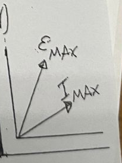

# Guía de ejercicios del 2º Parcial · Unidad 7: Corriente alterna

Ejercicios 45 a 54 de la guía, de fácil a parcial. Cómo usarla, los niveles (🟢 🟡 🔴) y la composición de los parciales están en el [índice](guia-de-ejercicios.md).

[← Unidad 6](guia-de-ejercicios-6-induccion.md) · [Índice de la guía de ejercicios](guia-de-ejercicios.md)

---

Con tensión alterna, cada elemento (R, L, C) relaciona tensión y corriente de una forma distinta. Se empieza por el valor eficaz y las reactancias, se sigue con circuitos RC, RL y RLC y la resonancia, y se termina con los ejercicios de parcial.

---

### Ejercicio 45

**Nivel:** 🟢 Concepto · **Fuente:** ejercicio propio · **Tipo de la guía de resolución:** [15. RLC serie a partir de mediciones](guia-de-resolucion.md#15-rlc-serie-a-partir-de-mediciones)

La tensión de la red domiciliaria es de 220 V eficaces a 50 Hz.

a) ¿Cuál es su valor de pico (amplitud)? Escriba $v(t)$.

b) Se conecta a la red una resistencia de 100 Ω. Calcule la corriente eficaz y la potencia media que consume.

<b>Solución</b>

Solución paso a paso

**Qué piden, en palabras.**

- "220 V" no es el máximo de la tensión del enchufe, sino su **valor eficaz**.
- **a)** El máximo y la fórmula de la tensión en el tiempo. **b)** La corriente y la potencia en una resistencia.

**La idea, desde cero.** Con **corriente alterna** la tensión no es fija: oscila como $v(t) = V_0\ \mathrm{sen}\ (\omega t)$. $V_0$ es la **amplitud** o valor de pico, y $\omega = 2\pi f$ la pulsación, con $f$ la frecuencia (50 Hz en la red de Argentina: 50 oscilaciones por segundo). Como la tensión cambia todo el tiempo, se usa un valor "representativo": el **valor eficaz**, que es la tensión continua que produciría el mismo calor en una resistencia. Se define como la raíz del promedio del cuadrado en un período $T$ (por eso también se llama RMS):

$$V_{EF} = \sqrt{\frac1T\int_0^Tv^2\ dt}$$

Los voltímetros y amperímetros de alterna miden valores eficaces, y "220 V" es el eficaz.

**Deducción del valor eficaz** (atajo: $V_{EF} = V_0/\sqrt2$). Con $\mathrm{sen}^2u = \tfrac12(1 - \cos2u)$:

$$\frac1T\int_0^TV_0^2\ \mathrm{sen}^2(\omega t)\ dt = \frac{V_0^2}{T}\int_0^T\frac{1 - \cos(2\omega t)}{2}\ dt = \frac{V_0^2}{T}\cdot\frac T2 = \frac{V_0^2}{2}$$

porque la integral de $\cos(2\omega t)$ en un período es 0 (es tan positiva como negativa). Entonces $V_{EF} = \sqrt{V_0^2/2} = V_0/\sqrt2$.

**Deducción de la potencia media en una resistencia** (atajo: $P = V_{EF}^2/R = I_{EF}^2R$). La potencia instantánea es $p = vi = v^2/R$. Su promedio en un período:

$$P = \frac1T\int_0^T\frac{v^2}{R}\ dt = \frac1R\cdot\frac1T\int_0^Tv^2\ dt = \frac{V_{EF}^2}{R}$$

Por eso se usa el eficaz: con él las fórmulas son las mismas que en continua.

#### Ítem a)

**Paso 1 — Pico.**

$$V_0 = \sqrt2\cdot220\ \text{V} = 311\ \text{V} \qquad v(t) = 311\ \mathrm{sen}\ (100\pi t)\ \text{V}$$

($\omega = 2\pi\cdot50 = 100\pi$ s⁻¹.)

#### Ítem b)

**Paso 2 — Corriente y potencia.**

$$I_{EF} = \frac{V_{EF}}{R} = \frac{220}{100} = 2{,}2\ \text{A} \qquad P = \frac{220^2}{100} = 484\ \text{W}$$

**Respuesta:** a) $V_0 = 311$ V, $v(t) = 311\ \mathrm{sen}\ (100\pi t)$ V; b) $I_{EF} = 2{,}2$ A y $P = 484$ W.

---

### Ejercicio 46

**Nivel:** 🟢 Concepto · **Fuente:** ejercicio propio · **Tipo de la guía de resolución:** [15. RLC serie a partir de mediciones](guia-de-resolucion.md#15-rlc-serie-a-partir-de-mediciones)

Se tienen una bobina ideal de 0,2 H y un capacitor de 50 μF.

a) Calcule la reactancia de cada uno a 50 Hz y a 100 Hz.

b) Si la bobina sola se conecta a 10 V eficaces de 50 Hz, ¿qué corriente eficaz circula? ¿Está en fase con la tensión?

c) ¿A qué frecuencia las dos reactancias serían iguales?

<b>Solución</b>

Solución paso a paso

**Qué piden, en palabras.**

- La **reactancia** es la "resistencia" de una bobina o un capacitor en alterna: el cociente entre la amplitud de la tensión y la de la corriente.
- **a)** Calcularla para cada elemento a dos frecuencias. **b)** Usarla para obtener una corriente. **c)** Encontrar la frecuencia en la que son iguales.

**La idea, desde cero.** Con **corriente alterna** la tensión no es fija: oscila como $v(t) = V_0\ \mathrm{sen}\ (\omega t)$. $V_0$ es la **amplitud** o valor de pico, y $\omega = 2\pi f$ la pulsación, con $f$ la frecuencia (50 Hz en la red de Argentina: 50 oscilaciones por segundo). Una **bobina** se opone a los *cambios* de corriente: su tensión es $v_L = L\dfrac{di}{dt}$ (es la fem autoinducida). Un **capacitor** acumula carga: su tensión es $v_C = q/C$, con $q = \int i\ dt$. Como una derivada y una integral de un seno dan un coseno, en los dos casos tensión y corriente quedan **desfasadas 90°**, y la relación entre amplitudes depende de la frecuencia.

**Deducción de $X_L$** (atajo: $X_L = \omega L$). Con $i = I_0\ \mathrm{sen}\ (\omega t)$:

$$v_L = L\frac{di}{dt} = L\ I_0\omega\cos(\omega t) = (\omega L)\ I_0\ \mathrm{sen}\ (\omega t + 90^\circ)$$

La amplitud de la tensión es $\omega L$ veces la de la corriente, y la tensión va 90° **adelantada**. $X_L = \omega L$: cuanto más rápido cambia la corriente, más se opone la bobina.

**Deducción de $X_C$** (atajo: $X_C = \dfrac1{\omega C}$). La carga es la integral de la corriente:

$$q = \int I_0\ \mathrm{sen}\ (\omega t)\ dt = -\frac{I_0}{\omega}\cos(\omega t) \quad\Rightarrow\quad v_C = \frac qC = \frac{1}{\omega C}\ I_0\ \mathrm{sen}\ (\omega t - 90^\circ)$$

La tensión va 90° **atrasada** (la corriente adelanta). $X_C = \dfrac1{\omega C}$: a baja frecuencia el capacitor tiene tiempo de llenarse y frena mucho la corriente.

#### Ítem a)

**Paso 1 — Reactancias.** A 50 Hz, $\omega = 100\pi = 314{,}2$ s⁻¹; a 100 Hz, $\omega = 628{,}3$ s⁻¹.

$$X_L(50) = 314{,}2\cdot0{,}2 = 62{,}8\ \Omega \qquad X_C(50) = \frac{1}{314{,}2\cdot50\times10^{-6}} = 63{,}7\ \Omega$$

$$X_L(100) = 125{,}7\ \Omega \qquad X_C(100) = 31{,}8\ \Omega$$

Al duplicar la frecuencia, $X_L$ se duplica y $X_C$ se reduce a la mitad.

#### Ítem b)

**Paso 2 — Corriente en la bobina.** Las amplitudes cumplen $V_0 = X_LI_0$, y dividiendo las dos por $\sqrt2$ vale lo mismo con eficaces:

$$I_{EF} = \frac{V_{EF}}{X_L} = \frac{10}{62{,}8} = 0{,}159\ \text{A}$$

No está en fase: la corriente va 90° atrasada respecto de la tensión.

#### Ítem c)

**Paso 3 — Reactancias iguales.**

$$\omega L = \frac1{\omega C} \quad\Rightarrow\quad \omega = \frac{1}{\sqrt{LC}} = \frac{1}{\sqrt{0{,}2\cdot50\times10^{-6}}} = 316{,}2\ \text{s}^{-1} \quad\Rightarrow\quad f = \frac{\omega}{2\pi} = 50{,}3\ \text{Hz}$$

Es la **frecuencia de resonancia** de un circuito con esta bobina y este capacitor.

**Respuesta:** a) 50 Hz: $X_L = 62{,}8\ \Omega$, $X_C = 63{,}7\ \Omega$; 100 Hz: $X_L = 125{,}7\ \Omega$, $X_C = 31{,}8\ \Omega$. b) $I_{EF} = 0{,}159$ A, atrasada 90°. c) $f = 50{,}3$ Hz.

---

### Ejercicio 47

**Nivel:** 🟡 Práctica · **Fuente:** [Práctica de Corriente alterna, Ej. 1](../7%20-%20Corriente%20Alterna/practica.md#ejercicio-1) (enunciado textual de la guía de la cátedra) · **Tipo de la guía de resolución:** [15. RLC serie a partir de mediciones](guia-de-resolucion.md#15-rlc-serie-a-partir-de-mediciones)

Un generador de corriente alterna que entrega 100V de tensión eficaz a 50 Hz se halla conectado a un circuito RC serie. Por el circuito circula una corriente eficaz *ief*= 0,2 sen (2π50 t + π/3) A.

a) calcule el valor de la impedancia del circuito RC serie;

b) calcule el valor de R y el valor de C;

c) calcule el valor de la tensión eficaz sobre el resistor;

d) calcule el valor de la tensión eficaz sobre el capacitor;

e) calcule el valor de inductancia que debe conectarse en serie al circuito RC serie para que entre en resonancia a frecuencia doble de la de trabajo;

f) calcule la potencia disipada por el circuito RC serie;

g) indique y justifique cuál sería el valor de la caída en la resistencia si el circuito RC estuviera en paralelo;

h) realice el diagrama de fasores correspondientes a los circuitos RC y RLC serie.

<b>Solución</b>

Solución paso a paso

**Qué piden, en palabras.**

- Un generador de 100 V eficaces y 50 Hz alimenta una resistencia y un capacitor en serie. La corriente eficaz es 0,2 A y adelanta 60° ($\pi/3$) a la tensión.
- Piden: **a)** la impedancia, **b)** R y C, **c)** y **d)** la tensión en cada uno, **e)** qué bobina agregar para que resuene al doble de frecuencia, **f)** la potencia, **g)** la tensión en R si estuvieran en paralelo, **h)** los fasores.

**La idea, desde cero.** Con corriente alterna, la tensión y la corriente oscilan como senos: $v = V_0\sin(\omega t)$, con $\omega = 2\pi f$. Cada elemento relaciona tensión y corriente de una forma distinta:

- **Resistencia:** $v = Ri$. Tensión y corriente suben y bajan juntas (en fase).
- **Bobina:** $v = L\ di/dt$. Se opone a los cambios de corriente, y la corriente queda **atrasada** 90°. Su "resistencia" en alterna es la reactancia $X_L = \omega L$: crece con la frecuencia.
- **Capacitor:** $v = q/C$. Tiene que cargarse antes de tener tensión, y la corriente queda **adelantada** 90°. Su reactancia es $X_C = 1/(\omega C)$: crece al bajar la frecuencia.

En serie, la "resistencia total" es la **impedancia** $Z = \sqrt{R^2 + (X_L - X_C)^2}$, y cumple $V = ZI$ (con amplitudes o con valores eficaces). Esto se ve en un triángulo rectángulo con catetos $R$ y $X_L - X_C$ e hipotenusa $Z$. El ángulo $\varphi$ del triángulo es el desfasaje entre tensión y corriente: $\cos\varphi = R/Z$. Si gana la bobina ($X_L > X_C$, **inductivo**), la tensión adelanta; si gana el capacitor (**capacitivo**), adelanta la corriente. **Potencias:** la activa (la que se consume de verdad, solo en la resistencia) es el promedio en un período de $v\cdot i$, que da $P = \tfrac12V_0I_0\cos\varphi = V_{EF}I_{EF}\cos\varphi = I_{EF}^2R$. Los **valores eficaces** son los de pico divididos $\sqrt2$, y son los que miden los instrumentos. La aparente es $S = V_{EF}I_{EF}$ y la reactiva $Q = V_{EF}I_{EF}\sin\varphi$: son los lados del triángulo de impedancias multiplicados por $I_{EF}^2$. **Resonancia:** es la frecuencia en la que $X_L = X_C$, o sea $\omega_0 = 1/\sqrt{LC}$. Ahí bobina y capacitor se cancelan, $Z = R$ es mínima, la corriente es máxima y está en fase con la tensión. Por debajo de $\omega_0$ manda el capacitor; por encima, la bobina.

**Deducción de las reactancias** (atajos: $X_L = \omega L$, $X_C = \dfrac1{\omega C}$). Con $i = I_0\ \mathrm{sen}\ (\omega t)$: la bobina tiene $v_L = L\dfrac{di}{dt} = \omega L\ I_0\cos(\omega t)$, que es amplitud $\omega L\ I_0$ y 90° de adelanto. El capacitor tiene $v_C = \dfrac1C\displaystyle\int i\ dt = -\frac{I_0}{\omega C}\cos(\omega t)$, que es amplitud $\dfrac{I_0}{\omega C}$ y 90° de atraso.

**Deducción de la impedancia** (atajo: $Z = \sqrt{R^2 + (X_L - X_C)^2}$, $\cos\varphi = R/Z$). En serie las tensiones se suman, pero desfasadas: la de R va con la corriente y las de L y C a $\pm90^\circ$, opuestas entre sí. Escribiéndolas como números complejos ($d/dt\to j\omega$, $\int dt\to\frac1{j\omega}$), $v = [R + j(X_L - X_C)]\ i = Z\ i$. El módulo de $Z$ es la hipotenusa de un triángulo de catetos $R$ y $X_L - X_C$, y su ángulo $\varphi$ es el desfasaje.

**Deducción del valor eficaz** (atajo: $V_{EF} = V_0/\sqrt2$). $V_{EF}^2 = \dfrac1T\displaystyle\int_0^TV_0^2\ \mathrm{sen}^2(\omega t)\ dt = \frac{V_0^2}{T}\int_0^T\frac{1 - \cos2\omega t}{2}\ dt = \frac{V_0^2}{2}$.

**Deducción de la potencia media** (atajo: $P = \tfrac12V_0I_0\cos\varphi = I_{EF}^2R$). Con $v = V_0\ \mathrm{sen}\ (\omega t)$, $i = I_0\ \mathrm{sen}\ (\omega t - \varphi)$ y $\mathrm{sen}\ a\ \mathrm{sen}\ b = \tfrac12[\cos(a - b) - \cos(a + b)]$:

$$P = \frac1T\int_0^Tv\ i\ dt = \frac{V_0I_0}{2}\cdot\frac1T\int_0^T[\cos\varphi - \cos(2\omega t - \varphi)]\ dt = \frac{V_0I_0}{2}\cos\varphi$$

Con $V_0 = ZI_0$ y $\cos\varphi = R/Z$: $P = \tfrac12I_0^2R = I_{EF}^2R$.

**Resolución.**

**Lectura de datos.** La guía llama "corriente eficaz" a la expresión, así que se toma $I_{EF} = 0{,}2$ A. La fase $+\pi/3$ indica que la corriente **adelanta 60°** a la tensión (capacitivo, como corresponde a un RC). $\omega = 2\pi\cdot50 = 314{,}16$ s⁻¹.

#### Ítem a)

**Paso 1 — Impedancia.**

$$Z = \frac{\mathcal E_{EF}}{I_{EF}} = \frac{100}{0{,}2} = 500\ \Omega$$

#### Ítem b)

**Paso 2 — R y C.** Del triángulo de impedancias, con $\varphi = 60^\circ$:

$$R = Z\cos\varphi = 500\cdot0{,}5 = 250\ \Omega \qquad X_C = Z\ \mathrm{sen}\ \varphi = 500\cdot0{,}866 = 433\ \Omega$$

$$C = \frac{1}{\omega X_C} = \frac{1}{314{,}16\cdot433}\ \text{F} = 7{,}35\ \mu\text{F}$$

#### Ítem c)

**Paso 3 — Tensión en la resistencia.** $V_{R,EF} = RI_{EF} = 250\cdot0{,}2 = 50$ V.

#### Ítem d)

**Paso 4 — Tensión en el capacitor.** $V_{C,EF} = X_CI_{EF} = 433\cdot0{,}2 = 86{,}6$ V. Control: no se suman como números sino como catetos, $\sqrt{50^2 + 86{,}6^2} = 100$ V ✓.

#### Ítem e)

**Paso 5 — Inductancia para resonar al doble de frecuencia.** Resonancia en $\omega' = 2\omega$: $\omega'L = \dfrac1{\omega'C}$, así que $\omega'^2LC = 1$ y

$$L = \frac{1}{(2\omega)^2C} = \frac{1}{628{,}3^2\cdot7{,}35\times10^{-6}}\ \text{H} = 0{,}345\ \text{H}$$

#### Ítem f)

**Paso 6 — Potencia.** Solo disipa la resistencia: $P = RI_{EF}^2 = 250\cdot0{,}2^2 = 10$ W.

#### Ítem g)

**Paso 7 — En paralelo.** Cada rama está conectada directamente al generador: la resistencia tiene los 100 V completos.

#### Ítem h)

**Paso 8 — Fasores.** RC: la corriente adelanta 60° a $\mathcal E$. RLC en resonancia (a la frecuencia doble): corriente y tensión en fase.

**Respuesta:**

- a) $Z = \mathcal E_{ef}/i_{ef} = 500\ \Omega$
- b) $R = Z\cos\phi = 250\ \Omega$; $|X_C| = Z\mathrm{sen}\ \phi = 433\ \Omega \Rightarrow C = 7{,}35\ \mu\text{F}$
- c) $V_{ef,R} = 50$ V
- d) $V_{ef,C} = (100^2 - 50^2)^{1/2}$ V $= 86{,}6$ V
- e) $L = 345$ mH
- f) $\langle P\rangle = 10$ W
- g) $V_{R,ef} = 100$ V, porque no deja de ser un circuito en paralelo.
- h) Diagramas de la guía:

---

### Ejercicio 48

**Nivel:** 🟡 Práctica · **Fuente:** [Práctica de Corriente alterna, Ej. 4](../7%20-%20Corriente%20Alterna/practica.md#ejercicio-4) (enunciado textual de la guía de la cátedra) · **Tipo de la guía de resolución:** [18. Diagrama de fasores: identificar los elementos](guia-de-resolucion.md#18-diagrama-de-fasores-identificar-los-elementos)

El diagrama de fases de la figura corresponde a un circuito de CA de sólo dos elementos pasivos que disipa 40W a 50Hz. Calcule el valor de esos elementos.

<b>Solución</b>

Solución paso a paso

**Qué piden, en palabras.**

- Un circuito de solo dos elementos disipa 40 W a 50 Hz. En el diagrama de fasores la corriente va adelantada, y las amplitudes son 2 A y 80 V.
- Piden: cuáles son los dos elementos y cuánto valen.

**La idea, desde cero.** Un **fasor** es una flecha que representa una tensión o una corriente alterna: su largo es la amplitud y su ángulo, la fase. Lo único que importa es cuál va adelante (girada en sentido antihorario). Corriente adelantada → manda un capacitor. Como el circuito disipa potencia, el otro elemento tiene que ser una resistencia (bobina y capacitor no disipan).

Con corriente alterna, la tensión y la corriente oscilan como senos: $v = V_0\sin(\omega t)$, con $\omega = 2\pi f$. Cada elemento relaciona tensión y corriente de una forma distinta:

- **Resistencia:** $v = Ri$. Tensión y corriente suben y bajan juntas (en fase).
- **Bobina:** $v = L\ di/dt$. Se opone a los cambios de corriente, y la corriente queda **atrasada** 90°. Su "resistencia" en alterna es la reactancia $X_L = \omega L$: crece con la frecuencia.
- **Capacitor:** $v = q/C$. Tiene que cargarse antes de tener tensión, y la corriente queda **adelantada** 90°. Su reactancia es $X_C = 1/(\omega C)$: crece al bajar la frecuencia.

En serie, la "resistencia total" es la **impedancia** $Z = \sqrt{R^2 + (X_L - X_C)^2}$, y cumple $V = ZI$ (con amplitudes o con valores eficaces). Esto se ve en un triángulo rectángulo con catetos $R$ y $X_L - X_C$ e hipotenusa $Z$. El ángulo $\varphi$ del triángulo es el desfasaje entre tensión y corriente: $\cos\varphi = R/Z$. Si gana la bobina ($X_L > X_C$, **inductivo**), la tensión adelanta; si gana el capacitor (**capacitivo**), adelanta la corriente. **Potencias:** la activa (la que se consume de verdad, solo en la resistencia) es el promedio en un período de $v\cdot i$, que da $P = \tfrac12V_0I_0\cos\varphi = V_{EF}I_{EF}\cos\varphi = I_{EF}^2R$. Los **valores eficaces** son los de pico divididos $\sqrt2$, y son los que miden los instrumentos. La aparente es $S = V_{EF}I_{EF}$ y la reactiva $Q = V_{EF}I_{EF}\sin\varphi$: son los lados del triángulo de impedancias multiplicados por $I_{EF}^2$.

**Deducción de las reactancias** (atajos: $X_L = \omega L$, $X_C = \dfrac1{\omega C}$). Con $i = I_0\ \mathrm{sen}\ (\omega t)$: la bobina tiene $v_L = L\dfrac{di}{dt} = \omega L\ I_0\cos(\omega t)$, que es amplitud $\omega L\ I_0$ y 90° de adelanto. El capacitor tiene $v_C = \dfrac1C\displaystyle\int i\ dt = -\frac{I_0}{\omega C}\cos(\omega t)$, que es amplitud $\dfrac{I_0}{\omega C}$ y 90° de atraso.

**Deducción de la impedancia** (atajo: $Z = \sqrt{R^2 + (X_L - X_C)^2}$, $\cos\varphi = R/Z$). En serie las tensiones se suman, pero desfasadas: la de R va con la corriente y las de L y C a $\pm90^\circ$, opuestas entre sí. Escribiéndolas como números complejos ($d/dt\to j\omega$, $\int dt\to\frac1{j\omega}$), $v = [R + j(X_L - X_C)]\ i = Z\ i$. El módulo de $Z$ es la hipotenusa de un triángulo de catetos $R$ y $X_L - X_C$, y su ángulo $\varphi$ es el desfasaje.

**Deducción del valor eficaz** (atajo: $V_{EF} = V_0/\sqrt2$). $V_{EF}^2 = \dfrac1T\displaystyle\int_0^TV_0^2\ \mathrm{sen}^2(\omega t)\ dt = \frac{V_0^2}{T}\int_0^T\frac{1 - \cos2\omega t}{2}\ dt = \frac{V_0^2}{2}$.

**Deducción de la potencia media** (atajo: $P = \tfrac12V_0I_0\cos\varphi = I_{EF}^2R$). Con $v = V_0\ \mathrm{sen}\ (\omega t)$, $i = I_0\ \mathrm{sen}\ (\omega t - \varphi)$ y $\mathrm{sen}\ a\ \mathrm{sen}\ b = \tfrac12[\cos(a - b) - \cos(a + b)]$:

$$P = \frac1T\int_0^Tv\ i\ dt = \frac{V_0I_0}{2}\cdot\frac1T\int_0^T[\cos\varphi - \cos(2\omega t - \varphi)]\ dt = \frac{V_0I_0}{2}\cos\varphi$$

Con $V_0 = ZI_0$ y $\cos\varphi = R/Z$: $P = \tfrac12I_0^2R = I_{EF}^2R$.

**Resolución.**

**Paso 1 — Qué elementos son.** En el diagrama la corriente está **adelantada** respecto de la tensión: es un circuito capacitivo, con dos elementos **R y C**. Los valores son de pico: $i_0 = 2$ A y $\mathcal E_0 = 80$ V.

**Paso 2 — R.** Solo la resistencia disipa: $P = \tfrac12i_0^2R$:

$$R = \frac{2P}{i_0^2}$$

**Paso 3 — C.** $Z = \mathcal E_0/i_0$ y $X_C = \sqrt{Z^2 - R^2}$:

$$C = \frac{1}{\omega X_C}$$

**Paso 4 — Cálculo.**

$$R = \frac{80}{4}\ \Omega = 20\ \Omega \qquad Z = \frac{80}{2}\ \Omega = 40\ \Omega \qquad X_C = \sqrt{1600 - 400}\ \Omega = 34{,}6\ \Omega$$

$$C = \frac{1}{314{,}16\cdot34{,}6}\ \text{F} = 92\ \mu\text{F}$$

**Respuesta:** $R = 20\ \Omega$; $C = 92\ \mu\text{F}$

---

### Ejercicio 49

**Nivel:** 🟡 Práctica · **Fuente:** ejercicio propio · **Tipo de la guía de resolución:** [16. RLC serie con la frecuencia de resonancia como dato](guia-de-resolucion.md#16-rlc-serie-con-la-frecuencia-de-resonancia-como-dato)

Un circuito RLC serie tiene $R = 10$ Ω, $L = 0{,}1$ H y $C = 100$ μF, y está alimentado por un generador de 20 V eficaces y frecuencia variable.

a) Calcule la frecuencia de resonancia.

b) Calcule la corriente eficaz y la potencia en resonancia.

c) Calcule la impedancia, la corriente, el desfasaje y la potencia a 40 Hz. ¿El circuito es inductivo o capacitivo?

<b>Solución</b>

Solución paso a paso

**Qué piden, en palabras.**

- Resistencia, bobina y capacitor uno detrás del otro, con un generador cuya frecuencia se puede cambiar.
- **a)** La frecuencia en la que bobina y capacitor se compensan. **b)** Qué pasa ahí. **c)** Qué pasa a una frecuencia más baja.

**La idea, desde cero.** Con **corriente alterna** la tensión no es fija: oscila como $v(t) = V_0\ \mathrm{sen}\ (\omega t)$. $V_0$ es la **amplitud** o valor de pico, y $\omega = 2\pi f$ la pulsación, con $f$ la frecuencia (50 Hz en la red de Argentina: 50 oscilaciones por segundo). En un circuito serie la corriente es la misma en los tres elementos, y las tensiones se suman. Pero no se suman como números, porque están desfasadas: la de la resistencia va en fase con la corriente, la de la bobina adelantada 90° y la del capacitor atrasada 90°. Las de bobina y capacitor apuntan en sentidos opuestos y **se restan**. Según cuál gane, el circuito es **inductivo** (gana la bobina, la tensión adelanta) o **capacitivo** (gana el capacitor, la corriente adelanta). Cuando empatan hay **resonancia**: el circuito se comporta como una resistencia sola.

**Deducción de la impedancia** (atajo: $Z = \sqrt{R^2 + (X_L - X_C)^2}$). Escribiendo las tensiones como números complejos, la derivada se vuelve un producto: con $i = I_0e^{j\omega t}$, $\dfrac{di}{dt} = j\omega i$ y $\int i\ dt = \dfrac{i}{j\omega}$. Entonces $v_R = Ri$, $v_L = j\omega L\ i$, $v_C = -\dfrac{j}{\omega C}i$, y sumando:

$$v = \left[R + j\left(\omega L - \frac1{\omega C}\right)\right]i = Z\ i$$

El módulo del número complejo da la relación de amplitudes, $\lvert Z\rvert = \sqrt{R^2 + (X_L - X_C)^2}$, y su argumento el desfasaje, $\tan\varphi = \dfrac{X_L - X_C}{R}$. Es un triángulo rectángulo con catetos $R$ y $X_L - X_C$.

**Deducción de la resonancia** (atajo: $f_0 = \dfrac{1}{2\pi\sqrt{LC}}$). Parte imaginaria nula: $\omega_0L = \dfrac1{\omega_0C}$, así que $\omega_0^2 = \dfrac1{LC}$.

**Deducción de la potencia media** (atajo: $P = I_{EF}^2R$). Con $v = V_0\ \mathrm{sen}\ (\omega t)$, $i = I_0\ \mathrm{sen}\ (\omega t - \varphi)$ y $\mathrm{sen}\ a\ \mathrm{sen}\ b = \tfrac12[\cos(a - b) - \cos(a + b)]$:

$$P = \frac1T\int_0^Tv\ i\ dt = \frac{V_0I_0}{2}\cdot\frac1T\int_0^T[\cos\varphi - \cos(2\omega t - \varphi)]\ dt = \frac{V_0I_0}{2}\cos\varphi$$

Con $V_0 = ZI_0$, $\cos\varphi = R/Z$ e $I_{EF} = I_0/\sqrt2$, queda $P = \tfrac12I_0^2R = I_{EF}^2R$: solo la resistencia consume.

#### Ítem a)

**Paso 1 — Resonancia.**

$$f_0 = \frac{1}{2\pi\sqrt{0{,}1\cdot10^{-4}}} = \frac{1}{2\pi\cdot3{,}16\times10^{-3}}\ \text{Hz} = 50{,}3\ \text{Hz}$$

#### Ítem b)

**Paso 2 — En resonancia.** $Z = R = 10\ \Omega$:

$$I_{EF} = \frac{20}{10} = 2\ \text{A} \qquad P = 2^2\cdot10 = 40\ \text{W}$$

Es la máxima corriente posible, porque $Z$ es mínima.

#### Ítem c)

**Paso 3 — A 40 Hz.** $\omega = 2\pi\cdot40 = 251{,}3$ s⁻¹:

$$X_L = 251{,}3\cdot0{,}1 = 25{,}1\ \Omega \qquad X_C = \frac{1}{251{,}3\cdot10^{-4}} = 39{,}8\ \Omega$$

$$Z = \sqrt{10^2 + (25{,}1 - 39{,}8)^2} = 17{,}7\ \Omega \qquad I_{EF} = \frac{20}{17{,}7} = 1{,}13\ \text{A}$$

$$\tan\varphi = \frac{-14{,}7}{10} \quad\Rightarrow\quad \varphi = -55{,}7^\circ \qquad P = 1{,}13^2\cdot10 = 12{,}7\ \text{W}$$

$X_C > X_L$: **capacitivo**, la corriente adelanta 55,7°. Es lo esperable: 40 Hz está por debajo de la resonancia, donde manda el capacitor.

**Respuesta:** a) $f_0 = 50{,}3$ Hz; b) $I_{EF} = 2$ A, $P = 40$ W; c) $Z = 17{,}7\ \Omega$, $I_{EF} = 1{,}13$ A, $\varphi = -55{,}7^\circ$ (la corriente adelanta), $P = 12{,}7$ W; capacitivo.

---

### Ejercicio 50

**Nivel:** 🔴 Parcial · **Fuente:** [2º Parcial — 03/12/2020, Ej. 5](2020-12-03-2do-parcial.md#ejercicio-5) (enunciado textual) · **Tipo de la guía de resolución:** [15. RLC serie a partir de mediciones](guia-de-resolucion.md#15-rlc-serie-a-partir-de-mediciones)

**Probabilidad de que aparezca uno parecido:** ≈ 25 % · el tipo 15 apareció en 3 de los 10 exámenes, la última vez el 09/12/2021 ([cómo se calcula](guia-de-ejercicios.md#composición-de-los-parciales)).

En un circuito RLC serie con generador de alterna la frecuencia es de 50 Hz y la corriente adelanta en 300 a la tensión. La lectura del amperímetro es de 4 A, y la potencia aparente es de 800 VA. **a)** Calcular el valor de la resistencia. **b)** Si L=60 mH, determinar C. **c)** ¿Cuál es la frecuencia de resonancia?

<b>Solución</b>

Solución paso a paso

**Qué piden, en palabras.**

- La frecuencia es 50 Hz.
- La corriente adelanta 30° a la tensión, así que el circuito es capacitivo.
- El amperímetro marca 4 A, que es valor eficaz. La potencia aparente es 800 VA.
- **a)** $R$.
- **b)** Sabiendo que $L = 60$ mH, calcular $C$.
- **c)** Frecuencia de resonancia: aquella en la que bobina y capacitor se compensan exactamente.
- **Plan:** $Z$ a partir de $S$ e $I$; $R$ y la reactancia neta con la fase; $X_L$ con $L$ y $\omega$; $X_C$, y de ahí $C$.

**La idea, desde cero.** Con corriente alterna, la tensión y la corriente oscilan. Cada elemento las relaciona de una forma distinta:

- Una **resistencia** las deja en fase: suben y bajan juntas.
- Una **bobina** se opone a los cambios de corriente, así que la corriente queda **atrasada** respecto de la tensión.
- Un **capacitor** tiene que cargarse antes de tener tensión, así que la corriente queda **adelantada**.

En un circuito **RLC serie** (resistencia, bobina y capacitor uno detrás del otro), según la frecuencia gana el efecto de la bobina (circuito **inductivo**) o el del capacitor (**capacitivo**). La "resistencia total" en alterna se llama **impedancia** $Z$, y el desfasaje entre la tensión y la corriente se llama $\varphi$.

Hay tres potencias:

- **Activa**: la que realmente se consume, en la resistencia.
- **Reactiva**: la que va y vuelve entre la bobina, el capacitor y la fuente sin consumirse.
- **Aparente**: tensión por corriente, en valores eficaces.

Los amperímetros y voltímetros miden **valores eficaces** (ver [0.10](guia-de-resolucion.md#010-ley-6-corriente-alterna-una-sola-ecuación-compleja)).

**La idea, aplicada a este ejercicio.**

La corriente adelanta, así que el capacitor manda sobre la bobina ($X_C > X_L$). El amperímetro (4 A) y la potencia aparente (800 VA) dan la impedancia, la "resistencia total" del circuito: 50 Ω. Ese número combina la resistencia y la reactancia neta como la hipotenusa y los catetos de un triángulo rectángulo con un ángulo de 30°: el cateto horizontal es $R$ y el vertical, $X_C - X_L$.

Con $L$ se sabe cuánto "empuja" la bobina a 50 Hz, y de ahí cuánto tiene que empujar el capacitor para ganarle por 25 Ω. La resonancia es la frecuencia en la que bobina y capacitor empatan.

**Deducción de lo que se usa** (todo sale de $v = Zi$ con $Z = R + j(X_L - X_C)$, ver [0.10](guia-de-resolucion.md#010-ley-6-corriente-alterna-una-sola-ecuación-compleja)).

- *Reactancias* (atajos: $X_L = \omega L$, $X_C = \dfrac{1}{\omega C}$). Con $i = I_0e^{j\omega t}$, la bobina da $v_L = L\dfrac{di}{dt} = j\omega L\ i$ y el capacitor $v_C = \dfrac1C\displaystyle\int i\ dt = \dfrac{1}{j\omega C}i = -\dfrac{j}{\omega C}i$. En serie se suman: $Z = R + j\left(\omega L - \dfrac{1}{\omega C}\right)$.
- *Z a partir de S* (atajo: $Z = S/I_{EF}^2$). Del módulo de $v = Zi$: $V_{EF} = \lvert Z\rvert I_{EF}$. Como $S = V_{EF}I_{EF}$, queda $S = \lvert Z\rvert I_{EF}^2$.
- *R y X a partir de la fase* (atajos: $R = Z\cos\varphi$, $\lvert X_L - X_C\rvert = Z\mathrm{sen}\ \varphi$). $\varphi$ es el argumento de $Z$, así que su parte real es $\lvert Z\rvert\cos\varphi$ y su parte imaginaria $\lvert Z\rvert\mathrm{sen}\ \varphi$. Si la corriente adelanta, $\varphi < 0$: la parte imaginaria es negativa, o sea $X_C > X_L$ (capacitivo).
- *Resonancia* (atajo: $f_0 = \dfrac{1}{2\pi\sqrt{LC}}$). Es la frecuencia en que la parte imaginaria se anula: $\omega_0 L = \dfrac{1}{\omega_0 C}$, o sea $\omega_0 = \dfrac{1}{\sqrt{LC}}$ y $f_0 = \omega_0/2\pi$.

#### Ítem a)

$Z = S/I_{EF}^2 = 800/16 = 50\ \Omega$ y $R = 50\cos30^\circ = 43{,}3\ \Omega$.

#### Ítem b)

La corriente adelanta → capacitivo: $X_C - X_L = Z\mathrm{sen}\ 30^\circ = 25\ \Omega$. Con $\omega = 2\pi f = 100\pi$:

$$X_L = 100\pi\cdot0{,}06 = 18{,}85\ \Omega \qquad X_C = 18{,}85 + 25 = 43{,}85\ \Omega \qquad C = \frac{1}{100\pi\cdot43{,}85}\ \text{F} = 72{,}6\ \mu\text{F}$$

#### Ítem c)

$$f_0 = \frac{1}{2\pi\sqrt{0{,}06\cdot72{,}6\times10^{-6}}}\ \text{Hz} = 76{,}3\ \text{Hz}$$

Coherente: capacitivo y $50 < 76{,}3$ Hz ✓.

**Respuesta:** a) $R = 43{,}3\ \Omega$; b) $C = 72{,}6\ \mu\text{F}$; c) $f_0 = 76{,}3$ Hz.

---

### Ejercicio 51

**Nivel:** 🔴 Parcial · **Fuente:** [2º Parcial — 25/11/2021, Ej. 4](2021-11-25-2do-parcial.md#ejercicio-4) (enunciado textual) · **Tipo de la guía de resolución:** [16. RLC serie con la frecuencia de resonancia como dato](guia-de-resolucion.md#16-rlc-serie-con-la-frecuencia-de-resonancia-como-dato)

**Probabilidad de que aparezca uno parecido:** ≈ 30 % · el tipo 16 apareció en 3 de los 10 exámenes, la última vez el 12/12/2024 ([cómo se calcula](guia-de-ejercicios.md#composición-de-los-parciales)).

A un circuito RLC serie que opera a 40Hz y resuena a 50 Hz, se le suministra una potencia aparente de 60 VA. Si la corriente (cuyo valor eficaz es 0,6 A) adelanta 300 respecto de la tensión, calcule: **a)** el valor de *R*; **b)** los valores de *L* y *C*; **c)** la tensión eficaz en cada elemento.

<b>Solución</b>

Solución paso a paso

**Qué piden, en palabras.**

- RLC serie que trabaja a 40 Hz y resuena a 50 Hz.
- Potencia aparente 60 VA; corriente eficaz 0,6 A; la corriente adelanta 30°.
- **a)** $R$.
- **b)** $L$ y $C$.
- **c)** Tensión eficaz en cada elemento: lo que marcaría un voltímetro conectado a los bornes de cada uno.

**La idea, desde cero.** La **resonancia** es la frecuencia en la que los efectos de la bobina y del capacitor se cancelan exactamente. Ahí el circuito se comporta como una resistencia sola: la corriente es máxima y está en fase con la tensión. Saber la frecuencia de resonancia da una relación entre L y C. Junto con la reactancia a la frecuencia de trabajo, alcanza para despejar los dos.

**La idea, aplicada a este ejercicio.**

Como en el tipo 15, $S$ e $I$ dan $Z$, y con los 30° se separan $R$ y la reactancia neta. Dos cosas dicen que manda el capacitor: la corriente adelanta, y la frecuencia de trabajo (40 Hz) está por debajo de la de resonancia (50 Hz).

No dan ni $L$ ni $C$, pero la resonancia dice que a 50 Hz bobina y capacitor empatan. Eso permite escribir $C$ en función de $L$, y la reactancia neta a 40 Hz queda con una sola incógnita, $L$.

En c), cada elemento tiene su propia "resistencia" ($R$, $X_L$, $X_C$), y su tensión es esa "resistencia" por la corriente. Las tres tensiones no suman 100 V porque no están en fase.

#### Ítem a)

De $S = V_{EF}I_{EF}$: $V_{EF} = S/I_{EF} = 100$ V. Del módulo de $v = Zi$: $Z = V_{EF}/I_{EF} = 100/0{,}6 = 166{,}7\ \Omega$. De la parte real de $Z$: $R = Z\cos30^\circ = 144{,}3\ \Omega$. (Estas tres relaciones se deducen en el [tipo 15](guia-de-resolucion.md#15-rlc-serie-a-partir-de-mediciones).)

#### Ítem b)

Capacitivo (corriente adelanta; además $40 < 50$ Hz): de la parte imaginaria de $Z$, $X_C - X_L = Z\mathrm{sen}\ 30^\circ = 83{,}3\ \Omega$.

*Deducción de L* (atajo: $X_L - X_C = L\ \dfrac{\omega^2 - \omega_0^2}{\omega}$). La condición de resonancia, $\omega_0L = \dfrac{1}{\omega_0C}$, da $C = \dfrac{1}{\omega_0^2L}$. Reemplazando en la reactancia a la frecuencia de trabajo:

$$X_L - X_C = \omega L - \frac{1}{\omega C} = \omega L - \frac{\omega_0^2L}{\omega} = L\ \frac{\omega^2 - \omega_0^2}{\omega} \quad\Rightarrow\quad L = \frac{(X_C - X_L)\ \omega}{\omega_0^2 - \omega^2}$$

Con $\omega = 80\pi$ y $\omega_0 = 100\pi$:

$$L = \frac{83{,}3\cdot80\pi}{(100\pi)^2 - (80\pi)^2}\ \text{H} = 0{,}59\ \text{H} \qquad C = \frac{1}{(100\pi)^2\cdot0{,}59}\ \text{F} = 17{,}2\ \mu\text{F}$$

#### Ítem c)

Cada elemento cumple su propia ley de Ohm compleja ($v_L = j\omega L\ i$, $v_C = -\dfrac{j}{\omega C}i$); tomando módulos, $V = XI$:

$$X_L = 80\pi\cdot0{,}59 = 148{,}3\ \Omega \qquad X_C = \frac{1}{80\pi\cdot17{,}2\times10^{-6}} = 231{,}3\ \Omega$$

$$V_R = 86{,}6\ \text{V} \qquad V_L = 89\ \text{V} \qquad V_C = 138{,}8\ \text{V}$$

**Las tensiones no se suman aritméticamente** (están desfasadas): $\sqrt{V_R^2 + (V_C - V_L)^2} = \sqrt{86{,}6^2 + 49{,}8^2} = 100$ V ✓.

**Respuesta:** a) $R = 144{,}3\ \Omega$; b) $L = 0{,}59$ H y $C = 17{,}2\ \mu\text{F}$; c) $V_R = 86{,}6$ V, $V_L = 89$ V y $V_C = 138{,}8$ V.

---

### Ejercicio 52

**Nivel:** 🔴 Parcial · **Fuente:** [Simulacro del 2º Parcial (sin fecha), Ej. 5](simulacro-2do-parcial.md#ejercicio-5) (enunciado textual) · **Tipo de la guía de resolución:** [17. Dos capacitores posibles (corregir el factor de potencia)](guia-de-resolucion.md#17-dos-capacitores-posibles-corregir-el-factor-de-potencia)

**Probabilidad de que aparezca uno parecido:** ≈ 40 % · el tipo 17 apareció en 4 de los 10 exámenes, la última vez el 28/11/2024 ([cómo se calcula](guia-de-ejercicios.md#composición-de-los-parciales)).

Un generador de alterna de frecuencia 50 Hz se conecta con una bobina cuya resistencia interna no es despreciable. La lectura del amperímetro es de 5 A, la potencia es de 100 W y el factor de potencia es 0,6.
**a)** Determine la inductancia L de la bobina.
**b)** Se desea conectar un capacitor en serie con la bobina, de tal modo que el nuevo factor de potencia sea 0,9. Determine dos valores posibles de C.

<b>Solución</b>

Solución paso a paso

**Qué piden, en palabras.**

- Una bobina con resistencia interna, conectada a un generador de 50 Hz.
- El amperímetro marca 5 A; la potencia (activa) es 100 W; el factor de potencia es 0,6.
- **a)** $L$ de la bobina.
- **b)** Qué capacitor agregar en serie para que el factor de potencia pase a 0,9. Hay dos respuestas.

**La idea, desde cero.** Una bobina real tiene resistencia (la del alambre), así que se modela como R y L en serie. Su **factor de potencia**, $\cos\varphi$, mide qué fracción de la potencia aparente se consume de verdad. Un factor bajo es malo para la red eléctrica.

Agregar un capacitor en serie compensa parte del efecto de la bobina y cambia el factor de potencia. El factor depende de **cuánto** se desbalancean bobina y capacitor, no de cuál de los dos gana. Por eso hay dos capacitores que dan el mismo factor: uno que compensa poco (sigue ganando la bobina) y otro que compensa de más (pasa a ganar el capacitor).

**La idea, aplicada a este ejercicio.**

La bobina sola es R y L en serie. Como solo R consume potencia, los 100 W con 5 A dicen cuánto vale R. El factor 0,6 dice qué fracción de $Z$ es $R$, y de ahí sale cuánto aporta la bobina ($X_L$).

En b), el capacitor en serie resta reactancia. Para llegar a factor 0,9 la reactancia neta tiene que valer 1,94 Ω en módulo, y da lo mismo que sea $+1{,}94$ o $-1{,}94$:

- $+1{,}94$: sigue mandando la bobina. El capacitor compensa poco: $X_C$ chica, o sea $C$ grande.
- $-1{,}94$: el capacitor compensa de más, con $C$ más chico.

"Bobina con resistencia interna" = R y L en serie.

**Deducción de lo que se usa.**

- *Potencia activa* (atajo: $P = I_{EF}^2R$). Es el promedio en un período de $v\ i$. Con $v = V_0\mathrm{sen}\ (\omega t)$, $i = I_0\mathrm{sen}\ (\omega t - \varphi)$ y $\mathrm{sen}\ a\ \mathrm{sen}\ b = \tfrac12[\cos(a - b) - \cos(a + b)]$:

$$P = \frac1T\int_0^Tv\ i\ dt = \frac{V_0I_0}{2}\cdot\frac1T\int_0^T\left[\cos\varphi - \cos(2\omega t - \varphi)\right]dt = \frac{V_0I_0}{2}\cos\varphi$$

(el segundo coseno promedia cero). Con $V_0 = ZI_0$, $\cos\varphi = R/Z$ e $I_{EF} = I_0/\sqrt2$ (el eficaz es $\sqrt{\tfrac1T\int i^2\ dt}$, y el promedio de $\mathrm{sen}^2$ es $\tfrac12$): $P = \tfrac12I_0^2R = I_{EF}^2R$.
- *Z a partir del factor de potencia* (atajo: $Z = R/\cos\varphi$). La parte real de $Z$ es $R = \lvert Z\rvert\cos\varphi$.
- *Reactancia* (atajo: $\lvert X\rvert = \sqrt{Z^2 - R^2}$). Es el módulo de $Z = R + jX$: $Z^2 = R^2 + X^2$.

#### Ítem a)

$R = P/I_{EF}^2 = 100/25 = 4\ \Omega$. $Z = R/\cos\varphi = 4/0{,}6 = 6{,}67\ \Omega$. $X_L = \sqrt{Z^2 - R^2} = 5{,}33\ \Omega$, y como $X_L = \omega L$, $L = 5{,}33/(100\pi) = 17{,}0$ mH.

#### Ítem b)

R y $X_L$ no cambian. Con factor 0,9: $Z' = 4/0{,}9 = 4{,}44\ \Omega$ y $X = \sqrt{Z'^2 - R^2} = 1{,}94\ \Omega$.

*Por qué hay dos soluciones.* $Z'^2 = R^2 + (X_L - X_C)^2$ depende de $(X_L - X_C)^2$, así que vale tanto $X_L - X_C = +X$ como $X_L - X_C = -X$. Despejando $X_C$ de cada una, y con $C = \dfrac{1}{\omega X_C}$:

$$X_C = 5{,}33 - 1{,}94 = 3{,}40\ \Omega \Rightarrow C_1 = \frac{1}{100\pi\cdot3{,}40}\ \text{F} = 937\ \mu\text{F}$$

$$X_C = 5{,}33 + 1{,}94 = 7{,}27\ \Omega \Rightarrow C_2 = \frac{1}{100\pi\cdot7{,}27}\ \text{F} = 438\ \mu\text{F}$$

**Respuesta:** a) $L = 17{,}0$ mH; b) $C_1 = 937\ \mu\text{F}$ (queda inductivo) o $C_2 = 438\ \mu\text{F}$ (queda capacitivo).

---

### Ejercicio 53

**Nivel:** 🔴 Parcial · **Fuente:** [2º Parcial (Tema 2) — 27/11/2025, Ej. 4](2025-11-27-2do-parcial-tema-2.md#ejercicio-4) (enunciado textual) · **Tipo de la guía de resolución:** [18. Diagrama de fasores: identificar los elementos](guia-de-resolucion.md#18-diagrama-de-fasores-identificar-los-elementos)

**Probabilidad de que aparezca uno parecido:** ≈ 15 % · el tipo 18 apareció en 1 de los 10 exámenes, la última vez el 27/11/2025 ([cómo se calcula](guia-de-ejercicios.md#composición-de-los-parciales)).

El diagrama de fases de la figura corresponde a un circuito de CA de solo dos elementos pasivos que disipa 80W a 100Hz. Calcule el valor de esos elementos, en caso de que exista solución. **Datos:** IMAX = 4 A ; VMAX = 80 V.

<b>Solución</b>

Solución paso a paso

**Qué piden, en palabras.**

- El circuito tiene solo dos elementos, de entre R, L y C, y disipa 80 W a 100 Hz.
- En el dibujo de fasores, la tensión está adelantada respecto de la corriente. Las amplitudes son 4 A y 80 V.
- **Qué piden:** cuáles son los dos elementos y cuánto valen, o justificar que no hay solución.

**La idea, desde cero.** Un **fasor** es una flecha que representa una tensión o una corriente alterna: su largo es la amplitud y su ángulo es la fase. Todas las flechas giran juntas, así que lo único que importa es el ángulo entre ellas: cuál va adelante (girada en sentido antihorario respecto de la otra) y por cuánto. Si la tensión va adelante, manda la bobina; si la corriente va adelante, manda el capacitor.

**La idea, aplicada a este ejercicio.**

La flecha de la tensión va adelantada respecto de la de la corriente, así que el circuito es inductivo. Como disipa 80 W, uno de los dos elementos tiene que ser R. Entonces son R y L.

Las amplitudes dan $Z = 80/4 = 20$ Ω. La potencia escrita con amplitudes, $\tfrac12V_0I_0\cos\varphi$, da el ángulo, y con él sale $R$. El resto del triángulo da $X_L$, y con la frecuencia, $L$. Hay que verificar que $\cos\varphi \le 1$: si diera más que 1, no habría solución.

La tensión está adelantada → **R y L** en serie. *Por qué:* el argumento de $Z$ es el ángulo que la tensión adelanta a la corriente. Adelanto positivo significa parte imaginaria positiva, y de R, L y C el único que la aporta positiva es L ($+j\omega L$). Como además disipa potencia, el otro es R (L y C no disipan: la potencia media es $\tfrac12V_0I_0\cos90^\circ = 0$).

**Deducción de la potencia con amplitudes** (atajo: $P = \tfrac12V_0I_0\cos\varphi$). Promedio de $v\ i$ en un período, con $v = V_0\mathrm{sen}\ (\omega t)$, $i = I_0\mathrm{sen}\ (\omega t - \varphi)$ y $\mathrm{sen}\ a\ \mathrm{sen}\ b = \tfrac12[\cos(a - b) - \cos(a + b)]$:

$$P = \frac1T\int_0^Tv\ i\ dt = \frac{V_0I_0}{2}\cdot\frac1T\int_0^T\left[\cos\varphi - \cos(2\omega t - \varphi)\right]dt = \tfrac12V_0I_0\cos\varphi$$

Y como $V_0 = ZI_0$ y $\cos\varphi = R/Z$, también $P = \tfrac12I_0^2R$, o sea $R = 2P/I_0^2$.

$$\cos\varphi = \frac{2P}{V_0I_0} = \frac{160}{320} = 0{,}5\ (\le1,\ \text{hay solución}) \quad\Rightarrow\quad \varphi = 60^\circ$$

$$R = \frac{2P}{I_0^2} = \frac{160}{16} = 10\ \Omega \qquad Z = \frac{80}{4} = 20\ \Omega \qquad X_L = 20\mathrm{sen}\ 60^\circ = 17{,}32\ \Omega$$

$$L = \frac{17{,}32}{2\pi\cdot100}\ \text{H} = 27{,}6\ \text{mH}$$

El ángulo del dibujo es esquemático: solo importa cuál fasor va adelante.

**Respuesta:** Son R y L en serie: $R = 10\ \Omega$ y $L = 27{,}6$ mH.

---

### Ejercicio 54

**Nivel:** 🔴 Parcial · **Fuente:** [2º Recuperatorio del 2º Parcial — 19/02/2021, Ej. 5](2021-02-19-2do-recuperatorio-2do-parcial.md#ejercicio-5) (enunciado textual) · **Tipo de la guía de resolución:** [19. Afirmaciones verdaderas o falsas sobre RLC](guia-de-resolucion.md#19-afirmaciones-verdaderas-o-falsas-sobre-rlc)

**Probabilidad de que aparezca uno parecido:** ≈ 10 % · el tipo 19 apareció en 1 de los 10 exámenes, la última vez el 19/02/2021 ([cómo se calcula](guia-de-ejercicios.md#composición-de-los-parciales)).

Considere las siguientes tres afirmaciones:

**Afirmación 1:** Por encima de la frecuencia de resonancia, un circuito RLC serie con generador de alterna es capacitivo.

**Afirmación 2:** Dado un circuito RLC serie con generador de alterna, si el circuito es inductivo, entonces aumentando progresivamente el valor de C podemos llegar a tornarlo capacitivo.

**Afirmación 3:** Una bobina con resistencia interna se conecta con un generador de alterna, obteniéndose un factor de potencia menor a 0,9 a una cierta frecuencia. Entonces, existen exactamente dos valores posibles de capacitancia C que pueden ser agregadas en serie al circuito, de modo de llevar el factor de potencia hasta 0,9.

**Indique cuál de las siguientes opciones es la correcta:**

- a) Solo una de las afirmaciones es verdadera.
- b) Solo una de las afirmaciones es falsa
- c) Todas las afirmaciones son verdaderas.
- d) Todas las afirmaciones son falsas.
- e) La verdad o falsedad de las afirmaciones depende del valor de la resistencia conectada al circuito.

<b>Solución</b>

Solución paso a paso

**Qué piden, en palabras.**

- Hay tres afirmaciones y hay que decidir cuáles son verdaderas:
  - **1:** si un RLC es capacitivo por encima de la resonancia;
  - **2:** si aumentar C puede volver capacitivo a un circuito inductivo;
  - **3:** si hay exactamente dos capacitores que llevan a 0,9 el factor de potencia de una bobina.

**La idea, desde cero.** Este tipo no tiene cuentas: hay que razonar cómo cambia la impedancia cuando cambian la frecuencia o el capacitor.

- La **bobina** se opone más a las frecuencias altas, porque la corriente cambia más rápido.
- El **capacitor** se opone más a las frecuencias bajas, porque tiene tiempo de cargarse y frenar la corriente. También se opone más cuanto más chico es.
- Por debajo de la resonancia manda el capacitor; por encima, la bobina.

**La idea, aplicada a este ejercicio.**

- **Afirmación 1.** Por encima de la resonancia la frecuencia es alta: la bobina se opone mucho y el capacitor poco, así que manda la bobina.
- **Afirmación 2.** Aumentar C hace que el capacitor se oponga menos, porque un capacitor grande casi no llega a llenarse. El circuito se vuelve más inductivo, no menos.
- **Afirmación 3.** Es el tipo 17: si la bobina sola tiene un factor de potencia peor que 0,9, hay dos capacitores que lo llevan a 0,9, uno que compensa poco y otro que compensa de más.

Todo sale de la parte imaginaria de $Z$, $X(\omega, C) = \omega L - \dfrac{1}{\omega C}$, que es positiva para un circuito inductivo y negativa para uno capacitivo.

- **1 — Falsa.** $X$ es creciente en $\omega$ (derivada $L + \dfrac{1}{\omega^2C} > 0$) y vale 0 en $\omega_0$. Entonces por encima de la resonancia $X > 0$: inductivo.
- **2 — Falsa.** $\dfrac{\partial X}{\partial C} = \dfrac{1}{\omega C^2} > 0$: aumentar C **aumenta** $X$ (achica $X_C$) y lo vuelve todavía más inductivo. Habría que **disminuir** C.
- **3 — Verdadera.** El factor de potencia es $\cos\varphi = R/\sqrt{R^2 + X^2}$, así que $\cos\varphi = 0{,}9$ equivale a $\lvert X\rvert = R\tan(\arccos0{,}9) = 0{,}484R$. La bobina sola tiene $X = X_L$; si su $\cos\varphi < 0{,}9$, entonces $X_L > 0{,}484R$. Con el capacitor, $X = X_L - X_C = \pm0{,}484R$ da $X_C = X_L\mp0{,}484R$, y las dos son positivas: hay exactamente dos valores de C.

Respuesta: **solo una es verdadera**.

**Respuesta:** Solo la afirmación 3 es verdadera.

---

[← Unidad 6](guia-de-ejercicios-6-induccion.md) · [Índice de la guía de ejercicios](guia-de-ejercicios.md)
