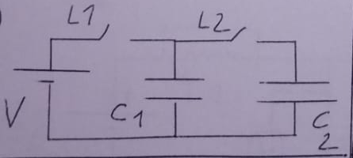
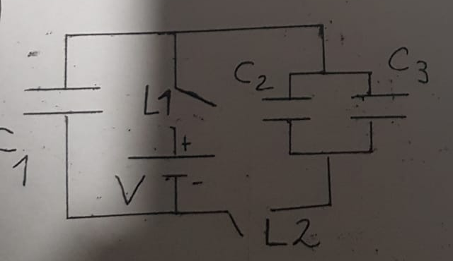
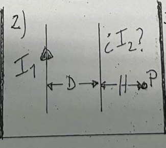
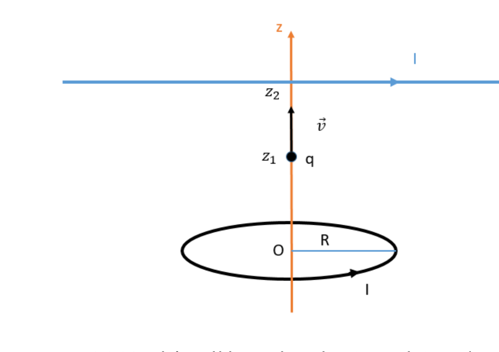
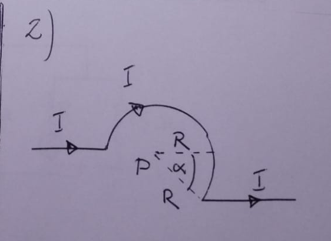
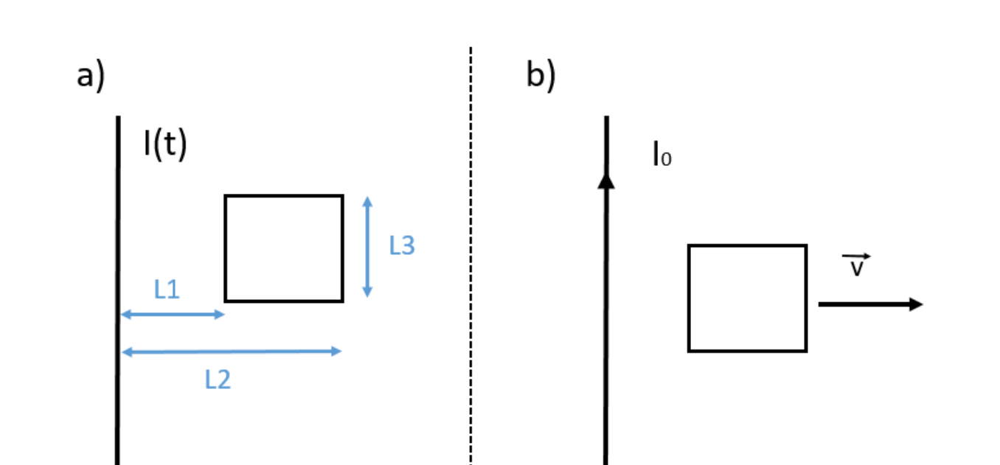
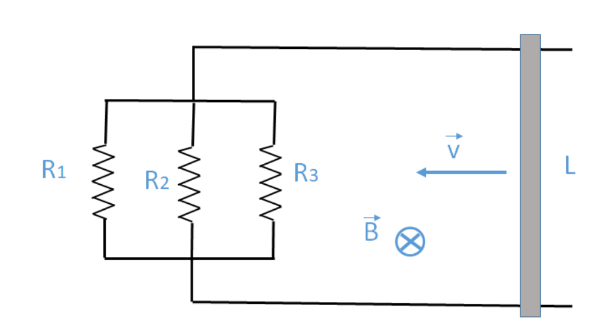
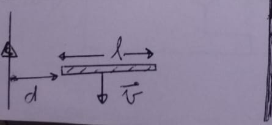
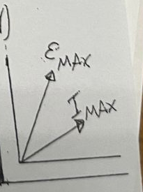

# Guía de ejercicios del 2º Parcial

Ejercicios ordenados de fácil a difícil para aprender los temas del 2º Parcial desde cero: se empieza con ejercicios de un solo concepto y números simples, y se termina con los ejercicios textuales de los parciales.

**Cómo usarla.**

- Hacé los ejercicios en orden. Intentá cada uno en papel antes de abrir la solución.
- El botón **Solución** muestra la respuesta. Adentro, **Solución paso a paso** explica todo como si no supieras física: **Qué piden, en palabras** traduce el enunciado, **La idea, desde cero** explica la física que hace falta, y cada fórmula despejada se **deduce** desde la integral o la derivada de la que sale, con el atajo al lado.
- Las explicaciones se repiten a propósito: cada ejercicio se puede leer solo.

**Niveles.**

| Nivel | Qué es |
|---|---|
| 🟢 Concepto | Ejercicio propio: un solo concepto, números simples. |
| 🟡 Práctica | Ejercicio propio o de la guía de la cátedra: combina ideas o tiene geometría. |
| 🔴 Parcial | Enunciado textual de un parcial, con link al examen. |

Material relacionado: [guía de resolución](guia-de-resolucion.md) (cómo resolver cada tipo de ejercicio), [demostraciones](demostraciones.md) de los atajos y [formulario](formulario.md). Volver al [índice de parciales](README.md).

| Unidad | 🟢 Concepto | 🟡 Práctica | 🔴 Parcial |
|---|---|---|---|
| [4. Capacitores y dieléctricos](#unidad-4-capacitores-y-dieléctricos) | [1](#ejercicio-1) · [2](#ejercicio-2) · [3](#ejercicio-3) | [4](#ejercicio-4) · [5](#ejercicio-5) · [6](#ejercicio-6) | [7](#ejercicio-7) · [8](#ejercicio-8) |
| [5. Magnetostática](#unidad-5-magnetostática) | [9](#ejercicio-9) · [10](#ejercicio-10) · [12](#ejercicio-12) · [13](#ejercicio-13) · [16](#ejercicio-16) | [11](#ejercicio-11) · [14](#ejercicio-14) · [15](#ejercicio-15) · [17](#ejercicio-17) · [18](#ejercicio-18) · [19](#ejercicio-19) · [20](#ejercicio-20) | [21](#ejercicio-21) · [22](#ejercicio-22) · [23](#ejercicio-23) · [24](#ejercicio-24) · [25](#ejercicio-25) · [26](#ejercicio-26) |
| [6. Inducción magnética](#unidad-6-inducción-magnética) | [27](#ejercicio-27) · [28](#ejercicio-28) · [29](#ejercicio-29) | [30](#ejercicio-30) · [31](#ejercicio-31) · [32](#ejercicio-32) · [33](#ejercicio-33) · [34](#ejercicio-34) · [35](#ejercicio-35) · [36](#ejercicio-36) · [37](#ejercicio-37) | [38](#ejercicio-38) · [39](#ejercicio-39) · [40](#ejercicio-40) · [41](#ejercicio-41) · [42](#ejercicio-42) · [43](#ejercicio-43) · [44](#ejercicio-44) |
| [7. Corriente alterna](#unidad-7-corriente-alterna) | [45](#ejercicio-45) · [46](#ejercicio-46) | [47](#ejercicio-47) · [48](#ejercicio-48) · [49](#ejercicio-49) | [50](#ejercicio-50) · [51](#ejercicio-51) · [52](#ejercicio-52) · [53](#ejercicio-53) · [54](#ejercicio-54) |

---

## Unidad 4: Capacitores y dieléctricos

Un capacitor guarda carga y energía. Se empieza por $Q = CV$ y la energía como integral, se sigue con serie y paralelo y con el reparto de carga entre capacitores, y se termina con los ejercicios de llaves que se toman en el parcial desde 2024.

---

### Ejercicio 1

**Nivel:** 🟢 Concepto · **Fuente:** ejercicio propio · **Tipo de la guía de resolución:** [1. Capacitores con llaves: energía disipada](guia-de-resolucion.md#1-capacitores-con-llaves-energ%C3%ADa-disipada)

Un capacitor de 10 μF se conecta a una pila de 12 V y se espera hasta que deja de circular corriente.

a) ¿Cuánta carga guarda?

b) ¿Cuánta energía guarda?

c) Si en vez de 12 V se usara una pila de 24 V, ¿cuánto valdrían la carga y la energía?

<b>Solución</b>

Solución paso a paso

**Qué piden, en palabras.**

- Un capacitor (capacidad $C = 10\ \mu\text{F}$) se conecta a una pila de 12 V.
- "Hasta que deja de circular corriente": el capacitor ya terminó de cargarse.
- **a)** La carga $Q$. **b)** La energía guardada $U$. **c)** Qué pasa con las dos si se duplica la tensión.

**La idea, desde cero.** Un capacitor son dos placas metálicas enfrentadas que no se tocan. Al conectarlo a una pila, la pila saca electrones de una placa y los pone en la otra: una placa queda con carga $+Q$ y la otra con $-Q$. La corriente no atraviesa el capacitor, solo lo carga. A medida que se carga, la tensión entre sus placas crece, hasta igualar la de la pila; en ese momento deja de circular corriente. La relación entre carga y tensión de un capacitor es

$$Q = C\,V$$

donde $C$, la **capacidad**, dice cuánta carga guarda por cada volt. Un faradio (F) es un coulomb por volt; $1\ \mu\text{F} = 10^{-6}$ F.

Cargar un capacitor cuesta trabajo: para meter más carga hay que empujarla contra la que ya está. Ese trabajo queda guardado como energía.

**Deducción de la energía** (atajo: $U = \tfrac12CV^2$). Cuando el capacitor ya tiene una carga $q$, la tensión entre sus placas es $v = q/C$. Llevar una carga pequeña $dq$ de una placa a la otra cuesta un trabajo $dW = v\,dq$ (la tensión es justamente energía por unidad de carga). La energía total es la suma de todos esos trabajos, desde $q = 0$ hasta la carga final $Q$:

$$U = \int_0^Q v\,dq = \int_0^Q\frac{q}{C}\,dq = \frac1C\left[\frac{q^2}{2}\right]_0^Q = \frac{Q^2}{2C}$$

Reemplazando $Q = CV$: $U = \dfrac{(CV)^2}{2C} = \tfrac12CV^2$. El $\tfrac12$ aparece porque la tensión no fue siempre $V$: empezó en 0 y creció de a poco.

**Paso 1 — Carga (ítem a).**

$$Q = CV = 10\ \mu\text{F}\cdot12\ \text{V} = 120\ \mu\text{C}$$

**Paso 2 — Energía (ítem b).** Con μF y V la energía sale en μJ:

$$U = \tfrac12CV^2 = \tfrac12\cdot10\cdot12^2\ \mu\text{J} = 720\ \mu\text{J}$$

**Paso 3 — Con 24 V (ítem c).** La carga es proporcional a $V$: se duplica, $Q = 240\ \mu\text{C}$. La energía es proporcional a $V^2$: se multiplica por 4, $U = \tfrac12\cdot10\cdot24^2 = 2880\ \mu\text{J}$.

**Respuesta:** a) $Q = 120\ \mu\text{C}$; b) $U = 720\ \mu\text{J}$; c) $Q = 240\ \mu\text{C}$ (el doble) y $U = 2880\ \mu\text{J}$ (cuatro veces más).

---

### Ejercicio 2

**Nivel:** 🟢 Concepto · **Fuente:** ejercicio propio · **Tipo de la guía de resolución:** [1. Capacitores con llaves: energía disipada](guia-de-resolucion.md#1-capacitores-con-llaves-energ%C3%ADa-disipada)

Se tienen dos capacitores, $C_1 = 3$ μF y $C_2 = 6$ μF, y una pila de 12 V.

a) Se conectan **en paralelo** a la pila. Calcule la capacidad equivalente, la carga de cada capacitor y la carga total que entregó la pila.

b) Se conectan **en serie** a la pila. Calcule la capacidad equivalente, la carga de cada capacitor y la tensión de cada uno.

<b>Solución</b>

Solución paso a paso

**Qué piden, en palabras.**

- Los mismos dos capacitores conectados de dos maneras distintas a la misma pila de 12 V.
- En cada caso, un único capacitor que haga lo mismo que los dos juntos (capacidad equivalente), y la carga y tensión de cada uno.

**La idea, desde cero.** Hay dos formas básicas de conectar dos elementos:

- **En paralelo:** cada extremo de un capacitor está unido por cable al mismo extremo del otro. Un cable por el que no circula corriente está todo al mismo potencial, así que los dos capacitores tienen **la misma tensión**: la de la pila.
- **En serie:** uno a continuación del otro, y en la unión no se conecta nada más. El pedazo de metal que queda entre los dos (placa de uno + cable + placa del otro) está aislado: tenía carga cero y la carga no puede entrar ni salir. Si una de sus placas queda con $-Q$, la otra tiene que quedar con $+Q$. Los dos capacitores tienen **la misma carga**.

**Deducción del paralelo** (atajo: $C_{eq} = C_1 + C_2$). Misma tensión $V$; la carga total que entrega la pila es la suma de las cargas:

$$Q_{tot} = Q_1 + Q_2 = C_1V + C_2V = (C_1 + C_2)V$$

Un único capacitor que guarde $Q_{tot}$ con la tensión $V$ tiene $C_{eq} = Q_{tot}/V = C_1 + C_2$. Es como agrandar las placas.

**Deducción de la serie** (atajo: $\dfrac1{C_{eq}} = \dfrac1{C_1} + \dfrac1{C_2}$). Misma carga $Q$; la tensión de la pila se reparte entre los dos (para ir de un borne al otro se pasa por los dos capacitores):

$$V = V_1 + V_2 = \frac{Q}{C_1} + \frac{Q}{C_2} = Q\left(\frac1{C_1} + \frac1{C_2}\right)$$

Un capacitor equivalente cumple $V = Q/C_{eq}$; comparando, $\dfrac1{C_{eq}} = \dfrac1{C_1} + \dfrac1{C_2}$, o sea $C_{eq} = \dfrac{C_1C_2}{C_1 + C_2}$. Siempre da menos que el más chico.

**Paso 1 — Paralelo (ítem a).**

$$C_{eq} = 3 + 6 = 9\ \mu\text{F} \qquad Q_1 = 3\cdot12 = 36\ \mu\text{C} \qquad Q_2 = 6\cdot12 = 72\ \mu\text{C}$$

$$Q_{tot} = 36 + 72 = 108\ \mu\text{C} = C_{eq}V = 9\cdot12\ ✓$$

**Paso 2 — Serie (ítem b).**

$$C_{eq} = \frac{3\cdot6}{3 + 6} = 2\ \mu\text{F} \qquad Q = C_{eq}V = 2\cdot12 = 24\ \mu\text{C}\ \text{(la misma en los dos)}$$

$$V_1 = \frac{24}{3} = 8\ \text{V} \qquad V_2 = \frac{24}{6} = 4\ \text{V} \qquad (8 + 4 = 12\ \text{V}\ ✓)$$

En serie, el capacitor más chico se queda con la mayor tensión ($V = Q/C$ con la misma $Q$).

**Respuesta:** a) $C_{eq} = 9\ \mu\text{F}$; $Q_1 = 36\ \mu\text{C}$, $Q_2 = 72\ \mu\text{C}$, total $108\ \mu\text{C}$. b) $C_{eq} = 2\ \mu\text{F}$; $Q_1 = Q_2 = 24\ \mu\text{C}$; $V_1 = 8$ V, $V_2 = 4$ V.

---

### Ejercicio 3

**Nivel:** 🟢 Concepto · **Fuente:** ejercicio propio · **Tipo de la guía de resolución:** [1. Capacitores con llaves: energía disipada](guia-de-resolucion.md#1-capacitores-con-llaves-energ%C3%ADa-disipada)

Una pila de 20 V carga, a través de una resistencia $R$ de valor desconocido, un capacitor de 5 μF inicialmente descargado. Se espera hasta que deja de circular corriente.

a) Calcule la carga final del capacitor y la energía que guarda.

b) Calcule la energía que entregó la pila.

c) ¿Cuánta energía se disipó en la resistencia? ¿Depende del valor de $R$?

<b>Solución</b>

Solución paso a paso

**Qué piden, en palabras.**

- Una pila carga un capacitor; en el camino la corriente pasa por una resistencia, que la calienta.
- **a)** Lo que queda guardado en el capacitor. **b)** Lo que entregó la pila. **c)** La diferencia, que se convirtió en calor.

**La idea, desde cero.** La energía se conserva: lo que entrega la pila tiene que ir a algún lado. Una parte queda guardada en el capacitor y el resto se pierde como calor en la resistencia (efecto Joule). Al final la corriente se detiene porque el capacitor llegó a la tensión de la pila. La diferencia clave entre la pila y el capacitor es que **la pila empuja cada coulomb con 20 V desde el principio**, mientras que el capacitor empezó en 0 V y fue subiendo.

**Deducción de la energía guardada** (atajo: $U = \tfrac12CV^2$). Con carga $q$ el capacitor tiene tensión $q/C$, y agregar $dq$ cuesta $\frac qC\,dq$:

$$U = \int_0^Q\frac qC\,dq = \frac{Q^2}{2C} = \tfrac12CV^2$$

**Deducción de la energía que entrega la pila** (atajo: $W = QV$). La pila mantiene su tensión $V$ **fija** mientras pasa cada pedacito de carga $dq$, y le entrega $V\,dq$:

$$W = \int_0^QV\,dq = V\int_0^Qdq = QV = CV^2$$

Comparando: la pila entrega $CV^2$ y el capacitor guarda $\tfrac12CV^2$. **Siempre se pierde la mitad**, y en ninguna de las dos cuentas aparece $R$.

**Paso 1 — Capacitor (ítem a).** Al final su tensión es 20 V:

$$Q = CV = 5\cdot20 = 100\ \mu\text{C} \qquad U = \tfrac12\cdot5\cdot20^2 = 1000\ \mu\text{J} = 1\ \text{mJ}$$

**Paso 2 — Pila (ítem b).**

$$W = QV = 100\ \mu\text{C}\cdot20\ \text{V} = 2000\ \mu\text{J} = 2\ \text{mJ}$$

**Paso 3 — Disipada (ítem c).**

$$E = W - U = 2 - 1 = 1\ \text{mJ}$$

No depende de $R$: con una resistencia grande la corriente es chica pero dura más; con una chica es grande pero dura poco. El calor total es el mismo.

**Respuesta:** a) $Q = 100\ \mu\text{C}$, $U = 1$ mJ; b) $W = 2$ mJ; c) se disipa 1 mJ, la mitad de lo entregado, sin importar el valor de $R$.

---

### Ejercicio 4

**Nivel:** 🟡 Práctica · **Fuente:** [Práctica de Capacitores y dieléctricos, Ej. 1](../4%20-%20Capacitores%20y%20Diel%C3%A9ctricos/practica.md#ejercicio-1) (enunciado textual de la guía de la cátedra) · **Tipo de la guía de resolución:** [1. Capacitores con llaves: energía disipada](guia-de-resolucion.md#1-capacitores-con-llaves-energ%C3%ADa-disipada)

Los capacitores del circuito de la figura valen *C1*=4μF; *C2*=6μF; *C3*=12,6μF; *C4*=2μF; *C5*=8μF. En régimen estacionario, calcule:

a) la capacidad equivalente de la configuración;

b) la carga almacenada en cada capacitor;

c) la ddp a la que se encuentra cada capacitor;

d) la energía almacenada por cada capacitor y la del sistema

<b>Solución</b>

Solución paso a paso

**Qué piden, en palabras.**

- Cinco capacitores conectados a una pila de 50 V: $C_1 = 4$, $C_2 = 6$, $C_3 = 12{,}6$, $C_4 = 2$ y $C_5 = 8$, todos en μF.
- "Régimen estacionario": pasó mucho tiempo, los capacitores terminaron de cargarse y ya no circula corriente.
- **a)** Un único capacitor que equivalga a todo el circuito. **b)** y **c)** La carga y la tensión de cada uno. **d)** La energía de cada uno y la total.

**La idea, desde cero.** Un capacitor son dos placas metálicas enfrentadas que no se tocan. La pila saca electrones de una placa y los pone en la otra: una queda con $+Q$ y la otra con $-Q$. La corriente no lo atraviesa, solo lo carga. Cuanta más carga tiene, mayor es la tensión entre sus placas: $Q = CV$, donde $C$ (la capacidad) es cuánta carga guarda por cada volt. Para resolver circuitos de capacitores hay que reconocer dos formas de conexión:

| | Cómo se ve | Qué tienen igual |
|---|---|---|
| **Paralelo** | los dos extremos de uno están unidos a los dos extremos del otro | la misma **tensión** |
| **Serie** | uno a continuación del otro, sin nada más conectado en la unión | la misma **carga** |

- *Por qué en paralelo tienen la misma tensión.* Un cable sin corriente está todo al mismo potencial. Las placas de la izquierda están unidas por cable y tienen el mismo potencial; lo mismo las de la derecha. La diferencia entre los dos lados es la misma para los dos capacitores.
- *Por qué en serie tienen la misma carga.* El pedazo de metal entre los dos (la placa derecha de uno, el cable y la placa izquierda del otro) está aislado. Antes de conectar la pila tenía carga total cero, y la carga no puede entrar ni salir. Si una de sus placas queda con $-Q$, la otra tiene que quedar con $+Q$.

**Paso 1 — Leer el circuito.** $C_1$ y $C_2$ están uno detrás del otro, en serie. $C_3$ va de los mismos dos puntos que ese par, así que está en paralelo con él: eso forma el bloque izquierdo. $C_4$ y $C_5$ comparten sus dos extremos: están en paralelo y forman el bloque derecho. Los dos bloques están en serie con la pila.

**Paso 2 — Fórmulas de combinación (deducidas).**

*Paralelo*: misma $V$, y las cargas se suman:

$$Q = C_aV + C_bV = (C_a + C_b)V \quad\Rightarrow\quad C_{eq} = C_a + C_b$$

*Serie*: misma $Q$, y las tensiones se suman:

$$V = \frac{Q}{C_a} + \frac{Q}{C_b} \quad\Rightarrow\quad \frac{1}{C_{eq}} = \frac1{C_a} + \frac1{C_b} \quad\Leftrightarrow\quad C_{eq} = \frac{C_aC_b}{C_a + C_b}$$

En serie, la equivalente siempre es menor que la menor de las dos.

**Paso 3 — Ítem a: simplificar de adentro hacia afuera** (todo en μF).

$$C_{12} = \frac{4\cdot6}{4 + 6} = 2{,}4 \qquad C_A = C_{12} + C_3 = 2{,}4 + 12{,}6 = 15 \qquad C_B = C_4 + C_5 = 10$$

$$C_{eq} = \frac{C_AC_B}{C_A + C_B} = \frac{15\cdot10}{25} = 6\ \mu\text{F}$$

**Paso 4 — Carga que entrega la pila.** Todo el circuito equivale a un capacitor de 6 μF conectado a 50 V:

$$Q = C_{eq}V = 6\cdot50 = 300\ \mu\text{C}$$

**Paso 5 — Volver hacia atrás: los dos bloques.** Están en serie, así que los dos tienen 300 μC:

$$V_A = \frac{300}{15} = 20\ \text{V} \qquad V_B = \frac{300}{10} = 30\ \text{V} \qquad (20 + 30 = 50\ \text{V}\ ✓)$$

**Paso 6 — Abrir el bloque derecho.** $C_4$ y $C_5$ están en paralelo, así que los dos tienen 30 V:

$$Q_4 = 2\cdot30 = 60\ \mu\text{C} \qquad Q_5 = 8\cdot30 = 240\ \mu\text{C} \qquad (60 + 240 = 300\ ✓)$$

**Paso 7 — Abrir el bloque izquierdo.** $C_3$ y el par $C_{12}$ están en paralelo, así que los dos tienen 20 V:

$$Q_3 = 12{,}6\cdot20 = 252\ \mu\text{C} \qquad Q_{12} = 2{,}4\cdot20 = 48\ \mu\text{C} \qquad (252 + 48 = 300\ ✓)$$

**Paso 8 — Abrir el par $C_1$–$C_2$.** Están en serie, así que cada uno tiene 48 μC (no se suman):

$$V_1 = \frac{48}{4} = 12\ \text{V} \qquad V_2 = \frac{48}{6} = 8\ \text{V} \qquad (12 + 8 = 20\ \text{V}\ ✓)$$

Con la misma carga, el capacitor más chico de una serie se queda con la mayor tensión ($V = Q/C$).

**Paso 9 — Ítem d: energía.** *De dónde sale:* con carga $q$, la tensión del capacitor es $q/C$, y agregar $dq$ cuesta $\frac qC\,dq$. Sumando de 0 a $Q$:

$$U = \int_0^Q\frac qC\,dq = \frac{Q^2}{2C} = \tfrac12CV^2$$

En μF y V, la energía sale en μJ:

$$U_1 = \tfrac12\cdot4\cdot12^2 = 288 \quad U_2 = \tfrac12\cdot6\cdot8^2 = 192 \quad U_3 = \tfrac12\cdot12{,}6\cdot20^2 = 2520 \quad U_4 = \tfrac12\cdot2\cdot30^2 = 900 \quad U_5 = \tfrac12\cdot8\cdot30^2 = 3600$$

Total: 7500 μJ. Control: $\tfrac12C_{eq}V^2 = \tfrac12\cdot6\cdot50^2 = 7500\ \mu\text{J}$ ✓.

**Resumen del método.** (1) Identificar serie y paralelo. (2) Simplificar hasta $C_{eq}$. (3) $Q = C_{eq}V$. (4) Volver hacia atrás: en serie se copia la carga y se reparte la tensión; en paralelo se copia la tensión y se reparte la carga. (5) $U = \tfrac12CV^2$ para cada uno, y verificar con $\tfrac12C_{eq}V^2$.

**Respuesta:**

- a) $C_{eq} = 6\ \mu\text{F}$
- b) $Q_1 = Q_2 = 48\ \mu\text{C}$; $Q_3 = 252\ \mu\text{C}$; $Q_4 = 60\ \mu\text{C}$; $Q_5 = 240\ \mu\text{C}$
- c) $V_1 = 12$ V; $V_2 = 8$ V; $V_3 = 20$ V; $V_4 = V_5 = 30$ V
- d) $U_1 = 288\ \mu\text{J}$; $U_2 = 192\ \mu\text{J}$; $U_3 = 2520\ \mu\text{J}$; $U_4 = 900\ \mu\text{J}$; $U_5 = 3600\ \mu\text{J}$; $U_T = U_1 + \dots + U_5 = C_{eq}V^2/2 = 7500\ \mu\text{J}$

---

### Ejercicio 5

**Nivel:** 🟡 Práctica · **Fuente:** [Práctica de Capacitores y dieléctricos, Ej. 5](../4%20-%20Capacitores%20y%20Diel%C3%A9ctricos/practica.md#ejercicio-5) (enunciado textual de la guía de la cátedra) · **Tipo de la guía de resolución:** [1. Capacitores con llaves: energía disipada](guia-de-resolucion.md#1-capacitores-con-llaves-energ%C3%ADa-disipada)

Los capacitores *C1* = 12μF y *C2*= 6μF de la figura se cargan con la llave en la posición (1). Una vez cargados se lleva la llave a la posición (2). Suponiendo que el capacitor *C3* = 2μF está inicialmente descargado, calcule:

a) la carga final almacenada por el capacitor *C3*;

b) la energía almacenada por el sistema *C1 C2* antes de conmutar la llave, y por el sistema *C1 C2 C3* después de hacerlo.

<b>Solución</b>

Solución paso a paso

**Qué piden, en palabras.**

- Llave en posición (1): $C_1 = 12$ μF y $C_2 = 6$ μF quedan en serie con la pila de 10 V y se cargan.
- Llave en posición (2): $C_2$ queda conectado con $C_3 = 2$ μF, que estaba descargado.
- **a)** La carga final de $C_3$. **b)** La energía guardada antes de mover la llave y después.

**La idea, desde cero.** Un capacitor guarda carga: $Q = CV$. En serie, todos tienen la misma carga; en paralelo, la misma tensión. Cuando un capacitor cargado se desconecta de la pila y se conecta con otro descargado, la carga no puede aparecer ni desaparecer: **se conserva** y se reparte hasta que los dos quedan con la misma tensión. Es como dos tanques de agua que se conectan por abajo y quedan al mismo nivel. En ese reparto se pierde energía en forma de calor en los cables, aunque la carga total sea la misma. La energía de un capacitor es $U = \int_0^Q\frac qC\,dq = \frac{Q^2}{2C} = \tfrac12CV^2$.

**Deducción de la serie** (atajo: $C_s = \dfrac{C_1C_2}{C_1 + C_2}$). En serie los dos tienen la misma carga $Q$ (el metal entre ellos está aislado y era neutro), y la tensión de la pila se reparte: $V = \dfrac{Q}{C_1} + \dfrac{Q}{C_2}$. Un equivalente cumple $V = Q/C_s$, así que $\dfrac1{C_s} = \dfrac1{C_1} + \dfrac1{C_2}$.

**Deducción del reparto** (atajo: $V' = \dfrac{Q_0}{C_2 + C_3}$). Cuando $C_2$, cargado, queda conectado a $C_3$, descargado, la carga solo puede pasar de uno al otro: $Q_2' + Q_3' = Q_0$. Al final no circula corriente, así que los dos tienen la misma tensión (están en paralelo): $Q_2' = C_2V'$ y $Q_3' = C_3V'$. Sumando, $(C_2 + C_3)V' = Q_0$.

**Deducción de la energía** (atajo: $U = \tfrac12CV^2 = \dfrac{Q^2}{2C}$). $U = \displaystyle\int_0^Q\frac qC\,dq = \frac{Q^2}{2C}$: cada $dq$ que se agrega cuesta la tensión que ya tiene el capacitor.

**Resolución.**

**Paso 1 — Posición (1).** La llave une $C_1$ con $C_2$: quedan **en serie** con la pila de 10 V.

$$C_s = \frac{C_1C_2}{C_1 + C_2} \qquad Q_0 = C_s\,V \qquad U_0 = \tfrac12C_sV^2$$

$$C_s = \frac{72}{18} = 4\ \mu\text{F} \qquad Q_0 = 40\ \mu\text{C} \qquad U_0 = \tfrac12\cdot4\cdot100 = 200\ \mu\text{J}$$

**Paso 2 — Posición (2).** La llave pasa a unir el borne de $C_2$ con $C_3$. $C_1$ queda **desconectado** de un lado: conserva sus 40 μC. $C_2$ queda **en paralelo con $C_3$** (comparten los dos nodos) y le pasa parte de su carga. Conservación de la carga en ese par:

$$Q_2' + Q_3' = Q_0 \qquad \frac{Q_2'}{C_2} = \frac{Q_3'}{C_3} = V' \quad\Rightarrow\quad V' = \frac{Q_0}{C_2 + C_3} \qquad Q_3' = C_3V'$$

**Paso 3 — Cálculo.**

$$V' = \frac{40}{8} = 5\ \text{V} \qquad Q_3' = 2\cdot5 = 10\ \mu\text{C} \qquad Q_2' = 30\ \mu\text{C}$$

**Paso 4 — Energía final.**

$$U' = \frac{Q_0^2}{2C_1} + \tfrac12(C_2 + C_3)V'^2 = \frac{1600}{24} + \tfrac12\cdot8\cdot25 = 66{,}67 + 100 = 166{,}67\ \mu\text{J}$$

La energía disminuye: la diferencia se disipa en los cables durante la redistribución de carga.

**Respuesta:** a) $Q_3 = 10\ \mu\text{C}$; b) $U_0 = 200\ \mu\text{J}$ y $U' = 166{,}67\ \mu\text{J}$

---

### Ejercicio 6

**Nivel:** 🟡 Práctica · **Fuente:** ejercicio propio · **Tipo de la guía de resolución:** [16. RLC serie con la frecuencia de resonancia como dato](guia-de-resolucion.md#16-rlc-serie-con-la-frecuencia-de-resonancia-como-dato)

Un capacitor cilíndrico está formado por un cilindro metálico interior de radio $a = 1$ mm y una cáscara cilíndrica coaxial de radio $b = 5$ mm, ambos de largo $\ell = 2$ m, con vacío entre ellos.

a) Deduzca la expresión de su capacidad y calcule su valor.

b) Si se lo conecta a 100 V, calcule la carga y el campo eléctrico justo afuera del cilindro interior.

<b>Solución</b>

Solución paso a paso

**Qué piden, en palabras.**

- Un capacitor con forma de cable coaxial: un cilindro adentro de otro, con el mismo eje.
- **a)** La fórmula de su capacidad, deducida, y su valor. **b)** La carga con 100 V y el campo eléctrico en la superficie del cilindro de adentro.

**La idea, desde cero.** La capacidad se calcula siempre igual: se supone que los conductores tienen cargas $+Q$ y $-Q$, se calcula el campo eléctrico entre ellos, se integra el campo para obtener la diferencia de potencial $V$, y se divide: $C = Q/V$. La carga se cancela y queda algo que depende solo de la forma. Para el campo se usa la **ley de Gauss**: el flujo del campo eléctrico a través de una superficie cerrada es la carga encerrada dividida por $\varepsilon_0$,

$$\oint\vec E\cdot d\vec A = \frac{Q_{enc}}{\varepsilon_0}$$

Con simetría cilíndrica el campo apunta hacia afuera (radial) y su módulo depende solo de la distancia $r$ al eje.

**Deducción del campo.** Sea $\lambda = Q/\ell$ la carga por metro del cilindro interior. Superficie de Gauss: un cilindro imaginario de radio $r$ ($a < r < b$) y largo $\ell$, coaxial. En su pared lateral el campo es perpendicular y constante, así que el flujo es $E\cdot2\pi r\ell$; en las tapas el campo es paralelo a la superficie y no aporta. Encierra la carga $\lambda\ell$:

$$E\cdot2\pi r\ell = \frac{\lambda\ell}{\varepsilon_0} \quad\Rightarrow\quad E(r) = \frac{\lambda}{2\pi\varepsilon_0r}$$

**Deducción de la tensión.** La diferencia de potencial entre los cilindros es la integral del campo a lo largo de un radio:

$$V = \int_a^bE\,dr = \frac{\lambda}{2\pi\varepsilon_0}\int_a^b\frac{dr}{r} = \frac{\lambda}{2\pi\varepsilon_0}\ln\frac ba$$

**Deducción de la capacidad** (atajo: $C = \dfrac{2\pi\varepsilon_0\ell}{\ln(b/a)}$).

$$C = \frac QV = \frac{\lambda\ell}{\dfrac{\lambda}{2\pi\varepsilon_0}\ln\dfrac ba} = \frac{2\pi\varepsilon_0\ell}{\ln(b/a)}$$

**Paso 1 — Valor (ítem a).** $\ln(5/1) = 1{,}609$:

$$C = \frac{2\pi\cdot8{,}85\times10^{-12}\cdot2}{1{,}609}\ \text{F} = 6{,}91\times10^{-11}\ \text{F} = 69{,}1\ \text{pF}$$

**Paso 2 — Carga (ítem b).** $Q = CV = 6{,}91\times10^{-11}\cdot100 = 6{,}91\times10^{-9}$ C = 6,91 nC.

**Paso 3 — Campo en $r = a$.** De la tensión, $\dfrac{\lambda}{2\pi\varepsilon_0} = \dfrac{V}{\ln(b/a)}$, y entonces

$$E(a) = \frac{V}{a\ln(b/a)} = \frac{100}{10^{-3}\cdot1{,}609}\ \tfrac{\text{V}}{\text{m}} = 6{,}21\times10^4\ \tfrac{\text{V}}{\text{m}}$$

**Respuesta:** a) $C = \dfrac{2\pi\varepsilon_0\ell}{\ln(b/a)} = 69{,}1$ pF; b) $Q = 6{,}91$ nC y $E(a) = 6{,}21\times10^4$ V/m.

---

### Ejercicio 7

**Nivel:** 🔴 Parcial · **Fuente:** [1er Recuperatorio del 2º Parcial — 12/12/2024, Ej. 1](2024-12-12-1er-recuperatorio-2do-parcial.md#ejercicio-1) (enunciado textual) · **Tipo de la guía de resolución:** [1. Capacitores con llaves: energía disipada](guia-de-resolucion.md#1-capacitores-con-llaves-energ%C3%ADa-disipada)

En el circuito de la figura, inicialmente los capacitores se hallan descargados y las llaves se encuentran abiertas. Se cierra la llave 1 y, transcurrido un tiempo muy largo, se abre la llave 1 y a continuación se cierra la llave 2. Calcular la energía disipada en las resistencias en la evolución completa del sistema.
**Datos:** V=60 V; C1=20 μF; C2=30 μF.

<b>Solución</b>

Solución paso a paso

**Qué piden, en palabras.**

- Fuente de 60 V; $C_1 = 20\ \mu\text{F}$ y $C_2 = 30\ \mu\text{F}$, los dos descargados al principio.
- **Etapa 1:** se cierra la llave 1 y $C_1$ se carga desde la fuente hasta 60 V.
- **Etapa 2:** se abre la llave 1, así que la fuente queda desconectada, y se cierra la llave 2. $C_1$, cargado, queda conectado con $C_2$, descargado. Parte de la carga de $C_1$ pasa a $C_2$, hasta que los dos tienen la misma tensión.
- **Qué piden:** la "energía disipada en la evolución completa", o sea la energía que se convirtió en calor en las dos etapas.
- **Plan:** sumar la energía perdida en la etapa 1 y la perdida en la etapa 2.

**La idea, desde cero.** Un capacitor funciona como un tanque de carga: dos placas que se cargan con $+Q$ y $-Q$. Cuanta más carga tiene, mayor es la tensión entre sus placas: $V = Q/C$. Una llave es un interruptor: abierta corta el cable, cerrada lo conecta. "Transcurrido un tiempo muy largo" significa que la corriente ya dejó de circular, porque el capacitor se cargó hasta tener la misma tensión que la fuente.

Los cables reales tienen algo de resistencia, y mientras circula corriente parte de la energía se pierde ahí en forma de calor. Lo que pregunta este tipo de ejercicio es cuánta energía se pierde. El resultado sorprende: esa pérdida no depende de cuánto valga la resistencia, solo de las capacidades y de las tensiones del principio y del final. Por eso la piden sin dar R.

**La idea, aplicada a este ejercicio.**

El "tanque" de carga de este ejercicio es $C_1$. En la **etapa 1** la fuente de 60 V lo llena: entra carga hasta que la tensión de $C_1$ llega a 60 V, y mientras tanto se pierde calor en los cables. En la **etapa 2** la fuente ya no está, así que la carga de $C_1$ no puede aumentar ni desaparecer: solo puede repartirse con $C_2$. Es como dos tanques de agua que se conectan por abajo y quedan al mismo nivel; acá "mismo nivel" quiere decir misma tensión. En ese reparto también se pierde energía, aunque la carga total no cambie. La energía perdida en cada etapa se calcula como "lo que había (o lo que entregó la fuente) menos lo que quedó".

**Deducción de las energías.**

- *Energía guardada* (atajo: $U = \tfrac12CV^2 = \dfrac{Q^2}{2C}$). Para llevar una carga $dq$ de una placa a la otra cuando la tensión es $v = q/C$ hace falta $v\,dq$. Integrando de 0 a $Q$:

$$U = \int_0^Q\frac qC\,dq = \frac{Q^2}{2C} = \tfrac12CV^2$$

- *Energía que entrega la fuente* (atajo: $QV$, el doble de lo guardado). La fuente mantiene su tensión $V$ **fija** mientras pasa toda la carga, así que $W = \displaystyle\int_0^QV\,dq = QV = CV^2$. La diferencia $CV^2 - \tfrac12CV^2 = \tfrac12CV^2$ se disipa en las resistencias, valgan lo que valgan.
- *Reparto.* Con la fuente desconectada, la carga de C₁ no tiene a dónde ir más que a C₂: se conserva. Al final C₁ y C₂ quedan conectados entre sí, en paralelo, con la misma tensión $V_f$, así que $Q_0 = C_1V_f + C_2V_f$. Lo que falta de energía se disipó en el camino.

**Carga.** $Q_0 = 20\ \mu\text{F}\cdot60\ \text{V} = 1200\ \mu\text{C}$. Energía en C₁: $U_0 = \tfrac12\cdot20\times10^{-6}\cdot3600 = 36$ mJ. La fuente entregó $Q_0V = 72$ mJ, así que se disiparon $E_1 = 36$ mJ.

**Reparto.**

$$V_f = \frac{1200\ \mu\text{C}}{50\ \mu\text{F}} = 24\ \text{V} \qquad U_f = \tfrac12\cdot50\times10^{-6}\cdot24^2\ \text{J} = 14{,}4\ \text{mJ} \qquad E_2 = 36 - 14{,}4 = 21{,}6\ \text{mJ}$$

**Total.** $E = 36 + 21{,}6 = 57{,}6$ mJ. (Cargas finales: $Q_1 = 480\ \mu\text{C}$, $Q_2 = 720\ \mu\text{C}$.)

**Respuesta:** Energía disipada en total $E = 57{,}6$ mJ (36 mJ al cargar y 21,6 mJ en el reparto). Cargas finales $Q_1 = 480\ \mu\text{C}$ y $Q_2 = 720\ \mu\text{C}$.

---

### Ejercicio 8

**Nivel:** 🔴 Parcial · **Fuente:** [2º Parcial — 28/11/2024, Ej. 1](2024-11-28-2do-parcial.md#ejercicio-1) (enunciado textual) · **Tipo de la guía de resolución:** [1. Capacitores con llaves: energía disipada](guia-de-resolucion.md#1-capacitores-con-llaves-energ%C3%ADa-disipada)

En el circuito de la figura, inicialmente los capacitores se encuentran descargados y las llaves se hallan abiertas. Se cierra la llave 1 y, transcurrido un tiempo muy largo, se abre la llave 1 y luego se cierra la llave 2. Determine la carga final de cada capacitor, y calcule la energía disipada en las resistencias del circuito desde que se cierra la llave 1 hasta alcanzado el estado final del sistema.
**Datos:** V=50 V, C1=30 μF, C2=20 μF, C3=60 μF.

<b>Solución</b>

Solución paso a paso

**Qué piden, en palabras.**

- Fuente de 50 V; $C_1 = 30\ \mu\text{F}$, $C_2 = 20\ \mu\text{F}$ y $C_3 = 60\ \mu\text{F}$, todos descargados al principio.
- **Etapa 1:** se cierra la llave 1 y se espera: $C_1$ se carga desde la fuente.
- **Etapa 2:** se abre la llave 1 (la fuente queda afuera) y se cierra la llave 2: $C_1$, cargado, queda conectado con $C_2$ y $C_3$, descargados.
- **Qué piden:** la carga final de cada capacitor y toda la energía que se convirtió en calor en los cables.

**La idea, desde cero.** Un capacitor funciona como un tanque de carga: dos placas que se cargan con $+Q$ y $-Q$. Cuanta más carga tiene, mayor es la tensión entre sus placas: $V = Q/C$. Una llave es un interruptor: abierta corta el cable, cerrada lo conecta. "Transcurrido un tiempo muy largo" significa que la corriente ya dejó de circular, porque el capacitor se cargó hasta tener la misma tensión que la fuente.

Los cables reales tienen algo de resistencia, y mientras circula corriente parte de la energía se pierde ahí en forma de calor. Lo que pregunta este tipo de ejercicio es cuánta energía se pierde. El resultado sorprende: esa pérdida no depende de cuánto valga la resistencia, solo de las capacidades y de las tensiones del principio y del final. Por eso la piden sin dar R.

**Deducción de las energías** (atajos: $U = \tfrac12CV^2$; la fuente entrega $QV$).

- *Energía guardada.* Con carga $q$, la tensión del capacitor es $q/C$, y agregar $dq$ cuesta $\frac qC\,dq$: $U = \displaystyle\int_0^Q\frac qC\,dq = \frac{Q^2}{2C} = \tfrac12CV^2$.
- *Energía de la fuente.* La fuente empuja cada $dq$ con su tensión fija $V$: $W = \displaystyle\int_0^QV\,dq = QV = CV^2$. Es el doble de lo guardado: al cargar desde una fuente siempre se disipa la mitad.

**Deducción del reparto** (atajo: $V_f = \dfrac{Q_0}{\sum C}$). Sin la fuente, la carga $Q_0$ de $C_1$ no puede aparecer ni desaparecer: solo se reparte. Al final no circula corriente y los capacitores conectados entre los mismos dos cables tienen la misma tensión $V_f$ (paralelo). Entonces $Q_0 = C_1V_f + C_2V_f + C_3V_f$.

**Lectura del circuito.** Hay tres ramas entre el cable superior y el inferior:

- C₁;
- la fuente V con la llave L1;
- el paralelo C₂ ∥ C₃, que se conecta al cable inferior a través de la llave L2.

Las "resistencias" son las de los cables. Como se ve abajo, la energía disipada **no depende de su valor**.

**Paso 1 — Etapa 1 (L1 cerrada, L2 abierta).** La rama de C₂ ∥ C₃ está abierta, así que solo se carga C₁, hasta la tensión de la fuente:

$$Q_0 = C_1V = 30\ \mu\text{F}\cdot50\ \text{V} = 1500\ \mu\text{C} \qquad U_0 = \tfrac12C_1V^2 = 37{,}5\ \text{mJ}$$

**Paso 2 — Energía disipada al cargar.** La fuente entrega $W = Q_0V = C_1V^2 = 75$ mJ. En C₁ quedan 37,5 mJ, así que en las resistencias se disipan

$$E_1 = W - U_0 = \tfrac12C_1V^2 = 37{,}5\ \text{mJ}$$

(En la carga de un capacitor desde una fuente ideal se pierde siempre la mitad.)

**Paso 3 — Etapa 2 (L1 abierta, L2 cerrada).** La fuente queda desconectada y C₁ queda en paralelo con C₂ ∥ C₃. La carga se conserva y se reparte hasta que todos tienen la misma tensión:

$$C_{23} = C_2 + C_3 = 80\ \mu\text{F} \qquad V_f = \frac{Q_0}{C_1 + C_{23}} = \frac{1500\ \mu\text{C}}{110\ \mu\text{F}} = 13{,}64\ \text{V}$$

**Paso 4 — Cargas finales.**

$$Q_1 = C_1V_f = 409{,}1\ \mu\text{C} \qquad Q_2 = C_2V_f = 272{,}7\ \mu\text{C} \qquad Q_3 = C_3V_f = 818{,}2\ \mu\text{C}$$

Verificación: $409{,}1 + 272{,}7 + 818{,}2 = 1500\ \mu\text{C}$ ✓.

**Paso 5 — Energía disipada en el reparto.**

$$U_f = \tfrac12(C_1 + C_{23})V_f^2 = \tfrac12\cdot110\ \mu\text{F}\cdot(13{,}64\ \text{V})^2 = 10{,}23\ \text{mJ}$$

$$E_2 = U_0 - U_f = 37{,}5 - 10{,}23 = 27{,}27\ \text{mJ}$$

Equivale a usar $E_2 = \tfrac12\dfrac{C_1C_{23}}{C_1 + C_{23}}V^2$.

**Paso 6 — Total.**

$$E = E_1 + E_2 = 37{,}5 + 27{,}27 = 64{,}77\ \text{mJ}$$

**Respuesta:** $Q_1 = 409{,}1\ \mu\text{C}$, $Q_2 = 272{,}7\ \mu\text{C}$, $Q_3 = 818{,}2\ \mu\text{C}$ ($V_f = 13{,}64$ V); energía disipada $E \approx 64{,}8$ mJ (37,5 mJ en la carga + 27,3 mJ en el reparto)

---

## Unidad 5: Magnetostática

Las corrientes producen campo magnético, y el campo magnético empuja a las cargas que se mueven. Se empieza por la fuerza sobre una carga y su movimiento circular, se sigue con el campo de un hilo (Ampère y Biot-Savart), de varios hilos, de espiras y de tramos, y se termina con los ejercicios de parcial.

---

### Ejercicio 9

**Nivel:** 🟢 Concepto · **Fuente:** ejercicio propio · **Tipo de la guía de resolución:** [4. Campo en 3D (anillo + hilo) y fuerza sobre una carga](guia-de-resolucion.md#4-campo-en-3d-anillo--hilo-y-fuerza-sobre-una-carga)

Un protón ($q = 1{,}6\times10^{-19}$ C) se mueve con velocidad $\vec v = 2\times10^5$ m/s $\hat x$ en una región donde hay un campo magnético uniforme $\vec B = 0{,}5$ T $\hat y$.

a) Calcule el módulo de la fuerza magnética sobre el protón.

b) Indique su dirección y sentido.

c) ¿Qué cambia si la partícula es un electrón con la misma velocidad?

d) ¿Y si el protón se moviera en la dirección $\hat y$?

<b>Solución</b>

Solución paso a paso

**Qué piden, en palabras.**

- Una carga positiva que se mueve hacia la derecha ($\hat x$) dentro de un campo que apunta hacia arriba ($\hat y$).
- **a)** y **b)** La fuerza: cuánto vale y hacia dónde apunta. **c)** Lo mismo con carga negativa. **d)** Lo mismo con la velocidad paralela al campo.

**La idea, desde cero.** Un campo magnético no hace nada sobre una carga quieta: solo empuja a las cargas **que se mueven**. La fuerza es

$$\vec F = q\,\vec v\times\vec B$$

El producto vectorial $\vec v\times\vec B$ da un vector **perpendicular a los dos**, de módulo $vB\,\mathrm{sen}\,\theta$ ($\theta$ = ángulo entre $\vec v$ y $\vec B$). Su sentido sale de la regla de la mano derecha, o con los versores de una terna derecha:

$$\hat x\times\hat y = \hat z \qquad \hat y\times\hat z = \hat x \qquad \hat z\times\hat x = \hat y$$

y al invertir el orden cambia el signo. Un vector paralelo a otro tiene producto vectorial nulo ($\hat y\times\hat y = 0$). El signo de $q$ importa: una carga negativa siente la fuerza en sentido contrario.

**Paso 1 — Módulo (ítem a).** $\vec v\perp\vec B$, así que $\mathrm{sen}\,90^\circ = 1$:

$$F = qvB = 1{,}6\times10^{-19}\cdot2\times10^5\cdot0{,}5\ \text{N} = 1{,}6\times10^{-14}\ \text{N}$$

**Paso 2 — Dirección (ítem b).**

$$\vec F = q\,v\,B\,(\hat x\times\hat y) = qvB\,\hat z$$

Apunta en $+\hat z$, perpendicular a la velocidad y al campo (si $x$ va a la derecha e $y$ hacia arriba en la hoja, $\hat z$ sale de la hoja).

**Paso 3 — Electrón (ítem c).** Mismo módulo, pero $q < 0$ invierte el sentido: $\vec F = -1{,}6\times10^{-14}$ N $\hat z$.

**Paso 4 — Velocidad paralela al campo (ítem d).** $\hat y\times\hat y = 0$: la fuerza es nula y el protón sigue derecho.

**Respuesta:** a) $F = 1{,}6\times10^{-14}$ N; b) $+\hat z$; c) mismo módulo, sentido $-\hat z$; d) $F = 0$.

---

### Ejercicio 10

**Nivel:** 🟢 Concepto · **Fuente:** ejercicio propio · **Tipo de la guía de resolución:** [7. Movimiento de una carga en un campo magnético](guia-de-resolucion.md#7-movimiento-de-una-carga-en-un-campo-magn%C3%A9tico)

El protón del ejercicio anterior ($m = 1{,}67\times10^{-27}$ kg, $q = 1{,}6\times10^{-19}$ C, $v = 2\times10^5$ m/s) entra perpendicularmente a un campo uniforme de 0,5 T y describe una circunferencia.

a) Calcule el radio de la circunferencia.

b) Calcule el tiempo que tarda en dar una vuelta (período).

c) ¿Qué pasa con el radio y con el período si la velocidad se duplica?

<b>Solución</b>

Solución paso a paso

**Qué piden, en palabras.**

- Una carga que entra perpendicular a un campo magnético uniforme gira en círculos.
- **a)** El tamaño del círculo. **b)** El tiempo de una vuelta. **c)** Cómo cambian si va más rápido.

**La idea, desde cero.** La fuerza magnética $q\,\vec v\times\vec B$ es siempre perpendicular a la velocidad. Una fuerza perpendicular a la velocidad no acelera ni frena: solo cambia la dirección del movimiento, como la tensión de una soga que hace girar una piedra. Como el campo es uniforme y $v$ no cambia, la fuerza tiene siempre el mismo módulo y siempre apunta hacia un mismo punto: el movimiento es **circular uniforme**. En un movimiento circular uniforme, la fuerza que apunta al centro (centrípeta) tiene que valer $m\dfrac{v^2}{r}$ (segunda ley de Newton con la aceleración centrípeta $v^2/r$).

**Deducción del radio** (atajo: $r = \dfrac{mv}{\lvert q\rvert B}$). La fuerza magnética hace de fuerza centrípeta:

$$\lvert q\rvert vB = m\frac{v^2}{r} \quad\Rightarrow\quad r = \frac{mv}{\lvert q\rvert B}$$

**Deducción del período** (atajo: $T = \dfrac{2\pi m}{\lvert q\rvert B}$). En una vuelta recorre la circunferencia, $2\pi r$, a velocidad $v$:

$$T = \frac{2\pi r}{v} = \frac{2\pi}{v}\cdot\frac{mv}{\lvert q\rvert B} = \frac{2\pi m}{\lvert q\rvert B}$$

La $v$ se simplifica: **el período no depende de la velocidad**.

**Paso 1 — Radio (ítem a).**

$$r = \frac{1{,}67\times10^{-27}\cdot2\times10^5}{1{,}6\times10^{-19}\cdot0{,}5}\ \text{m} = 4{,}18\times10^{-3}\ \text{m} = 4{,}18\ \text{mm}$$

**Paso 2 — Período (ítem b).**

$$T = \frac{2\pi\cdot1{,}67\times10^{-27}}{1{,}6\times10^{-19}\cdot0{,}5}\ \text{s} = 1{,}31\times10^{-7}\ \text{s}$$

Control: $2\pi r/v = 2\pi\cdot4{,}18\times10^{-3}/2\times10^5 = 1{,}31\times10^{-7}$ s ✓.

**Paso 3 — Doble velocidad (ítem c).** $r\propto v$: el radio se duplica (8,35 mm). $T$ no depende de $v$: queda igual. Va el doble de rápido pero recorre un círculo el doble de grande.

**Respuesta:** a) $r = 4{,}18$ mm; b) $T = 1{,}31\times10^{-7}$ s; c) el radio se duplica y el período no cambia.

---

### Ejercicio 11

**Nivel:** 🟡 Práctica · **Fuente:** [Práctica de Magnetostática, Ej. 4](../5%20-%20Magnetost%C3%A1tica/practica.md#ejercicio-4) (enunciado textual de la guía de la cátedra) · **Tipo de la guía de resolución:** [7. Movimiento de una carga en un campo magnético](guia-de-resolucion.md#7-movimiento-de-una-carga-en-un-campo-magn%C3%A9tico)

Un electrón (masa $m$ =9,1x10-31 kg y carga $q$ =−1,6x10-19 C) con energía de 2 keV ingresa a un campo magnético uniforme de 0,1T formando un ángulo de 89° con la dirección del campo. La trayectoria del electrón será entonces una hélice alrededor de una línea de campo. Halle los valores característicos de la hélice, esto es, su período, paso y radio. (1 keV= 1,6 × 10−16 J).

<b>Solución</b>

Solución paso a paso

**Qué piden, en palabras.**

- Un electrón con energía de 2 keV entra a un campo de 0,1 T formando 89° con él.
- **Qué piden:** las características de la hélice que describe: período (tiempo de una vuelta), paso (lo que avanza por vuelta) y radio.

**La idea, desde cero.** Una carga $q$ que se mueve con velocidad $\vec v$ dentro de un campo magnético $\vec B$ siente la fuerza $\vec F = q\,\vec v\times\vec B$. Esa fuerza es siempre perpendicular a la velocidad, así que no cambia la rapidez de la carga: solo la desvía. Si la carga entra perpendicular a un campo uniforme, describe una circunferencia, y la fuerza magnética cumple el papel de fuerza centrípeta:

$$\lvert q\rvert vB = \frac{mv^2}{r} \quad\Rightarrow\quad r = \frac{mv}{\lvert q\rvert B} \qquad T = \frac{2\pi r}{v} = \frac{2\pi m}{\lvert q\rvert B}$$

El período no depende de la velocidad: una carga más rápida da una vuelta más grande en el mismo tiempo. Si la carga entra **oblicua**, se separa la velocidad en dos partes: la perpendicular al campo, $v\sin\theta$, que la hace girar; y la paralela, $v\cos\theta$, que no siente fuerza y sigue derecho. Girar y avanzar a la vez es una **hélice**, con forma de resorte. El radio usa $v_\perp$, y el paso es lo que avanza durante una vuelta, $p = v_\parallel T$.

**Resolución.**

**Paso 1 — Descomponer la velocidad.** Con $\theta = 89^\circ$ entre $\vec v$ y $\vec B$:

$$v_\perp = v\sin\theta \qquad v_\parallel = v\cos\theta \qquad v = \sqrt{\frac{2E}{m}}$$

**Paso 2 — Fórmulas de la hélice.**

$$T = \frac{2\pi m}{|q|B} \qquad p = v_\parallel\,T \qquad r = \frac{m\,v_\perp}{|q|B}$$

**Paso 3 — Cálculo.** $E = 2\ \text{keV} = 3{,}2\times10^{-16}$ J:

$$v = \sqrt{\frac{2\cdot3{,}2\times10^{-16}}{9{,}1\times10^{-31}}}\ \tfrac{\text{m}}{\text{s}} = 2{,}65\times10^7\ \tfrac{\text{m}}{\text{s}}$$

$$T = \frac{2\pi\cdot9{,}1\times10^{-31}}{1{,}6\times10^{-19}\cdot0{,}1}\ \text{s} = 3{,}57\times10^{-10}\ \text{s}$$

$$p = 2{,}65\times10^7\cdot\cos89^\circ\cdot3{,}57\times10^{-10}\ \text{m} = 1{,}65\times10^{-4}\ \text{m} = 0{,}16\ \text{mm}$$

$$r = \frac{9{,}1\times10^{-31}\cdot2{,}65\times10^7\cdot\sin89^\circ}{1{,}6\times10^{-19}\cdot0{,}1}\ \text{m} = 1{,}5\times10^{-3}\ \text{m}$$

**Respuesta:** $\tau = 3{,}57\times10^{-10}$ s; $p = 0{,}16$ mm; $r = 1{,}5$ mm

---

### Ejercicio 12

**Nivel:** 🟢 Concepto · **Fuente:** ejercicio propio · **Tipo de la guía de resolución:** [2. Hilos paralelos: campo en un punto y punto de campo nulo](guia-de-resolucion.md#2-hilos-paralelos-campo-en-un-punto-y-punto-de-campo-nulo)

Por un hilo recto muy largo circula una corriente de 5 A hacia arriba.

a) Deduzca la expresión del campo magnético a una distancia $d$ del hilo.

b) Calcule el campo a 2 cm y a 10 cm del hilo.

c) Indique hacia dónde apunta el campo en un punto a la derecha del hilo y en uno a la izquierda (el hilo está en el plano de la hoja).

<b>Solución</b>

Solución paso a paso

**Qué piden, en palabras.**

- Un cable recto, tan largo que sus extremos no importan, con 5 A.
- **a)** La fórmula del campo a una distancia $d$, deducida. **b)** Su valor en dos puntos. **c)** Su sentido a cada lado del hilo.

**La idea, desde cero.** Una corriente produce un campo magnético a su alrededor. Alrededor de un hilo recto, las líneas de campo son **circunferencias centradas en el hilo**: el campo "da vueltas" alrededor de la corriente. El sentido de giro lo da la **regla de la mano derecha**: pulgar en el sentido de la corriente, y los dedos curvados indican hacia dónde gira el campo. Por simetría, a la misma distancia del hilo el campo tiene el mismo módulo.

Hay dos leyes para calcularlo, y las dos dan lo mismo.

**Deducción con Ampère** (atajo: $B = \dfrac{\mu_0 I}{2\pi d}$). La ley de Ampère dice que la circulación del campo a lo largo de una curva cerrada es $\mu_0$ por la corriente que la atraviesa:

$$\oint\vec B\cdot d\vec l = \mu_0 I_{enc}$$

Se elige como curva una circunferencia de radio $d$ centrada en el hilo. Sobre ella $\vec B$ es tangente (paralelo a $d\vec l$) y de módulo constante, así que la integral es $B$ por el largo de la circunferencia:

$$B\cdot2\pi d = \mu_0 I \quad\Rightarrow\quad B = \frac{\mu_0 I}{2\pi d}$$

**Deducción con Biot-Savart** (el mismo resultado, como control). Cada pedacito del hilo aporta $dB = \dfrac{\mu_0 I}{4\pi}\dfrac{\lvert d\vec l\times\hat r\rvert}{r^2}$. Con el hilo sobre el eje $x$ y el punto a distancia $d$, $\lvert d\vec l\times\hat r\rvert/r^2 = \dfrac{d\,dx}{(x^2 + d^2)^{3/2}}$:

$$B = \frac{\mu_0 I}{4\pi}\int_{-\infty}^{\infty}\frac{d\,dx}{(x^2 + d^2)^{3/2}} = \frac{\mu_0 I}{4\pi d}\left[\frac{x}{\sqrt{x^2 + d^2}}\right]_{-\infty}^{\infty} = \frac{\mu_0 I}{4\pi d}(1 - (-1)) = \frac{\mu_0 I}{2\pi d}\ ✓$$

(primitiva con $x = d\tan u$.) $\mu_0 = 4\pi\times10^{-7}$ T m/A, así que $\dfrac{\mu_0}{2\pi} = 2\times10^{-7}$.

**Paso 1 — Valores (ítem b).**

$$B(2\ \text{cm}) = \frac{2\times10^{-7}\cdot5}{0{,}02}\ \text{T} = 5\times10^{-5}\ \text{T} = 50\ \mu\text{T} \qquad B(10\ \text{cm}) = \frac{2\times10^{-7}\cdot5}{0{,}1}\ \text{T} = 10\ \mu\text{T}$$

A 5 veces más distancia, 5 veces menos campo.

**Paso 2 — Sentido (ítem c).** Pulgar hacia arriba: los dedos entran en la hoja del lado derecho y salen del lado izquierdo. A la derecha el campo es **entrante** (⊗); a la izquierda, **saliente** (⊙).

**Respuesta:** a) $B = \dfrac{\mu_0 I}{2\pi d}$; b) 50 μT a 2 cm y 10 μT a 10 cm; c) entrante a la derecha, saliente a la izquierda.

---

### Ejercicio 13

**Nivel:** 🟢 Concepto · **Fuente:** ejercicio propio · **Tipo de la guía de resolución:** [2. Hilos paralelos: campo en un punto y punto de campo nulo](guia-de-resolucion.md#2-hilos-paralelos-campo-en-un-punto-y-punto-de-campo-nulo)

Dos hilos rectos muy largos y paralelos están separados 10 cm. Por uno circulan 4 A y por el otro 6 A.

a) Calcule el campo magnético en el punto medio entre los hilos si las corrientes tienen el mismo sentido.

b) Ídem si tienen sentidos opuestos.

<b>Solución</b>

Solución paso a paso

**Qué piden, en palabras.**

- Dos cables paralelos; el punto está a mitad de camino, a 5 cm de cada uno.
- El campo total en ese punto, con las corrientes en el mismo sentido y en sentidos opuestos.

**La idea, desde cero.** Cada hilo produce su propio campo, que da vueltas a su alrededor. El campo en un punto es la **suma vectorial** de los dos (principio de superposición). Si el punto está en el plano de los hilos, los dos campos son perpendiculares a ese plano (entran o salen de la hoja), así que sumar vectores se reduce a sumar los módulos si apuntan igual, o restarlos si apuntan opuesto. El sentido de cada uno sale de la mano derecha.

**Deducción del campo de cada hilo** (atajo: $B = \dfrac{\mu_0 I}{2\pi d}$). Ampère sobre una circunferencia de radio $d$ centrada en el hilo: el campo es tangente y constante, así que $\oint\vec B\cdot d\vec l = B\cdot2\pi d = \mu_0 I$ y $B = \dfrac{\mu_0 I}{2\pi d}$.

**Paso 1 — Módulos.** Cada hilo está a $d = 0{,}05$ m:

$$B_1 = \frac{2\times10^{-7}\cdot4}{0{,}05}\ \text{T} = 16\ \mu\text{T} \qquad B_2 = \frac{2\times10^{-7}\cdot6}{0{,}05}\ \text{T} = 24\ \mu\text{T}$$

**Paso 2 — Mismo sentido (ítem a).** Hilo 1 a la izquierda y hilo 2 a la derecha, las dos corrientes hacia arriba. El punto está a la derecha del hilo 1: su campo es entrante. Está a la izquierda del hilo 2: su campo es saliente. Se oponen:

$$B = 24 - 16 = 8\ \mu\text{T}\ \text{(saliente, el del hilo de más corriente)}$$

**Paso 3 — Sentidos opuestos (ítem b).** Si la corriente del hilo 2 baja, su campo a su izquierda pasa a ser entrante, igual que el del hilo 1. Se suman:

$$B = 16 + 24 = 40\ \mu\text{T}\ \text{(entrante)}$$

**Regla que queda:** entre dos hilos, corrientes del mismo sentido dan campos opuestos (y el campo puede anularse ahí); corrientes opuestas dan campos que se suman.

**Respuesta:** a) $B = 8\ \mu\text{T}$; b) $B = 40\ \mu\text{T}$.

---

### Ejercicio 14

**Nivel:** 🟡 Práctica · **Fuente:** [Práctica de Magnetostática, Ej. 12](../5%20-%20Magnetost%C3%A1tica/practica.md#ejercicio-12) (enunciado textual de la guía de la cátedra) · **Tipo de la guía de resolución:** [3. Fuerza entre hilos](guia-de-resolucion.md#3-fuerza-entre-hilos)

Por dos alambres infinitos paralelos, separados una distancia *D*=0,6m, circulan corrientes *i1*=0,2A e *i2*=0,3A, respectivamente. Calcule la fuerza que por unidad de longitud la corriente superior ejerce sobre la corriente inferior si:

a) las corrientes son paralelas;

b) las corrientes son antiparalelas. (μ0=4π×10−7 N/A2)

<b>Solución</b>

Solución paso a paso

**Qué piden, en palabras.**

- Dos hilos paralelos a 0,6 m, con 0,2 A y 0,3 A.
- **Qué piden:** la fuerza por metro que uno hace sobre el otro, con las corrientes en el mismo sentido y en sentidos opuestos.

**La idea, desde cero.** Cada hilo está dentro del campo del otro. El hilo de arriba produce, en el de abajo, $B = \mu_0 i_1/(2\pi D)$ (Ampère), perpendicular al hilo. Sobre un metro del hilo de abajo actúa $F = i_2\cdot1\cdot B$ (fuerza sobre un cable, $i\,\vec\ell\times\vec B$). Haciendo el producto vectorial con las direcciones se ve que las corrientes del mismo sentido se atraen y las de sentido opuesto se repelen. El módulo es el mismo en los dos casos.

**Deducción del campo de un hilo** (atajo: $B = \dfrac{\mu_0 i}{2\pi d}$). Por simetría el campo del hilo es tangente a las circunferencias centradas en él y tiene el mismo módulo en toda la circunferencia de radio $d$. La ley de Ampère dice que la circulación del campo en una curva cerrada es $\mu_0$ por la corriente que la atraviesa. Sobre esa circunferencia, $\vec B\parallel d\vec l$:

$$\oint\vec B\cdot d\vec l = B\cdot2\pi d = \mu_0 i \quad\Rightarrow\quad B = \frac{\mu_0 i}{2\pi d}$$

**Deducción de la fuerza entre hilos** (atajo: $\dfrac F\ell = \dfrac{\mu_0 i_1i_2}{2\pi D}$). El hilo de abajo está dentro del campo del de arriba, $B_1 = \dfrac{\mu_0 i_1}{2\pi D}$, que es el mismo en todo el hilo y perpendicular a él. La fuerza sobre cada pedacito es $d\vec F = i_2\,d\vec l\times\vec B_1$, de módulo $i_2B_1\,dl$. Sumando sobre un largo $\ell$: $F = i_2\ell B_1$, y dividiendo por $\ell$ sale la fórmula. Haciendo el producto vectorial con las direcciones: si las corrientes van en el mismo sentido, la fuerza apunta hacia el otro hilo (atracción).

**Resolución.**

**Paso 1 — Fórmula.** El hilo inferior está en el campo del superior, $B = \mu_0 i_1/(2\pi D)$, perpendicular a él:

$$\frac F\ell = i_2\,B = \frac{\mu_0\,i_1i_2}{2\pi D}$$

**Paso 2 — Cálculo.**

$$\frac F\ell = \frac{4\pi\times10^{-7}\cdot0{,}2\cdot0{,}3}{2\pi\cdot0{,}6}\ \tfrac{\text{N}}{\text{m}} = 2\times10^{-8}\ \tfrac{\text{N}}{\text{m}}$$

**Paso 3 — Sentido.** Corrientes paralelas se atraen; antiparalelas se repelen. El módulo es el mismo en ambos casos.

**Respuesta:** En ambos casos es $F = 2\times10^{-8}$ N/m, atractiva en (a) y repulsiva en (b).

---

### Ejercicio 15

**Nivel:** 🟡 Práctica · **Fuente:** [Práctica de Magnetostática, Ej. 13](../5%20-%20Magnetost%C3%A1tica/practica.md#ejercicio-13) (enunciado textual de la guía de la cátedra) · **Tipo de la guía de resolución:** [2. Hilos paralelos: campo en un punto y punto de campo nulo](guia-de-resolucion.md#2-hilos-paralelos-campo-en-un-punto-y-punto-de-campo-nulo)

Dos alambres paralelos infinitos, separados una distancia *d*, están circulados por corrientes *i*1 e *i*2, respectivamente. El campo magnético generado por estos alambres se anula a una distancia *d/3* del que transporta la corriente *i*1 en la región externa a los dos alambres.

a) halle la relación entre los valores de las corrientes y su sentido de circulación;

b) halle la expresión de la intensidad del campo magnético generado en el punto medio entre los alambres;

c) discuta cuáles son las componentes que tendrá el campo magnético generado por los alambres en el punto medio entre ellos, a una altura *z* del plano que los contiene.

<b>Solución</b>

Solución paso a paso

**Qué piden, en palabras.**

- Dos hilos paralelos separados $d$. El campo total es cero en un punto **afuera** de los hilos, a $d/3$ del hilo 1.
- **a)** La relación entre las corrientes y sus sentidos. **b)** El campo en el punto medio. **c)** Qué componentes tiene el campo en el punto medio pero a una altura $z$ sobre el plano de los hilos.

**La idea, desde cero.** Cada hilo produce $\mu_0 i/(2\pi r)$, con líneas circulares a su alrededor. En el plano de los hilos, los dos campos son perpendiculares al plano y se suman o se restan. Por la mano derecha: con corrientes en el mismo sentido, los campos se oponen **entre** los hilos y se suman afuera; con corrientes opuestas, al revés. Campo cero afuera obliga a corrientes opuestas, y el punto tiene que estar más cerca del hilo con menos corriente. Fuera del plano, cada campo sigue siendo tangente a la circunferencia que rodea a su hilo, y ya no son paralelos entre sí.

**Deducción del campo de un hilo** (atajo: $B = \dfrac{\mu_0 i}{2\pi d}$). Por simetría el campo del hilo es tangente a las circunferencias centradas en él y tiene el mismo módulo en toda la circunferencia de radio $d$. La ley de Ampère dice que la circulación del campo en una curva cerrada es $\mu_0$ por la corriente que la atraviesa. Sobre esa circunferencia, $\vec B\parallel d\vec l$:

$$\oint\vec B\cdot d\vec l = B\cdot2\pi d = \mu_0 i \quad\Rightarrow\quad B = \frac{\mu_0 i}{2\pi d}$$

**Resolución.**

**Paso 1 — Sentidos.** En la región **externa** a dos hilos, los campos son opuestos solo si las corrientes son **antiparalelas** (con corrientes paralelas, afuera se suman).

**Paso 2 — Igualar módulos (ítem a).** El punto está a $d/3$ del hilo 1 y a $d + d/3 = 4d/3$ del hilo 2:

$$\frac{\mu_0 i_1}{2\pi(d/3)} = \frac{\mu_0 i_2}{2\pi(4d/3)} \quad\Rightarrow\quad 3i_1 = \frac34 i_2 \quad\Rightarrow\quad i_2 = 4i_1$$

**Paso 3 — Punto medio (ítem b).** Entre dos hilos antiparalelos los campos se **suman**. Cada hilo está a $d/2$:

$$B = \frac{\mu_0 i_1}{2\pi(d/2)} + \frac{\mu_0 i_2}{2\pi(d/2)} = \frac{\mu_0}{\pi d}(i_1 + i_2)$$

**Paso 4 — Fuera del plano (ítem c).** Cada hilo genera un campo perpendicular al hilo y perpendicular a la recta que lo une con el punto. A una altura $z$, esas direcciones tienen componentes tanto en la dirección que une los hilos como en la normal al plano, pero **ninguna componente a lo largo de los hilos**.

**Respuesta:** a) $i_2 = 4i_1$, antiparalelas; b) $B = \dfrac{\mu_0}{\pi d}(i_1 + i_2)$; c) en ambas direcciones perpendiculares a la dirección de los alambres.

---

### Ejercicio 16

**Nivel:** 🟢 Concepto · **Fuente:** ejercicio propio · **Tipo de la guía de resolución:** [5. Espiras: campo en el centro](guia-de-resolucion.md#5-espiras-campo-en-el-centro)

Una espira circular de radio 5 cm transporta una corriente de 3 A en sentido antihorario (vista desde el lector).

a) Deduzca la expresión del campo en el centro de la espira y calcule su valor.

b) ¿Hacia dónde apunta?

c) ¿Cuánto valdría el campo en el centro si el cable fuera solo media circunferencia (y los cables que la alimentan apuntaran hacia el centro)?

<b>Solución</b>

Solución paso a paso

**Qué piden, en palabras.**

- Un anillo de cable con corriente; el punto es su centro.
- **a)** La fórmula del campo en el centro, deducida, y su valor. **b)** Su sentido. **c)** El campo de media vuelta de cable.

**La idea, desde cero.** La ley de **Biot-Savart** dice que cada pedacito de cable $d\vec l$ con corriente $I$ produce en un punto un campo

$$d\vec B = \frac{\mu_0 I}{4\pi}\,\frac{d\vec l\times\hat r}{r^2}$$

donde $\hat r$ apunta del pedacito al punto y $r$ es la distancia. El campo total es la suma (integral) de todos los pedacitos. En el centro de una espira circular todo es sencillo: todos los pedacitos están a la misma distancia $R$, y cada uno es perpendicular al radio que lo une con el centro.

**Deducción del campo de un arco** (atajo: $B = \dfrac{\mu_0 I\theta}{4\pi R}$). Como $d\vec l\perp\hat r$, $\lvert d\vec l\times\hat r\rvert = dl$, y todos los aportes apuntan en la misma dirección (perpendicular al plano de la espira). Con $dl = R\,d\varphi$ (arco de ángulo $d\varphi$):

$$B = \frac{\mu_0 I}{4\pi}\int\frac{dl}{R^2} = \frac{\mu_0 I}{4\pi}\int_0^\theta\frac{R\,d\varphi}{R^2} = \frac{\mu_0 I\theta}{4\pi R}$$

Para la vuelta completa, $\theta = 2\pi$: $B = \dfrac{\mu_0 I}{2R}$.

**Paso 1 — Valor (ítem a).**

$$B = \frac{4\pi\times10^{-7}\cdot3}{2\cdot0{,}05}\ \text{T} = 3{,}77\times10^{-5}\ \text{T} = 37{,}7\ \mu\text{T}$$

**Paso 2 — Sentido (ítem b).** Regla de la mano derecha para espiras: los dedos siguen la corriente y el pulgar da el campo en el centro. Antihoraria → el pulgar sale de la hoja: **saliente** (⊙). (Equivalente: $d\vec l\times\hat r$ apunta hacia afuera de la hoja.)

**Paso 3 — Media vuelta (ítem c).** Los cables que apuntan hacia el centro no aportan: en ellos $d\vec l$ es paralelo a $\hat r$ y $d\vec l\times\hat r = 0$. Queda el arco con $\theta = \pi$:

$$B = \frac{\mu_0 I\pi}{4\pi R} = \frac{\mu_0 I}{4R} = 18{,}8\ \mu\text{T}$$

**Respuesta:** a) $B = \dfrac{\mu_0 I}{2R} = 37{,}7\ \mu\text{T}$; b) saliente; c) $\dfrac{\mu_0 I}{4R} = 18{,}8\ \mu\text{T}$.

---

### Ejercicio 17

**Nivel:** 🟡 Práctica · **Fuente:** [Práctica de Magnetostática, Ej. 21](../5%20-%20Magnetost%C3%A1tica/practica.md#ejercicio-21) (enunciado textual de la guía de la cátedra) · **Tipo de la guía de resolución:** [6. Hilo doblado: Biot-Savart por tramos](guia-de-resolucion.md#6-hilo-doblado-biot-savart-por-tramos)

Halle la expresión del vector ***B*** en el centro *C* de las siguientes configuraciones de semiespiras (recuerde que un segmento recto de alambre circulado por una corriente *i* genera campo nulo en su prolongación). La configuración (d) es una sucesión infinita de semiespiras concéntricas, de radios *Rn*= *ra* /(2*n*) (*n* ≥1). La corriente que circula por cada espira decrece (por efecto de la resistencia) como *i n*= *i0* / *n*2. En cada caso discuta qué sucede si se invierte el sentido de la corriente

(tenga en cuenta que $\sum_1^\infty\frac{(-1)^n}{n} = -\ln2$ )

<b>Solución</b>

Solución paso a paso

**Qué piden, en palabras.**

- Varias configuraciones de semicircunferencias concéntricas unidas por tramos rectos que apuntan al centro C, más una sucesión infinita (d).
- **Qué piden:** el campo en C en cada caso.

**La idea, desde cero.** Dos herramientas. (1) Un tramo recto cuya prolongación pasa por C no aporta campo en C, porque cada pedacito apunta hacia C ($d\vec l\parallel\hat r$). (2) Una semicircunferencia de radio $R$ centrada en C aporta $\dfrac{\mu_0 i}{4R}$. Sale de Biot-Savart: cada pedacito está a distancia $R$ y es perpendicular al radio, así que $B = \dfrac{\mu_0 i}{4\pi}\displaystyle\int_0^\pi\frac{R\,d\varphi}{R^2} = \dfrac{\mu_0 i}{4R}$. El sentido sale de la mano derecha: recorrida antihoraria → saliente; horaria → entrante. Después se suma con signos.

**Resolución.**

**Paso 1 — Herramientas.**

- Los tramos rectos están alineados con C: no aportan campo.
- Cada semiespira de radio $R$ aporta $\dfrac{\mu_0 i}{4R}$ en C: saliente ($+\hat e_z$) si la corriente la recorre en sentido antihorario y entrante ($-\hat e_z$) si la recorre en sentido horario.

**Paso 2 — (a).** La semiespira exterior $R_2$ se recorre en sentido horario ($-\hat e_z$) y la interior $R_1$ en sentido antihorario ($+\hat e_z$):

$$\vec B = \frac{\mu_0 i}{4}\left(\frac{1}{R_1} - \frac{1}{R_2}\right)\hat e_z$$

**Paso 3 — (b).** La semiespira superior $R_2$ y la inferior $R_1$ se recorren ambas en sentido horario:

$$\vec B = \frac{\mu_0 i}{4}\left(\frac{1}{R_2} + \frac{1}{R_1}\right)(-\hat e_z)$$

**Paso 4 — (c).** $R_3$ (abajo) y $R_1$ (arriba) en sentido antihorario; $R_2$ en sentido horario:

$$\vec B = \frac{\mu_0 i}{4}\left(\frac{1}{R_3} + \frac{1}{R_1} - \frac{1}{R_2}\right)\hat e_z$$

**Paso 5 — (d).** Las semiespiras consecutivas se recorren alternadamente en un sentido y en el otro. Cada una aporta

$$\frac{\mu_0 i_n}{4R_n} = \frac{\mu_0\,(i_0/n^2)}{4\,r_a/(2n)} = \frac{\mu_0 i_0}{2r_a}\cdot\frac1n$$

con signos alternados $(-1)^n$:

$$\vec B = \frac{\mu_0 i_0}{2r_a}\sum_{n=1}^\infty\frac{(-1)^n}{n}\,\hat e_z = \frac{\mu_0 i_0}{2r_a}(-\ln2)\,\hat e_z = \frac{\mu_0 i}{2r_a}\ln2\,(-\hat e_z)$$

**Paso 6 — Invertir la corriente.** En todos los casos el campo cambia de sentido (el módulo no cambia).

**Respuesta:**

- a) $\vec B = \dfrac{\mu_0 i}{4}\left(\dfrac{1}{R_1} - \dfrac{1}{R_2}\right)(\hat e_z)$
- b) $\vec B = \dfrac{\mu_0 i}{4}\left(\dfrac{1}{R_2} + \dfrac{1}{R_1}\right)(-\hat e_z)$
- c) $\vec B = \dfrac{\mu_0 i}{4}\left(\dfrac{1}{R_3} + \dfrac{1}{R_1} - \dfrac{1}{R_2}\right)(\hat e_z)$
- d) $\vec B = \dfrac{\mu_0 i}{2r_a}\ln2\ (-\hat e_z)$
- Si se invierte la corriente, en todos los casos el campo cambia de sentido.

---

### Ejercicio 18

**Nivel:** 🟡 Práctica · **Fuente:** [Práctica de Magnetostática, Ej. 16](../5%20-%20Magnetost%C3%A1tica/practica.md#ejercicio-16) (enunciado textual de la guía de la cátedra) · **Tipo de la guía de resolución:** [6. Hilo doblado: Biot-Savart por tramos](guia-de-resolucion.md#6-hilo-doblado-biot-savart-por-tramos)

La figura muestra un segmento rectilíneo de alambre, de longitud *L*, que conduce una corriente de intensidad *i* (no se muestran los alambres que completan el circuito y que a los efectos de este cálculo pueden ser ignorados). Calcule el campo magnético que la corriente genera en un punto *P* ubicado a una distancia *R* del alambre, y a una distancia *h>L/2* del centro del mismo.

<b>Solución</b>

Solución paso a paso

**Qué piden, en palabras.**

- Un segmento recto de largo $L$ con corriente $i$, y un punto P a distancia $R$ de su recta y a una altura $h > L/2$ del centro del segmento: el pie de la perpendicular cae **afuera** del segmento.
- **Qué piden:** el campo en P.

**La idea, desde cero.** El campo de un cable es la suma de lo que aporta cada pedacito, según Biot-Savart: $d\vec B = \dfrac{\mu_0 i}{4\pi}\dfrac{d\vec l\times\hat r}{r^2}$, con $\hat r$ apuntando del pedacito al punto. Para un tramo recto, con el punto a distancia $R$ de su recta y $x$ medido desde el pie de la perpendicular, $\lvert d\vec l\times\hat r\rvert = \dfrac{R\,dx}{\sqrt{x^2 + R^2}}$, y la integral da

$$B = \frac{\mu_0 i}{4\pi}\int_{x_1}^{x_2}\frac{R\,dx}{(x^2 + R^2)^{3/2}} = \frac{\mu_0 i}{4\pi R}\left[\frac{x}{\sqrt{x^2 + R^2}}\right]_{x_1}^{x_2} = \frac{\mu_0 i}{4\pi R}(\sin\theta_2 - \sin\theta_1)$$

(primitiva con $x = R\tan u$). $\theta$ es el ángulo con que el punto ve cada extremo, medido desde la perpendicular y con signo. Un tramo que apunta directo hacia el punto no aporta nada, porque ahí $d\vec l\parallel\hat r$. Como el pie de la perpendicular cae afuera del segmento, los dos extremos quedan del mismo lado: los dos senos tienen el mismo signo y se **restan**.

**Resolución.**

**Paso 1 — Ubicar los extremos respecto del punto.** P está a una altura $h$ por encima del centro del segmento. Los extremos están en $\pm L/2$, es decir a alturas $-(h - L/2)$ y $-(h + L/2)$ respecto de P: **los dos por debajo**.

**Paso 2 — Senos de los ángulos.** Con la fórmula $B = \frac{\mu_0 i}{4\pi R}(\sin\theta_2 - \sin\theta_1)$:

$$\sin\theta_2 = \frac{-(h - L/2)}{\sqrt{R^2 + (h - L/2)^2}} \qquad \sin\theta_1 = \frac{-(h + L/2)}{\sqrt{R^2 + (h + L/2)^2}}$$

**Paso 3 — Resultado.**

$$\vec B = \frac{\mu_0 i}{4\pi R}\left[\frac{h + L/2}{\left(R^2 + (h + L/2)^2\right)^{1/2}} - \frac{h - L/2}{\left(R^2 + (h - L/2)^2\right)^{1/2}}\right]\hat e_\phi$$

Es positivo, porque el primer término es mayor.

**Respuesta:** $\vec B = \dfrac{\mu_0 i}{4\pi R}\left[\dfrac{h + (L/2)}{\left(R^2 + \left(h + \frac L2\right)^2\right)^{1/2}} - \dfrac{h - (L/2)}{\left(R^2 + \left(h - \frac L2\right)^2\right)^{1/2}}\right]\hat e_\phi$

---

### Ejercicio 19

**Nivel:** 🟡 Práctica · **Fuente:** [Práctica de Magnetostática, Ej. 18](../5%20-%20Magnetost%C3%A1tica/practica.md#ejercicio-18) (enunciado textual de la guía de la cátedra) · **Tipo de la guía de resolución:** [5. Espiras: campo en el centro](guia-de-resolucion.md#5-espiras-campo-en-el-centro)

Calcule el campo magnético generado en su centro por una espira cuadrada de lado *L* circulada por una corriente eléctrica de intensidad *i*.

<b>Solución</b>

Solución paso a paso

**Qué piden, en palabras.**

- Una espira cuadrada de lado $L$ con corriente $i$.
- **Qué piden:** el campo en su centro.

**La idea, desde cero.** El campo de un cable es la suma de lo que aporta cada pedacito, según Biot-Savart: $d\vec B = \dfrac{\mu_0 i}{4\pi}\dfrac{d\vec l\times\hat r}{r^2}$, con $\hat r$ apuntando del pedacito al punto. Para un tramo recto, con el punto a distancia $R$ de su recta y $x$ medido desde el pie de la perpendicular, $\lvert d\vec l\times\hat r\rvert = \dfrac{R\,dx}{\sqrt{x^2 + R^2}}$, y la integral da

$$B = \frac{\mu_0 i}{4\pi}\int_{x_1}^{x_2}\frac{R\,dx}{(x^2 + R^2)^{3/2}} = \frac{\mu_0 i}{4\pi R}\left[\frac{x}{\sqrt{x^2 + R^2}}\right]_{x_1}^{x_2} = \frac{\mu_0 i}{4\pi R}(\sin\theta_2 - \sin\theta_1)$$

(primitiva con $x = R\tan u$). $\theta$ es el ángulo con que el punto ve cada extremo, medido desde la perpendicular y con signo. Un tramo que apunta directo hacia el punto no aporta nada, porque ahí $d\vec l\parallel\hat r$. Cada lado es un tramo recto visto desde su mediatriz, a distancia $L/2$, y ve sus extremos a $\pm45^\circ$. Los cuatro lados aportan lo mismo y en el mismo sentido (perpendicular al plano), así que se multiplica por 4.

**Resolución.**

**Paso 1 — Un lado.** Está a $L/2$ del centro, con $\theta_1 = -45^\circ$ y $\theta_2 = 45^\circ$:

$$B_{lado} = \frac{\mu_0 i}{4\pi(L/2)}\left(\sin45^\circ - \sin(-45^\circ)\right) = \frac{\mu_0 i}{2\pi L}\sqrt2$$

**Paso 2 — Cuatro lados.** Todos aportan lo mismo y en el mismo sentido:

$$B = 4\,B_{lado} = 2\sqrt2\,\frac{\mu_0 i}{\pi L}$$

**Paso 3 — Sentido.** En la figura la corriente circula en sentido **horario** (en el lado superior va hacia la derecha), así que el campo en el centro es **entrante**: $-\hat e_z$.

**Respuesta:** $\vec B = 2\sqrt2\,\dfrac{\mu_0 i}{\pi L}\,(-\hat e_z)$

---

### Ejercicio 20

**Nivel:** 🟡 Práctica · **Fuente:** [Práctica de Magnetostática, Ej. 20](../5%20-%20Magnetost%C3%A1tica/practica.md#ejercicio-20) (enunciado textual de la guía de la cátedra) · **Tipo de la guía de resolución:** [4. Campo en 3D (anillo + hilo) y fuerza sobre una carga](guia-de-resolucion.md#4-campo-en-3d-anillo--hilo-y-fuerza-sobre-una-carga)

a) halle la expresión general del campo magnético generado por un anillo de radio *R,* circulado por una corriente de intensidad *i,* en cada punto de su eje de revolución (eje Z en la figura);

b) a partir de (a), calcule el campo generado por la media espira derecha a lo largo del eje Z;

c) escriba ahora la expresión que permite calcular el campo generado por un anillo de abertura arbitraria a lo largo del eje de revolución de la espira completa.

<b>Solución</b>

Solución paso a paso

**Qué piden, en palabras.**

- Un anillo de radio $R$ con corriente $i$, en el plano XY.
- **a)** El campo en cualquier punto del eje Z. **b)** El campo de la mitad derecha del anillo. **c)** La expresión para un arco de cualquier abertura.

**La idea, desde cero.** Biot-Savart: cada pedacito del anillo aporta $d\vec B = \dfrac{\mu_0 i}{4\pi}\dfrac{d\vec l\times\vec r}{r^3}$, con $\vec r$ del pedacito al punto. Se parametriza el anillo con el ángulo $\phi'$, se escriben $d\vec l$ y $\vec r$ en componentes, se hace el producto vectorial y se integra en $\phi'$. En el anillo completo, las componentes perpendiculares al eje se cancelan de a pares (pedacitos opuestos) y queda solo la componente a lo largo del eje. En la media espira ya no hay pares opuestos, y aparece una componente perpendicular.

**Resolución.**

**Paso 1 — Biot-Savart.** Elemento en $\vec r' = R(\cos\phi';\ \sin\phi';\ 0)$, con $d\vec\ell = R\,d\phi'(-\sin\phi';\ \cos\phi';\ 0)$. Vector del elemento al punto $(0;0;z)$: $(-R\cos\phi';\ -R\sin\phi';\ z)$, de módulo $\sqrt{R^2 + z^2}$.

**Paso 2 — Producto vectorial.**

$$d\vec\ell\times(\vec r - \vec r') = R\,d\phi'\,(z\cos\phi';\ z\sin\phi';\ R)$$

$$\vec B(z) = \frac{\mu_0 i}{4\pi}\int\frac{(Rz\cos\phi';\ Rz\sin\phi';\ R^2)}{(R^2 + z^2)^{3/2}}\,d\phi'$$

**Paso 3 — Ítem a (de 0 a 2π).** Las integrales de $\cos\phi'$ y $\sin\phi'$ se anulan:

$$\vec B(z) = \frac{\mu_0 i}{4\pi}\,\frac{2\pi R^2}{(R^2 + z^2)^{3/2}}\,\hat e_z = \frac{\mu_0 i}{2}\,\frac{R^2}{(R^2 + z^2)^{3/2}}\,\hat e_z$$

**Paso 4 — Ítem b (de 0 a π).** $\int_0^\pi\cos\phi' = 0$, $\int_0^\pi\sin\phi' = 2$, $\int_0^\pi d\phi' = \pi$:

$$\vec B(z) = \frac{\mu_0 i}{4\pi(R^2 + z^2)^{3/2}}\left(2Rz\,\hat e_y + \pi R^2\,\hat e_z\right)$$

Ahora aparece una componente perpendicular al eje, porque la media espira no es simétrica. La componente $z$ es la mitad de la del anillo completo, como era de esperar.

**Paso 5 — Ítem c.** Basta con cambiar los límites de integración por $\phi_1$ y $\phi_2$.

**Respuesta:**

- a) $\vec B(z) = \dfrac{\mu_0 i}{4\pi}\displaystyle\int_0^{2\pi}\dfrac{(Rz\cos\phi';\ Rz\sin\phi';\ R^2)}{(R^2 + z^2)^{3/2}}\,d\phi' = \dfrac{\mu_0 i}{2}\,\dfrac{R^2}{(R^2 + z^2)^{3/2}}\,\hat e_z$
- b) $\vec B(z) = \dfrac{\mu_0 i}{4\pi}\displaystyle\int_0^{\pi}\dfrac{(Rz\cos\phi';\ Rz\sin\phi';\ R^2)}{(R^2 + z^2)^{3/2}}\,d\phi' = \dfrac{\mu_0 i}{4\pi(R^2 + z^2)^{3/2}}\left(2Rz\,\hat e_y + \pi R^2\,\hat e_z\right)$
- c) $\vec B(z) = \dfrac{\mu_0 i}{4\pi}\displaystyle\int_{\phi_1}^{\phi_2}\dfrac{(Rz\cos\phi';\ Rz\sin\phi';\ R^2)}{(R^2 + z^2)^{3/2}}\,d\phi'$

(La guía escribe en b el factor $\dfrac{\mu_0 i}{4(R^2 + z^2)^{3/2}}$, sin $\pi$ en el denominador. Así, la componente $z$ quedaría $\pi/2$ veces la del anillo completo, cuando tiene que ser la mitad: falta el $\pi$.)

---

### Ejercicio 21

**Nivel:** 🔴 Parcial · **Fuente:** [1er Recuperatorio del 2º Parcial — 09/12/2021, Ej. 1](2021-12-09-1er-recuperatorio-2do-parcial.md#ejercicio-1) (enunciado textual) · **Tipo de la guía de resolución:** [2. Hilos paralelos: campo en un punto y punto de campo nulo](guia-de-resolucion.md#2-hilos-paralelos-campo-en-un-punto-y-punto-de-campo-nulo)

Dos alambres paralelos infinitos, separados por una distancia de 8 cm, están circulados por corrientes I1=1 A e I2, respectivamente. El campo magnético generado por los alambres se anula a una distancia de 2 cm del primero, en la región externa a los dos alambres. **a)** Determine I2. **b)** Halle el campo magnético en el punto medio entre ambos alambres. **c)** Una carga q=6 μC pasa por el punto del ítem anterior con una velocidad de módulo 4 x 104 m/s y dirección coincidente con la de los hilos. Determine el módulo de la fuerza sobre la carga.

<b>Solución</b>

Solución paso a paso

**Qué piden, en palabras.**

- Dos hilos paralelos separados 8 cm. $I_1 = 1$ A; de $I_2$ no se conocen ni el valor ni el sentido.
- **Dato clave:** en un punto **afuera** de los hilos, a 2 cm del primero, el campo total es cero.
- **a)** Con esa condición, hallar $I_2$ y su sentido.
- **b)** Campo total en el punto medio, a 4 cm de cada hilo.
- **c)** Una carga pasa por el punto medio moviéndose paralela a los hilos y siente una fuerza magnética: hallar su módulo.

**La idea, desde cero.** Una corriente produce campo magnético a su alrededor. Un hilo "muy largo" o "infinito" es uno tan largo, comparado con las distancias del problema, que sus extremos no importan. Su campo tiene líneas que son circunferencias centradas en el hilo, y se debilita con la distancia como $1/d$.

Con dos hilos, el campo en un punto es la **suma vectorial** de los campos de cada uno (superposición). Si el punto está en el plano de los dos hilos, ambos campos son perpendiculares a ese plano (salen o entran de la hoja). Entonces sumar vectores se reduce a sumar o restar módulos, según el sentido de cada uno. "Campo nulo" en un punto significa que ahí los dos campos tienen igual módulo y sentidos opuestos.

**La idea, aplicada a este ejercicio.**

Cada hilo produce un campo que da vueltas a su alrededor y vale $\mu_0 I/2\pi d$. En el punto que está afuera, a 2 cm del hilo 1, el campo total es cero, así que ahí los dos campos tienen que apuntar en sentidos opuestos y tener el mismo módulo.

- Que apunten opuesto **afuera** de los hilos obliga a que las corrientes sean opuestas.
- Que tengan el mismo módulo, con el punto 5 veces más lejos del hilo 2 que del hilo 1, obliga a que $I_2$ sea 5 veces $I_1$.

En el punto medio, entre dos hilos con corrientes opuestas, los dos campos apuntan para el mismo lado y se suman. Por último, la carga se mueve paralela a los hilos y el campo es perpendicular a los hilos. Entonces $\vec v\perp\vec B$ y la fuerza es la máxima posible, $qvB$.

**Deducción del campo de un hilo infinito** (atajo: $B = \dfrac{\mu_0 I}{2\pi d}$). Por simetría, $\vec B$ es tangente a las circunferencias centradas en el hilo y tiene el mismo módulo en toda la circunferencia de radio $d$. Circulación de Ampère sobre esa circunferencia:

$$\oint\vec B\cdot d\vec l = B\cdot2\pi d = \mu_0 I \quad\Rightarrow\quad B = \frac{\mu_0 I}{2\pi d}$$

**Deducción de la tabla de campo nulo.** Hilo 1 en $x = 0$ con corriente hacia arriba; por la mano derecha, a su derecha el campo es ⊗ y a su izquierda ⊙. Si el hilo 2 (en $x = D$) también sube, entre los hilos el hilo 1 da ⊗ y el 2 da ⊙: se pueden cancelar. Afuera, por ejemplo a la derecha de los dos, ambos dan ⊗ y se suman. Con el hilo 2 bajando todo se invierte. Además, afuera el punto está más cerca de un hilo que del otro, así que para que $\dfrac{I_1}{d_1} = \dfrac{I_2}{d_2}$ con $d$ menor hace falta $I$ menor: el cero está del lado del hilo con menos corriente.

**a)** El cero está **afuera**: por la tabla, las corrientes son **antiparalelas**. El punto está a 2 cm del hilo 1 y a $2 + 8 = 10$ cm del hilo 2:

$$\frac{\mu_0 I_1}{2\pi\cdot0{,}02} = \frac{\mu_0 I_2}{2\pi\cdot0{,}10} \quad\Rightarrow\quad I_2 = 5I_1 = 5\ \text{A}\ (\text{sentido opuesto a } I_1)$$

Coherente: el cero quedó del lado del hilo con menos corriente.

**b)** Entre hilos antiparalelos los campos se suman. Cada uno está a 4 cm:

$$B = \frac{\mu_0}{2\pi}\left(\frac{I_1}{0{,}04} + \frac{I_2}{0{,}04}\right) = 2\times10^{-7}\cdot\frac{6}{0{,}04}\ \text{T} = 30\ \mu\text{T}$$

**c)** El campo de un hilo es tangente a circunferencias alrededor del hilo, o sea **perpendicular** a él. La velocidad es paralela a los hilos, así que $\vec v\perp\vec B$ y, de $\vec F = q\,\vec v\times\vec B$, el módulo es $\lvert\vec F\rvert = qvB\,\mathrm{sen}\,90^\circ = qvB$:

$$F = 6\times10^{-6}\cdot4\times10^4\cdot30\times10^{-6}\ \text{N} = 7{,}2\ \mu\text{N}$$

**Respuesta:** a) $I_2 = 5$ A, en sentido opuesto a $I_1$; b) $B = 30\ \mu\text{T}$; c) $F = 7{,}2\ \mu\text{N}$.

---

### Ejercicio 22

**Nivel:** 🔴 Parcial · **Fuente:** [2º Parcial (Tema 2) — 27/11/2025, Ej. 2](2025-11-27-2do-parcial-tema-2.md#ejercicio-2) (enunciado textual) · **Tipo de la guía de resolución:** [3. Fuerza entre hilos](guia-de-resolucion.md#3-fuerza-entre-hilos)

Dos hilos muy largos y que transportan corrientes I1=I e I2 de valor y sentido desconocidos se hallan dispuestos de forma coplanar, y separados por una distancia D.
**a)** Sabiendo que los hilos se atraen entre sí con una fuerza por unidad de longitud de módulo 4μ0I2/(3πD), determine el campo en el punto P (H=D/5). Exprese en términos de μ0, I y D.
**b)** ¿Existen puntos donde el campo magnético sea nulo? En caso afirmativo, determine alguno de ellos. En caso negativo, justifique claramente.

<b>Solución</b>

Solución paso a paso

**Qué piden, en palabras.**

- Dos hilos separados $D$. $I_1 = I$ es dato; de $I_2$ no se conocen ni el valor ni el sentido.
- **Dato:** los hilos se atraen con $F/\ell = \dfrac{4\mu_0I^2}{3\pi D}$.
- **a)** Con eso, sacar $I_2$ y su sentido. Después, el campo total en P, que está a $D/5$ a la derecha del hilo 2. El resultado va en función de $\mu_0$, $I$ y $D$, sin números.
- **b)** Decir si hay puntos donde el campo total es cero y, si los hay, encontrar uno.

**La idea, desde cero.** Un campo magnético empuja a las cargas que se mueven dentro de él, y por lo tanto también a los cables con corriente. Dos hilos con corriente se empujan entre sí porque cada uno está dentro del campo del otro. El resultado, que se deduce abajo, es que si las corrientes van en el mismo sentido los hilos se atraen, y si van en sentidos opuestos se repelen.

Como los hilos son infinitos, la fuerza total sería infinita. Por eso el dato es la fuerza **por unidad de longitud**, $F/\ell$: los newtons que siente cada metro de hilo.

**La idea, aplicada a este ejercicio.**

Los hilos se atraen, así que, por la regla "mismo sentido se atraen", $I_2$ va en el mismo sentido que $I_1$. La fuerza por metro crece con el producto de las corrientes, así que su valor dice cuánto vale $I_2$. Con las dos corrientes conocidas, P es un punto a la derecha de los dos hilos: ahí los dos campos apuntan igual (entrante) y se suman.

Para b): con corrientes del mismo sentido, los campos solo se oponen **entre** los hilos. Por eso el cero tiene que estar ahí, más cerca del hilo con menos corriente (el 1).

En la figura P está a la derecha del hilo 2, a $H = D/5$ de él (o sea a $6D/5$ del hilo 1).

**Deducción de la fuerza entre hilos** (atajo: $\dfrac F\ell = \dfrac{\mu_0 I_1I_2}{2\pi D}$, paralelas se atraen). Hilo 1 sobre el eje $y$ con $I_1$ hacia arriba, hilo 2 en $x = D$. El campo del hilo 1 en el hilo 2 sale de Ampère ([tipo 2](guia-de-resolucion.md#2-hilos-paralelos-campo-en-un-punto-y-punto-de-campo-nulo)): $\vec B_1 = -\dfrac{\mu_0 I_1}{2\pi D}\hat z$ (entrante, a la derecha del hilo). Es el mismo en todo el hilo 2, así que integrar $d\vec F = I_2\,d\vec l\times\vec B_1$ sobre un largo $\ell$ con $I_2$ hacia arriba da

$$\vec F = I_2\ell\,\hat y\times\left(-\frac{\mu_0 I_1}{2\pi D}\hat z\right) = -\frac{\mu_0 I_1I_2\ell}{2\pi D}\,\hat x$$

Apunta hacia el hilo 1: corrientes del mismo sentido se **atraen**. Si $I_2$ bajara, cambiaría el signo y se repelerían.

**a)** Se atraen → I₂ va en el **mismo sentido** que I₁ (hacia arriba). Su valor:

$$\frac{\mu_0 I\,I_2}{2\pi D} = \frac{4\mu_0 I^2}{3\pi D} \quad\Rightarrow\quad I_2 = \frac83 I$$

P está a la derecha de ambos hilos y las dos corrientes suben: los dos campos son **entrantes** y se suman. Cada uno es el de un hilo infinito, $\dfrac{\mu_0 I}{2\pi d}$ (deducido con Ampère en el [tipo 2](guia-de-resolucion.md#2-hilos-paralelos-campo-en-un-punto-y-punto-de-campo-nulo)):

$$B_P = \frac{\mu_0 I}{2\pi(6D/5)} + \frac{\mu_0(8I/3)}{2\pi(D/5)} = \frac{\mu_0 I}{2\pi D}\left(\frac56 + \frac{40}{3}\right) = \frac{85\,\mu_0 I}{12\pi D}\ \text{entrante}$$

**b)** Corrientes paralelas → el cero está **entre** los hilos. A distancia $x$ del hilo 1:

$$\frac{I}{x} = \frac{8I/3}{D - x} \quad\Rightarrow\quad 3(D - x) = 8x \quad\Rightarrow\quad x = \frac{3D}{11}$$

**Respuesta:** a) $I_2 = \tfrac83I$, en el mismo sentido que $I_1$; $B_P = \dfrac{85\,\mu_0 I}{12\pi D}$, entrante. b) Sí: sobre la recta entre los hilos, a $x = \tfrac{3D}{11}$ del hilo 1.

---

### Ejercicio 23

**Nivel:** 🔴 Parcial · **Fuente:** [2º Parcial — 25/11/2021, Ej. 2](2021-11-25-2do-parcial.md#ejercicio-2) (enunciado textual) · **Tipo de la guía de resolución:** [5. Espiras: campo en el centro](guia-de-resolucion.md#5-espiras-campo-en-el-centro)

**a)** Determine el campo magnético en el centro de una espira rectangular de lados 5 y 10 cm, que transporta una corriente de 2 A. **b)** ¿Qué radio debería tener una espira circular que transportase una corriente de 0,5 A, para que el campo en su centro tuviese un valor igual al determinado en **a)**?

<b>Solución</b>

Solución paso a paso

**Qué piden, en palabras.**

- **a)** Espira rectangular de 5 cm × 10 cm con 2 A: campo en su centro.
- **b)** Espira circular con 0,5 A: qué radio tiene que tener para que el campo en su centro sea igual al de a).
- **Plan:** calcular el campo de la rectangular sumando los 4 lados. Después igualarlo al campo de la circular y despejar el radio.

**La idea, desde cero.** Una **espira** es un cable cerrado con forma de curva (circunferencia, cuadrado o rectángulo) por el que circula corriente. En el centro de la espira, todos los pedazos de cable producen campo en el mismo sentido, perpendicular al plano de la espira, así que sus aportes se suman. En la espira circular, todos los pedazos están a la misma distancia del centro. En la rectangular, cada lado es un tramo recto y se suman los aportes de los cuatro.

**La idea, aplicada a este ejercicio.**

En la espira rectangular, cada uno de los cuatro lados es un tramo recto de cable, y todos empujan el campo del centro hacia el mismo lado (perpendicular a la hoja). Los lados largos están más cerca del centro y aportan más. Alcanza con calcular un lado de cada tipo y multiplicar por dos.

En b) se busca una espira circular "equivalente". Su campo es $\mu_0 I/2R$, así que cuanto más chico el radio, más campo. Con 0,5 A (cuatro veces menos corriente) va a hacer falta un radio chico.

**Deducción del campo de un lado** (atajo para el rectángulo entero: $B = \dfrac{2\mu_0 I\sqrt{a^2 + b^2}}{\pi ab}$). Biot-Savart sobre un tramo recto de largo $\ell$, visto desde su mediatriz a distancia $d$. Con el tramo sobre el eje $x$ y el origen en el pie de la perpendicular, $\lvert d\vec l\times\hat r\rvert = \dfrac{d\,dx}{\sqrt{x^2 + d^2}}$ y

$$B_{lado} = \frac{\mu_0 I}{4\pi}\int_{-\ell/2}^{\ell/2}\frac{d\,dx}{(x^2 + d^2)^{3/2}} = \frac{\mu_0 I}{4\pi d}\left[\frac{x}{\sqrt{x^2 + d^2}}\right]_{-\ell/2}^{\ell/2} = \frac{\mu_0 I}{4\pi d}\cdot\frac{\ell}{\sqrt{(\ell/2)^2 + d^2}}$$

(primitiva con $x = d\tan u$, o verificar derivando). Con la corriente circulando, los cuatro lados dan campo en el mismo sentido (perpendicular al plano), así que se suman.

**a)** Lados de 10 cm: $\ell = 0{,}10$ m, $d = 0{,}025$ m, $\sqrt{0{,}05^2 + 0{,}025^2} = 0{,}0559$ m:

$$B_{10} = \frac{10^{-7}\cdot2}{0{,}025}\cdot\frac{0{,}10}{0{,}0559}\ \text{T} = 14{,}31\ \mu\text{T}$$

Lados de 5 cm: $\ell = 0{,}05$ m, $d = 0{,}05$ m, $\sqrt{0{,}025^2 + 0{,}05^2} = 0{,}0559$ m:

$$B_5 = \frac{10^{-7}\cdot2}{0{,}05}\cdot\frac{0{,}05}{0{,}0559}\ \text{T} = 3{,}58\ \mu\text{T}$$

$$B = 2(14{,}31 + 3{,}58)\ \mu\text{T} = 35{,}8\ \mu\text{T}$$

Con el atajo: $\dfrac{2\cdot4\pi\times10^{-7}\cdot2\cdot\sqrt{0{,}05^2 + 0{,}10^2}}{\pi\cdot0{,}05\cdot0{,}10} = 35{,}8\ \mu\text{T}$ ✓.

**b)** **Deducción del campo de la espira circular en el centro** (atajo: $\dfrac{\mu_0 I}{2R}$). Biot-Savart: cada elemento está a distancia $R$ y es perpendicular al radio, así que $\lvert d\vec l\times\hat r\rvert = dl = R\,d\varphi$. Integrando la vuelta entera:

$$B = \frac{\mu_0 I}{4\pi}\int_0^{2\pi}\frac{R\,d\varphi}{R^2} = \frac{\mu_0 I}{2R}$$

Igualando:

$$\frac{\mu_0\cdot0{,}5}{2R} = 35{,}8\times10^{-6} \quad\Rightarrow\quad R = \frac{4\pi\times10^{-7}\cdot0{,}5}{2\cdot35{,}8\times10^{-6}}\ \text{m} = 8{,}8\ \text{mm}$$

**Respuesta:** a) $B = 35{,}8\ \mu\text{T}$; b) $R = 8{,}8$ mm.

---

### Ejercicio 24

**Nivel:** 🔴 Parcial · **Fuente:** [2º Recuperatorio del 2º Parcial — 19/02/2021, Ej. 2](2021-02-19-2do-recuperatorio-2do-parcial.md#ejercicio-2) (enunciado textual) · **Tipo de la guía de resolución:** [4. Campo en 3D (anillo + hilo) y fuerza sobre una carga](guia-de-resolucion.md#4-campo-en-3d-anillo--hilo-y-fuerza-sobre-una-carga)

Un anillo de radio R=8 cm, cuyo eje coincide con el eje de las Z y cuyo centro es el punto z=0, transporta una corriente I=2 A. Un hilo muy largo perpendicular al eje de las Z y que lo intersecta en el punto z2=18 cm, transporta la misma corriente I. **a)** Determine el campo magnético en el punto z1=10 cm. **b)** En un instante dado, una carga q=6 μC pasa por el punto z1 con velocidad **v**=5 x 104 m/s **k**. Determinar la fuerza magnética sobre la carga, en ese instante. **Dato:** μ0= 4π x 10-7 Tm/A.

<b>Solución</b>

Solución paso a paso

**Qué piden, en palabras.**

- Anillo de radio 8 cm, en un plano horizontal y centrado en el origen, con 2 A. Su eje es el eje $z$.
- Un hilo horizontal muy largo cruza el eje $z$ a 18 cm de altura, también con 2 A.
- **a)** Campo total en el punto del eje que está a 10 cm de altura. Es la suma del campo del anillo (vertical) y el del hilo (horizontal).
- **b)** Una carga de 6 μC pasa por ese punto subiendo, con velocidad en $+\hat k$. Calcular la fuerza magnética como vector.

**La idea, desde cero.** Acá los campos no están todos en la misma dirección, así que no alcanza con sumar módulos: hay que escribir cada campo como un vector con componentes $(x, y, z)$ y sumar componente a componente.

- Un **anillo** (espira circular) con corriente produce sobre su eje un campo dirigido a lo largo del eje, que se debilita al alejarse del anillo.
- Un **hilo** produce un campo que da vueltas alrededor de él.
- Una **carga** que se mueve dentro de un campo siente la fuerza $q\,\vec v\times\vec B$. Esa fuerza es perpendicular a la velocidad y al campo, y vale cero si la carga se mueve paralela al campo.

**La idea, aplicada a este ejercicio.**

El anillo está acostado en el plano horizontal, así que su campo sobre el eje es vertical ($\hat k$). El hilo es horizontal y pasa por encima del punto, así que su campo, que da vueltas alrededor del hilo, en el punto es horizontal y perpendicular al hilo ($\hat\jmath$). Los dos campos son perpendiculares: no se suman sus módulos, se arma el vector con las dos componentes.

La carga sube por el eje, paralela al campo del anillo, y esa parte del campo no le hace nada. Solo la empuja el campo del hilo, y la fuerza sale perpendicular a los dos ($\hat\imath$).

Ejes: $\hat k$ hacia arriba (eje del anillo), $\hat\imath$ en el sentido de la corriente del hilo, $\hat\jmath = \hat k\times\hat\imath$. El anillo circula en sentido antihorario visto desde arriba.

**Deducción del campo del anillo en su eje** (atajo: $B = \dfrac{\mu_0 IR^2}{2(R^2 + z^2)^{3/2}}$). Biot-Savart: cada elemento $d\vec l$ del anillo está a distancia $r = \sqrt{R^2 + z^2}$ del punto y es perpendicular a $\vec r$, así que $\lvert d\vec B\rvert = \dfrac{\mu_0 I\,dl}{4\pi r^2}$. El elemento diametralmente opuesto da un $d\vec B$ con la misma componente sobre el eje y la componente perpendicular al eje opuesta: estas se cancelan de a pares. La componente axial es $dB\cdot\dfrac Rr$ (el ángulo entre $d\vec B$ y el eje es el mismo que entre $\vec r$ y el plano del anillo). Integrando sobre el anillo, $\displaystyle\oint dl = 2\pi R$:

$$B = \frac{\mu_0 I}{4\pi r^2}\cdot\frac Rr\cdot2\pi R = \frac{\mu_0 IR^2}{2r^3} = \frac{\mu_0 IR^2}{2(R^2 + z^2)^{3/2}}$$

**a)** *Anillo* (en $z_1 = 0{,}10$ m, apunta en $+\hat k$ por la mano derecha):

$$B_a = \frac{4\pi\times10^{-7}\cdot2\cdot0{,}08^2}{2\,(0{,}08^2 + 0{,}10^2)^{3/2}}\ \text{T} = \frac{1{,}608\times10^{-8}}{2\cdot0{,}0021}\ \text{T} = 3{,}83\ \mu\text{T}$$

*Hilo* (está en $z_2$, a $d = 8$ cm por encima del punto). Módulo $\dfrac{\mu_0 I}{2\pi d}$, de la circulación de Ampère sobre una circunferencia de radio $d$ ($B\cdot2\pi d = \mu_0 I$, ver [tipo 2](guia-de-resolucion.md#2-hilos-paralelos-campo-en-un-punto-y-punto-de-campo-nulo)). Dirección: la de $d\vec l\times\hat r$ de Biot-Savart, con $d\vec l\parallel\hat\imath$ y, del hilo al punto, $\hat u = -\hat k$. Queda $\hat\imath\times(-\hat k) = \hat\jmath$:

$$B_h = \frac{2\times10^{-7}\cdot2}{0{,}08}\ \text{T} = 5\ \mu\text{T}$$

$$\vec B(z_1) = (5\,\hat\jmath + 3{,}83\,\hat k)\ \mu\text{T}$$

**b)** $\vec v = v\hat k$. La parte $\hat k$ del campo (la del anillo) es paralela a $\vec v$ y no aporta:

$$\vec F = q\,v\,B_h\,(\hat k\times\hat\jmath) = -qvB_h\,\hat\imath = -6\times10^{-6}\cdot5\times10^4\cdot5\times10^{-6}\ \text{N}\ \hat\imath = -1{,}5\ \mu\text{N}\ \hat\imath$$

**Respuesta:** a) $\vec B(z_1) = (5\,\hat\jmath + 3{,}83\,\hat k)\ \mu\text{T}$; b) $\vec F = -1{,}5\ \mu\text{N}\ \hat\imath$.

---

### Ejercicio 25

**Nivel:** 🔴 Parcial · **Fuente:** [1er Recuperatorio del 2º Parcial — 12/12/2024, Ej. 2](2024-12-12-1er-recuperatorio-2do-parcial.md#ejercicio-2) (enunciado textual) · **Tipo de la guía de resolución:** [6. Hilo doblado: Biot-Savart por tramos](guia-de-resolucion.md#6-hilo-doblado-biot-savart-por-tramos)

Un hilo muy largo con corriente adopta la forma indicada en la figura. Determinar el campo magnético en el punto P.
**Datos:** R=8 cm; I=2 A; α=30°; μ0=4π x 10-7 Tm/A.

<b>Solución</b>

Solución paso a paso

**Qué piden, en palabras.**

- El cable llega desde la izquierda por una recta que pasa por P. Después recorre un arco de radio 8 cm alrededor de P, y sale hacia la derecha por una recta horizontal que **no** pasa por P.
- $I = 2$ A, $\alpha = 30^\circ$.
- **Qué piden:** el campo total en P, con módulo y sentido.
- **Plan:** separar en tres tramos (entrada, arco, salida), calcular cada uno y sumarlos con su sentido.

**La idea, desde cero.** Este tipo tiene un solo cable que cambia de forma: tramos rectos y arcos. El campo de un cable es la suma de lo que aporta cada pedacito (eso dice Biot-Savart), así que se puede partir el cable en tramos, calcular lo que aporta cada uno en P y sumar.

Cada pedacito aporta en la dirección de $d\vec l\times\hat r$. Si el cable y P están en el plano de la hoja, todos los aportes son perpendiculares a la hoja (⊙ o ⊗), así que se suman o se restan. Un tramo que apunta directo hacia P, o que se aleja directo de P, no aporta nada.

**La idea, aplicada a este ejercicio.**

El cable tiene tres pedazos:

- **El tramo de entrada** viene por una recta que pasa justo por P. Cada pedacito apunta hacia P, así que no aporta.
- **El arco** está todo a 8 cm de P, y cada pedacito aporta lo mismo. Alcanza con saber cuántos radianes recorre: media vuelta más 30°.
- **El tramo de salida** es recto pero no pasa por P: va un poco más abajo, a $R\,\mathrm{sen}\,\alpha$. Aporta, pero poco, y hacia el lado contrario que el arco, porque visto desde P la corriente gira en el sentido opuesto.

El resultado es el campo del arco menos el del tramo de salida.

P es el centro del arco. El cable llega desde la izquierda por la horizontal que pasa por P, recorre el arco por arriba en sentido **horario** hasta un punto a un ángulo α **por debajo** de la horizontal, y sale hacia la derecha horizontalmente.

**Tramo de entrada.** Está sobre una recta que pasa por P, así que en todo el tramo $d\vec l$ y $\hat r$ son paralelos y $d\vec l\times\hat r = \vec0$ → aporta **0**.

**Arco.** Recorre media vuelta más α: $\theta = \pi + \alpha = 7\pi/6$. Gira en sentido horario alrededor de P → **entrante**.

*Deducción* (atajo: $\dfrac{\mu_0 I\theta}{4\pi R}$). Biot-Savart con cada elemento a distancia $R$ y perpendicular al radio: $\lvert d\vec l\times\hat r\rvert = R\,d\varphi$, y

$$B_{arco} = \frac{\mu_0 I}{4\pi}\int_0^\theta\frac{R\,d\varphi}{R^2} = \frac{\mu_0 I\theta}{4\pi R}$$

Con $\theta = 7\pi/6$:

$$B_{arco} = \frac{\mu_0 I\,(7\pi/6)}{4\pi R} = \frac{7\mu_0 I}{24R} = \frac{7\cdot4\pi\times10^{-7}\cdot2}{24\cdot0{,}08}\ \text{T} = 9{,}16\ \mu\text{T}$$

**Tramo de salida.** Es horizontal y está a $d = R\mathrm{sen}\,\alpha = 4$ cm por debajo de P. El pie de la perpendicular queda justo debajo de P. Con el origen ahí, el tramo va de $x_1 = R\cos\alpha$ a $+\infty$.

*Deducción* (atajo: $\dfrac{\mu_0 I}{4\pi d}(\mathrm{sen}\,\beta_2 - \mathrm{sen}\,\beta_1)$). Biot-Savart sobre el tramo recto, con $\lvert d\vec l\times\hat r\rvert = \dfrac{d\,dx}{\sqrt{x^2 + d^2}}$:

$$B_{rec} = \frac{\mu_0 I}{4\pi}\int_{R\cos\alpha}^{\infty}\frac{d\,dx}{(x^2 + d^2)^{3/2}} = \frac{\mu_0 I}{4\pi d}\left[\frac{x}{\sqrt{x^2 + d^2}}\right]_{R\cos\alpha}^{\infty} = \frac{\mu_0 I}{4\pi d}\left(1 - \frac{R\cos\alpha}{R}\right)$$

(en el límite inferior, $\sqrt{R^2\cos^2\alpha + R^2\mathrm{sen}^2\alpha} = R$). Entonces:

$$B_{rec} = \frac{\mu_0 I}{4\pi R\mathrm{sen}\,\alpha}(1 - \cos\alpha) = \frac{10^{-7}\cdot2}{0{,}04}(1 - 0{,}866)\ \text{T} = 0{,}67\ \mu\text{T}$$

Corriente hacia la derecha con P por encima: $\hat x\times\hat y = \hat z$ → **saliente**.

**Total** (se restan porque tienen sentidos opuestos):

$$B_P = 9{,}16 - 0{,}67 = 8{,}49\ \mu\text{T, entrante}$$

**Respuesta:** $B_P = 8{,}49\ \mu\text{T}$, entrante.

---

### Ejercicio 26

**Nivel:** 🔴 Parcial · **Fuente:** [2º Parcial — 25/11/2021, Ej. 3](2021-11-25-2do-parcial.md#ejercicio-3) (enunciado textual) · **Tipo de la guía de resolución:** [7. Movimiento de una carga en un campo magnético](guia-de-resolucion.md#7-movimiento-de-una-carga-en-un-campo-magn%C3%A9tico)

Una partícula cargada ingresa con una cierta velocidad en una zona de campo magnético uniforme de módulo 0,24 T y que forma un ángulo de 800 con la velocidad, observándose que la carga describe una trayectoria helicoidal de paso 0,85 mm. Teniendo esto en cuenta, se pide determinar el radio de la trayectoria circular que esa misma partícula, con esa misma velocidad, habría descrito si hubiese ingresado en una zona de campo uniforme perpendicular a la velocidad y de módulo 0,18 T.

<b>Solución</b>

Solución paso a paso

**Qué piden, en palabras.**

- Una partícula de la que no se conocen la masa, la carga ni la velocidad entra en un campo de 0,24 T, formando 80° con él, y describe una hélice de paso 0,85 mm.
- **Qué piden:** el radio de la circunferencia que describiría la misma partícula, con la misma velocidad, si entrara **perpendicular** a un campo de 0,18 T.
- **Plan:** del paso sale la combinación $mv/\lvert q\rvert$, y es lo único que hace falta para el radio. No hace falta conocer $m$, $q$ ni $v$ por separado.

**La idea, desde cero.** Una carga que se mueve en un campo magnético siente una fuerza **perpendicular a su velocidad**. Una fuerza así no la acelera ni la frena: solo la desvía, como la tensión de la soga cuando hacés girar una piedra. Por eso, si la carga entra perpendicular al campo, describe una circunferencia con rapidez constante.

Si entra oblicua, la parte de la velocidad paralela al campo no siente fuerza y sigue de largo. La combinación de girar y avanzar es una **hélice**, con forma de resorte. El **paso** de la hélice es lo que avanza en una vuelta.

**La idea, aplicada a este ejercicio.**

La partícula entra oblicua (a 80° del campo), así que describe una hélice: gira con la componente de la velocidad perpendicular al campo y avanza con la paralela. El paso, lo que avanza en una vuelta, mezcla las dos cosas: es el tiempo de una vuelta por la velocidad paralela. El tiempo de una vuelta depende de $m/\lvert q\rvert$ y de $B$, pero no de $v$. Así, del paso sale cuánto vale $mv/\lvert q\rvert$.

En la segunda situación la partícula entra perpendicular: toda su velocidad la hace girar, sin avanzar, y el radio depende justo de $mv/\lvert q\rvert$. No hace falta saber qué partícula es.

**Deducción del radio, el período y el paso** (atajos: $r = \dfrac{mv_\perp}{\lvert q\rvert B}$, $T = \dfrac{2\pi m}{\lvert q\rvert B}$, $p = v_\parallel T$). La fuerza $q\,\vec v\times\vec B$ es perpendicular a $\vec B$, así que no cambia $v_\parallel$; y es perpendicular a $\vec v$, así que no cambia el módulo de la velocidad. En el plano perpendicular a $\vec B$ queda una fuerza de módulo constante $\lvert q\rvert v_\perp B$, siempre perpendicular a la velocidad: es un movimiento circular uniforme, y esa fuerza es la centrípeta. Por Newton:

$$\lvert q\rvert v_\perp B = m\frac{v_\perp^2}{r} \quad\Rightarrow\quad r = \frac{mv_\perp}{\lvert q\rvert B} \qquad T = \frac{2\pi r}{v_\perp} = \frac{2\pi m}{\lvert q\rvert B}$$

Mientras da una vuelta, avanza a lo largo de $\vec B$ una distancia $p = v_\parallel T$ (el paso de la hélice).

No se conocen $m$, $q$ ni $v$, pero alcanza con la combinación $mv/\lvert q\rvert$. Del paso, con $v_\parallel = v\cos80^\circ$:

$$p = v\cos80^\circ\cdot\frac{2\pi m}{\lvert q\rvert B_1} \quad\Rightarrow\quad \frac{mv}{\lvert q\rvert} = \frac{pB_1}{2\pi\cos80^\circ}$$

Con el campo perpendicular, toda la velocidad es $v_\perp$:

$$r = \frac{mv}{\lvert q\rvert B_2} = \frac{pB_1}{2\pi B_2\cos80^\circ} = \frac{0{,}85\times10^{-3}\cdot0{,}24}{2\pi\cdot0{,}18\cdot0{,}1736}\ \text{m} = 1{,}04\ \text{mm}$$

**Respuesta:** $r = 1{,}04$ mm.

---

## Unidad 6: Inducción magnética

Un flujo magnético que cambia induce una tensión (Faraday). Se empieza por el flujo y la ley de Faraday con números simples, se sigue con barras que se mueven, espiras junto a hilos e inductancias, y se termina con los ejercicios de parcial. Usa los campos de la unidad 5.

---

### Ejercicio 27

**Nivel:** 🟢 Concepto · **Fuente:** ejercicio propio · **Tipo de la guía de resolución:** [8. Bobina en un campo que varía con el tiempo](guia-de-resolucion.md#8-bobina-en-un-campo-que-var%C3%ADa-con-el-tiempo)

Una espira cuadrada de 10 cm de lado está en un campo magnético uniforme de 0,4 T. Calcule el flujo magnético a través de la espira si:

a) el campo es perpendicular al plano de la espira;

b) el campo forma 60° con la normal (perpendicular) a la espira;

c) el campo es paralelo al plano de la espira.

<b>Solución</b>

Solución paso a paso

**Qué piden, en palabras.**

- Una espira (cable cerrado) cuadrada de $0{,}1\times0{,}1$ m, dentro de un campo de 0,4 T que se va inclinando.
- El flujo en tres orientaciones.

**La idea, desde cero.** El **flujo magnético** $\phi$ mide cuánto campo "atraviesa" una superficie. Pensalo como la cantidad de lluvia que entra por una ventana: depende de cuán fuerte llueve ($B$), del tamaño de la ventana ($A$) y de la inclinación. Si la lluvia cae de frente entra toda; si cae rasante, no entra nada. La definición general es una integral de superficie:

$$\phi = \iint\vec B\cdot d\vec A$$

donde $d\vec A$ es un vector perpendicular a cada pedacito de superficie, de módulo igual a su área. El producto escalar $\vec B\cdot d\vec A = B\,dA\cos\theta$ se queda solo con la parte del campo que atraviesa la superficie ($\theta$ = ángulo entre $\vec B$ y la normal).

**Deducción del flujo uniforme** (atajo: $\phi = BA\cos\theta$). Si $\vec B$ es el mismo en toda la espira y la espira es plana, $B$ y $\cos\theta$ salen de la integral:

$$\phi = \iint B\cos\theta\,dA = B\cos\theta\iint dA = BA\cos\theta$$

La unidad es T m² = Wb (weber).

**Paso 1 — Área.** $A = 0{,}1\cdot0{,}1 = 0{,}01$ m².

**Paso 2 — Perpendicular (ítem a).** El campo es paralelo a la normal: $\theta = 0$, $\cos0 = 1$.

$$\phi = 0{,}4\cdot0{,}01 = 4\times10^{-3}\ \text{Wb}$$

**Paso 3 — A 60° (ítem b).** $\cos60^\circ = 0{,}5$: $\phi = 2\times10^{-3}$ Wb.

**Paso 4 — Paralelo al plano (ítem c).** El campo es perpendicular a la normal: $\theta = 90^\circ$, $\cos90^\circ = 0$. $\phi = 0$: el campo "pasa de costado" y no atraviesa la espira.

**Respuesta:** a) $4\times10^{-3}$ Wb; b) $2\times10^{-3}$ Wb; c) 0.

---

### Ejercicio 28

**Nivel:** 🟢 Concepto · **Fuente:** ejercicio propio · **Tipo de la guía de resolución:** [8. Bobina en un campo que varía con el tiempo](guia-de-resolucion.md#8-bobina-en-un-campo-que-var%C3%ADa-con-el-tiempo)

Una bobina de 50 vueltas y 20 cm² de área, con resistencia total de 4 Ω, está quieta en un campo magnético uniforme perpendicular a sus vueltas y entrante (⊗). El campo crece de manera uniforme desde 0,1 T hasta 0,5 T en 0,2 s.

a) Calcule la fem inducida.

b) Calcule la corriente.

c) Indique el sentido de la corriente (horario o antihorario, visto desde el lector).

<b>Solución</b>

Solución paso a paso

**Qué piden, en palabras.**

- Una bobina (muchas vueltas de cable) quieta; lo que cambia es el campo, que crece.
- **a)** La tensión que aparece. **b)** La corriente que circula. **c)** Para qué lado gira esa corriente.

**La idea, desde cero.** **Ley de Faraday:** si cambia el flujo magnético que atraviesa un circuito, aparece en él una tensión llamada **fem inducida**, igual a la rapidez con que cambia ese flujo:

$$\mathcal E = -N\frac{d\phi}{dt}$$

($N$ = número de vueltas: cada vuelta aporta su fem y se suman, como pilas en serie). Si el circuito está cerrado, circula corriente $I = \mathcal E/R$ (ley de Ohm), sin ninguna pila. El signo menos es la **ley de Lenz**: la corriente inducida circula de modo de **oponerse al cambio** de flujo. Si el flujo crece, genera campo en contra; si decrece, genera campo a favor.

Acá la bobina no se mueve; el flujo cambia porque cambia $B$.

**Deducción de la fem** (atajo: $\lvert\mathcal E\rvert = NA\left\lvert\dfrac{dB}{dt}\right\rvert$). El campo es uniforme y perpendicular, así que el flujo por cada vuelta es $\phi = \iint\vec B\cdot d\vec A = B(t)\,A$. Con $N$ vueltas y $A$ fija, derivando:

$$\lvert\mathcal E\rvert = N\left\lvert\frac{d(BA)}{dt}\right\rvert = NA\left\lvert\frac{dB}{dt}\right\rvert$$

Si $B$ crece "de manera uniforme" (lineal), la derivada es constante: $\dfrac{dB}{dt} = \dfrac{\Delta B}{\Delta t}$.

**Paso 1 — Rapidez de cambio del campo.**

$$\frac{dB}{dt} = \frac{0{,}5 - 0{,}1}{0{,}2}\ \tfrac{\text{T}}{\text{s}} = 2\ \tfrac{\text{T}}{\text{s}}$$

**Paso 2 — Fem (ítem a).** $A = 20\ \text{cm}^2 = 2\times10^{-3}$ m²:

$$\lvert\mathcal E\rvert = 50\cdot2\times10^{-3}\cdot2\ \text{V} = 0{,}2\ \text{V}$$

**Paso 3 — Corriente (ítem b).** $I = \mathcal E/R = 0{,}2/4 = 0{,}05$ A.

**Paso 4 — Sentido (ítem c).** El flujo **entrante crece**. La corriente inducida se opone: produce campo **saliente** dentro de la bobina. Por la mano derecha (dedos siguiendo la corriente, pulgar = campo en el centro), un campo saliente lo produce una corriente **antihoraria**.

**Respuesta:** a) $\lvert\mathcal E\rvert = 0{,}2$ V; b) $I = 0{,}05$ A; c) antihorario.

---

### Ejercicio 29

**Nivel:** 🟢 Concepto · **Fuente:** ejercicio propio · **Tipo de la guía de resolución:** [10. Barra sobre rieles](guia-de-resolucion.md#10-barra-sobre-rieles)

Dos rieles metálicos horizontales y paralelos, separados 0,5 m, están unidos en su extremo izquierdo por una resistencia de 1,5 Ω. Sobre ellos se desliza hacia la derecha, a 3 m/s constantes, una barra metálica perpendicular a los rieles. Todo está en un campo magnético uniforme de 0,2 T entrante (⊗).

a) Calcule la fem inducida.

b) Calcule la corriente y su sentido de circulación.

<b>Solución</b>

Solución paso a paso

**Qué piden, en palabras.**

- Rieles + resistencia + barra forman un rectángulo cerrado. La barra se aleja de la resistencia, así que el rectángulo se agranda.
- **a)** La tensión que aparece. **b)** La corriente y para qué lado circula.

**La idea, desde cero.** **Ley de Faraday:** si cambia el flujo magnético que atraviesa un circuito, aparece en él una tensión llamada **fem inducida**, igual a la rapidez con que cambia ese flujo:

$$\mathcal E = -N\frac{d\phi}{dt}$$

($N$ = número de vueltas: cada vuelta aporta su fem y se suman, como pilas en serie). Si el circuito está cerrado, circula corriente $I = \mathcal E/R$ (ley de Ohm), sin ninguna pila. El signo menos es la **ley de Lenz**: la corriente inducida circula de modo de **oponerse al cambio** de flujo. Si el flujo crece, genera campo en contra; si decrece, genera campo a favor.

Acá el campo es fijo; lo que cambia es el **área** del circuito, porque la barra se mueve. La barra funciona como una pila: es el único lugar donde "se genera" la tensión.

**Deducción de la fem** (atajo: $\mathcal E = B\ell v$). Sea $x$ la distancia de la barra a la resistencia. El rectángulo tiene área $\ell x$ y, con $B$ uniforme y perpendicular, $\phi = B\ell x$. Derivando ($B$ y $\ell$ fijos, $dx/dt = v$):

$$\lvert\mathcal E\rvert = \left\lvert\frac{d(B\ell x)}{dt}\right\rvert = B\ell\frac{dx}{dt} = B\ell v$$

**Otra forma, mirando la barra** (sale lo mismo). Los electrones libres de la barra se mueven con ella a velocidad $\vec v$, así que sienten la fuerza magnética $q\,\vec v\times\vec B$, que los empuja a lo largo de la barra. Eso hace de un campo eléctrico $\vec v\times\vec B$, de módulo $vB$ (porque $\vec v\perp\vec B$). La fem es su integral a lo largo de la barra:

$$\mathcal E = \int_0^\ell(\vec v\times\vec B)\cdot d\vec l = \int_0^\ell vB\,dl = B\ell v\ ✓$$

**Paso 1 — Fem (ítem a).**

$$\mathcal E = 0{,}2\cdot0{,}5\cdot3\ \text{V} = 0{,}3\ \text{V}$$

**Paso 2 — Corriente (ítem b).** $I = \mathcal E/R = 0{,}3/1{,}5 = 0{,}2$ A.

**Paso 3 — Sentido.** El área crece y el flujo **entrante crece**. La corriente inducida produce campo saliente adentro del rectángulo: sentido **antihorario**. Con la barra a la derecha, eso es: sube por la barra y baja por la resistencia. Control con $\vec v\times\vec B$: $\vec v = v\hat x$, $\vec B = -B\hat z$, $\hat x\times(-\hat z) = \hat y$: empuja las cargas positivas **hacia arriba** en la barra ✓.

**Respuesta:** a) $\mathcal E = 0{,}3$ V; b) $I = 0{,}2$ A, en sentido antihorario (hacia arriba por la barra).

---

### Ejercicio 30

**Nivel:** 🟡 Práctica · **Fuente:** [Práctica de Inducción magnética, Ej. 10](../6%20-%20Inducci%C3%B3n%20Magn%C3%A9tica/practica.md#ejercicio-10) (enunciado textual de la guía de la cátedra) · **Tipo de la guía de resolución:** [10. Barra sobre rieles](guia-de-resolucion.md#10-barra-sobre-rieles)

La barra metálica de la figura desliza idealmente en contacto con un cuadro metálico en presencia de un campo magnético externo uniforme $\vec B = 0{,}5T\ (-\hat e_z)$. La resistencia eléctrica del conjunto es de 0,2 Ω, *L*=0,5m y velocidad de la barra es uniforme y vale $\vec v = 4\ m/seg\ (\hat e_x)$.

a) calcule el valor de la fem inducida;

b) indique y justifique el sentido de circulación de la corriente inducida;

c) calcule el valor de la fuerza externa que se requiere para mantener la velocidad constante;

d) calcule la potencia que se disipa por efecto Joule y compárela con la desarrollada por la fuerza externa.

<b>Solución</b>

Solución paso a paso

**Qué piden, en palabras.**

- Una barra de 0,5 m desliza a 4 m/s sobre un marco metálico, en un campo entrante de 0,5 T. Resistencia total 0,2 Ω.
- **a)** La fem. **b)** El sentido de la corriente. **c)** La fuerza externa para mantener la velocidad. **d)** La potencia disipada en calor, comparada con la de la fuerza externa.

**La idea, desde cero.** **Fem de movimiento:** cuando un conductor se mueve dentro de un campo magnético, sus cargas libres se mueven con él y sienten la fuerza $q\,\vec v\times\vec B$, que las empuja a lo largo del conductor. Eso equivale a una pila: la fem es $\mathcal E = \int(\vec v\times\vec B)\cdot d\vec l$ a lo largo del conductor. Para una barra recta de largo $L$, perpendicular al campo y a la velocidad, da $BLv$. Es lo mismo que Faraday: la barra va cambiando el área del circuito, y $\dfrac{d(BLx)}{dt} = BLv$. La barra con corriente dentro del campo siente $i\,\vec\ell\times\vec B$, que la frena (Lenz). Para que vaya a velocidad constante, alguien tiene que empujar con una fuerza igual y opuesta. La energía se conserva: el trabajo por segundo del que empuja ($Fv$) termina convertido en calor en la resistencia ($i^2R$).

**Deducción de la fuerza sobre la barra** (atajo: $F = iLB$). Sobre cada pedacito de barra con corriente actúa $d\vec F = i\,d\vec l\times\vec B$. $i$ y $\vec B$ son constantes a lo largo de la barra, así que sumando queda $\vec F = i\,\vec L\times\vec B$, de módulo $iLB$ (la barra es perpendicular al campo). Con $i = \mathcal E/R = BLv/R$: $F = \dfrac{B^2L^2v}{R}$.

**Deducción de las potencias** (atajos: $P_{ext} = Fv$, $P_{Joule} = i^2R$). La potencia de una fuerza es fuerza por velocidad (trabajo por segundo): $Fv = \dfrac{B^2L^2v^2}{R}$. La potencia que se convierte en calor en la resistencia es $\mathcal Ei = i^2R = \dfrac{(BLv)^2}{R}$. Son iguales: la energía que pone el que empuja termina toda como calor.

**Resolución.**

**Paso 1 — Fem (ítem a).** Barra perpendicular a $\vec B$ y a $\vec v$:

$$\mathcal E = B\,L\,v$$

**Paso 2 — Sentido (ítem b).** El área del circuito (y el flujo **entrante**) crece, así que la corriente genera campo saliente: sentido **antihorario**.

**Paso 3 — Corriente y fuerza (ítem c).**

$$i = \frac{\mathcal E}{R} \qquad F = iLB = \frac{B^2L^2v}{R}$$

La fuerza magnética frena la barra ($-\hat e_x$); la externa tiene que ser igual y en $+\hat e_x$.

**Paso 4 — Potencias (ítem d).** $P_{Joule} = i^2R$ y $P_{ext} = F\,v$. Son iguales: $\dfrac{B^2L^2v^2}{R}$.

**Paso 5 — Cálculo.**

$$\mathcal E = 0{,}5\cdot0{,}5\cdot4\ \text{V} = 1\ \text{V} \qquad i = \frac{1}{0{,}2}\ \text{A} = 5\ \text{A} \qquad F = 5\cdot0{,}5\cdot0{,}5\ \text{N} = 1{,}25\ \text{N}$$

$$P = 5^2\cdot0{,}2\ \text{W} = 5\ \text{W} = 1{,}25\ \text{N}\cdot4\ \text{m/s}$$

**Respuesta:** a) $\mathcal E = 1$ V; b) la corriente inducida circula en sentido antihorario; c) $\vec F = 1{,}25$ N $\hat e_x$; d) $P = 5$ W (igual a la potencia de la fuerza externa).

---

### Ejercicio 31

**Nivel:** 🟡 Práctica · **Fuente:** [Práctica de Inducción magnética, Ej. 1](../6%20-%20Inducci%C3%B3n%20Magn%C3%A9tica/practica.md#ejercicio-1) (enunciado textual de la guía de la cátedra) · **Tipo de la guía de resolución:** [9. Espira junto a un hilo: flujo con integral](guia-de-resolucion.md#9-espira-junto-a-un-hilo-flujo-con-integral)

Por el conductor recto de la figura circula una corriente de 10A. Para los valores ab=cd=5cm; bc=da=2cm; L=1cm

a) calcule el valor del flujo que atraviesa a la espira abcd;

b) discuta si al invertir la corriente se modifica el resultado anterior;

c) calcule el valor del flujo que atraviesa a la espira abcd, pero suponiendo ahora que el lado bc es el que está enfrentado al cable;

d) suponga que en la situación (a) la superficie de la espira se redujera a la mitad ¿el flujo cambia a la mitad o depende de la manera geométrica en que se reduce la superficie?

<b>Solución</b>

Solución paso a paso

**Qué piden, en palabras.**

- Un hilo recto con 10 A y, en el mismo plano, una espira rectangular de 5 cm × 2 cm, con su lado más cercano a 1 cm del hilo.
- **a)** El flujo a través de la espira. **b)** Si cambia al invertir la corriente. **c)** El flujo si la espira se gira y queda enfrentado el lado corto. **d)** Si al achicar la espira a la mitad el flujo también se reduce a la mitad.

**La idea, desde cero.** El **flujo magnético** mide cuánto campo atraviesa una superficie: si el campo es uniforme y perpendicular, es $B\cdot\text{área}$. El campo de un hilo infinito a distancia $x$ es $B = \dfrac{\mu_0 i}{2\pi x}$ (de Ampère, con una circunferencia de radio $x$: $B\cdot2\pi x = \mu_0 i$). No es uniforme: es más fuerte cerca del hilo. Por eso el flujo a través de una espira rectangular coplanar no es "$B$ por el área": se corta la espira en tiras paralelas al hilo, de ancho $dx$ y largo $c$, en cada una de las cuales $B$ es constante, y se suma: $\phi = \displaystyle\int_{x_1}^{x_2}\frac{\mu_0 i}{2\pi x}c\,dx = \frac{\mu_0 ic}{2\pi}\ln\frac{x_2}{x_1}$.

**Resolución.**

**Paso 1 — Por qué hay que integrar.** El campo del hilo, $B = \dfrac{\mu_0 i}{2\pi x}$, no es uniforme: depende de la distancia $x$. Se divide la espira en tiras paralelas al hilo, de ancho $dx$ y largo $c$ (el lado paralelo al hilo); en cada tira $B$ es constante.

$$\phi = \int_a^{a+b}\frac{\mu_0 i}{2\pi x}\,c\,dx = \frac{\mu_0 i c}{2\pi}\ln\!\left(\frac{a + b}{a}\right)$$

**Paso 2 — Ítem a.** El lado enfrentado al hilo es ab (5 cm, paralelo), a $a = L = 1$ cm, y la espira se extiende $b = 2$ cm:

$$\phi = \frac{4\pi\times10^{-7}\cdot10\cdot0{,}05}{2\pi}\ln\!\left(\frac{3}{1}\right)\ \text{Wb} = 10^{-7}\cdot1{,}0986\ \text{Wb} = 1{,}1\times10^{-7}\ \text{Wb}$$

**Paso 3 — Ítem b.** Si se invierte la corriente, $\vec B$ cambia de sentido y el flujo cambia de signo. Pero el signo depende de la orientación elegida para $d\vec S$, que también se puede invertir: el **módulo** no cambia.

**Paso 4 — Ítem c.** Ahora el lado paralelo al hilo es bc ($c = 2$ cm) y la espira se extiende $b = 5$ cm, desde $a = 1$ cm hasta 6 cm:

$$\phi = \frac{4\pi\times10^{-7}\cdot10\cdot0{,}02}{2\pi}\ln6\ \text{Wb} = 4\times10^{-8}\cdot1{,}792\ \text{Wb} = 7{,}17\times10^{-8}\ \text{Wb}$$

**Paso 5 — Ítem d.** Como $B$ no es uniforme, el flujo depende de **qué parte** del área se quita. Si se reduce el lado paralelo al hilo a la mitad, el flujo se reduce a la mitad; si se acorta la dimensión perpendicular, no (las partes cercanas al hilo pesan más).

**Respuesta:** a) $\phi = 1{,}1\times10^{-7}$ Wb; b) el valor no se modifica porque también puede invertirse $d\vec S$; c) $\phi = 7{,}17\times10^{-8}$ Wb; d) depende de la manera geométrica en que se reduce el área.

---

### Ejercicio 32

**Nivel:** 🟡 Práctica · **Fuente:** [Práctica de Inducción magnética, Ej. 20](../6%20-%20Inducci%C3%B3n%20Magn%C3%A9tica/practica.md#ejercicio-20) (enunciado textual de la guía de la cátedra) · **Tipo de la guía de resolución:** [9. Espira junto a un hilo: flujo con integral](guia-de-resolucion.md#9-espira-junto-a-un-hilo-flujo-con-integral)

A una distancia *d*= 25cm de un alambre recto infinito por el que circula una corriente *i* (t) se encuentra una bobina cuadrada de 100 vueltas y lado *a*=10cm.

a) para *i* (t) = 0,3 (1−e−βt) A (β=0,1 seg−1) y la espira en reposo respecto del alambre, calcule el valor absoluto de la fem inducida en función del tiempo e indique el sentido de circulación de la corriente inducida en la espira;

b) estime el tiempo que transcurre hasta que se anula la fem;

c) calcule el valor absoluto de la fem inducida en función de la posición e indique el sentido de circulación de la corriente inducida en la espira para *i*(t) = *i0* constante y la espira acercándose al alambre con velocidad constante *v*.

<b>Solución</b>

Solución paso a paso

**Qué piden, en palabras.**

- Un hilo y, a 25 cm, una bobina cuadrada de 100 vueltas y 10 cm de lado.
- **a)** Con la corriente $0{,}3(1 - e^{-\beta t})$ y la bobina quieta: fem y sentido. **b)** Cuándo se anula la fem. **c)** Con la corriente fija y la bobina acercándose a velocidad $v$: fem y sentido.

**La idea, desde cero.** **Ley de Faraday:** si cambia el flujo magnético que atraviesa un circuito, aparece en él una tensión (fem inducida) igual a la rapidez con que cambia ese flujo, $\mathcal E = -\dfrac{d\phi}{dt}$ (por $N$ si hay $N$ vueltas). Si el circuito está cerrado, circula corriente, $i = \mathcal E/R$, sin necesidad de pila. El **flujo** es cuánto campo atraviesa la superficie del circuito: $\phi = \iint\vec B\cdot d\vec A$, que con un campo uniforme y perpendicular es simplemente $B\cdot\text{área}$. **Lenz** da el sentido: la corriente inducida circula de modo de oponerse al cambio. Si el flujo crece, genera campo en contra; si decrece, genera campo a favor. El campo de un hilo infinito a distancia $x$ es $B = \dfrac{\mu_0 i}{2\pi x}$ (de Ampère, con una circunferencia de radio $x$: $B\cdot2\pi x = \mu_0 i$). No es uniforme: es más fuerte cerca del hilo. Por eso el flujo a través de una espira rectangular coplanar no es "$B$ por el área": se corta la espira en tiras paralelas al hilo, de ancho $dx$ y largo $c$, en cada una de las cuales $B$ es constante, y se suma: $\phi = \displaystyle\int_{x_1}^{x_2}\frac{\mu_0 i}{2\pi x}c\,dx = \frac{\mu_0 ic}{2\pi}\ln\frac{x_2}{x_1}$. El flujo puede cambiar porque cambia la corriente (se deriva respecto de $t$) o porque cambia la distancia (regla de la cadena con $dx/dt = -v$).

**Resolución.**

**Paso 1 — Flujo.** Bobina de $N$ vueltas, lado paralelo $a$, desde $x$ hasta $x + a$:

$$\phi = N\frac{\mu_0 i a}{2\pi}\ln\!\left(\frac{x + a}{x}\right)$$

**Paso 2 — Ítem a (espira quieta en $x = d$).**

$$|\mathcal E| = N\frac{\mu_0 a}{2\pi}\ln\!\left(\frac{d + a}{d}\right)\frac{di}{dt} \qquad \frac{di}{dt} = 0{,}3\,\beta\,e^{-\beta t}$$

$$|\mathcal E| = 100\cdot2\times10^{-7}\cdot0{,}1\cdot\ln(1{,}4)\cdot0{,}03\,e^{-\beta t}\ \text{V} = 2\times10^{-8}e^{-\beta t}\ \text{V}$$

Sentido: la corriente baja por el cable, así que a la derecha el campo es saliente, y **crece**. La corriente inducida genera campo entrante: sentido **horario**.

**Paso 3 — Ítem b.** $e^{-\beta t}$ es prácticamente nula para $\beta t \sim 5$, es decir $t\sim5/\beta = 50$ s. A partir de ahí la corriente es constante y la fem se anula.

**Paso 4 — Ítem c (espira que se acerca).** Ahora cambia $x$, con $dx/dt = -v$:

$$\frac{d}{dx}\ln\!\left(\frac{x + a}{x}\right) = \frac{1}{x + a} - \frac1x = -\frac{a}{x(x + a)}$$

$$|\mathcal E| = N\frac{\mu_0 i_0 a}{2\pi}\,\frac{1}{a + x}\left(\frac ax\right)v$$

Al acercarse, el flujo saliente crece: sentido **horario**.

**Respuesta:**

- a) $|\mathcal E| = 2\times10^{-8}e^{-\beta t}$ V; la corriente inducida circula en sentido horario porque tiende a generar un flujo que disminuya el flujo externo, que crece.
- b) La función $e^{-\beta t}$ se hace prácticamente nula para $\beta t\sim5$, de modo tal que la corriente se hace constante en $t\sim5/\beta = 50$ s y, con $i$ constante, se anula la fem inducida.
- c) $|\mathcal E| = N\dfrac{\mu_0 i_0 a}{2\pi}\dfrac{1}{a + x}\left(\dfrac ax\right)v$; la corriente inducida circula en sentido horario porque tiende a generar un flujo que disminuya el flujo externo, que crece porque la espira se acerca al alambre.

---

### Ejercicio 33

**Nivel:** 🟡 Práctica · **Fuente:** ejercicio propio · **Tipo de la guía de resolución:** [11. Barra que se mueve junto a un hilo](guia-de-resolucion.md#11-barra-que-se-mueve-junto-a-un-hilo)

Por un hilo recto vertical muy largo circula una corriente de 10 A hacia arriba. A su derecha hay una barra metálica horizontal de 20 cm, perpendicular al hilo, cuyo extremo más cercano está a 2 cm del hilo. La barra se mueve hacia arriba (paralela al hilo) a 5 m/s.

a) Calcule la diferencia de potencial entre los extremos de la barra.

b) ¿Cuál de los dos extremos está a mayor potencial?

<b>Solución</b>

Solución paso a paso

**Qué piden, en palabras.**

- Una barra suelta (no forma un circuito) que se mueve dentro del campo del hilo.
- **a)** La tensión entre sus puntas. **b)** Cuál punta queda "positiva".

**La idea, desde cero.** Cuando un metal se mueve dentro de un campo magnético, sus cargas libres se mueven con él y sienten la fuerza $q\,\vec v\times\vec B$. Esa fuerza las empuja a lo largo de la barra: se acumulan cargas positivas en una punta y negativas en la otra, y aparece una diferencia de potencial, como en una pila. No circula corriente porque no hay circuito. Esa tensión es la **fem de movimiento**: la integral de $\vec v\times\vec B$ (que hace de campo eléctrico) a lo largo de la barra.

La dificultad es que el campo del hilo **no es uniforme**: es más fuerte cerca del hilo. Cada pedacito de barra empuja con distinta fuerza, y por eso hay que integrar.

**Deducción del campo del hilo** (atajo: $B = \dfrac{\mu_0 I}{2\pi r}$). Ampère sobre una circunferencia de radio $r$ centrada en el hilo: $B\cdot2\pi r = \mu_0 I$.

**Deducción de la fem** (atajo: $\mathcal E = \dfrac{\mu_0 Iv}{2\pi}\ln\dfrac{d + \ell}{d}$). La velocidad es paralela al hilo y el campo es perpendicular al plano, así que $\vec v\perp\vec B$ y $\vec v\times\vec B$ tiene módulo $vB(r)$ y apunta a lo largo de la barra. Integrando desde $r = d$ hasta $r = d + \ell$:

$$\mathcal E = \int_d^{d + \ell}v\,\frac{\mu_0 I}{2\pi r}\,dr = \frac{\mu_0 Iv}{2\pi}\int_d^{d + \ell}\frac{dr}{r} = \frac{\mu_0 Iv}{2\pi}\ln\frac{d + \ell}{d}$$

**Paso 1 — Valor (ítem a).** $d = 0{,}02$ m, $d + \ell = 0{,}22$ m, $\dfrac{\mu_0}{2\pi} = 2\times10^{-7}$:

$$\mathcal E = 2\times10^{-7}\cdot10\cdot5\cdot\ln11\ \text{V} = 10^{-5}\cdot2{,}398\ \text{V} = 2{,}40\times10^{-5}\ \text{V} = 24\ \mu\text{V}$$

**Paso 2 — Polaridad (ítem b).** Ejes: $\hat x$ a la derecha, $\hat y$ hacia arriba, $\hat z$ saliente. A la derecha del hilo el campo es entrante, $\vec B = -B\hat z$. La barra sube, $\vec v = v\hat y$:

$$\vec v\times\vec B = vB\,\hat y\times(-\hat z) = -vB\,\hat x$$

Empuja las cargas positivas hacia $-\hat x$, o sea **hacia el hilo**. El extremo **más cercano** al hilo queda a mayor potencial.

**Respuesta:** a) $\mathcal E = 24\ \mu\text{V}$; b) el extremo más cercano al hilo.

---

### Ejercicio 34

**Nivel:** 🟡 Práctica · **Fuente:** [Práctica de Inducción magnética, Ej. 8](../6%20-%20Inducci%C3%B3n%20Magn%C3%A9tica/practica.md#ejercicio-8) (enunciado textual de la guía de la cátedra) · **Tipo de la guía de resolución:** [12. Barra que gira](guia-de-resolucion.md#12-barra-que-gira)

La barra metálica de longitud *L* de la figura gira con velocidad angular constante ω solidaria al pivote *P*, sumergida en un campo magnético uniforme $\vec B = B_0\,(-\hat e_z)$.

a) halle la expresión de la fem inducida en la barra;

b) indique el sentido de circulación que tendría la corriente inducida en la barra.

<b>Solución</b>

Solución paso a paso

**Qué piden, en palabras.**

- Una barra de largo $L$ gira con velocidad angular $\omega$ alrededor de un pivote P, en un campo uniforme entrante.
- **a)** La fem entre sus extremos. **b)** El sentido de la corriente inducida.

**La idea, desde cero.** **Fem de movimiento:** cuando un conductor se mueve dentro de un campo magnético, sus cargas libres se mueven con él y sienten la fuerza $q\,\vec v\times\vec B$, que las empuja a lo largo del conductor. Eso equivale a una pila: la fem es $\mathcal E = \int(\vec v\times\vec B)\cdot d\vec l$ a lo largo del conductor. Para una barra recta de largo $L$, perpendicular al campo y a la velocidad, da $BLv$. Es lo mismo que Faraday: la barra va cambiando el área del circuito, y $\dfrac{d(BLx)}{dt} = BLv$. Acá cada punto de la barra va a distinta velocidad: el que está a distancia $r$ del pivote se mueve con $v = \omega r$. Por eso hay que integrar a lo largo de la barra.

**Resolución.**

**Paso 1 — Velocidad de cada punto.** Un punto a distancia $r$ del pivote tiene $\vec v = \omega r\,\hat e_\phi$ (gira en sentido antihorario).

**Paso 2 — $\vec v\times\vec B$.** Con $\hat e_\phi\times(-\hat e_z) = -\hat e_R$:

$$\vec v\times\vec B = \omega rB_0\,(-\hat e_R)$$

Apunta **hacia el pivote**.

**Paso 3 — Fem de movimiento.**

$$|\mathcal E| = \int_0^L\omega rB_0\,dr = \frac{B_0L^2\omega}{2}$$

(También sale con el flujo: el área barrida es $\tfrac12\omega L^2t$.)

**Paso 4 — Sentido.** El "campo" $\vec v\times\vec B$ empuja las cargas positivas hacia P: la corriente inducida circularía en sentido radial **entrante**, hacia el pivote.

**Respuesta:** a) $\mathcal E = B_0L^2\omega/2$; b) en sentido radial entrante, hacia el pivote P.

---

### Ejercicio 35

**Nivel:** 🟡 Práctica · **Fuente:** [Práctica de Inducción magnética, Ej. 16](../6%20-%20Inducci%C3%B3n%20Magn%C3%A9tica/practica.md#ejercicio-16) (enunciado textual de la guía de la cátedra) · **Tipo de la guía de resolución:** [13. Autoinductancia e inductancia mutua de solenoides](guia-de-resolucion.md#13-autoinductancia-e-inductancia-mutua-de-solenoides)

Por una bobina de 2 cm de radio y 40 cm de longitud, que tiene arrolladas 2000 vueltas de alambre, circula una corriente *i* (t)=*2 sen (100π t)*. Calcule: a) el valor del coeficiente de autoinducción *L* de la bobina; b) la fem autoinducida en función del tiempo.

<b>Solución</b>

Solución paso a paso

**Qué piden, en palabras.**

- Una bobina de radio 2 cm, largo 40 cm y 2000 vueltas, con corriente $i(t) = 2\sin(100\pi t)$.
- **a)** Su coeficiente de autoinducción $L$. **b)** La fem autoinducida en función del tiempo.

**La idea, desde cero.** Una bobina con corriente produce campo, y ese campo atraviesa sus propias vueltas. La **autoinductancia** $L$ es el flujo propio total por cada ampere: $N\phi = Li$. Para un solenoide largo, adentro $B = \mu_0\frac N\ell i$ (Ampère), y cada vuelta tiene flujo $B\pi r^2$, así que $L = \dfrac{N\cdot\mu_0\frac N\ell i\cdot\pi r^2}{i} = \dfrac{\mu_0N^2\pi r^2}{\ell}$. Si la corriente cambia, el flujo propio cambia y, por Faraday, aparece la fem autoinducida $\mathcal E = -L\,di/dt$.

**Deducción del campo del solenoide** (atajo: $B = \mu_0\dfrac N\ell i$). Ampère con un rectángulo con un lado de largo $\ell'$ adentro (paralelo al eje) y el opuesto afuera: adentro aporta $B\ell'$, afuera $B\approx0$, y los lados perpendiculares no aportan. Encierra $\frac N\ell\ell'$ vueltas: $B\ell' = \mu_0\frac N\ell\ell' i$.

**Deducción de la fem autoinducida** (atajo: $\mathcal E = -L\dfrac{di}{dt}$). Faraday aplicado a la propia bobina: $\mathcal E = -\dfrac{d(N\phi)}{dt} = -\dfrac{d(Li)}{dt} = -L\dfrac{di}{dt}$, con $L$ constante. Para $i = 2\,\mathrm{sen}\,(100\pi t)$: $\dfrac{di}{dt} = 200\pi\cos(100\pi t)$.

**Resolución.**

**Paso 1 — Inductancia (ítem a).** Se aproxima por solenoide largo ($40\ \text{cm} \gg 2\ \text{cm}$):

$$L = \mu_0\frac{N^2}{\ell}\pi r^2$$

**Paso 2 — Fem (ítem b).**

$$\mathcal E = -L\frac{di}{dt} = -L\cdot2\cdot100\pi\cos(100\pi t)$$

**Paso 3 — Cálculo.**

$$L = 4\pi\times10^{-7}\cdot\frac{4\times10^6}{0{,}4}\cdot\pi\cdot4\times10^{-4}\ \text{H} = 15{,}8\ \text{mH}$$

$$|\mathcal E(t)| = 200\pi L\cos(100\pi t) = 9{,}92\cos(100\pi t)\ \text{V}$$

**Respuesta:** a) $L = 15{,}8$ mH; b) $\mathcal E(t) = 200\pi L\cos(100\pi t)$ (en módulo, ≈ 9,9 V × cos(100πt))

---

### Ejercicio 36

**Nivel:** 🟡 Práctica · **Fuente:** ejercicio propio · **Tipo de la guía de resolución:** [13. Autoinductancia e inductancia mutua de solenoides](guia-de-resolucion.md#13-autoinductancia-e-inductancia-mutua-de-solenoides)

Un solenoide largo de 50 cm, 4 cm de radio y 1000 vueltas tiene en su interior, con el mismo eje y el mismo largo, otro solenoide de 2 cm de radio y 400 vueltas.

a) Calcule la inductancia mutua entre ambos.

b) Si la corriente del solenoide exterior aumenta a razón de 100 A/s, ¿cuánto vale la fem inducida en el interior?

<b>Solución</b>

Solución paso a paso

**Qué piden, en palabras.**

- Dos bobinas largas, una adentro de la otra.
- **a)** La inductancia mutua $M$: cuánto flujo produce una en la otra por cada ampere. **b)** La tensión que aparece en la de adentro cuando cambia la corriente de la de afuera.

**La idea, desde cero.** Un solenoide es un alambre enrollado en hélice sobre un cilindro. Con corriente, adentro produce un campo uniforme y paralelo al eje (como un imán), y afuera casi nada. Si hay dos bobinas, el campo de una atraviesa las vueltas de la otra. La **inductancia mutua** $M$ es la constante que relaciona la corriente de una con el flujo total en la otra:

$$N_1\phi_{1\leftarrow2} = M\,I_2$$

Si $I_2$ cambia, ese flujo cambia y, por Faraday, aparece una fem en la bobina 1: $\mathcal E_1 = -M\dfrac{dI_2}{dt}$. Así funciona un transformador.

**Deducción del campo del solenoide** (atajo: $B = \mu_0 nI$, con $n = N/\ell$). Ampère sobre un rectángulo con un lado de largo $\ell'$ adentro, paralelo al eje, y el lado opuesto afuera. Adentro $\vec B\parallel d\vec l$ y aporta $B\ell'$; afuera $B\approx0$; en los lados perpendiculares $\vec B\perp d\vec l$. El rectángulo encierra $n\ell'$ vueltas con corriente $I$ cada una:

$$\oint\vec B\cdot d\vec l = B\ell' = \mu_0 n\ell' I \quad\Rightarrow\quad B = \mu_0 nI$$

**Deducción de M** (atajo: $M = \dfrac{\mu_0 N_1N_2\pi r_1^2}{\ell}$). El campo del exterior, $B_2 = \mu_0\dfrac{N_2}{\ell}I_2$, llena todo su interior y atraviesa cada una de las $N_1$ vueltas del solenoide de adentro por su área $\pi r_1^2$ (el área del grande que queda afuera del chico no cuenta, porque no es parte de las vueltas del chico):

$$M = \frac{N_1\,B_2\,\pi r_1^2}{I_2} = \frac{N_1\cdot\mu_0\dfrac{N_2}{\ell}I_2\cdot\pi r_1^2}{I_2} = \frac{\mu_0 N_1N_2\pi r_1^2}{\ell}$$

Va siempre el radio **menor**.

**Paso 1 — Valor (ítem a).**

$$M = \frac{4\pi\times10^{-7}\cdot400\cdot1000\cdot\pi\cdot0{,}02^2}{0{,}5}\ \text{H} = 1{,}26\times10^{-3}\ \text{H} = 1{,}26\ \text{mH}$$

**Paso 2 — Fem (ítem b).**

$$\lvert\mathcal E_1\rvert = M\frac{dI_2}{dt} = 1{,}26\times10^{-3}\cdot100\ \text{V} = 0{,}126\ \text{V}$$

**Respuesta:** a) $M = 1{,}26$ mH; b) $\lvert\mathcal E\rvert = 0{,}126$ V.

---

### Ejercicio 37

**Nivel:** 🟡 Práctica · **Fuente:** ejercicio propio · **Tipo de la guía de resolución:** [14. Solenoide: campo, inductancia, energía y longitud](guia-de-resolucion.md#14-solenoide-campo-inductancia-energ%C3%ADa-y-longitud)

Un solenoide de 25 cm de largo y 1 cm de radio tiene 500 vueltas y lleva una corriente de 4 A.

a) Calcule su autoinductancia.

b) Calcule la energía que guarda, con $\tfrac12LI^2$.

c) Calcule el campo en su interior y verifique la energía con la densidad $\dfrac{B^2}{2\mu_0}$.

<b>Solución</b>

Solución paso a paso

**Qué piden, en palabras.**

- Una bobina larga con corriente.
- **a)** Su autoinductancia $L$. **b)** La energía guardada. **c)** La misma energía calculada de otra forma, a partir del campo.

**La idea, desde cero.** Una bobina con corriente produce un campo que atraviesa sus propias vueltas: tiene un flujo propio. Si la corriente cambia, ese flujo cambia y, por Faraday, aparece en la misma bobina una fem que se opone al cambio (**autoinducción**). La **autoinductancia** $L$ es el flujo propio total por cada ampere: $N\phi = LI$. Para hacer crecer la corriente hay que vencer esa oposición, y la energía que eso cuesta queda guardada en el campo magnético. Se recupera al apagar la corriente.

**Deducción del campo** (atajo: $B = \mu_0 nI$). Ampère con un rectángulo con un lado $\ell'$ adentro y el opuesto afuera: solo aporta el lado de adentro, $B\ell' = \mu_0 n\ell' I$.

**Deducción de L** (atajo: $L = \dfrac{\mu_0 N^2\pi r^2}{\ell}$). Cada vuelta tiene flujo $\phi = B\pi r^2$, con $B = \mu_0\dfrac N\ell I$:

$$L = \frac{N\phi}{I} = \frac{N\cdot\mu_0\dfrac N\ell I\cdot\pi r^2}{I} = \frac{\mu_0 N^2\pi r^2}{\ell}$$

**Deducción de la energía** (atajo: $U = \tfrac12LI^2$). Mientras la corriente crece, la fuente tiene que vencer la fem autoinducida, de módulo $L\dfrac{di}{dt}$. La potencia que entrega es tensión por corriente, $L\dfrac{di}{dt}i$, y la energía es su integral en el tiempo. Cambiando la variable a $i$ (de 0 a $I$):

$$U = \int L\,i\,\frac{di}{dt}\,dt = \int_0^IL\,i\,di = \tfrac12LI^2$$

**Deducción de la densidad** (atajo: $u = \dfrac{B^2}{2\mu_0}$). Reemplazando $L$ y despejando con $B = \mu_0\dfrac N\ell I$:

$$U = \tfrac12\cdot\frac{\mu_0N^2\pi r^2}{\ell}I^2 = \frac{(\mu_0 NI/\ell)^2}{2\mu_0}\cdot\pi r^2\ell = \frac{B^2}{2\mu_0}\cdot\text{volumen}$$

La energía está repartida en el volumen interior, con $\dfrac{B^2}{2\mu_0}$ joules por metro cúbico.

**Paso 1 — L (ítem a).**

$$L = \frac{4\pi\times10^{-7}\cdot500^2\cdot\pi\cdot0{,}01^2}{0{,}25}\ \text{H} = 3{,}95\times10^{-4}\ \text{H} = 0{,}395\ \text{mH}$$

**Paso 2 — Energía (ítem b).** $U = \tfrac12\cdot3{,}95\times10^{-4}\cdot4^2 = 3{,}16\times10^{-3}$ J = 3,16 mJ.

**Paso 3 — Campo y control (ítem c).** $n = 500/0{,}25 = 2000$ m⁻¹:

$$B = 4\pi\times10^{-7}\cdot2000\cdot4\ \text{T} = 0{,}0101\ \text{T} \qquad u = \frac{B^2}{2\mu_0} = 40{,}2\ \tfrac{\text{J}}{\text{m}^3}$$

Volumen: $\pi\cdot0{,}01^2\cdot0{,}25 = 7{,}85\times10^{-5}$ m³. $U = 40{,}2\cdot7{,}85\times10^{-5} = 3{,}16\times10^{-3}$ J ✓.

**Respuesta:** a) $L = 0{,}395$ mH; b) $U = 3{,}16$ mJ; c) $B = 0{,}0101$ T, y $\dfrac{B^2}{2\mu_0}\cdot\text{vol} = 3{,}16$ mJ ✓.

---

### Ejercicio 38

**Nivel:** 🔴 Parcial · **Fuente:** [Simulacro del 2º Parcial (sin fecha), Ej. 2](simulacro-2do-parcial.md#ejercicio-2) (enunciado textual) · **Tipo de la guía de resolución:** [8. Bobina en un campo que varía con el tiempo](guia-de-resolucion.md#8-bobina-en-un-campo-que-var%C3%ADa-con-el-tiempo)

Un alambre de longitud 5 m se enrolla para formar una bobina circular de área 2,21 x 10-3 m2. La bobina es sumergida en un campo magnético perpendicular al plano que la contiene, y cuya intensidad varía en el tiempo según la ley:

B(t) = a t2 + b t4 [T],

donde a y b son coeficientes. Sabiendo que la resistencia de la bobina es de 5Ω, y que la corriente que circula por ella satisface I(t=1 s) = 0,3 A; I(t=2 s) = 0,05 A, determinar los valores de a y b.

<b>Solución</b>

Solución paso a paso

**Qué piden, en palabras.**

- Con 5 m de alambre se arma una bobina circular de área $2{,}21\times10^{-3}$ m². No dicen cuántas vueltas tiene: sale de la geometría.
- El campo es perpendicular a la bobina y cambia con el tiempo como $B(t) = at^2 + bt^4$. Resistencia de la bobina: 5 Ω.
- **Datos:** la corriente vale 0,3 A en $t = 1$ s y 0,05 A en $t = 2$ s.
- **Qué piden:** $a$ y $b$.
- **Plan:** calcular el número de vueltas, escribir la corriente $I(t)$ y plantear dos ecuaciones con dos incógnitas.

**La idea, desde cero.** **Ley de Faraday:** si cambia el campo magnético que atraviesa un circuito, aparece en el circuito una tensión (fem inducida) y, si el circuito está cerrado, circula corriente. No hace falta ninguna pila: así funcionan los generadores y los transformadores. Cuanto más rápido cambia el flujo, mayor es la fem. Una bobina de $N$ vueltas es como $N$ espiras en serie, así que la fem se multiplica por $N$.

**La idea, aplicada a este ejercicio.**

La bobina está quieta y el campo crece con el tiempo, como $at^2 + bt^4$. El flujo por cada vuelta es $B$ por el área, y hay $N$ vueltas. Al cambiar el flujo aparece una fem igual a la rapidez con que cambia, o sea la derivada de $NAB(t)$. Esa fem empuja corriente por la resistencia de 5 Ω, según la ley de Ohm. La derivada tiene a $a$ y a $b$, y la corriente es dato en dos instantes: quedan dos ecuaciones lineales con dos incógnitas.

**N.** $r = \sqrt{A/\pi} = 2{,}652$ cm, perímetro $2\pi r = 0{,}1666$ m, $N = 5/0{,}1666 = 30$ vueltas. Entonces $NA = 0{,}0663$ m².

**Deducción de la corriente** (atajo: $I = \dfrac{NA}{R}\dfrac{dB}{dt}$). El campo es uniforme y perpendicular a cada vuelta, así que la integral de superficie del flujo se reduce a un producto: $\phi = \displaystyle\iint\vec B\cdot d\vec A = B(t)\,A$. Con $N$ vueltas el flujo total es $NB(t)A$. Faraday, con $N$ y $A$ fijos:

$$\lvert\mathcal E\rvert = \left\lvert\frac{d(NAB)}{dt}\right\rvert = NA\left\lvert\frac{dB}{dt}\right\rvert$$

y la corriente sale de la ley de Ohm, $I = \mathcal E/R$.

**Corriente.** Derivando $B(t) = at^2 + bt^4$:

$$I(t) = \frac{NA}{R}\,\frac{dB}{dt} = \frac{NA}{R}(2at + 4bt^3)$$

**Sistema.**

$$t = 1:\ 2a + 4b = \frac{0{,}3\cdot5}{0{,}0663} = 22{,}62 \qquad t = 2:\ 4a + 32b = \frac{0{,}05\cdot5}{0{,}0663} = 3{,}771$$

Restando dos veces la primera a la segunda: $24b = -41{,}48$, así que $b = -1{,}73$ T/s⁴ y $a = 14{,}77$ T/s².

**Respuesta:** $a = 14{,}77$ T/s² y $b = -1{,}73$ T/s⁴.

---

### Ejercicio 39

**Nivel:** 🔴 Parcial · **Fuente:** [2º Recuperatorio del 2º Parcial — 19/02/2021, Ej. 3](2021-02-19-2do-recuperatorio-2do-parcial.md#ejercicio-3) (enunciado textual) · **Tipo de la guía de resolución:** [9. Espira junto a un hilo: flujo con integral](guia-de-resolucion.md#9-espira-junto-a-un-hilo-flujo-con-integral)

En la figura el hilo es muy largo, y la corriente por el mismo varía en el tiempo según la ley I(t) = I0 sen (ωt). **a)** Determine la fem inducida en la espira. **b)** Suponga ahora que la corriente en el hilo se mantiene constante en el tiempo con valor I0, y que la espira parte de la posición inicial anterior y se aleja del hilo con velocidad constante de módulo 5 cm/s. Determinar la fem inducida en la espira. **c)** Suponga que la espira es conductora, con resistencia 3Ω. Determinar, para el caso del ítem anterior, la corriente inducida en la espira, indicando el sentido de circulación. **Datos:** L1=12 cm, L2=20 cm, L3=15 cm, I0=3 A, ω=5π 1/s, μ0=4π x 10-7 Tm/A.

<b>Solución</b>

Solución paso a paso

**Qué piden, en palabras.**

- Hilo vertical. A su derecha, en el mismo plano, una espira rectangular. Su lado cercano está a $L_1 = 12$ cm del hilo, el lejano a $L_2 = 20$ cm, y los lados paralelos al hilo miden $L_3 = 15$ cm.
- **a)** La corriente del hilo oscila, $I(t) = 3\,\mathrm{sen}\,(5\pi t)$, y la espira está quieta: fem en la espira.
- **b)** La corriente es fija, 3 A, pero la espira se aleja del hilo a 5 cm/s: fem en el instante inicial.
- **c)** Para el caso b), con una espira de 3 Ω: corriente y su sentido (horario o antihorario).

**La idea, desde cero.** Igual que en el tipo anterior, un flujo que cambia induce una fem. La diferencia es que el campo del hilo no es el mismo en toda la espira: es más fuerte cerca del hilo. Por eso el flujo no es "$B$ por el área" sino una integral. El flujo puede cambiar de dos formas:

- cambia la corriente del hilo, y con ella el campo;
- la espira se aleja del hilo y pasa a una zona de campo más débil.

**La idea, aplicada a este ejercicio.**

El hilo produce a su derecha un campo entrante, más fuerte cerca del hilo (a 12 cm) que lejos (a 20 cm). Para el flujo se corta la espira en franjas verticales muy finas, en cada una de las cuales el campo es parejo. Sumar (integrar) las franjas da un logaritmo.

- **a)** Si la corriente oscila, el campo y el flujo oscilan con ella, y la fem es la derivada.
- **b)** Si la espira se aleja, pasa a zonas de campo más débil, el flujo baja y también hay fem.
- **c)** Lenz: el flujo entrante baja, así que la corriente inducida trata de "reponerlo" generando campo entrante dentro de la espira. Eso es sentido horario.

La espira va de $x = L_1$ a $x = L_2$, con lado paralelo $L_3$.

**Deducción del flujo** (atajo: $\phi = \dfrac{\mu_0 Ic}{2\pi}\ln\dfrac{x_2}{x_1}$). El campo del hilo a distancia $x$ es $B(x) = \dfrac{\mu_0 I}{2\pi x}$ (Ampère sobre una circunferencia de radio $x$: $B\cdot2\pi x = \mu_0 I$) y es perpendicular al plano de la espira. No es uniforme, pero es constante a lo largo de cada franja paralela al hilo. Se toma como elemento de área una franja de largo $L_3$ y ancho $dx$, $dA = L_3\,dx$, y la integral de superficie queda simple:

$$\phi = \iint\vec B\cdot d\vec A = \int_{L_1}^{L_2}\frac{\mu_0 I}{2\pi x}\,L_3\,dx = \frac{\mu_0 IL_3}{2\pi}\ln\frac{L_2}{L_1}$$

**a)** Solo varía $I$. Por Faraday, $\lvert\mathcal E\rvert = \left\lvert\dfrac{d\phi}{dt}\right\rvert$, con la geometría fija y $\dfrac{dI}{dt} = I_0\omega\cos(\omega t)$:

$$\lvert\mathcal E\rvert = \frac{\mu_0L_3}{2\pi}\ln\frac{L_2}{L_1}\,I_0\omega\cos(\omega t) = 2\times10^{-7}\cdot0{,}15\cdot0{,}511\cdot3\cdot5\pi\cos(5\pi t)\ \text{V} = 7{,}2\times10^{-7}\cos(5\pi t)\ \text{V}$$

**b)** Ahora $I = I_0$ fija y se mueve la espira. Con $b = L_2 - L_1 = 0{,}08$ m y $x(t) = L_1 + vt$, el flujo es la misma integral entre $x$ y $x + b$. Se deriva con la regla de la cadena, usando $\dfrac{d}{dt}\ln\dfrac{x + b}{x} = \left(\dfrac{1}{x + b} - \dfrac1x\right)\dfrac{dx}{dt}$:

$$\phi = \frac{\mu_0 I_0L_3}{2\pi}\ln\frac{x + b}{x} \quad\Rightarrow\quad \lvert\mathcal E\rvert = \frac{\mu_0 I_0L_3}{2\pi}\left(\frac{1}{x} - \frac{1}{x + b}\right)v = \frac{\mu_0 I_0L_3}{2\pi}\,\frac{bv}{x(x + b)}$$

En $t = 0$: $\lvert\mathcal E\rvert = 2\times10^{-7}\cdot3\cdot0{,}15\cdot\dfrac{0{,}08\cdot0{,}05}{0{,}12\cdot0{,}20}\ \text{V} = 1{,}5\times10^{-8}$ V.

**c)** $I = \mathcal E/R = 5\times10^{-9}$ A. Sentido: a la derecha del hilo (corriente hacia arriba) el campo es entrante; al alejarse, el flujo entrante disminuye; la corriente inducida lo refuerza → **horario**.

**Respuesta:** a) $\lvert\mathcal E\rvert = 7{,}2\times10^{-7}\cos(5\pi t)$ V; b) $\lvert\mathcal E\rvert = 1{,}5\times10^{-8}$ V; c) $I = 5\times10^{-9}$ A, en sentido horario.

---

### Ejercicio 40

**Nivel:** 🔴 Parcial · **Fuente:** [2º Parcial — 03/12/2020, Ej. 3](2020-12-03-2do-parcial.md#ejercicio-3) (enunciado textual) · **Tipo de la guía de resolución:** [10. Barra sobre rieles](guia-de-resolucion.md#10-barra-sobre-rieles)

La barra de longitud L=11 cm se desplaza con velocidad constante hacia la izquierda y de módulo 15 m/s, sobre rieles conductores, en presencia de un campo magnético entrante y uniforme de módulo B=3 T. No hay rozamiento. Determine: **a)** Valor y sentido de circulación de la corriente inducida, y **b)** Módulo, dirección y sentido de la fuerza magnética y de la fuerza del agente externo que actúan sobre la barra. R1=5Ω, R2=2Ω, R3=6Ω.

<b>Solución</b>

Solución paso a paso

**Qué piden, en palabras.**

- Barra de 11 cm que se mueve hacia la izquierda a 15 m/s.
- Campo entrante de 3 T.
- Tres resistencias (5, 2 y 6 Ω) conectan los rieles.
- **a)** Corriente inducida: valor y sentido.
- **b)** Fuerza magnética sobre la barra, y fuerza que tiene que hacer el agente externo para mantener la velocidad constante. Las dos con módulo, dirección y sentido.

**La idea, desde cero.** Hay dos rieles metálicos paralelos, unidos en un extremo por resistencias, y una barra metálica apoyada sobre ellos que se desliza. Rieles, barra y resistencias forman un circuito cerrado cuya área cambia cuando se mueve la barra. Con un campo magnético perpendicular, el flujo cambia y se induce una fem: la barra funciona como una pila y circula corriente.

Además, la barra con corriente está dentro de un campo magnético, así que siente una fuerza, y esa fuerza siempre se opone al movimiento (es la ley de Lenz). Para mantener la velocidad constante, alguien (el "agente externo") tiene que empujar la barra con una fuerza igual y opuesta.

**La idea, aplicada a este ejercicio.**

Rieles, barra y resistencias forman un rectángulo. La barra va hacia la izquierda y el área encerrada se achica, así que el flujo del campo entrante baja y aparece la fem $B\ell v$. La barra hace de pila. Lo que conecta sus extremos son las tres resistencias, las tres entre los mismos dos rieles, o sea en paralelo.

La corriente que circula por la barra está dentro del campo, así que recibe una fuerza, y esa fuerza la frena: apunta hacia la derecha. Como la barra va a velocidad constante, la fuerza total sobre ella es cero, así que el agente externo empuja con la misma fuerza hacia la izquierda.

**Deducción de la fem** (atajo: $\mathcal E = B\ell v$). El circuito es el rectángulo formado por los rieles, la barra y el tramo con resistencias. Si $x$ es la distancia de la barra a ese tramo, el área es $\ell x$ y, con $B$ uniforme y perpendicular, $\phi = B\ell x$. Faraday:

$$\lvert\mathcal E\rvert = \left\lvert\frac{d(B\ell x)}{dt}\right\rvert = B\ell\left\lvert\frac{dx}{dt}\right\rvert = B\ell v$$

**a)**

$$\mathcal E = B\ell v = 3\cdot0{,}11\cdot15\ \text{V} = 4{,}95\ \text{V}$$

Las tres resistencias están en paralelo entre los rieles (las tres tienen la tensión $\mathcal E$ y las corrientes se suman, así que $\dfrac{1}{R_{eq}} = \sum\dfrac{1}{R_i}$):

$$R_{eq} = \left(\frac15 + \frac12 + \frac16\right)^{-1}\ \Omega = 1{,}154\ \Omega \qquad I = \frac{4{,}95}{1{,}154}\ \text{A} = 4{,}29\ \text{A}$$

Sentido: la barra va hacia la izquierda, el área encerrada se achica y el flujo entrante disminuye. La corriente inducida lo refuerza → **horaria** (en la barra, hacia abajo). Comprobación: $\vec v\times\vec B = (-\hat x)\times(-\hat z) = -\hat y$, hacia abajo ✓.

**b)** *Deducción de la fuerza sobre la barra* (atajo: $\vec F = I\vec\ell\times\vec B$). Se integra $d\vec F = I\,d\vec l\times\vec B$ a lo largo de la barra. Como $I$ y $\vec B$ son constantes, salen de la integral y queda $\displaystyle\int d\vec l = \vec\ell$, el vector que va de un extremo al otro en el sentido de la corriente. Acá $\vec\ell = -\ell\hat y$:

$$\vec F_M = I\vec\ell\times\vec B = 4{,}29\cdot0{,}11\cdot3\,\big((-\hat y)\times(-\hat z)\big)\ \text{N} = 1{,}42\ \text{N}\ \hat x$$

Hacia la derecha: frena la barra. El agente externo hace $1{,}42$ N hacia la izquierda.

**Respuesta:** a) $\mathcal E = 4{,}95$ V e $I = 4{,}29$ A, en sentido horario (hacia abajo en la barra); b) $\vec F_M = 1{,}42$ N hacia la derecha (frena), y el agente externo hace 1,42 N hacia la izquierda.

---

### Ejercicio 41

**Nivel:** 🔴 Parcial · **Fuente:** [1er Recuperatorio del 2º Parcial — 12/12/2024, Ej. 4](2024-12-12-1er-recuperatorio-2do-parcial.md#ejercicio-4) (enunciado textual) · **Tipo de la guía de resolución:** [11. Barra que se mueve junto a un hilo](guia-de-resolucion.md#11-barra-que-se-mueve-junto-a-un-hilo)

Un hilo muy largo transporta una corriente I=3A. Una barra conductora de longitud l=10 cm se mueve en dirección paralela al hilo, con velocidad de módulo 20 m/s y de sentido opuesto al de circulación de la corriente. La distancia entre el hilo y el extremo más próximo de la barra es d=5 cm. Determinar la diferencia de potencial inducida entre los extremos de la barra. Justificar cuál se halla a mayor potencial.

<b>Solución</b>

Solución paso a paso

**Qué piden, en palabras.**

- Hilo con 3 A.
- Barra de 10 cm perpendicular al hilo, con su extremo más cercano a 5 cm.
- La barra se mueve paralela al hilo a 20 m/s, en sentido contrario al de la corriente.
- **Qué piden:** la diferencia de potencial entre los extremos de la barra, y cuál de los dos está a mayor potencial.

**La idea, desde cero.** Una barra metálica se mueve dentro de un campo magnético. Sus electrones libres se mueven con ella, así que sienten la fuerza $q\,\vec v\times\vec B$, que los empuja a lo largo de la barra. Se acumula carga negativa en un extremo y queda carga positiva en el otro: aparece una diferencia de potencial entre los extremos, como en una pila. No circula corriente porque no hay circuito cerrado.

Como el campo del hilo es más fuerte cerca del hilo, cada pedazo de barra empuja a las cargas con distinta intensidad. Por eso hay que integrar a lo largo de la barra.

**La idea, aplicada a este ejercicio.**

La barra está a la derecha del hilo, dentro de su campo entrante, y baja, en contra de la corriente. Sus cargas bajan con ella, y la fuerza $q\,\vec v\times\vec B$ las empuja a lo largo de la barra: a las positivas, alejándolas del hilo. Se acumulan cargas positivas en el extremo lejano, que queda a mayor potencial. Cerca del hilo el campo es más fuerte y empuja más. Por eso la fem es una integral a lo largo de la barra, que da un logaritmo.

**Deducción** (atajo: $\mathcal E = \dfrac{\mu_0 Iv}{2\pi}\ln\dfrac{d + \ell}{d}$). No hay circuito cerrado, así que se usa la fem de movimiento: sobre cada carga de la barra actúa $q\,\vec v\times\vec B$, que equivale a un campo eléctrico $\vec v\times\vec B$, y la fem es su integral de línea a lo largo de la barra. El campo del hilo a distancia $r$ es $\dfrac{\mu_0 I}{2\pi r}$ (Ampère: $B\cdot2\pi r = \mu_0 I$). $\vec v$ es paralela al hilo y $\vec B$ es perpendicular al plano, así que $\vec v\perp\vec B$ y $\vec v\times\vec B$ tiene módulo $vB$ y apunta a lo largo de la barra. Entonces:

$$\mathcal E = \int_d^{d + \ell}(\vec v\times\vec B)\cdot d\vec r = \int_d^{d + \ell}\frac{\mu_0 Iv}{2\pi r}\,dr = \frac{\mu_0 Iv}{2\pi}\ln\frac{d + \ell}{d}$$

Con los datos:

$$\mathcal E = 2\times10^{-7}\cdot3\cdot20\cdot\ln\frac{15}{5}\ \text{V} = 13{,}2\ \mu\text{V}$$

Polaridad: hilo con corriente hacia arriba, barra a su derecha → $\vec B = -B\hat z$. La barra va hacia abajo: $\vec v\times\vec B = (-\hat y)\times(-\hat z) = \hat x$. Las cargas positivas se van al extremo **más lejano del hilo**, que queda a mayor potencial.

**Respuesta:** $\mathcal E = 13{,}2\ \mu\text{V}$; el extremo más lejano del hilo está a mayor potencial.

---

### Ejercicio 42

**Nivel:** 🔴 Parcial · **Fuente:** [2º Parcial — 20/11/2015, Ej. 3](2015-11-20-2do-parcial.md#ejercicio-3) (enunciado textual) · **Tipo de la guía de resolución:** [12. Barra que gira](guia-de-resolucion.md#12-barra-que-gira)

Una barra conductora de longitud 45 cm y extremos P y Q, gira en sentido horario alrededor del punto O de la barra, situado a una distancia de 15 cm del extremo P. Existe un campo magnético uniforme, saliente respecto del plano de la hoja. Sabiendo que ω=8 1/s y B=0,3 T, determine la diferencia de tensión entre P y Q. Justifique cuál de ellos se halla a mayor potencial.

<b>Solución</b>

Solución paso a paso

**Qué piden, en palabras.**

- Barra de 45 cm, con extremos P y Q, que gira en sentido horario alrededor de un punto O de la barra. O está a 15 cm de P, y por lo tanto a 30 cm de Q.
- Campo saliente de 0,3 T; $\omega = 8$ rad/s.
- **Qué piden:** $V_P - V_Q$, y cuál de los dos extremos está a mayor potencial.

**La idea, desde cero.** Es la misma idea que la barra junto al hilo, pero ahora el campo es uniforme y lo que cambia de un punto a otro es la **velocidad**: al girar, los puntos lejos del eje se mueven más rápido ($v = \omega r$). Si el eje está en un punto interior de la barra, la barra son dos mitades que giran. Cada mitad empuja las cargas hacia el eje (o las dos hacia afuera), y lo que interesa es la diferencia de potencial entre los dos extremos.

**La idea, aplicada a este ejercicio.**

La barra gira alrededor de O. Las dos mitades, OP (15 cm) y OQ (30 cm), giran con la misma $\omega$, pero los puntos de OQ llegan más lejos y van más rápido. En cada mitad, la fuerza magnética empuja las cargas positivas hacia O (sale de $\vec v\times\vec B$). Entonces O es el punto de mayor potencial, y el potencial baja hacia cada extremo: poco hacia P y más hacia Q. La diferencia entre P y Q es la resta de esas dos caídas. P está más cerca de O, cae menos y queda más alto.

$OP = 0{,}15$ m y $OQ = 0{,}30$ m.

**Deducción de la fem de cada mitad** (atajo: $\mathcal E = \tfrac12B\omega r_0^2$). Fem de movimiento: el punto de la barra a distancia $r$ de O se mueve con $v = \omega r$, perpendicular a la barra y a $\vec B$, así que $\lvert\vec v\times\vec B\rvert = \omega rB$, a lo largo de la barra. Integrando desde O hasta el extremo, a distancia $r_0$:

$$\mathcal E = \int_0^{r_0}\omega rB\,dr = \tfrac12B\omega r_0^2$$

(Por Faraday sale lo mismo: en un tiempo $t$ la mitad barre un sector de ángulo $\omega t$ y área $\tfrac12r_0^2\omega t$, así que $\phi = \tfrac12Br_0^2\omega t$ y $\dfrac{d\phi}{dt} = \tfrac12B\omega r_0^2$.)

Sentido: con la barra sobre $+\hat x$ y giro horario, $\vec v = -\omega r\hat y$ y $\vec v\times\vec B = (-\hat y)\times\hat z\cdot\omega rB = -\omega rB\,\hat x$: apunta **hacia O**. Lo mismo pasa en la otra mitad. O queda al mayor potencial y el potencial cae hacia cada extremo:

$$V_O - V_P = \tfrac12\cdot0{,}3\cdot8\cdot0{,}15^2 = 0{,}027\ \text{V} \qquad V_O - V_Q = \tfrac12\cdot0{,}3\cdot8\cdot0{,}30^2 = 0{,}108\ \text{V}$$

$$V_P - V_Q = 0{,}108 - 0{,}027 = 0{,}081\ \text{V}$$

P (el más cercano al eje) está a mayor potencial.

**Respuesta:** $V_P - V_Q = 0{,}081$ V; P está a mayor potencial.

---

### Ejercicio 43

**Nivel:** 🔴 Parcial · **Fuente:** [1er Recuperatorio del 2º Parcial — 09/12/2021, Ej. 2](2021-12-09-1er-recuperatorio-2do-parcial.md#ejercicio-2) (enunciado textual) · **Tipo de la guía de resolución:** [13. Autoinductancia e inductancia mutua de solenoides](guia-de-resolucion.md#13-autoinductancia-e-inductancia-mutua-de-solenoides)

Un solenoide de radio 2 cm y longitud 60 cm tiene arrolladas 3000 vueltas de alambre. **a)** Determine el coeficiente de autoinducción del solenoide. Justifique la fórmula utilizada. **b)** Se dispone al solenoide de forma coaxial con otro solenoide de la misma longitud, radio 3 cm y 2000 vueltas de alambre. ¿Cuál es la inductancia mutua? Justifique la fórmula utilizada.

<b>Solución</b>

Solución paso a paso

**Qué piden, en palabras.**

- Solenoide de radio 2 cm, largo 60 cm y 3000 vueltas.
- **a)** Su autoinductancia $L$, justificando la fórmula.
- **b)** Otro solenoide del mismo largo, de radio 3 cm y 2000 vueltas, se coloca coaxial con el primero (uno dentro del otro, con el mismo eje). Calcular la inductancia mutua $M$, justificando la fórmula.

**La idea, desde cero.** Una bobina con corriente produce campo magnético, y ese campo atraviesa sus propias vueltas: la bobina tiene un flujo propio. Si la corriente cambia, ese flujo cambia y, por Faraday, se induce una fem **en la misma bobina** que se opone al cambio. Eso es la **autoinducción**. La autoinductancia $L$ mide cuánto flujo propio produce cada ampere.

Si hay dos bobinas, el campo de una atraviesa a la otra, así que un cambio de corriente en una induce fem en la otra. La **inductancia mutua** $M$ mide cuánto flujo produce una bobina en la otra por cada ampere. Así funciona un transformador.

**La idea, aplicada a este ejercicio.**

**a)** El solenoide es 30 veces más largo que su radio, así que se lo trata como infinito: adentro el campo es uniforme y vale $\mu_0NI/\ell$. Ese campo atraviesa cada una de las 3000 vueltas, así que el flujo propio total es $N\cdot B\cdot\text{área}$. Ese flujo es proporcional a $I$, y la constante de proporcionalidad es $L$.

**b)** El solenoide de 2 cm queda dentro del de 3 cm. El campo del grande llena todo su interior, así que también atraviesa las vueltas del chico, pero solo por el área del chico: la parte del grande que queda afuera del chico no cuenta. El flujo en el chico dividido la corriente del grande es $M$.

**a)** *Justificación del campo* (atajo: $B = \mu_0\dfrac N\ell I$). 60 cm ≫ 2 cm, así que se trata como solenoide infinito: adentro el campo es uniforme y paralelo al eje, y afuera es despreciable. Ampère sobre un rectángulo con un lado de largo $\ell'$ adentro y el opuesto afuera: solo aporta el lado de adentro y se encierran $\dfrac N\ell\ell'$ vueltas, así que $B\ell' = \mu_0\dfrac N\ell\ell' I$ y $B = \mu_0\dfrac N\ell I$.

*Justificación de L.* Por definición $N\phi = LI$, con $\phi = B\cdot\pi R^2$ el flujo por cada vuelta:

$$L = \mu_0\frac{N^2}{\ell}\pi R^2 = 4\pi\times10^{-7}\cdot\frac{3000^2}{0{,}6}\cdot\pi\cdot0{,}02^2\ \text{H} = 23{,}7\ \text{mH}$$

**b)** *Justificación de M.* Por definición $N_1\phi_{1\leftarrow2} = MI_2$: el flujo que la corriente del solenoide 2 produce a través de las vueltas del 1. El solenoide de 3 cm es el exterior. Su campo $B_2 = \mu_0 N_2I_2/\ell$ (mismo Ampère que en a) es uniforme dentro de él, así que atraviesa las $N_1$ vueltas del interior, de área $\pi R_1^2$. (Al revés, el campo del interior solo existe dentro de $R_1$, así que por las vueltas del exterior también pasa solo a través de $\pi R_1^2$: por eso siempre va el radio menor.) Entonces:

$$M = \frac{N_1B_2\pi R_1^2}{I_2} = \frac{\mu_0 N_1N_2\pi R_1^2}{\ell} = \frac{4\pi\times10^{-7}\cdot3000\cdot2000\cdot\pi\cdot0{,}02^2}{0{,}6}\ \text{H} = 15{,}8\ \text{mH}$$

**Respuesta:** a) $L = 23{,}7$ mH; b) $M = 15{,}8$ mH.

---

### Ejercicio 44

**Nivel:** 🔴 Parcial · **Fuente:** [2º Parcial — 28/11/2024, Ej. 3](2024-11-28-2do-parcial.md#ejercicio-3) (enunciado textual) · **Tipo de la guía de resolución:** [14. Solenoide: campo, inductancia, energía y longitud](guia-de-resolucion.md#14-solenoide-campo-inductancia-energ%C3%ADa-y-longitud)

Un solenoide muy largo de radio R=0,8 cm y autoinducción L=2 x 10-5 H transporta una corriente I=18 A. Sabiendo que el módulo del campo magnético en su interior es B=5 x 10-4 T, determinar la longitud del solenoide.

<b>Solución</b>

Solución paso a paso

**Qué piden, en palabras.**

- Solenoide de radio 0,8 cm, con $L = 2\times10^{-5}$ H y corriente de 18 A. El campo adentro es $5\times10^{-4}$ T.
- No dan ni el número de vueltas ni la longitud.
- **Qué piden:** la longitud.
- **Plan:** escribir la energía de dos formas, con $L$ y con $B$, e igualarlas. La longitud es la única incógnita.

**La idea, desde cero.** Un **solenoide** es una bobina larga: alambre enrollado en hélice sobre un cilindro. Adentro el campo es uniforme y paralelo al eje, y afuera es casi cero. El solenoide guarda energía en ese campo: para establecer la corriente hay que vencer la autoinducción, y esa energía queda almacenada (se recupera al cortar la corriente). En este tipo se combinan tres ecuaciones (campo, inductancia y energía) para despejar el dato que no se da.

**La idea, aplicada a este ejercicio.**

El solenoide guarda energía en el campo de su interior, y esa energía se puede escribir de dos formas:

- con la inductancia y la corriente, $\tfrac12LI^2$, que son datos;
- con el campo y el volumen interior, $\dfrac{B^2}{2\mu_0}\pi R^2\ell$, donde la única incógnita es $\ell$.

Igualarlas da $\ell$ directamente, sin necesitar el número de vueltas.

**Deducción de las tres ecuaciones.**

- *Campo* (atajo: $B = \mu_0 nI$). Ampère sobre un rectángulo con un lado de largo $\ell'$ adentro del solenoide, paralelo al eje, y el lado opuesto afuera. Afuera $B\approx0$; en los lados perpendiculares al eje $\vec B\perp d\vec l$. Solo aporta el lado de adentro. El rectángulo encierra $n\ell'$ vueltas, cada una con corriente $I$:

$$\oint\vec B\cdot d\vec l = B\ell' = \mu_0 n\ell' I \quad\Rightarrow\quad B = \mu_0 nI$$

- *Inductancia* (atajo: $L = \mu_0 n^2\pi R^2\ell$). Por definición $N\Phi = LI$. Cada una de las $N = n\ell$ vueltas tiene flujo $B\pi R^2$:

$$L = \frac{N\Phi}{I} = \frac{n\ell\cdot\mu_0 nI\cdot\pi R^2}{I} = \mu_0 n^2\pi R^2\ell$$

- *Energía* (atajo: $U = \tfrac12LI^2 = \dfrac{B^2}{2\mu_0}\cdot\text{volumen}$). Mientras la corriente crece de 0 a $I$, la fuente tiene que vencer la fem autoinducida $L\,di/dt$ (Faraday). La potencia es $L\,i\,\dfrac{di}{dt}$ y su integral en el tiempo es

$$U = \int L\,i\,\frac{di}{dt}\,dt = \int_0^IL\,i\,di = \tfrac12LI^2$$

Reemplazando $L$ y $B$: $\tfrac12\mu_0 n^2\pi R^2\ell\,I^2 = \dfrac{(\mu_0 nI)^2}{2\mu_0}\pi R^2\ell = \dfrac{B^2}{2\mu_0}\pi R^2\ell$.

La forma más directa es igualar las dos expresiones de la energía:

$$\tfrac12LI^2 = \frac{B^2}{2\mu_0}\pi R^2\ell \quad\Rightarrow\quad \ell = \frac{\mu_0 LI^2}{B^2\pi R^2} = \frac{4\pi\times10^{-7}\cdot2\times10^{-5}\cdot18^2}{(5\times10^{-4})^2\cdot\pi\cdot0{,}008^2}\ \text{m} = 162\ \text{m}$$

Verificación por el otro camino: $n = B/(\mu_0 I) = 22{,}1$ m⁻¹ y $\ell = L/(\mu_0 n^2\pi R^2) = 162$ m ✓.

**Respuesta:** $\ell = 162$ m.

---

## Unidad 7: Corriente alterna

Con tensión alterna, cada elemento (R, L, C) relaciona tensión y corriente de una forma distinta. Se empieza por el valor eficaz y las reactancias, se sigue con circuitos RC, RL y RLC y la resonancia, y se termina con los ejercicios de parcial.

---

### Ejercicio 45

**Nivel:** 🟢 Concepto · **Fuente:** ejercicio propio · **Tipo de la guía de resolución:** [15. RLC serie a partir de mediciones](guia-de-resolucion.md#15-rlc-serie-a-partir-de-mediciones)

La tensión de la red domiciliaria es de 220 V eficaces a 50 Hz.

a) ¿Cuál es su valor de pico (amplitud)? Escriba $v(t)$.

b) Se conecta a la red una resistencia de 100 Ω. Calcule la corriente eficaz y la potencia media que consume.

<b>Solución</b>

Solución paso a paso

**Qué piden, en palabras.**

- "220 V" no es el máximo de la tensión del enchufe, sino su **valor eficaz**.
- **a)** El máximo y la fórmula de la tensión en el tiempo. **b)** La corriente y la potencia en una resistencia.

**La idea, desde cero.** Con **corriente alterna** la tensión no es fija: oscila como $v(t) = V_0\,\mathrm{sen}\,(\omega t)$. $V_0$ es la **amplitud** o valor de pico, y $\omega = 2\pi f$ la pulsación, con $f$ la frecuencia (50 Hz en la red de Argentina: 50 oscilaciones por segundo). Como la tensión cambia todo el tiempo, se usa un valor "representativo": el **valor eficaz**, que es la tensión continua que produciría el mismo calor en una resistencia. Se define como la raíz del promedio del cuadrado en un período $T$ (por eso también se llama RMS):

$$V_{EF} = \sqrt{\frac1T\int_0^Tv^2\,dt}$$

Los voltímetros y amperímetros de alterna miden valores eficaces, y "220 V" es el eficaz.

**Deducción del valor eficaz** (atajo: $V_{EF} = V_0/\sqrt2$). Con $\mathrm{sen}^2u = \tfrac12(1 - \cos2u)$:

$$\frac1T\int_0^TV_0^2\,\mathrm{sen}^2(\omega t)\,dt = \frac{V_0^2}{T}\int_0^T\frac{1 - \cos(2\omega t)}{2}\,dt = \frac{V_0^2}{T}\cdot\frac T2 = \frac{V_0^2}{2}$$

porque la integral de $\cos(2\omega t)$ en un período es 0 (es tan positiva como negativa). Entonces $V_{EF} = \sqrt{V_0^2/2} = V_0/\sqrt2$.

**Deducción de la potencia media en una resistencia** (atajo: $P = V_{EF}^2/R = I_{EF}^2R$). La potencia instantánea es $p = vi = v^2/R$. Su promedio en un período:

$$P = \frac1T\int_0^T\frac{v^2}{R}\,dt = \frac1R\cdot\frac1T\int_0^Tv^2\,dt = \frac{V_{EF}^2}{R}$$

Por eso se usa el eficaz: con él las fórmulas son las mismas que en continua.

**Paso 1 — Pico (ítem a).**

$$V_0 = \sqrt2\cdot220\ \text{V} = 311\ \text{V} \qquad v(t) = 311\,\mathrm{sen}\,(100\pi t)\ \text{V}$$

($\omega = 2\pi\cdot50 = 100\pi$ s⁻¹.)

**Paso 2 — Corriente y potencia (ítem b).**

$$I_{EF} = \frac{V_{EF}}{R} = \frac{220}{100} = 2{,}2\ \text{A} \qquad P = \frac{220^2}{100} = 484\ \text{W}$$

**Respuesta:** a) $V_0 = 311$ V, $v(t) = 311\,\mathrm{sen}\,(100\pi t)$ V; b) $I_{EF} = 2{,}2$ A y $P = 484$ W.

---

### Ejercicio 46

**Nivel:** 🟢 Concepto · **Fuente:** ejercicio propio · **Tipo de la guía de resolución:** [15. RLC serie a partir de mediciones](guia-de-resolucion.md#15-rlc-serie-a-partir-de-mediciones)

Se tienen una bobina ideal de 0,2 H y un capacitor de 50 μF.

a) Calcule la reactancia de cada uno a 50 Hz y a 100 Hz.

b) Si la bobina sola se conecta a 10 V eficaces de 50 Hz, ¿qué corriente eficaz circula? ¿Está en fase con la tensión?

c) ¿A qué frecuencia las dos reactancias serían iguales?

<b>Solución</b>

Solución paso a paso

**Qué piden, en palabras.**

- La **reactancia** es la "resistencia" de una bobina o un capacitor en alterna: el cociente entre la amplitud de la tensión y la de la corriente.
- **a)** Calcularla para cada elemento a dos frecuencias. **b)** Usarla para obtener una corriente. **c)** Encontrar la frecuencia en la que son iguales.

**La idea, desde cero.** Con **corriente alterna** la tensión no es fija: oscila como $v(t) = V_0\,\mathrm{sen}\,(\omega t)$. $V_0$ es la **amplitud** o valor de pico, y $\omega = 2\pi f$ la pulsación, con $f$ la frecuencia (50 Hz en la red de Argentina: 50 oscilaciones por segundo). Una **bobina** se opone a los *cambios* de corriente: su tensión es $v_L = L\dfrac{di}{dt}$ (es la fem autoinducida). Un **capacitor** acumula carga: su tensión es $v_C = q/C$, con $q = \int i\,dt$. Como una derivada y una integral de un seno dan un coseno, en los dos casos tensión y corriente quedan **desfasadas 90°**, y la relación entre amplitudes depende de la frecuencia.

**Deducción de $X_L$** (atajo: $X_L = \omega L$). Con $i = I_0\,\mathrm{sen}\,(\omega t)$:

$$v_L = L\frac{di}{dt} = L\,I_0\omega\cos(\omega t) = (\omega L)\,I_0\,\mathrm{sen}\,(\omega t + 90^\circ)$$

La amplitud de la tensión es $\omega L$ veces la de la corriente, y la tensión va 90° **adelantada**. $X_L = \omega L$: cuanto más rápido cambia la corriente, más se opone la bobina.

**Deducción de $X_C$** (atajo: $X_C = \dfrac1{\omega C}$). La carga es la integral de la corriente:

$$q = \int I_0\,\mathrm{sen}\,(\omega t)\,dt = -\frac{I_0}{\omega}\cos(\omega t) \quad\Rightarrow\quad v_C = \frac qC = \frac{1}{\omega C}\,I_0\,\mathrm{sen}\,(\omega t - 90^\circ)$$

La tensión va 90° **atrasada** (la corriente adelanta). $X_C = \dfrac1{\omega C}$: a baja frecuencia el capacitor tiene tiempo de llenarse y frena mucho la corriente.

**Paso 1 — Reactancias (ítem a).** A 50 Hz, $\omega = 100\pi = 314{,}2$ s⁻¹; a 100 Hz, $\omega = 628{,}3$ s⁻¹.

$$X_L(50) = 314{,}2\cdot0{,}2 = 62{,}8\ \Omega \qquad X_C(50) = \frac{1}{314{,}2\cdot50\times10^{-6}} = 63{,}7\ \Omega$$

$$X_L(100) = 125{,}7\ \Omega \qquad X_C(100) = 31{,}8\ \Omega$$

Al duplicar la frecuencia, $X_L$ se duplica y $X_C$ se reduce a la mitad.

**Paso 2 — Corriente en la bobina (ítem b).** Las amplitudes cumplen $V_0 = X_LI_0$, y dividiendo las dos por $\sqrt2$ vale lo mismo con eficaces:

$$I_{EF} = \frac{V_{EF}}{X_L} = \frac{10}{62{,}8} = 0{,}159\ \text{A}$$

No está en fase: la corriente va 90° atrasada respecto de la tensión.

**Paso 3 — Reactancias iguales (ítem c).**

$$\omega L = \frac1{\omega C} \quad\Rightarrow\quad \omega = \frac{1}{\sqrt{LC}} = \frac{1}{\sqrt{0{,}2\cdot50\times10^{-6}}} = 316{,}2\ \text{s}^{-1} \quad\Rightarrow\quad f = \frac{\omega}{2\pi} = 50{,}3\ \text{Hz}$$

Es la **frecuencia de resonancia** de un circuito con esta bobina y este capacitor.

**Respuesta:** a) 50 Hz: $X_L = 62{,}8\ \Omega$, $X_C = 63{,}7\ \Omega$; 100 Hz: $X_L = 125{,}7\ \Omega$, $X_C = 31{,}8\ \Omega$. b) $I_{EF} = 0{,}159$ A, atrasada 90°. c) $f = 50{,}3$ Hz.

---

### Ejercicio 47

**Nivel:** 🟡 Práctica · **Fuente:** [Práctica de Corriente alterna, Ej. 1](../7%20-%20Corriente%20Alterna/practica.md#ejercicio-1) (enunciado textual de la guía de la cátedra) · **Tipo de la guía de resolución:** [15. RLC serie a partir de mediciones](guia-de-resolucion.md#15-rlc-serie-a-partir-de-mediciones)

Un generador de corriente alterna que entrega 100V de tensión eficaz a 50 Hz se halla conectado a un circuito RC serie. Por el circuito circula una corriente eficaz *ief*= 0,2 sen (2π50 t + π/3) A.

a) calcule el valor de la impedancia del circuito RC serie;

b) calcule el valor de R y el valor de C;

c) calcule el valor de la tensión eficaz sobre el resistor;

d) calcule el valor de la tensión eficaz sobre el capacitor;

e) calcule el valor de inductancia que debe conectarse en serie al circuito RC serie para que entre en resonancia a frecuencia doble de la de trabajo;

f) calcule la potencia disipada por el circuito RC serie;

g) indique y justifique cuál sería el valor de la caída en la resistencia si el circuito RC estuviera en paralelo;

h) realice el diagrama de fasores correspondientes a los circuitos RC y RLC serie.

<b>Solución</b>

Solución paso a paso

**Qué piden, en palabras.**

- Un generador de 100 V eficaces y 50 Hz alimenta una resistencia y un capacitor en serie. La corriente eficaz es 0,2 A y adelanta 60° ($\pi/3$) a la tensión.
- Piden: **a)** la impedancia, **b)** R y C, **c)** y **d)** la tensión en cada uno, **e)** qué bobina agregar para que resuene al doble de frecuencia, **f)** la potencia, **g)** la tensión en R si estuvieran en paralelo, **h)** los fasores.

**La idea, desde cero.** Con corriente alterna, la tensión y la corriente oscilan como senos: $v = V_0\sin(\omega t)$, con $\omega = 2\pi f$. Cada elemento relaciona tensión y corriente de una forma distinta:

- **Resistencia:** $v = Ri$. Tensión y corriente suben y bajan juntas (en fase).
- **Bobina:** $v = L\,di/dt$. Se opone a los cambios de corriente, y la corriente queda **atrasada** 90°. Su "resistencia" en alterna es la reactancia $X_L = \omega L$: crece con la frecuencia.
- **Capacitor:** $v = q/C$. Tiene que cargarse antes de tener tensión, y la corriente queda **adelantada** 90°. Su reactancia es $X_C = 1/(\omega C)$: crece al bajar la frecuencia.

En serie, la "resistencia total" es la **impedancia** $Z = \sqrt{R^2 + (X_L - X_C)^2}$, y cumple $V = ZI$ (con amplitudes o con valores eficaces). Esto se ve en un triángulo rectángulo con catetos $R$ y $X_L - X_C$ e hipotenusa $Z$. El ángulo $\varphi$ del triángulo es el desfasaje entre tensión y corriente: $\cos\varphi = R/Z$. Si gana la bobina ($X_L > X_C$, **inductivo**), la tensión adelanta; si gana el capacitor (**capacitivo**), adelanta la corriente. **Potencias:** la activa (la que se consume de verdad, solo en la resistencia) es el promedio en un período de $v\cdot i$, que da $P = \tfrac12V_0I_0\cos\varphi = V_{EF}I_{EF}\cos\varphi = I_{EF}^2R$. Los **valores eficaces** son los de pico divididos $\sqrt2$, y son los que miden los instrumentos. La aparente es $S = V_{EF}I_{EF}$ y la reactiva $Q = V_{EF}I_{EF}\sin\varphi$: son los lados del triángulo de impedancias multiplicados por $I_{EF}^2$. **Resonancia:** es la frecuencia en la que $X_L = X_C$, o sea $\omega_0 = 1/\sqrt{LC}$. Ahí bobina y capacitor se cancelan, $Z = R$ es mínima, la corriente es máxima y está en fase con la tensión. Por debajo de $\omega_0$ manda el capacitor; por encima, la bobina.

**Deducción de las reactancias** (atajos: $X_L = \omega L$, $X_C = \dfrac1{\omega C}$). Con $i = I_0\,\mathrm{sen}\,(\omega t)$: la bobina tiene $v_L = L\dfrac{di}{dt} = \omega L\,I_0\cos(\omega t)$, que es amplitud $\omega L\,I_0$ y 90° de adelanto. El capacitor tiene $v_C = \dfrac1C\displaystyle\int i\,dt = -\frac{I_0}{\omega C}\cos(\omega t)$, que es amplitud $\dfrac{I_0}{\omega C}$ y 90° de atraso.

**Deducción de la impedancia** (atajo: $Z = \sqrt{R^2 + (X_L - X_C)^2}$, $\cos\varphi = R/Z$). En serie las tensiones se suman, pero desfasadas: la de R va con la corriente y las de L y C a $\pm90^\circ$, opuestas entre sí. Escribiéndolas como números complejos ($d/dt\to j\omega$, $\int dt\to\frac1{j\omega}$), $v = [R + j(X_L - X_C)]\,i = Z\,i$. El módulo de $Z$ es la hipotenusa de un triángulo de catetos $R$ y $X_L - X_C$, y su ángulo $\varphi$ es el desfasaje.

**Deducción del valor eficaz** (atajo: $V_{EF} = V_0/\sqrt2$). $V_{EF}^2 = \dfrac1T\displaystyle\int_0^TV_0^2\,\mathrm{sen}^2(\omega t)\,dt = \frac{V_0^2}{T}\int_0^T\frac{1 - \cos2\omega t}{2}\,dt = \frac{V_0^2}{2}$.

**Deducción de la potencia media** (atajo: $P = \tfrac12V_0I_0\cos\varphi = I_{EF}^2R$). Con $v = V_0\,\mathrm{sen}\,(\omega t)$, $i = I_0\,\mathrm{sen}\,(\omega t - \varphi)$ y $\mathrm{sen}\,a\,\mathrm{sen}\,b = \tfrac12[\cos(a - b) - \cos(a + b)]$:

$$P = \frac1T\int_0^Tv\,i\,dt = \frac{V_0I_0}{2}\cdot\frac1T\int_0^T[\cos\varphi - \cos(2\omega t - \varphi)]\,dt = \frac{V_0I_0}{2}\cos\varphi$$

Con $V_0 = ZI_0$ y $\cos\varphi = R/Z$: $P = \tfrac12I_0^2R = I_{EF}^2R$.

**Resolución.**

**Lectura de datos.** La guía llama "corriente eficaz" a la expresión, así que se toma $I_{EF} = 0{,}2$ A. La fase $+\pi/3$ indica que la corriente **adelanta 60°** a la tensión (capacitivo, como corresponde a un RC). $\omega = 2\pi\cdot50 = 314{,}16$ s⁻¹.

**Paso 1 — Impedancia (ítem a).**

$$Z = \frac{\mathcal E_{EF}}{I_{EF}}$$

**Paso 2 — R y C (ítem b).** Del triángulo de impedancias, con $\phi = 60^\circ$:

$$R = Z\cos\phi \qquad X_C = Z\mathrm{sen}\,\phi \qquad C = \frac{1}{\omega X_C}$$

**Paso 3 — Tensiones (ítems c y d).** $V_{R,EF} = RI_{EF}$ y $V_{C,EF} = X_CI_{EF}$ (comprobando que $\sqrt{V_R^2 + V_C^2} = 100$ V).

**Paso 4 — Inductancia (ítem e).** Resonancia en $\omega' = 2\omega$: $\omega'^2LC = 1$, de donde

$$L = \frac{1}{(2\omega)^2C}$$

**Paso 5 — Potencia (ítem f).** $P = RI_{EF}^2$.

**Paso 6 — Cálculo.**

$$Z = \frac{100}{0{,}2}\ \Omega = 500\ \Omega \qquad R = 500\cdot0{,}5 = 250\ \Omega \qquad X_C = 500\cdot0{,}866 = 433\ \Omega$$

$$C = \frac{1}{314{,}16\cdot433}\ \text{F} = 7{,}35\ \mu\text{F} \qquad V_{R,EF} = 250\cdot0{,}2 = 50\ \text{V} \qquad V_{C,EF} = 433\cdot0{,}2 = 86{,}6\ \text{V}$$

$$L = \frac{1}{(628{,}3)^2\cdot7{,}35\times10^{-6}}\ \text{H} = 0{,}345\ \text{H} \qquad P = 250\cdot0{,}04\ \text{W} = 10\ \text{W}$$

**Paso 7 — Ítem g.** En paralelo, cada rama está conectada directamente al generador: la resistencia tiene los 100 V completos.

**Paso 8 — Ítem h.** RC: la corriente adelanta 60° a $\mathcal E$. RLC en resonancia (a la frecuencia doble): corriente y tensión en fase.

**Respuesta:**

- a) $Z = \mathcal E_{ef}/i_{ef} = 500\ \Omega$
- b) $R = Z\cos\phi = 250\ \Omega$; $|X_C| = Z\mathrm{sen}\,\phi = 433\ \Omega \Rightarrow C = 7{,}35\ \mu\text{F}$
- c) $V_{ef,R} = 50$ V
- d) $V_{ef,C} = (100^2 - 50^2)^{1/2}$ V $= 86{,}6$ V
- e) $L = 345$ mH
- f) $\langle P\rangle = 10$ W
- g) $V_{R,ef} = 100$ V, porque no deja de ser un circuito en paralelo.
- h) Diagramas de la guía:

---

### Ejercicio 48

**Nivel:** 🟡 Práctica · **Fuente:** [Práctica de Corriente alterna, Ej. 4](../7%20-%20Corriente%20Alterna/practica.md#ejercicio-4) (enunciado textual de la guía de la cátedra) · **Tipo de la guía de resolución:** [18. Diagrama de fasores: identificar los elementos](guia-de-resolucion.md#18-diagrama-de-fasores-identificar-los-elementos)

El diagrama de fases de la figura corresponde a un circuito de CA de sólo dos elementos pasivos que disipa 40W a 50Hz. Calcule el valor de esos elementos.

<b>Solución</b>

Solución paso a paso

**Qué piden, en palabras.**

- Un circuito de solo dos elementos disipa 40 W a 50 Hz. En el diagrama de fasores la corriente va adelantada, y las amplitudes son 2 A y 80 V.
- Piden: cuáles son los dos elementos y cuánto valen.

**La idea, desde cero.** Un **fasor** es una flecha que representa una tensión o una corriente alterna: su largo es la amplitud y su ángulo, la fase. Lo único que importa es cuál va adelante (girada en sentido antihorario). Corriente adelantada → manda un capacitor. Como el circuito disipa potencia, el otro elemento tiene que ser una resistencia (bobina y capacitor no disipan).

Con corriente alterna, la tensión y la corriente oscilan como senos: $v = V_0\sin(\omega t)$, con $\omega = 2\pi f$. Cada elemento relaciona tensión y corriente de una forma distinta:

- **Resistencia:** $v = Ri$. Tensión y corriente suben y bajan juntas (en fase).
- **Bobina:** $v = L\,di/dt$. Se opone a los cambios de corriente, y la corriente queda **atrasada** 90°. Su "resistencia" en alterna es la reactancia $X_L = \omega L$: crece con la frecuencia.
- **Capacitor:** $v = q/C$. Tiene que cargarse antes de tener tensión, y la corriente queda **adelantada** 90°. Su reactancia es $X_C = 1/(\omega C)$: crece al bajar la frecuencia.

En serie, la "resistencia total" es la **impedancia** $Z = \sqrt{R^2 + (X_L - X_C)^2}$, y cumple $V = ZI$ (con amplitudes o con valores eficaces). Esto se ve en un triángulo rectángulo con catetos $R$ y $X_L - X_C$ e hipotenusa $Z$. El ángulo $\varphi$ del triángulo es el desfasaje entre tensión y corriente: $\cos\varphi = R/Z$. Si gana la bobina ($X_L > X_C$, **inductivo**), la tensión adelanta; si gana el capacitor (**capacitivo**), adelanta la corriente. **Potencias:** la activa (la que se consume de verdad, solo en la resistencia) es el promedio en un período de $v\cdot i$, que da $P = \tfrac12V_0I_0\cos\varphi = V_{EF}I_{EF}\cos\varphi = I_{EF}^2R$. Los **valores eficaces** son los de pico divididos $\sqrt2$, y son los que miden los instrumentos. La aparente es $S = V_{EF}I_{EF}$ y la reactiva $Q = V_{EF}I_{EF}\sin\varphi$: son los lados del triángulo de impedancias multiplicados por $I_{EF}^2$.

**Deducción de las reactancias** (atajos: $X_L = \omega L$, $X_C = \dfrac1{\omega C}$). Con $i = I_0\,\mathrm{sen}\,(\omega t)$: la bobina tiene $v_L = L\dfrac{di}{dt} = \omega L\,I_0\cos(\omega t)$, que es amplitud $\omega L\,I_0$ y 90° de adelanto. El capacitor tiene $v_C = \dfrac1C\displaystyle\int i\,dt = -\frac{I_0}{\omega C}\cos(\omega t)$, que es amplitud $\dfrac{I_0}{\omega C}$ y 90° de atraso.

**Deducción de la impedancia** (atajo: $Z = \sqrt{R^2 + (X_L - X_C)^2}$, $\cos\varphi = R/Z$). En serie las tensiones se suman, pero desfasadas: la de R va con la corriente y las de L y C a $\pm90^\circ$, opuestas entre sí. Escribiéndolas como números complejos ($d/dt\to j\omega$, $\int dt\to\frac1{j\omega}$), $v = [R + j(X_L - X_C)]\,i = Z\,i$. El módulo de $Z$ es la hipotenusa de un triángulo de catetos $R$ y $X_L - X_C$, y su ángulo $\varphi$ es el desfasaje.

**Deducción del valor eficaz** (atajo: $V_{EF} = V_0/\sqrt2$). $V_{EF}^2 = \dfrac1T\displaystyle\int_0^TV_0^2\,\mathrm{sen}^2(\omega t)\,dt = \frac{V_0^2}{T}\int_0^T\frac{1 - \cos2\omega t}{2}\,dt = \frac{V_0^2}{2}$.

**Deducción de la potencia media** (atajo: $P = \tfrac12V_0I_0\cos\varphi = I_{EF}^2R$). Con $v = V_0\,\mathrm{sen}\,(\omega t)$, $i = I_0\,\mathrm{sen}\,(\omega t - \varphi)$ y $\mathrm{sen}\,a\,\mathrm{sen}\,b = \tfrac12[\cos(a - b) - \cos(a + b)]$:

$$P = \frac1T\int_0^Tv\,i\,dt = \frac{V_0I_0}{2}\cdot\frac1T\int_0^T[\cos\varphi - \cos(2\omega t - \varphi)]\,dt = \frac{V_0I_0}{2}\cos\varphi$$

Con $V_0 = ZI_0$ y $\cos\varphi = R/Z$: $P = \tfrac12I_0^2R = I_{EF}^2R$.

**Resolución.**

**Paso 1 — Qué elementos son.** En el diagrama la corriente está **adelantada** respecto de la tensión: es un circuito capacitivo, con dos elementos **R y C**. Los valores son de pico: $i_0 = 2$ A y $\mathcal E_0 = 80$ V.

**Paso 2 — R.** Solo la resistencia disipa: $P = \tfrac12i_0^2R$:

$$R = \frac{2P}{i_0^2}$$

**Paso 3 — C.** $Z = \mathcal E_0/i_0$ y $X_C = \sqrt{Z^2 - R^2}$:

$$C = \frac{1}{\omega X_C}$$

**Paso 4 — Cálculo.**

$$R = \frac{80}{4}\ \Omega = 20\ \Omega \qquad Z = \frac{80}{2}\ \Omega = 40\ \Omega \qquad X_C = \sqrt{1600 - 400}\ \Omega = 34{,}6\ \Omega$$

$$C = \frac{1}{314{,}16\cdot34{,}6}\ \text{F} = 92\ \mu\text{F}$$

**Respuesta:** $R = 20\ \Omega$; $C = 92\ \mu\text{F}$

---

### Ejercicio 49

**Nivel:** 🟡 Práctica · **Fuente:** ejercicio propio · **Tipo de la guía de resolución:** [16. RLC serie con la frecuencia de resonancia como dato](guia-de-resolucion.md#16-rlc-serie-con-la-frecuencia-de-resonancia-como-dato)

Un circuito RLC serie tiene $R = 10$ Ω, $L = 0{,}1$ H y $C = 100$ μF, y está alimentado por un generador de 20 V eficaces y frecuencia variable.

a) Calcule la frecuencia de resonancia.

b) Calcule la corriente eficaz y la potencia en resonancia.

c) Calcule la impedancia, la corriente, el desfasaje y la potencia a 40 Hz. ¿El circuito es inductivo o capacitivo?

<b>Solución</b>

Solución paso a paso

**Qué piden, en palabras.**

- Resistencia, bobina y capacitor uno detrás del otro, con un generador cuya frecuencia se puede cambiar.
- **a)** La frecuencia en la que bobina y capacitor se compensan. **b)** Qué pasa ahí. **c)** Qué pasa a una frecuencia más baja.

**La idea, desde cero.** Con **corriente alterna** la tensión no es fija: oscila como $v(t) = V_0\,\mathrm{sen}\,(\omega t)$. $V_0$ es la **amplitud** o valor de pico, y $\omega = 2\pi f$ la pulsación, con $f$ la frecuencia (50 Hz en la red de Argentina: 50 oscilaciones por segundo). En un circuito serie la corriente es la misma en los tres elementos, y las tensiones se suman. Pero no se suman como números, porque están desfasadas: la de la resistencia va en fase con la corriente, la de la bobina adelantada 90° y la del capacitor atrasada 90°. Las de bobina y capacitor apuntan en sentidos opuestos y **se restan**. Según cuál gane, el circuito es **inductivo** (gana la bobina, la tensión adelanta) o **capacitivo** (gana el capacitor, la corriente adelanta). Cuando empatan hay **resonancia**: el circuito se comporta como una resistencia sola.

**Deducción de la impedancia** (atajo: $Z = \sqrt{R^2 + (X_L - X_C)^2}$). Escribiendo las tensiones como números complejos, la derivada se vuelve un producto: con $i = I_0e^{j\omega t}$, $\dfrac{di}{dt} = j\omega i$ y $\int i\,dt = \dfrac{i}{j\omega}$. Entonces $v_R = Ri$, $v_L = j\omega L\,i$, $v_C = -\dfrac{j}{\omega C}i$, y sumando:

$$v = \left[R + j\left(\omega L - \frac1{\omega C}\right)\right]i = Z\,i$$

El módulo del número complejo da la relación de amplitudes, $\lvert Z\rvert = \sqrt{R^2 + (X_L - X_C)^2}$, y su argumento el desfasaje, $\tan\varphi = \dfrac{X_L - X_C}{R}$. Es un triángulo rectángulo con catetos $R$ y $X_L - X_C$.

**Deducción de la resonancia** (atajo: $f_0 = \dfrac{1}{2\pi\sqrt{LC}}$). Parte imaginaria nula: $\omega_0L = \dfrac1{\omega_0C}$, así que $\omega_0^2 = \dfrac1{LC}$.

**Deducción de la potencia media** (atajo: $P = I_{EF}^2R$). Con $v = V_0\,\mathrm{sen}\,(\omega t)$, $i = I_0\,\mathrm{sen}\,(\omega t - \varphi)$ y $\mathrm{sen}\,a\,\mathrm{sen}\,b = \tfrac12[\cos(a - b) - \cos(a + b)]$:

$$P = \frac1T\int_0^Tv\,i\,dt = \frac{V_0I_0}{2}\cdot\frac1T\int_0^T[\cos\varphi - \cos(2\omega t - \varphi)]\,dt = \frac{V_0I_0}{2}\cos\varphi$$

Con $V_0 = ZI_0$, $\cos\varphi = R/Z$ e $I_{EF} = I_0/\sqrt2$, queda $P = \tfrac12I_0^2R = I_{EF}^2R$: solo la resistencia consume.

**Paso 1 — Resonancia (ítem a).**

$$f_0 = \frac{1}{2\pi\sqrt{0{,}1\cdot10^{-4}}} = \frac{1}{2\pi\cdot3{,}16\times10^{-3}}\ \text{Hz} = 50{,}3\ \text{Hz}$$

**Paso 2 — En resonancia (ítem b).** $Z = R = 10\ \Omega$:

$$I_{EF} = \frac{20}{10} = 2\ \text{A} \qquad P = 2^2\cdot10 = 40\ \text{W}$$

Es la máxima corriente posible, porque $Z$ es mínima.

**Paso 3 — A 40 Hz (ítem c).** $\omega = 2\pi\cdot40 = 251{,}3$ s⁻¹:

$$X_L = 251{,}3\cdot0{,}1 = 25{,}1\ \Omega \qquad X_C = \frac{1}{251{,}3\cdot10^{-4}} = 39{,}8\ \Omega$$

$$Z = \sqrt{10^2 + (25{,}1 - 39{,}8)^2} = 17{,}7\ \Omega \qquad I_{EF} = \frac{20}{17{,}7} = 1{,}13\ \text{A}$$

$$\tan\varphi = \frac{-14{,}7}{10} \quad\Rightarrow\quad \varphi = -55{,}7^\circ \qquad P = 1{,}13^2\cdot10 = 12{,}7\ \text{W}$$

$X_C > X_L$: **capacitivo**, la corriente adelanta 55,7°. Es lo esperable: 40 Hz está por debajo de la resonancia, donde manda el capacitor.

**Respuesta:** a) $f_0 = 50{,}3$ Hz; b) $I_{EF} = 2$ A, $P = 40$ W; c) $Z = 17{,}7\ \Omega$, $I_{EF} = 1{,}13$ A, $\varphi = -55{,}7^\circ$ (la corriente adelanta), $P = 12{,}7$ W; capacitivo.

---

### Ejercicio 50

**Nivel:** 🔴 Parcial · **Fuente:** [2º Parcial — 03/12/2020, Ej. 5](2020-12-03-2do-parcial.md#ejercicio-5) (enunciado textual) · **Tipo de la guía de resolución:** [15. RLC serie a partir de mediciones](guia-de-resolucion.md#15-rlc-serie-a-partir-de-mediciones)

En un circuito RLC serie con generador de alterna la frecuencia es de 50 Hz y la corriente adelanta en 300 a la tensión. La lectura del amperímetro es de 4 A, y la potencia aparente es de 800 VA. **a)** Calcular el valor de la resistencia. **b)** Si L=60 mH, determinar C. **c)** ¿Cuál es la frecuencia de resonancia?

<b>Solución</b>

Solución paso a paso

**Qué piden, en palabras.**

- La frecuencia es 50 Hz.
- La corriente adelanta 30° a la tensión, así que el circuito es capacitivo.
- El amperímetro marca 4 A, que es valor eficaz. La potencia aparente es 800 VA.
- **a)** $R$.
- **b)** Sabiendo que $L = 60$ mH, calcular $C$.
- **c)** Frecuencia de resonancia: aquella en la que bobina y capacitor se compensan exactamente.
- **Plan:** $Z$ a partir de $S$ e $I$; $R$ y la reactancia neta con la fase; $X_L$ con $L$ y $\omega$; $X_C$, y de ahí $C$.

**La idea, desde cero.** Con corriente alterna, la tensión y la corriente oscilan. Cada elemento las relaciona de una forma distinta:

- Una **resistencia** las deja en fase: suben y bajan juntas.
- Una **bobina** se opone a los cambios de corriente, así que la corriente queda **atrasada** respecto de la tensión.
- Un **capacitor** tiene que cargarse antes de tener tensión, así que la corriente queda **adelantada**.

En un circuito **RLC serie** (resistencia, bobina y capacitor uno detrás del otro), según la frecuencia gana el efecto de la bobina (circuito **inductivo**) o el del capacitor (**capacitivo**). La "resistencia total" en alterna se llama **impedancia** $Z$, y el desfasaje entre la tensión y la corriente se llama $\varphi$.

Hay tres potencias:

- **Activa**: la que realmente se consume, en la resistencia.
- **Reactiva**: la que va y vuelve entre la bobina, el capacitor y la fuente sin consumirse.
- **Aparente**: tensión por corriente, en valores eficaces.

Los amperímetros y voltímetros miden **valores eficaces** (ver [0.10](guia-de-resolucion.md#010-ley-6-corriente-alterna-una-sola-ecuación-compleja)).

**La idea, aplicada a este ejercicio.**

La corriente adelanta, así que el capacitor manda sobre la bobina ($X_C > X_L$). El amperímetro (4 A) y la potencia aparente (800 VA) dan la impedancia, la "resistencia total" del circuito: 50 Ω. Ese número combina la resistencia y la reactancia neta como la hipotenusa y los catetos de un triángulo rectángulo con un ángulo de 30°: el cateto horizontal es $R$ y el vertical, $X_C - X_L$.

Con $L$ se sabe cuánto "empuja" la bobina a 50 Hz, y de ahí cuánto tiene que empujar el capacitor para ganarle por 25 Ω. La resonancia es la frecuencia en la que bobina y capacitor empatan.

**Deducción de lo que se usa** (todo sale de $v = Zi$ con $Z = R + j(X_L - X_C)$, ver [0.10](guia-de-resolucion.md#010-ley-6-corriente-alterna-una-sola-ecuación-compleja)).

- *Reactancias* (atajos: $X_L = \omega L$, $X_C = \dfrac{1}{\omega C}$). Con $i = I_0e^{j\omega t}$, la bobina da $v_L = L\dfrac{di}{dt} = j\omega L\,i$ y el capacitor $v_C = \dfrac1C\displaystyle\int i\,dt = \dfrac{1}{j\omega C}i = -\dfrac{j}{\omega C}i$. En serie se suman: $Z = R + j\left(\omega L - \dfrac{1}{\omega C}\right)$.
- *Z a partir de S* (atajo: $Z = S/I_{EF}^2$). Del módulo de $v = Zi$: $V_{EF} = \lvert Z\rvert I_{EF}$. Como $S = V_{EF}I_{EF}$, queda $S = \lvert Z\rvert I_{EF}^2$.
- *R y X a partir de la fase* (atajos: $R = Z\cos\varphi$, $\lvert X_L - X_C\rvert = Z\mathrm{sen}\,\varphi$). $\varphi$ es el argumento de $Z$, así que su parte real es $\lvert Z\rvert\cos\varphi$ y su parte imaginaria $\lvert Z\rvert\mathrm{sen}\,\varphi$. Si la corriente adelanta, $\varphi < 0$: la parte imaginaria es negativa, o sea $X_C > X_L$ (capacitivo).
- *Resonancia* (atajo: $f_0 = \dfrac{1}{2\pi\sqrt{LC}}$). Es la frecuencia en que la parte imaginaria se anula: $\omega_0 L = \dfrac{1}{\omega_0 C}$, o sea $\omega_0 = \dfrac{1}{\sqrt{LC}}$ y $f_0 = \omega_0/2\pi$.

**a)** $Z = S/I_{EF}^2 = 800/16 = 50\ \Omega$ y $R = 50\cos30^\circ = 43{,}3\ \Omega$.

**b)** La corriente adelanta → capacitivo: $X_C - X_L = Z\mathrm{sen}\,30^\circ = 25\ \Omega$. Con $\omega = 2\pi f = 100\pi$:

$$X_L = 100\pi\cdot0{,}06 = 18{,}85\ \Omega \qquad X_C = 18{,}85 + 25 = 43{,}85\ \Omega \qquad C = \frac{1}{100\pi\cdot43{,}85}\ \text{F} = 72{,}6\ \mu\text{F}$$

**c)**

$$f_0 = \frac{1}{2\pi\sqrt{0{,}06\cdot72{,}6\times10^{-6}}}\ \text{Hz} = 76{,}3\ \text{Hz}$$

Coherente: capacitivo y $50 < 76{,}3$ Hz ✓.

**Respuesta:** a) $R = 43{,}3\ \Omega$; b) $C = 72{,}6\ \mu\text{F}$; c) $f_0 = 76{,}3$ Hz.

---

### Ejercicio 51

**Nivel:** 🔴 Parcial · **Fuente:** [2º Parcial — 25/11/2021, Ej. 4](2021-11-25-2do-parcial.md#ejercicio-4) (enunciado textual) · **Tipo de la guía de resolución:** [16. RLC serie con la frecuencia de resonancia como dato](guia-de-resolucion.md#16-rlc-serie-con-la-frecuencia-de-resonancia-como-dato)

A un circuito RLC serie que opera a 40Hz y resuena a 50 Hz, se le suministra una potencia aparente de 60 VA. Si la corriente (cuyo valor eficaz es 0,6 A) adelanta 300 respecto de la tensión, calcule: **a)** el valor de *R*; **b)** los valores de *L* y *C*; **c)** la tensión eficaz en cada elemento.

<b>Solución</b>

Solución paso a paso

**Qué piden, en palabras.**

- RLC serie que trabaja a 40 Hz y resuena a 50 Hz.
- Potencia aparente 60 VA; corriente eficaz 0,6 A; la corriente adelanta 30°.
- **a)** $R$.
- **b)** $L$ y $C$.
- **c)** Tensión eficaz en cada elemento: lo que marcaría un voltímetro conectado a los bornes de cada uno.

**La idea, desde cero.** La **resonancia** es la frecuencia en la que los efectos de la bobina y del capacitor se cancelan exactamente. Ahí el circuito se comporta como una resistencia sola: la corriente es máxima y está en fase con la tensión. Saber la frecuencia de resonancia da una relación entre L y C. Junto con la reactancia a la frecuencia de trabajo, alcanza para despejar los dos.

**La idea, aplicada a este ejercicio.**

Como en el tipo 15, $S$ e $I$ dan $Z$, y con los 30° se separan $R$ y la reactancia neta. Dos cosas dicen que manda el capacitor: la corriente adelanta, y la frecuencia de trabajo (40 Hz) está por debajo de la de resonancia (50 Hz).

No dan ni $L$ ni $C$, pero la resonancia dice que a 50 Hz bobina y capacitor empatan. Eso permite escribir $C$ en función de $L$, y la reactancia neta a 40 Hz queda con una sola incógnita, $L$.

En c), cada elemento tiene su propia "resistencia" ($R$, $X_L$, $X_C$), y su tensión es esa "resistencia" por la corriente. Las tres tensiones no suman 100 V porque no están en fase.

**a)** De $S = V_{EF}I_{EF}$: $V_{EF} = S/I_{EF} = 100$ V. Del módulo de $v = Zi$: $Z = V_{EF}/I_{EF} = 100/0{,}6 = 166{,}7\ \Omega$. De la parte real de $Z$: $R = Z\cos30^\circ = 144{,}3\ \Omega$. (Estas tres relaciones se deducen en el [tipo 15](guia-de-resolucion.md#15-rlc-serie-a-partir-de-mediciones).)

**b)** Capacitivo (corriente adelanta; además $40 < 50$ Hz): de la parte imaginaria de $Z$, $X_C - X_L = Z\mathrm{sen}\,30^\circ = 83{,}3\ \Omega$.

*Deducción de L* (atajo: $X_L - X_C = L\,\dfrac{\omega^2 - \omega_0^2}{\omega}$). La condición de resonancia, $\omega_0L = \dfrac{1}{\omega_0C}$, da $C = \dfrac{1}{\omega_0^2L}$. Reemplazando en la reactancia a la frecuencia de trabajo:

$$X_L - X_C = \omega L - \frac{1}{\omega C} = \omega L - \frac{\omega_0^2L}{\omega} = L\,\frac{\omega^2 - \omega_0^2}{\omega} \quad\Rightarrow\quad L = \frac{(X_C - X_L)\,\omega}{\omega_0^2 - \omega^2}$$

Con $\omega = 80\pi$ y $\omega_0 = 100\pi$:

$$L = \frac{83{,}3\cdot80\pi}{(100\pi)^2 - (80\pi)^2}\ \text{H} = 0{,}59\ \text{H} \qquad C = \frac{1}{(100\pi)^2\cdot0{,}59}\ \text{F} = 17{,}2\ \mu\text{F}$$

**c)** Cada elemento cumple su propia ley de Ohm compleja ($v_L = j\omega L\,i$, $v_C = -\dfrac{j}{\omega C}i$); tomando módulos, $V = XI$:

$$X_L = 80\pi\cdot0{,}59 = 148{,}3\ \Omega \qquad X_C = \frac{1}{80\pi\cdot17{,}2\times10^{-6}} = 231{,}3\ \Omega$$

$$V_R = 86{,}6\ \text{V} \qquad V_L = 89\ \text{V} \qquad V_C = 138{,}8\ \text{V}$$

**Las tensiones no se suman aritméticamente** (están desfasadas): $\sqrt{V_R^2 + (V_C - V_L)^2} = \sqrt{86{,}6^2 + 49{,}8^2} = 100$ V ✓.

**Respuesta:** a) $R = 144{,}3\ \Omega$; b) $L = 0{,}59$ H y $C = 17{,}2\ \mu\text{F}$; c) $V_R = 86{,}6$ V, $V_L = 89$ V y $V_C = 138{,}8$ V.

---

### Ejercicio 52

**Nivel:** 🔴 Parcial · **Fuente:** [Simulacro del 2º Parcial (sin fecha), Ej. 5](simulacro-2do-parcial.md#ejercicio-5) (enunciado textual) · **Tipo de la guía de resolución:** [17. Dos capacitores posibles (corregir el factor de potencia)](guia-de-resolucion.md#17-dos-capacitores-posibles-corregir-el-factor-de-potencia)

Un generador de alterna de frecuencia 50 Hz se conecta con una bobina cuya resistencia interna no es despreciable. La lectura del amperímetro es de 5 A, la potencia es de 100 W y el factor de potencia es 0,6.
**a)** Determine la inductancia L de la bobina.
**b)** Se desea conectar un capacitor en serie con la bobina, de tal modo que el nuevo factor de potencia sea 0,9. Determine dos valores posibles de C.

<b>Solución</b>

Solución paso a paso

**Qué piden, en palabras.**

- Una bobina con resistencia interna, conectada a un generador de 50 Hz.
- El amperímetro marca 5 A; la potencia (activa) es 100 W; el factor de potencia es 0,6.
- **a)** $L$ de la bobina.
- **b)** Qué capacitor agregar en serie para que el factor de potencia pase a 0,9. Hay dos respuestas.

**La idea, desde cero.** Una bobina real tiene resistencia (la del alambre), así que se modela como R y L en serie. Su **factor de potencia**, $\cos\varphi$, mide qué fracción de la potencia aparente se consume de verdad. Un factor bajo es malo para la red eléctrica.

Agregar un capacitor en serie compensa parte del efecto de la bobina y cambia el factor de potencia. El factor depende de **cuánto** se desbalancean bobina y capacitor, no de cuál de los dos gana. Por eso hay dos capacitores que dan el mismo factor: uno que compensa poco (sigue ganando la bobina) y otro que compensa de más (pasa a ganar el capacitor).

**La idea, aplicada a este ejercicio.**

La bobina sola es R y L en serie. Como solo R consume potencia, los 100 W con 5 A dicen cuánto vale R. El factor 0,6 dice qué fracción de $Z$ es $R$, y de ahí sale cuánto aporta la bobina ($X_L$).

En b), el capacitor en serie resta reactancia. Para llegar a factor 0,9 la reactancia neta tiene que valer 1,94 Ω en módulo, y da lo mismo que sea $+1{,}94$ o $-1{,}94$:

- $+1{,}94$: sigue mandando la bobina. El capacitor compensa poco: $X_C$ chica, o sea $C$ grande.
- $-1{,}94$: el capacitor compensa de más, con $C$ más chico.

"Bobina con resistencia interna" = R y L en serie.

**Deducción de lo que se usa.**

- *Potencia activa* (atajo: $P = I_{EF}^2R$). Es el promedio en un período de $v\,i$. Con $v = V_0\mathrm{sen}\,(\omega t)$, $i = I_0\mathrm{sen}\,(\omega t - \varphi)$ y $\mathrm{sen}\,a\,\mathrm{sen}\,b = \tfrac12[\cos(a - b) - \cos(a + b)]$:

$$P = \frac1T\int_0^Tv\,i\,dt = \frac{V_0I_0}{2}\cdot\frac1T\int_0^T\left[\cos\varphi - \cos(2\omega t - \varphi)\right]dt = \frac{V_0I_0}{2}\cos\varphi$$

(el segundo coseno promedia cero). Con $V_0 = ZI_0$, $\cos\varphi = R/Z$ e $I_{EF} = I_0/\sqrt2$ (el eficaz es $\sqrt{\tfrac1T\int i^2\,dt}$, y el promedio de $\mathrm{sen}^2$ es $\tfrac12$): $P = \tfrac12I_0^2R = I_{EF}^2R$.
- *Z a partir del factor de potencia* (atajo: $Z = R/\cos\varphi$). La parte real de $Z$ es $R = \lvert Z\rvert\cos\varphi$.
- *Reactancia* (atajo: $\lvert X\rvert = \sqrt{Z^2 - R^2}$). Es el módulo de $Z = R + jX$: $Z^2 = R^2 + X^2$.

**a)** $R = P/I_{EF}^2 = 100/25 = 4\ \Omega$. $Z = R/\cos\varphi = 4/0{,}6 = 6{,}67\ \Omega$. $X_L = \sqrt{Z^2 - R^2} = 5{,}33\ \Omega$, y como $X_L = \omega L$, $L = 5{,}33/(100\pi) = 17{,}0$ mH.

**b)** R y $X_L$ no cambian. Con factor 0,9: $Z' = 4/0{,}9 = 4{,}44\ \Omega$ y $X = \sqrt{Z'^2 - R^2} = 1{,}94\ \Omega$.

*Por qué hay dos soluciones.* $Z'^2 = R^2 + (X_L - X_C)^2$ depende de $(X_L - X_C)^2$, así que vale tanto $X_L - X_C = +X$ como $X_L - X_C = -X$. Despejando $X_C$ de cada una, y con $C = \dfrac{1}{\omega X_C}$:

$$X_C = 5{,}33 - 1{,}94 = 3{,}40\ \Omega \Rightarrow C_1 = \frac{1}{100\pi\cdot3{,}40}\ \text{F} = 937\ \mu\text{F}$$

$$X_C = 5{,}33 + 1{,}94 = 7{,}27\ \Omega \Rightarrow C_2 = \frac{1}{100\pi\cdot7{,}27}\ \text{F} = 438\ \mu\text{F}$$

**Respuesta:** a) $L = 17{,}0$ mH; b) $C_1 = 937\ \mu\text{F}$ (queda inductivo) o $C_2 = 438\ \mu\text{F}$ (queda capacitivo).

---

### Ejercicio 53

**Nivel:** 🔴 Parcial · **Fuente:** [2º Parcial (Tema 2) — 27/11/2025, Ej. 4](2025-11-27-2do-parcial-tema-2.md#ejercicio-4) (enunciado textual) · **Tipo de la guía de resolución:** [18. Diagrama de fasores: identificar los elementos](guia-de-resolucion.md#18-diagrama-de-fasores-identificar-los-elementos)

El diagrama de fases de la figura corresponde a un circuito de CA de solo dos elementos pasivos que disipa 80W a 100Hz. Calcule el valor de esos elementos, en caso de que exista solución. **Datos:** IMAX = 4 A ; VMAX = 80 V.

<b>Solución</b>

Solución paso a paso

**Qué piden, en palabras.**

- El circuito tiene solo dos elementos, de entre R, L y C, y disipa 80 W a 100 Hz.
- En el dibujo de fasores, la tensión está adelantada respecto de la corriente. Las amplitudes son 4 A y 80 V.
- **Qué piden:** cuáles son los dos elementos y cuánto valen, o justificar que no hay solución.

**La idea, desde cero.** Un **fasor** es una flecha que representa una tensión o una corriente alterna: su largo es la amplitud y su ángulo es la fase. Todas las flechas giran juntas, así que lo único que importa es el ángulo entre ellas: cuál va adelante (girada en sentido antihorario respecto de la otra) y por cuánto. Si la tensión va adelante, manda la bobina; si la corriente va adelante, manda el capacitor.

**La idea, aplicada a este ejercicio.**

La flecha de la tensión va adelantada respecto de la de la corriente, así que el circuito es inductivo. Como disipa 80 W, uno de los dos elementos tiene que ser R. Entonces son R y L.

Las amplitudes dan $Z = 80/4 = 20$ Ω. La potencia escrita con amplitudes, $\tfrac12V_0I_0\cos\varphi$, da el ángulo, y con él sale $R$. El resto del triángulo da $X_L$, y con la frecuencia, $L$. Hay que verificar que $\cos\varphi \le 1$: si diera más que 1, no habría solución.

La tensión está adelantada → **R y L** en serie. *Por qué:* el argumento de $Z$ es el ángulo que la tensión adelanta a la corriente. Adelanto positivo significa parte imaginaria positiva, y de R, L y C el único que la aporta positiva es L ($+j\omega L$). Como además disipa potencia, el otro es R (L y C no disipan: la potencia media es $\tfrac12V_0I_0\cos90^\circ = 0$).

**Deducción de la potencia con amplitudes** (atajo: $P = \tfrac12V_0I_0\cos\varphi$). Promedio de $v\,i$ en un período, con $v = V_0\mathrm{sen}\,(\omega t)$, $i = I_0\mathrm{sen}\,(\omega t - \varphi)$ y $\mathrm{sen}\,a\,\mathrm{sen}\,b = \tfrac12[\cos(a - b) - \cos(a + b)]$:

$$P = \frac1T\int_0^Tv\,i\,dt = \frac{V_0I_0}{2}\cdot\frac1T\int_0^T\left[\cos\varphi - \cos(2\omega t - \varphi)\right]dt = \tfrac12V_0I_0\cos\varphi$$

Y como $V_0 = ZI_0$ y $\cos\varphi = R/Z$, también $P = \tfrac12I_0^2R$, o sea $R = 2P/I_0^2$.

$$\cos\varphi = \frac{2P}{V_0I_0} = \frac{160}{320} = 0{,}5\ (\le1,\ \text{hay solución}) \quad\Rightarrow\quad \varphi = 60^\circ$$

$$R = \frac{2P}{I_0^2} = \frac{160}{16} = 10\ \Omega \qquad Z = \frac{80}{4} = 20\ \Omega \qquad X_L = 20\mathrm{sen}\,60^\circ = 17{,}32\ \Omega$$

$$L = \frac{17{,}32}{2\pi\cdot100}\ \text{H} = 27{,}6\ \text{mH}$$

El ángulo del dibujo es esquemático: solo importa cuál fasor va adelante.

**Respuesta:** Son R y L en serie: $R = 10\ \Omega$ y $L = 27{,}6$ mH.

---

### Ejercicio 54

**Nivel:** 🔴 Parcial · **Fuente:** [2º Recuperatorio del 2º Parcial — 19/02/2021, Ej. 5](2021-02-19-2do-recuperatorio-2do-parcial.md#ejercicio-5) (enunciado textual) · **Tipo de la guía de resolución:** [19. Afirmaciones verdaderas o falsas sobre RLC](guia-de-resolucion.md#19-afirmaciones-verdaderas-o-falsas-sobre-rlc)

Considere las siguientes tres afirmaciones:

**Afirmación 1:** Por encima de la frecuencia de resonancia, un circuito RLC serie con generador de alterna es capacitivo.

**Afirmación 2:** Dado un circuito RLC serie con generador de alterna, si el circuito es inductivo, entonces aumentando progresivamente el valor de C podemos llegar a tornarlo capacitivo.

**Afirmación 3:** Una bobina con resistencia interna se conecta con un generador de alterna, obteniéndose un factor de potencia menor a 0,9 a una cierta frecuencia. Entonces, existen exactamente dos valores posibles de capacitancia C que pueden ser agregadas en serie al circuito, de modo de llevar el factor de potencia hasta 0,9.

**Indique cuál de las siguientes opciones es la correcta:**

- a) Solo una de las afirmaciones es verdadera.
- b) Solo una de las afirmaciones es falsa
- c) Todas las afirmaciones son verdaderas.
- d) Todas las afirmaciones son falsas.
- e) La verdad o falsedad de las afirmaciones depende del valor de la resistencia conectada al circuito.

<b>Solución</b>

Solución paso a paso

**Qué piden, en palabras.**

- Hay tres afirmaciones y hay que decidir cuáles son verdaderas:
  - **1:** si un RLC es capacitivo por encima de la resonancia;
  - **2:** si aumentar C puede volver capacitivo a un circuito inductivo;
  - **3:** si hay exactamente dos capacitores que llevan a 0,9 el factor de potencia de una bobina.

**La idea, desde cero.** Este tipo no tiene cuentas: hay que razonar cómo cambia la impedancia cuando cambian la frecuencia o el capacitor.

- La **bobina** se opone más a las frecuencias altas, porque la corriente cambia más rápido.
- El **capacitor** se opone más a las frecuencias bajas, porque tiene tiempo de cargarse y frenar la corriente. También se opone más cuanto más chico es.
- Por debajo de la resonancia manda el capacitor; por encima, la bobina.

**La idea, aplicada a este ejercicio.**

- **Afirmación 1.** Por encima de la resonancia la frecuencia es alta: la bobina se opone mucho y el capacitor poco, así que manda la bobina.
- **Afirmación 2.** Aumentar C hace que el capacitor se oponga menos, porque un capacitor grande casi no llega a llenarse. El circuito se vuelve más inductivo, no menos.
- **Afirmación 3.** Es el tipo 17: si la bobina sola tiene un factor de potencia peor que 0,9, hay dos capacitores que lo llevan a 0,9, uno que compensa poco y otro que compensa de más.

Todo sale de la parte imaginaria de $Z$, $X(\omega, C) = \omega L - \dfrac{1}{\omega C}$, que es positiva para un circuito inductivo y negativa para uno capacitivo.

- **1 — Falsa.** $X$ es creciente en $\omega$ (derivada $L + \dfrac{1}{\omega^2C} > 0$) y vale 0 en $\omega_0$. Entonces por encima de la resonancia $X > 0$: inductivo.
- **2 — Falsa.** $\dfrac{\partial X}{\partial C} = \dfrac{1}{\omega C^2} > 0$: aumentar C **aumenta** $X$ (achica $X_C$) y lo vuelve todavía más inductivo. Habría que **disminuir** C.
- **3 — Verdadera.** El factor de potencia es $\cos\varphi = R/\sqrt{R^2 + X^2}$, así que $\cos\varphi = 0{,}9$ equivale a $\lvert X\rvert = R\tan(\arccos0{,}9) = 0{,}484R$. La bobina sola tiene $X = X_L$; si su $\cos\varphi < 0{,}9$, entonces $X_L > 0{,}484R$. Con el capacitor, $X = X_L - X_C = \pm0{,}484R$ da $X_C = X_L\mp0{,}484R$, y las dos son positivas: hay exactamente dos valores de C.

Respuesta: **solo una es verdadera**.

**Respuesta:** Solo la afirmación 3 es verdadera.

Volver al [índice de parciales](README.md).
