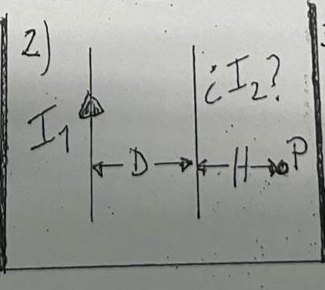
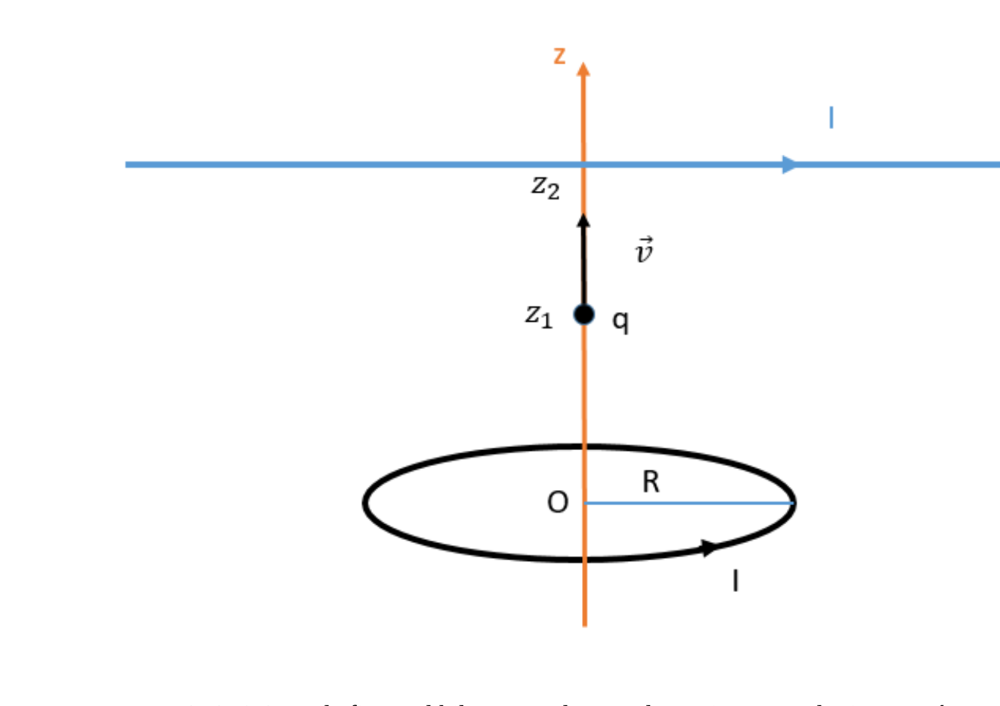
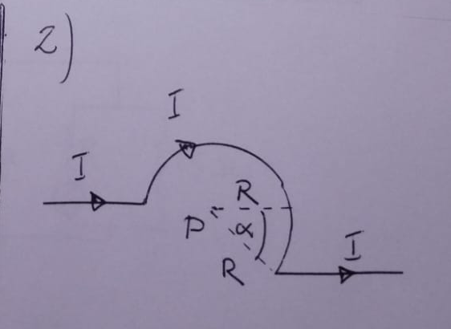
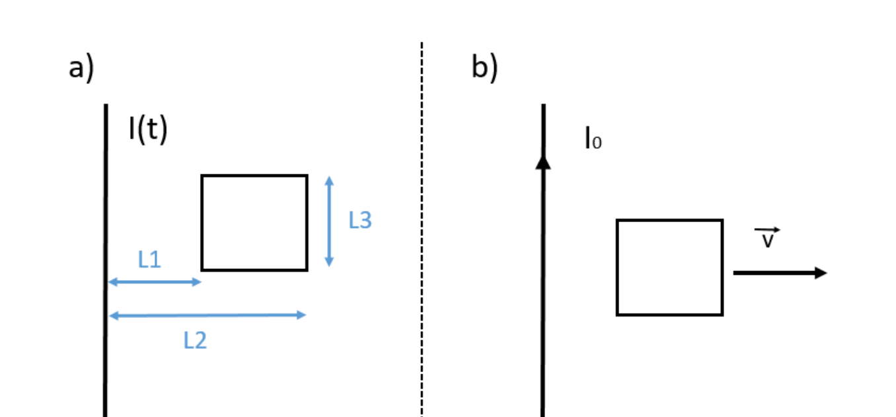
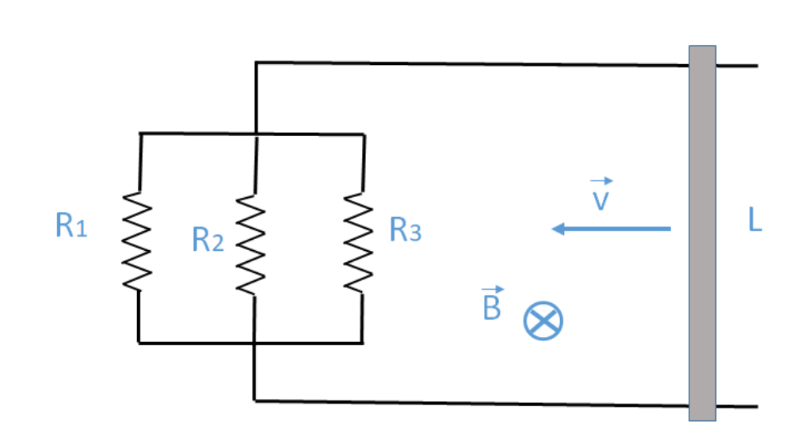
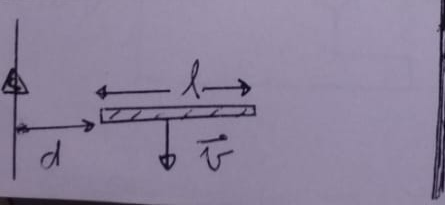
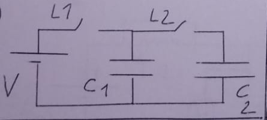
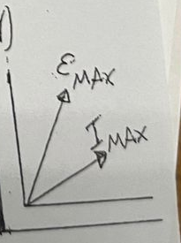

# Guía de resolución del 2º Parcial

Esta guía es para quien ya aprobó Análisis Matemático II (integrales de línea, de superficie, Stokes, producto vectorial) pero **no sabe nada de Física II**. No hace falta haber leído la teoría del repo: todo lo necesario está acá.

Se revisaron los 44 ejercicios de los 10 exámenes del 2º Parcial de esta carpeta y se agruparon en **19 tipos**. Para cada tipo hay:

- **Cómo reconocerlo** en el enunciado.
- **Receta**: los pasos que siempre se siguen.
- **Ejemplo resuelto**: un ejercicio real de parcial, elegido como representante del tipo. Cada fórmula se **deduce** de las leyes en el momento en que se usa, con el atajo al lado. No hace falta memorizar los atajos: alcanza con saber hacer la deducción.
- **Variantes**: los demás ejercicios del mismo tipo, con lo que cambia respecto del ejemplo.

Primero conviene leer la [sección 0](#0-kit-mínimo-lo-que-am2-no-te-dio). Ahí está la idea central de la guía: todo el 2º Parcial sale de [seis leyes](#04-las-seis-leyes-lo-único-que-hay-que-memorizar), y cada fórmula que se usa en los ejercicios se deduce de una de ellas con una integral o una derivada. Después se puede ir directo al tipo que interese.

Volver al [índice de parciales](README.md).

---

## Índice

**[0. Kit mínimo](#0-kit-mínimo-lo-que-am2-no-te-dio)**: unidades, regla de la mano derecha, las seis leyes de las que se deducen todas las fórmulas y la [tabla de atajos para el día del parcial](#011-atajos-para-el-día-del-parcial).

**Magnetostática (campos y fuerzas que producen las corrientes)**

1. [Hilos paralelos: campo en un punto y punto de campo nulo](#1-hilos-paralelos-campo-en-un-punto-y-punto-de-campo-nulo)
2. [Fuerza entre hilos](#2-fuerza-entre-hilos)
3. [Campo en 3D (anillo + hilo) y fuerza sobre una carga](#3-campo-en-3d-anillo--hilo-y-fuerza-sobre-una-carga)
4. [Espiras: campo en el centro](#4-espiras-campo-en-el-centro)
5. [Hilo doblado: Biot-Savart por tramos](#5-hilo-doblado-biot-savart-por-tramos)
6. [Movimiento de una carga en un campo magnético](#6-movimiento-de-una-carga-en-un-campo-magnético)
7. [Solenoide: campo, inductancia, energía y longitud](#7-solenoide-campo-inductancia-energía-y-longitud)
8. [Autoinductancia e inductancia mutua de solenoides](#8-autoinductancia-e-inductancia-mutua-de-solenoides)

**Inducción (fem que aparece cuando cambia el flujo)**

9. [Bobina en un campo que varía con el tiempo](#9-bobina-en-un-campo-que-varía-con-el-tiempo)
10. [Espira junto a un hilo: flujo con integral](#10-espira-junto-a-un-hilo-flujo-con-integral)
11. [Barra sobre rieles](#11-barra-sobre-rieles)
12. [Barra que se mueve junto a un hilo](#12-barra-que-se-mueve-junto-a-un-hilo)
13. [Barra que gira](#13-barra-que-gira)

**Capacitores (desde 2024)**

14. [Capacitores con llaves: energía disipada](#14-capacitores-con-llaves-energía-disipada)

**Corriente alterna**

15. [RLC serie a partir de mediciones](#15-rlc-serie-a-partir-de-mediciones)
16. [RLC serie con la frecuencia de resonancia como dato](#16-rlc-serie-con-la-frecuencia-de-resonancia-como-dato)
17. [Dos capacitores posibles (corregir el factor de potencia)](#17-dos-capacitores-posibles-corregir-el-factor-de-potencia)
18. [Diagrama de fasores: identificar los elementos](#18-diagrama-de-fasores-identificar-los-elementos)
19. [Afirmaciones verdaderas o falsas sobre RLC](#19-afirmaciones-verdaderas-o-falsas-sobre-rlc)

**[Tabla de cobertura](#tabla-de-cobertura)**: a qué tipo corresponde cada ejercicio de cada examen.

---

## 0. Kit mínimo (lo que AM2 no te dio)

### 0.1 Unidades y constantes

| Magnitud | Símbolo | Unidad |
|---|---|---|
| Corriente | $I$ | A (ampere) |
| Campo magnético | $\vec B$ | T (tesla). 1 μT = $10^{-6}$ T |
| Flujo magnético | $\phi$ | T m² = Wb (weber) |
| Fuerza electromotriz (fem), tensión | $\mathcal E$, $V$ | V (volt) |
| Inductancia | $L$, $M$ | H (henry) |
| Capacidad | $C$ | F (farad). 1 μF = $10^{-6}$ F |
| Resistencia, reactancia, impedancia | $R$, $X$, $Z$ | Ω (ohm) |

- **Permeabilidad del vacío:** $\mu_0 = 4\pi\times10^{-7}$ T m/A. Atajo muy útil: $\dfrac{\mu_0}{2\pi} = 2\times10^{-7}$ y $\dfrac{\mu_0}{4\pi} = 10^{-7}$.
- **Permitividad del vacío** (solo para capacitores): $\varepsilon_0 = 8{,}85\times10^{-12}$ F/m.
- Todo en el SI: los centímetros se pasan a metros **antes** de reemplazar.

### 0.2 Notación de los dibujos

- ⊙ = vector **saliente** de la hoja (hacia el lector), ⊗ = **entrante**.
- Ejes habituales: $\hat x$ (o $\hat\imath$) a la derecha, $\hat y$ (o $\hat\jmath$) hacia arriba, $\hat z$ (o $\hat k$) saliente. Es una terna derecha: $\hat x\times\hat y = \hat z$, $\hat y\times\hat z = \hat x$, $\hat z\times\hat x = \hat y$ (y cambian de signo al invertir el orden).

### 0.3 La regla de la mano derecha (para el sentido del campo)

Casi todos los ejercicios piden **módulo, dirección y sentido**. El módulo sale de las fórmulas; el sentido, de una de estas dos reglas:

- **Hilo recto:** pulgar en el sentido de la corriente; los dedos curvados indican cómo gira $\vec B$ alrededor del hilo. Las líneas de campo son circunferencias centradas en el hilo.
  Ejemplo: hilo vertical con corriente hacia arriba → a su **derecha** el campo es **entrante** (⊗) y a su **izquierda**, **saliente** (⊙).
- **Espira, arco o solenoide:** los dedos siguen la corriente; el pulgar da $\vec B$ en el centro. Corriente **antihoraria** (vista desde el lector) → campo **saliente**; **horaria** → **entrante**.

Equivalente analítico: el campo de un elemento de corriente apunta según $d\vec l\times\hat r$, donde $\hat r$ va **del elemento al punto**.

### 0.4 Las seis leyes (lo único que hay que memorizar)

Las fórmulas del 2º Parcial no son 20 fórmulas independientes. Todas salen de **seis leyes**, cada una una integral o una derivada, más alguna simetría. Esta es la tabla para memorizar:

| # | Ley | Ecuación | Qué da |
|---|---|---|---|
| 1 | Biot-Savart | $d\vec B = \dfrac{\mu_0 I}{4\pi}\,\dfrac{d\vec l\times\hat r}{r^2}$ | el campo de **cualquier** cable (integral de línea) |
| 2 | Ampère | $\displaystyle\oint\vec B\cdot d\vec l = \mu_0 I_{enc}$ | atajo para hilo infinito y solenoide |
| 3 | Fuerza magnética | $d\vec F = I\,d\vec l\times\vec B$ (una carga: $\vec F = q\,\vec v\times\vec B$) | fuerza sobre cargas y cables |
| 4 | Faraday | $\mathcal E = -\dfrac{d\Phi}{dt}$, con $\Phi = \displaystyle\iint\vec B\cdot d\vec A$ | toda la inducción, L, M y energía magnética |
| 5 | Capacitor | $q = Cv$, energía $U = \displaystyle\int v\,dq$ | capacitores con llaves |
| 6 | Elementos de un circuito | $v_R = Ri$, $\ v_L = L\dfrac{di}{dt}$, $\ v_C = \dfrac qC$ | toda la corriente alterna |

En $d\vec l\times\hat r$, $d\vec l$ apunta en el sentido de la corriente y $\hat r$ es el versor que va **del elemento de cable al punto P**. Constante: $\mu_0 = 4\pi\times10^{-7}$ T m/A.

Las secciones 0.5 a 0.10 deducen de estas seis todo lo que se usa en los ejercicios. Cada deducción es una integral de AM2 de pocas líneas. Al final de cada sección hay una tabla de lo que sale de esa ley. No hace falta memorizar esas tablas: sirven para **reconocer** el caso y saber cómo se deduce.

**Atajos para el día del parcial:** están todos juntos en [0.11](#011-atajos-para-el-día-del-parcial). Son 10 y evitan todas las integrales de los parciales. Los tres que aparecen en casi todos los exámenes son hilo infinito $\dfrac{\mu_0 I}{2\pi d}$, espira circular en el centro $\dfrac{\mu_0 I}{2R}$ y solenoide $\mu_0 nI$.

---

### 0.5 Ley 1: Biot-Savart (campo de cualquier cable)

$$\vec B(P) = \frac{\mu_0 I}{4\pi}\int_{\text{cable}}\frac{d\vec l\times\hat r}{r^2}$$

Es una integral de línea vectorial sobre el cable. El **sentido** de cada aporte es el de $d\vec l\times\hat r$ (o la mano derecha, 0.3). Para el módulo, en todos los casos del parcial alcanza con tres integrales: tramo recto, arco centrado en P y anillo visto desde su eje.

**Caso 0: P sobre la prolongación de un tramo recto.** Ahí $d\vec l\parallel\hat r$, así que $d\vec l\times\hat r = \vec0$:

$$B = 0$$

**Caso A: tramo recto.** Se pone el cable sobre el eje $x$, con el origen en el **pie de la perpendicular** trazada desde P (P queda a distancia $d$). Para el elemento en $x$: $\vec r = (-x,\ d)$, $r = \sqrt{x^2 + d^2}$ y

$$d\vec l\times\hat r = dx\,\hat x\times\frac{-x\hat x + d\hat y}{r} = \frac{d\,dx}{r}\,\hat z$$

$$B = \frac{\mu_0 I}{4\pi}\int_{x_1}^{x_2}\frac{d\,dx}{(x^2 + d^2)^{3/2}} = \frac{\mu_0 I}{4\pi d}\left[\frac{x}{\sqrt{x^2 + d^2}}\right]_{x_1}^{x_2}$$

(La primitiva sale con $x = d\tan u$, o se verifica derivando.) El corchete evaluado en cada extremo es el seno del ángulo con que P ve ese extremo, medido desde la perpendicular, **con signo** (negativo si el extremo está del otro lado del pie). Hay que acordarse de la integral, no de los casos:

| Caso | Límites | Resultado |
|---|---|---|
| Hilo infinito | $x_1 = -\infty$, $x_2 = +\infty$ (corchete: $1 - (-1)$) | $\dfrac{\mu_0 I}{2\pi d}$ |
| Semi-infinito, P frente a su extremo | $x_1 = 0$, $x_2 = \infty$ (corchete: $1 - 0$) | $\dfrac{\mu_0 I}{4\pi d}$ |
| Lado de una espira visto desde su mediatriz (largo $\ell$) | $\pm\ell/2$ | $\dfrac{\mu_0 I}{4\pi d}\cdot\dfrac{\ell}{\sqrt{(\ell/2)^2 + d^2}}$ |
| Espira rectangular $a\times b$ en el centro | sumar los 4 lados ($d = b/2$ para los lados de largo $a$ y viceversa) | $\dfrac{2\mu_0 I\sqrt{a^2 + b^2}}{\pi ab}$ |
| Espira cuadrada de lado $D$ | rectángulo con $a = b = D$ | $\dfrac{2\sqrt2\,\mu_0 I}{\pi D}$ |

Cuenta del rectángulo: los dos lados de largo $a$ están a $b/2$ y cada uno da $\dfrac{\mu_0 I}{4\pi(b/2)}\cdot\dfrac{a}{\sqrt{a^2 + b^2}/2}$. Sumando los cuatro lados:

$$B = \frac{\mu_0 I}{\pi\sqrt{a^2 + b^2}}\left(\frac ab + \frac ba\right)\cdot 2 = \frac{2\mu_0 I}{\pi\sqrt{a^2 + b^2}}\cdot\frac{a^2 + b^2}{ab} = \frac{2\mu_0 I\sqrt{a^2 + b^2}}{\pi ab}$$

**Caso B: arco de radio $R$ centrado en P.** Cada elemento está a distancia $R$ y es perpendicular al radio, así que $\lvert d\vec l\times\hat r\rvert = dl = R\,d\varphi$:

$$B = \frac{\mu_0 I}{4\pi}\int_0^\theta\frac{R\,d\varphi}{R^2} = \frac{\mu_0 I\,\theta}{4\pi R}$$

| Caso | $\theta$ | Resultado |
|---|---|---|
| Espira circular en el centro | $2\pi$ | $\dfrac{\mu_0 I}{2R}$ |
| Semicircunferencia | $\pi$ | $\dfrac{\mu_0 I}{4R}$ |
| Cualquier arco | el que recorra (en radianes) | $\dfrac{\mu_0 I\,\theta}{4\pi R}$ |

**Caso C: anillo de radio $R$, en un punto de su eje a distancia $z$.** Todos los elementos están a $r = \sqrt{R^2 + z^2}$ y son perpendiculares a $\vec r$, así que cada uno da $dB = \dfrac{\mu_0 I\,dl}{4\pi r^2}$. Por simetría, las componentes perpendiculares al eje se cancelan de a pares (elementos opuestos del anillo). Sobrevive la componente axial, que es $dB\cdot\dfrac Rr$:

$$B = \frac{\mu_0 I}{4\pi r^2}\cdot\frac Rr\int dl = \frac{\mu_0 I}{4\pi r^3}R\cdot2\pi R = \frac{\mu_0 IR^2}{2(R^2 + z^2)^{3/2}}$$

Control: con $z = 0$ da $\dfrac{\mu_0 I}{2R}$, igual que el caso B con $\theta = 2\pi$.

**Superposición.** Un cable con varias partes (tramos rectos y arcos) o varios cables: se calcula cada parte con su caso y se suman los vectores. Esto resuelve los tipos [1](#1-hilos-paralelos-campo-en-un-punto-y-punto-de-campo-nulo) a [5](#5-hilo-doblado-biot-savart-por-tramos).

---

### 0.6 Ley 2: Ampère (atajo cuando hay simetría)

$$\oint_{\mathcal C}\vec B\cdot d\vec l = \mu_0 I_{enc}$$

Es una circulación, como en el teorema de Stokes: $I_{enc}$ es la corriente que atraviesa cualquier superficie con borde $\mathcal C$. Solo permite **despejar** $B$ si se elige una curva donde $\vec B$ sea tangente y de módulo constante (o perpendicular, o nulo).

| Caso | Curva $\mathcal C$ | Cuenta | Resultado |
|---|---|---|---|
| Hilo infinito | circunferencia de radio $d$ centrada en el hilo | $B\cdot2\pi d = \mu_0 I$ | $B = \dfrac{\mu_0 I}{2\pi d}$ |
| Solenoide largo ($n = N/\ell$ vueltas por metro) | rectángulo con un lado de largo $\ell'$ adentro, paralelo al eje, y el opuesto afuera | adentro aporta $B\ell'$; afuera $B \approx 0$; los lados perpendiculares no aportan. Encierra $n\ell'$ vueltas: $B\ell' = \mu_0 n\ell' I$ | $B = \mu_0 nI$ (uniforme) |

El hilo infinito también sale de Biot-Savart (caso A con límites infinitos). Que dos caminos den lo mismo sirve de control.

---

### 0.7 Ley 3: fuerza magnética

$$d\vec F = I\,d\vec l\times\vec B \qquad (\text{para una carga puntual: } \vec F = q\,\vec v\times\vec B)$$

Es la misma ley: una corriente es carga en movimiento ($I\,d\vec l = dq\,\vec v$).

| Caso | Cómo sale | Resultado |
|---|---|---|
| Carga puntual | directo; si $\vec v\parallel\vec B$ da 0, si $\vec v\perp\vec B$ da $\lvert q\rvert vB$ | $\vec F = q\,\vec v\times\vec B$ (**con el signo de $q$**) |
| Tramo recto en campo uniforme | integrar $d\vec l$ a lo largo del tramo | $\vec F = I\,\vec\ell\times\vec B$ |
| Entre dos hilos paralelos | el hilo 2 está en el campo del 1 (Ampère): $F = I_2\ell\cdot\dfrac{\mu_0 I_1}{2\pi D}$ | $\dfrac{F}{\ell} = \dfrac{\mu_0 I_1I_2}{2\pi D}$; paralelas se atraen |
| Carga con $\vec v\perp\vec B$ uniforme | la fuerza es centrípeta: $\lvert q\rvert vB = \dfrac{mv^2}{r}$ | $r = \dfrac{mv}{\lvert q\rvert B}$, período $T = \dfrac{2\pi r}{v} = \dfrac{2\pi m}{\lvert q\rvert B}$ |
| Carga con $\vec v$ oblicua | la componente paralela a $\vec B$ no siente fuerza; la perpendicular gira | hélice de paso $p = v_\parallel T$ |
| Trabajo de la fuerza magnética | $dW = \vec F\cdot\vec v\,dt = (q\,\vec v\times\vec B)\cdot\vec v\,dt = 0$ | **nunca** cambia el módulo de la velocidad |

---

### 0.8 Ley 4: Faraday (toda la inducción sale de acá)

$$\mathcal E = -\frac{d\Phi}{dt} \qquad \Phi = \iint_S\vec B\cdot d\vec A$$

El flujo es una integral de superficie sobre cualquier superficie con borde en el circuito. Si el circuito tiene $N$ vueltas, el flujo total es $N$ veces el de una. El **sentido** de la corriente inducida lo da la **ley de Lenz**: se opone al cambio de flujo (si el flujo entrante crece, la corriente genera campo saliente, o sea que circula en sentido antihorario; si decrece, en sentido horario). En la práctica se calcula $\lvert d\Phi/dt\rvert$ y el sentido se saca con Lenz. La corriente es $I = \mathcal E/R$.

El flujo puede cambiar porque cambia $B$, porque cambia el área o porque el circuito se mueve dentro de un campo no uniforme. Cada ejercicio de inducción es uno de estos casos:

| Caso | Flujo | Derivando | Tipo |
|---|---|---|---|
| Bobina quieta con $B(t)$ uniforme | $N\Phi = NA\,B(t)$ | $\mathcal E = NA\,\dfrac{dB}{dt}$ | [9](#9-bobina-en-un-campo-que-varía-con-el-tiempo) |
| Espira rectangular junto a un hilo (lado paralelo $c$, de $x_1$ a $x_2$) | franjas de ancho $dx$: $\displaystyle\int_{x_1}^{x_2}\frac{\mu_0 I}{2\pi x}c\,dx = \frac{\mu_0 Ic}{2\pi}\ln\frac{x_2}{x_1}$ | derivar $I(t)$, o $x_1(t)$ y $x_2(t)$ con regla de la cadena | [10](#10-espira-junto-a-un-hilo-flujo-con-integral) |
| Barra sobre rieles (separación $\ell$, posición $x$), $B$ uniforme | $\Phi = B\ell x$ | $\mathcal E = B\ell v$ | [11](#11-barra-sobre-rieles) |
| Barra sobre rieles con $B(x)$ | $\Phi = \displaystyle\int_0^xB(x')\,\ell\,dx'$ | Teorema fundamental del cálculo: $\mathcal E = B(x)\,\ell v$ | [11](#11-barra-sobre-rieles) |
| Barra que gira alrededor de un extremo | barre un sector de área $\tfrac12r_0^2\theta$: $\Phi = \tfrac12Br_0^2\theta$ | $\mathcal E = \tfrac12B\omega r_0^2$ | [13](#13-barra-que-gira) |

**Fem de movimiento (misma ley vista desde la barra).** Cuando una barra se mueve **sola**, sin un circuito cerrado, no hay un "área" evidente. Ahí se usa que sobre cada carga de la barra actúa $q\,\vec v\times\vec B$, que hace el papel de un campo eléctrico $\vec v\times\vec B$. La fem es su integral de línea a lo largo de la barra:

$$\mathcal E = \int_{\text{barra}}(\vec v\times\vec B)\cdot d\vec l$$

El extremo hacia el que apunta $\vec v\times\vec B$ queda a **mayor potencial**. Da lo mismo que Faraday (por ejemplo, la barra que gira: $v = \omega r$ y $\displaystyle\int_0^{r_0}B\omega r\,dr = \tfrac12B\omega r_0^2$). Con el campo de un hilo, $B = \dfrac{\mu_0 I}{2\pi r}$, sale $\mathcal E = \dfrac{\mu_0 Iv}{2\pi}\ln\dfrac{d + \ell}{d}$ (tipo [12](#12-barra-que-se-mueve-junto-a-un-hilo)).

**Inductancias: Faraday aplicado al propio circuito.** Si el flujo $N\Phi$ que atraviesa una bobina es proporcional a una corriente, la constante de proporcionalidad es una inductancia:

$$N\Phi_{\text{propio}} = LI \qquad N_2\Phi_{2\leftarrow1} = MI_1$$

Y Faraday da directamente la fem autoinducida: $\mathcal E = -\dfrac{d(LI)}{dt} = -L\dfrac{dI}{dt}$.

| Caso | Cuenta (con $B = \mu_0 nI$ de Ampère, $A = \pi R^2$) | Resultado |
|---|---|---|
| L de un solenoide | $N\Phi = N\cdot\mu_0\dfrac N\ell I\cdot A$ | $L = \dfrac{\mu_0 N^2A}{\ell} = \mu_0 n^2A\ell$ |
| M de dos solenoides coaxiales | el campo del **exterior** atraviesa las $N_1$ vueltas del interior, de área $A_1$ (la **menor**) | $M = \dfrac{\mu_0 N_1N_2A_1}{\ell}$ |

**Energía magnética: integrar la potencia.** Para hacer crecer la corriente hay que vencer la fem autoinducida, que exige una potencia $P = \mathcal E I = LI\dfrac{dI}{dt}$. Integrando:

$$U = \int_0^IL\,i\,di = \tfrac12LI^2$$

Reemplazando $L$ y $B$ del solenoide: $\tfrac12\mu_0 n^2A\ell\,I^2 = \dfrac{(\mu_0 nI)^2}{2\mu_0}A\ell = \dfrac{B^2}{2\mu_0}\cdot\text{volumen}$. La energía está repartida en el volumen con densidad $\dfrac{B^2}{2\mu_0}$ (tipo [7](#7-solenoide-campo-inductancia-energía-y-longitud)).

---

### 0.9 Ley 5: capacitores

$$q = Cv \qquad U = \int_0^Qv\,dq = \int_0^Q\frac qC\,dq = \frac{Q^2}{2C} = \tfrac12CV^2$$

| Caso | Cómo sale | Resultado |
|---|---|---|
| Energía que entrega una fuente de tensión fija $V$ | $W = \displaystyle\int V\,dq = QV = CV^2$ | el doble de lo que guarda: **la mitad se disipa** en las resistencias, sin importar cuánto valgan |
| Capacitor aislado que se conecta a otros descargados | la carga no tiene a dónde ir: se conserva. Terminan en paralelo, con la misma tensión | $V_f = \dfrac{Q_0}{\sum C}$; energía disipada $=U_{antes} - U_{después}$ |
| Capacitores en paralelo / en serie | misma $v$, se suman las $q$ / misma $q$, se suman las $v$ | $C_{eq} = \sum C_i$ / $\dfrac{1}{C_{eq}} = \sum\dfrac{1}{C_i}$ |
| Capacitor cilíndrico (radios $a < b$, largo $\ell$) | Gauss: $E = \dfrac{\lambda}{2\pi\varepsilon_0 r}$; $\ V = \displaystyle\int_a^bE\,dr = \frac{\lambda}{2\pi\varepsilon_0}\ln\frac ba$; $\ C = \dfrac{\lambda\ell}{V}$ | $C = \dfrac{2\pi\varepsilon_0\ell}{\ln(b/a)}$ |

---

### 0.10 Ley 6: corriente alterna (una sola ecuación compleja)

Las relaciones entre tensión y corriente en cada elemento son:

$$v_R = Ri \qquad v_L = L\frac{di}{dt} \qquad v_C = \frac qC,\ \text{con } i = \frac{dq}{dt}$$

(La de la bobina es Faraday: es la fem autoinducida.)

**El truco: la derivada se convierte en un producto.** Con el generador $v(t) = V_0\,\mathrm{sen}\,(\omega t)$, todas las tensiones y corrientes oscilan a la misma $\omega$. Se escriben como parte imaginaria de exponenciales complejas, $i = I_0e^{j\omega t}$ (en electricidad $j = \sqrt{-1}$, porque $i$ ya es la corriente). Entonces:

$$\frac{di}{dt} = j\omega\,i \qquad q = \int i\,dt = \frac{i}{j\omega}$$

y las tres relaciones quedan como una ley de Ohm con una "resistencia" compleja, la **impedancia**:

$$v_R = R\,i \qquad v_L = (j\omega L)\,i \qquad v_C = \frac{1}{j\omega C}\,i = \left(-\frac{j}{\omega C}\right)i$$

En serie la corriente es la misma y las tensiones se suman:

$$v = \underbrace{\left[R + j\left(\omega L - \frac{1}{\omega C}\right)\right]}_{Z}\,i = \left[R + j(X_L - X_C)\right]i \qquad X_L = \omega L,\ \ X_C = \frac{1}{\omega C}$$

**Todo lo de alterna es leer este número complejo $Z$:**

| Qué | Cómo sale de $Z$ | Resultado |
|---|---|---|
| Relación de amplitudes | módulo: $V_0 = \lvert Z\rvert I_0$ | $Z = \sqrt{R^2 + (X_L - X_C)^2} = \dfrac{V_0}{I_0} = \dfrac{V_{EF}}{I_{EF}}$ |
| Desfasaje | argumento: $v = \lvert Z\rvert e^{j\varphi}i$ | $\tan\varphi = \dfrac{X_L - X_C}{R}$, $\ \cos\varphi = \dfrac RZ$. Si $\varphi > 0$ la tensión adelanta |
| Inductivo o capacitivo | signo de la parte imaginaria | $X_L > X_C$: inductivo (la tensión adelanta). $X_C > X_L$: capacitivo (la corriente adelanta) |
| Resonancia | parte imaginaria nula: $\omega L = \dfrac{1}{\omega C}$ | $\omega_0 = \dfrac{1}{\sqrt{LC}}$. Por debajo de $\omega_0$ domina $X_C$ (capacitivo); por encima, $X_L$ (inductivo) |
| Reactancia con $\omega_0$ como dato | reemplazar $C = 1/(\omega_0^2L)$ | $X_L - X_C = L\,\dfrac{\omega^2 - \omega_0^2}{\omega}$ |
| Tensión en un solo elemento | módulo de su impedancia por $I$ | $V_R = RI$, $\ V_L = X_LI$, $\ V_C = X_CI$ (no se suman como números: se suman como vectores del plano complejo) |

Es el **triángulo de impedancias**: catetos $R$ y $X_L - X_C$, hipotenusa $Z$, ángulo $\varphi$.

**Valores eficaces: un promedio integral.** El valor eficaz es la raíz del valor medio del cuadrado. Los amperímetros y voltímetros miden eficaces; "de pico" o "máximo" es la amplitud.

$$V_{EF}^2 = \frac1T\int_0^TV_0^2\,\mathrm{sen}^2(\omega t)\,dt = \frac{V_0^2}{2} \quad\Rightarrow\quad V_{EF} = \frac{V_0}{\sqrt2}$$

**Potencia activa: otro promedio integral.** Con $v = V_0\,\mathrm{sen}\,(\omega t)$ e $i = I_0\,\mathrm{sen}\,(\omega t - \varphi)$, y usando $\mathrm{sen}\,a\,\mathrm{sen}\,b = \tfrac12[\cos(a - b) - \cos(a + b)]$:

$$P = \frac1T\int_0^Tv\,i\,dt = \frac{V_0I_0}{2}\cdot\frac1T\int_0^T\left[\cos\varphi - \cos(2\omega t - \varphi)\right]dt = \frac{V_0I_0}{2}\cos\varphi = V_{EF}I_{EF}\cos\varphi$$

Como $\cos\varphi = R/Z$ y $V_{EF} = ZI_{EF}$, también $P = I_{EF}^2R$: solo la resistencia consume energía en promedio. Multiplicando los lados del triángulo de impedancias por $I_{EF}^2$ salen las otras dos potencias:

| Potencia | Lado del triángulo × $I_{EF}^2$ | Fórmula | Unidad |
|---|---|---|---|
| Activa | $R$ | $P = I_{EF}^2R = V_{EF}I_{EF}\cos\varphi$ | W |
| Reactiva | $X_L - X_C$ | $Q = I_{EF}^2(X_L - X_C) = V_{EF}I_{EF}\,\mathrm{sen}\,\varphi$ | VAR |
| Aparente | $Z$ | $S = I_{EF}^2Z = V_{EF}I_{EF}$ | VA |

$\cos\varphi$ se llama **factor de potencia**.

**Truco central de casi todos los ejercicios de alterna:** con los datos se obtienen $Z$ y $R$ (o $Z$ y $\varphi$), y de ahí $\lvert X_L - X_C\rvert = \sqrt{Z^2 - R^2} = Z\,\mathrm{sen}\,\varphi$. Lo que diga el enunciado sobre la fase o la resonancia decide el **signo** de $X_L - X_C$.

---

### 0.11 Atajos para el día del parcial

Con estos **10 atajos** se evitan todas las integrales que aparecen en los 10 parciales. Cada uno está deducido en la sección de su ley y en el ejemplo del tipo correspondiente. Las leyes, estos atajos y las constantes, sin deducciones, están juntos en el [formulario](formulario.md).

| # | Atajo | Integral que ahorra | Tipos |
|---|---|---|---|
| 1 | **Tramo recto:** $B = \dfrac{\mu_0 I}{4\pi d}(\mathrm{sen}\,\beta_2 - \mathrm{sen}\,\beta_1)$. Casos particulares: hilo infinito $\dfrac{\mu_0 I}{2\pi d}$, semi-infinito con P frente a su extremo $\dfrac{\mu_0 I}{4\pi d}$, P sobre la prolongación $0$ | Biot-Savart en una recta ([0.5, caso A](#05-ley-1-biot-savart-campo-de-cualquier-cable)) | [1](#1-hilos-paralelos-campo-en-un-punto-y-punto-de-campo-nulo), [2](#2-fuerza-entre-hilos), [3](#3-campo-en-3d-anillo--hilo-y-fuerza-sobre-una-carga), [4](#4-espiras-campo-en-el-centro), [5](#5-hilo-doblado-biot-savart-por-tramos), [10](#10-espira-junto-a-un-hilo-flujo-con-integral), [12](#12-barra-que-se-mueve-junto-a-un-hilo) |
| 2 | **Arco centrado en P:** $B = \dfrac{\mu_0 I\theta}{4\pi R}$. Espira circular $\dfrac{\mu_0 I}{2R}$, semicircunferencia $\dfrac{\mu_0 I}{4R}$ | Biot-Savart en un arco ([0.5, caso B](#05-ley-1-biot-savart-campo-de-cualquier-cable)) | [4](#4-espiras-campo-en-el-centro), [5](#5-hilo-doblado-biot-savart-por-tramos) |
| 3 | **Anillo en su eje:** $B = \dfrac{\mu_0 IR^2}{2(R^2 + z^2)^{3/2}}$ | Biot-Savart con simetría ([0.5, caso C](#05-ley-1-biot-savart-campo-de-cualquier-cable)) | [3](#3-campo-en-3d-anillo--hilo-y-fuerza-sobre-una-carga) |
| 4 | **Solenoide:** $B = \mu_0 nI$ | circulación de Ampère ([0.6](#06-ley-2-ampère-atajo-cuando-hay-simetría)) | [7](#7-solenoide-campo-inductancia-energía-y-longitud), [8](#8-autoinductancia-e-inductancia-mutua-de-solenoides) |
| 5 | **Hilo y logaritmo:** flujo en una espira $\Phi = \dfrac{\mu_0 Ic}{2\pi}\ln\dfrac{x_2}{x_1}$; barra junto al hilo $\mathcal E = \dfrac{\mu_0 Iv}{2\pi}\ln\dfrac{d + \ell}{d}$ | flujo o fem con un campo no uniforme ([0.8](#08-ley-4-faraday-toda-la-inducción-sale-de-acá)) | [10](#10-espira-junto-a-un-hilo-flujo-con-integral), [12](#12-barra-que-se-mueve-junto-a-un-hilo) |
| 6 | **Barra que gira:** $\mathcal E = \tfrac12B\omega r_0^2$ | $\int(\vec v\times\vec B)\cdot d\vec l$ con $v = \omega r$ ([0.8](#08-ley-4-faraday-toda-la-inducción-sale-de-acá)) | [13](#13-barra-que-gira) |
| 7 | **Energía magnética:** $U = \tfrac12LI^2 = \dfrac{B^2}{2\mu_0}\cdot\text{volumen}$ | $\int L\,i\,di$ ([0.8](#08-ley-4-faraday-toda-la-inducción-sale-de-acá)) | [7](#7-solenoide-campo-inductancia-energía-y-longitud) |
| 8 | **Energía de un capacitor:** $U = \tfrac12CV^2 = \dfrac{Q^2}{2C}$; la fuente entrega $QV$, así que se disipa la mitad | $\int v\,dq$ ([0.9](#09-ley-5-capacitores)) | [14](#14-capacitores-con-llaves-energía-disipada) |
| 9 | **Eficaces y potencia:** $V_{EF} = \dfrac{V_0}{\sqrt2}$, $\ P = V_{EF}I_{EF}\cos\varphi = I_{EF}^2R$ | promedios en un período ([0.10](#010-ley-6-corriente-alterna-una-sola-ecuación-compleja)) | [15](#15-rlc-serie-a-partir-de-mediciones) a [18](#18-diagrama-de-fasores-identificar-los-elementos) |
| 10 | **Capacitor cilíndrico:** $C = \dfrac{2\pi\varepsilon_0\ell}{\ln(b/a)}$ | Gauss y $\int E\,dr$ ([0.9](#09-ley-5-capacitores)) | [16](#16-rlc-serie-con-la-frecuencia-de-resonancia-como-dato) (apareció una sola vez) |

Los imprescindibles son el **1**, el **2** y el **4**: entre los tres aparecen en casi todos los parciales.

**Lo que no hace falta memorizar** porque sale con álgebra o con una derivada, sin integrar:

| Fórmula | Cómo sale en una línea |
|---|---|
| Fuerza entre hilos $\dfrac F\ell = \dfrac{\mu_0 I_1I_2}{2\pi D}$ | campo del hilo 1 (atajo 1) por $I_2\ell$; paralelas se atraen |
| Fuerza sobre una carga o un cable | $\vec F = q\,\vec v\times\vec B$, $\ \vec F = I\vec\ell\times\vec B$ (la ley misma) |
| Radio y período $r = \dfrac{mv_\perp}{\lvert q\rvert B}$, $T = \dfrac{2\pi m}{\lvert q\rvert B}$; paso $p = v_\parallel T$ | fuerza magnética = fuerza centrípeta $\dfrac{mv^2}{r}$ |
| Barra sobre rieles $\mathcal E = B\ell v$ | derivar $\Phi = B\ell x$ |
| Bobina con $B(t)$: $\mathcal E = NA\dfrac{dB}{dt}$ | derivar $\Phi = NAB(t)$ |
| $L = \mu_0\dfrac{N^2}{\ell}A$, $\ M = \mu_0\dfrac{N_1N_2}{\ell}A_{\text{menor}}$, $\ \mathcal E = -L\dfrac{dI}{dt}$ | $N\Phi = LI$ con el solenoide (atajo 4) |
| Espira rectangular $\dfrac{2\mu_0 I\sqrt{a^2 + b^2}}{\pi ab}$ | sumar 4 lados con el atajo 1 |
| Reparto de carga $V_f = \dfrac{Q_0}{\sum C}$ | la carga se conserva y terminan en paralelo |
| $Z = \sqrt{R^2 + (X_L - X_C)^2}$, $\ X_L = \omega L$, $\ X_C = \dfrac{1}{\omega C}$ | $d/dt\to j\omega$ en $v_L$ y $v_C$, y sumar en serie |
| $\cos\varphi = \dfrac RZ$, $\ \lvert X_L - X_C\rvert = Z\,\mathrm{sen}\,\varphi$ | parte real e imaginaria de $Z$ |
| $\omega_0 = \dfrac{1}{\sqrt{LC}}$ | parte imaginaria de $Z$ igual a 0 |
| $X_L - X_C = L\,\dfrac{\omega^2 - \omega_0^2}{\omega}$ | reemplazar $C = \dfrac{1}{\omega_0^2L}$ |
| $S = V_{EF}I_{EF}$, $\ Q = V_{EF}I_{EF}\,\mathrm{sen}\,\varphi$ | lados del triángulo de impedancias por $I_{EF}^2$ |

**Ojo: a veces piden la demostración.** En [20/11/2015, Ej. 1](2015-11-20-2do-parcial.md#ejercicio-1) piden demostrar el campo de una espira rectangular, y en [09/12/2021, Ej. 2](2021-12-09-1er-recuperatorio-2do-parcial.md#ejercicio-2) piden "justifique la fórmula utilizada" para L y M. Conviene saber deducir al menos los atajos 1, 2 y 4 y la $L$ del solenoide.

---

# Magnetostática

## 1. Hilos paralelos: campo en un punto y punto de campo nulo

**Cómo reconocerlo.** Dos hilos "muy largos" paralelos; piden el campo en un punto, dónde se anula, o una corriente desconocida a partir de un punto de campo nulo.

**De dónde sale.** [Ley 2, Ampère](#06-ley-2-ampère-atajo-cuando-hay-simetría) (o [Ley 1, Biot-Savart](#05-ley-1-biot-savart-campo-de-cualquier-cable) con límites infinitos) para el campo de cada hilo, y superposición.

**Receta.**

1. Dibujar los hilos y el punto. Para cada hilo, distancia al punto y sentido del campo (mano derecha, 0.3).
2. Sumar con signo: $B = \dfrac{\mu_0}{2\pi}\left(\pm\dfrac{I_1}{d_1}\pm\dfrac{I_2}{d_2}\right)$.
3. Para campo nulo, usar esta regla (sale de dibujar los sentidos):

| Corrientes | Entre los hilos | Afuera |
|---|---|---|
| Paralelas (mismo sentido) | campos **opuestos** → puede haber cero | campos iguales → nunca cero |
| Antiparalelas | campos **iguales** → nunca cero | campos opuestos → cero del lado del hilo con **menos** corriente |

4. Igualar módulos $\dfrac{I_1}{d_1} = \dfrac{I_2}{d_2}$ y despejar. El cero es una recta paralela a los hilos, no un punto aislado.

### Ejemplo — 1er Recuperatorio 09/12/2021, Ej. 1

> Dos alambres paralelos infinitos, separados por una distancia de 8 cm, están circulados por corrientes I₁=1 A e I₂. El campo magnético generado por los alambres se anula a una distancia de 2 cm del primero, en la región externa a los dos alambres. **a)** Determine I₂. **b)** Halle el campo magnético en el punto medio entre ambos alambres. **c)** Una carga q=6 μC pasa por el punto del ítem anterior con una velocidad de módulo 4 x 10⁴ m/s y dirección coincidente con la de los hilos. Determine el módulo de la fuerza sobre la carga.

**Deducción del campo de un hilo infinito** (atajo: $B = \dfrac{\mu_0 I}{2\pi d}$). Por simetría, $\vec B$ es tangente a las circunferencias centradas en el hilo y tiene el mismo módulo en toda la circunferencia de radio $d$. Circulación de Ampère sobre esa circunferencia:

$$\oint\vec B\cdot d\vec l = B\cdot2\pi d = \mu_0 I \quad\Rightarrow\quad B = \frac{\mu_0 I}{2\pi d}$$

**Deducción de la tabla de campo nulo.** Hilo 1 en $x = 0$ con corriente hacia arriba; por la mano derecha, a su derecha el campo es ⊗ y a su izquierda ⊙. Si el hilo 2 (en $x = D$) también sube, entre los hilos el hilo 1 da ⊗ y el 2 da ⊙: se pueden cancelar. Afuera, por ejemplo a la derecha de los dos, ambos dan ⊗ y se suman. Con el hilo 2 bajando todo se invierte. Además, afuera el punto está más cerca de un hilo que del otro, así que para que $\dfrac{I_1}{d_1} = \dfrac{I_2}{d_2}$ con $d$ menor hace falta $I$ menor: el cero está del lado del hilo con menos corriente.

**a)** El cero está **afuera**: por la tabla, las corrientes son **antiparalelas**. El punto está a 2 cm del hilo 1 y a $2 + 8 = 10$ cm del hilo 2:

$$\frac{\mu_0 I_1}{2\pi\cdot0{,}02} = \frac{\mu_0 I_2}{2\pi\cdot0{,}10} \quad\Rightarrow\quad I_2 = 5I_1 = 5\ \text{A}\ (\text{sentido opuesto a } I_1)$$

Coherente: el cero quedó del lado del hilo con menos corriente.

**b)** Entre hilos antiparalelos los campos se suman. Cada uno está a 4 cm:

$$B = \frac{\mu_0}{2\pi}\left(\frac{I_1}{0{,}04} + \frac{I_2}{0{,}04}\right) = 2\times10^{-7}\cdot\frac{6}{0{,}04}\ \text{T} = 30\ \mu\text{T}$$

**c)** El campo de un hilo es tangente a circunferencias alrededor del hilo, o sea **perpendicular** a él. La velocidad es paralela a los hilos, así que $\vec v\perp\vec B$ y, de $\vec F = q\,\vec v\times\vec B$, el módulo es $\lvert\vec F\rvert = qvB\,\mathrm{sen}\,90^\circ = qvB$:

$$F = 6\times10^{-6}\cdot4\times10^4\cdot30\times10^{-6}\ \text{N} = 7{,}2\ \mu\text{N}$$

**Variantes.**

- [2º Parcial 28/11/2024, Ej. 2](2024-11-28-2do-parcial.md#ejercicio-2): mismas preguntas al revés (dan las dos corrientes antiparalelas, piden B en un punto intermedio y dónde se anula).
- [2º Parcial 03/12/2020, Ej. 1](2020-12-03-2do-parcial.md#ejercicio-1): además piden la fuerza **vectorial** sobre una carga negativa que se mueve perpendicular a los hilos. Ahí sí hay que hacer $q\,\vec v\times\vec B$ con versores y con el signo de $q$.
- [2º Parcial 25/11/2021, Ej. 1a](2021-11-25-2do-parcial.md#ejercicio-1): el campo se anula **entre** los hilos → corrientes paralelas.

---

## 2. Fuerza entre hilos

**Cómo reconocerlo.** "Los hilos se atraen/repelen con una fuerza por unidad de longitud de…".

**De dónde sale.** [Ley 3, fuerza magnética](#07-ley-3-fuerza-magnética) sobre un hilo que está en el campo del otro ([Ley 2, Ampère](#06-ley-2-ampère-atajo-cuando-hay-simetría)).

**Receta.**

1. Atracción → corrientes **paralelas**; repulsión → antiparalelas.
2. $\dfrac{F}{\ell} = \dfrac{\mu_0 I_1 I_2}{2\pi D}$ → despejar la corriente que falte.
3. Con los sentidos ya conocidos, seguir como en el [tipo 1](#1-hilos-paralelos-campo-en-un-punto-y-punto-de-campo-nulo).

*Por qué se atraen:* el hilo 1 genera $B_1$ en el hilo 2, y sobre el hilo 2 actúa $I_2\vec\ell\times\vec B_1$. Haciendo la cuenta con corrientes del mismo sentido, la fuerza apunta hacia el hilo 1.

### Ejemplo — 2º Parcial 27/11/2025 (Tema 2), Ej. 2

> Dos hilos muy largos y que transportan corrientes I₁=I e I₂ de valor y sentido desconocidos se hallan dispuestos de forma coplanar, y separados por una distancia D. **a)** Sabiendo que los hilos se atraen entre sí con una fuerza por unidad de longitud de módulo 4μ₀I²/(3πD), determine el campo en el punto P (H=D/5). Exprese en términos de μ₀, I y D. **b)** ¿Existen puntos donde el campo magnético sea nulo? En caso afirmativo, determine alguno de ellos. En caso negativo, justifique claramente.

En la figura P está a la derecha del hilo 2, a $H = D/5$ de él (o sea a $6D/5$ del hilo 1).

**Deducción de la fuerza entre hilos** (atajo: $\dfrac F\ell = \dfrac{\mu_0 I_1I_2}{2\pi D}$, paralelas se atraen). Hilo 1 sobre el eje $y$ con $I_1$ hacia arriba, hilo 2 en $x = D$. El campo del hilo 1 en el hilo 2 sale de Ampère ([tipo 1](#1-hilos-paralelos-campo-en-un-punto-y-punto-de-campo-nulo)): $\vec B_1 = -\dfrac{\mu_0 I_1}{2\pi D}\hat z$ (entrante, a la derecha del hilo). Es el mismo en todo el hilo 2, así que integrar $d\vec F = I_2\,d\vec l\times\vec B_1$ sobre un largo $\ell$ con $I_2$ hacia arriba da

$$\vec F = I_2\ell\,\hat y\times\left(-\frac{\mu_0 I_1}{2\pi D}\hat z\right) = -\frac{\mu_0 I_1I_2\ell}{2\pi D}\,\hat x$$

Apunta hacia el hilo 1: corrientes del mismo sentido se **atraen**. Si $I_2$ bajara, cambiaría el signo y se repelerían.

**a)** Se atraen → I₂ va en el **mismo sentido** que I₁ (hacia arriba). Su valor:

$$\frac{\mu_0 I\,I_2}{2\pi D} = \frac{4\mu_0 I^2}{3\pi D} \quad\Rightarrow\quad I_2 = \frac83 I$$

P está a la derecha de ambos hilos y las dos corrientes suben: los dos campos son **entrantes** y se suman. Cada uno es el de un hilo infinito, $\dfrac{\mu_0 I}{2\pi d}$ (deducido con Ampère en el [tipo 1](#1-hilos-paralelos-campo-en-un-punto-y-punto-de-campo-nulo)):

$$B_P = \frac{\mu_0 I}{2\pi(6D/5)} + \frac{\mu_0(8I/3)}{2\pi(D/5)} = \frac{\mu_0 I}{2\pi D}\left(\frac56 + \frac{40}{3}\right) = \frac{85\,\mu_0 I}{12\pi D}\ \text{entrante}$$

**b)** Corrientes paralelas → el cero está **entre** los hilos. A distancia $x$ del hilo 1:

$$\frac{I}{x} = \frac{8I/3}{D - x} \quad\Rightarrow\quad 3(D - x) = 8x \quad\Rightarrow\quad x = \frac{3D}{11}$$

**Variantes.** [Simulacro, Ej. 1a-b](simulacro-2do-parcial.md#ejercicio-1): misma idea con números (dan F/ℓ y piden I).

---

## 3. Campo en 3D (anillo + hilo) y fuerza sobre una carga

**Cómo reconocerlo.** Aparece un anillo con un punto sobre su **eje**, a veces combinado con un hilo; y una carga que pasa por ese punto.

**De dónde sale.** [Ley 1, Biot-Savart](#05-ley-1-biot-savart-campo-de-cualquier-cable), caso C (anillo) y caso A (hilo); [Ley 3, fuerza magnética](#07-ley-3-fuerza-magnética) para la carga.

**Receta.**

1. Elegir ejes en 3D y escribir **cada campo como vector** (no solo el módulo), porque ahora apuntan en direcciones distintas.
2. Anillo sobre su eje: $\dfrac{\mu_0 IR^2}{2(R^2 + z^2)^{3/2}}$ a lo largo del eje (sentido por mano derecha).
3. Hilo: $\dfrac{\mu_0 I}{2\pi d}$, con dirección $\hat I\times\hat u$, donde $\hat u$ es el versor perpendicular que va **del hilo al punto**.
4. Fuerza $\vec F = q\,\vec v\times\vec B$ con producto vectorial completo. La componente de $\vec B$ paralela a $\vec v$ no aporta.

### Ejemplo — 2º Recuperatorio 19/02/2021, Ej. 2

> Un anillo de radio R=8 cm, cuyo eje coincide con el eje de las Z y cuyo centro es el punto z=0, transporta una corriente I=2 A. Un hilo muy largo perpendicular al eje de las Z y que lo intersecta en el punto z₂=18 cm, transporta la misma corriente I. **a)** Determine el campo magnético en el punto z₁=10 cm. **b)** En un instante dado, una carga q=6 μC pasa por el punto z₁ con velocidad **v**=5 x 10⁴ m/s **k**. Determinar la fuerza magnética sobre la carga, en ese instante.

Ejes: $\hat k$ hacia arriba (eje del anillo), $\hat\imath$ en el sentido de la corriente del hilo, $\hat\jmath = \hat k\times\hat\imath$. El anillo circula en sentido antihorario visto desde arriba.

**Deducción del campo del anillo en su eje** (atajo: $B = \dfrac{\mu_0 IR^2}{2(R^2 + z^2)^{3/2}}$). Biot-Savart: cada elemento $d\vec l$ del anillo está a distancia $r = \sqrt{R^2 + z^2}$ del punto y es perpendicular a $\vec r$, así que $\lvert d\vec B\rvert = \dfrac{\mu_0 I\,dl}{4\pi r^2}$. El elemento diametralmente opuesto da un $d\vec B$ con la misma componente sobre el eje y la componente perpendicular al eje opuesta: estas se cancelan de a pares. La componente axial es $dB\cdot\dfrac Rr$ (el ángulo entre $d\vec B$ y el eje es el mismo que entre $\vec r$ y el plano del anillo). Integrando sobre el anillo, $\displaystyle\oint dl = 2\pi R$:

$$B = \frac{\mu_0 I}{4\pi r^2}\cdot\frac Rr\cdot2\pi R = \frac{\mu_0 IR^2}{2r^3} = \frac{\mu_0 IR^2}{2(R^2 + z^2)^{3/2}}$$

**a)** *Anillo* (en $z_1 = 0{,}10$ m, apunta en $+\hat k$ por la mano derecha):

$$B_a = \frac{4\pi\times10^{-7}\cdot2\cdot0{,}08^2}{2\,(0{,}08^2 + 0{,}10^2)^{3/2}}\ \text{T} = \frac{1{,}608\times10^{-8}}{2\cdot0{,}0021}\ \text{T} = 3{,}83\ \mu\text{T}$$

*Hilo* (está en $z_2$, a $d = 8$ cm por encima del punto). Módulo $\dfrac{\mu_0 I}{2\pi d}$, de la circulación de Ampère sobre una circunferencia de radio $d$ ($B\cdot2\pi d = \mu_0 I$, ver [tipo 1](#1-hilos-paralelos-campo-en-un-punto-y-punto-de-campo-nulo)). Dirección: la de $d\vec l\times\hat r$ de Biot-Savart, con $d\vec l\parallel\hat\imath$ y, del hilo al punto, $\hat u = -\hat k$. Queda $\hat\imath\times(-\hat k) = \hat\jmath$:

$$B_h = \frac{2\times10^{-7}\cdot2}{0{,}08}\ \text{T} = 5\ \mu\text{T}$$

$$\vec B(z_1) = (5\,\hat\jmath + 3{,}83\,\hat k)\ \mu\text{T}$$

**b)** $\vec v = v\hat k$. La parte $\hat k$ del campo (la del anillo) es paralela a $\vec v$ y no aporta:

$$\vec F = q\,v\,B_h\,(\hat k\times\hat\jmath) = -qvB_h\,\hat\imath = -6\times10^{-6}\cdot5\times10^4\cdot5\times10^{-6}\ \text{N}\ \hat\imath = -1{,}5\ \mu\text{N}\ \hat\imath$$

**Variantes.** [1er Recuperatorio 09/12/2021, Ej. 3](2021-12-09-1er-recuperatorio-2do-parcial.md#ejercicio-3): dan $B$ sobre el eje a distancia D y piden $B$ a distancia 3D. Se despeja D de la fórmula del anillo: $(R^2 + D^2)^{3/2} = \dfrac{\mu_0 IR^2}{2B}$ (da $D = 10$ cm) y se reemplaza $3D$.

---

## 4. Espiras: campo en el centro

**Cómo reconocerlo.** Espira circular, cuadrada o rectangular; piden B en el centro o un tamaño para que los campos de dos espiras cumplan una relación.

**De dónde sale.** [Ley 1, Biot-Savart](#05-ley-1-biot-savart-campo-de-cualquier-cable): caso B (arco con $\theta = 2\pi$) para la circular y caso A sumando 4 lados para la rectangular.

**Receta.**

1. Circular: $B = \dfrac{\mu_0 I}{2R}$. Rectangular $a\times b$: $B = \dfrac{2\mu_0 I\sqrt{a^2 + b^2}}{\pi ab}$. Cuadrada: $\dfrac{2\sqrt2\,\mu_0 I}{\pi D}$.
2. Si piden *demostrar* la del rectángulo: sumar los 4 lados con la integral del tramo recto ([0.5, caso A](#05-ley-1-biot-savart-campo-de-cualquier-cable)). Cada lado se ve desde su mediatriz, así que $\mathrm{sen}\,\beta_2 = -\mathrm{sen}\,\beta_1$ y el aporte es $\dfrac{\mu_0 I}{4\pi d}\cdot2\mathrm{sen}\,\beta$. Los 4 lados dan campo en el mismo sentido.
3. Dirección: perpendicular al plano de la espira, sentido por mano derecha. Si el sentido de la corriente no está dado, se elige y se aclara.
4. Plantear la relación pedida y despejar.

### Ejemplo — 2º Parcial 25/11/2021, Ej. 2

> **a)** Determine el campo magnético en el centro de una espira rectangular de lados 5 y 10 cm, que transporta una corriente de 2 A. **b)** ¿Qué radio debería tener una espira circular que transportase una corriente de 0,5 A, para que el campo en su centro tuviese un valor igual al determinado en **a)**?

**Deducción del campo de un lado** (atajo para el rectángulo entero: $B = \dfrac{2\mu_0 I\sqrt{a^2 + b^2}}{\pi ab}$). Biot-Savart sobre un tramo recto de largo $\ell$, visto desde su mediatriz a distancia $d$. Con el tramo sobre el eje $x$ y el origen en el pie de la perpendicular, $\lvert d\vec l\times\hat r\rvert = \dfrac{d\,dx}{\sqrt{x^2 + d^2}}$ y

$$B_{lado} = \frac{\mu_0 I}{4\pi}\int_{-\ell/2}^{\ell/2}\frac{d\,dx}{(x^2 + d^2)^{3/2}} = \frac{\mu_0 I}{4\pi d}\left[\frac{x}{\sqrt{x^2 + d^2}}\right]_{-\ell/2}^{\ell/2} = \frac{\mu_0 I}{4\pi d}\cdot\frac{\ell}{\sqrt{(\ell/2)^2 + d^2}}$$

(primitiva con $x = d\tan u$, o verificar derivando). Con la corriente circulando, los cuatro lados dan campo en el mismo sentido (perpendicular al plano), así que se suman.

**a)** Lados de 10 cm: $\ell = 0{,}10$ m, $d = 0{,}025$ m, $\sqrt{0{,}05^2 + 0{,}025^2} = 0{,}0559$ m:

$$B_{10} = \frac{10^{-7}\cdot2}{0{,}025}\cdot\frac{0{,}10}{0{,}0559}\ \text{T} = 14{,}31\ \mu\text{T}$$

Lados de 5 cm: $\ell = 0{,}05$ m, $d = 0{,}05$ m, $\sqrt{0{,}025^2 + 0{,}05^2} = 0{,}0559$ m:

$$B_5 = \frac{10^{-7}\cdot2}{0{,}05}\cdot\frac{0{,}05}{0{,}0559}\ \text{T} = 3{,}58\ \mu\text{T}$$

$$B = 2(14{,}31 + 3{,}58)\ \mu\text{T} = 35{,}8\ \mu\text{T}$$

Con el atajo: $\dfrac{2\cdot4\pi\times10^{-7}\cdot2\cdot\sqrt{0{,}05^2 + 0{,}10^2}}{\pi\cdot0{,}05\cdot0{,}10} = 35{,}8\ \mu$T ✓.

**b)** **Deducción del campo de la espira circular en el centro** (atajo: $\dfrac{\mu_0 I}{2R}$). Biot-Savart: cada elemento está a distancia $R$ y es perpendicular al radio, así que $\lvert d\vec l\times\hat r\rvert = dl = R\,d\varphi$. Integrando la vuelta entera:

$$B = \frac{\mu_0 I}{4\pi}\int_0^{2\pi}\frac{R\,d\varphi}{R^2} = \frac{\mu_0 I}{2R}$$

Igualando:

$$\frac{\mu_0\cdot0{,}5}{2R} = 35{,}8\times10^{-6} \quad\Rightarrow\quad R = \frac{4\pi\times10^{-7}\cdot0{,}5}{2\cdot35{,}8\times10^{-6}}\ \text{m} = 8{,}8\ \text{mm}$$

**Variantes.**

- [2º Parcial 20/11/2015, Ej. 1](2015-11-20-2do-parcial.md#ejercicio-1): demostrar el campo de una espira $a\times\sqrt3a$ (receta, paso 2).
- [2º Parcial 03/12/2020, Ej. 2](2020-12-03-2do-parcial.md#ejercicio-2) y [Simulacro, Ej. 4](simulacro-2do-parcial.md#ejercicio-4): espira cuadrada con campo $k$ veces el de una circular → $D = \dfrac{4\sqrt2\,I_qR}{k\pi I_c}$.
- [2º Recuperatorio 18/02/2022, Ej. 1](2022-02-18-2do-recuperatorio-2do-parcial.md#ejercicio-1): además una carga pasa por el centro con velocidad **paralela al plano** → $\vec v\perp\vec B$ y $F = qvB$.

---

## 5. Hilo doblado: Biot-Savart por tramos

**Cómo reconocerlo.** Un dibujo con un único cable que tiene tramos rectos (a veces semi-infinitos) y arcos, y un punto P.

**De dónde sale.** [Ley 1, Biot-Savart](#05-ley-1-biot-savart-campo-de-cualquier-cable): caso 0 (prolongación), caso A (tramos rectos) y caso B (arcos), y superposición.

**Receta.**

1. Partir el cable en tramos: rectos y arcos.
2. Para cada tramo, decidir cuál de estos casos es:
   - **P sobre la prolongación del tramo** → aporta **0**. (Es el caso más fácil de pasar por alto y el que más se repite.)
   - **Arco centrado en P** → $\dfrac{\mu_0 I\theta}{4\pi R}$, con $\theta$ en radianes.
   - **Recto** → $\dfrac{\mu_0 I}{4\pi d}(\mathrm{sen}\,\beta_2 - \mathrm{sen}\,\beta_1)$. Trazar la perpendicular desde P a la **recta** que contiene al tramo; $d$ es su largo y desde su pie se miden las posiciones de los extremos.
3. Sentido de cada aporte: mano derecha, o $d\vec l\times\hat r$. Todos son perpendiculares a la hoja (⊙ o ⊗).
4. Sumar con signo.

### Ejemplo — 1er Recuperatorio 12/12/2024, Ej. 2

> Un hilo muy largo con corriente adopta la forma indicada en la figura. Determinar el campo magnético en el punto P. **Datos:** R=8 cm; I=2 A; α=30°.

P es el centro del arco. El cable llega desde la izquierda por la horizontal que pasa por P, recorre el arco por arriba en sentido **horario** hasta un punto a un ángulo α **por debajo** de la horizontal, y sale hacia la derecha horizontalmente.

**Tramo de entrada.** Está sobre una recta que pasa por P, así que en todo el tramo $d\vec l$ y $\hat r$ son paralelos y $d\vec l\times\hat r = \vec0$ → aporta **0**.

**Arco.** Recorre media vuelta más α: $\theta = \pi + \alpha = 7\pi/6$. Gira en sentido horario alrededor de P → **entrante**.

*Deducción* (atajo: $\dfrac{\mu_0 I\theta}{4\pi R}$). Biot-Savart con cada elemento a distancia $R$ y perpendicular al radio: $\lvert d\vec l\times\hat r\rvert = R\,d\varphi$, y

$$B_{arco} = \frac{\mu_0 I}{4\pi}\int_0^\theta\frac{R\,d\varphi}{R^2} = \frac{\mu_0 I\theta}{4\pi R}$$

Con $\theta = 7\pi/6$:

$$B_{arco} = \frac{\mu_0 I\,(7\pi/6)}{4\pi R} = \frac{7\mu_0 I}{24R} = \frac{7\cdot4\pi\times10^{-7}\cdot2}{24\cdot0{,}08}\ \text{T} = 9{,}16\ \mu\text{T}$$

**Tramo de salida.** Es horizontal y está a $d = R\mathrm{sen}\,\alpha = 4$ cm por debajo de P. El pie de la perpendicular queda justo debajo de P. Con el origen ahí, el tramo va de $x_1 = R\cos\alpha$ a $+\infty$.

*Deducción* (atajo: $\dfrac{\mu_0 I}{4\pi d}(\mathrm{sen}\,\beta_2 - \mathrm{sen}\,\beta_1)$). Biot-Savart sobre el tramo recto, con $\lvert d\vec l\times\hat r\rvert = \dfrac{d\,dx}{\sqrt{x^2 + d^2}}$:

$$B_{rec} = \frac{\mu_0 I}{4\pi}\int_{R\cos\alpha}^{\infty}\frac{d\,dx}{(x^2 + d^2)^{3/2}} = \frac{\mu_0 I}{4\pi d}\left[\frac{x}{\sqrt{x^2 + d^2}}\right]_{R\cos\alpha}^{\infty} = \frac{\mu_0 I}{4\pi d}\left(1 - \frac{R\cos\alpha}{R}\right)$$

(en el límite inferior, $\sqrt{R^2\cos^2\alpha + R^2\mathrm{sen}^2\alpha} = R$). Entonces:

$$B_{rec} = \frac{\mu_0 I}{4\pi R\mathrm{sen}\,\alpha}(1 - \cos\alpha) = \frac{10^{-7}\cdot2}{0{,}04}(1 - 0{,}866)\ \text{T} = 0{,}67\ \mu\text{T}$$

Corriente hacia la derecha con P por encima: $\hat x\times\hat y = \hat z$ → **saliente**.

**Total** (se restan porque tienen sentidos opuestos):

$$B_P = 9{,}16 - 0{,}67 = 8{,}49\ \mu\text{T, entrante}$$

**Variantes.**

- [2º Parcial 03/12/2020, Ej. 4](2020-12-03-2do-parcial.md#ejercicio-4): semicircunferencia + semi-infinito con P frente a su extremo ($\mu_0 I/4\pi R$) + un hilo infinito aparte.
- [2º Recuperatorio 19/02/2021, Ej. 1](2021-02-19-2do-recuperatorio-2do-parcial.md#ejercicio-1) y [2º Parcial 27/11/2025, Ej. 1](2025-11-27-2do-parcial-tema-2.md#ejercicio-1): hilo doblado en ángulo recto, sin arcos. Cuidado con los $\mathrm{sen}\,\beta$: el pie de la perpendicular puede caer **fuera** del tramo (en 2021, $\mathrm{sen}\,\beta_1 = D/\sqrt{D^2 + H^2}$ con el mismo signo que $\mathrm{sen}\,\beta_2$, y por eso queda una **resta** $1 - D/\sqrt{D^2+H^2}$).
- [2º Parcial 20/11/2015, Ej. 2](2015-11-20-2do-parcial.md#ejercicio-2): espira circular + hilo infinito coplanares; piden la distancia D para que el campo en el centro sea nulo. Se igualan $\dfrac{\mu_0 I_H}{2\pi D} = \dfrac{\mu_0 I_E}{2R}$. **Trampa:** da $D < R$, o sea que el hilo tendría que atravesar la espira; hay que comentarlo.

---

## 6. Movimiento de una carga en un campo magnético

**Cómo reconocerlo.** Una partícula entra a una región con $\vec B$; piden radio, paso de hélice o velocidad.

**De dónde sale.** [Ley 3, fuerza magnética](#07-ley-3-fuerza-magnética): fuerza centrípeta para el radio, y trabajo nulo.

**Receta.**

1. Separar $\vec v$ en componente paralela a $\vec B$ ($v_\parallel = v\cos\theta$) y perpendicular ($v_\perp = v\mathrm{sen}\,\theta$).
2. La perpendicular produce un **movimiento circular**: igualando $\lvert q\rvert v_\perp B = m\dfrac{v_\perp^2}{r}$:

$$r = \frac{mv_\perp}{\lvert q\rvert B} \qquad T = \frac{2\pi m}{\lvert q\rvert B}\ (\text{no depende de } v)$$

3. La paralela no se ve afectada: avanza a velocidad constante. La combinación es una **hélice** de paso $p = v_\parallel T$.
4. Como la fuerza magnética no hace trabajo, **el módulo de la velocidad no cambia nunca**.

### Ejemplo — 2º Parcial 25/11/2021, Ej. 3

> Una partícula cargada ingresa con una cierta velocidad en una zona de campo magnético uniforme de módulo 0,24 T y que forma un ángulo de 80° con la velocidad, observándose que la carga describe una trayectoria helicoidal de paso 0,85 mm. Teniendo esto en cuenta, se pide determinar el radio de la trayectoria circular que esa misma partícula, con esa misma velocidad, habría descrito si hubiese ingresado en una zona de campo uniforme perpendicular a la velocidad y de módulo 0,18 T.

**Deducción del radio, el período y el paso** (atajos: $r = \dfrac{mv_\perp}{\lvert q\rvert B}$, $T = \dfrac{2\pi m}{\lvert q\rvert B}$, $p = v_\parallel T$). La fuerza $q\,\vec v\times\vec B$ es perpendicular a $\vec B$, así que no cambia $v_\parallel$; y es perpendicular a $\vec v$, así que no cambia el módulo de la velocidad. En el plano perpendicular a $\vec B$ queda una fuerza de módulo constante $\lvert q\rvert v_\perp B$, siempre perpendicular a la velocidad: es un movimiento circular uniforme, y esa fuerza es la centrípeta. Por Newton:

$$\lvert q\rvert v_\perp B = m\frac{v_\perp^2}{r} \quad\Rightarrow\quad r = \frac{mv_\perp}{\lvert q\rvert B} \qquad T = \frac{2\pi r}{v_\perp} = \frac{2\pi m}{\lvert q\rvert B}$$

Mientras da una vuelta, avanza a lo largo de $\vec B$ una distancia $p = v_\parallel T$ (el paso de la hélice).

No se conocen $m$, $q$ ni $v$, pero alcanza con la combinación $mv/\lvert q\rvert$. Del paso, con $v_\parallel = v\cos80^\circ$:

$$p = v\cos80^\circ\cdot\frac{2\pi m}{\lvert q\rvert B_1} \quad\Rightarrow\quad \frac{mv}{\lvert q\rvert} = \frac{pB_1}{2\pi\cos80^\circ}$$

Con el campo perpendicular, toda la velocidad es $v_\perp$:

$$r = \frac{mv}{\lvert q\rvert B_2} = \frac{pB_1}{2\pi B_2\cos80^\circ} = \frac{0{,}85\times10^{-3}\cdot0{,}24}{2\pi\cdot0{,}18\cdot0{,}1736}\ \text{m} = 1{,}04\ \text{mm}$$

**Variantes.** [2º Recuperatorio 18/02/2022, Ej. 2](2022-02-18-2do-recuperatorio-2do-parcial.md#ejercicio-2): carga en un campo **no uniforme** $\vec B(z)$; piden el módulo de la velocidad en un instante posterior. Es una pregunta conceptual: como la fuerza magnética no hace trabajo, $\lvert\vec v\rvert$ se conserva y vale lo mismo que al principio ($3\times10^5$ m/s). No hay que integrar nada.

---

## 7. Solenoide: campo, inductancia, energía y longitud

**Cómo reconocerlo.** "Solenoide muy largo" con datos de L, B, I y radio; piden energía o longitud.

**De dónde sale.** [Ley 2, Ampère](#06-ley-2-ampère-atajo-cuando-hay-simetría) para $B$, [Ley 4, Faraday](#08-ley-4-faraday-toda-la-inducción-sale-de-acá) para $L$ y la energía como integral de la potencia.

**Receta.** Hay tres ecuaciones y se combinan según los datos:

$$B = \mu_0 nI \qquad L = \mu_0 n^2\pi R^2\ell \qquad U = \tfrac12LI^2 = \frac{B^2}{2\mu_0}\pi R^2\ell$$

La de $L$ sale de la definición: $N\phi = (n\ell)(\mu_0 nI)(\pi R^2)$ y $L = N\phi/I$. La última dice que la energía está repartida en el volumen interior con densidad $B^2/2\mu_0$.

### Ejemplo — 2º Parcial 28/11/2024, Ej. 3

> Un solenoide muy largo de radio R=0,8 cm y autoinducción L=2 x 10⁻⁵ H transporta una corriente I=18 A. Sabiendo que el módulo del campo magnético en su interior es B=5 x 10⁻⁴ T, determinar la longitud del solenoide.

**Deducción de las tres ecuaciones.**

- *Campo* (atajo: $B = \mu_0 nI$). Ampère sobre un rectángulo con un lado de largo $\ell'$ adentro del solenoide, paralelo al eje, y el lado opuesto afuera. Afuera $B\approx0$; en los lados perpendiculares al eje $\vec B\perp d\vec l$. Solo aporta el lado de adentro. El rectángulo encierra $n\ell'$ vueltas, cada una con corriente $I$:

$$\oint\vec B\cdot d\vec l = B\ell' = \mu_0 n\ell' I \quad\Rightarrow\quad B = \mu_0 nI$$

- *Inductancia* (atajo: $L = \mu_0 n^2\pi R^2\ell$). Por definición $N\Phi = LI$. Cada una de las $N = n\ell$ vueltas tiene flujo $B\pi R^2$:

$$L = \frac{N\Phi}{I} = \frac{n\ell\cdot\mu_0 nI\cdot\pi R^2}{I} = \mu_0 n^2\pi R^2\ell$$

- *Energía* (atajo: $U = \tfrac12LI^2 = \dfrac{B^2}{2\mu_0}\cdot$volumen). Mientras la corriente crece de 0 a $I$, la fuente tiene que vencer la fem autoinducida $L\,di/dt$ (Faraday). La potencia es $L\,i\,\dfrac{di}{dt}$ y su integral en el tiempo es

$$U = \int L\,i\,\frac{di}{dt}\,dt = \int_0^IL\,i\,di = \tfrac12LI^2$$

Reemplazando $L$ y $B$: $\tfrac12\mu_0 n^2\pi R^2\ell\,I^2 = \dfrac{(\mu_0 nI)^2}{2\mu_0}\pi R^2\ell = \dfrac{B^2}{2\mu_0}\pi R^2\ell$.

La forma más directa es igualar las dos expresiones de la energía:

$$\tfrac12LI^2 = \frac{B^2}{2\mu_0}\pi R^2\ell \quad\Rightarrow\quad \ell = \frac{\mu_0 LI^2}{B^2\pi R^2} = \frac{4\pi\times10^{-7}\cdot2\times10^{-5}\cdot18^2}{(5\times10^{-4})^2\cdot\pi\cdot0{,}008^2}\ \text{m} = 162\ \text{m}$$

Verificación por el otro camino: $n = B/(\mu_0 I) = 22{,}1$ m⁻¹ y $\ell = L/(\mu_0 n^2\pi R^2) = 162$ m ✓.

**Variantes.** [Simulacro, Ej. 3](simulacro-2do-parcial.md#ejercicio-3): es el mismo ejercicio con otros números, y además piden la energía $\tfrac12LI^2$.

---

## 8. Autoinductancia e inductancia mutua de solenoides

**Cómo reconocerlo.** Piden "coeficiente de autoinducción", "inductancia mutua" o "fem autoinducida" de una bobina con radio, longitud y número de vueltas.

**De dónde sale.** [Ley 4, Faraday](#08-ley-4-faraday-toda-la-inducción-sale-de-acá): $N\Phi = LI$ y $N_2\Phi_2 = MI_1$, con el $B$ del solenoide de [Ley 2, Ampère](#06-ley-2-ampère-atajo-cuando-hay-simetría).

**Receta.**

1. Justificar: si la longitud es mucho mayor que el radio, vale el campo del solenoide infinito.
2. $L = \mu_0\dfrac{N^2}{\ell}\pi R^2$.
3. Dos solenoides coaxiales de igual longitud: el campo del **exterior** es uniforme en todo su interior y atraviesa la sección del **interior**. Entonces $M = \dfrac{\mu_0 N_1N_2\pi R_{\text{menor}}^2}{\ell}$ (siempre con el radio menor).
4. Fem autoinducida: $\mathcal E = -L\dfrac{dI}{dt}$.

### Ejemplo — 1er Recuperatorio 09/12/2021, Ej. 2

> Un solenoide de radio 2 cm y longitud 60 cm tiene arrolladas 3000 vueltas de alambre. **a)** Determine el coeficiente de autoinducción del solenoide. Justifique la fórmula utilizada. **b)** Se dispone al solenoide de forma coaxial con otro solenoide de la misma longitud, radio 3 cm y 2000 vueltas de alambre. ¿Cuál es la inductancia mutua? Justifique la fórmula utilizada.

**a)** *Justificación del campo* (atajo: $B = \mu_0\dfrac N\ell I$). 60 cm ≫ 2 cm, así que se trata como solenoide infinito: adentro el campo es uniforme y paralelo al eje, y afuera es despreciable. Ampère sobre un rectángulo con un lado de largo $\ell'$ adentro y el opuesto afuera: solo aporta el lado de adentro y se encierran $\dfrac N\ell\ell'$ vueltas, así que $B\ell' = \mu_0\dfrac N\ell\ell' I$ y $B = \mu_0\dfrac N\ell I$.

*Justificación de L.* Por definición $N\phi = LI$, con $\phi = B\cdot\pi R^2$ el flujo por cada vuelta:

$$L = \mu_0\frac{N^2}{\ell}\pi R^2 = 4\pi\times10^{-7}\cdot\frac{3000^2}{0{,}6}\cdot\pi\cdot0{,}02^2\ \text{H} = 23{,}7\ \text{mH}$$

**b)** *Justificación de M.* Por definición $N_1\phi_{1\leftarrow2} = MI_2$: el flujo que la corriente del solenoide 2 produce a través de las vueltas del 1. El solenoide de 3 cm es el exterior. Su campo $B_2 = \mu_0 N_2I_2/\ell$ (mismo Ampère que en a) es uniforme dentro de él, así que atraviesa las $N_1$ vueltas del interior, de área $\pi R_1^2$. (Al revés, el campo del interior solo existe dentro de $R_1$, así que por las vueltas del exterior también pasa solo a través de $\pi R_1^2$: por eso siempre va el radio menor.) Entonces:

$$M = \frac{N_1B_2\pi R_1^2}{I_2} = \frac{\mu_0 N_1N_2\pi R_1^2}{\ell} = \frac{4\pi\times10^{-7}\cdot3000\cdot2000\cdot\pi\cdot0{,}02^2}{0{,}6}\ \text{H} = 15{,}8\ \text{mH}$$

**Variantes.** [2º Recuperatorio 18/02/2022, Ej. 4](2022-02-18-2do-recuperatorio-2do-parcial.md#ejercicio-4): bobina con $I(t) = 3\mathrm{sen}\,(200t)$. Se calcula L igual ($45{,}7$ mH). La fem sale de Faraday aplicado a la propia bobina: $\mathcal E = -\dfrac{d(N\phi)}{dt} = -\dfrac{d(LI)}{dt}$, y con L constante

$$\mathcal E(t) = -L\frac{dI}{dt} = -0{,}0457\cdot3\cdot200\cos(200t)\ \text{V} = -27{,}4\cos(200t)\ \text{V}$$

---

# Inducción

## 9. Bobina en un campo que varía con el tiempo

**Cómo reconocerlo.** $B(t)$ dado como función; bobina quieta con N vueltas.

**De dónde sale.** [Ley 4, Faraday](#08-ley-4-faraday-toda-la-inducción-sale-de-acá) con $B(t)$ y área fija.

**Receta.**

1. Flujo total $N\phi(t) = NA\,B(t)$ (si $\vec B$ es perpendicular al plano).
2. $\lvert\mathcal E\rvert = NA\,\lvert dB/dt\rvert$ y $I = \mathcal E/R$.
3. Si falta N, se saca de la geometría: largo del alambre / perímetro de una vuelta.

### Ejemplo — Simulacro, Ej. 2

> Un alambre de longitud 5 m se enrolla para formar una bobina circular de área 2,21 x 10⁻³ m². La bobina es sumergida en un campo magnético perpendicular al plano que la contiene, y cuya intensidad varía en el tiempo según la ley B(t) = a t² + b t⁴ [T], donde a y b son coeficientes. Sabiendo que la resistencia de la bobina es de 5Ω, y que la corriente que circula por ella satisface I(t=1 s) = 0,3 A; I(t=2 s) = 0,05 A, determinar los valores de a y b.

**N.** $r = \sqrt{A/\pi} = 2{,}652$ cm, perímetro $2\pi r = 0{,}1666$ m, $N = 5/0{,}1666 = 30$ vueltas. Entonces $NA = 0{,}0663$ m².

**Deducción de la corriente** (atajo: $I = \dfrac{NA}{R}\dfrac{dB}{dt}$). El campo es uniforme y perpendicular a cada vuelta, así que la integral de superficie del flujo se reduce a un producto: $\phi = \displaystyle\iint\vec B\cdot d\vec A = B(t)\,A$. Con $N$ vueltas el flujo total es $NB(t)A$. Faraday, con $N$ y $A$ fijos:

$$\lvert\mathcal E\rvert = \left\lvert\frac{d(NAB)}{dt}\right\rvert = NA\left\lvert\frac{dB}{dt}\right\rvert$$

y la corriente sale de la ley de Ohm, $I = \mathcal E/R$.

**Corriente.** Derivando $B(t) = at^2 + bt^4$:

$$I(t) = \frac{NA}{R}\,\frac{dB}{dt} = \frac{NA}{R}(2at + 4bt^3)$$

**Sistema.**

$$t = 1:\ 2a + 4b = \frac{0{,}3\cdot5}{0{,}0663} = 22{,}62 \qquad t = 2:\ 4a + 32b = \frac{0{,}05\cdot5}{0{,}0663} = 3{,}771$$

Restando dos veces la primera a la segunda: $24b = -41{,}48$, así que $b = -1{,}73$ T/s⁴ y $a = 14{,}77$ T/s².

---

## 10. Espira junto a un hilo: flujo con integral

**Cómo reconocerlo.** Espira rectangular en el mismo plano que un hilo infinito; la corriente del hilo varía o la espira se mueve.

**De dónde sale.** [Ley 4, Faraday](#08-ley-4-faraday-toda-la-inducción-sale-de-acá): flujo del hilo integrado en franjas, y derivada respecto de $t$.

**Receta.**

1. El campo del hilo no es uniforme: $B(x) = \dfrac{\mu_0 I}{2\pi x}$, perpendicular al plano. Se integra el flujo en franjas paralelas al hilo, de ancho $dx$ y largo $c$ (el lado paralelo al hilo):

$$\phi = \int_{x_1}^{x_2}\frac{\mu_0 I}{2\pi x}\,c\,dx = \frac{\mu_0 Ic}{2\pi}\ln\frac{x_2}{x_1}$$

2. Si varía $I(t)$: derivar respecto de $t$ con la geometría fija.
3. Si la espira se aleja a velocidad $v$: $x_1 = x_0 + vt$, $x_2 = x_1 + b$, y derivar con regla de la cadena.
4. Sentido con Lenz.

### Ejemplo — 2º Recuperatorio 19/02/2021, Ej. 3

> En la figura el hilo es muy largo, y la corriente por el mismo varía en el tiempo según la ley I(t) = I₀ sen(ωt). **a)** Determine la fem inducida en la espira. **b)** Suponga ahora que la corriente en el hilo se mantiene constante en el tiempo con valor I₀, y que la espira parte de la posición inicial anterior y se aleja del hilo con velocidad constante de módulo 5 cm/s. Determinar la fem inducida en la espira. **c)** Suponga que la espira es conductora, con resistencia 3Ω. Determinar, para el caso del ítem anterior, la corriente inducida en la espira, indicando el sentido de circulación. **Datos:** L₁=12 cm, L₂=20 cm, L₃=15 cm, I₀=3 A, ω=5π 1/s.

La espira va de $x = L_1$ a $x = L_2$, con lado paralelo $L_3$.

**Deducción del flujo** (atajo: $\phi = \dfrac{\mu_0 Ic}{2\pi}\ln\dfrac{x_2}{x_1}$). El campo del hilo a distancia $x$ es $B(x) = \dfrac{\mu_0 I}{2\pi x}$ (Ampère sobre una circunferencia de radio $x$: $B\cdot2\pi x = \mu_0 I$) y es perpendicular al plano de la espira. No es uniforme, pero es constante a lo largo de cada franja paralela al hilo. Se toma como elemento de área una franja de largo $L_3$ y ancho $dx$, $dA = L_3\,dx$, y la integral de superficie queda simple:

$$\phi = \iint\vec B\cdot d\vec A = \int_{L_1}^{L_2}\frac{\mu_0 I}{2\pi x}\,L_3\,dx = \frac{\mu_0 IL_3}{2\pi}\ln\frac{L_2}{L_1}$$

**a)** Solo varía $I$. Por Faraday, $\lvert\mathcal E\rvert = \left\lvert\dfrac{d\phi}{dt}\right\rvert$, con la geometría fija y $\dfrac{dI}{dt} = I_0\omega\cos(\omega t)$:

$$\lvert\mathcal E\rvert = \frac{\mu_0L_3}{2\pi}\ln\frac{L_2}{L_1}\,I_0\omega\cos(\omega t) = 2\times10^{-7}\cdot0{,}15\cdot0{,}511\cdot3\cdot5\pi\cos(5\pi t)\ \text{V} = 7{,}2\times10^{-7}\cos(5\pi t)\ \text{V}$$

**b)** Ahora $I = I_0$ fija y se mueve la espira. Con $b = L_2 - L_1 = 0{,}08$ m y $x(t) = L_1 + vt$, el flujo es la misma integral entre $x$ y $x + b$. Se deriva con la regla de la cadena, usando $\dfrac{d}{dt}\ln\dfrac{x + b}{x} = \left(\dfrac{1}{x + b} - \dfrac1x\right)\dfrac{dx}{dt}$:

$$\phi = \frac{\mu_0 I_0L_3}{2\pi}\ln\frac{x + b}{x} \quad\Rightarrow\quad \lvert\mathcal E\rvert = \frac{\mu_0 I_0L_3}{2\pi}\left(\frac{1}{x} - \frac{1}{x + b}\right)v = \frac{\mu_0 I_0L_3}{2\pi}\,\frac{bv}{x(x + b)}$$

En $t = 0$: $\lvert\mathcal E\rvert = 2\times10^{-7}\cdot3\cdot0{,}15\cdot\dfrac{0{,}08\cdot0{,}05}{0{,}12\cdot0{,}20}\ \text{V} = 1{,}5\times10^{-8}$ V.

**c)** $I = \mathcal E/R = 5\times10^{-9}$ A. Sentido: a la derecha del hilo (corriente hacia arriba) el campo es entrante; al alejarse, el flujo entrante disminuye; la corriente inducida lo refuerza → **horario**.

**Variantes.** [2º Parcial 25/11/2021, Ej. 1b-c](2021-11-25-2do-parcial.md#ejercicio-1): espira entre **dos** hilos. Se calcula el flujo de cada uno con la misma integral y se suman con signo (dentro de la espira los campos de hilos paralelos se oponen).

---

## 11. Barra sobre rieles

**Cómo reconocerlo.** Una barra que desliza sobre dos rieles conductores unidos por resistencias, en un campo perpendicular al plano.

**De dónde sale.** [Ley 4, Faraday](#08-ley-4-faraday-toda-la-inducción-sale-de-acá) con área $\ell x$ (o $\int B(x)\,\ell\,dx$), y [Ley 3, fuerza magnética](#07-ley-3-fuerza-magnética) para la fuerza que frena.

**Receta.**

1. $\mathcal E = B\ell v$ (o con la integral de flujo si $B$ depende de la posición).
2. $R_{eq}$ de lo que cierra el circuito; $I = \mathcal E/R_{eq}$.
3. Sentido: Lenz, o el de $\vec v\times\vec B$ en la barra (por donde empuja a las cargas positivas).
4. Fuerza magnética sobre la barra: $\vec F_M = I\vec\ell\times\vec B$. **Siempre frena** (se opone a $\vec v$). Si la velocidad es constante, un agente externo hace $\vec F_{AE} = -\vec F_M$.

### Ejemplo — 2º Parcial 03/12/2020, Ej. 3

> La barra de longitud L=11 cm se desplaza con velocidad constante hacia la izquierda y de módulo 15 m/s, sobre rieles conductores, en presencia de un campo magnético entrante y uniforme de módulo B=3 T. No hay rozamiento. Determine: **a)** Valor y sentido de circulación de la corriente inducida, y **b)** Módulo, dirección y sentido de la fuerza magnética y de la fuerza del agente externo que actúan sobre la barra. R₁=5Ω, R₂=2Ω, R₃=6Ω.

**Deducción de la fem** (atajo: $\mathcal E = B\ell v$). El circuito es el rectángulo formado por los rieles, la barra y el tramo con resistencias. Si $x$ es la distancia de la barra a ese tramo, el área es $\ell x$ y, con $B$ uniforme y perpendicular, $\phi = B\ell x$. Faraday:

$$\lvert\mathcal E\rvert = \left\lvert\frac{d(B\ell x)}{dt}\right\rvert = B\ell\left\lvert\frac{dx}{dt}\right\rvert = B\ell v$$

**a)**

$$\mathcal E = B\ell v = 3\cdot0{,}11\cdot15\ \text{V} = 4{,}95\ \text{V}$$

Las tres resistencias están en paralelo entre los rieles (las tres tienen la tensión $\mathcal E$ y las corrientes se suman, así que $\dfrac{1}{R_{eq}} = \sum\dfrac{1}{R_i}$):

$$R_{eq} = \left(\frac15 + \frac12 + \frac16\right)^{-1}\ \Omega = 1{,}154\ \Omega \qquad I = \frac{4{,}95}{1{,}154}\ \text{A} = 4{,}29\ \text{A}$$

Sentido: la barra va hacia la izquierda, el área encerrada se achica y el flujo entrante disminuye. La corriente inducida lo refuerza → **horaria** (en la barra, hacia abajo). Comprobación: $\vec v\times\vec B = (-\hat x)\times(-\hat z) = -\hat y$, hacia abajo ✓.

**b)** *Deducción de la fuerza sobre la barra* (atajo: $\vec F = I\vec\ell\times\vec B$). Se integra $d\vec F = I\,d\vec l\times\vec B$ a lo largo de la barra. Como $I$ y $\vec B$ son constantes, salen de la integral y queda $\displaystyle\int d\vec l = \vec\ell$, el vector que va de un extremo al otro en el sentido de la corriente. Acá $\vec\ell = -\ell\hat y$:

$$\vec F_M = I\vec\ell\times\vec B = 4{,}29\cdot0{,}11\cdot3\,\big((-\hat y)\times(-\hat z)\big)\ \text{N} = 1{,}42\ \text{N}\ \hat x$$

Hacia la derecha: frena la barra. El agente externo hace $1{,}42$ N hacia la izquierda.

**Variantes.** [2º Parcial 27/11/2025, Ej. 3](2025-11-27-2do-parcial-tema-2.md#ejercicio-3): campo **no uniforme** $B(x) = kx$. El flujo es una integral:

$$\phi(x) = \int_0^x kx'\,\ell\,dx' = \frac{k\ell x^2}{2} \quad\Rightarrow\quad \mathcal E = \frac{d\phi}{dt} = k\ell x\,v = B(x)\,\ell v$$

Con $x = vt = 40$ m: $\mathcal E = 0{,}5\cdot40\cdot0{,}24\cdot20 = 96$ V e $I = 96/8 = 12$ A.

---

## 12. Barra que se mueve junto a un hilo

**Cómo reconocerlo.** Barra perpendicular a un hilo infinito, moviéndose **paralela** al hilo. No hay circuito cerrado: piden diferencia de potencial entre los extremos.

**De dónde sale.** [Ley 4, Faraday](#08-ley-4-faraday-toda-la-inducción-sale-de-acá), en la forma de fem de movimiento $\int(\vec v\times\vec B)\cdot d\vec l$ con el campo del hilo.

**Receta.** El campo cambia a lo largo de la barra, así que la fem es una integral de línea:

$$\mathcal E = \int_d^{d + \ell}(\vec v\times\vec B)\cdot d\vec r = \int_d^{d + \ell}\frac{\mu_0 Iv}{2\pi r}\,dr = \frac{\mu_0 Iv}{2\pi}\ln\frac{d + \ell}{d}$$

El extremo hacia el que apunta $\vec v\times\vec B$ está a mayor potencial.

### Ejemplo — 1er Recuperatorio 12/12/2024, Ej. 4

> Un hilo muy largo transporta una corriente I=3A. Una barra conductora de longitud l=10 cm se mueve en dirección paralela al hilo, con velocidad de módulo 20 m/s y de sentido opuesto al de circulación de la corriente. La distancia entre el hilo y el extremo más próximo de la barra es d=5 cm. Determinar la diferencia de potencial inducida entre los extremos de la barra. Justificar cuál se halla a mayor potencial.

**Deducción** (atajo: $\mathcal E = \dfrac{\mu_0 Iv}{2\pi}\ln\dfrac{d + \ell}{d}$). No hay circuito cerrado, así que se usa la fem de movimiento: sobre cada carga de la barra actúa $q\,\vec v\times\vec B$, que equivale a un campo eléctrico $\vec v\times\vec B$, y la fem es su integral de línea a lo largo de la barra. El campo del hilo a distancia $r$ es $\dfrac{\mu_0 I}{2\pi r}$ (Ampère: $B\cdot2\pi r = \mu_0 I$). $\vec v$ es paralela al hilo y $\vec B$ es perpendicular al plano, así que $\vec v\perp\vec B$ y $\vec v\times\vec B$ tiene módulo $vB$ y apunta a lo largo de la barra. Entonces:

$$\mathcal E = \int_d^{d + \ell}(\vec v\times\vec B)\cdot d\vec r = \int_d^{d + \ell}\frac{\mu_0 Iv}{2\pi r}\,dr = \frac{\mu_0 Iv}{2\pi}\ln\frac{d + \ell}{d}$$

Con los datos:

$$\mathcal E = 2\times10^{-7}\cdot3\cdot20\cdot\ln\frac{15}{5}\ \text{V} = 13{,}2\ \mu\text{V}$$

Polaridad: hilo con corriente hacia arriba, barra a su derecha → $\vec B = -B\hat z$. La barra va hacia abajo: $\vec v\times\vec B = (-\hat y)\times(-\hat z) = \hat x$. Las cargas positivas se van al extremo **más lejano del hilo**, que queda a mayor potencial.

**Variantes.** [2º Recuperatorio 18/02/2022, Ej. 3](2022-02-18-2do-recuperatorio-2do-parcial.md#ejercicio-3): idéntico con otros números.

---

## 13. Barra que gira

**Cómo reconocerlo.** Barra que rota con velocidad angular ω en un campo uniforme perpendicular.

**De dónde sale.** [Ley 4, Faraday](#08-ley-4-faraday-toda-la-inducción-sale-de-acá): fem de movimiento con $v = \omega r$ (o el área barrida).

**Receta.** El punto a distancia $r$ del eje tiene $v = \omega r$. La fem de un tramo de largo $r_0$ que gira alrededor de uno de sus extremos:

$$\mathcal E = \int_0^{r_0}B\,\omega r\,dr = \tfrac12B\omega r_0^2$$

Si el eje está en un punto interior O, se calcula cada mitad por separado; las dos fem van ambas **desde O** (o ambas **hacia O**) y se restan.

### Ejemplo — 2º Parcial 20/11/2015, Ej. 3

> Una barra conductora de longitud 45 cm y extremos P y Q, gira en sentido horario alrededor del punto O de la barra, situado a una distancia de 15 cm del extremo P. Existe un campo magnético uniforme, saliente respecto del plano de la hoja. Sabiendo que ω=8 1/s y B=0,3 T, determine la diferencia de tensión entre P y Q. Justifique cuál de ellos se halla a mayor potencial.

$OP = 0{,}15$ m y $OQ = 0{,}30$ m.

**Deducción de la fem de cada mitad** (atajo: $\mathcal E = \tfrac12B\omega r_0^2$). Fem de movimiento: el punto de la barra a distancia $r$ de O se mueve con $v = \omega r$, perpendicular a la barra y a $\vec B$, así que $\lvert\vec v\times\vec B\rvert = \omega rB$, a lo largo de la barra. Integrando desde O hasta el extremo, a distancia $r_0$:

$$\mathcal E = \int_0^{r_0}\omega rB\,dr = \tfrac12B\omega r_0^2$$

(Por Faraday sale lo mismo: en un tiempo $t$ la mitad barre un sector de ángulo $\omega t$ y área $\tfrac12r_0^2\omega t$, así que $\phi = \tfrac12Br_0^2\omega t$ y $\dfrac{d\phi}{dt} = \tfrac12B\omega r_0^2$.)

Sentido: con la barra sobre $+\hat x$ y giro horario, $\vec v = -\omega r\hat y$ y $\vec v\times\vec B = (-\hat y)\times\hat z\cdot\omega rB = -\omega rB\,\hat x$: apunta **hacia O**. Lo mismo pasa en la otra mitad. O queda al mayor potencial y el potencial cae hacia cada extremo:

$$V_O - V_P = \tfrac12\cdot0{,}3\cdot8\cdot0{,}15^2 = 0{,}027\ \text{V} \qquad V_O - V_Q = \tfrac12\cdot0{,}3\cdot8\cdot0{,}30^2 = 0{,}108\ \text{V}$$

$$V_P - V_Q = 0{,}108 - 0{,}027 = 0{,}081\ \text{V}$$

P (el más cercano al eje) está a mayor potencial.

---

# Capacitores

## 14. Capacitores con llaves: energía disipada

**Cómo reconocerlo.** Circuito con fuente, capacitores y dos llaves que se abren y cierran en orden. Piden cargas finales y energía disipada "en las resistencias" (las de los cables).

**De dónde sale.** [Ley 5, capacitores](#09-ley-5-capacitores): $U = \int v\,dq$ y conservación de la carga.

**Receta.**

1. **Etapa de carga** (fuente conectada a $C_1$): $Q_0 = C_1V$. Se disipa $E_1 = \tfrac12C_1V^2$ (la mitad de lo que entrega la fuente, ver [0.9](#09-ley-5-capacitores)).
2. **Etapa de reparto** (fuente desconectada, $C_1$ cargado se conecta en paralelo con capacitores descargados): la carga **se conserva** y todos terminan a la misma tensión:

$$V_f = \frac{Q_0}{C_1 + C_{\text{resto}}} \qquad Q_i = C_iV_f$$

3. Energía disipada en el reparto: $E_2 = U_{\text{antes}} - U_{\text{después}}$.
4. Total: $E_1 + E_2$.

### Ejemplo — 1er Recuperatorio 12/12/2024, Ej. 1

> En el circuito de la figura, inicialmente los capacitores se hallan descargados y las llaves se encuentran abiertas. Se cierra la llave 1 y, transcurrido un tiempo muy largo, se abre la llave 1 y a continuación se cierra la llave 2. Calcular la energía disipada en las resistencias en la evolución completa del sistema. **Datos:** V=60 V; C₁=20 μF; C₂=30 μF.

**Deducción de las energías.**

- *Energía guardada* (atajo: $U = \tfrac12CV^2 = \dfrac{Q^2}{2C}$). Para llevar una carga $dq$ de una placa a la otra cuando la tensión es $v = q/C$ hace falta $v\,dq$. Integrando de 0 a $Q$:

$$U = \int_0^Q\frac qC\,dq = \frac{Q^2}{2C} = \tfrac12CV^2$$

- *Energía que entrega la fuente* (atajo: $QV$, el doble de lo guardado). La fuente mantiene su tensión $V$ **fija** mientras pasa toda la carga, así que $W = \displaystyle\int_0^QV\,dq = QV = CV^2$. La diferencia $CV^2 - \tfrac12CV^2 = \tfrac12CV^2$ se disipa en las resistencias, valgan lo que valgan.
- *Reparto.* Con la fuente desconectada, la carga de C₁ no tiene a dónde ir más que a C₂: se conserva. Al final C₁ y C₂ quedan conectados entre sí, en paralelo, con la misma tensión $V_f$, así que $Q_0 = C_1V_f + C_2V_f$. Lo que falta de energía se disipó en el camino.

**Carga.** $Q_0 = 20\ \mu\text{F}\cdot60\ \text{V} = 1200\ \mu$C. Energía en C₁: $U_0 = \tfrac12\cdot20\times10^{-6}\cdot3600 = 36$ mJ. La fuente entregó $Q_0V = 72$ mJ, así que se disiparon $E_1 = 36$ mJ.

**Reparto.**

$$V_f = \frac{1200\ \mu\text{C}}{50\ \mu\text{F}} = 24\ \text{V} \qquad U_f = \tfrac12\cdot50\times10^{-6}\cdot24^2\ \text{J} = 14{,}4\ \text{mJ} \qquad E_2 = 36 - 14{,}4 = 21{,}6\ \text{mJ}$$

**Total.** $E = 36 + 21{,}6 = 57{,}6$ mJ. (Cargas finales: $Q_1 = 480\ \mu$C, $Q_2 = 720\ \mu$C.)

**Variantes.** [2º Parcial 28/11/2024, Ej. 1](2024-11-28-2do-parcial.md#ejercicio-1): igual, pero en la etapa de reparto C₁ se conecta con $C_2\parallel C_3$ (se suman: 80 μF).

---

# Corriente alterna

Todos estos ejercicios son RLC **serie**. Antes de empezar, conviene repasar [0.10](#010-ley-6-corriente-alterna-una-sola-ecuación-compleja) y anotar qué dato es eficaz y cuál es de pico.

## 15. RLC serie a partir de mediciones

**Cómo reconocerlo.** Dan algunos de: tensión, corriente (amperímetro), potencias, fase, frecuencia, y uno de L o C. Piden el resto.

**De dónde sale.** [Ley 6, alterna](#010-ley-6-corriente-alterna-una-sola-ecuación-compleja): módulo y argumento de $Z$.

**Receta.**

1. Sacar $Z$: $Z = V_{EF}/I_{EF}$, o $Z = S/I_{EF}^2$.
2. Sacar $\varphi$ (o el factor de potencia) y $R = Z\cos\varphi$. O al revés: $R = P/I_{EF}^2$ y $\cos\varphi = R/Z$.
3. $\lvert X_L - X_C\rvert = Z\mathrm{sen}\,\varphi$. Signo: "la corriente adelanta" → capacitivo ($X_C > X_L$); "la tensión adelanta" → inductivo.
4. Con el elemento conocido, despejar el otro. $X_L = \omega L$, $X_C = 1/(\omega C)$, $\omega = 2\pi f$.
5. Si piden resonancia: $f_0 = 1/(2\pi\sqrt{LC})$. Verificar coherencia: capacitivo ⇔ $f < f_0$.

### Ejemplo — 2º Parcial 03/12/2020, Ej. 5

> En un circuito RLC serie con generador de alterna la frecuencia es de 50 Hz y la corriente adelanta en 30° a la tensión. La lectura del amperímetro es de 4 A, y la potencia aparente es de 800 VA. **a)** Calcular el valor de la resistencia. **b)** Si L=60 mH, determinar C. **c)** ¿Cuál es la frecuencia de resonancia?

**Deducción de lo que se usa** (todo sale de $v = Zi$ con $Z = R + j(X_L - X_C)$, ver [0.10](#010-ley-6-corriente-alterna-una-sola-ecuación-compleja)).

- *Reactancias* (atajos: $X_L = \omega L$, $X_C = \dfrac{1}{\omega C}$). Con $i = I_0e^{j\omega t}$, la bobina da $v_L = L\dfrac{di}{dt} = j\omega L\,i$ y el capacitor $v_C = \dfrac1C\displaystyle\int i\,dt = \dfrac{1}{j\omega C}i = -\dfrac{j}{\omega C}i$. En serie se suman: $Z = R + j\left(\omega L - \dfrac{1}{\omega C}\right)$.
- *Z a partir de S* (atajo: $Z = S/I_{EF}^2$). Del módulo de $v = Zi$: $V_{EF} = \lvert Z\rvert I_{EF}$. Como $S = V_{EF}I_{EF}$, queda $S = \lvert Z\rvert I_{EF}^2$.
- *R y X a partir de la fase* (atajos: $R = Z\cos\varphi$, $\lvert X_L - X_C\rvert = Z\mathrm{sen}\,\varphi$). $\varphi$ es el argumento de $Z$, así que su parte real es $\lvert Z\rvert\cos\varphi$ y su parte imaginaria $\lvert Z\rvert\mathrm{sen}\,\varphi$. Si la corriente adelanta, $\varphi < 0$: la parte imaginaria es negativa, o sea $X_C > X_L$ (capacitivo).
- *Resonancia* (atajo: $f_0 = \dfrac{1}{2\pi\sqrt{LC}}$). Es la frecuencia en que la parte imaginaria se anula: $\omega_0 L = \dfrac{1}{\omega_0 C}$, o sea $\omega_0 = \dfrac{1}{\sqrt{LC}}$ y $f_0 = \omega_0/2\pi$.

**a)** $Z = S/I_{EF}^2 = 800/16 = 50\ \Omega$ y $R = 50\cos30^\circ = 43{,}3\ \Omega$.

**b)** La corriente adelanta → capacitivo: $X_C - X_L = Z\mathrm{sen}\,30^\circ = 25\ \Omega$. Con $\omega = 2\pi f = 100\pi$:

$$X_L = 100\pi\cdot0{,}06 = 18{,}85\ \Omega \qquad X_C = 18{,}85 + 25 = 43{,}85\ \Omega \qquad C = \frac{1}{100\pi\cdot43{,}85}\ \text{F} = 72{,}6\ \mu\text{F}$$

**c)**

$$f_0 = \frac{1}{2\pi\sqrt{0{,}06\cdot72{,}6\times10^{-6}}}\ \text{Hz} = 76{,}3\ \text{Hz}$$

Coherente: capacitivo y $50 < 76{,}3$ Hz ✓.

**Variantes.** [2º Parcial 20/11/2015, Ej. 4](2015-11-20-2do-parcial.md#ejercicio-4): igual, pero dan C y piden L; también la potencia activa $P = V_{EF}I_{EF}\cos\varphi$.

---

## 16. RLC serie con la frecuencia de resonancia como dato

**Cómo reconocerlo.** Dan la frecuencia de trabajo **y** la de resonancia, pero no dan ni L ni C.

**De dónde sale.** [Ley 6, alterna](#010-ley-6-corriente-alterna-una-sola-ecuación-compleja): módulo y argumento de $Z$, con $C = 1/(\omega_0^2L)$ de la condición de resonancia.

**Receta.** Pasos 1 a 3 del [tipo 15](#15-rlc-serie-a-partir-de-mediciones) para obtener $X = X_L - X_C$ (con signo). Después, usando $C = 1/(\omega_0^2L)$:

$$X_L - X_C = \omega L - \frac{\omega_0^2L}{\omega} = L\,\frac{\omega^2 - \omega_0^2}{\omega}$$

Es una ecuación lineal en L. Se despeja L y luego $C = 1/(\omega_0^2L)$.

### Ejemplo — 2º Parcial 25/11/2021, Ej. 4

> A un circuito RLC serie que opera a 40Hz y resuena a 50 Hz, se le suministra una potencia aparente de 60 VA. Si la corriente (cuyo valor eficaz es 0,6 A) adelanta 30° respecto de la tensión, calcule: **a)** el valor de *R*; **b)** los valores de *L* y *C*; **c)** la tensión eficaz en cada elemento.

**a)** De $S = V_{EF}I_{EF}$: $V_{EF} = S/I_{EF} = 100$ V. Del módulo de $v = Zi$: $Z = V_{EF}/I_{EF} = 100/0{,}6 = 166{,}7\ \Omega$. De la parte real de $Z$: $R = Z\cos30^\circ = 144{,}3\ \Omega$. (Estas tres relaciones se deducen en el [tipo 15](#15-rlc-serie-a-partir-de-mediciones).)

**b)** Capacitivo (corriente adelanta; además $40 < 50$ Hz): de la parte imaginaria de $Z$, $X_C - X_L = Z\mathrm{sen}\,30^\circ = 83{,}3\ \Omega$.

*Deducción de L* (atajo: $X_L - X_C = L\,\dfrac{\omega^2 - \omega_0^2}{\omega}$). La condición de resonancia, $\omega_0L = \dfrac{1}{\omega_0C}$, da $C = \dfrac{1}{\omega_0^2L}$. Reemplazando en la reactancia a la frecuencia de trabajo:

$$X_L - X_C = \omega L - \frac{1}{\omega C} = \omega L - \frac{\omega_0^2L}{\omega} = L\,\frac{\omega^2 - \omega_0^2}{\omega} \quad\Rightarrow\quad L = \frac{(X_C - X_L)\,\omega}{\omega_0^2 - \omega^2}$$

Con $\omega = 80\pi$ y $\omega_0 = 100\pi$:

$$L = \frac{83{,}3\cdot80\pi}{(100\pi)^2 - (80\pi)^2}\ \text{H} = 0{,}59\ \text{H} \qquad C = \frac{1}{(100\pi)^2\cdot0{,}59}\ \text{F} = 17{,}2\ \mu\text{F}$$

**c)** Cada elemento cumple su propia ley de Ohm compleja ($v_L = j\omega L\,i$, $v_C = -\dfrac{j}{\omega C}i$); tomando módulos, $V = XI$:

$$X_L = 80\pi\cdot0{,}59 = 148{,}3\ \Omega \qquad X_C = \frac{1}{80\pi\cdot17{,}2\times10^{-6}} = 231{,}3\ \Omega$$

$$V_R = 86{,}6\ \text{V} \qquad V_L = 89\ \text{V} \qquad V_C = 138{,}8\ \text{V}$$

**Las tensiones no se suman aritméticamente** (están desfasadas): $\sqrt{V_R^2 + (V_C - V_L)^2} = \sqrt{86{,}6^2 + 49{,}8^2} = 100$ V ✓.

**Variantes.**

- [2º Recuperatorio 18/02/2022, Ej. 5](2022-02-18-2do-recuperatorio-2do-parcial.md#ejercicio-5): dan potencia activa, factor de potencia y la corriente **de pico**. Entonces $R = 2P/I_0^2$ y $X = R\tan\varphi$. Trabaja por encima de la resonancia → inductivo. Además piden $S = P/\cos\varphi$ y $Q = S\mathrm{sen}\,\varphi$.
- [1er Recuperatorio 12/12/2024, Ej. 3](2024-12-12-1er-recuperatorio-2do-parcial.md#ejercicio-3): el capacitor es **cilíndrico**; primero se calcula $C = 2\pi\varepsilon_0\ell/\ln(b/a) = 14{,}75$ nF. Como C ya se conoce, L sale directo de la resonancia: $L = 1/(\omega_0^2C)$.

---

## 17. Dos capacitores posibles (corregir el factor de potencia)

**Cómo reconocerlo.** "Determine dos valores posibles de C", "factor de potencia 0,9", "¿existe otro capacitor que…?", "las dos opciones C y C'".

**De dónde sale.** [Ley 6, alterna](#010-ley-6-corriente-alterna-una-sola-ecuación-compleja): $Z$ depende de $\lvert X_L - X_C\rvert$, no de su signo.

**Idea clave.** El factor de potencia (y $Z$) depende de $\lvert X_L - X_C\rvert$, no de su signo. Para una reactancia neta $X$ pedida hay dos opciones:

$$X_C = X_L - X\ (\text{queda inductivo}) \qquad\text{o}\qquad X_C = X_L + X\ (\text{queda capacitivo})$$

La primera solo existe si da positiva.

### Ejemplo — Simulacro, Ej. 5

> Un generador de alterna de frecuencia 50 Hz se conecta con una bobina cuya resistencia interna no es despreciable. La lectura del amperímetro es de 5 A, la potencia es de 100 W y el factor de potencia es 0,6. **a)** Determine la inductancia L de la bobina. **b)** Se desea conectar un capacitor en serie con la bobina, de tal modo que el nuevo factor de potencia sea 0,9. Determine dos valores posibles de C.

"Bobina con resistencia interna" = R y L en serie.

**Deducción de lo que se usa.**

- *Potencia activa* (atajo: $P = I_{EF}^2R$). Es el promedio en un período de $v\,i$. Con $v = V_0\mathrm{sen}\,(\omega t)$, $i = I_0\mathrm{sen}\,(\omega t - \varphi)$ y $\mathrm{sen}\,a\,\mathrm{sen}\,b = \tfrac12[\cos(a - b) - \cos(a + b)]$:

$$P = \frac1T\int_0^Tv\,i\,dt = \frac{V_0I_0}{2}\cdot\frac1T\int_0^T\left[\cos\varphi - \cos(2\omega t - \varphi)\right]dt = \frac{V_0I_0}{2}\cos\varphi$$

(el segundo coseno promedia cero). Con $V_0 = ZI_0$, $\cos\varphi = R/Z$ e $I_{EF} = I_0/\sqrt2$ (el eficaz es $\sqrt{\tfrac1T\int i^2\,dt}$, y el promedio de $\mathrm{sen}^2$ es $\tfrac12$): $P = \tfrac12I_0^2R = I_{EF}^2R$.
- *Z a partir del factor de potencia* (atajo: $Z = R/\cos\varphi$). La parte real de $Z$ es $R = \lvert Z\rvert\cos\varphi$.
- *Reactancia* (atajo: $\lvert X\rvert = \sqrt{Z^2 - R^2}$). Es el módulo de $Z = R + jX$: $Z^2 = R^2 + X^2$.

**a)** $R = P/I_{EF}^2 = 100/25 = 4\ \Omega$. $Z = R/\cos\varphi = 4/0{,}6 = 6{,}67\ \Omega$. $X_L = \sqrt{Z^2 - R^2} = 5{,}33\ \Omega$, y como $X_L = \omega L$, $L = 5{,}33/(100\pi) = 17{,}0$ mH.

**b)** R y $X_L$ no cambian. Con factor 0,9: $Z' = 4/0{,}9 = 4{,}44\ \Omega$ y $X = \sqrt{Z'^2 - R^2} = 1{,}94\ \Omega$.

*Por qué hay dos soluciones.* $Z'^2 = R^2 + (X_L - X_C)^2$ depende de $(X_L - X_C)^2$, así que vale tanto $X_L - X_C = +X$ como $X_L - X_C = -X$. Despejando $X_C$ de cada una, y con $C = \dfrac{1}{\omega X_C}$:

$$X_C = 5{,}33 - 1{,}94 = 3{,}40\ \Omega \Rightarrow C_1 = \frac{1}{100\pi\cdot3{,}40}\ \text{F} = 937\ \mu\text{F}$$

$$X_C = 5{,}33 + 1{,}94 = 7{,}27\ \Omega \Rightarrow C_2 = \frac{1}{100\pi\cdot7{,}27}\ \text{F} = 438\ \mu\text{F}$$

**Variantes.**

- [2º Recuperatorio 19/02/2021, Ej. 4](2021-02-19-2do-recuperatorio-2do-parcial.md#ejercicio-4): dan $X_L$ y si trabaja por encima o por debajo de la resonancia; eso elige cuál de las dos opciones.
- [2º Parcial 28/11/2024, Ej. 4](2024-11-28-2do-parcial.md#ejercicio-4): piden el cociente $C'/C = X_C/X_{C'}$ (a la misma frecuencia, $C\propto1/X_C$).
- [1er Recuperatorio 09/12/2021, Ej. 4c](2021-12-09-1er-recuperatorio-2do-parcial.md#ejercicio-4): "reemplazar el capacitor sin cambiar el factor de potencia" → $X'_C = 2X_L - X_C$ (la reactancia neta cambia de signo con el mismo módulo).

---

## 18. Diagrama de fasores: identificar los elementos

**Cómo reconocerlo.** Un dibujo con dos flechas (tensión y corriente) y "circuito de solo dos elementos".

**De dónde sale.** [Ley 6, alterna](#010-ley-6-corriente-alterna-una-sola-ecuación-compleja): el argumento de $Z$ dice qué fasor adelanta, y la potencia media da $R$.

**Receta.**

1. Si la tensión está adelantada (girada en sentido antihorario respecto de la corriente) → inductivo → **R y L**. Si atrasada → **R y C**. Si disipa potencia, uno de los dos es R. (Si estuvieran a 90° exactos serían L y C sin R, y no disiparía.)
2. Los fasores se dibujan con amplitudes: $P = \tfrac12V_0I_0\cos\varphi$, $Z = V_0/I_0$.
3. $R = Z\cos\varphi$ (o $2P/I_0^2$) y $X = Z\mathrm{sen}\,\varphi$.

### Ejemplo — 2º Parcial 27/11/2025 (Tema 2), Ej. 4

> El diagrama de fases de la figura corresponde a un circuito de CA de solo dos elementos pasivos que disipa 80W a 100Hz. Calcule el valor de esos elementos, en caso de que exista solución. **Datos:** I_MAX = 4 A ; V_MAX = 80 V.

La tensión está adelantada → **R y L** en serie. *Por qué:* el argumento de $Z$ es el ángulo que la tensión adelanta a la corriente. Adelanto positivo significa parte imaginaria positiva, y de R, L y C el único que la aporta positiva es L ($+j\omega L$). Como además disipa potencia, el otro es R (L y C no disipan: la potencia media es $\tfrac12V_0I_0\cos90^\circ = 0$).

**Deducción de la potencia con amplitudes** (atajo: $P = \tfrac12V_0I_0\cos\varphi$). Promedio de $v\,i$ en un período, con $v = V_0\mathrm{sen}\,(\omega t)$, $i = I_0\mathrm{sen}\,(\omega t - \varphi)$ y $\mathrm{sen}\,a\,\mathrm{sen}\,b = \tfrac12[\cos(a - b) - \cos(a + b)]$:

$$P = \frac1T\int_0^Tv\,i\,dt = \frac{V_0I_0}{2}\cdot\frac1T\int_0^T\left[\cos\varphi - \cos(2\omega t - \varphi)\right]dt = \tfrac12V_0I_0\cos\varphi$$

Y como $V_0 = ZI_0$ y $\cos\varphi = R/Z$, también $P = \tfrac12I_0^2R$, o sea $R = 2P/I_0^2$.

$$\cos\varphi = \frac{2P}{V_0I_0} = \frac{160}{320} = 0{,}5\ (\le1,\ \text{hay solución}) \quad\Rightarrow\quad \varphi = 60^\circ$$

$$R = \frac{2P}{I_0^2} = \frac{160}{16} = 10\ \Omega \qquad Z = \frac{80}{4} = 20\ \Omega \qquad X_L = 20\mathrm{sen}\,60^\circ = 17{,}32\ \Omega$$

$$L = \frac{17{,}32}{2\pi\cdot100}\ \text{H} = 27{,}6\ \text{mH}$$

El ángulo del dibujo es esquemático: solo importa cuál fasor va adelante.

---

## 19. Afirmaciones verdaderas o falsas sobre RLC

**Cómo reconocerlo.** Lista de afirmaciones y opciones tipo "solo una es verdadera".

**De dónde sale.** [Ley 6, alterna](#010-ley-6-corriente-alterna-una-sola-ecuación-compleja): signo de la parte imaginaria de $Z$ y cómo cambia con $C$ y $\omega$.

**Herramientas** (todas salen de [0.10](#010-ley-6-corriente-alterna-una-sola-ecuación-compleja)):

- Por debajo de $f_0$: capacitivo. Por encima: inductivo.
- Aumentar C → **baja** $X_C$ → el circuito se vuelve **más inductivo**. Aumentar L → más inductivo.
- Para llevar un factor de potencia a un valor dado agregando un capacitor en serie hay dos opciones ([tipo 17](#17-dos-capacitores-posibles-corregir-el-factor-de-potencia)), y las dos existen si el factor inicial es **menor** que el pedido.

### Ejemplo — 2º Recuperatorio 19/02/2021, Ej. 5

> **1:** Por encima de la frecuencia de resonancia, un circuito RLC serie es capacitivo. **2:** Si un RLC serie es inductivo, aumentando progresivamente C podemos llegar a tornarlo capacitivo. **3:** Una bobina con resistencia interna da un factor de potencia menor a 0,9; existen exactamente dos valores de C que, agregados en serie, llevan el factor de potencia a 0,9.

Todo sale de la parte imaginaria de $Z$, $X(\omega, C) = \omega L - \dfrac{1}{\omega C}$, que es positiva para un circuito inductivo y negativa para uno capacitivo.

- **1 — Falsa.** $X$ es creciente en $\omega$ (derivada $L + \dfrac{1}{\omega^2C} > 0$) y vale 0 en $\omega_0$. Entonces por encima de la resonancia $X > 0$: inductivo.
- **2 — Falsa.** $\dfrac{\partial X}{\partial C} = \dfrac{1}{\omega C^2} > 0$: aumentar C **aumenta** $X$ (achica $X_C$) y lo vuelve todavía más inductivo. Habría que **disminuir** C.
- **3 — Verdadera.** El factor de potencia es $\cos\varphi = R/\sqrt{R^2 + X^2}$, así que $\cos\varphi = 0{,}9$ equivale a $\lvert X\rvert = R\tan(\arccos0{,}9) = 0{,}484R$. La bobina sola tiene $X = X_L$; si su $\cos\varphi < 0{,}9$, entonces $X_L > 0{,}484R$. Con el capacitor, $X = X_L - X_C = \pm0{,}484R$ da $X_C = X_L\mp0{,}484R$, y las dos son positivas: hay exactamente dos valores de C.

Respuesta: **solo una es verdadera**.

---

## Tabla de cobertura

Cada ejercicio de los 10 exámenes, con el tipo de esta guía que lo resuelve. En negrita, los que se usaron como ejemplo.

| Examen | Ej. 1 | Ej. 2 | Ej. 3 | Ej. 4 | Ej. 5 |
|---|---|---|---|---|---|
| [Simulacro](simulacro-2do-parcial.md) | 2 + 1 | **9** | 7 | 4 | **17** |
| [20/11/2015](2015-11-20-2do-parcial.md) | 4 | 5 | **13** | 15 | — |
| [03/12/2020](2020-12-03-2do-parcial.md) | 1 | 4 | **11** | 5 | **15** |
| [19/02/2021](2021-02-19-2do-recuperatorio-2do-parcial.md) | 5 | **3** | **10** | 17 | **19** |
| [25/11/2021](2021-11-25-2do-parcial.md) | 1 + 10 | **4** | **6** | **16** | — |
| [09/12/2021](2021-12-09-1er-recuperatorio-2do-parcial.md) | **1** | **8** | 3 | 15 + 17 | — |
| [18/02/2022](2022-02-18-2do-recuperatorio-2do-parcial.md) | 4 | 6 | 12 | 8 | 16 |
| [28/11/2024](2024-11-28-2do-parcial.md) | 14 | 1 | **7** | 17 | — |
| [12/12/2024](2024-12-12-1er-recuperatorio-2do-parcial.md) | **14** | **5** | 16 | **12** | — |
| [27/11/2025](2025-11-27-2do-parcial-tema-2.md) | 5 | **2** | 11 | **18** | — |

**Lo que más se repite** (aparece en casi todos los exámenes): un ejercicio de hilos o espiras (tipos 1-5), uno de inducción (9-13) y uno de RLC serie (15-17). Desde 2024 se suma uno de capacitores con llaves (14).

Volver al [índice de parciales](README.md).
